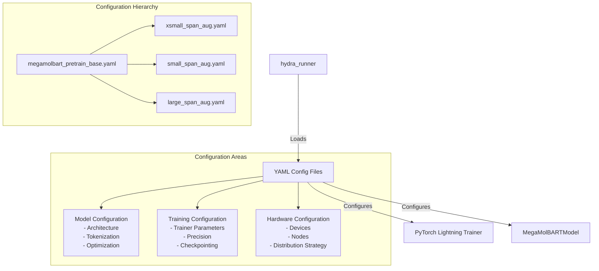
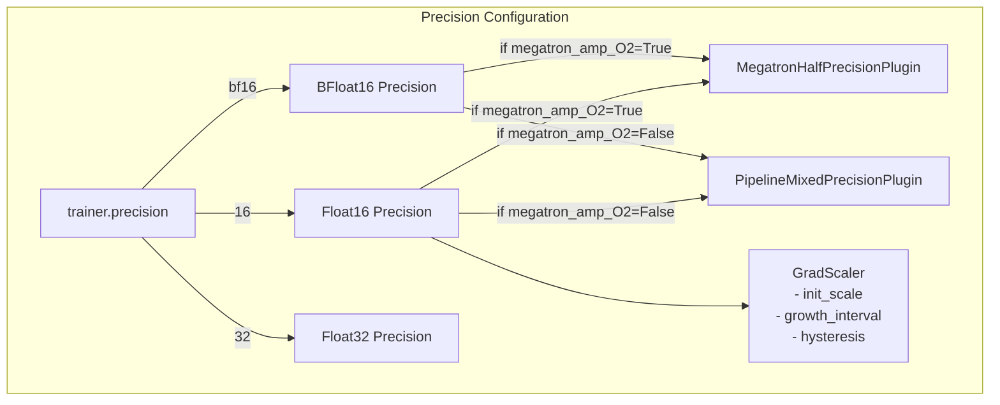
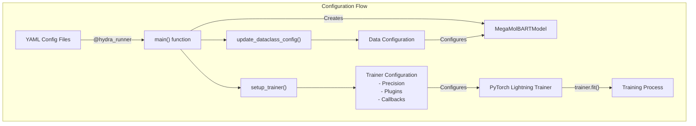

<!-- source: DeepWiki mcp.deepwiki.com · repo NVIDIA/MegaMolBART · page 3.2 Training Configuration · fetched 2026-10-26 -->

# Training Configuration

<details>
<summary>Relevant source files</summary>

The following files were used as context for generating this wiki page:

- [examples/chem/conf/megamolbart_pretrain_large_span_aug.yaml](examples/chem/conf/megamolbart_pretrain_large_span_aug.yaml)
- [examples/chem/conf/megamolbart_pretrain_small_span_aug.yaml](examples/chem/conf/megamolbart_pretrain_small_span_aug.yaml)
- [examples/chem/conf/megamolbart_pretrain_xsmall_span_aug.yaml](examples/chem/conf/megamolbart_pretrain_xsmall_span_aug.yaml)
- [examples/chem/megamolbart_pretrain.py](examples/chem/megamolbart_pretrain.py)

</details>


This page details how to configure the training of MegaMolBART models through YAML configuration files and explains the key hyperparameters and options available. For information about data processing configuration, see [Data Processing Pipeline](#3.1), and for distributed training setup, see [Distributed Training](#3.3).

## Configuration System Overview

MegaMolBART uses a hierarchical configuration system based on Hydra to manage training parameters. The configuration files define model architecture, training hyperparameters, data processing options, and hardware allocation.



Sources: [examples/chem/megamolbart_pretrain.py:92-93](), [examples/chem/conf/megamolbart_pretrain_small_span_aug.yaml:1-2](), [examples/chem/conf/megamolbart_pretrain_xsmall_span_aug.yaml:1-2](), [examples/chem/conf/megamolbart_pretrain_large_span_aug.yaml:1-2]()

## Base Configuration and Inheritance

MegaMolBART uses a base configuration file with model-specific YAML files that inherit from it. This approach allows for consistent defaults while enabling customization for different model sizes and training scenarios.

All model-specific configuration files start with:

```yaml
defaults:
  - megamolbart_pretrain_base
```

Sources: [examples/chem/conf/megamolbart_pretrain_small_span_aug.yaml:1-2](), [examples/chem/conf/megamolbart_pretrain_xsmall_span_aug.yaml:1-2](), [examples/chem/conf/megamolbart_pretrain_large_span_aug.yaml:1-2]()

## Model Size Configurations

MegaMolBART provides predefined configurations for different model sizes, each with appropriate hardware requirements:

| Model Size | Layers | Hidden Size | Attention Heads | Devices | Nodes | Total GPUs |
|------------|--------|-------------|-----------------|---------|-------|------------|
| XSmall     | 2      | 256         | 4               | 1       | 1     | 1          |
| Small      | 6      | 512         | 8               | 8       | 8     | 64         |
| Large      | 8      | 1024        | 16              | 8       | 8     | 64         |

Sources: [examples/chem/conf/megamolbart_pretrain_xsmall_span_aug.yaml:4-13](), [examples/chem/conf/megamolbart_pretrain_small_span_aug.yaml:4-13](), [examples/chem/conf/megamolbart_pretrain_large_span_aug.yaml:4-13]()

## Training Configuration Parameters

The training configuration is handled through the `trainer` section of the YAML files and processed by the `setup_trainer` function in the training script.

### Hardware Configuration

```yaml
trainer:
  devices: 8          # Number of GPUs per node
  num_nodes: 8        # Number of nodes
  precision: 16       # Training precision (16, 32, or 'bf16')
```

Sources: [examples/chem/conf/megamolbart_pretrain_small_span_aug.yaml:4-6](), [examples/chem/megamolbart_pretrain.py:51-62]()

### Precision and Mixed Precision

The training script supports different precision modes through PyTorch Lightning plugins:



Sources: [examples/chem/megamolbart_pretrain.py:51-62]()

### Training Process Configuration

The training script configures the following components:

1. **Trainer Plugins**:
   - `NLPDDPPlugin`: For distributed data parallel training
   - Precision plugins based on configuration

2. **Experiment Manager**:
   - Handles logging
   - Checkpoint management 
   - Resume training capabilities

3. **Timer Callback**:
   - Controls maximum training time
   - Uses a stateless implementation

Sources: [examples/chem/megamolbart_pretrain.py:41-89]()

## Configuration Flow From YAML to Model



Sources: [examples/chem/megamolbart_pretrain.py:92-111]()

## Running Training with Different Configurations

To start a training run with a specific configuration:

1. The default configuration is specified in the `@hydra_runner` decorator in the training script
2. To use a different configuration, provide it as a command-line argument

For example, to train using the small model configuration:

```bash
python megamolbart_pretrain.py --config-name=megamolbart_pretrain_small_span_aug
```

To override specific parameters:

```bash
python megamolbart_pretrain.py --config-name=megamolbart_pretrain_small_span_aug trainer.max_epochs=10 model.learning_rate=1e-4
```

Sources: [examples/chem/megamolbart_pretrain.py:92-93]()

## Training Control Flags

The main training script checks for the following control flags in the configuration:

```yaml
# Control flags (assumed values in base config)
do_training: true     # Whether to perform model training
do_testing: false     # Whether to run evaluation after training
```

These flags control which operations are performed when the script is run:

- `do_training=true`: Execute the training process with `trainer.fit(model)`
- `do_testing=true`: Run evaluation after training with `trainer.test(model)`

Sources: [examples/chem/megamolbart_pretrain.py:108-131]()

## Checkpointing and Resume Training

The training script handles checkpoint management through PyTorch Lightning's checkpoint connector:

1. If `model.resume_from_checkpoint` is specified, it is used for resuming training
2. Otherwise, training resumes from checkpoints found by the experiment manager
3. The checkpoint connector is configured with the resume path

This allows for seamless resumption of training from previous checkpoints.

Sources: [examples/chem/megamolbart_pretrain.py:72-79]()

## Logging and Monitoring

The experiment manager, configured through the `exp_manager` function, handles:

1. TensorBoard logging
2. Checkpoint saving
3. Output directories for logs and model artifacts

Training progress can be monitored through TensorBoard logs generated during training.

Sources: [examples/chem/megamolbart_pretrain.py:67-68]()

## Integration with Data Processing

The training script can also handle data preprocessing if needed:

1. If `do_training=false`, it can trigger data processing
2. First, processes data into CSV files using `Preprocess`
3. Then optionally converts CSV data to binary format using `CsvToBinary` if `dataset_format="bin"`

For more details on data processing, see [Data Processing Pipeline](#3.1).

Sources: [examples/chem/megamolbart_pretrain.py:112-126]()

---

