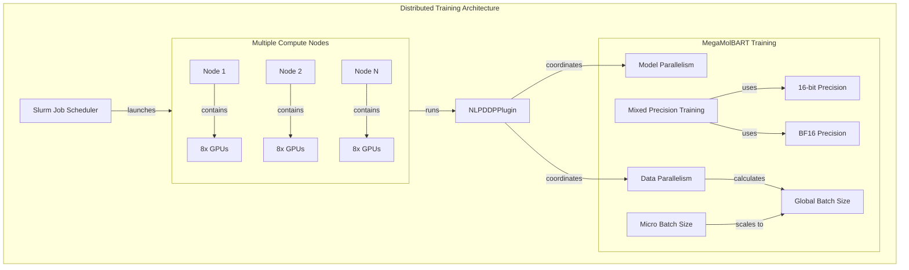
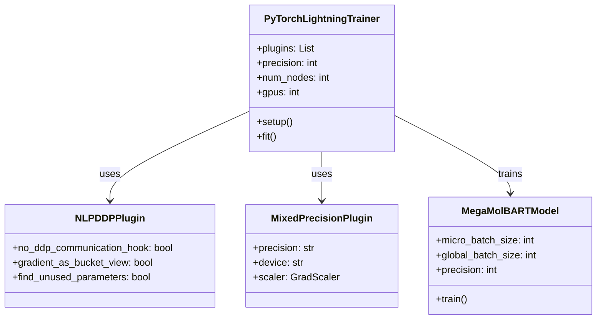
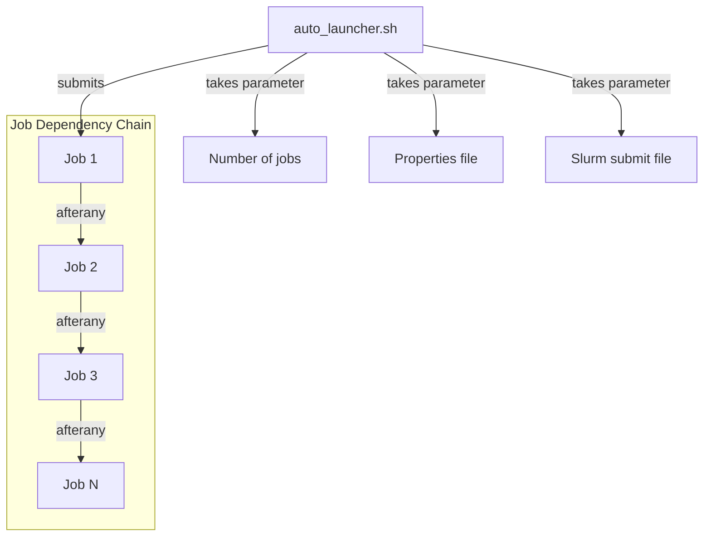

<!-- source: DeepWiki mcp.deepwiki.com · repo NVIDIA/MegaMolBART · page 3.3 Distributed Training · fetched 2026-10-26 -->

# Distributed Training

<details>
<summary>Relevant source files</summary>

The following files were used as context for generating this wiki page:

- [examples/chem/megamolbart_pretrain.py](examples/chem/megamolbart_pretrain.py)
- [examples/chem/slurm/auto_launcher.sh](examples/chem/slurm/auto_launcher.sh)
- [examples/chem/slurm/megamolbart_pretrain_slurm.sh](examples/chem/slurm/megamolbart_pretrain_slurm.sh)

</details>


This document explains how to perform distributed training with MegaMolBART across multiple GPUs and nodes using PyTorch Lightning and Slurm. MegaMolBART supports efficient scaling from single-GPU training to massive parallel training on 64+ GPUs, enabling the training of larger model variants.

For information about training configuration parameters, see [Training Configuration](#3.2).

## Overview of Distributed Training Architecture

MegaMolBART implements distributed training through PyTorch Lightning using NVIDIA's NLPDDPPlugin and other distributed training extensions. The system supports both data parallelism and mixed precision training to maximize GPU utilization and training speed.



Sources: [examples/chem/megamolbart_pretrain.py:41-89](), [examples/chem/slurm/megamolbart_pretrain_slurm.sh:80-82]()

## Distributed Training Components

MegaMolBART's distributed training system consists of several key components:

1. **NLPDDPPlugin**: A PyTorch Lightning plugin that extends DistributedDataParallel with optimizations for NLP workloads
2. **Mixed Precision Training**: Support for 16-bit and bfloat16 precision to improve training efficiency
3. **Batch Size Scaling**: Automatic scaling of micro-batch sizes to global batch sizes based on the distributed configuration
4. **Slurm Integration**: Scripts for launching and managing distributed training jobs on Slurm clusters



Sources: [examples/chem/megamolbart_pretrain.py:25-30](), [examples/chem/megamolbart_pretrain.py:44-62]()

## Setting Up Distributed Training with PyTorch Lightning

MegaMolBART uses the `setup_trainer` function to configure the PyTorch Lightning trainer with the appropriate distributed training plugins:

1. **NLPDDPPlugin**: Configured with optimized settings for transformer-based models
2. **Precision Plugins**: Either `MegatronHalfPrecisionPlugin` or `PipelineMixedPrecisionPlugin` depending on configuration
3. **Elastic Environment**: Optional TorchElasticEnvironment plugin for BCP clusters

The `setup_trainer` function sets up all the necessary components for distributed training:

```
NLPDDPPlugin(
    no_ddp_communication_hook=True,
    gradient_as_bucket_view=cfg.model.gradient_as_bucket_view,
    find_unused_parameters=False,
)
```

Mixed precision training is configured based on the precision setting in the configuration:

```
if cfg.trainer.precision in [16, 'bf16']:
    scaler = None
    if cfg.trainer.precision == 16:
        scaler = GradScaler(
            init_scale=cfg.model.get('native_amp_init_scale', 2 ** 32),
            growth_interval=cfg.model.get('native_amp_growth_interval', 1000),
            hysteresis=cfg.model.get('hysteresis', 2),
        )
```

Sources: [examples/chem/megamolbart_pretrain.py:41-89]()

## Running Distributed Training with Slurm

MegaMolBART includes scripts for running distributed training on Slurm-based clusters. The `megamolbart_pretrain_slurm.sh` script provides a template for launching distributed training jobs.

### Slurm Configuration

The script includes Slurm resource allocation directives:

```
#SBATCH --nodes=8
#SBATCH --ntasks-per-node=8
#SBATCH --gpus-per-node=8
```

This configures a job to use 8 nodes with 8 GPUs per node, for a total of 64 GPUs.

### Batch Size Calculation

The script automatically calculates the global batch size based on:
- Micro batch size (per GPU)
- Number of nodes
- Number of tasks per node

```
GLOBAL_BATCH_SIZE=$(expr ${MICRO_BATCH_SIZE} \* ${SLURM_JOB_NUM_NODES} \* ${SLURM_NTASKS_PER_NODE})
```

Sources: [examples/chem/slurm/megamolbart_pretrain_slurm.sh:1-13](), [examples/chem/slurm/megamolbart_pretrain_slurm.sh:80-82]()

## Launching Distributed Training Jobs

Distributed training jobs can be launched using the `srun` command, which distributes the training across all allocated nodes and GPUs:

```
srun \
    --output slurm-%j-%n.out \
    --error error-%j-%n.out \
    --container-image ${MEGAMOLBART_CONT} \
    --container-mounts ${MOUNTS} \
    --container-workdir /opt/nvidia/nemo_chem/examples/chem/ \
    --export WANDB_API_KEY="${WANDB_API_KEY}" \
    python megamolbart_pretrain.py \
        --config-path=conf \
        --config-name=megamolbart_pretrain_small_span_aug \
        ++trainer.num_nodes=${SLURM_JOB_NUM_NODES} \
        ++trainer.gpus=${SLURM_NTASKS_PER_NODE} \
        ...
```

The script:
1. Uses a container for consistent environment
2. Mounts necessary data and result directories
3. Passes Slurm environment variables to the Python script
4. Overrides configuration parameters with values appropriate for the distributed setup

Sources: [examples/chem/slurm/megamolbart_pretrain_slurm.sh:97-118]()

### Customizing Distributed Training Jobs

The Slurm script supports configuration through properties files, allowing customization of:
- Container image
- Storage paths
- Batch sizes
- Validation check intervals
- Experiment names

These properties can be passed to the script using the `-p` flag:

```bash
sbatch megamolbart_pretrain_slurm.sh -p your_properties_file.properties
```

Sources: [examples/chem/slurm/megamolbart_pretrain_slurm.sh:30-46](), [examples/chem/slurm/megamolbart_pretrain_slurm.sh:60-66]()

## Automating Job Submission

For extended training runs, the `auto_launcher.sh` script can be used to chain multiple Slurm jobs together:



The auto launcher script:
1. Submits the first job normally
2. Submits subsequent jobs with a dependency on the previous job
3. Allows customization through properties files

Usage example:
```bash
./auto_launcher.sh -n 5 -p properties.txt megamolbart_pretrain_slurm.sh
```

This would submit the training job 5 times in sequence, with each job starting when the previous one completes.

Sources: [examples/chem/slurm/auto_launcher.sh:1-67]()

## Distributed Training Best Practices

When running distributed training with MegaMolBART, consider the following best practices:

| Consideration | Recommendation |
|---------------|----------------|
| Micro Batch Size | 256 is recommended for A100 GPUs with 80GB memory |
| Number of Nodes | 8 nodes with 8 GPUs each (64 total) for large models |
| Precision | Use mixed precision (16-bit) for faster training |
| Validation Interval | Set `val_check_interval` to 200 for efficient validation |
| Model Size | Match model size to available GPUs (XSmall for 1 GPU, Small/Large for 64 GPUs) |
| Container Image | Use the provided NVIDIA container for consistent environment |

Sources: [examples/chem/slurm/megamolbart_pretrain_slurm.sh:48-56]()

## Summary

MegaMolBART's distributed training system provides a flexible and efficient way to train large molecular transformer models across multiple GPUs and nodes. By leveraging PyTorch Lightning's distributed training plugins and Slurm for job management, the system enables scaling from single-GPU training to massive distributed training on 64+ GPUs.

The combination of data parallelism, mixed precision training, and container-based execution ensures consistent and efficient training across different computing environments, from workstations to large HPC clusters.

---

