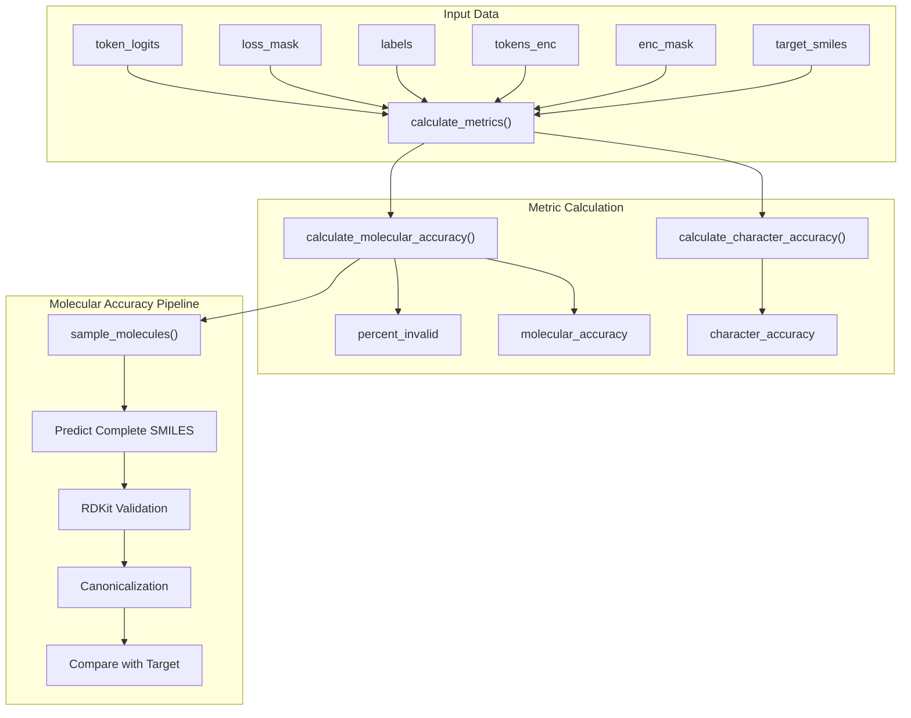
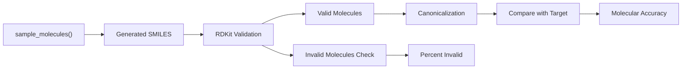
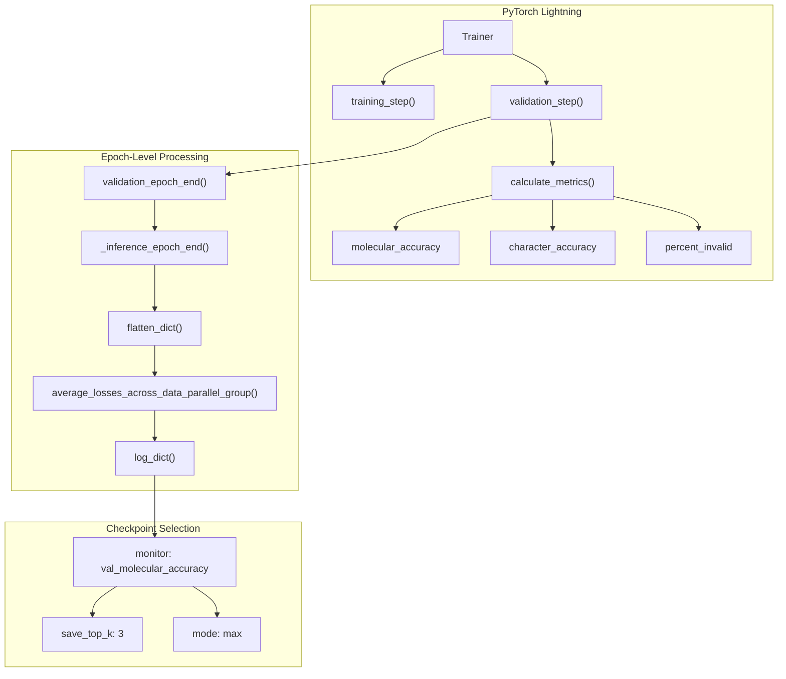
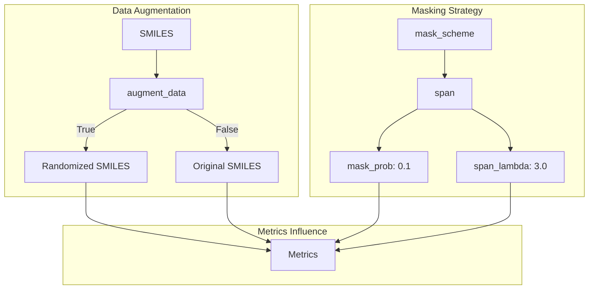

<!-- source: DeepWiki mcp.deepwiki.com · repo NVIDIA/MegaMolBART · page 3.4 Metrics and Evaluation · fetched 2026-10-26 -->

# Metrics and Evaluation

<details>
<summary>Relevant source files</summary>

The following files were used as context for generating this wiki page:

- [examples/chem/conf/megamolbart_pretrain_base.yaml](examples/chem/conf/megamolbart_pretrain_base.yaml)
- [examples/chem/megamolbart_pretrain.py](examples/chem/megamolbart_pretrain.py)
- [examples/chem/shell/megamolbart_pretrain_quick.sh](examples/chem/shell/megamolbart_pretrain_quick.sh)
- [nemo_chem/data/augment.py](nemo_chem/data/augment.py)
- [nemo_chem/data/csv_dataset.py](nemo_chem/data/csv_dataset.py)
- [nemo_chem/data/preprocess/preprocess.py](nemo_chem/data/preprocess/preprocess.py)
- [nemo_chem/data/utils.py](nemo_chem/data/utils.py)
- [nemo_chem/models/megamolbart/megamolbart_model.py](nemo_chem/models/megamolbart/megamolbart_model.py)
- [nemo_chem/utils/__init__.py](nemo_chem/utils/__init__.py)

</details>


This page describes the metrics and evaluation methodologies used in the MegaMolBART system. It covers how model performance is measured during training, validation, and testing phases, as well as how these metrics are used for model selection and optimization. For information about the training configuration process, see [Training Configuration](#3.2).

## 1. Core Evaluation Metrics

MegaMolBART employs three primary metrics to evaluate model performance:

1. **Character Accuracy**: Token-level accuracy that measures how well the model predicts individual tokens in SMILES strings
2. **Molecular Accuracy**: Molecule-level accuracy that evaluates whether the complete predicted SMILES string represents the same molecule as the target
3. **Percent Invalid**: Fraction of generated SMILES strings that don't correspond to valid chemical structures

These metrics provide a comprehensive evaluation of the model's ability to learn molecular representations at different granularities.

### Metrics Calculation Flow



Sources: [nemo_chem/models/megamolbart/megamolbart_model.py:307-326](), [nemo_chem/models/megamolbart/megamolbart_model.py:270-306](), [nemo_chem/models/megamolbart/megamolbart_model.py:240-268]()

## 2. Character Accuracy

Character accuracy provides a token-level evaluation of the model's predictions. It measures how accurately the model can predict each token in the SMILES string representation of molecules.

### Calculation Method

The character accuracy calculation is implemented in the `calculate_character_accuracy` method:

```python
def calculate_character_accuracy(self, token_logits, loss_mask, labels, batch_idx=None, log=False):
    # Get most probable token
    _, predicted_tokens = torch.max(token_logits, dim=2)
    correct_tokens = torch.eq(labels, predicted_tokens) * loss_mask
    
    # Calculate percent of correct tokens
    num_correct = correct_tokens.detach().sum()
    total = loss_mask.detach().sum()
    character_accuracy = num_correct / total
    
    return character_accuracy
```

This metric:
1. Takes the argmax of token logits to find predicted tokens
2. Compares predictions to ground truth labels
3. Applies a loss mask to only consider non-masked tokens
4. Calculates the percentage of correctly predicted tokens

Sources: [nemo_chem/models/megamolbart/megamolbart_model.py:240-268]()

## 3. Molecular Accuracy and Percent Invalid

Molecular accuracy evaluates whether the model can correctly generate the entire molecule, rather than just individual tokens. It provides a more holistic measure of model performance for molecular generation tasks.

### Calculation Method

Molecular accuracy is calculated in the `calculate_molecular_accuracy` method:



The process involves:
1. Using `sample_molecules()` to generate complete SMILES strings
2. Converting each SMILES to an RDKit molecule object
3. Identifying invalid molecules (those that RDKit cannot parse)
4. Canonicalizing valid molecules
5. Comparing with the canonical target SMILES
6. Computing both accuracy (percentage of correct molecules) and invalid rate

Sources: [nemo_chem/models/megamolbart/megamolbart_model.py:270-306](), [nemo_chem/models/megamolbart/megamolbart_model.py:205-238]()

## 4. Evaluation Process

MegaMolBART's evaluation is integrated into the PyTorch Lightning training framework, with evaluations occurring during training (validation steps) and after training (testing).

### Validation During Training



The validation process:
1. Occurs at intervals defined by `val_check_interval` (default: every 10,000 steps)
2. Calculates metrics for each batch in the validation set
3. Aggregates metrics across all batches at the end of validation
4. Logs results to the console and logging platforms (TensorBoard/WandB)
5. Determines if the current model should be saved as a checkpoint

Sources: [nemo_chem/models/megamolbart/megamolbart_model.py:160-186](), [nemo_chem/models/megamolbart/megamolbart_model.py:188-198](), [nemo_chem/models/megamolbart/megamolbart_model.py:134-158]()

### Testing Process

Testing follows a similar flow to validation but occurs after training is complete:

1. The `test_epoch_end` method calls `_inference_epoch_end` with mode='test'
2. Metrics are calculated across all test batches
3. Results are averaged and reported
4. No checkpoints are saved during testing

Sources: [nemo_chem/models/megamolbart/megamolbart_model.py:200-203]()

## 5. Metric Usage

### Model Selection and Checkpointing

The MegaMolBART system uses molecular accuracy as the primary metric for model selection:

```yaml
checkpoint_callback_params:
  save_top_k: 3                    # number of checkpoints to save
  monitor: val_molecular_accuracy  # use molecular accuracy for selection
  mode: max                        # higher is better
  save_last: True                  # always save last checkpoint
```

This configuration means:
1. The system will keep the 3 checkpoints with the highest molecular accuracy
2. The last checkpoint is always preserved regardless of performance
3. These checkpoints can be used for model selection and deployment

Sources: [examples/chem/conf/megamolbart_pretrain_base.yaml:119-126]()

### Logging and Visualization

Metrics are logged in multiple formats:

1. **Console Logs**: Key metrics are printed to the console during training
2. **TensorBoard**: Metrics are logged to TensorBoard for visualization
3. **Weights & Biases**: For more advanced experiment tracking and visualization

The logged metrics include:
- Character accuracy
- Molecular accuracy
- Percent invalid molecules
- Loss values

```python
# Prepend val/test tag to metric for Tensorboard / WandB
logged_results = {}
for metric_name, metric_val in averaged_results.items():
    logged_results[f'{mode}_{metric_name}'] = metric_val

self.log_dict(logged_results, prog_bar=True)
```

Sources: [nemo_chem/models/megamolbart/megamolbart_model.py:134-158](), [examples/chem/conf/megamolbart_pretrain_base.yaml:130-143]()

## 6. Data Augmentation and Masking Impact on Metrics

The evaluation metrics are influenced by data processing techniques like augmentation and masking:



Key factors:
1. **SMILES Augmentation**: When enabled, affects how molecules are represented during training and evaluation
2. **Masking Scheme**: The span masking approach with configurable mask probability and span length
3. **Canonicalization**: Whether input SMILES are canonicalized affects the reference for evaluation

Sources: [nemo_chem/data/augment.py:1-277](), [examples/chem/conf/megamolbart_pretrain_base.yaml:82-94]()

## 7. Configuration and Customization

Metrics and evaluation can be customized through the configuration file:

| Parameter | Description | Default |
|-----------|-------------|---------|
| `val_check_interval` | How often to perform validation | 10,000 steps |
| `limit_val_batches` | Number of batches in validation | 200 |
| `limit_test_batches` | Number of batches in testing | 0 |
| `checkpoint_callback_params.monitor` | Metric for checkpoint selection | `val_molecular_accuracy` |
| `checkpoint_callback_params.mode` | Whether to maximize or minimize | `max` |
| `checkpoint_callback_params.save_top_k` | Number of best checkpoints to keep | 3 |

Additional customization options:
- Logging frequency with `log_every_n_steps`
- Detailed evaluation with `num_sanity_val_steps`
- Logging platforms through `exp_manager` settings

Sources: [examples/chem/conf/megamolbart_pretrain_base.yaml:7-24](), [examples/chem/conf/megamolbart_pretrain_base.yaml:112-143]()

## 8. Interpreting Results

When interpreting MegaMolBART metrics, consider:

1. **Character Accuracy**: 
   - Higher values indicate better token-level prediction
   - Should increase steadily during training
   - Limited as a metric since small token errors can lead to invalid molecules

2. **Molecular Accuracy**:
   - Most important metric for overall model performance
   - Measures the ability to generate exactly the target molecule
   - Accounts for chemical equivalence through canonicalization

3. **Percent Invalid**:
   - Should decrease during training
   - High values indicate the model struggles to learn molecular grammar rules
   - Values below 10% typically indicate good model understanding of SMILES syntax

Typically, a successful model will show decreasing invalid percentages, increasing character accuracy, and gradually improving molecular accuracy, with the latter being the most significant indicator of model quality.

Sources: [nemo_chem/models/megamolbart/megamolbart_model.py:307-326]()

---

