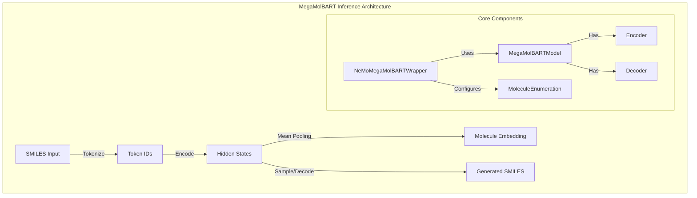
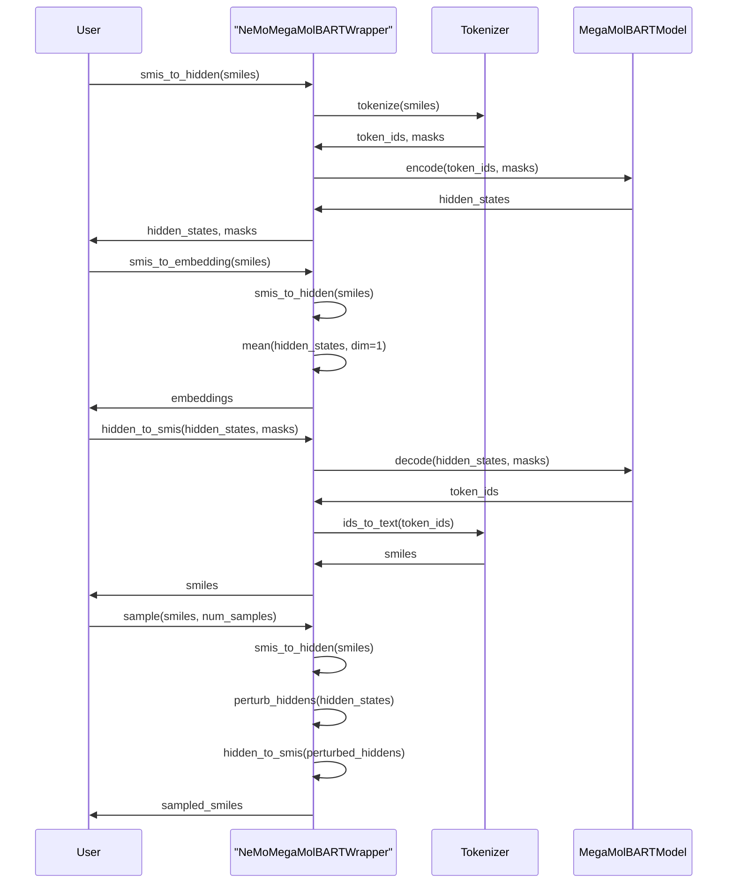
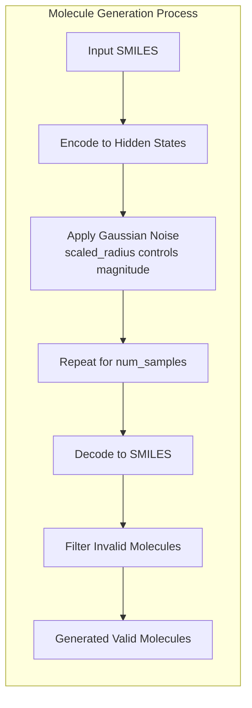
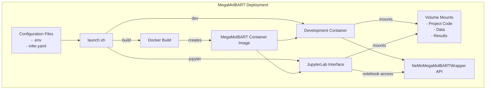

<!-- source: DeepWiki mcp.deepwiki.com · repo NVIDIA/MegaMolBART · page 4 Inference System · fetched 2026-10-26 -->

# Inference System

<details>
<summary>Relevant source files</summary>

The following files were used as context for generating this wiki page:

- [.dockerignore](.dockerignore)
- [examples/chem/conf/infer.yaml](examples/chem/conf/infer.yaml)
- [examples/chem/conf/megamolbart_pretrain_base.yaml](examples/chem/conf/megamolbart_pretrain_base.yaml)
- [examples/chem/megamolbart_eval.py](examples/chem/megamolbart_eval.py)
- [examples/chem/shell/megamolbart_pretrain_quick.sh](examples/chem/shell/megamolbart_pretrain_quick.sh)
- [launch.sh](launch.sh)
- [nemo_chem/data/augment.py](nemo_chem/data/augment.py)
- [nemo_chem/data/csv_dataset.py](nemo_chem/data/csv_dataset.py)
- [nemo_chem/data/preprocess/preprocess.py](nemo_chem/data/preprocess/preprocess.py)
- [nemo_chem/data/utils.py](nemo_chem/data/utils.py)
- [nemo_chem/models/megamolbart/__init__.py](nemo_chem/models/megamolbart/__init__.py)
- [nemo_chem/models/megamolbart/infer.py](nemo_chem/models/megamolbart/infer.py)
- [nemo_chem/models/megamolbart/megamolbart_model.py](nemo_chem/models/megamolbart/megamolbart_model.py)
- [nemo_chem/utils/__init__.py](nemo_chem/utils/__init__.py)
- [setup/Dockerfile](setup/Dockerfile)
- [setup/conda/env.yml](setup/conda/env.yml)
- [setup/config_model.sh](setup/config_model.sh)
- [setup/entrypoint.sh](setup/entrypoint.sh)
- [tests/pre_train_model_test.py](tests/pre_train_model_test.py)
- [tests/test_inference.py](tests/test_inference.py)

</details>


The MegaMolBART Inference System provides functionality for using trained MegaMolBART models to process molecular data and generate new molecules. This page describes the architecture, components, and usage of the inference system, focusing on the API, molecule generation capabilities, and deployment options.

For information about training MegaMolBART models, see [Training System](#3).

## Overview of the Inference System

The MegaMolBART inference system allows users to:

1. Convert SMILES strings to hidden state representations
2. Transform hidden states back to SMILES strings
3. Generate molecular embeddings for downstream tasks
4. Sample new molecules similar to input molecules

The core of the inference system is the `NeMoMegaMolBARTWrapper` class, which provides a high-level API for all inference operations, utilizing the underlying MegaMolBART encoder-decoder architecture.



Sources: [nemo_chem/models/megamolbart/infer.py:16-162](). [nemo_chem/models/megamolbart/megamolbart_model.py:30-36]()

## Inference API

The primary interface for inference is the `NeMoMegaMolBARTWrapper` class, which simplifies working with the MegaMolBART model by providing high-level methods for common inference tasks.

### Initialization

To use the inference API, you first need to initialize the wrapper with a model configuration:

```python
from nemo_chem.models.megamolbart import NeMoMegaMolBARTWrapper

# Using default configuration
inference_wrapper = NeMoMegaMolBARTWrapper()

# Using custom configuration
from hydra import compose, initialize
with initialize(config_path="path/to/config"):
    cfg = compose(config_name="infer")
    inference_wrapper = NeMoMegaMolBARTWrapper(model_cfg=cfg)
```

The default configuration loads from `/workspace/nemo_chem/examples/chem/conf/infer.yaml`, which specifies the model path, tokenizer configuration, and data processing settings.

Sources: [nemo_chem/models/megamolbart/infer.py:20-55](). [examples/chem/conf/infer.yaml:1-34]()

### Core Methods

The wrapper provides four key methods for working with molecular representations:

#### 1. SMILES to Hidden States

Converts SMILES strings to their hidden state representation in the model's latent space:

```python
# Convert SMILES to hidden states
hidden_states, padding_masks = inference_wrapper.smis_to_hidden(['CC(=O)C', 'c1ccccc1'])
```

#### 2. SMILES to Embeddings

Creates fixed-size embedding vectors for molecules by averaging their hidden states:

```python
# Get molecule embeddings (useful for similarity, clustering, etc.)
embeddings = inference_wrapper.smis_to_embedding(['CC(=O)C', 'c1ccccc1'])
```

#### 3. Hidden States to SMILES

Transforms hidden state representations back to SMILES strings:

```python
# Convert hidden states back to SMILES
generated_smiles = inference_wrapper.hidden_to_smis(hidden_states, padding_masks)
```

#### 4. Molecule Sampling

Generates new molecules similar to the input by perturbing the hidden states:

```python
# Sample multiple new molecules similar to inputs
samples = inference_wrapper.sample(
    smiles, 
    num_samples=10, 
    sampling_method='greedy-perturbate',
    sampling_kwarg={'scaled_radius': 1.0}
)
```

Sources: [nemo_chem/models/megamolbart/infer.py:135-212](). [tests/test_inference.py:22-106]()

### Inference Pipeline Workflow

The diagram below illustrates the entire inference pipeline from input SMILES to various outputs:



Sources: [nemo_chem/models/megamolbart/infer.py:135-212](). [tests/test_inference.py:22-106]()

## Molecule Generation

The MegaMolBART model enables different approaches for molecule generation through its inference API.

### Molecule Sampling Method

The current implementation supports the `greedy-perturbate` sampling method:

1. Encode input SMILES to hidden states
2. Apply random perturbations to the hidden states using Gaussian noise
3. Decode the perturbed hidden states back to SMILES strings

This method creates variations of the input molecule that preserve many of its key features while exploring the chemical space around it.



Sources: [nemo_chem/models/megamolbart/infer.py:184-212](). [tests/test_inference.py:80-106]()

The key parameters that control generation are:

| Parameter | Description | Default Value |
|-----------|-------------|---------------|
| `num_samples` | Number of molecules to generate per input | 10 |
| `sampling_method` | Method used for sampling | 'greedy-perturbate' |
| `scaled_radius` | Controls perturbation magnitude (higher = more diverse but less valid) | 1.0 |
| `return_embedding` | Whether to return embeddings alongside samples | False |

### Autoregressive Sampling

Under the hood, the `hidden_to_smis` method uses autoregressive decoding to generate molecules token by token:

1. The model starts with the perturbed hidden states
2. It predicts the first token based on these hidden states
3. Each subsequent token is predicted based on all previously generated tokens
4. Generation stops when an EOS (End of Sequence) token is generated or max length is reached

This process is implemented in the `MegaMolBARTModel.sample_molecules` method.

Sources: [nemo_chem/models/megamolbart/megamolbart_model.py:204-238]()

## Using Pretrained Models

The inference system can use pretrained MegaMolBART models for molecule processing and generation.

### Loading Pretrained Models

The `NeMoMegaMolBARTWrapper` class handles loading pretrained models:

```python
# Load a model from a specific path
inference_wrapper = NeMoMegaMolBARTWrapper(
    model_cfg=OmegaConf.create({
        "model": {
            "model_path": "/path/to/my/model.nemo",
            "parallel_size": 1
        }
    })
)
```

The default configuration in `infer.yaml` looks for the model at `/models/MegaMolBART_0_2_0.nemo`.

Sources: [nemo_chem/models/megamolbart/infer.py:93-133](). [examples/chem/conf/infer.yaml:1-34]()

### Model Sizes and Configurations

MegaMolBART comes in different sizes (XSmall, Small, Large, XLarge), each with different parameter counts:

| Model Size | Hidden Size | Layers | Attention Heads | Parameters |
|------------|-------------|--------|----------------|------------|
| XSmall     | 256         | 2      | 4              | ~5M        |
| Small      | 512         | 6      | 8              | ~45M       |
| Large      | 1024        | 8      | 16             | ~350M      |
| XLarge     | 1536+       | 12+    | 24+            | ~700M+     |

Sources: [examples/chem/conf/megamolbart_pretrain_base.yaml:42-66]()

### Example Script

An evaluation script is provided for testing pretrained models:

```bash
python examples/chem/megamolbart_eval.py --model_file /path/to/model.nemo --prompt "CC(=O)C"
```

This script loads the model and tests its ability to reconstruct the input molecule.

Sources: [examples/chem/megamolbart_eval.py:1-131]()

## Deployment

The MegaMolBART repository provides tools for deploying the inference system using Docker containers.

### Docker Container Management

The `launch.sh` script provides commands for building, running, and interacting with the MegaMolBART container:

```bash
# Build the container
./launch.sh build

# Run in development mode
./launch.sh dev

# Start a JupyterLab environment
./launch.sh jupyter
```

Sources: [launch.sh:26-82](), [launch.sh:370-378]()

### Configuration Options

The inference environment can be configured through:

1. `.env` file for environment variables
2. `infer.yaml` for model and inference parameters
3. Command-line arguments to the `launch.sh` script

The key environment variables include:

| Variable | Description | Default |
|----------|-------------|---------|
| `MEGAMOLBART_CONT` | Container image for MegaMolBART | nvcr.io/nvidia/clara/megamolbart_v0.2:0.2.0 |
| `PROJECT_PATH` | Local path to code | Current directory |
| `DATA_PATH` | Path to data directory | /tmp |
| `RESULT_PATH` | Path for results | ~/results/nemo_experiments |
| `JUPYTER_PORT` | Port for JupyterLab | 8888 |

Sources: [launch.sh:83-125](), [setup/Dockerfile:1-76]()

### Deployment Architecture

The diagram below shows the architecture of the deployed inference system:



Sources: [launch.sh:179-232](), [launch.sh:307-350](), [launch.sh:369-378]()

## Testing and Validation

The MegaMolBART repository includes test scripts for validating the inference system behavior.

### Running Tests

The test suite includes tests for all inference methods:

```bash
# Run inside the container
cd /workspace/nemo_chem
python -m pytest tests/test_inference.py
```

These tests verify that:
- SMILES to hidden state conversion works correctly
- SMILES to embedding conversion produces valid embeddings
- Hidden state to SMILES conversion preserves molecular identity
- Molecule sampling produces valid outputs

Sources: [tests/test_inference.py:9-106]()

### Metrics for Inference Quality

When evaluating molecule generation quality, several metrics are important:

| Metric | Description | Target Range |
|--------|-------------|--------------|
| Validity | Percentage of generated SMILES that are valid molecules | >90% |
| Uniqueness | Percentage of unique molecules in the generated set | >80% |
| Novelty | Percentage of generated molecules not in the training set | Variable |

The test suite validates that at least 30% of generated molecules are valid, though production models typically achieve much higher validity rates.

Sources: [tests/test_inference.py:104-106]()

## Conclusion

The MegaMolBART Inference System provides a comprehensive toolkit for molecular representation learning and generation. Through the `NeMoMegaMolBARTWrapper` API, users can easily convert between SMILES strings and their latent representations, as well as generate novel molecules with properties similar to input compounds.

The system is designed for easy deployment using Docker containers, with flexible configuration options to adapt to different hardware environments and use cases.

---

