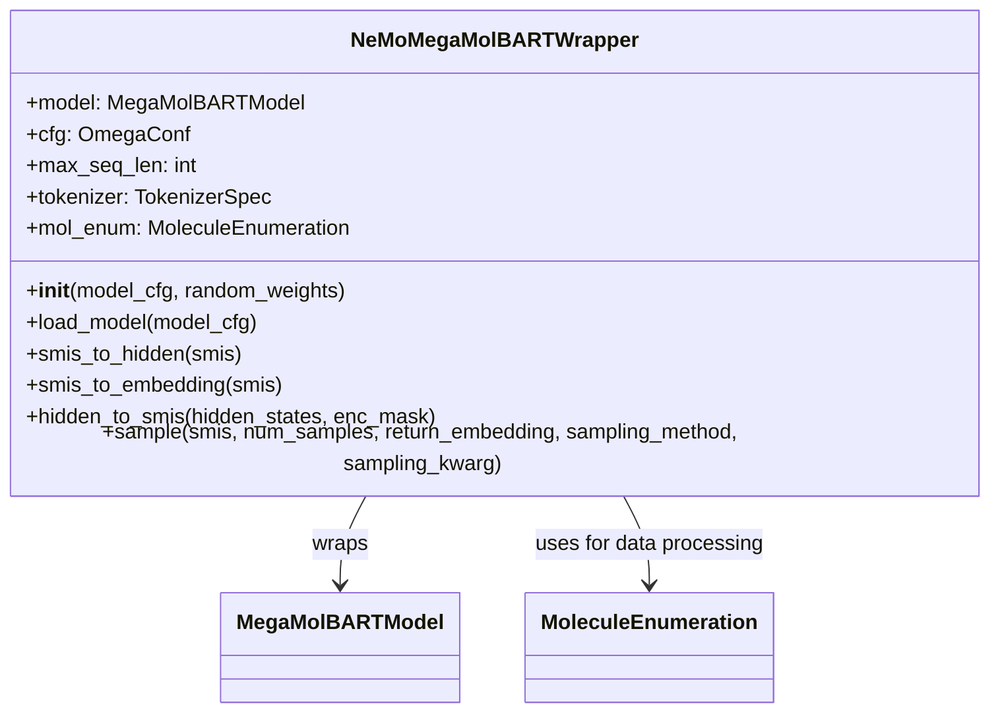
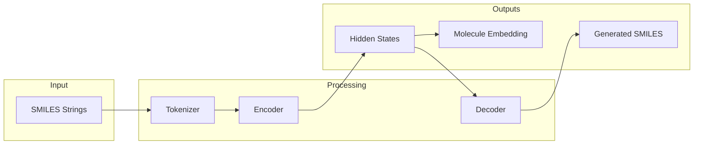
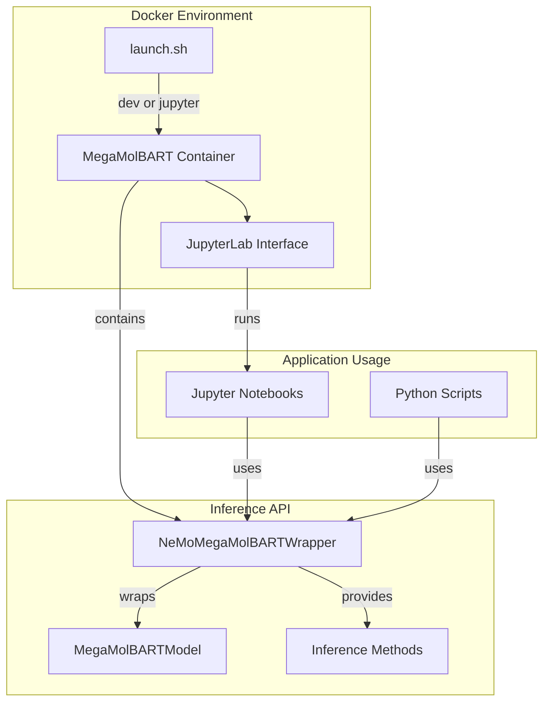
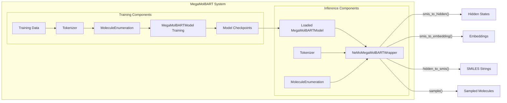

<!-- source: DeepWiki mcp.deepwiki.com · repo NVIDIA/MegaMolBART · page 4.1 Inference API · fetched 2026-10-26 -->

# Inference API

<details>
<summary>Relevant source files</summary>

The following files were used as context for generating this wiki page:

- [.dockerignore](.dockerignore)
- [examples/chem/conf/infer.yaml](examples/chem/conf/infer.yaml)
- [examples/chem/conf/megamolbart_pretrain_base.yaml](examples/chem/conf/megamolbart_pretrain_base.yaml)
- [examples/chem/megamolbart_eval.py](examples/chem/megamolbart_eval.py)
- [examples/chem/shell/megamolbart_pretrain_quick.sh](examples/chem/shell/megamolbart_pretrain_quick.sh)
- [launch.sh](launch.sh)
- [nemo_chem/data/augment.py](nemo_chem/data/augment.py)
- [nemo_chem/data/csv_dataset.py](nemo_chem/data/csv_dataset.py)
- [nemo_chem/data/preprocess/preprocess.py](nemo_chem/data/preprocess/preprocess.py)
- [nemo_chem/data/utils.py](nemo_chem/data/utils.py)
- [nemo_chem/models/megamolbart/__init__.py](nemo_chem/models/megamolbart/__init__.py)
- [nemo_chem/models/megamolbart/infer.py](nemo_chem/models/megamolbart/infer.py)
- [nemo_chem/models/megamolbart/megamolbart_model.py](nemo_chem/models/megamolbart/megamolbart_model.py)
- [nemo_chem/utils/__init__.py](nemo_chem/utils/__init__.py)
- [setup/Dockerfile](setup/Dockerfile)
- [setup/conda/env.yml](setup/conda/env.yml)
- [setup/config_model.sh](setup/config_model.sh)
- [setup/entrypoint.sh](setup/entrypoint.sh)
- [tests/pre_train_model_test.py](tests/pre_train_model_test.py)
- [tests/test_inference.py](tests/test_inference.py)

</details>


## Overview

The MegaMolBART Inference API provides a streamlined interface for performing inference operations with trained MegaMolBART models. This API enables users to leverage the power of MegaMolBART for molecular representation learning and generation without having to interact directly with the underlying model architecture. The primary use cases include converting SMILES strings to hidden vector representations, generating molecular embeddings, and sampling new molecules from latent space.

For information about training MegaMolBART models, see [Training System](#3), and for using pre-trained models, see [Using Pretrained Models](#4.3).

Sources: [nemo_chem/models/megamolbart/infer.py:1-213](), [tests/test_inference.py:1-107]()

## NeMoMegaMolBARTWrapper Class

The heart of the Inference API is the `NeMoMegaMolBARTWrapper` class, which encapsulates a trained MegaMolBART model and provides methods for inference operations.

### Class Architecture and Initialization



The wrapper is initialized with a model configuration, or it can use default configurations:

```python
def __init__(self, model_cfg=None, random_weights=False):
    # Load default config if none provided
    if model_cfg is None:
        model_cfg = OmegaConf.load('/workspace/nemo_chem/examples/chem/conf/infer.yaml')
    if random_weights:
        model_cfg['model']['model_path'] = None
        
    self.model = self.load_model(model_cfg)
    self.cfg = self.model._cfg
    self.max_seq_len = self.cfg.max_position_embeddings
    self.tokenizer = self.model.tokenizer
    # Configure molecule enumeration for processing
    self.mol_enum = MoleculeEnumeration(...)
```

Sources: [nemo_chem/models/megamolbart/infer.py:20-54](), [examples/chem/conf/infer.yaml:1-34]()

### Data Flow in Inference Operations



Sources: [nemo_chem/models/megamolbart/infer.py:135-212](), [tests/test_inference.py:22-106]()

## Core Inference Methods

The `NeMoMegaMolBARTWrapper` class provides four primary methods for inference operations:

| Method | Purpose | Input | Output |
|--------|---------|-------|--------|
| `smis_to_hidden` | Convert SMILES strings to hidden state representations | List of SMILES strings | Hidden states tensor, Padding mask tensor |
| `smis_to_embedding` | Generate molecular embeddings | List of SMILES strings | Embedding tensor |
| `hidden_to_smis` | Convert hidden states back to SMILES strings | Hidden states tensor, Padding mask tensor | List of SMILES strings |
| `sample` | Generate new molecules from existing ones | List of SMILES strings, sampling parameters | List of generated SMILES strings |

Sources: [nemo_chem/models/megamolbart/infer.py:135-212]()

### Converting SMILES to Hidden States

The `smis_to_hidden` method converts SMILES strings to their hidden state representations:

```python
def smis_to_hidden(self, smis: List[str]):
    """Compute hidden-state and padding mask for smiles.
    
    Params
        smi: string, input SMILES molecule
        
    Returns
        hidden-state array and boolean mask
    """
    if isinstance(smis, str):
        smis = [smis]
        
    hidden_states, enc_masks = self._transform(smis)
    return hidden_states, enc_masks
```

This method is the foundation for other operations as it creates the model's internal representation of molecules.

Sources: [nemo_chem/models/megamolbart/infer.py:135-148](), [tests/test_inference.py:22-36]()

### Generating Molecular Embeddings

The `smis_to_embedding` method creates fixed-length embedding vectors for molecules:

```python
def smis_to_embedding(self, smis: List[str]):
    """Computes embedding and padding mask for smiles.
    
    Params
        smi: string, input SMILES molecule
        
    Returns
        hidden-state array and boolean mask
    """
    if isinstance(smis, str):
        smis = [smis]
        
    hiddens, _ = self.smis_to_hidden(smis)
    return torch.mean(hiddens, dim=1)
```

This generates a single vector representation per molecule by averaging the hidden states, which is useful for tasks like similarity comparison or molecular property prediction.

Sources: [nemo_chem/models/megamolbart/infer.py:150-163](), [tests/test_inference.py:38-51]()

### Converting Hidden States to SMILES

The `hidden_to_smis` method decodes hidden states back to SMILES strings:

```python
def hidden_to_smis(self, hidden_states, enc_mask):
    predicted_tokens_ids, _ = self.model.decode(None,
                                              enc_mask,
                                              self.cfg.max_position_embeddings,
                                              enc_output=hidden_states)
    
    # Process token IDs to remove padding and EOS tokens
    predicted_tokens_ids = predicted_tokens_ids.cpu().detach().numpy().tolist()
    for i, predicted_token_id in enumerate(predicted_tokens_ids):
        if self.tokenizer.eos_id in predicted_token_id:
            idx = predicted_token_id.index(self.tokenizer.eos_id)
            predicted_tokens_ids[i] = predicted_token_id[:idx]
        else:
            predicted_tokens_ids[i] = [id for id in predicted_token_id if id != self.tokenizer.pad_id]
    
    smis = self.tokenizer.ids_to_text(predicted_tokens_ids)
    
    return smis
```

This method is important for reconstructing molecules from their latent representations.

Sources: [nemo_chem/models/megamolbart/infer.py:165-182](), [tests/test_inference.py:53-77]()

### Sampling Molecules

The `sample` method generates new molecules based on existing ones:

```python
def sample(self,
           smis,
           num_samples=10,
           return_embedding=False,
           sampling_method='greedy-perturbate',
           sampling_kwarg={'scaled_radius': 1, 'topk': 10}):
    """
    Sample from model given hidden states and mask
    """
    hidden_states, enc_masks = self.smis_to_hidden(smis)
    
    if sampling_method == 'greedy-perturbate':
        # 1.1 is experimentally derived. At this radius we get optimal
        # sampling KPIs values.
        scaled_radius = 1.1 * sampling_kwarg['scaled_radius']
        sample_masks = enc_masks.repeat_interleave(num_samples, 0)
        perturbed_hiddens = hidden_states.repeat_interleave(num_samples, 0)
        perturbed_hiddens = perturbed_hiddens + (scaled_radius * torch.randn(perturbed_hiddens.shape).to(perturbed_hiddens.device))
        
        samples = self.hidden_to_smis(perturbed_hiddens, sample_masks)
        if return_embedding:
            embs = torch.mean(perturbed_hiddens, dim=1)
    else:
        raise ValueError(f'Invalid samping method {sampling_method}')
    
    if return_embedding:
        return samples, embs
    else:
        return samples
```

This method enables molecular generation by perturbing the latent representation and decoding the perturbed states.

Sources: [nemo_chem/models/megamolbart/infer.py:184-212](), [tests/test_inference.py:80-106]()

## Model Loading and Configuration

### Loading a Model for Inference

The `load_model` method handles loading a saved MegaMolBART model for inference:

```python
def load_model(self, model_cfg):
    """Load saved model checkpoint
    
    Params:
        checkpoint_path: path to nemo checkpoint
        
    Returns:
        MegaMolBART trained model
    """
    torch.set_grad_enabled(False)
    
    # trainer required for restoring model parallel models
    trainer = Trainer(
        plugins=NLPDDPPlugin(),
        devices=1,
        accelerator='gpu',
        precision=32,
    )
    
    app_state = AppState()
    if model_cfg.model.model_path is not None:
        model = MegaMolBARTModel.restore_from(
            restore_path=model_cfg.model.model_path,
            trainer=trainer,
            save_restore_connector=NLPSaveRestoreConnector(),
        )
    else:
        # Initialize with random weights
        cfg = OmegaConf.load(
            '/workspace/nemo_chem/examples/chem/conf/megamolbart_pretrain_base.yaml')
        cfg.model.num_layers=6
        cfg.model.hidden_size=512
        cfg.model.num_attention_heads=8
        cfg.model.precision = cfg.trainer.precision
        
        model = MegaMolBARTModel(cfg.model, trainer)
    
    model.freeze()
    
    return model
```

This method supports loading a trained model from a checkpoint file or initializing a model with random weights for testing purposes.

Sources: [nemo_chem/models/megamolbart/infer.py:93-133]()

### Default Configuration

The default inference configuration is defined in `infer.yaml`:

```yaml
name: MegaMolBART_Inference
desc: Minimum configuration for initializing a MegaMolBART model.

model:
  model_path: /models/MegaMolBART_0_2_0.nemo
  parallel_size: 1

  tokenizer:
    vocab_path: /models/vocab/megamolbart.vocab
    model_path: /models/vocab/megamolbart.model

  data:
    encoder_augment: False
    encoder_mask: False
    decoder_augment: False
    decoder_mask: False
    mask_prob: 0
```

Sources: [examples/chem/conf/infer.yaml:1-34]()

## Integration with Docker Environment

The NeMoMegaMolBARTWrapper is designed to be used within the Docker environment provided by the MegaMolBART repository. The `launch.sh` script facilitates running inference inside the container:



To run inference inside the Docker container, you can use:

```bash
./launch.sh dev
# Inside container
python -c "from nemo_chem.models.megamolbart import NeMoMegaMolBARTWrapper; model = NeMoMegaMolBARTWrapper()"
```

Alternatively, you can use the Jupyter interface:

```bash
./launch.sh jupyter
# Access JupyterLab at http://localhost:8888
```

Sources: [launch.sh:26-407](), [setup/Dockerfile:1-76](), [setup/entrypoint.sh:1-12]()

## Example Usage

### Basic Inference with Pretrained Model

```python
from nemo_chem.models.megamolbart import NeMoMegaMolBARTWrapper

# Initialize the wrapper with default config
inferer = NeMoMegaMolBARTWrapper()

# Convert SMILES to hidden states
smiles = ['c1cc2ccccc2cc1', 'COc1cc2nc(N)c2cc1OC']
hidden_states, padding_masks = inferer.smis_to_hidden(smiles)

# Convert hidden states back to SMILES
reconstructed_smiles = inferer.hidden_to_smis(hidden_states, padding_masks)

# Generate embeddings for molecules
embeddings = inferer.smis_to_embedding(smiles)

# Sample new molecules based on input molecules
new_molecules = inferer.sample(smiles, num_samples=5, sampling_method='greedy-perturbate')
```

Sources: [tests/test_inference.py:22-106]()

### Custom Configuration

```python
from hydra import compose, initialize
from nemo_chem.models.megamolbart import NeMoMegaMolBARTWrapper

# Load custom configuration
with initialize(config_path="/path/to/configs"):
    cfg = compose(config_name="my_custom_config")

# Initialize with custom config
inferer = NeMoMegaMolBARTWrapper(model_cfg=cfg)

# Use the API as before
smiles = ['CCO', 'c1ccccc1']
embeddings = inferer.smis_to_embedding(smiles)
```

Sources: [tests/test_inference.py:23-25]()

## Integration with Model Processing Pipeline

The Inference API integrates with the broader MegaMolBART system architecture, particularly with the data processing components that handle SMILES string tokenization and augmentation.



The Inference API leverages the same tokenizer and molecular enumeration components used during training, ensuring consistency between the training and inference processes.

Sources: [nemo_chem/models/megamolbart/infer.py:20-54](), [nemo_chem/data/augment.py:31-277]()

## Testing the Inference API

The repository includes tests that demonstrate the functionality of the Inference API:

1. `test_smis_to_hiddens` - Tests conversion of SMILES strings to hidden states
2. `test_smis_to_embedding` - Tests generation of molecular embeddings
3. `test_hidden_to_smis` - Tests reconstruction of SMILES from hidden states
4. `test_sample` - Tests molecule sampling functionality

These tests provide additional examples of how to use the API and verify that it's working correctly.

Sources: [tests/test_inference.py:22-106]()

## Performance Considerations

When using the Inference API for large-scale molecule processing, consider the following:

1. **GPU Memory Usage**: The model requires significant GPU memory, especially for larger model sizes.
2. **Batch Processing**: Process molecules in batches to maximize throughput.
3. **Precision**: The default inference configuration uses 32-bit precision for maximum accuracy, but 16-bit precision can be used for faster inference if needed.
4. **Sampling Parameters**: When using the `sample` method, the `scaled_radius` parameter controls the diversity of generated molecules. Higher values lead to more diverse but potentially less valid molecules.

Sources: [nemo_chem/models/megamolbart/infer.py:184-212](), [tests/test_inference.py:80-106]()

## Summary

The MegaMolBART Inference API provides a powerful and user-friendly interface for working with trained MegaMolBART models. Key features include:

1. Converting SMILES strings to hidden state representations
2. Generating molecular embeddings for downstream tasks
3. Reconstructing SMILES strings from hidden states
4. Sampling new molecules from latent space

The API is designed to be used within the Docker environment provided by the MegaMolBART repository, making it easy to get started with molecular representation learning and generation.

Sources: [nemo_chem/models/megamolbart/infer.py:1-213]()

---

