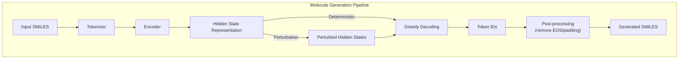
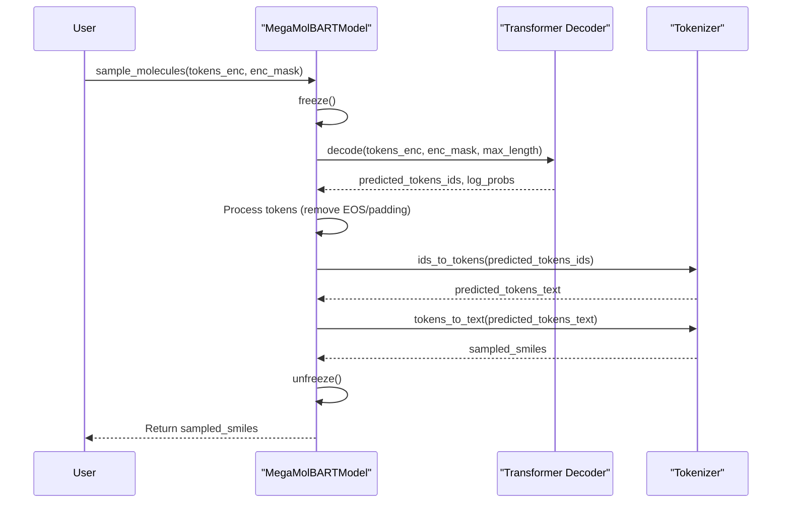
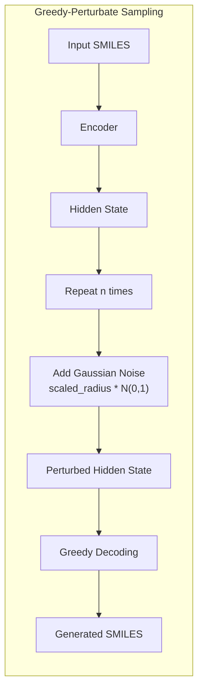
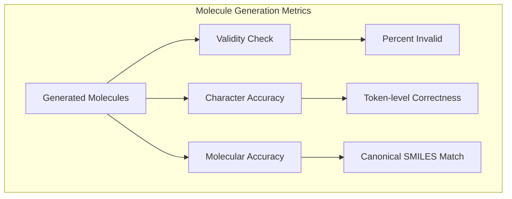

<!-- source: DeepWiki mcp.deepwiki.com · repo NVIDIA/MegaMolBART · page 4.2 Molecule Generation · fetched 2026-10-26 -->

# Molecule Generation

<details>
<summary>Relevant source files</summary>

The following files were used as context for generating this wiki page:

- [.dockerignore](.dockerignore)
- [examples/chem/conf/infer.yaml](examples/chem/conf/infer.yaml)
- [examples/chem/conf/megamolbart_pretrain_base.yaml](examples/chem/conf/megamolbart_pretrain_base.yaml)
- [examples/chem/megamolbart_eval.py](examples/chem/megamolbart_eval.py)
- [examples/chem/shell/megamolbart_pretrain_quick.sh](examples/chem/shell/megamolbart_pretrain_quick.sh)
- [launch.sh](launch.sh)
- [nemo_chem/data/augment.py](nemo_chem/data/augment.py)
- [nemo_chem/data/csv_dataset.py](nemo_chem/data/csv_dataset.py)
- [nemo_chem/data/preprocess/preprocess.py](nemo_chem/data/preprocess/preprocess.py)
- [nemo_chem/data/utils.py](nemo_chem/data/utils.py)
- [nemo_chem/models/megamolbart/__init__.py](nemo_chem/models/megamolbart/__init__.py)
- [nemo_chem/models/megamolbart/infer.py](nemo_chem/models/megamolbart/infer.py)
- [nemo_chem/models/megamolbart/megamolbart_model.py](nemo_chem/models/megamolbart/megamolbart_model.py)
- [nemo_chem/utils/__init__.py](nemo_chem/utils/__init__.py)
- [setup/Dockerfile](setup/Dockerfile)
- [setup/conda/env.yml](setup/conda/env.yml)
- [setup/config_model.sh](setup/config_model.sh)
- [setup/entrypoint.sh](setup/entrypoint.sh)
- [tests/pre_train_model_test.py](tests/pre_train_model_test.py)
- [tests/test_inference.py](tests/test_inference.py)

</details>


## Overview

MegaMolBART provides powerful functionality for generating molecular structures expressed as SMILES strings. This document describes the molecule generation capabilities of the MegaMolBART model, including both deterministic reconstruction and stochastic sampling methods. For information about the full inference API, see [Inference API](#4.1).

The molecule generation capabilities of MegaMolBART enable several key applications:
- Reconstruction of molecules from latent representations
- Controlled generation of novel molecules through latent space perturbation
- Batch generation of multiple molecule variants

Sources: [nemo_chem/models/megamolbart/megamolbart_model.py:205-238](), [nemo_chem/models/megamolbart/infer.py:184-212]()

## Generation Architecture

MegaMolBART's molecule generation is built on the encoder-decoder transformer architecture, where:
1. The encoder processes input SMILES strings into hidden representations
2. The decoder autoregressively generates tokens to form new SMILES strings



Sources: [nemo_chem/models/megamolbart/megamolbart_model.py:205-238](), [nemo_chem/models/megamolbart/infer.py:184-212]()

## Core Generation Methods

Two primary methods enable molecule generation in MegaMolBART:

### Low-level Generation with `sample_molecules`

The `sample_molecules` method in the `MegaMolBARTModel` class provides the foundational generation capability:



This method:
- Takes token IDs and attention mask from the encoder
- Can optionally use pre-computed hidden states
- Performs autoregressive decoding to generate new token sequences
- Processes tokens by removing EOS and padding tokens
- Converts token IDs back to SMILES strings

Sources: [nemo_chem/models/megamolbart/megamolbart_model.py:205-238]()

### High-level Generation with `sample`

The `NeMoMegaMolBARTWrapper` provides a more user-friendly interface for molecule generation through its `sample` method:

```python
def sample(self,
           smis,
           num_samples=10,
           return_embedding=False,
           sampling_method='greedy-perturbate',
           sampling_kwarg={'scaled_radius': 1, 'topk': 10}):
```

This method supports:
- Generating multiple samples from each input SMILES
- Controlling generation with different sampling strategies
- Optionally returning embeddings along with generated SMILES

Sources: [nemo_chem/models/megamolbart/infer.py:184-212]()

## Sampling Strategies

### Greedy-Perturbate

The primary sampling strategy implemented in MegaMolBART is `greedy-perturbate`, which:
1. Encodes input SMILES to create hidden state representations
2. Adds Gaussian noise to the hidden states with a controlled scale
3. Decodes the perturbed hidden states using greedy decoding
4. Returns the resulting SMILES strings



The `scaled_radius` parameter controls diversity:
- Higher values (>1.0) generate more diverse but potentially less valid molecules
- Lower values (<1.0) produce molecules more similar to the input

Sources: [nemo_chem/models/megamolbart/infer.py:195-202]()

## Using Molecule Generation

### Basic Usage Example

Here's how to generate molecules using the `NeMoMegaMolBARTWrapper`:

```python
# Initialize the model
from nemo_chem.models.megamolbart import NeMoMegaMolBARTWrapper
from hydra import compose, initialize

# Load configuration
with initialize(config_path="conf"):
    cfg = compose(config_name="infer")

# Create inference wrapper
inferer = NeMoMegaMolBARTWrapper(model_cfg=cfg)

# Input SMILES strings
smiles = ['c1cc2ccccc2cc1', 'COc1cc2nc(N)c2cc1OC']

# Generate 10 molecules for each input SMILES
generated_smiles = inferer.sample(
    smiles, 
    num_samples=10, 
    sampling_method='greedy-perturbate',
    sampling_kwarg={'scaled_radius': 1.1}
)
```

Sources: [tests/test_inference.py:81-106]()

### Customizing Generation Parameters

The generation process can be customized through several parameters:

| Parameter | Description | Typical Values |
|-----------|-------------|----------------|
| `num_samples` | Number of molecules to generate per input | 10-100 |
| `sampling_method` | Method used for sampling | 'greedy-perturbate' |
| `scaled_radius` | Controls diversity of samples | 0.8-1.5 |
| `return_embedding` | Also return embeddings | True/False |

```python
# Generate more diverse molecules
diverse_molecules = inferer.sample(
    smiles, 
    num_samples=20, 
    sampling_method='greedy-perturbate',
    sampling_kwarg={'scaled_radius': 1.5}
)

# Generate molecules with their embeddings
molecules, embeddings = inferer.sample(
    smiles, 
    num_samples=5,
    return_embedding=True,
    sampling_method='greedy-perturbate',
    sampling_kwarg={'scaled_radius': 1.0}
)
```

Sources: [nemo_chem/models/megamolbart/infer.py:184-212](), [tests/test_inference.py:81-106]()

## Evaluating Generated Molecules

### Validity Checking

Generated molecules should be checked for validity using RDKit:

```python
from rdkit import Chem

# Check validity of generated molecules
valid_molecules = []
for smi in generated_smiles:
    mol = Chem.MolFromSmiles(smi)
    if mol is not None:
        valid_molecules.append(smi)

validity_rate = len(valid_molecules) / len(generated_smiles)
print(f"Validity rate: {validity_rate:.2f}")
```

### Canonical Comparison

To compare input and generated molecules, use canonical SMILES:

```python
for input_smi, generated_smi in zip(smiles, generated_smiles):
    input_mol = Chem.MolFromSmiles(input_smi)
    gen_mol = Chem.MolFromSmiles(generated_smi)
    
    if input_mol and gen_mol:
        input_canonical = Chem.MolToSmiles(input_mol, canonical=True)
        gen_canonical = Chem.MolToSmiles(gen_mol, canonical=True)
        
        if input_canonical == gen_canonical:
            print("Perfect reconstruction")
        else:
            print("Novel molecule generated")
```

Sources: [tests/test_inference.py:62-77](), [tests/test_inference.py:81-106]()

## Generation Metrics

MegaMolBART uses several metrics to evaluate the quality of generated molecules:



### Character Accuracy

Measures token-level accuracy between generated and target tokens:

```python
character_accuracy = model.calculate_character_accuracy(
    token_logits, loss_mask, labels
)
```

Sources: [nemo_chem/models/megamolbart/megamolbart_model.py:240-268]()

### Molecular Accuracy

Evaluates if generated molecules match targets after canonicalization:

```python
molecular_accuracy, percent_invalid = model.calculate_molecular_accuracy(
    tokens_enc, enc_mask, target_smiles
)
```

Sources: [nemo_chem/models/megamolbart/megamolbart_model.py:270-306]()

## Integration with MegaMolBART Training

The molecule generation capabilities are also used during model validation to assess model quality:

```python
def validation_step(self, batch, batch_idx):
    # Calculate metrics including molecule generation
    metrics = self.calculate_metrics(
        token_logits=token_logits,
        loss_mask=loss_mask,
        labels=labels,
        tokens_enc=tokens_enc,
        enc_mask=enc_mask,
        target_smiles=target_smiles
    )
```

Sources: [nemo_chem/models/megamolbart/megamolbart_model.py:160-186](), [nemo_chem/models/megamolbart/megamolbart_model.py:307-326]()

---

