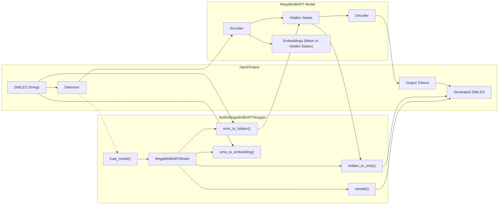
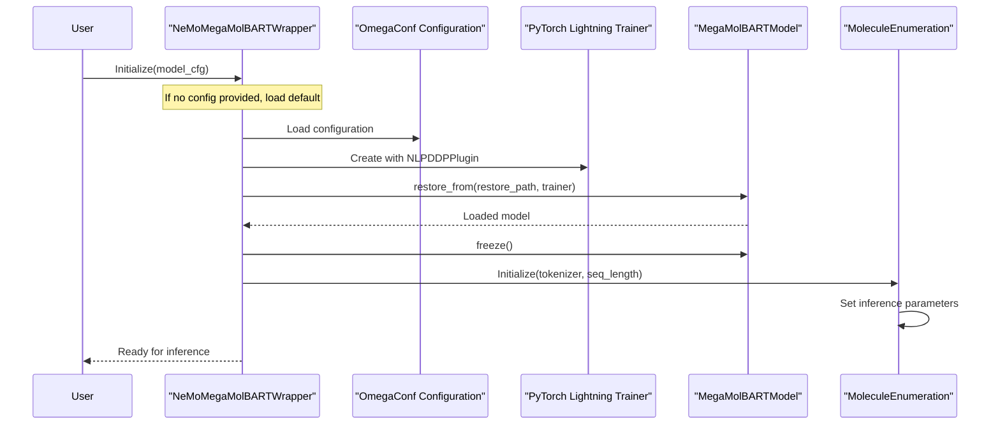
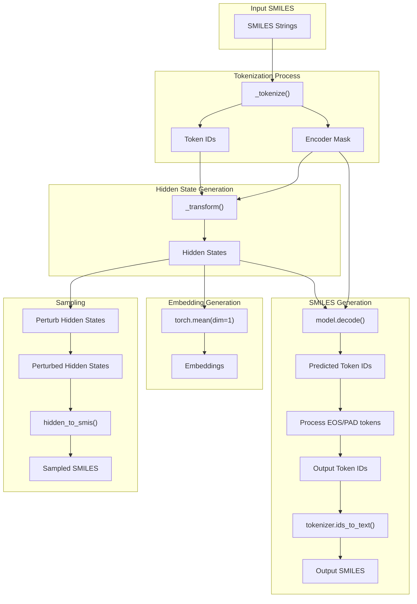
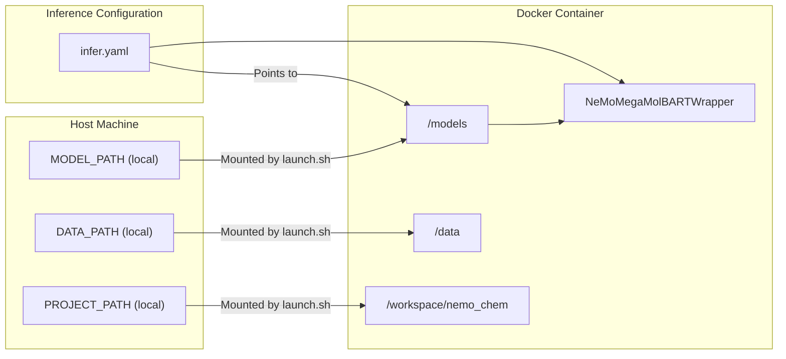

<!-- source: DeepWiki mcp.deepwiki.com · repo NVIDIA/MegaMolBART · page 4.3 Using Pretrained Models · fetched 2026-10-26 -->

# Using Pretrained Models

<details>
<summary>Relevant source files</summary>

The following files were used as context for generating this wiki page:

- [.dockerignore](.dockerignore)
- [.gitignore](.gitignore)
- [QUICKSTART.md](QUICKSTART.md)
- [README.md](README.md)
- [docs/ngc/base_image.md](docs/ngc/base_image.md)
- [docs/ngc/cmds](docs/ngc/cmds)
- [docs/ngc/model.md](docs/ngc/model.md)
- [docs/ngc/overview.md](docs/ngc/overview.md)
- [docs/ngc/requirements.md](docs/ngc/requirements.md)
- [examples/chem/conf/infer.yaml](examples/chem/conf/infer.yaml)
- [examples/chem/megamolbart_eval.py](examples/chem/megamolbart_eval.py)
- [launch.sh](launch.sh)
- [nemo_chem/models/megamolbart/__init__.py](nemo_chem/models/megamolbart/__init__.py)
- [nemo_chem/models/megamolbart/infer.py](nemo_chem/models/megamolbart/infer.py)
- [setup/Dockerfile](setup/Dockerfile)
- [setup/conda/env.yml](setup/conda/env.yml)
- [setup/config_model.sh](setup/config_model.sh)
- [setup/entrypoint.sh](setup/entrypoint.sh)
- [tests/data/test/metadata.txt](tests/data/test/metadata.txt)
- [tests/data/test/x000.csv](tests/data/test/x000.csv)
- [tests/pre_train_model_test.py](tests/pre_train_model_test.py)
- [tests/test_inference.py](tests/test_inference.py)

</details>


This document provides a comprehensive guide on how to load and use pretrained MegaMolBART models for inference tasks. It covers model loading, configuration, and the core inference operations available. For information about training your own models, see [Training System](#3), and for general inference system architecture, see [Inference System](#4).

## 1. Overview of Pretrained Models

MegaMolBART pretrained models are used for molecular representation learning and generation based on SMILES strings. These models can be used for:

1. Converting SMILES strings to hidden state representations
2. Generating embeddings for molecules
3. Creating new molecules by sampling from the latent space
4. Reconstructing SMILES strings from hidden state representations

### Pretrained Model Architecture Diagram



Sources: [nemo_chem/models/megamolbart/infer.py:20-212]()

## 2. Loading Pretrained Models

MegaMolBART provides a wrapper class called `NeMoMegaMolBARTWrapper` that handles model loading and inference operations.

### Configuration

Before loading a model, you need to have a configuration file that specifies:
- Path to the pretrained model
- Path to tokenizer files
- Data processing parameters

A typical inference configuration looks like:

```yaml
model:
  model_path: /models/MegaMolBART_0_2_0.nemo
  parallel_size: 1

  tokenizer:
    vocab_path: /models/vocab/megamolbart.vocab
    model_path: /models/vocab/megamolbart.model

  data:
    encoder_augment: False
    encoder_mask: False
    decoder_augment: False
    decoder_mask: False
    mask_prob: 0
```

Sources: [examples/chem/conf/infer.yaml:1-34]()

### Loading a Model

To load a pretrained model, instantiate a `NeMoMegaMolBARTWrapper` with a configuration:

```python
from nemo_chem.models.megamolbart import NeMoMegaMolBARTWrapper
from hydra import compose, initialize

# Load config using Hydra
with initialize(config_path="conf"):
    cfg = compose(config_name="infer")

# Initialize wrapper with pretrained model
inferer = NeMoMegaMolBARTWrapper(model_cfg=cfg)
```

The wrapper handles:
1. Loading the model from the specified path
2. Setting up the tokenizer
3. Configuring data processing parameters
4. Freezing the model for inference

Sources: [nemo_chem/models/megamolbart/infer.py:20-47](), [tests/test_inference.py:14-19]()

### Model Loading Process Diagram



Sources: [nemo_chem/models/megamolbart/infer.py:24-54](), [nemo_chem/models/megamolbart/infer.py:93-133]()

## 3. Core Inference Operations

MegaMolBART provides several key operations for working with molecules.

### 3.1 Converting SMILES to Hidden States

The `smis_to_hidden` method converts SMILES strings to hidden state representations:

```python
smiles = ['c1cc2ccccc2cc1', 'COc1cc2nc(N3CCN(C(=O)c4ccco4)CC3)nc(N)c2cc1OC']
hidden_states, enc_masks = inferer.smis_to_hidden(smiles)
```

This returns:
- `hidden_states`: Tensor containing hidden state representations
- `enc_masks`: Tensor containing padding masks

Sources: [nemo_chem/models/megamolbart/infer.py:135-148](), [tests/test_inference.py:22-36]()

### 3.2 Computing Molecule Embeddings

The `smis_to_embedding` method computes embeddings by taking the mean of hidden states:

```python
smiles = ['c1cc2ccccc2cc1', 'COc1cc2nc(N3CCN(C(=O)c4ccco4)CC3)nc(N)c2cc1OC']
embeddings = inferer.smis_to_embedding(smiles)
```

Embeddings can be used for tasks like similarity calculations, clustering, or as features for predictive models.

Sources: [nemo_chem/models/megamolbart/infer.py:150-163](), [tests/test_inference.py:38-51]()

### 3.3 Converting Hidden States to SMILES

The `hidden_to_smis` method converts hidden states back to SMILES strings:

```python
smiles = ['c1cc2ccccc2cc1']
hidden_states, enc_masks = inferer.smis_to_hidden(smiles)
reconstructed_smiles = inferer.hidden_to_smis(hidden_states, enc_masks)
```

This is useful for checking model reconstruction capabilities and for generating molecules from modified hidden states.

Sources: [nemo_chem/models/megamolbart/infer.py:165-182](), [tests/test_inference.py:53-77]()

### 3.4 Sampling New Molecules

The `sample` method generates new molecules by perturbing the hidden states of input molecules:

```python
smiles = ['c1cc2ccccc2cc1']
samples = inferer.sample(smiles, num_samples=10, sampling_method='greedy-perturbate')
```

Parameters:
- `num_samples`: Number of samples to generate per input SMILES
- `sampling_method`: Currently supports 'greedy-perturbate'
- `sampling_kwarg`: Additional parameters like `scaled_radius` for controlling the perturbation magnitude

Sources: [nemo_chem/models/megamolbart/infer.py:184-212](), [tests/test_inference.py:80-106]()

### Inference Operations Flow Diagram



Sources: [nemo_chem/models/megamolbart/infer.py:56-92](), [nemo_chem/models/megamolbart/infer.py:184-212]()

## 4. Setting Up the Environment

### 4.1 Using Docker Containers

The MegaMolBART repository provides a `launch.sh` script for managing Docker containers. To use pretrained models, you'll need to:

1. Either use the provided NGC container or build a custom one
2. Configure the container with paths to your models and data

```bash
# Set model path in .env file
MODEL_PATH=/path/to/models/directory

# Launch container in development mode
./launch.sh dev
```

Sources: [launch.sh:269-304](), [README.md:163-176]()

### 4.2 Container Configuration

The container expects models to be mounted at `/models`. You can configure this in the `.env` file:

```bash
# Example .env entry for model path
MODEL_PATH=/your/local/path/to/models
```

When using the `launch.sh` script, this directory will be mounted to `/models` inside the container.

Sources: [launch.sh:77-80](), [launch.sh:296-300]()

### 4.3 Environment Setup Diagram



Sources: [launch.sh:162-167](), [README.md:40-47]()

## 5. Example Usage

### 5.1 Basic Inference Example

This example shows a complete workflow for loading a model and performing inference:

```python
from nemo_chem.models.megamolbart import NeMoMegaMolBARTWrapper
from hydra import compose, initialize

# Load configuration
with initialize(config_path="/workspace/nemo_chem/examples/chem/conf"):
    cfg = compose(config_name="infer")

# Initialize wrapper with pretrained model
inferer = NeMoMegaMolBARTWrapper(model_cfg=cfg)

# Perform inference operations
smiles = ['c1cc2ccccc2cc1']  # Naphthalene

# Get embeddings
embeddings = inferer.smis_to_embedding(smiles)

# Generate new molecules
samples = inferer.sample(smiles, num_samples=5)
print("Generated molecules:")
for sample in samples:
    print(sample)
```

Sources: [tests/test_inference.py:22-106]()

### 5.2 Command-Line Evaluation

For quick evaluations, you can use the provided `megamolbart_eval.py` script:

```bash
python examples/chem/megamolbart_eval.py \
    --model_file /models/MegaMolBART_0_2_0.nemo \
    --prompt "c1cc2ccccc2cc1" \
    --tokens_to_generate 100
```

This script loads the model and evaluates its ability to reconstruct the input molecule.

Sources: [examples/chem/megamolbart_eval.py:55-131]()

### 5.3 Testing Inference Capabilities

The repository includes test scripts that can be used to verify inference capabilities:

```bash
# Inside the container
pytest --log-cli-level=10 tests/test_inference.py
```

This runs tests for all the core inference operations and helps ensure the model is functioning correctly.

Sources: [README.md:176-176]()

## 6. Performance Considerations

When working with pretrained models, consider the following:

| Operation | Memory Requirements | Typical Runtime | Notes |
|-----------|---------------------|-----------------|-------|
| Model Loading | ~1-3 GB depending on model size | 5-10 seconds | Only done once at startup |
| SMILES to Hidden | Low | Fast (ms per molecule) | Scales linearly with batch size |
| Hidden to SMILES | Medium | Medium (10-100ms per molecule) | Involves auto-regressive decoding |
| Sampling | Medium-High | Slower (100ms+ per sample) | Scales with number of samples |

For production use cases:
- Batch inputs when possible to maximize throughput
- For large-scale inference, consider distributed inference setup
- Monitor GPU memory usage when processing large batches

Sources: [nemo_chem/models/megamolbart/infer.py:93-133](), [tests/test_inference.py:80-106]()

---

