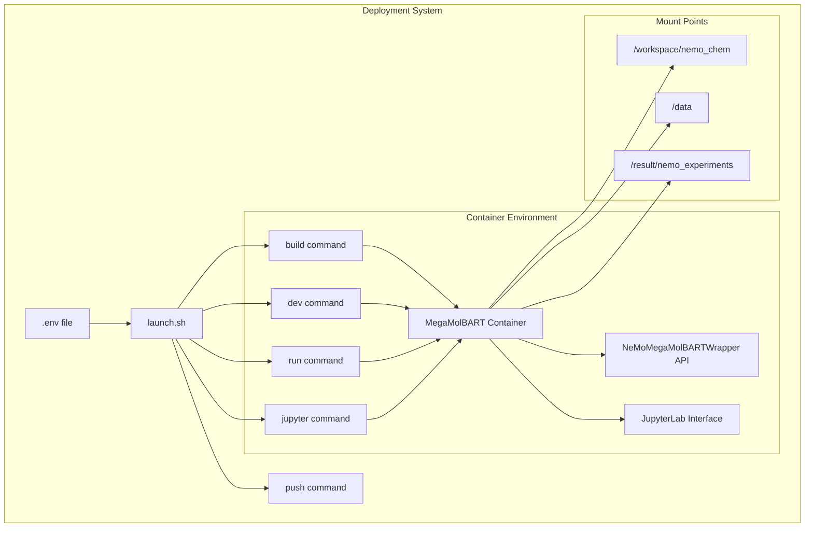
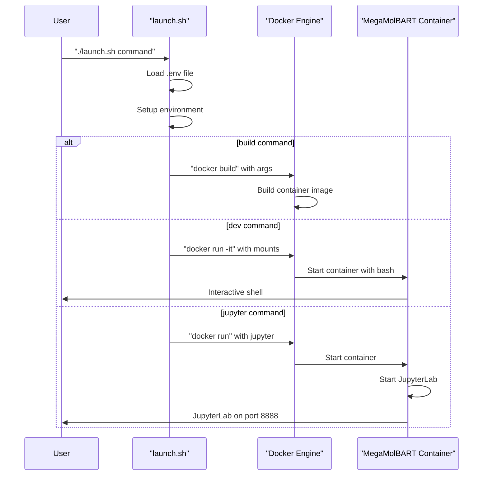
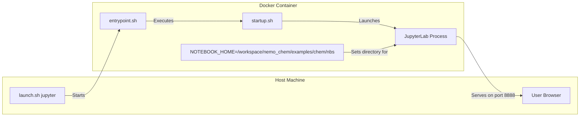
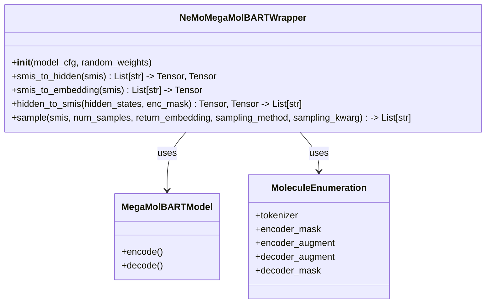

<!-- source: DeepWiki mcp.deepwiki.com · repo NVIDIA/MegaMolBART · page 5 Deployment · fetched 2026-10-26 -->

# Deployment

<details>
<summary>Relevant source files</summary>

The following files were used as context for generating this wiki page:

- [.dockerignore](.dockerignore)
- [.gitignore](.gitignore)
- [QUICKSTART.md](QUICKSTART.md)
- [README.md](README.md)
- [docs/ngc/base_image.md](docs/ngc/base_image.md)
- [docs/ngc/cmds](docs/ngc/cmds)
- [docs/ngc/model.md](docs/ngc/model.md)
- [docs/ngc/overview.md](docs/ngc/overview.md)
- [docs/ngc/requirements.md](docs/ngc/requirements.md)
- [examples/chem/conf/infer.yaml](examples/chem/conf/infer.yaml)
- [examples/chem/megamolbart_eval.py](examples/chem/megamolbart_eval.py)
- [launch.sh](launch.sh)
- [nemo_chem/models/megamolbart/__init__.py](nemo_chem/models/megamolbart/__init__.py)
- [nemo_chem/models/megamolbart/infer.py](nemo_chem/models/megamolbart/infer.py)
- [setup/Dockerfile](setup/Dockerfile)
- [setup/conda/env.yml](setup/conda/env.yml)
- [setup/config_model.sh](setup/config_model.sh)
- [setup/entrypoint.sh](setup/entrypoint.sh)
- [tests/data/test/metadata.txt](tests/data/test/metadata.txt)
- [tests/data/test/x000.csv](tests/data/test/x000.csv)
- [tests/pre_train_model_test.py](tests/pre_train_model_test.py)
- [tests/test_inference.py](tests/test_inference.py)

</details>


This document provides a comprehensive guide for deploying the MegaMolBART system. It covers Docker container management, environment configuration, JupyterLab integration, and inference deployment. For information about training the model, refer to [Training System](#3), and for model architecture details, see [Model Architecture](#2).

## Overview of MegaMolBART Deployment

MegaMolBART deployment consists of several key components that enable users to run inference, develop models, and manage Docker containers efficiently. The deployment system is centered around the `launch.sh` script, which serves as the primary interface for all deployment-related tasks.



Sources: [launch.sh:1-405](), [README.md:40-78]()

## Docker Container Management

The `launch.sh` script is the primary tool for managing MegaMolBART Docker containers. It provides commands for building, pushing, and running containers with the appropriate environment variables and volume mounts.

### Available Commands

| Command | Description | Key Options |
|---------|-------------|-------------|
| `build` | Builds the Docker container | `-p/--pkg`: Package model, `-b/--base-image`: Specify base image, `-c/--clean`: Clean build |
| `push` | Pushes the container to registry | `-v/--version`: Specify version, `-a/--additional_copies`: Push to additional tags |
| `dev` | Starts interactive development container | `-a/--additional-args`: Additional Docker args, `-t/--tmp`: Temp container name, `-c/--cmd`: Custom command |
| `run` | Runs a command in container | N/A |
| `jupyter` | Starts JupyterLab in container | N/A |

Sources: [launch.sh:26-83](), [launch.sh:380-405]()

### Building and Running Containers

The `build` command creates a Docker container from the Dockerfile, configuring it with appropriate dependencies and settings:

```
./launch.sh build
```

For development with an interactive shell:

```
./launch.sh dev
```

To run JupyterLab for notebook-based development:

```
./launch.sh jupyter
```

The script handles all the necessary Docker configuration, including volume mounts, NVIDIA GPU access, and network settings.



Sources: [launch.sh:180-232](), [launch.sh:307-348](), [launch.sh:369-379]()

## Environment Configuration

MegaMolBART uses a `.env` file to configure the deployment environment. This file contains essential variables that control how containers are built and run.

### Required Environment Variables

| Variable | Description | Default |
|----------|-------------|---------|
| `MEGAMOLBART_CONT` | Container image name | `nvcr.io/nvidia/clara/megamolbart_v0.2:0.2.0` |
| `PROJECT_PATH` | Local path to code | Current directory |
| `DATA_PATH` | Path to data directory | `/tmp` |
| `RESULT_PATH` | Path to results directory | `~/results/nemo_experiments` |
| `JUPYTER_PORT` | Port for JupyterLab | `8888` |
| `REGISTRY_USER` | Registry username | `'$oauthtoken'` |
| `REGISTRY` | Container registry URL | `NotSpecified` |
| `REGISTRY_ACCESS_TOKEN` | Registry access token | `NotSpecified` |
| `WANDB_API_KEY` | Weights & Biases API key | `NotSpecified` |
| `GITHUB_ACCESS_TOKEN` | GitHub access token | `UserName:PersonalToken` |
| `GITHUB_BRANCH` | GitHub branch name | `main` |

The `launch.sh` script will automatically create a `.env` file with default values if it doesn't exist:

```
$ ./launch.sh
sourcing environment from ./.env
```

Example `.env` file contents:

```
MEGAMOLBART_CONT=nvcr.io/nvidia/clara/megamolbart:0.2.0
PROJECT_PATH=/home/user/Projects/github/MegaMolBART/
DATA_PATH=/data/bionemo/data/
RESULT_PATH=/data/bionemo/results/
JUPYTER_PORT=8888
REGISTRY_USER=$oauthtoken
REGISTRY=NotSpecified
REGISTRY_ACCESS_TOKEN=NotSpecified
GITHUB_ACCESS_TOKEN=INSERT_GITHUB_ACCESS_TOKEN_HERE
WANDB_API_KEY=NotSpecified
GITHUB_BRANCH=main
```

Sources: [launch.sh:84-125](), [README.md:46-71]()

## JupyterLab Integration

MegaMolBART comes with built-in JupyterLab support, allowing for interactive development and experimentation. The JupyterLab interface runs within the container and is accessible via a web browser.

### Starting JupyterLab

To start JupyterLab:

```
./launch.sh jupyter
```

This command:
1. Sets up the environment based on your `.env` file
2. Mounts your project, data, and results directories
3. Starts JupyterLab on the specified port (default: 8888)

Access JupyterLab by opening `http://localhost:8888` (or the specified port) in your web browser.



Sources: [launch.sh:369-379](), [setup/Dockerfile:70-76](), [setup/entrypoint.sh:1-12]()

### JupyterLab Environment

The JupyterLab environment provides access to:

- Example notebooks for training and inference
- Pre-configured Python environment with all dependencies
- Access to mounted data and results directories
- Direct access to the MegaMolBART codebase

## Inference Deployment

MegaMolBART provides a simple API for model inference through the `NeMoMegaMolBARTWrapper` class. This allows for deploying trained models for tasks such as molecule generation and embedding extraction.

### Setting Up Inference

To deploy a model for inference, you need:

1. A trained model file (`.nemo` format)
2. Configuration for the inference setup

The inference configuration is managed through a YAML file, typically located at `examples/chem/conf/infer.yaml`:

```yaml
name: MegaMolBART_Inference
desc: Minimum configuration for initializing a MegaMolBART model.

model:
  model_path: /models/MegaMolBART_0_2_0.nemo
  parallel_size: 1

  tokenizer:
    vocab_path: /models/vocab/megamolbart.vocab
    model_path: /models/vocab/megamolbart.model

  data:
    encoder_augment: False
    encoder_mask: False
    decoder_augment: False
    decoder_mask: False
    mask_prob: 0
```

To add your model path, edit the `model_path` field in the config to point to your model file.

Sources: [examples/chem/conf/infer.yaml:1-34](), [README.md:162-168]()

### Inference API

The `NeMoMegaMolBARTWrapper` class provides the primary interface for inference operations:



The key API methods are:

| Method | Description | Input | Output |
|--------|-------------|-------|--------|
| `smis_to_hidden` | Convert SMILES to hidden states | List of SMILES strings | Hidden states tensor, Padding mask tensor |
| `smis_to_embedding` | Get embeddings for SMILES | List of SMILES strings | Embedding tensor |
| `hidden_to_smis` | Convert hidden states to SMILES | Hidden states tensor, Padding mask tensor | List of SMILES strings |
| `sample` | Sample new molecules from latent space | List of SMILES strings, sampling parameters | List of sampled SMILES strings |

Sources: [nemo_chem/models/megamolbart/infer.py:20-212]()

### Testing Inference

The repository includes a test suite for validating inference functionality in `tests/test_inference.py`. These tests verify:

1. SMILES to hidden state conversion
2. SMILES to embedding conversion 
3. Hidden state to SMILES reconstruction
4. Molecule sampling

To test your inference setup, you can run:

```
./launch.sh dev -c "python -m pytest --log-cli-level=10 tests/test_inference.py"
```

Which will run all inference tests and output detailed logs of the process.

Sources: [tests/test_inference.py:1-106](), [README.md:176-177]()

### Inference Examples

Here's an example of how to use the inference API in a Python script:

```python
from hydra import compose, initialize
from nemo_chem.models.megamolbart import NeMoMegaMolBARTWrapper

# Load configuration
with initialize(config_path="/workspace/nemo_chem/examples/chem/conf"):
    cfg = compose(config_name="infer")

# Create inference wrapper
inferer = NeMoMegaMolBARTWrapper(model_cfg=cfg)

# Example SMILES strings
smiles = ['c1cc2ccccc2cc1', 'COc1cc2nc(N3CCN(C(=O)c4ccco4)CC3)nc(N)c2cc1OC']

# Get embeddings
embeddings = inferer.smis_to_embedding(smiles)

# Sample new molecules
samples = inferer.sample(smiles, num_samples=10, sampling_method='greedy-perturbate')
for i, sample in enumerate(samples):
    print(f"Sample {i}: {sample}")
```

The `NeMoMegaMolBARTWrapper` handles all the underlying model operations, including loading the model, tokenization, and inference.

## Quick Deployment Guide

For a quick deployment of MegaMolBART for inference, follow these steps:

1. **Pull the container**:
   ```
   docker pull nvcr.io/nvidia/clara/megamolbart_v0.2:0.2.0
   ```

2. **Run the container**:
   ```
   docker run --gpus all --rm -p 8888:8888 nvcr.io/nvidia/clara/megamolbart_v0.2:0.2.0
   ```

3. **Access JupyterLab**:
   Open `http://localhost:8888` in your browser

4. **Run inference**:
   Use the example notebooks or the Python API as shown above

Sources: [README.md:16-38](), [docs/ngc/overview.md:1-27]()

The deployment system is designed to make MegaMolBART easily accessible for both development and production use cases, with a focus on containerization for reproducibility and ease of setup.

---

