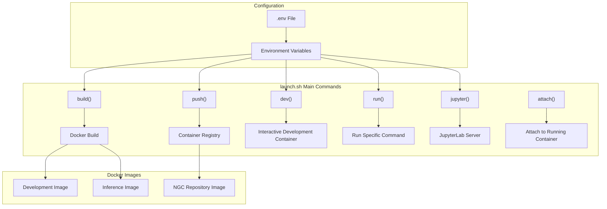
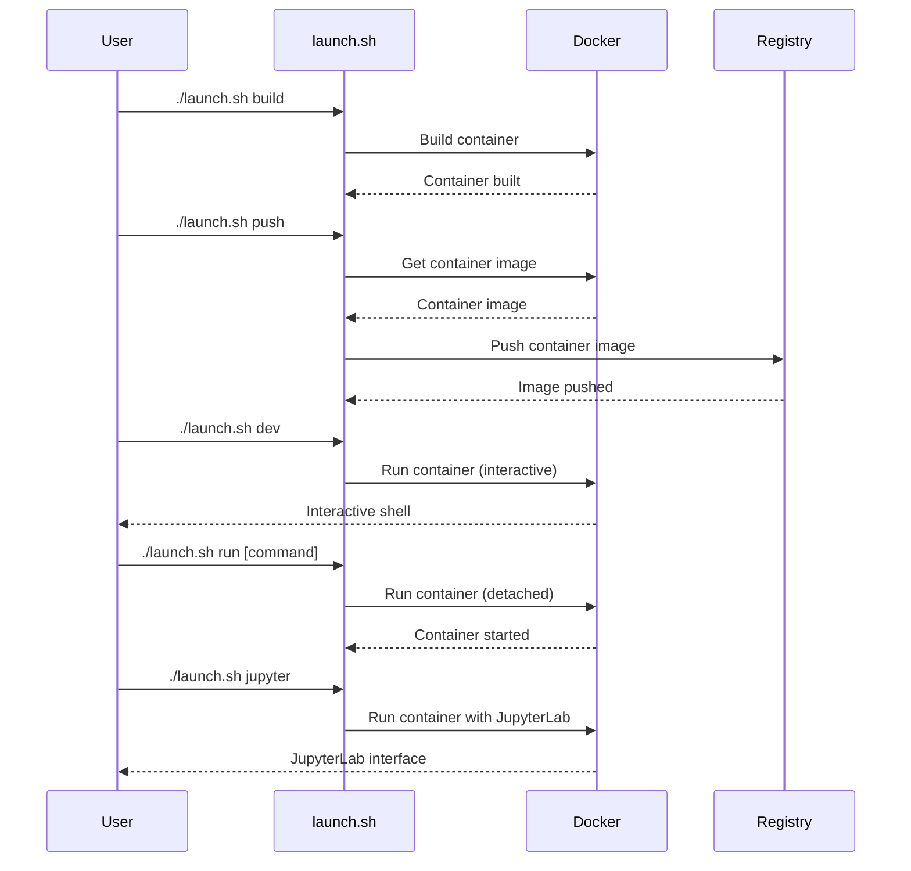
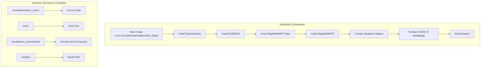
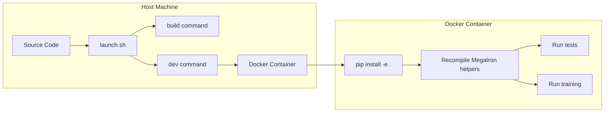

<!-- source: DeepWiki mcp.deepwiki.com · repo NVIDIA/MegaMolBART · page 5.1 Docker Container Management · fetched 2026-10-26 -->

# Docker Container Management

<details>
<summary>Relevant source files</summary>

The following files were used as context for generating this wiki page:

- [.dockerignore](.dockerignore)
- [.gitignore](.gitignore)
- [QUICKSTART.md](QUICKSTART.md)
- [README.md](README.md)
- [docs/ngc/base_image.md](docs/ngc/base_image.md)
- [docs/ngc/cmds](docs/ngc/cmds)
- [docs/ngc/model.md](docs/ngc/model.md)
- [docs/ngc/overview.md](docs/ngc/overview.md)
- [docs/ngc/requirements.md](docs/ngc/requirements.md)
- [examples/chem/conf/infer.yaml](examples/chem/conf/infer.yaml)
- [examples/chem/megamolbart_eval.py](examples/chem/megamolbart_eval.py)
- [launch.sh](launch.sh)
- [nemo_chem/models/megamolbart/__init__.py](nemo_chem/models/megamolbart/__init__.py)
- [nemo_chem/models/megamolbart/infer.py](nemo_chem/models/megamolbart/infer.py)
- [setup/Dockerfile](setup/Dockerfile)
- [setup/conda/env.yml](setup/conda/env.yml)
- [setup/config_model.sh](setup/config_model.sh)
- [setup/entrypoint.sh](setup/entrypoint.sh)
- [tests/data/test/metadata.txt](tests/data/test/metadata.txt)
- [tests/data/test/x000.csv](tests/data/test/x000.csv)
- [tests/pre_train_model_test.py](tests/pre_train_model_test.py)
- [tests/test_inference.py](tests/test_inference.py)

</details>


## Purpose and Scope

This document explains how to build, run, and manage Docker containers for MegaMolBART using the `launch.sh` script. It covers container building, pushing to registries, development environments, and running inference or training tasks. For environment configuration details, see [Environment Configuration](#5.2).

Sources: [launch.sh:26-83](), [README.md:42-71]()

## Overview

The MegaMolBART repository provides a robust Docker container management system through the `launch.sh` script. This script serves as a central utility for handling all Docker-related operations, from building images to deploying containers for various workflows.

### Container Management Architecture



Sources: [launch.sh:382-405](), [README.md:42-71]()

## Environment Configuration

Before using the container management system, you need to configure the environment by creating a `.env` file in the repository root directory. The `launch.sh` script will automatically create this file with default values if it doesn't exist.

### Key Environment Variables

| Variable | Description | Example Value |
|----------|-------------|---------------|
| `MEGAMOLBART_CONT` | Container image name | `nvcr.io/nvidia/clara/megamolbart_v0.2:0.2.0` |
| `PROJECT_PATH` | Path to source code | `/home/user/Projects/MegaMolBART/` |
| `DATA_PATH` | Path to data directory | `/data/bionemo/data/` |
| `RESULT_PATH` | Path to results directory | `/data/bionemo/results/` |
| `JUPYTER_PORT` | Port for JupyterLab | `8888` |
| `REGISTRY_USER` | Registry username | `$oauthtoken` |
| `REGISTRY` | Container registry URL | `nvcr.io` |
| `REGISTRY_ACCESS_TOKEN` | Registry access token | `<token>` |
| `WANDB_API_KEY` | Weights & Biases API key | `<api_key>` |
| `GITHUB_ACCESS_TOKEN` | GitHub access token (for build) | `<token>` |
| `GITHUB_BRANCH` | GitHub branch to use | `main` |

Sources: [launch.sh:84-125](), [README.md:46-71]()

### Default Mounts and Paths

The script configures the following default mount points inside the container:

| Host Path | Container Path | Purpose |
|-----------|---------------|---------|
| `PROJECT_PATH` | `/workspace/nemo_chem` | Source code |
| `DATA_PATH` | `/data` | Data files |
| `RESULT_PATH` | `/result/nemo_experiments` | Results and checkpoints |
| `MODEL_PATH` (optional) | `/models` | Model files |

Sources: [launch.sh:127-130](), [QUICKSTART.md:15-20]()

## Command Reference

### Container Lifecycle Management



Sources: [launch.sh:180-379]()

### Building a Container

The `build` command creates a Docker container using the specified Dockerfile and configuration.

```
./launch.sh build [options]
```

Options:
- `-p, --pkg`: Package model files in the container
- `-b, --base-image BASE_IMAGE`: Specify a custom base image
- `-c, --clean`: Build without using cache

Example:
```
./launch.sh build -c
```

Sources: [launch.sh:180-232](), [README.md:73-77]()

### Pushing a Container to Registry

The `push` command pushes the built container to a registry.

```
./launch.sh push [options]
```

Options:
- `-v, --version VERSION`: Tag with specific version
- `-a, --additional_copies IMAGES`: Push additional copies with different tags

Example:
```
./launch.sh push -v 1.0
```

Sources: [launch.sh:234-277]()

### Development Environment

The `dev` command launches an interactive development container.

```
./launch.sh dev [options]
```

Options:
- `-a, --additional-args ARGS`: Additional Docker arguments
- `-t, --tmp NAME`: Temporary container name suffix
- `-d, --demon`: Run in detached mode
- `-n, --notebook_home PATH`: Set notebook home directory
- `-c, --cmd COMMAND`: Custom command to run

Example:
```
./launch.sh dev -c "python examples/chem/megamolbart_pretrain.py"
```

Sources: [launch.sh:307-348](), [README.md:79-89](), [QUICKSTART.md:144-177]()

### Running Commands

The `run` command executes a specific command in a detached container.

```
./launch.sh run [command]
```

Example:
```
./launch.sh run "python examples/chem/megamolbart_pretrain.py"
```

Sources: [launch.sh:351-357]()

### JupyterLab Environment

The `jupyter` command launches a JupyterLab server in a container.

```
./launch.sh jupyter
```

This starts a JupyterLab server on the port specified in the `.env` file (default: 8888).

Sources: [launch.sh:369-379](), [README.md:16-39]()

## Container Structure and Dockerfile

The MegaMolBART container is based on a Dockerfile located at `setup/Dockerfile`. This Dockerfile specifies the base image, installs dependencies, and sets up the environment.



Sources: [setup/Dockerfile:1-76]()

### Key Dockerfile Elements

- Base image: `nvcr.io/nvidia/clara/megamolbart_base:nemo_1.11_rc1`
- Conda environment: `base`
- Dependencies: Python libraries, PySMILES, etc.
- Source code: Cloned from GitHub repository
- Entrypoint: `/opt/entrypoint.sh`
- Default command: `/opt/nvidia/startup.sh`

Sources: [setup/Dockerfile:16-76]()

## Development Workflow

The MegaMolBART Docker container is designed to support various development workflows. Here's a typical workflow for development:

1. Configure environment variables in `.env` file
2. Build the container: `./launch.sh build`
3. Start development container: `./launch.sh dev`
4. Inside the container:
   - Install development code: `pip install -e .`
   - Recompile Megatron helpers if needed
   - Run code/tests



Sources: [README.md:141-177](), [QUICKSTART.md:141-177]()

## Training Workflow

To run a training job using the MegaMolBART container:

1. Configure environment variables in `.env` file
2. Start a container with appropriate volume mounts:
   ```
   ./launch.sh run "python examples/chem/megamolbart_pretrain.py \
      --config-path=conf \
      --config-name=megamolbart_pretrain_xsmall_span_aug"
   ```

Alternatively, use the provided shell scripts in `examples/chem/shell/` or `examples/chem/slurm/` for convenience.

Sources: [QUICKSTART.md:57-97]()

## Inference Workflow

To run inference using a pre-trained MegaMolBART model:

1. Configure environment variables in `.env` file, including `MODEL_PATH`
2. Update the inference configuration in `examples/chem/conf/infer.yaml`
3. Start a development container:
   ```
   ./launch.sh dev
   ```
4. Inside the container, run inference tests:
   ```
   pytest --log-cli-level=10 tests/test_inference.py
   ```

Sources: [README.md:162-176](), [tests/test_inference.py:1-107](), [nemo_chem/models/megamolbart/infer.py:1-212]()

## Using Prebuilt Containers from NGC

NVIDIA provides prebuilt MegaMolBART containers on NGC. To use them:

```bash
# For Docker version 19.03 or later
docker run \
    --gpus all \
    --rm \
    -p 8888:8888 \
    nvcr.io/nvidia/clara/megamolbart_v0.2:0.2.0

# For Docker version 19.02 or older
docker run \
    --runtime nvidia \
    --rm \
    -p 8888:8888 \
    nvcr.io/nvidia/clara/megamolbart_v0.2:0.2.0
```

After starting the container, access JupyterLab by opening http://HOSTNAME:8888 in a browser.

Sources: [README.md:16-39](), [docs/ngc/overview.md:1-27]()

## Troubleshooting Common Issues

### Docker GPU Support

The `launch.sh` script automatically detects the Docker version and configures the appropriate GPU runtime parameters:
- For Docker 19.03+: Uses `--gpus all`
- For older Docker versions: Uses `--runtime=nvidia`

If you encounter GPU-related issues, ensure you have the proper NVIDIA drivers and the NVIDIA Container Toolkit installed.

Sources: [launch.sh:140-151]()

### Container Access Issues

If you can't access services like JupyterLab in the container, check:
1. Port mapping in the `launch.sh` command
2. Network configuration (`--network host`)
3. Firewall settings on your host machine

### Volume Mount Issues

If volume mounts aren't working correctly:
1. Ensure the specified host directories exist
2. Check permissions on the host directories
3. Verify the paths in your `.env` file

## Best Practices

1. **Use NGC containers when possible**: For most use cases, the prebuilt containers from NGC are recommended.
2. **Customize .env file**: Always customize the `.env` file to match your environment.
3. **Mount volumes**: Mount data, results, and source code volumes to preserve data between container runs.
4. **Use the dev command for development**: The `dev` command provides an interactive shell that's ideal for development.
5. **Use JupyterLab for exploration**: The `jupyter` command provides a convenient way to explore the code and run examples.

Sources: [README.md:42-71](), [QUICKSTART.md:10-20]()

---

