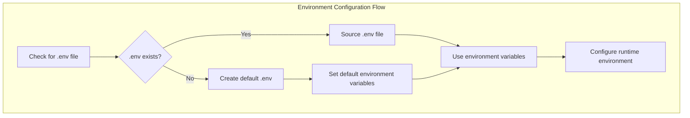
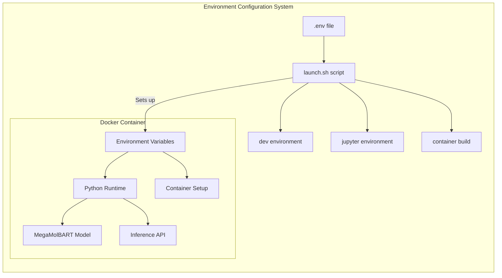
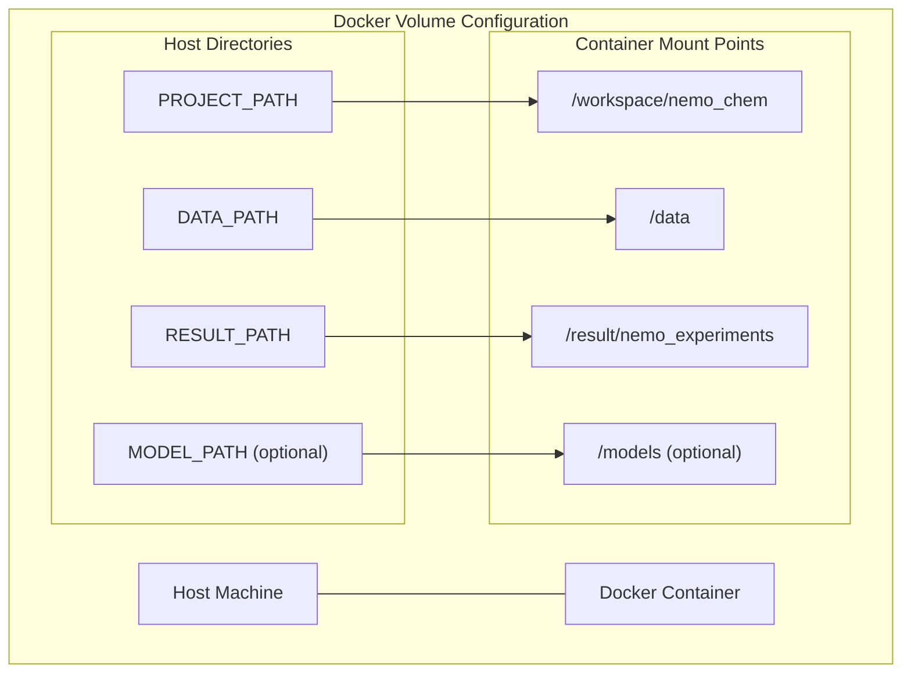
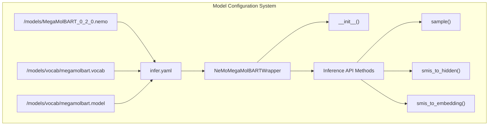

<!-- source: DeepWiki mcp.deepwiki.com · repo NVIDIA/MegaMolBART · page 5.2 Environment Configuration · fetched 2026-10-26 -->

# Environment Configuration

<details>
<summary>Relevant source files</summary>

The following files were used as context for generating this wiki page:

- [.dockerignore](.dockerignore)
- [examples/chem/conf/infer.yaml](examples/chem/conf/infer.yaml)
- [examples/chem/megamolbart_eval.py](examples/chem/megamolbart_eval.py)
- [launch.sh](launch.sh)
- [nemo_chem/models/megamolbart/__init__.py](nemo_chem/models/megamolbart/__init__.py)
- [nemo_chem/models/megamolbart/infer.py](nemo_chem/models/megamolbart/infer.py)
- [nemo_chem/package_info.py](nemo_chem/package_info.py)
- [setup.py](setup.py)
- [setup/Dockerfile](setup/Dockerfile)
- [setup/conda/env.yml](setup/conda/env.yml)
- [setup/config_model.sh](setup/config_model.sh)
- [setup/entrypoint.sh](setup/entrypoint.sh)
- [tests/pre_train_model_test.py](tests/pre_train_model_test.py)
- [tests/test_inference.py](tests/test_inference.py)

</details>


This page details how to configure the environment for running MegaMolBART, covering environment variables, Docker container settings, and file paths required for operation. For container management, see [Docker Container Management](#5.1), and for JupyterLab integration, see [JupyterLab Integration](#5.3).

## Environment Variable Configuration

MegaMolBART uses environment variables to configure various aspects of the system. These variables control Docker container settings, data paths, API keys, and more.

### Core Environment Variables

The main configuration method is through a `.env` file in the project root directory. If this file doesn't exist, `launch.sh` will create it with default values.



Sources: [launch.sh:100-125]()

### Required Environment Variables

The following environment variables are essential for MegaMolBART operation:

| Variable | Description | Default | Required for |
|----------|-------------|---------|-------------|
| `MEGAMOLBART_CONT` | Container image for training | `nvcr.io/nvidia/clara/megamolbart_v0.2:0.2.0` | All operations |
| `PROJECT_PATH` | Local path to code | Current directory | All operations |
| `DATA_PATH` | Path to data directory | `/tmp` | Training, inference |
| `RESULT_PATH` | Path to store results | `~/results/nemo_experiments` | Training, evaluation |
| `JUPYTER_PORT` | Port for Jupyter Lab | `8888` | Development, Jupyter |

Sources: [launch.sh:85-90]()

### Optional Environment Variables

Additional environment variables for specific use cases:

| Variable | Description | Use Case |
|----------|-------------|----------|
| `REGISTRY` | Container registry URL | Container publishing |
| `REGISTRY_USER` | Registry username | Container publishing |
| `REGISTRY_ACCESS_TOKEN` | Registry access token | Container publishing |
| `WANDB_API_KEY` | Weights & Biases API key | Experiment tracking |
| `GITHUB_ACCESS_TOKEN` | GitHub API token | Building containers |
| `GITHUB_BRANCH` | GitHub branch to use | Building containers |
| `MODEL_PATH` | Path to models directory | Model inference |

Sources: [launch.sh:91-98](), [launch.sh:134-138]()

## Environment File Setup

The `.env` file follows a simple `KEY=VALUE` format. Below is a diagram showing how environment variables are processed by the system:



Sources: [launch.sh:26-83](), [setup/Dockerfile:55-57]()

### Creating a Custom .env File

You can create a `.env` file manually, or let `launch.sh` generate one with default values. Here's how the automatic creation works:

1. Running any `launch.sh` command checks for the file
2. If not found, it creates a template with default values
3. You can then edit this file to customize your configuration

Sources: [launch.sh:101-125]()

## Docker Environment Configuration

The MegaMolBART system runs inside Docker containers with specific mount points and environment settings.

### Volume Mounts

When running the container, several local directories are mounted:



Sources: [launch.sh:127-129](), [launch.sh:153-170](), [launch.sh:297-300]()

### Runtime Environment Setup

The container runtime environment includes:

1. Python paths configured for MegaMolBART and NeMo
2. User permissions matching the host user
3. Shared memory and stack limits for performance
4. GPU access configuration

Sources: [launch.sh:152-170](), [setup/Dockerfile:53-58]()

## Model and Inference Configuration

For inference operations, additional environment configuration is needed:



Sources: [nemo_chem/models/megamolbart/infer.py:20-44](), [examples/chem/conf/infer.yaml:1-34]()

## Common Environment Configuration Scenarios

### Development Environment

For development work, use:

```bash
# Edit .env file to set up development paths
./launch.sh dev
```

This command:
1. Mounts your project directory into the container
2. Sets up proper Python paths
3. Configures Weights & Biases for experiment tracking
4. Opens an interactive bash shell

Sources: [launch.sh:307-348]()

### JupyterLab Environment

For notebook-based work:

```bash
# Edit .env file to set JUPYTER_PORT
./launch.sh jupyter
```

This sets up JupyterLab with:
1. The notebook directory at `/workspace`
2. No authentication (for local development)
3. All model and data paths properly configured

Sources: [launch.sh:369-379](), [setup/entrypoint.sh:1-12]()

### Inference Environment

For running inference:

1. Ensure your `.env` file has `MODEL_PATH` pointing to your models directory
2. If using Weights & Biases, set `WANDB_API_KEY`
3. Run the container with proper mounts

MegaMolBART will look for models and configuration files in the specified paths as defined in the inference configuration.

Sources: [nemo_chem/models/megamolbart/infer.py:30-33](), [examples/chem/conf/infer.yaml:5-11]()

## Additional Configuration Files

Beyond environment variables, MegaMolBART uses configuration files for specific components:

### Inference Configuration File

The `infer.yaml` file (located at `examples/chem/conf/infer.yaml`) controls inference parameters:

```yaml
model:
  model_path: /models/MegaMolBART_0_2_0.nemo  # Path to model file
  tokenizer:
    vocab_path: /models/vocab/megamolbart.vocab  # Tokenizer vocabulary
    model_path: /models/vocab/megamolbart.model  # Tokenizer model
```

Sources: [examples/chem/conf/infer.yaml:4-11]()

### Docker Build Configuration

The Dockerfile uses environment variables to set up the container environment:

```
- PYTHONPATH: Sets Python module search paths
- PACKAGE: Controls model packaging
- NEMO_HOME/NEMO_CHEM_HOME: Sets framework directories
- NOTEBOOK_HOME: Sets default notebook directory
```

Sources: [setup/Dockerfile:55-70]()

## Troubleshooting Environment Configuration

Common issues and solutions:

1. **Missing .env file**: Run any launch.sh command to generate a template
2. **Docker GPU access issues**: Ensure NVIDIA Container Toolkit is installed and `--gpus all` parameter is used
3. **Model not found**: Check MODEL_PATH in .env and verify it contains required files
4. **API access failures**: Verify API tokens in .env are correct and not expired

Sources: [launch.sh:141-151]()

---

