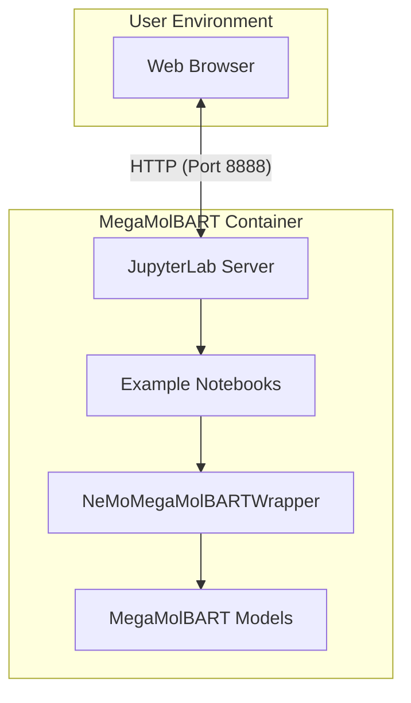
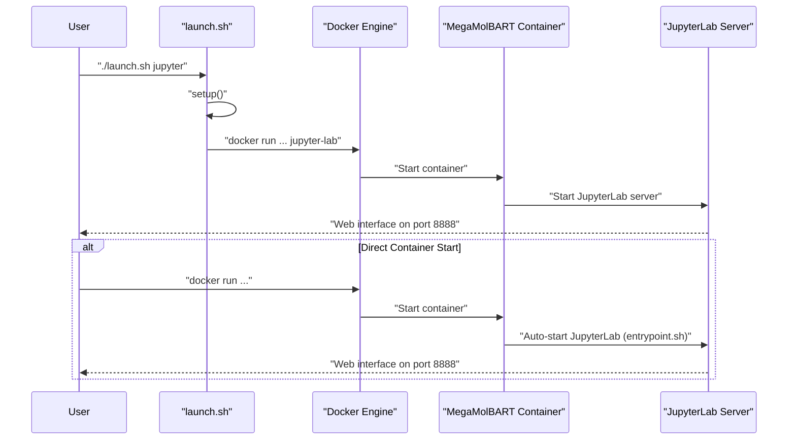
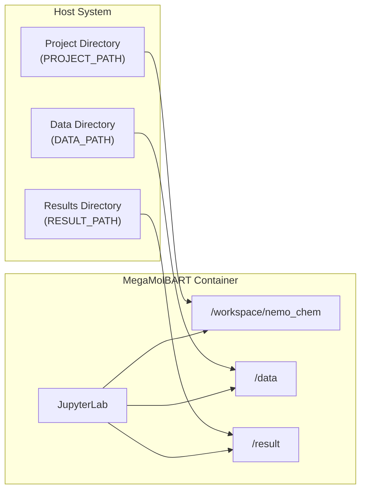
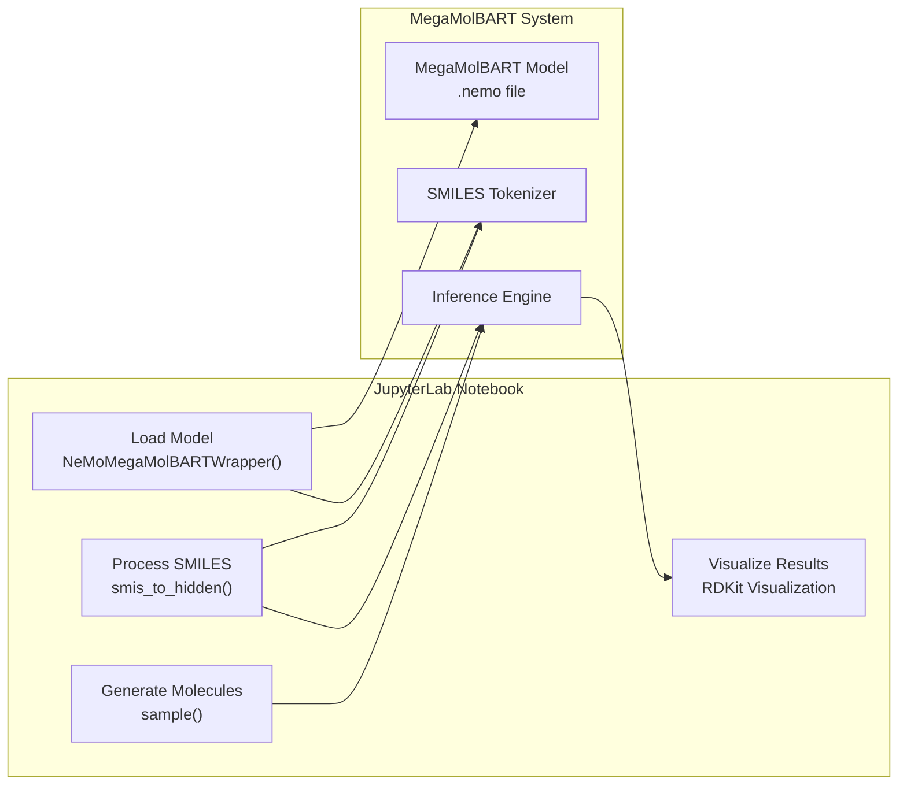

<!-- source: DeepWiki mcp.deepwiki.com · repo NVIDIA/MegaMolBART · page 5.3 JupyterLab Integration · fetched 2026-10-26 -->

# JupyterLab Integration

<details>
<summary>Relevant source files</summary>

The following files were used as context for generating this wiki page:

- [.dockerignore](.dockerignore)
- [.gitignore](.gitignore)
- [QUICKSTART.md](QUICKSTART.md)
- [README.md](README.md)
- [docs/ngc/base_image.md](docs/ngc/base_image.md)
- [docs/ngc/cmds](docs/ngc/cmds)
- [docs/ngc/model.md](docs/ngc/model.md)
- [docs/ngc/overview.md](docs/ngc/overview.md)
- [docs/ngc/requirements.md](docs/ngc/requirements.md)
- [examples/chem/conf/infer.yaml](examples/chem/conf/infer.yaml)
- [examples/chem/megamolbart_eval.py](examples/chem/megamolbart_eval.py)
- [launch.sh](launch.sh)
- [nemo_chem/models/megamolbart/__init__.py](nemo_chem/models/megamolbart/__init__.py)
- [nemo_chem/models/megamolbart/infer.py](nemo_chem/models/megamolbart/infer.py)
- [setup/Dockerfile](setup/Dockerfile)
- [setup/conda/env.yml](setup/conda/env.yml)
- [setup/config_model.sh](setup/config_model.sh)
- [setup/entrypoint.sh](setup/entrypoint.sh)
- [tests/data/test/metadata.txt](tests/data/test/metadata.txt)
- [tests/data/test/x000.csv](tests/data/test/x000.csv)
- [tests/pre_train_model_test.py](tests/pre_train_model_test.py)
- [tests/test_inference.py](tests/test_inference.py)

</details>


This page explains how to use JupyterLab with the MegaMolBART system for interactive development, experimentation, and visualization. JupyterLab provides a web-based interface for running Python code, visualizing molecular structures, and working with MegaMolBART models. For information about Docker container management, see [Docker Container Management](#5.1).

## Overview of JupyterLab Integration

JupyterLab is integrated into the MegaMolBART system as a key interface for interactive development and model experimentation. The integration provides several benefits:

1. Interactive Python environment for working with MegaMolBART models
2. Visualization of molecular structures and model outputs
3. Easy access to example notebooks demonstrating key functionality
4. Simplified development workflow for custom applications



Sources: [launch.sh:369-379](), [setup/entrypoint.sh:1-9](), [README.md:16-39]()

## Container Configuration

JupyterLab is automatically configured in the MegaMolBART Docker container. The container includes the following JupyterLab configuration:

1. Default notebook directory set to `/opt/nvidia/nemo_chem/examples/chem/nbs`
2. JupyterLab server running on port 8888
3. No authentication (for development ease)
4. Access from any IP address (0.0.0.0)

The key environment variable that controls JupyterLab is:

| Variable | Default Value | Description |
|----------|---------------|-------------|
| NOTEBOOK_HOME | /opt/nvidia/nemo_chem/examples/chem/nbs | Directory where JupyterLab starts |
| JUPYTER_PORT | 8888 | Port on which JupyterLab listens |

Sources: [setup/Dockerfile:70-71](), [launch.sh:85-90](), [setup/entrypoint.sh:1-9]()

## Launching JupyterLab

There are two main ways to launch JupyterLab with MegaMolBART:

### 1. Using the launch.sh Script

The `launch.sh` script provides a dedicated command for starting JupyterLab:

```bash
./launch.sh jupyter
```

This command:
1. Sets up the Docker environment with appropriate volume mounts
2. Launches the MegaMolBART container with JupyterLab
3. Exposes JupyterLab on the configured port (default: 8888)

### 2. Automatic Start in Container

When running the MegaMolBART container directly, JupyterLab starts automatically:

```bash
docker run --gpus all --rm -p 8888:8888 nvcr.io/nvidia/clara/megamolbart_v0.2:0.2.0
```

After starting the container, access JupyterLab by opening a browser and navigating to:
`http://<hostname-or-ip>:8888`



Sources: [launch.sh:369-379](), [setup/entrypoint.sh:1-9](), [README.md:16-39]()

## Environment Configuration

The `.env` file controls important settings for the JupyterLab integration. When using `launch.sh`, this file configures:

1. Container image selection
2. Path mappings for code, data, and results
3. JupyterLab port configuration

Example `.env` file content:

```
# Docker Image used for training, inference, and development
MEGAMOLBART_CONT=nvcr.io/nvidia/clara/megamolbart:0.2.0

# Path to Source code
PROJECT_PATH=/home/user/Projects/github/MegaMolBART/

# Path to data and results file
DATA_PATH=/data/bionemo/data/
RESULT_PATH=/data/bionemo/results/

# HOST port for jupyter lab web interface
JUPYTER_PORT=8888
```

If the `.env` file doesn't exist, `launch.sh` will create it with default values.

Sources: [launch.sh:18-125](), [README.md:42-71]()

## Volume Mounting and Data Access

To use your local data and save notebook results persistently, JupyterLab needs access to volumes mounted from the host system. The `launch.sh` script mounts the following volumes:

| Container Path | Purpose | Environment Variable |
|----------------|---------|---------------------|
| /workspace/nemo_chem | MegaMolBART code | PROJECT_PATH |
| /data | Dataset directory | DATA_PATH |
| /result | Output directory for experiment results | RESULT_PATH |

These paths are accessible within JupyterLab notebooks.



Sources: [launch.sh:127-170](), [README.md:42-71]()

## Using MegaMolBART in Notebooks

The MegaMolBART container provides key Python modules that can be used in JupyterLab notebooks. The main API for inference is the `NeMoMegaMolBARTWrapper` class:

```python
from nemo_chem.models.megamolbart import NeMoMegaMolBARTWrapper
```

### Key Functionality Available in Notebooks

| Function | Description |
|----------|-------------|
| `smis_to_hidden()` | Convert SMILES strings to hidden state representations |
| `smis_to_embedding()` | Extract embeddings from SMILES strings |
| `hidden_to_smis()` | Convert hidden states back to SMILES strings |
| `sample()` | Generate similar molecules by sampling around a reference molecule |

### Example Notebook Workflow

1. Load a pre-trained MegaMolBART model
2. Process input SMILES strings
3. Generate embeddings or new molecules
4. Visualize results



Sources: [nemo_chem/models/megamolbart/infer.py:20-212](), [tests/test_inference.py:1-106]()

## Example Usage

Here's a simple example of how to use MegaMolBART for molecule generation in a notebook:

```python
# Import the wrapper
from nemo_chem.models.megamolbart import NeMoMegaMolBARTWrapper
from rdkit import Chem
from rdkit.Chem import Draw

# Load a pre-trained model
model = NeMoMegaMolBARTWrapper()

# Define some input SMILES
smiles = ['c1cc2ccccc2cc1',  # Naphthalene
          'COc1cc2nc(N3CCN(C(=O)c4ccco4)CC3)nc(N)c2cc1OC']

# Generate similar molecules
generated_smiles = model.sample(smiles, num_samples=5)

# Visualize the molecules
molecules = [Chem.MolFromSmiles(smi) for smi in generated_smiles]
Draw.MolsToGridImage(molecules, molsPerRow=3, subImgSize=(200, 200))
```

Sources: [tests/test_inference.py:80-106](), [nemo_chem/models/megamolbart/infer.py:184-212]()

## Advanced Configuration

### Customizing JupyterLab Settings

You can customize JupyterLab settings by modifying the `launch.sh` script or by passing additional Docker arguments:

```bash
./launch.sh dev -a "--env NOTEBOOK_HOME=/custom/path" -c "jupyter-lab --no-browser --ip=0.0.0.0"
```

### Security Considerations

The default JupyterLab configuration disables authentication for development ease. For production deployments, consider:

1. Enabling token or password authentication
2. Using SSL/TLS for encrypted connections
3. Restricting network access to the JupyterLab port

Sources: [launch.sh:369-379](), [setup/entrypoint.sh:1-9]()

## Troubleshooting

### Common Issues

| Issue | Solution |
|-------|----------|
| JupyterLab not accessible | Check that port 8888 is not blocked by firewall |
| Permission errors | Verify that volume mount permissions are correct |
| Model loading fails | Ensure MODEL_PATH is correctly specified in .env |
| Missing packages | The container has all required packages; no additional installation needed |

### Checking JupyterLab Status

To check if JupyterLab is running in the container:

```bash
docker exec <container_id> ps aux | grep jupyter
```

Sources: [README.md:16-39](), [launch.sh:369-379]()

## Summary

JupyterLab integration provides a powerful interface for interactive development and experimentation with MegaMolBART. By using the provided container and launch scripts, you can quickly set up a development environment for working with molecular data and models. The integration supports both quick experimentation through example notebooks and custom development for specific applications.

---

