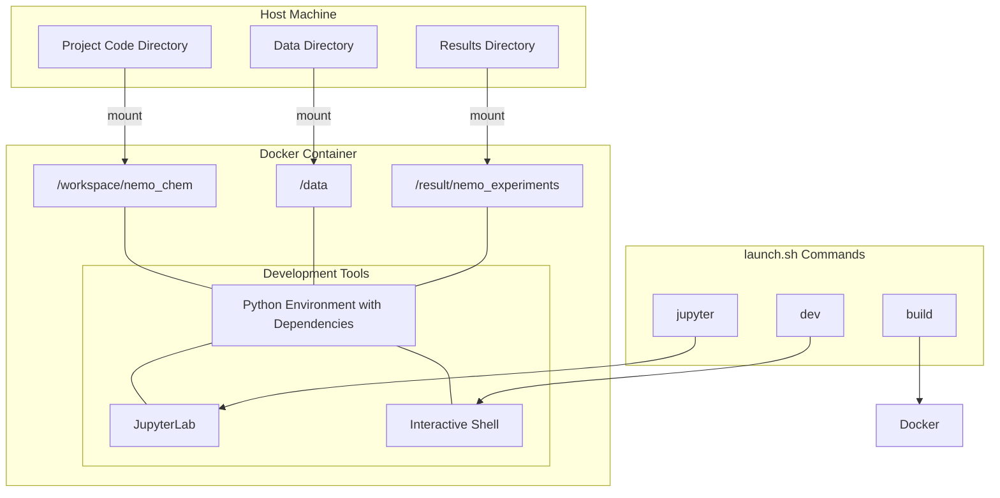
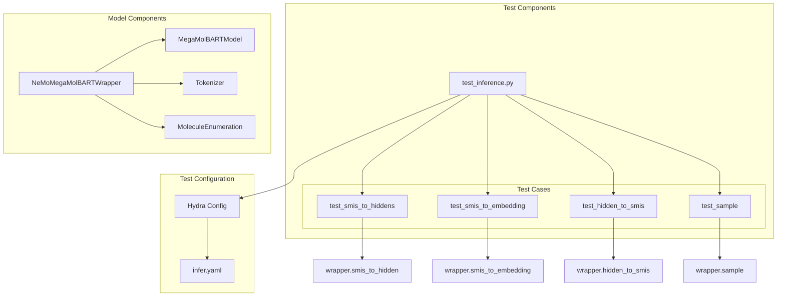

<!-- source: DeepWiki mcp.deepwiki.com · repo NVIDIA/MegaMolBART · page 6 Development and Testing · fetched 2026-10-26 -->

# Development and Testing

<details>
<summary>Relevant source files</summary>

The following files were used as context for generating this wiki page:

- [.dockerignore](.dockerignore)
- [examples/chem/conf/infer.yaml](examples/chem/conf/infer.yaml)
- [examples/chem/megamolbart_eval.py](examples/chem/megamolbart_eval.py)
- [launch.sh](launch.sh)
- [nemo_chem/models/megamolbart/__init__.py](nemo_chem/models/megamolbart/__init__.py)
- [nemo_chem/models/megamolbart/infer.py](nemo_chem/models/megamolbart/infer.py)
- [setup/Dockerfile](setup/Dockerfile)
- [setup/conda/env.yml](setup/conda/env.yml)
- [setup/config_model.sh](setup/config_model.sh)
- [setup/entrypoint.sh](setup/entrypoint.sh)
- [tests/__init__.py](tests/__init__.py)
- [tests/pre_train_model_test.py](tests/pre_train_model_test.py)
- [tests/test_inference.py](tests/test_inference.py)

</details>


This document provides resources for developers working on or extending the MegaMolBART system. It covers how to set up a development environment, run tests, and understand common development workflows.

For deployment in production environments, see [Deployment](#5).

## 6.1 Development Environment

MegaMolBART provides a containerized development environment that ensures consistent dependencies and configurations across different systems. The development environment is managed through the `launch.sh` script which provides various commands for building, running, and interacting with the development container.

### Setting Up the Development Environment

To set up your development environment, you need to:

1. Clone the MegaMolBART repository
2. Create a `.env` file with your configuration (or let `launch.sh` create a default one)
3. Build the development container
4. Launch the development environment

```bash
# Clone repository
git clone https://github.com/NVIDIA/MegaMolBART.git
cd MegaMolBART

# Build the container
./launch.sh build

# Launch development environment
./launch.sh dev
```

When you first run `launch.sh`, it will check for a `.env` file and create one with default values if it doesn't exist. This file contains environment variables that control how the development environment is configured.

### Key Environment Variables

The `.env` file can contain the following important variables:

| Variable | Description | Default |
|----------|-------------|---------|
| `MEGAMOLBART_CONT` | Container image name | `nvcr.io/nvidia/clara/megamolbart_v0.2:0.2.0` |
| `PROJECT_PATH` | Local path to project code | Current directory |
| `DATA_PATH` | Path to data directory | `/tmp` |
| `RESULT_PATH` | Path to store results | `$HOME/results/nemo_experiments` |
| `JUPYTER_PORT` | Port for JupyterLab | `8888` |
| `WANDB_API_KEY` | Weights & Biases API key | Not specified |
| `GITHUB_ACCESS_TOKEN` | GitHub access token | Not specified |

You can customize these values to match your development environment requirements.

### Using the Development Container

The development container provides all dependencies needed to develop and test MegaMolBART. The `launch.sh` script offers several commands for interacting with the container:

```bash
# Start a development shell
./launch.sh dev

# Run a specific command inside the container
./launch.sh dev -c "python -m tests.test_inference"

# Launch JupyterLab
./launch.sh jupyter
```

#### Container Directory Structure

When you launch the development container, the following directories are mounted:

| Host Path | Container Path | Purpose |
|-----------|----------------|---------|
| `$PROJECT_PATH` | `/workspace/nemo_chem` | MegaMolBART code |
| `$DATA_PATH` | `/data` | Data files |
| `$RESULT_PATH` | `/result/nemo_experiments` | Experiment results |

Sources: [launch.sh:128-163]()

### Development Container Architecture



Sources: [launch.sh:26-82](), [launch.sh:307-349](), [launch.sh:369-379](), [setup/Dockerfile:1-76]()

## 6.2 Running Tests

MegaMolBART includes a test suite for verifying the functionality of various components. The tests mainly focus on the inference capabilities of the model, ensuring that encoding and decoding of molecules works correctly.

### Test Directory Structure

The tests are located in the `tests` directory:

| File | Purpose |
|------|---------|
| `test_inference.py` | Tests for the inference wrapper API |
| `pre_train_model_test.py` | Tests for the pre-training model (deprecated) |

### Running Basic Tests

To run the inference tests, you can use the following command from the development container:

```bash
python -m tests.test_inference
```

These tests check that the MegaMolBART model can:

1. Convert SMILES strings to hidden states
2. Convert hidden states back to SMILES strings
3. Generate molecular samples from existing molecules
4. Create molecular embeddings

### Test Components and Flow



Sources: [tests/test_inference.py:1-107](), [nemo_chem/models/megamolbart/infer.py:1-212]()

### Understanding Test Results

The test suite outputs logging information that helps diagnose any issues. When tests pass, you'll see information about:

1. Input and output SMILES strings
2. Hidden state shapes
3. Molecular embedding dimensions
4. Sample generation statistics (total samples, valid molecules)

Here's what the test output typically looks like:

```
[INFO] Input SMILES and Infered: ['c1cc2ccccc2cc1', 'COc1cc2nc(N3CCN(C(=O)c4ccco4)CC3)nc(N)c2cc1OC', 'CC(=O)C(=O)N1CCC([C@H]2CCCCN2C(=O)c2ccc3c(n2)CCN(C(=O)OC(C)(C)C)C3)CC1'], ['c1cc2ccccc2cc1', 'COc1cc2nc(N3CCN(C(=O)c4ccco4)CC3)nc(N)c2cc1OC', 'CC(=O)C(=O)N1CCC([C@H]2CCCCN2C(=O)c2ccc3c(n2)CCN(C(=O)OC(C)(C)C)C3)CC1']
[INFO] Input and Infered:c1cc2ccccc2cc1,  c1cc2ccccc2cc1
[INFO] Canonical Input and Infered: c1ccc2cc3ccccc3cc2c1, c1ccc2cc3ccccc3cc2c1
```

If the tests are successful, the `assert` statements in the test functions will pass silently. If any test fails, you'll see an assertion error with details about what went wrong.

Sources: [tests/test_inference.py:63-76]()

### Key Test Metrics

The molecular generation tests in `test_sample()` check for:

1. **Uniqueness**: The number of unique molecules generated
2. **Validity**: The percentage of generated molecules that are valid (can be parsed by RDKit)
3. **Diversity**: How different the generated molecules are from the input

A warning is displayed if less than 30% of the generated molecules are valid:

```python
if len(valid_molecules) < len(samples) * 0.3:
    log.warning("TOO FEW VALID SAMPLES")
```

Sources: [tests/test_inference.py:100-106]()

## 6.3 Common Workflows

This section outlines typical development workflows when working with MegaMolBART.

### Model Inference Testing Workflow

A common workflow is to test model inference capabilities using the `NeMoMegaMolBARTWrapper` class:

```mermaid
flowchart TD
    subgraph "Inference Testing Workflow"
        loadModel["Load Model"]
        prepareData["Prepare SMILES Strings"]
        runInference["Run Inference"]
        validateResults["Validate Results"]
        
        loadModel --> prepareData
        prepareData --> runInference
        runInference --> validateResults
    end
    
    subgraph "Key Components"
        wrapper["NeMoMegaMolBARTWrapper"]
        model["MegaMolBARTModel"]
        config["infer.yaml"]
        
        wrapper --> model
        config --> wrapper
    end
    
    loadModel --> wrapper.init
    prepareData --> "List[SMILES strings]"
    runInference --> wrapper.smis_to_hidden
    runInference --> wrapper.hidden_to_smis
    runInference --> wrapper.sample
    validateResults --> "RDKit Validation"
```

Sources: [nemo_chem/models/megamolbart/infer.py:20-212](), [tests/test_inference.py:10-20]()

### Working with the Inference API

The `NeMoMegaMolBARTWrapper` class provides the main interface for working with trained MegaMolBART models. It handles:

1. Loading model weights
2. Tokenizing SMILES strings
3. Running inference operations
4. Converting model outputs to SMILES strings

Key methods include:

| Method | Purpose |
|--------|---------|
| `smis_to_hidden` | Convert SMILES strings to hidden states |
| `smis_to_embedding` | Generate molecule embeddings |
| `hidden_to_smis` | Convert hidden states back to SMILES strings |
| `sample` | Generate new molecules by sampling from the model |

Example usage:

```python
from nemo_chem.models.megamolbart import NeMoMegaMolBARTWrapper
from hydra import compose, initialize

# Load configuration and model
with initialize(config_path="examples/chem/conf"):
    cfg = compose(config_name="infer")
    wrapper = NeMoMegaMolBARTWrapper(model_cfg=cfg)

# Inference operations
smiles = ['c1cc2ccccc2cc1']  # Naphthalene
hidden_states, masks = wrapper.smis_to_hidden(smiles)
embedding = wrapper.smis_to_embedding(smiles)
reconstructed = wrapper.hidden_to_smis(hidden_states, masks)
samples = wrapper.sample(smiles, num_samples=10)
```

Sources: [nemo_chem/models/megamolbart/infer.py:135-212](), [tests/test_inference.py:22-107]()

### Model Evaluation

For more detailed model evaluation, you can use the `megamolbart_eval.py` script. This script loads a model and evaluates its ability to reconstruct input molecules:

```bash
python examples/chem/megamolbart_eval.py --model_file /path/to/model.nemo --prompt "C1CC(=O)C1N"
```

The script will:
1. Load the specified model
2. Process the input SMILES string
3. Reconstruct the molecule using the model
4. Compare the input and output to verify model performance

Sources: [examples/chem/megamolbart_eval.py:1-131]()

### Container Building and Management

For development work that requires specific configurations or dependencies, you may need to build custom containers. The `launch.sh` script provides commands for building and managing Docker containers:

```bash
# Build with clean cache
./launch.sh build -c

# Build with a specific base image
./launch.sh build -b custom_base_image:tag

# Push container to a registry
./launch.sh push -v 1.0.0
```

These commands leverage the Docker build system defined in `setup/Dockerfile`.

Sources: [launch.sh:180-232](), [launch.sh:235-277](), [setup/Dockerfile:1-76]()

### JupyterLab Development

For interactive development, the `launch.sh jupyter` command sets up a JupyterLab server with access to the full development environment:

```bash
./launch.sh jupyter
```

This command:
1. Configures the environment with mounted directories
2. Starts JupyterLab on the port specified in your `.env` file (default: 8888)
3. Sets up notebook access without password requirements for local development

You can then access JupyterLab by navigating to `http://localhost:8888` in your browser.

Sources: [launch.sh:369-379](), [setup/entrypoint.sh:1-12]()

---

