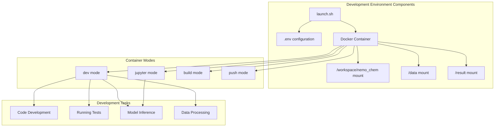
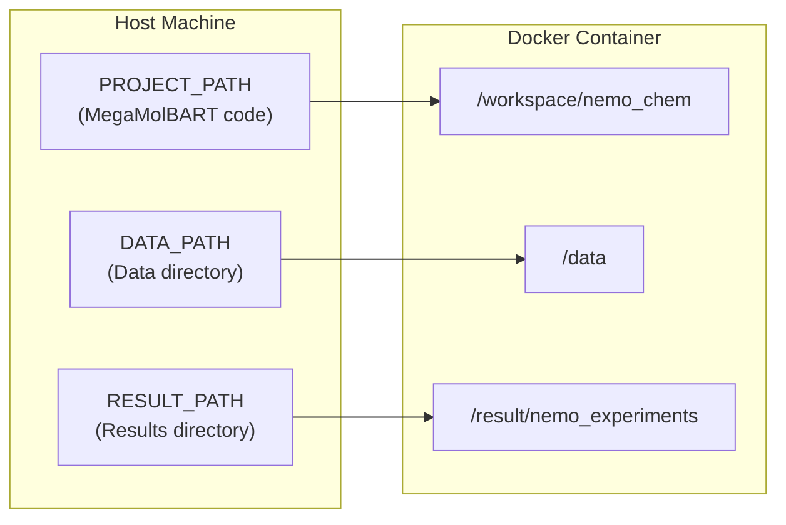
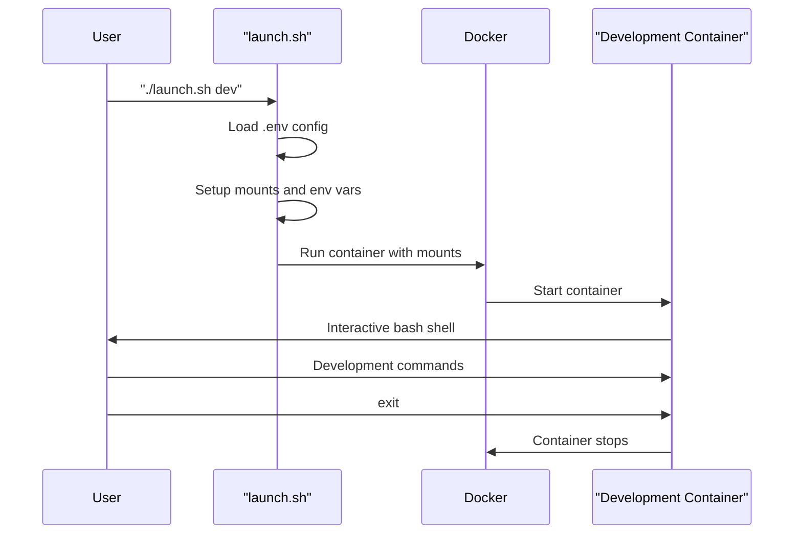

<!-- source: DeepWiki mcp.deepwiki.com · repo NVIDIA/MegaMolBART · page 6.1 Development Environment · fetched 2026-10-26 -->

# Development Environment

<details>
<summary>Relevant source files</summary>

The following files were used as context for generating this wiki page:

- [.dockerignore](.dockerignore)
- [.gitignore](.gitignore)
- [QUICKSTART.md](QUICKSTART.md)
- [README.md](README.md)
- [docs/ngc/base_image.md](docs/ngc/base_image.md)
- [docs/ngc/cmds](docs/ngc/cmds)
- [docs/ngc/model.md](docs/ngc/model.md)
- [docs/ngc/overview.md](docs/ngc/overview.md)
- [docs/ngc/requirements.md](docs/ngc/requirements.md)
- [examples/chem/conf/infer.yaml](examples/chem/conf/infer.yaml)
- [examples/chem/megamolbart_eval.py](examples/chem/megamolbart_eval.py)
- [launch.sh](launch.sh)
- [nemo_chem/models/megamolbart/__init__.py](nemo_chem/models/megamolbart/__init__.py)
- [nemo_chem/models/megamolbart/infer.py](nemo_chem/models/megamolbart/infer.py)
- [setup/Dockerfile](setup/Dockerfile)
- [setup/conda/env.yml](setup/conda/env.yml)
- [setup/config_model.sh](setup/config_model.sh)
- [setup/entrypoint.sh](setup/entrypoint.sh)
- [tests/data/test/metadata.txt](tests/data/test/metadata.txt)
- [tests/data/test/x000.csv](tests/data/test/x000.csv)
- [tests/pre_train_model_test.py](tests/pre_train_model_test.py)
- [tests/test_inference.py](tests/test_inference.py)

</details>


## Purpose and Scope

This document details how to set up and use the development environment for the MegaMolBART project. It covers the configuration of the development environment, the use of the `launch.sh` utility script for container management, and common development workflows. For information about running tests specifically, see [Running Tests](#6.2), and for common development patterns and best practices, see [Common Workflows](#6.3).

## Environment Overview

The MegaMolBART development environment is primarily container-based, providing a consistent and reproducible environment across different systems. The development workflow relies on Docker containers that bundle all necessary dependencies and tools.

### Development Environment Architecture



Sources: [launch.sh](), [README.md]()

## Setting Up the Development Environment

### Environment Configuration

The development environment is configured through a `.env` file in the project root directory. This file contains environment variables that control the behavior of the development container and the `launch.sh` utility script.

#### Required Configuration Variables

| Variable | Description | Example Value |
|----------|-------------|---------------|
| `MEGAMOLBART_CONT` | Container image for MegaMolBART training | `nvcr.io/nvidia/clara/megamolbart_v0.2:0.2.0` |
| `PROJECT_PATH` | Local path to code | `/home/user/Projects/MegaMolBART/` |
| `DATA_PATH` | Path to data directory | `/data/bionemo/data/` |
| `RESULT_PATH` | Path to results directory | `/data/bionemo/results/` |
| `JUPYTER_PORT` | Port for JupyterLab | `8888` |
| `REGISTRY_USER` | Container registry username | `$oauthtoken` |
| `REGISTRY` | Container registry URL | `nvcr.io` |
| `REGISTRY_ACCESS_TOKEN` | Container registry access token | `your_token_here` |
| `WANDB_API_KEY` | Weights and Balances API key | `your_wandb_key_here` |
| `GITHUB_ACCESS_TOKEN` | GitHub API token (for builds) | `your_github_token_here` |
| `GITHUB_BRANCH` | GitHub branch to use | `main` |

The `.env` file will be automatically created with default values when you first run `launch.sh` if it doesn't exist, but you should update it with your specific paths and settings.

Sources: [launch.sh:17-125](), [README.md:41-71]()

### Container Paths and Mounts

When running the development container, several key paths are mounted to provide access to code, data, and results:



Sources: [launch.sh:127-169](), [README.md:15-20]()

## Using the Development Environment

### The `launch.sh` Utility Script

The `launch.sh` script is the primary interface for managing the development environment. It provides commands for building containers, running development sessions, launching JupyterLab, and more.

#### Available Commands

| Command | Description |
|---------|-------------|
| `./launch.sh build` | Build the Docker container |
| `./launch.sh push` | Push the container to a registry |
| `./launch.sh dev` | Start an interactive development shell |
| `./launch.sh run` | Run a command in a new container |
| `./launch.sh jupyter` | Start a JupyterLab server |

Sources: [launch.sh:26-83]()

### Interactive Development Workflow

The most common development workflow uses the `dev` command to start an interactive shell in the container:

```bash
./launch.sh dev
```

This command:
1. Mounts your project, data, and results directories in the container
2. Configures the necessary environment variables
3. Starts an interactive bash shell

For more complex use cases, additional options are available:

| Option | Description | Example |
|--------|-------------|---------|
| `-a` or `--additional-args` | Additional Docker arguments | `./launch.sh dev -a "--gpus 2"` |
| `-t` or `--tmp` | Suffix for container name | `./launch.sh dev -t mydev` |
| `-d` or `--demon` | Run in daemon mode | `./launch.sh dev -d` |
| `-c` or `--cmd` | Override default command | `./launch.sh dev -c python script.py` |

Sources: [launch.sh:307-348](), [README.md:143-177]()

### Development Container Workflow



Sources: [launch.sh:307-348](), [QUICKSTART.md:143-177]()

## JupyterLab Integration

The development environment includes JupyterLab for interactive notebook-based development. To start JupyterLab:

```bash
./launch.sh jupyter
```

This command starts a JupyterLab server on the specified port (default: 8888). The server is accessible at `http://localhost:8888` or `http://hostname:8888`.

JupyterLab provides a web-based interface for working with Jupyter notebooks, which can be useful for interactive exploration and visualization of models and data.

Sources: [launch.sh:369-379](), [QUICKSTART.md:36-40]()

## Building and Customizing Containers

### Building Custom Containers

While the provided NGC container is recommended for most users, you can build custom containers for specific needs:

```bash
./launch.sh build
```

Options for container building include:

| Option | Description | Example |
|--------|-------------|---------|
| `-b` or `--base-image` | Specify a base image | `./launch.sh build -b nvcr.io/nvidia/pytorch:21.08-py3` |
| `-c` or `--clean` | Build without cache | `./launch.sh build -c` |
| `-p` or `--pkg` | Package model in container | `./launch.sh build -p` |

The container build process uses the Dockerfile at `setup/Dockerfile` and includes installing dependencies, setting up the Python environment, and configuring the container for MegaMolBART development.

Sources: [launch.sh:180-232](), [setup/Dockerfile](), [README.md:73-77]()

### Container Registry Integration

Built containers can be pushed to a registry for sharing or deployment:

```bash
./launch.sh push
```

This command authenticates with the registry specified in your `.env` file and pushes the container.

Sources: [launch.sh:234-277]()

## Common Development Tasks

### Running Inference

The development container can be used to run inference with MegaMolBART models. Example using the inference API:

```bash
# Inside the development container
python -m nemo_chem.models.megamolbart.grpc.service
```

For testing inference functionality, the repository includes tests that can be run with:

```bash
pytest --log-cli-level=10 tests/test_inference.py
```

Sources: [README.md:86-87](), [tests/test_inference.py](), [nemo_chem/models/megamolbart/infer.py]()

### Setting Up for Code Development

When developing code within the container, it's recommended to reinstall the package in development mode and recompile any necessary components:

```bash
# Inside the development container
cd /workspace/nemo_chem
pip install -e .
bash setup/recompile_megatron_helper.sh
```

Sources: [QUICKSTART.md:147-177]()

### Model Configuration for Development

The container mounts model configuration files, allowing you to modify them for development purposes. Key configuration files are located in `examples/chem/conf/`.

For inference, the default configuration is loaded from `examples/chem/conf/infer.yaml`, which can be customized for specific model paths and parameters.

Sources: [examples/chem/conf/infer.yaml]()

## Troubleshooting the Development Environment

### Common Issues

1. **Missing .env file**: If configuration variables are not set properly, the container might not have access to necessary resources. Check that your `.env` file has the correct paths and settings.

2. **GPU access issues**: Ensure that your Docker is configured with GPU support. The script uses `--gpus all` for Docker versions 19.03+ and `--runtime=nvidia` for older versions.

3. **Port conflicts**: If the JupyterLab port (default: 8888) is already in use, specify a different port in your `.env` file.

4. **Container build failures**: When building custom containers, ensure that your GitHub access token has the necessary permissions if accessing private repositories.

Sources: [launch.sh:142-151](), [README.md:41-71]()

### Environment Variable Considerations

The development environment relies heavily on environment variables, both within the `.env` file and passed to the container. When customizing the environment, be aware of the following:

1. Paths must be absolute
2. Docker permissions may affect access to mounted volumes
3. GPU access requires proper NVIDIA driver and Docker GPU support configuration

Sources: [launch.sh:84-99]()

---

