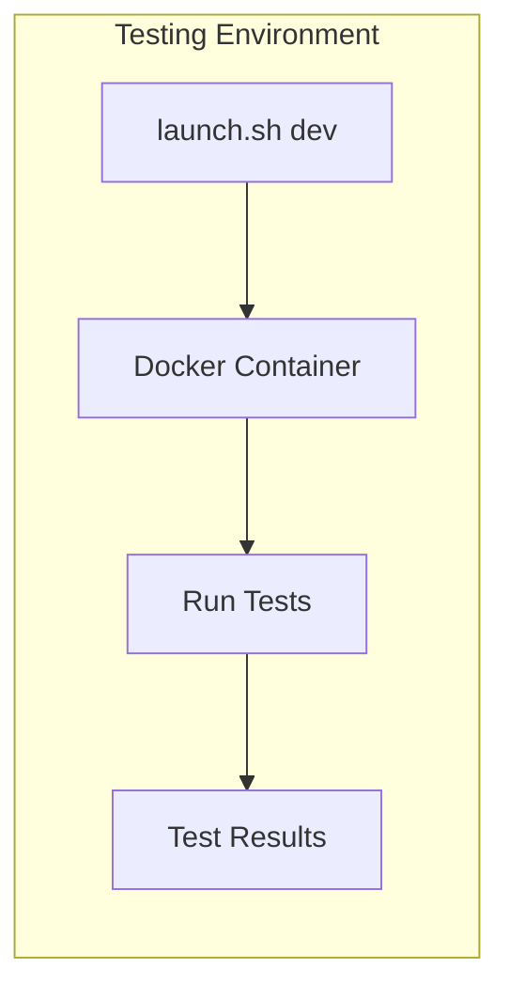
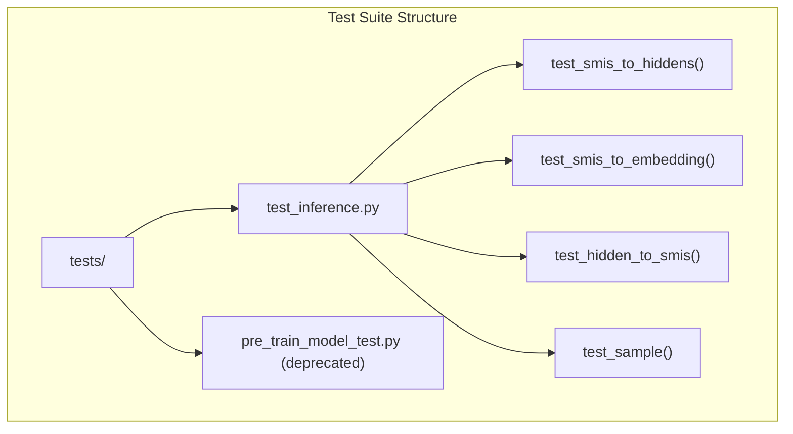
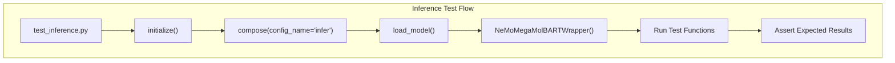
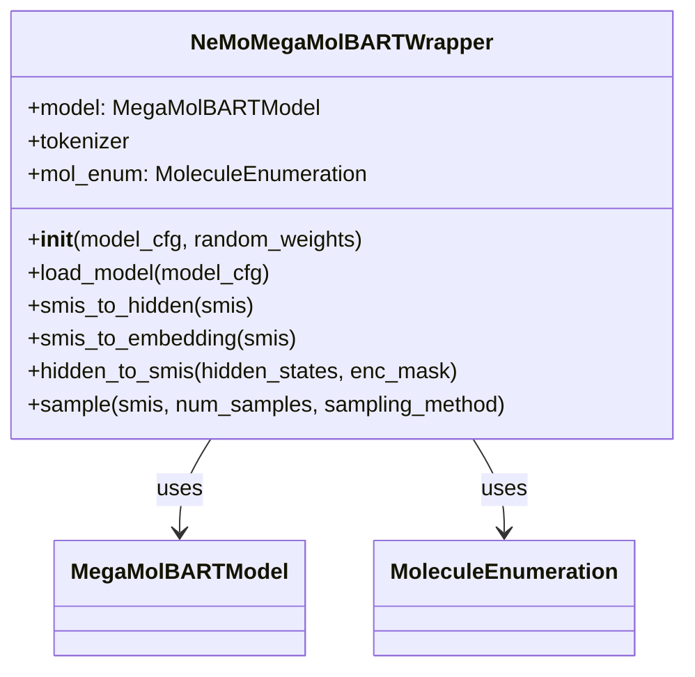

<!-- source: DeepWiki mcp.deepwiki.com · repo NVIDIA/MegaMolBART · page 6.2 Running Tests · fetched 2026-10-26 -->

# Running Tests

<details>
<summary>Relevant source files</summary>

The following files were used as context for generating this wiki page:

- [.dockerignore](.dockerignore)
- [examples/chem/conf/infer.yaml](examples/chem/conf/infer.yaml)
- [examples/chem/megamolbart_eval.py](examples/chem/megamolbart_eval.py)
- [launch.sh](launch.sh)
- [nemo_chem/models/megamolbart/__init__.py](nemo_chem/models/megamolbart/__init__.py)
- [nemo_chem/models/megamolbart/infer.py](nemo_chem/models/megamolbart/infer.py)
- [setup/Dockerfile](setup/Dockerfile)
- [setup/conda/env.yml](setup/conda/env.yml)
- [setup/config_model.sh](setup/config_model.sh)
- [setup/entrypoint.sh](setup/entrypoint.sh)
- [tests/__init__.py](tests/__init__.py)
- [tests/pre_train_model_test.py](tests/pre_train_model_test.py)
- [tests/test_inference.py](tests/test_inference.py)

</details>


This document provides instructions for running tests in the MegaMolBART system. Testing is an essential part of verifying that the model inference functionality works correctly, especially after making changes to the codebase or updating dependencies.

For information about setting up the development environment, see [Development Environment](#6.1).

## Test Environment Setup

Tests in MegaMolBART are designed to be run within the Docker container environment. The following sections outline how to prepare your environment for running tests.

### Using Docker for Testing

The easiest way to run tests is to use the provided Docker container, which comes with all dependencies pre-installed.



Sources: [launch.sh:290-348](), [setup/Dockerfile:16-76]()

To run tests in the Docker container:

1. Build the Docker container if you haven't already:
   ```
   ./launch.sh build
   ```

2. Start a development session:
   ```
   ./launch.sh dev
   ```

3. Inside the container, you will be in the `/workspace/nemo_chem` directory, where you can run the tests.

## Test Suite Structure

The MegaMolBART test suite is organized into separate test files focusing on different aspects of the system.



Sources: [tests/test_inference.py:1-107](), [tests/pre_train_model_test.py:1-261]()

## Running Inference Tests

The primary tests in MegaMolBART are in `test_inference.py`, which verifies the core functionality of the inference pipeline.

### Test Components

The inference tests verify four key capabilities:

1. **Converting SMILES to hidden states** - Tests the encoding functionality
2. **Converting SMILES to embeddings** - Tests the embedding generation
3. **Converting hidden states back to SMILES** - Tests the decoding functionality
4. **Sampling molecules** - Tests the molecule generation capability

### Running the Tests

To run all inference tests:

```bash
cd /workspace/nemo_chem
python -m tests.test_inference
```

You can also run individual tests by specifying the test function:

```bash
cd /workspace/nemo_chem
python -m tests.test_inference::test_sample
```

## Inference Test Implementation Details

The test implementation uses the Hydra configuration system to load model settings from `examples/chem/conf/infer.yaml`.



Sources: [tests/test_inference.py:13-20](), [tests/test_inference.py:22-106]()

The tests use a context manager `load_model()` to create a single model instance that's reused across all tests, which improves efficiency:

```python
@contextmanager
def load_model(inf_cfg):
    global _INFERER
    if _INFERER is None:
        _INFERER = NeMoMegaMolBARTWrapper(model_cfg=inf_cfg)
    yield _INFERER
```

### Test Verification

Tests use assertions to verify that:
- The model can process SMILES strings into hidden representations correctly
- The model can generate molecular embeddings of the correct shape
- The model can accurately reconstruct SMILES strings from hidden states (verifying with RDKit)
- The model can generate valid molecular samples

## Model Configuration for Testing

The test suite uses a default configuration file that specifies model paths and parameters:

| Configuration Option | Default Value | Description |
|----------------------|---------------|-------------|
| model_path | /models/MegaMolBART_0_2_0.nemo | Path to the model file |
| vocab_path | /models/vocab/megamolbart.vocab | Path to vocabulary file |
| model_path | /models/vocab/megamolbart.model | Path to tokenizer model |
| encoder_augment | False | Whether to use augmentation during encoding |
| encoder_mask | False | Whether to use masking during encoding |

Sources: [examples/chem/conf/infer.yaml:1-34]()

## Metrics in Testing

The inference tests evaluate several important metrics:

1. **Character-level Accuracy**: Verifying that the model produces the correct character tokens
2. **Molecular Accuracy**: Checking that the decoded SMILES represent the same chemical structure (using RDKit canonicalization)
3. **Percent Valid**: Ensuring that a sufficient percentage of generated molecules are chemically valid

## Running Evaluation on Pretrained Models

For broader evaluation of a trained model, you can use the `megamolbart_eval.py` script which provides a convenient way to test molecule reconstruction:

```bash
python examples/chem/megamolbart_eval.py --model_file /path/to/model.nemo --prompt "C1=CC=CC=C1"
```

Key parameters:
- `--model_file`: Path to the MegaMolBART model file (.nemo format)
- `--prompt`: SMILES string to reconstruct
- `--tokens_to_generate`: Number of tokens to generate (default: 100)
- `--precision`: Precision to use (16 or 32)

Sources: [examples/chem/megamolbart_eval.py:1-131]()

## Troubleshooting Tests

Common issues when running tests include:

1. **Missing model files**: Ensure the model path in `examples/chem/conf/infer.yaml` points to a valid model file
2. **GPU memory issues**: Tests require a GPU with sufficient memory
3. **Invalid test molecules**: Some molecules may be invalid or too complex to process

The test output includes logging information that can help diagnose issues.

## NeMoMegaMolBARTWrapper Testing Architecture

The following diagram shows the architecture of the `NeMoMegaMolBARTWrapper` class that forms the backbone of the testing infrastructure:



Sources: [nemo_chem/models/megamolbart/infer.py:20-212]()

## Integration with Docker

The tests can also be run directly through the `launch.sh` script by combining the `dev` command with a specific test command:

```bash
./launch.sh dev -c "python -m tests.test_inference"
```

This launches a container, runs the tests, and then exits.

Sources: [launch.sh:307-347]()

## Advanced Testing Features

The inference wrapper supports several advanced testing capabilities:

1. **Loading model with random weights**: Set `random_weights=True` when creating `NeMoMegaMolBARTWrapper`
2. **Different sampling methods**: Use the `sampling_method` parameter in the `sample()` function
3. **Embedding generation**: Get molecule embeddings using `smis_to_embedding()`

By understanding these testing capabilities, you can effectively verify the functionality of the MegaMolBART system and ensure that your models are working correctly.

---

