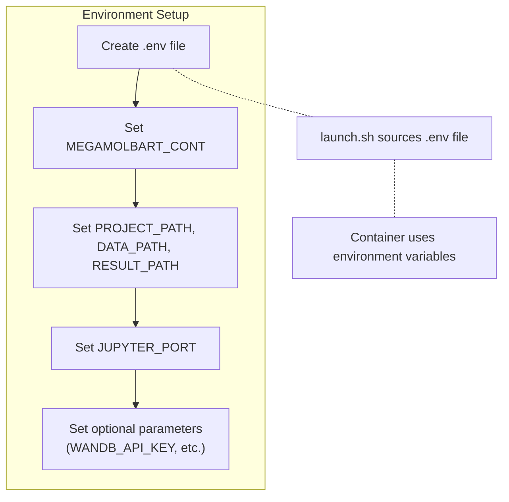
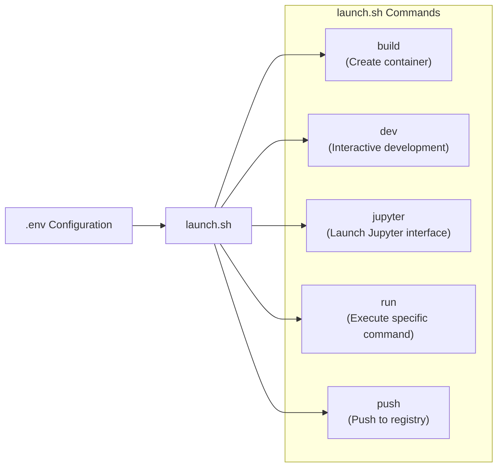
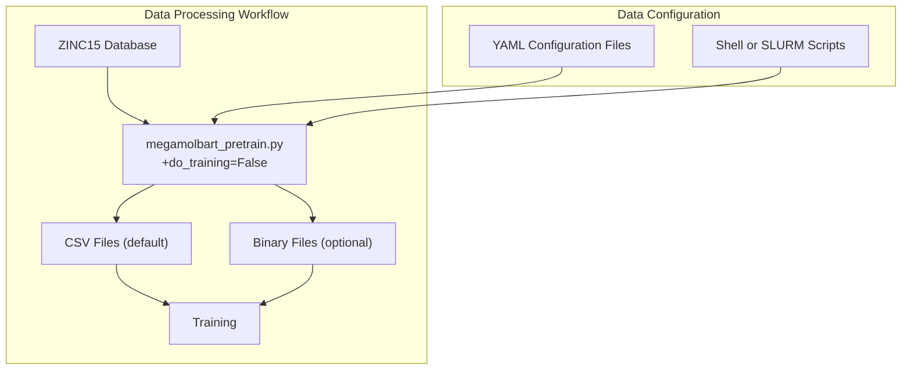
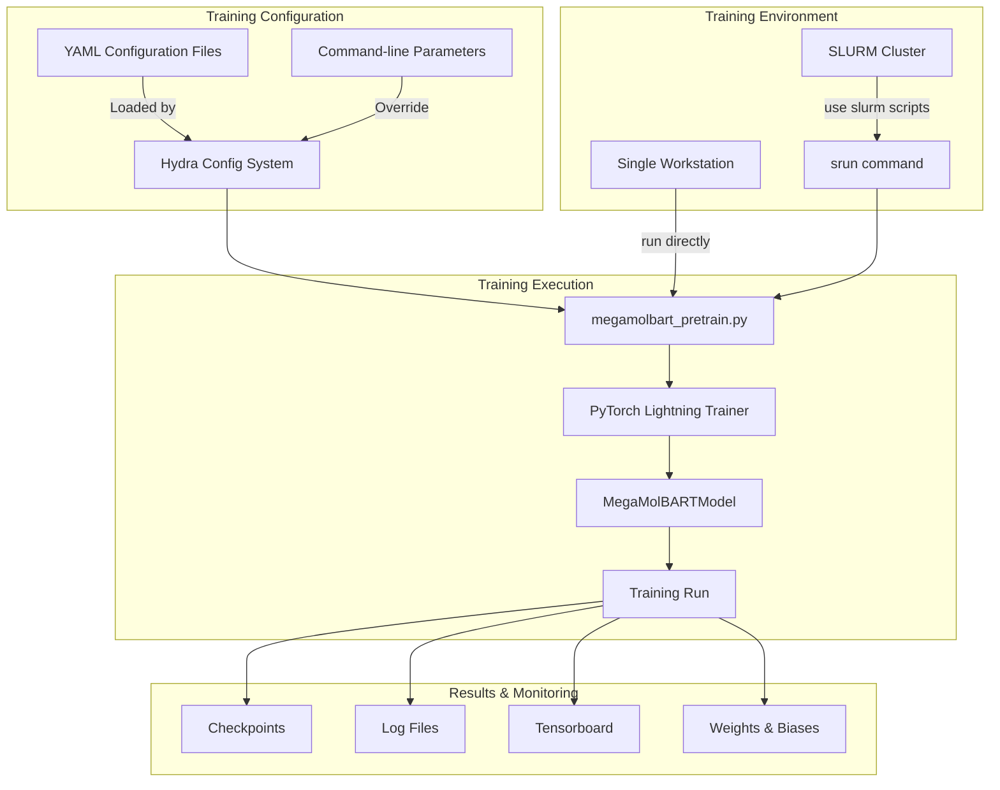
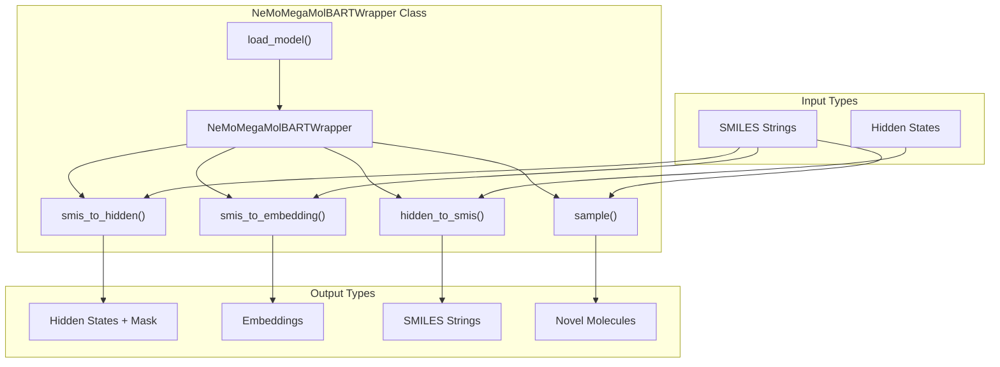
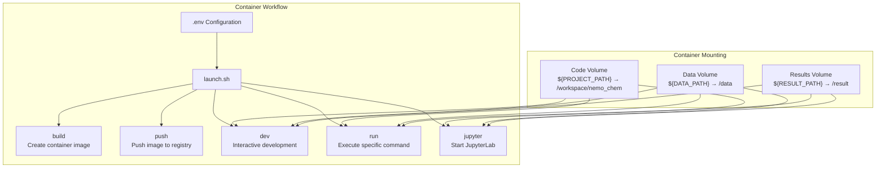
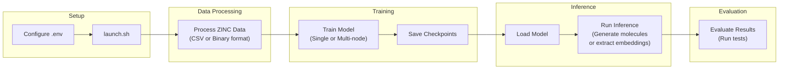

<!-- source: DeepWiki mcp.deepwiki.com · repo NVIDIA/MegaMolBART · page 6.3 Common Workflows · fetched 2026-10-26 -->

# Common Workflows

<details>
<summary>Relevant source files</summary>

The following files were used as context for generating this wiki page:

- [.dockerignore](.dockerignore)
- [.gitignore](.gitignore)
- [QUICKSTART.md](QUICKSTART.md)
- [README.md](README.md)
- [docs/ngc/base_image.md](docs/ngc/base_image.md)
- [docs/ngc/cmds](docs/ngc/cmds)
- [docs/ngc/model.md](docs/ngc/model.md)
- [docs/ngc/overview.md](docs/ngc/overview.md)
- [docs/ngc/requirements.md](docs/ngc/requirements.md)
- [examples/chem/conf/infer.yaml](examples/chem/conf/infer.yaml)
- [examples/chem/megamolbart_eval.py](examples/chem/megamolbart_eval.py)
- [launch.sh](launch.sh)
- [nemo_chem/models/megamolbart/__init__.py](nemo_chem/models/megamolbart/__init__.py)
- [nemo_chem/models/megamolbart/infer.py](nemo_chem/models/megamolbart/infer.py)
- [setup/Dockerfile](setup/Dockerfile)
- [setup/conda/env.yml](setup/conda/env.yml)
- [setup/config_model.sh](setup/config_model.sh)
- [setup/entrypoint.sh](setup/entrypoint.sh)
- [tests/__init__.py](tests/__init__.py)
- [tests/data/test/metadata.txt](tests/data/test/metadata.txt)
- [tests/data/test/x000.csv](tests/data/test/x000.csv)
- [tests/pre_train_model_test.py](tests/pre_train_model_test.py)
- [tests/test_inference.py](tests/test_inference.py)

</details>


## Purpose and Scope

This page documents common development and operational workflows when working with MegaMolBART. It describes practical patterns for setting up environments, processing data, training models, and running inference operations. For detailed information on the development environment setup, refer to [Development Environment](#6.1). For specific details on running tests, see [Running Tests](#6.2).

## Development Environment Setup

Setting up a proper development environment is the first step in working with MegaMolBART. The project provides the `launch.sh` script as a central utility for managing Docker containers across all workflows.

### Environment Configuration

Before using any workflow, you need to configure your environment by creating a `.env` file in the project root. This file defines key paths and configuration settings.



Sources: [launch.sh:17-125](), [README.md:42-71]()

A typical `.env` file contains:

```
MEGAMOLBART_CONT=nvcr.io/nvidia/clara/megamolbart:0.2.0
PROJECT_PATH=/path/to/MegaMolBART/
DATA_PATH=/path/to/data/
RESULT_PATH=/path/to/results/
JUPYTER_PORT=8888
WANDB_API_KEY=your_key_if_available
```

### Common Container Commands

The `launch.sh` script offers several subcommands for different workflows:



Sources: [launch.sh:26-80](), [README.md:74-89]()

#### Development Container

For interactive development, use the dev command:

```
./launch.sh dev
```

This launches a container with:
- Code mounted at `/workspace/nemo_chem`
- Data mounted at `/data`
- Results mounted at `/result`

#### JupyterLab Interface

For notebook-based development:

```
./launch.sh jupyter
```

This launches a JupyterLab interface on the configured port.

Sources: [launch.sh:365-379](), [README.md:16-39]()

## Data Processing Workflows

Data processing for MegaMolBART primarily involves working with SMILES strings from the ZINC-15 database. There are two main data format workflows: CSV and binary.

### Data Processing Overview



Sources: [README.md:112-157](), [QUICKSTART.md:21-53]()

### CSV Data Processing

CSV is the default data format. To process ZINC data into CSV:

1. Ensure `dataset_format: csv` is in your model configuration YAML 
2. Set `do_training: False` in your configuration or use `++do_training=False` on command line
3. Run the processing command:

```
python megamolbart_pretrain.py --config-path=conf --config-name=megamolbart_pretrain_xsmall_span_aug ++do_training=False
```

### Binary Data Processing

For potentially faster training, you can use the binary data format:

1. Set `dataset_format: bin` in your model configuration YAML
2. Set `num_enumerations` to specify how many SMILES enumerations to store (e.g., 5)
3. Run the processing command as with CSV

Binary processing first creates CSV files if they don't exist, then converts them to binary format.

Sources: [README.md:130-141](), [QUICKSTART.md:112-123]()

## Training Workflows

Training MegaMolBART models involves running the pretrain script with appropriate configuration. There are workflows for single-node and distributed training.

### Training Workflow Overview



Sources: [QUICKSTART.md:57-138](), [README.md:143-160]()

### Workstation Training

For training on a single workstation:

1. Prepare your configuration YAML (typically in `examples/chem/conf/`)
2. Run the training command:

```
python megamolbart_pretrain.py --config-path=conf --config-name=megamolbart_pretrain_xsmall_span_aug
```

### Distributed Training with SLURM

For multi-node training on a SLURM cluster:

1. Prepare a SLURM script defining nodes, GPUs, and other parameters
2. Set appropriate YAML configuration and override parameters for distributed training
3. Submit the SLURM job

A typical SLURM command might look like:

```
srun --container-image ${CONTAINER} --container-mounts ${MOUNTS} python megamolbart_pretrain.py --config-path=conf --config-name=megamolbart_pretrain_large_span_aug ++trainer.num_nodes=${SLURM_JOB_NUM_NODES} ++trainer.gpus=${SLURM_NTASKS_PER_NODE}
```

### Training Output

The training process produces:
- Checkpoints in the `checkpoints` directory
- Log files (`cmd-args.log`, `hparams.yaml`, etc.)
- Tensorboard logs for visualization
- Optional Weights & Biases logs if configured

Sources: [QUICKSTART.md:179-198](), [README.md:143-160]()

## Inference Workflows

MegaMolBART provides several inference workflows through the `NeMoMegaMolBARTWrapper` class, allowing you to generate molecules and extract embeddings.

### Inference Workflow Overview



Sources: [nemo_chem/models/megamolbart/infer.py:19-212](), [tests/test_inference.py:10-106]()

### Loading a Model

To perform inference, first load a pretrained model:

```python
from nemo_chem.models.megamolbart import NeMoMegaMolBARTWrapper
from hydra import compose, initialize

# Load configuration
with initialize(config_path="conf"):
    cfg = compose(config_name="infer")

# Initialize wrapper with model
inferer = NeMoMegaMolBARTWrapper(model_cfg=cfg)
```

### Common Inference Operations

Four main inference operations are available:

1. **Converting SMILES to hidden states**:
   ```python
   smiles = ["CCO", "c1ccccc1"]
   hidden_states, mask = inferer.smis_to_hidden(smiles)
   ```

2. **Extracting embeddings from SMILES**:
   ```python
   embeddings = inferer.smis_to_embedding(smiles)
   ```

3. **Converting hidden states back to SMILES**:
   ```python
   new_smiles = inferer.hidden_to_smis(hidden_states, mask)
   ```

4. **Sampling new molecules**:
   ```python
   sampled_molecules = inferer.sample(smiles, num_samples=10)
   ```

Sources: [tests/test_inference.py:22-106](), [nemo_chem/models/megamolbart/infer.py:134-212]()

### Model Evaluation

The test suite includes tests to verify:
- Successful translation from SMILES to hidden states and back
- Validity of generated molecules
- Quality of sampled molecules

You can run these tests to verify your model's performance:

```bash
pytest --log-cli-level=10 tests/test_inference.py
```

Sources: [tests/test_inference.py:53-106](), [README.md:162-176]()

## Container-based Workflows

MegaMolBART leverages Docker containers for consistent environment setup across development, training, and deployment. The `launch.sh` script provides a unified interface for all container operations.

### Container Management



Sources: [launch.sh:127-379](), [README.md:42-89]()

### Development Container Workflow

A typical interactive development workflow:

1. Configure your `.env` file
2. Start a development container:
   ```bash
   ./launch.sh dev
   ```
3. Inside the container:
   - Install development code: `pip install -e .`
   - Recompile Megatron helpers if needed: `bash setup/recompile_megatron_helper.sh`
   - Run code or tests

### Using Custom Arguments

The `launch.sh` script accepts additional arguments for customization:

```bash
# Use a specific command
./launch.sh dev -c "python examples/chem/megamolbart_pretrain.py --config-path=conf --config-name=megamolbart_pretrain_xsmall_span_aug"

# Add custom Docker arguments
./launch.sh dev -a "--gpus 1"

# Run in daemon mode
./launch.sh dev -d
```

Sources: [launch.sh:306-348](), [QUICKSTART.md:142-177]()

## End-to-End Workflow Example

Below is a complete end-to-end workflow for training and using a MegaMolBART model:



Sources: [README.md:90-176](), [QUICKSTART.md:1-198]()

1. **Setup**:
   - Configure `.env` with paths and settings
   - Build container if needed: `./launch.sh build`

2. **Data Processing**:
   - Process ZINC data: `./launch.sh dev -c "python examples/chem/megamolbart_pretrain.py --config-path=conf --config-name=megamolbart_pretrain_xsmall_span_aug ++do_training=False"`

3. **Training**:
   - Train a model: `./launch.sh dev -c "python examples/chem/megamolbart_pretrain.py --config-path=conf --config-name=megamolbart_pretrain_xsmall_span_aug"`
   - Monitor training with Tensorboard or Weights & Biases

4. **Inference**:
   - Update `examples/chem/conf/infer.yaml` with your model path
   - Run inference using `NeMoMegaMolBARTWrapper`

5. **Evaluation**:
   - Test inference capabilities: `./launch.sh dev -c "pytest --log-cli-level=10 tests/test_inference.py"`

This workflow can be customized according to your specific needs for research or production use cases.