# Page: Overview

# Overview

<details>
<summary>Relevant source files</summary>

The following files were used as context for generating this wiki page:

- [.gitignore](.gitignore)
- [QUICKSTART.md](QUICKSTART.md)
- [README.md](README.md)
- [docs/ngc/base_image.md](docs/ngc/base_image.md)
- [docs/ngc/cmds](docs/ngc/cmds)
- [docs/ngc/model.md](docs/ngc/model.md)
- [docs/ngc/overview.md](docs/ngc/overview.md)
- [docs/ngc/requirements.md](docs/ngc/requirements.md)
- [nemo_chem/package_info.py](nemo_chem/package_info.py)
- [setup.py](setup.py)
- [tests/data/test/metadata.txt](tests/data/test/metadata.txt)
- [tests/data/test/x000.csv](tests/data/test/x000.csv)

</details>


MegaMolBART is a deep learning model for small molecule drug discovery and cheminformatics based on SMILES (Simplified Molecular Input Line Entry System) strings. It leverages NVIDIA's NeMo-Megatron framework, which is designed for the development of large transformer models. This overview introduces the system's purpose, architecture, and key components as implemented in the MegaMolBART repository. For detailed installation instructions, see [Installation and Setup](#1.2).

## Purpose and Applications

MegaMolBART addresses several challenges in computational chemistry:

- **Molecule representation learning**: Learning meaningful vector representations of chemical compounds
- **Molecule generation**: Creating novel molecules with desired properties
- **Chemical space exploration**: Enabling navigation of the vast space of possible molecules

The model's encoder can provide embeddings for use in downstream predictive models, while the encoder-decoder architecture together enables generation of new molecular structures.

Sources: [README.md:3-9](), [docs/ngc/model.md:1-4]()

## System Architecture

MegaMolBART employs a transformer-based architecture with the following components:

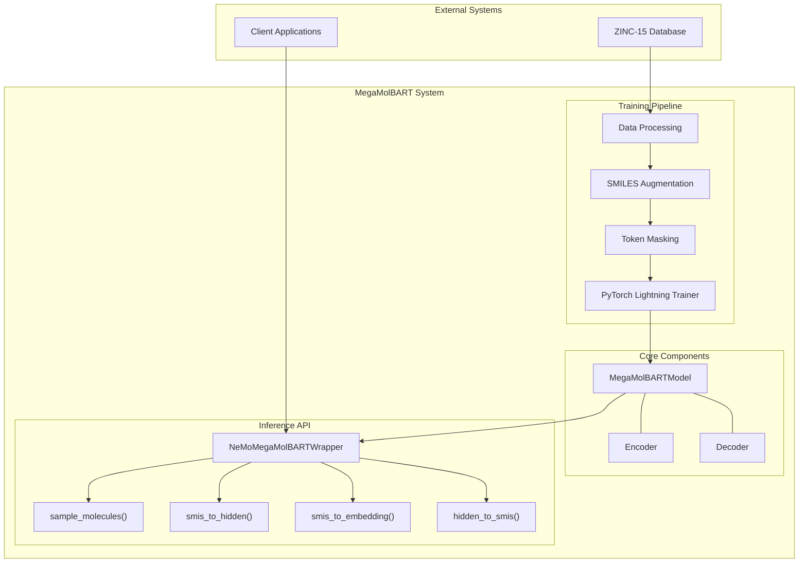

**Model Architecture Diagram**

The architecture is based on BART (Bidirectional and Auto-Regressive Transformer), which consists of a bidirectional encoder and an autoregressive decoder. During training, the model learns to reconstruct SMILES strings from partially masked or corrupted inputs.

Sources: [README.md:5-7](), [docs/ngc/model.md:5-7]()

## Implementation Framework

MegaMolBART is implemented using:

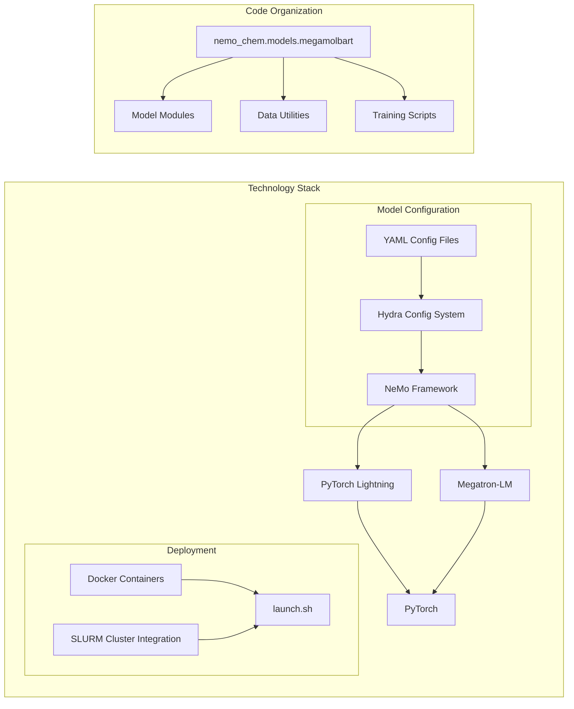

**Implementation Framework Diagram**

The system leverages:
- **NeMo**: Provides a framework for building, training, and fine-tuning neural modules
- **PyTorch Lightning**: Handles training loop organization and distributed training
- **Megatron-LM**: Enables efficient model parallelism for large transformer models
- **Hydra**: Manages configuration hierarchies and parameter overrides
- **Docker**: Ensures consistent environments across development, training, and inference

Sources: [README.md:7-9](), [QUICKSTART.md:11-20]()

## Key Components

### Model Variants

MegaMolBART offers multiple model configurations to suit different computational budgets:

| Configuration | Layers | Hidden Size | Attention Heads | Typical GPU Requirements |
|---------------|--------|-------------|-----------------|--------------------------|
| XSmall        | 2      | 256         | 4               | 1 GPU                   |
| Small         | 6      | 512         | 8               | 8+ GPUs                 |
| Large         | 8      | 1024        | 16              | 64+ GPUs                |
| XLarge        | *Larger than Large* | | | |

### Data Processing Pipeline

The data processing pipeline includes:
1. **Data acquisition**: Downloading from ZINC-15 database
2. **Filtering**: Removing molecules exceeding 512 characters
3. **Train/validation/test splitting**: 99% / 0.5% / 0.5% split
4. **Data augmentation**: Masking and SMILES randomization
5. **Tokenization**: Converting SMILES strings to token sequences

### Training System

Training is managed through configuration files and scripts that:
- Define model architecture parameters
- Configure optimization hyperparameters
- Specify data processing steps
- Support distributed training across multiple GPUs and nodes

### Inference System

The model's inference capabilities include:
- Sampling new molecules from the learned distribution
- Converting SMILES strings to vector embeddings
- Generating molecules similar to a given input

Sources: [README.md:96-101](), [docs/ngc/model.md:19-25]()

## Getting Started

MegaMolBART is provided as a Docker container for ease of use:

```bash
# For Docker version 19.03 or later
docker run \
    --gpus all \
    --rm \
    -p 8888:8888 \
    nvcr.io/nvidia/clara/megamolbart_v0.2:0.2.0
```

The `launch.sh` script simplifies container management for development, data processing, training, and inference. For detailed usage, see the [Installation and Setup](#1.2) section.

Sources: [README.md:16-36](), [QUICKSTART.md:22-53]()

---

# Page: System Architecture

# System Architecture

<details>
<summary>Relevant source files</summary>

The following files were used as context for generating this wiki page:

- [.dockerignore](.dockerignore)
- [.gitignore](.gitignore)
- [QUICKSTART.md](QUICKSTART.md)
- [README.md](README.md)
- [docs/ngc/base_image.md](docs/ngc/base_image.md)
- [docs/ngc/cmds](docs/ngc/cmds)
- [docs/ngc/model.md](docs/ngc/model.md)
- [docs/ngc/overview.md](docs/ngc/overview.md)
- [docs/ngc/requirements.md](docs/ngc/requirements.md)
- [examples/chem/conf/infer.yaml](examples/chem/conf/infer.yaml)
- [examples/chem/conf/megamolbart_pretrain_base.yaml](examples/chem/conf/megamolbart_pretrain_base.yaml)
- [examples/chem/megamolbart_eval.py](examples/chem/megamolbart_eval.py)
- [examples/chem/shell/megamolbart_pretrain_quick.sh](examples/chem/shell/megamolbart_pretrain_quick.sh)
- [launch.sh](launch.sh)
- [nemo_chem/data/augment.py](nemo_chem/data/augment.py)
- [nemo_chem/data/csv_dataset.py](nemo_chem/data/csv_dataset.py)
- [nemo_chem/data/preprocess/preprocess.py](nemo_chem/data/preprocess/preprocess.py)
- [nemo_chem/data/utils.py](nemo_chem/data/utils.py)
- [nemo_chem/models/megamolbart/__init__.py](nemo_chem/models/megamolbart/__init__.py)
- [nemo_chem/models/megamolbart/infer.py](nemo_chem/models/megamolbart/infer.py)
- [nemo_chem/models/megamolbart/megamolbart_model.py](nemo_chem/models/megamolbart/megamolbart_model.py)
- [nemo_chem/utils/__init__.py](nemo_chem/utils/__init__.py)
- [setup/Dockerfile](setup/Dockerfile)
- [setup/conda/env.yml](setup/conda/env.yml)
- [setup/config_model.sh](setup/config_model.sh)
- [setup/entrypoint.sh](setup/entrypoint.sh)
- [tests/data/test/metadata.txt](tests/data/test/metadata.txt)
- [tests/data/test/x000.csv](tests/data/test/x000.csv)
- [tests/pre_train_model_test.py](tests/pre_train_model_test.py)
- [tests/test_inference.py](tests/test_inference.py)

</details>


This page provides a comprehensive overview of the MegaMolBART system architecture, explaining the key components, their responsibilities, and how they interact. MegaMolBART is a deep learning framework for molecular representation learning and generation using transformer-based models operating on SMILES strings (Simplified Molecular Input Line Entry System - a text representation of molecules).

For more details on using and installing the system, see [Installation and Setup](#1.2).

## High-Level Architecture Overview

The MegaMolBART system consists of several core subsystems working together to enable molecular representation learning, processing, and generation.

### Overall System Architecture

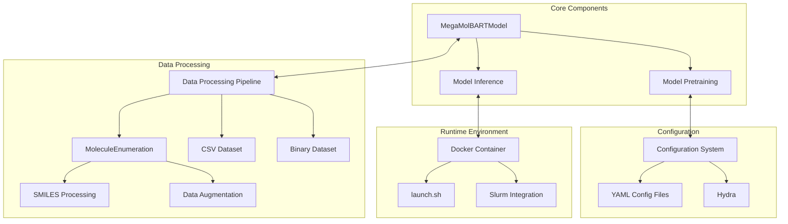

Sources: [launch.sh:1-405](), [nemo_chem/models/megamolbart/megamolbart_model.py:1-330](), [examples/chem/conf/megamolbart_pretrain_base.yaml:1-144](), [nemo_chem/data/augment.py:1-278]()

## Core Components

### MegaMolBARTModel

At the heart of the system is the `MegaMolBARTModel` class, which inherits from NeMo's `MegatronLMEncoderDecoderModel`. This class represents a transformer-based encoder-decoder architecture specialized for molecular representation learning.

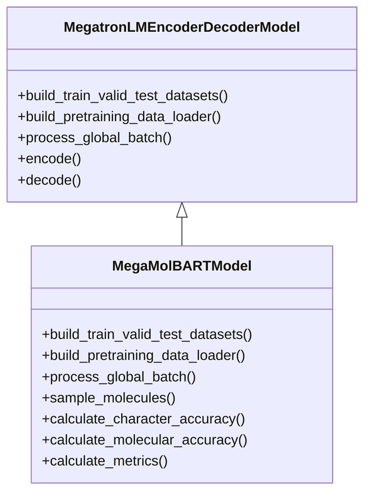

Key responsibilities of the MegaMolBARTModel:
- Loads and processes molecular data (SMILES strings)
- Manages the encoder-decoder transformer architecture
- Provides methods for training and inference
- Calculates metrics like character accuracy and molecular accuracy
- Offers molecule sampling and generation capabilities

Sources: [nemo_chem/models/megamolbart/megamolbart_model.py:37-329]()

### NeMoMegaMolBARTWrapper

For inference, the system provides the `NeMoMegaMolBARTWrapper` class, which wraps the model and provides simplified APIs for inference operations.

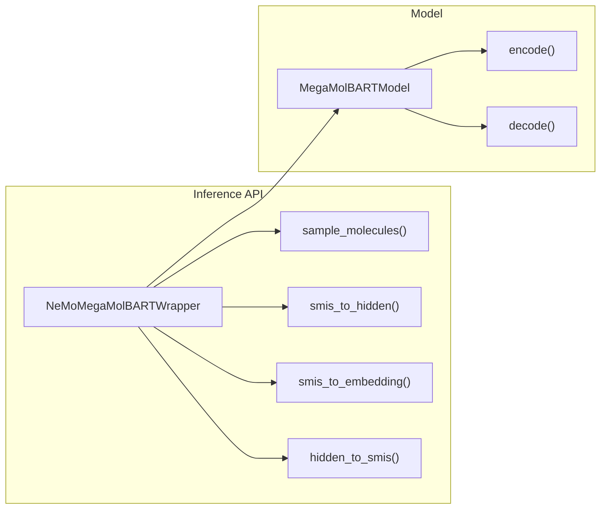

Key functionality:
- Converting SMILES strings to hidden representations
- Converting hidden representations back to SMILES strings
- Generating new molecules via sampling
- Computing embeddings for molecules

Sources: [nemo_chem/models/megamolbart/infer.py:1-213](), [tests/test_inference.py:1-107]()

## Data Processing System

The data pipeline is a crucial component of MegaMolBART, responsible for processing SMILES strings, tokenizing them, applying augmentations, and preparing batches for training or inference.

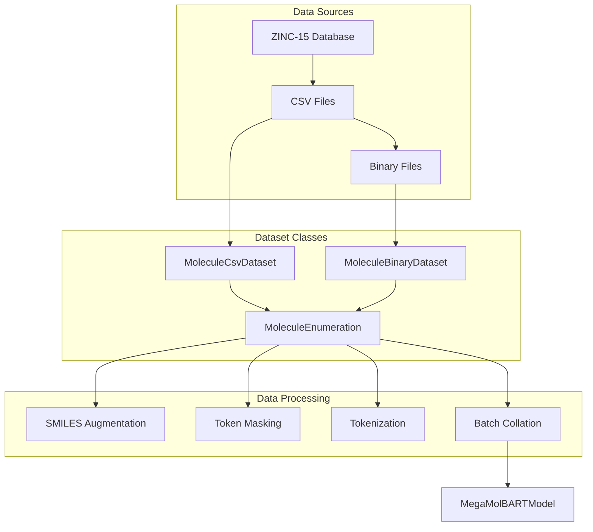

Key components:
- **MoleculeEnumeration**: Handles SMILES augmentation, tokenization, masking, and batch preparation
- **Dataset Classes**: Support different data formats (CSV, binary)
- **Data Augmentation**: Random SMILES, masking schemes
- **Batch Collation**: Prepares data batches with proper masking and padding

The system supports two main data formats:
1. **CSV Format**: Direct processing of SMILES strings
2. **Binary Format**: Pre-processed data for faster loading

Sources: [nemo_chem/data/augment.py:1-278](), [nemo_chem/data/csv_dataset.py:1-85](), [nemo_chem/data/utils.py:1-134](), [nemo_chem/data/preprocess/preprocess.py:1-216]()

### MoleculeEnumeration

The `MoleculeEnumeration` class is central to data processing:

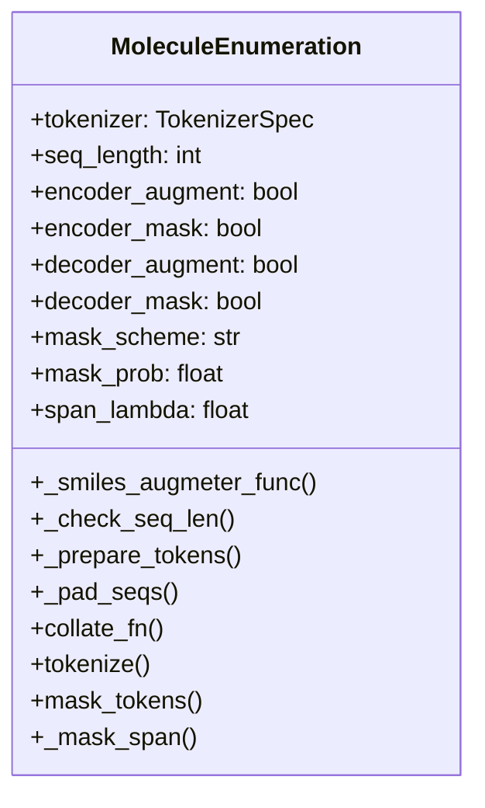

This class handles:
- SMILES string augmentation (randomization)
- Tokenization of SMILES strings
- Token masking for pretraining (BART-style)
- Sequence padding and batch preparation
- Encoder/decoder input preparation

Sources: [nemo_chem/data/augment.py:31-278]()

## Configuration System

MegaMolBART uses a hierarchical configuration system based on YAML files and Hydra.

```mermaid
flowchart TB
    subgraph "Configuration System"
        BASE["megamolbart_pretrain_base.yaml"]
        XS["xsmall_span_aug.yaml"]
        SM["small_span_aug.yaml"]
        LG["large_span_aug.yaml"]
        XL["xlarge_span_aug.yaml"]
        
        BASE --> XS
        BASE --> SM
        BASE --> LG
        BASE --> XL
    end
    
    subgraph "Configuration Categories"
        M_CFG["Model Configuration"]
        T_CFG["Training Configuration"]
        D_CFG["Data Configuration"]
        E_CFG["Experiment Configuration"]
        
        BASE --> M_CFG
        BASE --> T_CFG
        BASE --> D_CFG
        BASE --> E_CFG
    end
    
    subgraph "Model Parameters"
        LAYERS["num_layers"]
        HIDDEN["hidden_size"]
        HEADS["num_attention_heads"]
        FF["ffn_hidden_size"]
        SEQ["seq_length"]
        
        M_CFG --> LAYERS
        M_CFG --> HIDDEN
        M_CFG --> HEADS
        M_CFG --> FF
        M_CFG --> SEQ
    end
    
    subgraph "Training Parameters"
        BATCH["global_batch_size"]
        MICRO["micro_batch_size"]
        OPT["optimizer"]
        SCHED["scheduler"]
        PREC["precision"]
        
        T_CFG --> BATCH
        T_CFG --> MICRO
        T_CFG --> OPT
        T_CFG --> SCHED
        T_CFG --> PREC
    end
    
    subgraph "Data Parameters"
        PATH["dataset_path"]
        FORMAT["dataset_format"]
        MASK_PROB["mask_prob"]
        SPAN["span_lambda"]
        AUG_ENC["encoder_augment"]
        
        D_CFG --> PATH
        D_CFG --> FORMAT
        D_CFG --> MASK_PROB
        D_CFG --> SPAN
        D_CFG --> AUG_ENC
    end
```

Main configuration files:
- `megamolbart_pretrain_base.yaml`: Base configuration with defaults
- Model-specific configurations:
  - `xsmall_span_aug.yaml`: Extra small model (2 layers, 256 hidden size)
  - `small_span_aug.yaml`: Small model (6 layers, 512 hidden size)
  - `large_span_aug.yaml`: Large model (8 layers, 1024 hidden size)

The configuration system allows for:
- Model architecture configuration
- Training hyperparameters
- Data processing options
- Experiment tracking configuration

Sources: [examples/chem/conf/megamolbart_pretrain_base.yaml:1-144](), [README.md:96-101]()

## Deployment and Runtime Environment

MegaMolBART is designed to be run in a containerized environment, with the `launch.sh` script providing a unified interface for all operations.

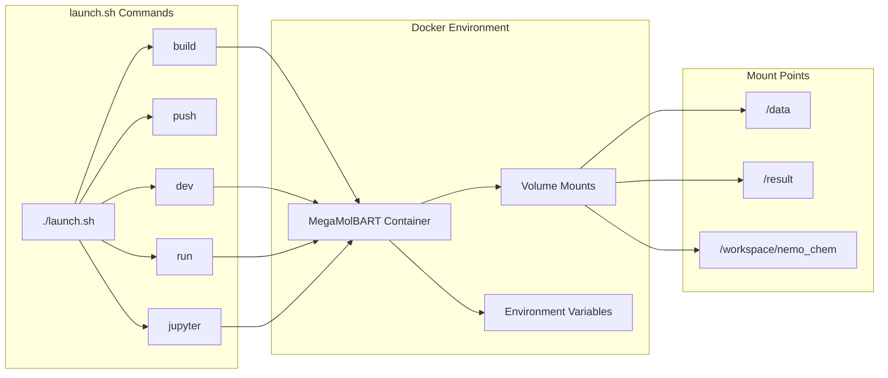

The `launch.sh` script provides:
- Container building and management
- Development environment setup
- Training and inference execution
- Jupyter notebook integration
- Environment configuration via `.env` file

Sources: [launch.sh:1-405](), [setup/Dockerfile:1-76](), [QUICKSTART.md:1-198]()

## Training System

The training system coordinates the model, data processing, and configuration to enable efficient pretraining of MegaMolBART models.

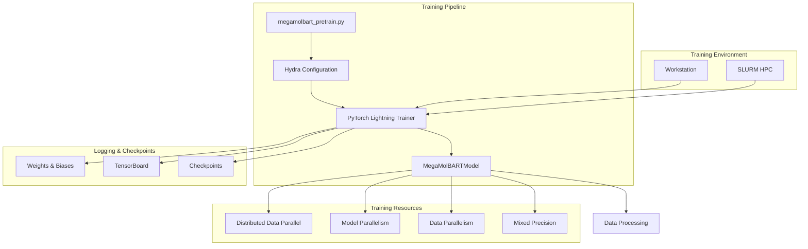

Key training components:
- PyTorch Lightning for training management
- NeMo extensions for Megatron-LM integration
- Distributed training support (DDP, model parallelism)
- Mixed precision training
- Logging and checkpoint management

Sources: [examples/chem/shell/megamolbart_pretrain_quick.sh:1-131](), [QUICKSTART.md:57-140]()

## Inference System

The inference system provides interfaces for using pretrained MegaMolBART models for various tasks.

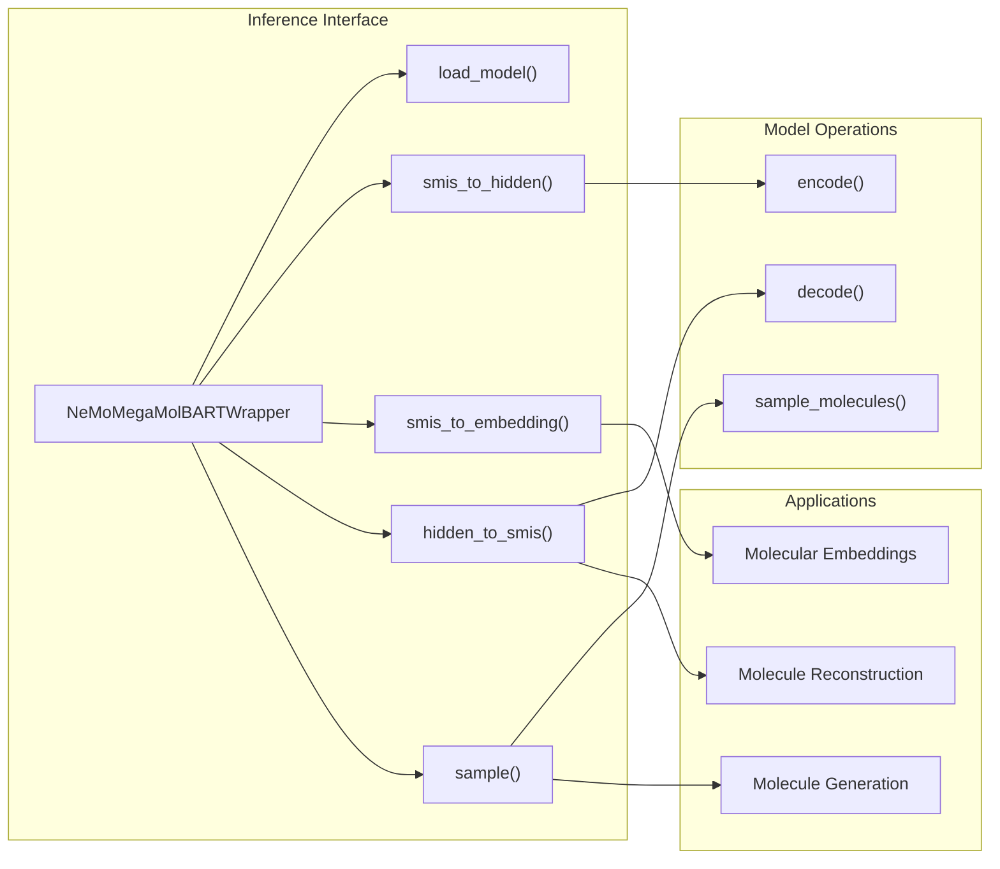

Key inference capabilities:
- Loading pretrained models
- Converting SMILES to hidden representations
- Converting hidden representations to SMILES
- Sampling molecules from latent space
- Computing molecular embeddings

Sources: [nemo_chem/models/megamolbart/infer.py:1-213](), [examples/chem/conf/infer.yaml:1-35](), [tests/test_inference.py:1-107]()

## Dataflow During Training

This diagram illustrates the flow of data during the training process:

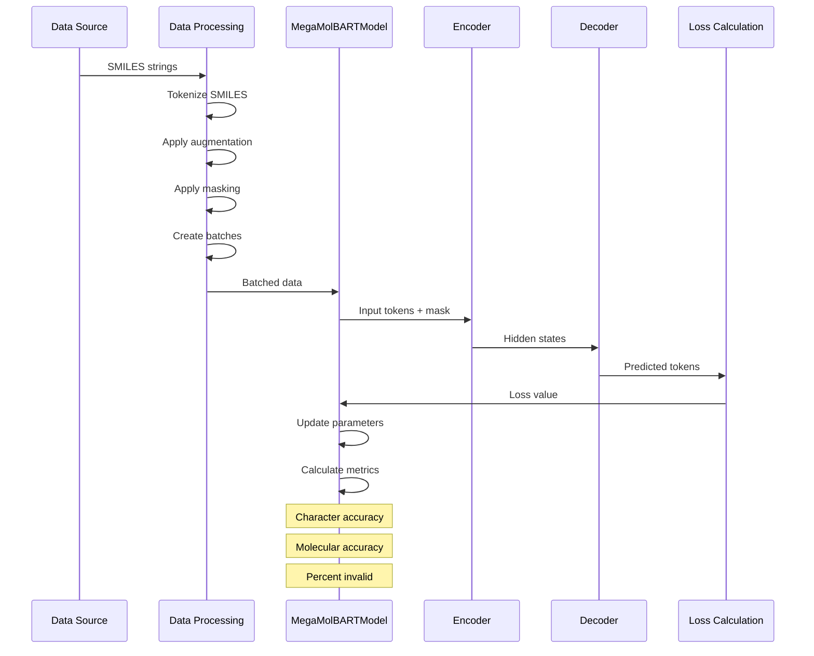

Sources: [nemo_chem/models/megamolbart/megamolbart_model.py:60-204](), [nemo_chem/data/augment.py:143-196]()

## Model Size Configurations

MegaMolBART supports multiple model size configurations to accommodate different computational resources:

| Configuration | Layers | Hidden Size | Attention Heads | Parameters | Recommended GPUs |
|---------------|--------|-------------|----------------|------------|-----------------|
| XSmall        | 2      | 256         | 4              | ~10M       | 1-8             |
| Small         | 6      | 512         | 8              | ~100M      | 8-64            |
| Large         | 8      | 1024        | 16             | ~500M      | 64+             |
| XLarge        | 12     | 1280        | 20             | ~1.5B      | 128+            |

Sources: [README.md:96-101](), [examples/chem/conf/megamolbart_pretrain_base.yaml:43-48]()

## Conclusion

The MegaMolBART system architecture provides a comprehensive framework for molecular representation learning and generation. It combines the power of transformer-based models with specialized components for molecular data processing and analysis. The modular design allows for flexible configuration and deployment across various computing environments, from single workstations to large HPC clusters.

The architecture leverages NVIDIA's NeMo-Megatron framework to enable efficient large-scale training while providing simplified interfaces for inference and application development. The SMILES-based approach makes it directly applicable to a wide range of molecular discovery and drug development workflows.

Sources: [README.md:1-182](), [nemo_chem/models/megamolbart/megamolbart_model.py:1-330]()

---

# Page: Installation and Setup

# Installation and Setup

<details>
<summary>Relevant source files</summary>

The following files were used as context for generating this wiki page:

- [.dockerignore](.dockerignore)
- [.gitignore](.gitignore)
- [QUICKSTART.md](QUICKSTART.md)
- [README.md](README.md)
- [docs/ngc/base_image.md](docs/ngc/base_image.md)
- [docs/ngc/cmds](docs/ngc/cmds)
- [docs/ngc/model.md](docs/ngc/model.md)
- [docs/ngc/overview.md](docs/ngc/overview.md)
- [docs/ngc/requirements.md](docs/ngc/requirements.md)
- [examples/chem/conf/infer.yaml](examples/chem/conf/infer.yaml)
- [examples/chem/megamolbart_eval.py](examples/chem/megamolbart_eval.py)
- [launch.sh](launch.sh)
- [nemo_chem/models/megamolbart/__init__.py](nemo_chem/models/megamolbart/__init__.py)
- [nemo_chem/models/megamolbart/infer.py](nemo_chem/models/megamolbart/infer.py)
- [nemo_chem/package_info.py](nemo_chem/package_info.py)
- [setup.py](setup.py)
- [setup/Dockerfile](setup/Dockerfile)
- [setup/conda/env.yml](setup/conda/env.yml)
- [setup/config_model.sh](setup/config_model.sh)
- [setup/entrypoint.sh](setup/entrypoint.sh)
- [tests/data/test/metadata.txt](tests/data/test/metadata.txt)
- [tests/data/test/x000.csv](tests/data/test/x000.csv)
- [tests/pre_train_model_test.py](tests/pre_train_model_test.py)
- [tests/test_inference.py](tests/test_inference.py)

</details>


This document provides detailed instructions for installing and setting up the MegaMolBART system. It covers how to configure your environment, use the provided Docker containers, and prepare the system for development, training, or inference tasks. For information about the model architecture and theoretical foundations, see [Model Architecture](#2).

## 1. Overview

MegaMolBART is deployed primarily through Docker containers, which provide a consistent environment across different computing platforms. This approach ensures that all dependencies are correctly installed and configured. The system offers several setup options:

1. Using the pre-built NGC container (recommended)
2. Building a custom container from source
3. Setting up a development environment

The repository provides a comprehensive `launch.sh` script that handles container management, volume mounting, and environment configuration.

Sources: [launch.sh:1-405](), [README.md:16-37](), [QUICKSTART.md:11-14]()

## 2. Prerequisites

### 2.1 Hardware Requirements

MegaMolBART requires:
- NVIDIA GPU with at least 8GB memory
- CUDA-compatible driver installed
- Sufficient disk space for data, models, and results

### 2.2 Software Requirements

- Linux operating system
- Docker (version 19.03+ recommended for native GPU support)
- NVIDIA Container Toolkit (for older Docker versions)

Sources: [docs/ngc/requirements.md:1-10]()

## 3. Container Setup

### 3.1 Using the Pre-built NGC Container (Recommended)

The simplest way to get started is by using the pre-built container from NVIDIA NGC:

```bash
# For Docker version 19.03 or later
docker run \
    --gpus all \
    --rm \
    -p 8888:8888 \
    nvcr.io/nvidia/clara/megamolbart_v0.2:0.2.0

# For Docker version 19.02 or older
docker run \
    --runtime nvidia \
    --rm \
    -p 8888:8888 \
    nvcr.io/nvidia/clara/megamolbart_v0.2:0.2.0
```

This command starts the container and exposes the JupyterLab interface on port 8888.

Sources: [README.md:22-36](), [docs/ngc/overview.md:9-24]()

### 3.2 Setup with the Launch Script

For more advanced usage, the repository provides a `launch.sh` script that handles container operations. When first executed, it will create a template `.env` file if one doesn't exist.

```bash
# Create .env file with defaults
./launch.sh

# Build the container (only needed if not using NGC pre-built container)
./launch.sh build

# Start development environment
./launch.sh dev
```

### 3.3 Container Architecture

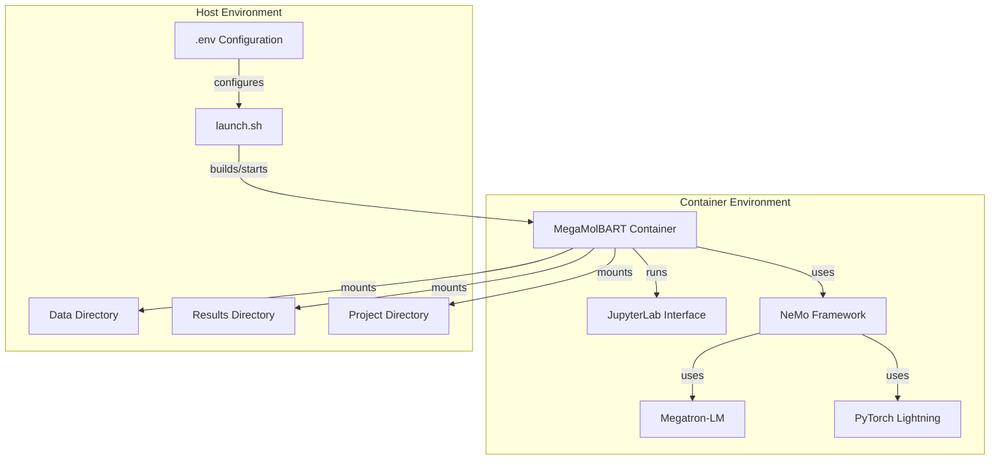

Sources: [launch.sh:127-170](), [README.md:42-70](), [setup/Dockerfile:1-77]()

## 4. Environment Configuration

### 4.1 The .env File

The `.env` file contains environment variables that configure the container behavior. When `launch.sh` is first run, it creates a template `.env` file with defaults. You should modify this file to match your environment.

Example `.env` file:

```
# Docker Image used for training, inference, and development
MEGAMOLBART_CONT=nvcr.io/nvidia/clara/megamolbart:0.2.0

# Path to Source code
PROJECT_PATH=/home/user/Projects/github/MegaMolBART/

# Path to data and results file
DATA_PATH=/data/bionemo/data/
RESULT_PATH=/data/bionemo/results/

# HOST port for jupyter lab web interface
JUPYTER_PORT=8888

# Docker image repository configuration
REGISTRY_USER=$oauthtoken
REGISTRY=NotSpecified
REGISTRY_ACCESS_TOKEN=NotSpecified

# wandb API key. https://wandb.ai/
WANDB_API_KEY=NotSpecified

# GITHUB configuration only required for building image
GITHUB_ACCESS_TOKEN=INSERT_GITHUB_ACCESS_TOKEN_HERE
GITHUB_BRANCH=main
```

Sources: [launch.sh:84-124](), [README.md:46-71]()

### 4.2 Directory Structure and Volume Mounting

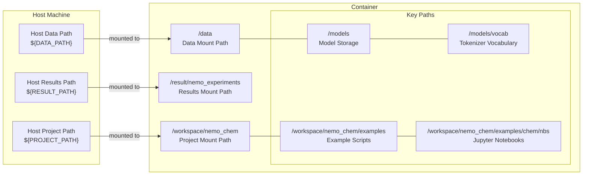

The MegaMolBART container uses three main volume mounts:

1. **Data Path**: Mounted to `/data` in the container - stores datasets for training and inference
2. **Result Path**: Mounted to `/result/nemo_experiments` - stores training outputs, logs, and checkpoints
3. **Project Path**: Mounted to `/workspace/nemo_chem` - contains the MegaMolBART code

Sources: [launch.sh:127-170](), [QUICKSTART.md:15-20]()

## 5. Using the Launch Script

The `launch.sh` script is the primary interface for managing MegaMolBART containers. It provides several commands for different operations.

### 5.1 Launch Script Commands

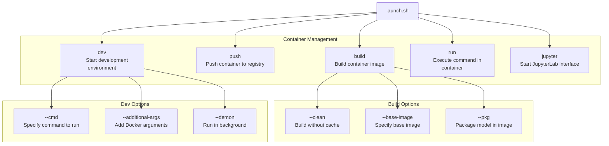

### 5.2 Command Examples

**Building a Container:**
```bash
./launch.sh build                       # Basic build
./launch.sh build --clean               # Build without cache
./launch.sh build --base-image my_base  # Build with custom base image
```

**Development Environment:**
```bash
./launch.sh dev                               # Start shell in container
./launch.sh dev --cmd python script.py        # Run specific command
./launch.sh dev --additional-args "--gpus 2"  # Pass additional args to Docker
```

**Training or Inference:**
```bash
./launch.sh run python path/to/script.py  # Run script in container
```

**JupyterLab Interface:**
```bash
./launch.sh jupyter  # Start JupyterLab on the configured port
```

Sources: [launch.sh:26-83](), [launch.sh:305-348](), [launch.sh:380-404]()

## 6. Operating Modes

### 6.1 Development Mode

Development mode mounts the source code directory and provides an interactive shell:

```bash
./launch.sh dev
```

Inside the container, you can install development code and recompile components:

```bash
cd /workspace/nemo_chem && \
pip install -e . && \
bash setup/recompile_megatron_helper.sh
```

Sources: [QUICKSTART.md:142-177](), [README.md:79-88]()

### 6.2 Running Inference

To run inference with a pre-trained model:

1. Add `MODEL_PATH` in your `.env` file pointing to the directory containing model files
2. Update the inference configuration in `examples/chem/conf/infer.yaml` to point to your model file
3. Start the development container:

```bash
./launch.sh dev
```

4. Run inference tests:

```bash
pytest --log-cli-level=10 tests/test_inference.py
```

The `NeMoMegaMolBARTWrapper` class provides the main API for inference operations:

```python
from nemo_chem.models.megamolbart import NeMoMegaMolBARTWrapper

# Initialize the wrapper with a model configuration
wrapper = NeMoMegaMolBARTWrapper(model_cfg=cfg)

# Generate molecule embeddings
embeddings = wrapper.smis_to_embedding(smiles_list)

# Sample new molecules
samples = wrapper.sample(smiles_list, num_samples=10)
```

Sources: [README.md:162-176](), [nemo_chem/models/megamolbart/infer.py:1-212](), [tests/test_inference.py:1-106](), [examples/chem/conf/infer.yaml:1-34]()

### 6.3 Training Mode

For training, you can use the pre-built scripts provided in the repository:

1. Configure your data path in the `.env` file
2. Use the appropriate script for your environment:

**For workstations:**
```bash
./launch.sh run python /workspace/nemo_chem/examples/chem/megamolbart_pretrain.py \
    --config-path=conf \
    --config-name=megamolbart_pretrain_xsmall_span_aug
```

**For SLURM clusters:**
There are SLURM scripts available in the `examples/chem/slurm` directory.

Sources: [QUICKSTART.md:57-97](), [QUICKSTART.md:101-140]()

### 6.4 JupyterLab Interface

To start the JupyterLab interface:

```bash
./launch.sh jupyter
```

This starts JupyterLab on the port specified in your `.env` file (default 8888). You can access it by opening http://localhost:8888 in your browser.

Sources: [launch.sh:369-379](), [README.md:16-39]()

## 7. Troubleshooting

### 7.1 Docker Issues

- **GPU not available**: Ensure the NVIDIA driver is installed and the NVIDIA Container Toolkit is correctly configured
- **Permission denied**: Try running with `sudo` or add your user to the docker group
- **Volume mount issues**: Check that the paths in your `.env` file exist and are absolute paths

### 7.2 Container Build Failures

- **GitHub access token issues**: For custom builds, ensure your GitHub token has the correct permissions
- **Network failures**: Check your internet connection and proxy settings
- **Base image not found**: Verify the base image reference in `setup/Dockerfile`

### 7.3 Common Runtime Errors

- **Out of memory errors**: Reduce batch size or model size in the configuration
- **Missing data**: Ensure the data path is correctly set and contains the expected files
- **Model loading failures**: Verify the model path in your inference configuration

Sources: [README.md:72-78](), [setup/Dockerfile:1-77]()

---

# Page: Model Architecture

# Model Architecture

<details>
<summary>Relevant source files</summary>

The following files were used as context for generating this wiki page:

- [examples/chem/conf/megamolbart_pretrain_base.yaml](examples/chem/conf/megamolbart_pretrain_base.yaml)
- [examples/chem/megamolbart_pretrain.py](examples/chem/megamolbart_pretrain.py)
- [examples/chem/shell/megamolbart_pretrain_quick.sh](examples/chem/shell/megamolbart_pretrain_quick.sh)
- [nemo_chem/data/augment.py](nemo_chem/data/augment.py)
- [nemo_chem/data/csv_dataset.py](nemo_chem/data/csv_dataset.py)
- [nemo_chem/data/preprocess/preprocess.py](nemo_chem/data/preprocess/preprocess.py)
- [nemo_chem/data/utils.py](nemo_chem/data/utils.py)
- [nemo_chem/models/megamolbart/megamolbart_model.py](nemo_chem/models/megamolbart/megamolbart_model.py)
- [nemo_chem/utils/__init__.py](nemo_chem/utils/__init__.py)

</details>


This document describes the architecture of the MegaMolBART model, a transformer-based encoder-decoder model specialized for learning molecular representations from SMILES strings. For information about training the model, see [Training System](#3), and for inference details, see [Inference System](#4).

## Overview of MegaMolBART Architecture

MegaMolBART is an encoder-decoder transformer model based on NVIDIA's Megatron-LM framework, designed specifically for molecular representation learning. It processes SMILES (Simplified Molecular Input Line Entry System) strings, which are a linear text notation for representing molecular structures.

The model follows a BART-like (Bidirectional and Auto-Regressive Transformer) architecture and is pre-trained using masked language modeling techniques adapted for molecular representations. By learning to reconstruct molecules from corrupted inputs, MegaMolBART develops powerful chemical understanding that can be applied to various downstream tasks.

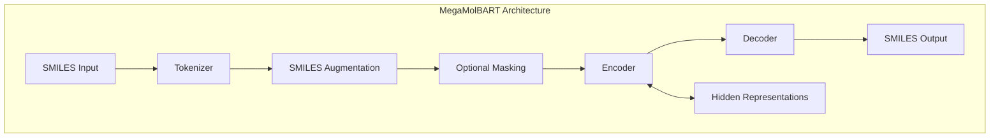

Sources: [nemo_chem/models/megamolbart/megamolbart_model.py:37-45](), [examples/chem/conf/megamolbart_pretrain_base.yaml:36-66]()

## Encoder-Decoder Design

MegaMolBART implements a transformer-based encoder-decoder architecture that inherits from NVIDIA's `MegatronLMEncoderDecoderModel`. This design enables the model to effectively process and generate SMILES strings representing molecular structures.

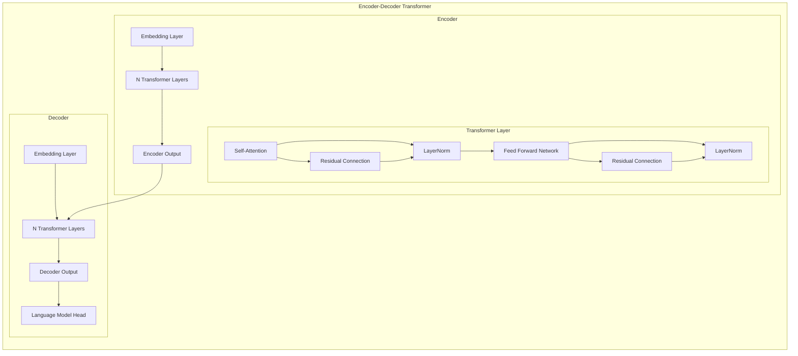

Sources: [nemo_chem/models/megamolbart/megamolbart_model.py:37-45](), [examples/chem/conf/megamolbart_pretrain_base.yaml:36-66]()

### Key Components

1. **Encoder**: 
   - Processes input SMILES strings (either original or masked/corrupted)
   - Consists of N transformer layers with self-attention mechanisms
   - Outputs contextualized representations of the input

2. **Decoder**:
   - Generates output SMILES strings autoregressively
   - Also consists of N transformer layers
   - Takes encoder representations as input through cross-attention

3. **Shared Parameters**:
   - Word embeddings can be shared between encoder and decoder
   - The decoder's output embedding layer can optionally share weights with the language model head

4. **Architecture Configuration**:
   - Configurable number of layers, hidden size, and attention heads
   - Supports various activation functions: gelu, geglu, swiglu, reglu
   - Implements different normalization types: layernorm, rmsnorm

Sources: [examples/chem/conf/megamolbart_pretrain_base.yaml:36-66]()

## SMILES Processing

The processing of SMILES strings is a critical component of the MegaMolBART architecture, involving several key steps to prepare molecular data for the model.

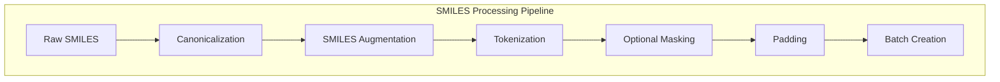

Sources: [nemo_chem/data/augment.py:31-45](), [nemo_chem/data/augment.py:143-196]()

### SMILES Representation and Tokenization

MegaMolBART uses a specialized tokenizer for SMILES strings that understands chemical syntax. The tokenization process:

1. Converts SMILES strings into token sequences
2. Adds special tokens like `<bos>` (beginning of sequence), `<eos>` (end of sequence), and `<pad>` (padding)
3. Handles chemical tokens appropriately for molecular structures

### SMILES Augmentation

To improve generalization, MegaMolBART employs SMILES augmentation techniques:

1. **Atom order randomization**: 
   - Shuffles the atom ordering in the molecular graph
   - Generates alternative but chemically equivalent SMILES representations
   - Helps the model learn invariant molecular representations

2. **Canonicalization**: 
   - Option to convert all input SMILES to a canonical form
   - Ensures consistency in molecular representation

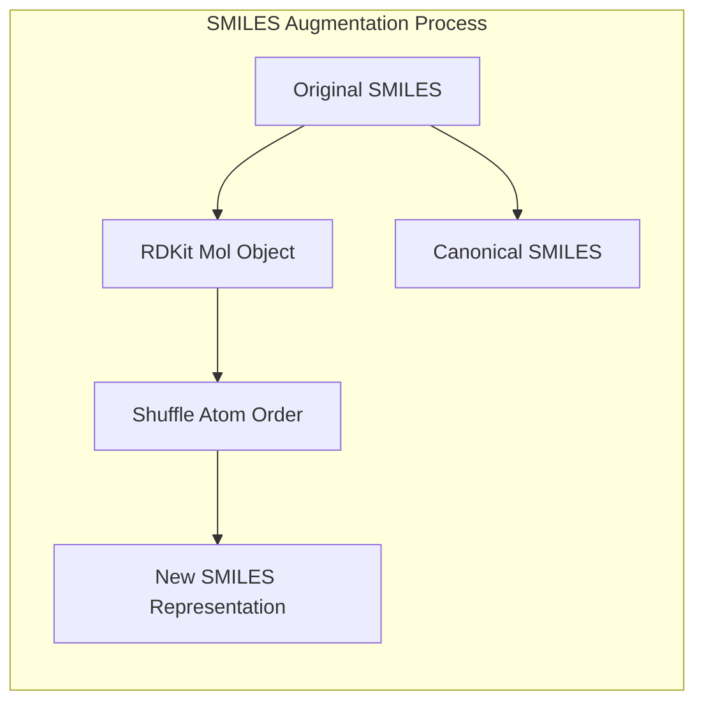

Sources: [nemo_chem/data/augment.py:51-81]()

### Masking Strategies

MegaMolBART uses masking during pre-training as part of its self-supervised learning approach. The primary masking strategy is span masking:

1. **Span Masking**:
   - Masks continuous spans of tokens rather than individual tokens
   - Span lengths are sampled from a Poisson distribution (λ = span_lambda parameter)
   - Default span_lambda is 3.0, meaning average span length is 3 tokens
   - Default mask probability is 0.15, meaning 15% of tokens are masked

The masking process is applied to encoder inputs when `encoder_mask` is enabled.

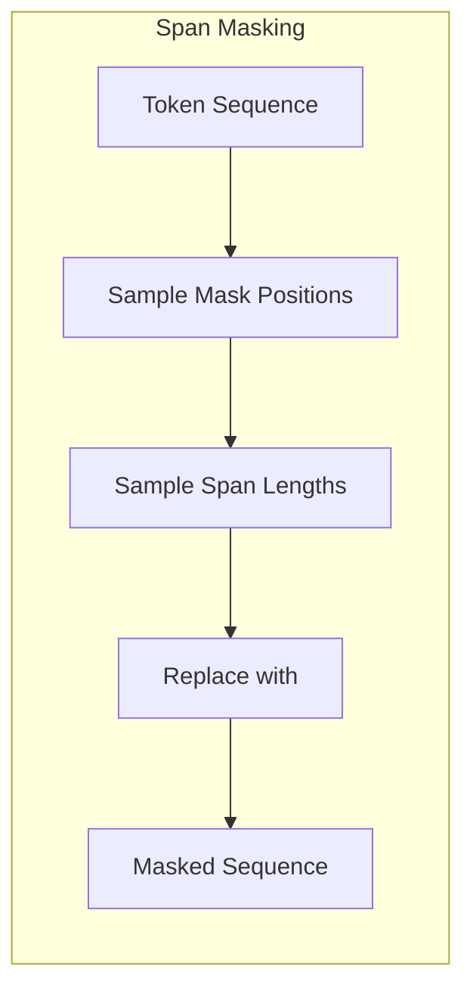

Sources: [nemo_chem/data/augment.py:199-232](), [nemo_chem/data/augment.py:241-264]()

## Model Configurations

MegaMolBART comes in multiple size configurations, allowing users to balance model capacity against computational requirements.

```mermaid
flowchart LR
    subgraph "Model Size Configurations"
        direction LR
        Base["Base Configuration"] --> XS["XSmall"]
        Base --> S["Small"]
        Base --> L["Large"]
        Base --> XL["XLarge"]
    end
```

Each configuration specifies different hyperparameters:

| Configuration | Layers | Hidden Size | Attention Heads | Typical Hardware |
|---------------|--------|-------------|----------------|------------------|
| XSmall        | 2      | 256         | 4              | Single GPU       |
| Small         | 6      | 512         | 8              | 8 GPUs           |
| Large         | 8      | 1024        | 16             | 64 GPUs (8×8)    |
| XLarge        | 12+    | 1536+       | 24+            | 64+ GPUs         |

The base configuration for all models specifies common parameters:

```mermaid
flowchart TB
    subgraph "Base Model Parameters"
        SeqLen["Sequence Length: 512"]
        Dropout["Dropout: 0.1"]
        LayerNorm["LayerNorm Epsilon: 1e-5"]
        Activation["Activation: GELU"]
        Optim["Optimizer: Fused Adam"]
        LRSched["Scheduler: Noam Annealing"]
    end
```

Sources: [examples/chem/conf/megamolbart_pretrain_base.yaml:36-66]()

## Implementation Details

MegaMolBART is implemented using PyTorch and NVIDIA's NeMo framework. Key implementation classes and their roles:

```mermaid
flowchart TD
    subgraph "Implementation Class Hierarchy"
        MegatronLM["MegatronLMEncoderDecoderModel"] --> MegaMolBART["MegaMolBARTModel"]
        MegaMolBART --> Functions["Key Methods"]
        
        Functions --> Sample["sample_molecules()"]
        Functions --> CharAcc["calculate_character_accuracy()"]
        Functions --> MolAcc["calculate_molecular_accuracy()"]
        Functions --> Metrics["calculate_metrics()"]
    end
```

Sources: [nemo_chem/models/megamolbart/megamolbart_model.py:37-204]()

### Core Model Class

The `MegaMolBARTModel` class inherits from `MegatronLMEncoderDecoderModel` and implements molecular-specific functionality:

1. **Data Handling**:
   - Builds training, validation, and test datasets
   - Implements collate functions for batching
   - Processes molecular data for the model

2. **Molecule Generation**:
   - `sample_molecules()` method for generating molecules from encoder states
   - Autoregressive sampling of token sequences
   - Conversion of predicted tokens back to SMILES strings

3. **Evaluation Metrics**:
   - Character-level accuracy (token prediction)
   - Molecule-level accuracy (complete SMILES accuracy)
   - Invalid molecule percentage tracking

Sources: [nemo_chem/models/megamolbart/megamolbart_model.py:205-240](), [nemo_chem/models/megamolbart/megamolbart_model.py:240-306]()

### Optimization and Training

MegaMolBART uses several optimization techniques:

1. **Mixed Precision Training**:
   - Support for FP16 and BF16 precision
   - Uses NVIDIA Apex for mixed-precision optimization

2. **Distributed Training**:
   - Data Parallel (DP) training
   - Model Parallel (MP) training for larger models
   - NLPDDPPlugin for efficient distributed training

3. **Learning Rate Scheduling**:
   - Noam Annealing schedule (warmup followed by decay)
   - Configurable warmup steps and minimum learning rate

Sources: [examples/chem/megamolbart_pretrain.py:41-89](), [examples/chem/conf/megamolbart_pretrain_base.yaml:96-110]()

## Pretraining Objective

MegaMolBART's pretraining objective is to reconstruct original SMILES strings from corrupted inputs. This is implemented as:

1. Input SMILES strings are tokenized and optionally augmented
2. Spans of tokens are masked in the encoder input
3. The model learns to predict the original tokens in the decoder
4. Training loss is calculated on token predictions versus actual tokens
5. Evaluation metrics track both token-level and molecule-level accuracy

This pretraining approach enables the model to develop a robust understanding of molecular structures and chemical properties, making it effective for downstream tasks in molecular machine learning.

Sources: [nemo_chem/models/megamolbart/megamolbart_model.py:307-326]()

---

# Page: Encoder-Decoder Design

# Encoder-Decoder Design

<details>
<summary>Relevant source files</summary>

The following files were used as context for generating this wiki page:

- [examples/chem/conf/megamolbart_pretrain_base.yaml](examples/chem/conf/megamolbart_pretrain_base.yaml)
- [examples/chem/megamolbart_pretrain.py](examples/chem/megamolbart_pretrain.py)
- [examples/chem/shell/megamolbart_pretrain_quick.sh](examples/chem/shell/megamolbart_pretrain_quick.sh)
- [nemo_chem/data/augment.py](nemo_chem/data/augment.py)
- [nemo_chem/data/csv_dataset.py](nemo_chem/data/csv_dataset.py)
- [nemo_chem/data/preprocess/preprocess.py](nemo_chem/data/preprocess/preprocess.py)
- [nemo_chem/data/utils.py](nemo_chem/data/utils.py)
- [nemo_chem/models/megamolbart/megamolbart_model.py](nemo_chem/models/megamolbart/megamolbart_model.py)
- [nemo_chem/utils/__init__.py](nemo_chem/utils/__init__.py)

</details>


## Purpose and Scope

This page documents the transformer-based encoder-decoder architecture used in MegaMolBART for molecular representation learning and generation. The encoder-decoder design is the fundamental architecture that enables the model to process SMILES string representations of molecules, encode them into latent representations, and decode them back to SMILES strings or generate new molecules. This architecture supports both pre-training tasks and downstream applications like molecule generation.

For information about how SMILES strings are processed before entering the model, see [SMILES Processing](#2.2). For details on specific model size configurations and parameters, see [Model Configurations](#2.3).

## Architecture Overview

MegaMolBART implements a transformer-based encoder-decoder architecture derived from the BART (Bidirectional and Auto-Regressive Transformers) model. The implementation extends NeMo's MegatronLMEncoderDecoderModel class.

```mermaid
graph TD
    subgraph "MegaMolBART Architecture"
        subgraph "Encoder"
            Input["Input SMILES"] --> TokenizeE["Tokenization"]
            TokenizeE --> MaskE["Masking (during training)"]
            MaskE --> EmbedE["Embedding Layer"]
            EmbedE --> TransformE["Transformer Layers"]
            TransformE --> EncoderOut["Encoder Hidden States"]
        end
        
        subgraph "Decoder"
            DecoderIn["Decoder Input"] --> TokenizeD["Tokenization"]
            TokenizeD --> EmbedD["Embedding Layer"]
            EmbedD --> TransformD["Transformer Layers"]
            EncoderOut --> TransformD
            TransformD --> DecoderOut["Decoder Hidden States"]
        end
        
        DecoderOut --> Project["Linear Projection"]
        Project --> Softmax["Softmax"]
        Softmax --> TokenProbs["Token Probabilities"]
    end
```

Sources: [nemo_chem/models/megamolbart/megamolbart_model.py:37-46]()

## Encoder Component

The encoder processes tokenized SMILES strings and transforms them into a contextual representation. During pre-training, input SMILES are masked according to a specific masking strategy.

```mermaid
flowchart TD
    subgraph "Encoder Architecture"
        Input["Input Tokens"] --> Embed["Token + Position Embeddings"]
        Embed --> Layers["Transformer Layers"]
        Layers --> Hidden["Hidden States"]
    end
    
    subgraph "Encoder Transformer Layer"
        LayerIn["Layer Input"] --> SelfAtt["Self-Attention"]
        SelfAtt --> AddNorm1["Add & LayerNorm"]
        LayerIn --> AddNorm1
        AddNorm1 --> FFN["Feed-Forward Network"]
        FFN --> AddNorm2["Add & LayerNorm"]
        AddNorm1 --> AddNorm2
        AddNorm2 --> LayerOut["Layer Output"]
    end
```

Key encoder features:
- Each transformer layer contains self-attention mechanisms that learn relationships between tokens in the input sequence
- Uses LayerNorm for normalization and GELU activation functions
- Position embeddings help capture the sequential nature of SMILES strings
- Bidirectional attention allows tokens to attend to the full context in both directions

Sources: [examples/chem/conf/megamolbart_pretrain_base.yaml:36-64]()

## Decoder Component

The decoder autogressively generates SMILES strings. It contains two types of attention mechanisms in each layer:
1. Masked self-attention that attends only to previous tokens (for autoregressive generation)
2. Cross-attention that attends to the encoder's outputs

```mermaid
flowchart TD
    subgraph "Decoder Architecture"
        Input["Input Tokens"] --> Embed["Token + Position Embeddings"]
        Embed --> Layers["Transformer Layers"]
        EncoderStates["Encoder Hidden States"] --> Layers
        Layers --> Hidden["Hidden States"]
        Hidden --> Projection["Linear Projection to Vocabulary"]
    end
    
    subgraph "Decoder Transformer Layer"
        LayerIn["Layer Input"] --> MaskedAtt["Masked Self-Attention"]
        MaskedAtt --> AddNorm1["Add & LayerNorm"]
        LayerIn --> AddNorm1
        AddNorm1 --> CrossAtt["Cross-Attention to Encoder"]
        CrossAtt --> AddNorm2["Add & LayerNorm"]
        AddNorm1 --> AddNorm2
        AddNorm2 --> FFN["Feed-Forward Network"]
        FFN --> AddNorm3["Add & LayerNorm"]
        AddNorm2 --> AddNorm3
        AddNorm3 --> LayerOut["Layer Output"]
    end
```

During inference, the decoder samples tokens one at a time:

```python
def sample_molecules(self, tokens_enc, enc_mask, hidden_states=None):
    # Decode encoder hidden state to tokens
    predicted_tokens_ids, log_probs = self.decode(tokens_enc,
                                                  enc_mask,
                                                  self._cfg.max_position_embeddings,
                                                  enc_output=hidden_states)
    # ... processing and conversion to SMILES ...
    return sampled_smiles
```

Sources: [nemo_chem/models/megamolbart/megamolbart_model.py:205-238]()

## Data Flow During Training

During training, MegaMolBART follows these steps for processing molecule data:

```mermaid
flowchart LR
    SMILES["SMILES String"] --> Augment["SMILES Augmentation"]
    Augment --> SpanMask["Span Masking"]
    SpanMask --> Tokenize["Tokenization"]
    Tokenize --> Encode["Encoder Processing"]
    Encode --> HiddenStates["Hidden States"]
    HiddenStates --> Decode["Decoder Processing"]
    Decode --> Predict["Token Prediction"]
    Predict --> Loss["Cross-Entropy Loss"]
```

### Masking Strategy

MegaMolBART uses a span masking approach where continuous spans of tokens are masked according to these parameters:

| Parameter | Function |
|-----------|----------|
| `mask_scheme` | Type of masking (span) |
| `mask_prob` | Probability of masking a token (default: 0.1) |
| `span_lambda` | Poisson distribution parameter for span length (default: 3.0) |

During training, the encoder input has spans of tokens replaced with a mask token, while the decoder learns to predict the original tokens.

Sources: [nemo_chem/data/augment.py:211-266]()

## Inference Process

During inference, MegaMolBART can generate molecules in several ways:

```mermaid
flowchart TD
    Input["Input SMILES"] --> Tokenize["Tokenize"]
    Tokenize --> Encoder["Encoder"]
    Encoder --> HiddenStates["Hidden States"]
    HiddenStates --> Decoder["Decoder (Autoregressive)"]
    Decoder --> GeneratedTokens["Generated Tokens"]
    GeneratedTokens --> ConvertSMILES["Convert to SMILES"]
    ConvertSMILES --> Validate["RDKit Validation"]
    Validate --> ValidMolecule["Valid Molecule"]
```

The model includes metrics to evaluate generation quality:

1. Character accuracy - token-level accuracy of predictions
2. Molecular accuracy - complete molecule accuracy after canonicalization
3. Percent invalid - percentage of generated molecules that are invalid according to RDKit

```python
def calculate_metrics(self, token_logits, loss_mask, labels, tokens_enc, enc_mask, target_smiles, batch_idx=None, log_char=False, log_mol=False):
    """Calculate metrics for character accuracy, molecular accuracy, and invalid molecules"""
    character_accuracy = self.calculate_character_accuracy(token_logits, loss_mask, labels, batch_idx, log=log_char)
    molecular_accuracy, percent_invalid = self.calculate_molecular_accuracy(tokens_enc, enc_mask, target_smiles, batch_idx, log=log_mol)
    metrics = {'character_accuracy': character_accuracy,
              'molecular_accuracy': molecular_accuracy,
              'percent_invalid': percent_invalid}
    return metrics
```

Sources: [nemo_chem/models/megamolbart/megamolbart_model.py:307-326]()

## Implementation Details

### Key Classes

The encoder-decoder architecture is implemented through several key classes:

1. `MegaMolBARTModel` - Main model class inheriting from MegatronLMEncoderDecoderModel
2. `MoleculeEnumeration` - Handles SMILES augmentation and masking for training

### Configuration Parameters

The architecture is highly configurable through YAML configuration files. Key parameters include:

| Parameter | Description | Default Value |
|-----------|-------------|---------------|
| `seq_length` | Maximum sequence length | 512 |
| `hidden_size` | Dimension of hidden layers | 768 (base) |
| `num_layers` | Number of transformer layers | 3 (base) |
| `num_attention_heads` | Number of attention heads | 12 (base) |
| `ffn_hidden_size` | Feed-forward network size | 4 × hidden_size |
| `encoder_arch` | Encoder architecture type | transformer |
| `decoder_arch` | Decoder architecture type | transformer |
| `activation` | Activation function | gelu |
| `share_word_embeddings` | Whether to share encoder/decoder embeddings | True |

Sources: [examples/chem/conf/megamolbart_pretrain_base.yaml:36-66]()

### Model Scaling

MegaMolBART can be scaled to different sizes by adjusting key architectural parameters:

| Model Size | Layers | Hidden Size | Attention Heads |
|------------|--------|-------------|-----------------|
| XSmall     | 2      | 256         | 4               |
| Small      | 6      | 512         | 8               |
| Large      | 8      | 1024        | 16              |
| XLarge     | 12+    | 1536+       | 16+             |

The scaling of these parameters follows best practices from transformer-based language models like BERT and GPT.

Sources: [examples/chem/conf/megamolbart_pretrain_base.yaml:36-66]()

## Integration with MegaMolBART System

The encoder-decoder architecture integrates with the overall MegaMolBART system as follows:

```mermaid
flowchart TD
    subgraph "Training Pipeline"
        MoleculeData["SMILES Data"] --> Preprocessing["Data Preprocessing"]
        Preprocessing --> DataAugmentation["SMILES Augmentation"]
        DataAugmentation --> MaskingModule["Span Masking"]
        MaskingModule --> BatchFormation["Batch Formation"]
        BatchFormation --> EncoderDecoder["Encoder-Decoder Model"]
        EncoderDecoder --> TrainingLoss["Loss Calculation"]
        TrainingLoss --> Optimization["Parameter Optimization"]
    end
    
    subgraph "Inference Pipeline"
        InputSMILES["Input SMILES"] --> Tokenizer["SMILES Tokenizer"]
        Tokenizer --> EncoderInference["Encoder"]
        EncoderInference --> Representation["Molecular Representation"]
        Representation --> DecoderInference["Decoder"]
        DecoderInference --> SMILESOutput["Generated SMILES"]
        SMILESOutput --> Validation["Molecular Validation"]
    end
```

This architecture enables MegaMolBART to effectively learn molecular representations during pre-training and generate valid molecules during inference.

Sources: [nemo_chem/models/megamolbart/megamolbart_model.py:37-329](), [nemo_chem/data/augment.py:31-277]()

---

# Page: SMILES Processing

# SMILES Processing

<details>
<summary>Relevant source files</summary>

The following files were used as context for generating this wiki page:

- [examples/chem/conf/megamolbart_pretrain_base.yaml](examples/chem/conf/megamolbart_pretrain_base.yaml)
- [examples/chem/conf/megamolbart_pretrain_large_span_aug.yaml](examples/chem/conf/megamolbart_pretrain_large_span_aug.yaml)
- [examples/chem/conf/megamolbart_pretrain_small_span_aug.yaml](examples/chem/conf/megamolbart_pretrain_small_span_aug.yaml)
- [examples/chem/conf/megamolbart_pretrain_xsmall_span_aug.yaml](examples/chem/conf/megamolbart_pretrain_xsmall_span_aug.yaml)
- [examples/chem/shell/megamolbart_pretrain_quick.sh](examples/chem/shell/megamolbart_pretrain_quick.sh)
- [nemo_chem/data/augment.py](nemo_chem/data/augment.py)
- [nemo_chem/data/csv_dataset.py](nemo_chem/data/csv_dataset.py)
- [nemo_chem/data/preprocess/preprocess.py](nemo_chem/data/preprocess/preprocess.py)
- [nemo_chem/data/utils.py](nemo_chem/data/utils.py)
- [nemo_chem/models/megamolbart/megamolbart_model.py](nemo_chem/models/megamolbart/megamolbart_model.py)
- [nemo_chem/utils/__init__.py](nemo_chem/utils/__init__.py)

</details>


This document describes how MegaMolBART processes SMILES (Simplified Molecular-Input Line-Entry System) strings for molecular representation learning. The processing pipeline includes data loading, tokenization, augmentation, masking, and preparation of tensors for the encoder-decoder architecture. For information about the general encoder-decoder design, see [Encoder-Decoder Design](#2.1).

## Overview of SMILES Processing

SMILES strings are text-based representations of molecules that encode their structure in a compact format. MegaMolBART processes these strings through a series of steps to prepare them for training the transformer-based model.

### SMILES Processing Pipeline

```mermaid
flowchart LR
    subgraph "Input Data"
        SMILES["SMILES Strings\ne.g. 'CC(=O)O'"]
    end
    
    subgraph "Processing Pipeline"
        AUG["SMILES Augmentation\n(atom order randomization)"]
        TOK["Tokenization"]
        MASK["Masking\n(for pretraining)"]
        PAD["Padding"]
        BATCH["Batch Preparation"]
    end
    
    subgraph "Model Input"
        ENC["Encoder Input"]
        DEC["Decoder Input"]
        LABELS["Label Tensors"]
        MASKS["Attention Masks"]
    end
    
    SMILES --> AUG
    AUG --> TOK
    TOK --> MASK
    MASK --> PAD
    PAD --> BATCH
    BATCH --> ENC
    BATCH --> DEC
    BATCH --> LABELS
    BATCH --> MASKS
```

Sources:
- [nemo_chem/data/augment.py:31-141]()
- [nemo_chem/models/megamolbart/megamolbart_model.py:37-105]()

## MoleculeEnumeration Class

The central component for SMILES processing is the `MoleculeEnumeration` class, which handles all steps from raw SMILES to model-ready tensors.

```mermaid
classDiagram
    class MoleculeEnumeration {
        +tokenizer: TokenizerSpec
        +seq_length: int
        +encoder_augment: bool
        +encoder_mask: bool
        +decoder_augment: bool
        +decoder_mask: bool
        +canonicalize_input: bool
        +mask_scheme: str
        +mask_prob: float
        +span_lambda: float
        +collate_fn(batch: List[str]) → dict
        -_smiles_augmeter_func(smiles, augment_data, canonicalize_input) → tuple
        -_prepare_tokens(batch, mask_data) → dict
        -_pad_seqs(seqs, pad_token) → tuple
        -tokenize(sents1, mask) → dict
        -mask_tokens(tokens, empty_mask) → tuple
        -_mask_span(ts) → tuple
    }
```

Sources:
- [nemo_chem/data/augment.py:31-45]()

## SMILES Data Loading

The system supports loading SMILES data from both CSV and binary formats. The dataset construction is handled by specialized dataset classes.

```mermaid
flowchart TD
    subgraph "Dataset Construction"
        B["build_train_valid_test_datasets()"]
        B --> BT["Train Dataset"]
        B --> BV["Validation Dataset"]
        B --> BTE["Test Dataset"]
    end
    
    subgraph "Dataset Types"
        CSV["MoleculeCsvDataset"]
        BIN["MoleculeBinaryDataset"]
    end
    
    subgraph "Dataset Configuration"
        CFG["DatasetFileConfig
        - train
        - test
        - val"]
        
        MCFG["MoleculeCsvDatasetConfig
        - dataset_path
        - dataset_format
        - etc."]
    end
    
    CFG --> B
    MCFG --> B
    B -.-> CSV
    B -.-> BIN
```

Sources:
- [nemo_chem/data/utils.py:97-133]()
- [nemo_chem/data/csv_dataset.py:38-84]()

## SMILES Augmentation

SMILES augmentation is a key technique for improving model robustness by creating variations of the same molecule through different atom ordering.

### Augmentation Process

```mermaid
flowchart LR
    subgraph "SMILES Augmentation"
        SMILES["SMILES string"] -->|"RDKit"| MOL["RDKit Molecule"]
        MOL -->|"atom reordering"| AUG_MOL["Augmented Molecule"]
        AUG_MOL -->|"MolToSmiles"| AUG_SMILES["Augmented SMILES"]
        
        CANON["Canonical SMILES"] -->|"target"| LOSS["Loss Calculation"]
        AUG_SMILES -->|"input"| MODEL["Model"]
        MODEL --> LOSS
    end
```

The augmentation is performed using RDKit's atom reordering functionality:

1. Convert input SMILES to RDKit molecule object
2. Shuffle atom ordering randomly 
3. Convert back to SMILES string (non-canonical)
4. Use canonical SMILES as ground truth target

Sources:
- [nemo_chem/data/augment.py:51-81]()

### Configuration Options

Augmentation can be configured separately for encoder and decoder:

- `encoder_augment`: Whether to augment SMILES for encoder input (typically True)
- `decoder_augment`: Whether to augment SMILES for decoder input
- `canonicalize_input`: Whether to canonicalize input SMILES

Sources:
- [examples/chem/conf/megamolbart_pretrain_base.yaml:82-85]()

## SMILES Tokenization and Masking

Tokenization converts SMILES strings into token IDs, and masking is applied for pretraining objectives.

### Masking Schemes

The primary masking scheme is span masking, where consecutive tokens are masked based on a Poisson distribution:

```mermaid
flowchart LR
    subgraph "Span Masking Process"
        TOK["Tokenized SMILES"] --> PROB["Apply mask_prob\nto each position"]
        PROB --> SPAN["Sample span length\nfrom Poisson(λ)"]
        SPAN --> REPLACE["Replace span with\nMASK token"]
        REPLACE --> MASKED["Masked sequence"]
    end
```

Masking configuration parameters:
- `mask_scheme`: Type of masking to use (currently 'span')
- `mask_prob`: Probability of masking a token
- `span_lambda`: Expected span length (λ for Poisson distribution)

Sources:
- [nemo_chem/data/augment.py:212-264]()
- [examples/chem/conf/megamolbart_pretrain_base.yaml:86-88]()

## Batch Preparation

The `collate_fn` method in `MoleculeEnumeration` prepares batches for model training:

```mermaid
flowchart TD
    subgraph "collate_fn"
        BATCH["Batch of SMILES"] --> ENC_AUG["Apply Encoder Augmentation"]
        ENC_AUG --> ENC_MASK["Apply Encoder Masking"]
        ENC_AUG --> DEC_AUG["Apply Decoder Augmentation"]
        DEC_AUG --> DEC_MASK["Apply Decoder Masking"]
        
        ENC_MASK --> ENC_TOK["Tokenize Encoder Input"]
        DEC_MASK --> DEC_TOK["Tokenize Decoder Input"]
        
        ENC_TOK --> PAD_ENC["Pad Encoder Sequences"]
        DEC_TOK --> PAD_DEC["Pad Decoder Sequences"]
        
        PAD_ENC --> OUT_ENC["text_enc Tensor"]
        PAD_DEC --> OUT_DEC["text_dec Tensor"]
        PAD_ENC --> OUT_ENC_MASK["enc_mask Tensor"]
        PAD_DEC --> OUT_DEC_MASK["dec_mask Tensor"]
        
        DEC_TOK --> LABELS["Create Label Tensors"]
        LABELS --> OUT_LABELS["labels Tensor"]
        LABELS --> OUT_LOSS_MASK["loss_mask Tensor"]
    end
```

The `collate_fn` method returns a dictionary with the following tensors:
- `text_enc`: Token IDs for encoder input
- `enc_mask`: Mask for encoder input (1=active, 0=padding)
- `text_dec`: Token IDs for decoder input (starts with BOS token)
- `dec_mask`: Mask for decoder input
- `labels`: Target token IDs for loss calculation
- `loss_mask`: Mask for loss calculation (1=active, 0=ignore)
- `target_smiles`: Original canonical SMILES strings for evaluation

Sources:
- [nemo_chem/data/augment.py:143-196]()

## End-to-End SMILES Processing Example

Below is an example of SMILES processing from raw data to model input:

1. Start with raw SMILES: `CC(=O)O` (acetic acid)
2. Apply augmentation: `O(C)C=O` (non-canonical representation)
3. Tokenize: `['O', '(', 'C', ')', 'C', '=', 'O']`
4. Apply masking: `['O', '(', 'C', ')', '[MASK]', '=', 'O']`
5. Convert to IDs: `[27, 7, 13, 8, 1, 21, 27]` (example IDs)
6. Pad sequence: `[27, 7, 13, 8, 1, 21, 27, 0, 0, ...]`
7. Create attention mask: `[1, 1, 1, 1, 1, 1, 1, 0, 0, ...]`

## Model Integration

The SMILES processing pipeline is integrated with the MegaMolBARTModel class through the `build_pretraining_data_loader` method, which configures the dataloader with the appropriate collate function.

```mermaid
flowchart TD
    subgraph "Data Integration Flow"
        MODEL["MegaMolBARTModel"]
        DATASET["Dataset (CSV/Binary)"]
        DATALOADER["DataLoader"]
        COLLATE["MoleculeEnumeration.collate_fn"]
        CONFIG["Configuration YAML"]
        
        CONFIG --> MODEL
        MODEL --> |"build_pretraining_data_loader()"| DATALOADER
        DATASET --> DATALOADER
        DATALOADER --> |"assigns"| COLLATE
        
        COLLATE --> |"processes batches"| PROCESSED["Processed Tensors"]
        MODEL --> |"process_global_batch()"| PROCESSED
        PROCESSED --> |"forward pass"| TRAINING["Model Training"]
    end
```

Sources:
- [nemo_chem/models/megamolbart/megamolbart_model.py:90-115]()
- [nemo_chem/models/megamolbart/megamolbart_model.py:117-132]()

## Configuration Parameters

The SMILES processing pipeline can be customized through configuration parameters in the YAML files:

| Parameter | Description | Default Value |
|-----------|-------------|---------------|
| `encoder_augment` | Apply augmentation to encoder input | True |
| `encoder_mask` | Apply masking to encoder input | True |
| `decoder_augment` | Apply augmentation to decoder input | True |
| `decoder_mask` | Apply masking to decoder input | False |
| `mask_scheme` | Masking scheme | "span" |
| `mask_prob` | Probability of masking a token | 0.1 |
| `span_lambda` | Expected span length | 3.0 |
| `canonicalize_input` | Canonicalize input SMILES | True |
| `seq_length` | Maximum sequence length | 512 |
| `dataset_format` | Dataset format (csv/bin) | "csv" |

Sources:
- [examples/chem/conf/megamolbart_pretrain_base.yaml:42-94]()

## Evaluation Metrics

The SMILES processing influences the metrics used for model evaluation:

1. **Character Accuracy**: Accuracy at the token level (percentage of correctly predicted tokens)
2. **Molecular Accuracy**: Percentage of molecules that are correctly reconstructed after canonicalization
3. **Percent Invalid**: Percentage of generated SMILES that cannot be parsed into valid molecules

Sources:
- [nemo_chem/models/megamolbart/megamolbart_model.py:240-326]()

## Conclusion

The SMILES processing pipeline in MegaMolBART provides a robust framework for handling molecular data. By combining augmentation, tokenization, and masking, it creates a rich pretraining environment that enables the model to learn meaningful molecular representations. The configurable nature of the pipeline allows for experimentation with different processing strategies to optimize model performance.

---

# Page: Model Configurations

# Model Configurations

<details>
<summary>Relevant source files</summary>

The following files were used as context for generating this wiki page:

- [examples/chem/conf/megamolbart_pretrain_large_span_aug.yaml](examples/chem/conf/megamolbart_pretrain_large_span_aug.yaml)
- [examples/chem/conf/megamolbart_pretrain_small_span_aug.yaml](examples/chem/conf/megamolbart_pretrain_small_span_aug.yaml)
- [examples/chem/conf/megamolbart_pretrain_xsmall_span_aug.yaml](examples/chem/conf/megamolbart_pretrain_xsmall_span_aug.yaml)

</details>


This page details the various size configurations of the MegaMolBART model, including XSmall, Small, and Large variants. It provides information about each configuration's architecture parameters and computing resource requirements. For information about the overall encoder-decoder architecture, see [Encoder-Decoder Design](#2.1). For details on how to configure the training process, see [Training Configuration](#3.2).

## Configuration System Overview

MegaMolBART uses a hierarchical YAML-based configuration system powered by Hydra to define different model sizes. All model configurations inherit from a base configuration file and override specific parameters to define different model scales.

```mermaid
flowchart TD
    Base["megamolbart_pretrain_base.yaml"] --> XSmall["xsmall_span_aug.yaml"]
    Base --> Small["small_span_aug.yaml"]
    Base --> Large["large_span_aug.yaml"]
    Base --> XLarge["xlarge_span_aug.yaml (Inferred)"]
    
    XSmall --> |"defines"| XSmallModel["XSmall Model"]
    Small --> |"defines"| SmallModel["Small Model"]
    Large --> |"defines"| LargeModel["Large Model"]
    XLarge --> |"defines"| XLargeModel["XLarge Model"]
    
    subgraph "Inheritance Hierarchy"
        Base
        XSmall
        Small
        Large
        XLarge
    end
    
    subgraph "Generated Models"
        XSmallModel
        SmallModel
        LargeModel
        XLargeModel
    end
```

Sources: [examples/chem/conf/megamolbart_pretrain_xsmall_span_aug.yaml:1-4](), [examples/chem/conf/megamolbart_pretrain_small_span_aug.yaml:1-4](), [examples/chem/conf/megamolbart_pretrain_large_span_aug.yaml:1-4]()

## Model Size Comparison

The following table compares the key architectural parameters across different MegaMolBART model configurations:

| Configuration | Layers | Hidden Size | Attention Heads | Devices | Nodes | Total GPUs | Primary Use Case |
|---------------|--------|-------------|-----------------|---------|-------|------------|-----------------|
| XSmall        | 2      | 256         | 4               | 1       | 1     | 1          | Development, testing, small-scale experiments |
| Small         | 6      | 512         | 8               | 8       | 8     | 64         | Medium-scale pretraining, fine-tuning |
| Large         | 8      | 1024        | 16              | 8       | 8     | 64         | Large-scale pretraining for production models |

Sources: [examples/chem/conf/megamolbart_pretrain_xsmall_span_aug.yaml](), [examples/chem/conf/megamolbart_pretrain_small_span_aug.yaml](), [examples/chem/conf/megamolbart_pretrain_large_span_aug.yaml]()

## Configuration Parameters

The key parameters that define each model configuration include:

### Architecture Parameters

- **num_layers**: Number of transformer encoder and decoder layers
- **hidden_size**: Dimension of the model's hidden representations
- **num_attention_heads**: Number of attention heads in multi-head attention mechanisms

### Hardware Parameters

- **devices**: Number of GPUs per node
- **num_nodes**: Number of compute nodes

```mermaid
graph TD
    subgraph "Model Parameters Impact"
        NL["num_layers"] --> |"affects"| MD["Model Depth"]
        HS["hidden_size"] --> |"affects"| MW["Model Width"]
        NAH["num_attention_heads"] --> |"affects"| AR["Attention Resolution"]
        
        MD --> |"increases"| PC["Parameter Count"]
        MW --> |"increases"| PC
        AR --> |"increases"| PC
        
        PC --> |"increases"| MR["Memory Requirements"]
        PC --> |"increases"| CT["Computation Time"]
        
        MR --> |"determines"| HW["Hardware Requirements"]
        CT --> |"determines"| HW
    end
```

Sources: [examples/chem/conf/megamolbart_pretrain_xsmall_span_aug.yaml:10-13](), [examples/chem/conf/megamolbart_pretrain_small_span_aug.yaml:10-13](), [examples/chem/conf/megamolbart_pretrain_large_span_aug.yaml:10-13]()

## Detailed Configuration Descriptions

### XSmall Configuration

The XSmall configuration is designed for development, testing, and quick experiments on limited hardware resources.

```yaml
model:
  name: xsmall_span_aug
  # model architecture
  num_layers: 2
  hidden_size: 256
  num_attention_heads: 4

trainer:
  devices: 1
  num_nodes: 1
```

Key features:
- Minimal transformer architecture with only 2 layers
- Small hidden size of 256 dimensions
- Can run on a single GPU
- Fastest training and inference times
- Smallest memory footprint

Sources: [examples/chem/conf/megamolbart_pretrain_xsmall_span_aug.yaml:4-13]()

### Small Configuration

The Small configuration offers a balance between model capacity and computational requirements, suitable for medium-scale pretraining and fine-tuning tasks.

```yaml
model:
  name: small_span_aug
  # model architecture
  num_layers: 6
  hidden_size: 512
  num_attention_heads: 8

trainer:
  devices: 8
  num_nodes: 8
```

Key features:
- Moderately deep transformer with 6 layers
- Medium hidden size of 512 dimensions
- Requires distributed training (64 GPUs across 8 nodes)
- Good balance between performance and computational cost

Sources: [examples/chem/conf/megamolbart_pretrain_small_span_aug.yaml:4-13]()

### Large Configuration

The Large configuration is designed for production-grade models with high capacity, suitable for large-scale pretraining on extensive molecular datasets.

```yaml
model:
  name: large_span_aug
  # model architecture
  num_layers: 8
  hidden_size: 1024
  num_attention_heads: 16

trainer:
  devices: 8
  num_nodes: 8
```

Key features:
- Deep transformer with 8 layers
- Large hidden size of 1024 dimensions
- Highest parameter count among the configurations
- Requires substantial computational resources (64 GPUs across 8 nodes)
- Highest capacity for learning complex molecular patterns

Sources: [examples/chem/conf/megamolbart_pretrain_large_span_aug.yaml:4-13]()

## Hardware Requirements and Scaling

The configuration YAML files define not only the model architecture but also the required hardware resources. This ensures that the training system can properly distribute the workload across available GPUs.

```mermaid
flowchart LR
    subgraph "Configuration to Hardware Mapping"
        XS["XSmall Configuration"] --> |"requires"| XS_HW["1 GPU"]
        S["Small Configuration"] --> |"requires"| S_HW["64 GPUs (8 per node × 8 nodes)"]
        L["Large Configuration"] --> |"requires"| L_HW["64 GPUs (8 per node × 8 nodes)"]
        
        XS_HW --> |"for"| D["Development & Testing"]
        S_HW --> |"for"| PT["Medium-scale Pretraining"]
        L_HW --> |"for"| LPT["Large-scale Pretraining"]
        
        subgraph "Scale with Model Size"
            direction TB
            XS_P["Parameters: ~1M"] --> S_P["Parameters: ~10M-50M"] --> L_P["Parameters: ~100M+"]
            XS_M["Memory: ~1GB"] --> S_M["Memory: ~10GB per GPU"] --> L_M["Memory: ~20GB per GPU"]
            XS_T["Training: Hours"] --> S_T["Training: Days"] --> L_T["Training: Weeks"]
        end
    end
```

Sources: [examples/chem/conf/megamolbart_pretrain_xsmall_span_aug.yaml:4-6](), [examples/chem/conf/megamolbart_pretrain_small_span_aug.yaml:4-6](), [examples/chem/conf/megamolbart_pretrain_large_span_aug.yaml:4-6]()

## Configuration Selection Guidelines

When choosing a MegaMolBART configuration, consider the following factors:

1. **Available Hardware Resources**: Select a configuration that matches your available computing infrastructure.
   - XSmall: Single GPU workstation
   - Small/Large: Multi-node GPU cluster with high-speed interconnect

2. **Use Case Requirements**:
   - Development and testing: XSmall
   - Research experimentation: Small
   - Production-grade models: Large

3. **Dataset Size**:
   - Small datasets (~thousands of molecules): XSmall may be sufficient
   - Medium datasets (~millions of molecules): Small recommended
   - Large datasets (~tens of millions of molecules): Large recommended

The modular configuration system allows researchers and developers to easily create custom configurations by modifying the existing YAML files and adjusting the key parameters according to their specific requirements.

---

# Page: Training System

# Training System

<details>
<summary>Relevant source files</summary>

The following files were used as context for generating this wiki page:

- [examples/chem/conf/megamolbart_pretrain_large_span_aug.yaml](examples/chem/conf/megamolbart_pretrain_large_span_aug.yaml)
- [examples/chem/conf/megamolbart_pretrain_small_span_aug.yaml](examples/chem/conf/megamolbart_pretrain_small_span_aug.yaml)
- [examples/chem/conf/megamolbart_pretrain_xsmall_span_aug.yaml](examples/chem/conf/megamolbart_pretrain_xsmall_span_aug.yaml)
- [examples/chem/megamolbart_pretrain.py](examples/chem/megamolbart_pretrain.py)

</details>


The MegaMolBART Training System provides a comprehensive framework for pretraining transformer-based molecular representation models. This document describes how to configure and execute training runs for MegaMolBART models, from single-GPU experiments to large-scale distributed training across multiple nodes.

For details on the model architecture itself, see [Model Architecture](#2), and for inference usage, see [Inference System](#4).

## Training System Overview

The MegaMolBART training system is built on PyTorch Lightning with specialized plugins for distributed training at scale. It supports data parallelism, mixed precision training, and checkpoint management.

```mermaid
flowchart TD
    subgraph "MegaMolBART Training System"
        PP["megamolbart_pretrain.py"] --> |"configures"| HC["Hydra Configuration"]
        HC --> |"initializes"| TR["PyTorch Lightning Trainer"]
        HC --> |"configures"| MB["MegaMolBARTModel"]
        PP --> |"executes"| TR
        TR --> |"trains"| MB
        MB --> |"loads"| DP["Data Pipeline"]
        
        subgraph "Training Components"
            TR --> DDP["NLPDDPPlugin"]
            TR --> MP["Mixed Precision"]
            TR --> CP["Checkpointing"]
            TR --> TM["Timer"]
        end
        
        subgraph "Data Processing"
            DP --> CSVData["CSV Dataset"]
            DP --> BinData["Binary Dataset"]
            DP --> Aug["Data Augmentation"]
            Aug --> Mask["SMILES Masking"]
            Aug --> Enum["Molecule Enumeration"]
        end
    end
```

Sources: [examples/chem/megamolbart_pretrain.py:41-89](), [examples/chem/megamolbart_pretrain.py:92-102]()

## Configuration System

The training system uses a hierarchical configuration approach based on Hydra. Configuration files define model architecture, training parameters, and hardware resource allocation.

```mermaid
flowchart TD
    subgraph "Configuration Hierarchy"
        Base["megamolbart_pretrain_base.yaml"] --> XS["xsmall_span_aug.yaml"]
        Base --> SM["small_span_aug.yaml"]
        Base --> LG["large_span_aug.yaml"]
        
        XS --> |"sets"| XS_Model["Model: XSmall
        - 2 layers
        - 256 hidden size
        - 4 attention heads"]
        
        SM --> |"sets"| SM_Model["Model: Small
        - 6 layers
        - 512 hidden size
        - 8 attention heads"]
        
        LG --> |"sets"| LG_Model["Model: Large
        - 8 layers
        - 1024 hidden size
        - 16 attention heads"]
        
        XS --> |"allocates"| XS_Res["Resources:
        - 1 device
        - 1 node"]
        
        SM --> |"allocates"| SM_Res["Resources:
        - 8 devices
        - 8 nodes
        - Total: 64 GPUs"]
        
        LG --> |"allocates"| LG_Res["Resources:
        - 8 devices
        - 8 nodes
        - Total: 64 GPUs"]
    end
    
    subgraph "Configuration Loading"
        PP["megamolbart_pretrain.py"] --> |"@hydra_runner"| HC["Hydra Config"]
        HC --> |"loads"| Base
    end
```

Sources: [examples/chem/conf/megamolbart_pretrain_xsmall_span_aug.yaml:1-13](), [examples/chem/conf/megamolbart_pretrain_small_span_aug.yaml:1-14](), [examples/chem/conf/megamolbart_pretrain_large_span_aug.yaml:1-14](), [examples/chem/megamolbart_pretrain.py:92]()

## Training Workflow

The MegaMolBART training workflow consists of data preprocessing, model initialization, training, and optional testing.

```mermaid
flowchart TD
    subgraph "Training Execution Flow"
        main["main()"] --> setup["setup_trainer()"]
        main --> |"creates"| model["MegaMolBARTModel"]
        
        subgraph "Preprocessing Phase"
            condition1{"cfg.do_training == False"} --> preprocess["Preprocess"]
            preprocess --> |"creates"| csv["CSV Files"]
            condition2{"cfg.model.data.dataset_format == bin"} --> csvtobin["CsvToBinary"]
            csvtobin --> |"creates"| bin["Binary Files"]
        end
        
        subgraph "Training Phase"
            condition3{"cfg.do_training == True"} --> train["trainer.fit(model)"]
        end
        
        subgraph "Testing Phase"
            condition4{"cfg.do_testing == True"} --> test["trainer.test(model)"]
        end
    end
```

Sources: [examples/chem/megamolbart_pretrain.py:92-135](), [examples/chem/megamolbart_pretrain.py:108-131]()

## Training Process Configuration

The training system can be configured through YAML files, with the most important settings shown below:

| Configuration Category | Key Parameters | Description |
|------------------------|----------------|-------------|
| Model Architecture | `num_layers`, `hidden_size`, `num_attention_heads` | Defines the size and capacity of the model |
| Training Resources | `trainer.devices`, `trainer.num_nodes` | Specifies GPU distribution |
| Precision | `trainer.precision` | Controls numerical precision (16, bf16, 32) |
| Training Control | `do_training`, `do_testing` | Toggles training and testing phases |
| Data Processing | `model.data.*` | Controls dataset configuration |

Sources: [examples/chem/conf/megamolbart_pretrain_xsmall_span_aug.yaml:1-13](), [examples/chem/conf/megamolbart_pretrain_small_span_aug.yaml:1-14](), [examples/chem/conf/megamolbart_pretrain_large_span_aug.yaml:1-14]()

## Distributed Training Setup

MegaMolBART supports large-scale distributed training using PyTorch Lightning's distributed training capabilities with specialized plugins.

```mermaid
flowchart TD
    subgraph "Distributed Training Architecture"
        setup["setup_trainer()"] --> plugins["Initialize Plugins"]
        plugins --> ddp["NLPDDPPlugin"]
        
        subgraph "Precision Plugins"
            condition{"megatron_amp_O2?"} --> |"Yes"| mega["MegatronHalfPrecisionPlugin"]
            condition --> |"No"| pipe["PipelineMixedPrecisionPlugin"]
        end
        
        subgraph "Cluster Integration"
            check{"cluster_type == BCP?"} --> |"Yes"| elastic["TorchElasticEnvironment"]
        end
        
        plugins --> trainer["Trainer"]
        trainer --> |"initializes"| exp["exp_manager()"]
        trainer --> |"configures"| checkpoint["CheckpointConnector"]
        trainer --> |"overrides"| timer["StatelessTimer"]
    end
```

Sources: [examples/chem/megamolbart_pretrain.py:41-89]()

## Data Processing During Training

During training, the data pipeline handles SMILES molecular data with several augmentation and preprocessing steps.

```mermaid
flowchart LR
    subgraph "Training Data Pipeline"
        data["model.data"] --> format{"dataset_format"}
        format --> |"csv"| csv["CSV Dataset"]
        format --> |"bin"| bin["Binary Dataset"]
        
        csv --> mol["MoleculeEnumeration"]
        bin --> mol
        
        mol --> |"processes"| aug["Data Augmentation"]
        aug --> mask["SMILES Masking"]
        aug --> rand["SMILES Randomization"]
        
        mask --> batch["Training Batch"]
        rand --> batch
        
        batch --> |"fed to"| model["MegaMolBARTModel"]
        model --> |"computes"| loss["Loss"]
    end
```

Sources: [examples/chem/megamolbart_pretrain.py:112-126]()

## Running Training

To launch a training job, use the `megamolbart_pretrain.py` script with the appropriate configuration file:

```bash
python examples/chem/megamolbart_pretrain.py --config-name=megamolbart_pretrain_xsmall_span_aug
```

The script supports the following operations based on configuration:

- **Data Preprocessing**: When `do_training=False`, the script prepares datasets from raw SMILES data
- **Model Training**: When `do_training=True`, the script trains the model using the prepared datasets
- **Model Testing**: When `do_testing=True`, the script evaluates the model on test data

Sources: [examples/chem/megamolbart_pretrain.py:108-131]()

## Checkpointing and Resuming

The training system includes robust checkpointing capabilities that allow training to be paused and resumed. Checkpoints are managed by PyTorch Lightning's CheckpointConnector with customizations for efficient distributed training.

```mermaid
flowchart TD
    subgraph "Checkpoint Management"
        trainer["Trainer"] --> connector["CheckpointConnector"]
        
        subgraph "Resuming Options"
            cfg["cfg.model.resume_from_checkpoint"] --> |"specified"| resume["Resume from specified path"]
            cfg --> |"not specified"| auto["Resume from automatically found checkpoint"]
        end
        
        connector --> |"handles"| save["Save Checkpoints"]
        connector --> |"handles"| load["Load Checkpoints"]
        
        exp["exp_manager()"] --> |"configures"| dir["Checkpoint Directory"]
        exp --> |"finds"| last["Last Checkpoint"]
    end
```

Sources: [examples/chem/megamolbart_pretrain.py:66-83]()

## Model Sizes and Resource Requirements

MegaMolBART provides several pre-configured model sizes with corresponding resource requirements:

| Model Size | Layers | Hidden Size | Attention Heads | GPU Requirements |
|------------|--------|-------------|----------------|------------------|
| XSmall     | 2      | 256         | 4              | 1 device, 1 node |
| Small      | 6      | 512         | 8              | 8 devices, 8 nodes (64 GPUs) |
| Large      | 8      | 1024        | 16             | 8 devices, 8 nodes (64 GPUs) |

For smaller experimental runs, the XSmall configuration can be used on a single GPU, while the larger models are designed for multi-node distributed training environments.

Sources: [examples/chem/conf/megamolbart_pretrain_xsmall_span_aug.yaml:1-13](), [examples/chem/conf/megamolbart_pretrain_small_span_aug.yaml:1-14](), [examples/chem/conf/megamolbart_pretrain_large_span_aug.yaml:1-14]()

---

# Page: Data Processing Pipeline

# Data Processing Pipeline

<details>
<summary>Relevant source files</summary>

The following files were used as context for generating this wiki page:

- [examples/chem/conf/megamolbart_pretrain_base.yaml](examples/chem/conf/megamolbart_pretrain_base.yaml)
- [examples/chem/megamolbart_pretrain.py](examples/chem/megamolbart_pretrain.py)
- [examples/chem/shell/megamolbart_pretrain_quick.sh](examples/chem/shell/megamolbart_pretrain_quick.sh)
- [nemo_chem/data/augment.py](nemo_chem/data/augment.py)
- [nemo_chem/data/csv_dataset.py](nemo_chem/data/csv_dataset.py)
- [nemo_chem/data/preprocess/preprocess.py](nemo_chem/data/preprocess/preprocess.py)
- [nemo_chem/data/utils.py](nemo_chem/data/utils.py)
- [nemo_chem/models/megamolbart/megamolbart_model.py](nemo_chem/models/megamolbart/megamolbart_model.py)
- [nemo_chem/utils/__init__.py](nemo_chem/utils/__init__.py)

</details>


This document details the data processing pipeline for the MegaMolBART (Molecular BART) system, covering the journey from raw molecular data to model-ready batches. The pipeline handles downloading and preprocessing SMILES strings from the ZINC-15 database, creating structured datasets, performing molecular augmentation, tokenization, masking, and preparing batches for transformer-based training.

For information about configuring the training process, see [Training Configuration](#3.2). For information about the model architecture itself, see [Model Architecture](#2).

## Pipeline Overview

The MegaMolBART data processing pipeline follows a sequential workflow that prepares molecules for pretraining:

```mermaid
flowchart TD
    subgraph "Data Collection"
        ZINC["ZINC-15 Database"] --> Download["Download and Parse"]
        Download --> Process["Process & Filter"]
        Process --> Split["Train/Val/Test Split"]
    end
    
    subgraph "Data Formatting"
        Split --> CSV["CSV Files"]
        CSV --> Optional["Optional Binary Conversion"]
    end
    
    subgraph "Dataset Creation"
        CSV --> CSVDataset["MoleculeCsvDataset"]
        Optional --> BinDataset["MoleculeBinaryDataset"]
        CSVDataset --> BuildData["build_train_valid_test_datasets"]
        BinDataset --> BuildData
    end
    
    subgraph "Data Augmentation & Preparation"
        BuildData --> MolEnum["MoleculeEnumeration"]
        MolEnum --> SMIAug["SMILES Augmentation"]
        MolEnum --> Token["Tokenization"]
        MolEnum --> Mask["Token Masking"]
        SMIAug & Token & Mask --> Collate["Batch Collation"]
    end
    
    Collate --> Model["MegaMolBARTModel Training"]
```

Sources:
- [nemo_chem/data/preprocess/preprocess.py:194-216]()
- [nemo_chem/data/utils.py:96-133]()
- [nemo_chem/data/augment.py:31-48]()
- [nemo_chem/models/megamolbart/megamolbart_model.py:60-88]()

## Data Collection and Preprocessing

### ZINC-15 Data Acquisition

The data collection process begins with downloading molecular data from the ZINC-15 database, which contains commercially available compounds represented as SMILES strings.

The `Preprocess` class handles data download and filtering:

```mermaid
flowchart LR
    Links["Links File"] --> Download["process_files()"]
    Download --> Filter["Filter by Length (<150 chars)"]
    Filter --> Canonical["Canonicalize SMILES"]
    Canonical --> Split["balanced_split()"]
    Split --> TrainDir["Train Directory"]
    Split --> ValDir["Validation Directory"]
    Split --> TestDir["Test Directory"]
```

Key operations:
1. Download files in parallel from provided links
2. Filter molecules by SMILES string length (maximum 150 characters)
3. Canonicalize SMILES using RDKit
4. Split data into train (98%), validation (1%), and test (1%) sets
5. Save as CSV files with "zinc_id" and "SMILES" columns

Sources:
- [nemo_chem/data/preprocess/preprocess.py:195-215]()
- [nemo_chem/data/preprocess/preprocess.py:103-135]()
- [nemo_chem/data/preprocess/preprocess.py:165-193]()

### CSV to Binary Conversion (Optional)

For enhanced loading performance, CSV files can optionally be converted to binary format:

```mermaid
flowchart LR
    CSV["CSV Files"] --> Converter["CsvToBinary"]
    Converter --> Binary["Binary Files (.bin)"]
```

This conversion step is triggered when `dataset_format` is set to "bin" in the configuration. Binary format significantly improves loading speed during training.

Sources:
- [examples/chem/megamolbart_pretrain.py:112-126]()

## Dataset Creation

### Building Datasets

The dataset creation process combines preprocessed files into structured PyTorch datasets:

```mermaid
flowchart TD
    Config["Configuration"] --> BuildDatasets["build_train_valid_test_datasets()"]
    BuildDatasets --> FormatCheck{"Dataset Format?"}
    
    FormatCheck -->|"csv"| ExpandCSV["Expand CSV Paths"]
    FormatCheck -->|"bin"| ExpandBin["Expand Binary Paths"]
    
    ExpandCSV --> CSVDataset["MoleculeCsvDataset"]
    ExpandBin --> BinDataset["MoleculeBinaryDataset"]
    
    CSVDataset & BinDataset --> Return["Train/Val/Test Datasets"]
```

The `build_train_valid_test_datasets` function:
1. Expands dataset paths using braceexpand syntax (e.g., `x[000..146]` to `x000, x001, ..., x146`)
2. Verifies that all files exist
3. Creates appropriate dataset objects based on format (CSV or binary)
4. Returns train, validation, and test datasets

Sources:
- [nemo_chem/data/utils.py:96-133]()
- [nemo_chem/models/megamolbart/megamolbart_model.py:60-88]()
- [nemo_chem/data/csv_dataset.py:67-84]()

## Molecular Augmentation and Tokenization

### MoleculeEnumeration Class

The core of the data augmentation and preparation process is the `MoleculeEnumeration` class, which handles SMILES augmentation, tokenization, and masking:

```mermaid
classDiagram
    class MoleculeEnumeration {
        +tokenizer
        +seq_length
        +encoder_augment
        +encoder_mask
        +decoder_augment
        +decoder_mask
        +mask_scheme
        +mask_prob
        +span_lambda
        +_smiles_augmeter_func()
        +collate_fn()
        +tokenize()
        +mask_tokens()
        +_mask_span()
    }
```

Sources:
- [nemo_chem/data/augment.py:31-48]()

### SMILES Augmentation

Augmentation creates diverse but equivalent SMILES representations of the same molecule:

```mermaid
flowchart TD
    InputSMI["Input SMILES"] --> ParseMol["Convert to RDKit Mol"]
    ParseMol --> CanonOpt{"Canonicalize?"}
    
    CanonOpt -->|"Yes"| Canon["Generate Canonical SMILES"]
    CanonOpt -->|"No"| KeepOrig["Keep Original SMILES"]
    
    Canon & KeepOrig --> AugOpt{"Augment?"}
    
    AugOpt -->|"No"| ReturnOrig["Return Original"]
    AugOpt -->|"Yes"| ShuffleAtoms["Shuffle Atom Order"]
    ShuffleAtoms --> Renumber["RDKit RenumberAtoms()"]
    Renumber --> GenNonCanon["Generate Non-canonical SMILES"]
    GenNonCanon --> ReturnAug["Return Augmented"]
```

The augmentation process:
1. Parses SMILES into RDKit molecule
2. Optionally canonicalizes the molecule
3. For augmentation, shuffles atom order and generates a new, equivalent SMILES representation
4. Returns both augmented SMILES and canonical form as targets

Sources:
- [nemo_chem/data/augment.py:51-81]()

### Tokenization and Masking

Tokenization converts SMILES strings into token sequences, and masking prepares data for BART-style pretraining:

```mermaid
flowchart TD
    SMI["SMILES Strings"] --> Tokenize["text_to_tokens()"]
    Tokenize --> TokenSeqs["Token Sequences"]
    
    TokenSeqs --> MaskOpt{"Apply Masking?"}
    MaskOpt -->|"No"| NoMask["Original Tokens"]
    MaskOpt -->|"Yes"| MaskScheme["Span Masking"]
    
    MaskScheme --> Sample["Sample Mask Positions"]
    Sample --> ApplySpan["Apply Poisson Spans"]
    ApplySpan --> Replace["Replace with [MASK]"]
    Replace --> TokenMask["Create Token Mask"]
    
    NoMask --> Return["Return Tokens & Mask"]
    TokenMask --> Return
```

The masking process uses span masking by default:
1. Sample mask positions based on `mask_prob` parameter
2. For each mask position, sample span length from Poisson distribution (λ = `span_lambda`)
3. Replace tokens with mask token and track original tokens for loss calculation

Sources:
- [nemo_chem/data/augment.py:198-277]()

## Batch Preparation

### Collation Function

The `collate_fn` method prepares batches for the encoder-decoder model:

```mermaid
flowchart TD
    BatchSMI["Batch of SMILES"] --> EncAug["Encoder Augmentation"]
    BatchSMI --> DecAug["Decoder Augmentation"]
    
    EncAug --> EncMask{"Apply Encoder Mask?"}
    EncMask -->|"Yes"| ApplyEncMask["Mask Encoder Tokens"]
    EncMask -->|"No"| SkipEncMask["Skip Encoder Masking"]
    
    DecAug --> DecMask{"Apply Decoder Mask?"}
    DecMask -->|"Yes"| ApplyDecMask["Mask Decoder Tokens"]
    DecMask -->|"No"| SkipDecMask["Skip Decoder Masking"]
    
    ApplyEncMask & SkipEncMask --> EncTokenize["Tokenize Encoder Input"]
    ApplyDecMask & SkipDecMask --> DecTokenize["Tokenize Decoder Input"]
    
    EncTokenize --> EncPad["Pad Encoder Sequences"]
    DecTokenize --> AddBOS["Add BOS Token"]
    AddBOS --> DecPad["Pad Decoder Sequences"]
    
    DecTokenize --> AddEOS["Add EOS Token"]
    AddEOS --> LabelPad["Pad Label Sequences"]
    
    EncPad & DecPad & LabelPad --> BuildDict["Build Batch Dictionary"]
    BuildDict --> Return["Return Batch"]
```

The collation process:
1. Applies augmentation to SMILES for encoder and optionally for decoder
2. Applies masking to encoder tokens (for BART-style pretraining)
3. Tokenizes and pads sequences
4. Adds special tokens (BOS to decoder input, EOS to labels)
5. Creates tensor batch with:
   - `text_enc`: Encoder input tokens
   - `enc_mask`: Encoder attention mask
   - `text_dec`: Decoder input tokens (starting with BOS)
   - `dec_mask`: Decoder attention mask
   - `labels`: Target output tokens (ending with EOS)
   - `loss_mask`: Mask for loss calculation
   - `target_smiles`: Canonical SMILES strings for evaluation

Sources:
- [nemo_chem/data/augment.py:143-196]()

## Configuration Options

The data processing pipeline is configured through the YAML configuration files:

| Parameter | Description | Default |
|-----------|-------------|---------|
| `dataset_path` | Directory for data files | `/data/zinc_csv_split` |
| `dataset_format` | Data format ("csv" or "bin") | "csv" |
| `encoder_augment` | Apply augmentation to encoder input | True |
| `encoder_mask` | Apply masking to encoder input | True |
| `decoder_augment` | Apply augmentation to decoder input | True |
| `decoder_mask` | Apply masking to decoder input | False |
| `mask_scheme` | Masking strategy | "span" |
| `mask_prob` | Probability of masking tokens | 0.1 |
| `span_lambda` | Parameter for Poisson distribution in span masking | 3.0 |
| `canonicalize_input` | Canonicalize SMILES strings | True |

Sources:
- [examples/chem/conf/megamolbart_pretrain_base.yaml:75-94]()

## Integration with Training Process

The data pipeline integrates with the model in `MegaMolBARTModel`:

```mermaid
flowchart TD
    ModelInit["MegaMolBARTModel.__init__()"] --> BuildData["build_train_valid_test_datasets()"]
    BuildData --> CSVorBin{"CSV or Binary?"}
    CSVorBin -->|"CSV"| CSVDataset["MoleculeCsvDataset"]
    CSVorBin -->|"Binary"| BinDataset["MoleculeBinaryDataset"]
    
    CSVDataset & BinDataset --> BuildLoader["build_pretraining_data_loader()"]
    BuildLoader --> AttachCollate["Attach collate_fn"]
    AttachCollate --> TrainLoader["Training DataLoader"]
    
    TrainLoader --> ProcessBatch["process_global_batch()"]
    ProcessBatch --> ModelForward["Model Forward Pass"]
```

The model:
1. Builds datasets during initialization
2. Creates data loaders with appropriate collation function
3. Processes batches during training

Sources:
- [nemo_chem/models/megamolbart/megamolbart_model.py:60-115]()
- [examples/chem/megamolbart_pretrain.py:92-102]()

## Running the Pipeline

To run just the data preprocessing step without training:

```bash
python megamolbart_pretrain.py --config-path=conf --config-name=megamolbart_pretrain_xsmall_span_aug do_training=False
```

This command triggers:
1. Data downloading and processing into CSV files
2. Optional conversion to binary format (if specified)

Sources:
- [examples/chem/shell/megamolbart_pretrain_quick.sh:60-64]()
- [examples/chem/megamolbart_pretrain.py:112-126]()

## Conclusion

The MegaMolBART data processing pipeline transforms raw SMILES strings into augmented, tokenized, and masked sequences suitable for training a molecular transformer model. The pipeline's modular design supports both CSV and binary data formats, with configurable augmentation and masking strategies.

This robust data pipeline is critical for effective pretraining, enabling the model to learn meaningful molecular representations from large chemical databases.

---

# Page: Training Configuration

# Training Configuration

<details>
<summary>Relevant source files</summary>

The following files were used as context for generating this wiki page:

- [examples/chem/conf/megamolbart_pretrain_large_span_aug.yaml](examples/chem/conf/megamolbart_pretrain_large_span_aug.yaml)
- [examples/chem/conf/megamolbart_pretrain_small_span_aug.yaml](examples/chem/conf/megamolbart_pretrain_small_span_aug.yaml)
- [examples/chem/conf/megamolbart_pretrain_xsmall_span_aug.yaml](examples/chem/conf/megamolbart_pretrain_xsmall_span_aug.yaml)
- [examples/chem/megamolbart_pretrain.py](examples/chem/megamolbart_pretrain.py)

</details>


This page details how to configure the training of MegaMolBART models through YAML configuration files and explains the key hyperparameters and options available. For information about data processing configuration, see [Data Processing Pipeline](#3.1), and for distributed training setup, see [Distributed Training](#3.3).

## Configuration System Overview

MegaMolBART uses a hierarchical configuration system based on Hydra to manage training parameters. The configuration files define model architecture, training hyperparameters, data processing options, and hardware allocation.

```mermaid
flowchart TD
    subgraph "Configuration Hierarchy"
        Base["megamolbart_pretrain_base.yaml"] --> XSmall["xsmall_span_aug.yaml"]
        Base --> Small["small_span_aug.yaml"]
        Base --> Large["large_span_aug.yaml"]
    end

    subgraph "Configuration Areas"
        Config["YAML Config Files"] --> ModelConfig["Model Configuration
        - Architecture
        - Tokenization
        - Optimization"]
        
        Config --> TrainingConfig["Training Configuration
        - Trainer Parameters
        - Precision
        - Checkpointing"]
        
        Config --> HardwareConfig["Hardware Configuration
        - Devices
        - Nodes
        - Distribution Strategy"]
    end

    Hydra["hydra_runner"] --> |"Loads"| Config
    Config --> |"Configures"| Trainer["PyTorch Lightning Trainer"]
    Config --> |"Configures"| Model["MegaMolBARTModel"]
```

Sources: [examples/chem/megamolbart_pretrain.py:92-93](), [examples/chem/conf/megamolbart_pretrain_small_span_aug.yaml:1-2](), [examples/chem/conf/megamolbart_pretrain_xsmall_span_aug.yaml:1-2](), [examples/chem/conf/megamolbart_pretrain_large_span_aug.yaml:1-2]()

## Base Configuration and Inheritance

MegaMolBART uses a base configuration file with model-specific YAML files that inherit from it. This approach allows for consistent defaults while enabling customization for different model sizes and training scenarios.

All model-specific configuration files start with:

```yaml
defaults:
  - megamolbart_pretrain_base
```

Sources: [examples/chem/conf/megamolbart_pretrain_small_span_aug.yaml:1-2](), [examples/chem/conf/megamolbart_pretrain_xsmall_span_aug.yaml:1-2](), [examples/chem/conf/megamolbart_pretrain_large_span_aug.yaml:1-2]()

## Model Size Configurations

MegaMolBART provides predefined configurations for different model sizes, each with appropriate hardware requirements:

| Model Size | Layers | Hidden Size | Attention Heads | Devices | Nodes | Total GPUs |
|------------|--------|-------------|-----------------|---------|-------|------------|
| XSmall     | 2      | 256         | 4               | 1       | 1     | 1          |
| Small      | 6      | 512         | 8               | 8       | 8     | 64         |
| Large      | 8      | 1024        | 16              | 8       | 8     | 64         |

Sources: [examples/chem/conf/megamolbart_pretrain_xsmall_span_aug.yaml:4-13](), [examples/chem/conf/megamolbart_pretrain_small_span_aug.yaml:4-13](), [examples/chem/conf/megamolbart_pretrain_large_span_aug.yaml:4-13]()

## Training Configuration Parameters

The training configuration is handled through the `trainer` section of the YAML files and processed by the `setup_trainer` function in the training script.

### Hardware Configuration

```yaml
trainer:
  devices: 8          # Number of GPUs per node
  num_nodes: 8        # Number of nodes
  precision: 16       # Training precision (16, 32, or 'bf16')
```

Sources: [examples/chem/conf/megamolbart_pretrain_small_span_aug.yaml:4-6](), [examples/chem/megamolbart_pretrain.py:51-62]()

### Precision and Mixed Precision

The training script supports different precision modes through PyTorch Lightning plugins:

```mermaid
flowchart TD
    subgraph "Precision Configuration"
        Precision["trainer.precision"] --> |"16"| FP16["Float16 Precision"]
        Precision --> |"bf16"| BF16["BFloat16 Precision"]
        Precision --> |"32"| FP32["Float32 Precision"]
        
        FP16 --> |"if megatron_amp_O2=True"| MegatronPlugin["MegatronHalfPrecisionPlugin"]
        FP16 --> |"if megatron_amp_O2=False"| PipelinePlugin["PipelineMixedPrecisionPlugin"]
        BF16 --> |"if megatron_amp_O2=True"| MegatronPlugin
        BF16 --> |"if megatron_amp_O2=False"| PipelinePlugin
        
        FP16 --> GradScaler["GradScaler
        - init_scale
        - growth_interval
        - hysteresis"]
    end
```

Sources: [examples/chem/megamolbart_pretrain.py:51-62]()

### Training Process Configuration

The training script configures the following components:

1. **Trainer Plugins**:
   - `NLPDDPPlugin`: For distributed data parallel training
   - Precision plugins based on configuration

2. **Experiment Manager**:
   - Handles logging
   - Checkpoint management 
   - Resume training capabilities

3. **Timer Callback**:
   - Controls maximum training time
   - Uses a stateless implementation

Sources: [examples/chem/megamolbart_pretrain.py:41-89]()

## Configuration Flow From YAML to Model

```mermaid
flowchart TD
    subgraph "Configuration Flow"
        YAML["YAML Config Files"] --> |"@hydra_runner"| MainFunction["main() function"]
        MainFunction --> SetupTrainer["setup_trainer()"]
        MainFunction --> UpdateDataConfig["update_dataclass_config()"]
        
        SetupTrainer --> TrainerConfig["Trainer Configuration
        - Precision
        - Plugins
        - Callbacks"]
        
        UpdateDataConfig --> DataConfig["Data Configuration"]
        
        MainFunction --> |"Creates"| Model["MegaMolBARTModel"]
        TrainerConfig --> |"Configures"| Trainer["PyTorch Lightning Trainer"]
        DataConfig --> |"Configures"| Model
        
        Trainer --> |"trainer.fit()"| Train["Training Process"]
    end
```

Sources: [examples/chem/megamolbart_pretrain.py:92-111]()

## Running Training with Different Configurations

To start a training run with a specific configuration:

1. The default configuration is specified in the `@hydra_runner` decorator in the training script
2. To use a different configuration, provide it as a command-line argument

For example, to train using the small model configuration:

```bash
python megamolbart_pretrain.py --config-name=megamolbart_pretrain_small_span_aug
```

To override specific parameters:

```bash
python megamolbart_pretrain.py --config-name=megamolbart_pretrain_small_span_aug trainer.max_epochs=10 model.learning_rate=1e-4
```

Sources: [examples/chem/megamolbart_pretrain.py:92-93]()

## Training Control Flags

The main training script checks for the following control flags in the configuration:

```yaml
# Control flags (assumed values in base config)
do_training: true     # Whether to perform model training
do_testing: false     # Whether to run evaluation after training
```

These flags control which operations are performed when the script is run:

- `do_training=true`: Execute the training process with `trainer.fit(model)`
- `do_testing=true`: Run evaluation after training with `trainer.test(model)`

Sources: [examples/chem/megamolbart_pretrain.py:108-131]()

## Checkpointing and Resume Training

The training script handles checkpoint management through PyTorch Lightning's checkpoint connector:

1. If `model.resume_from_checkpoint` is specified, it is used for resuming training
2. Otherwise, training resumes from checkpoints found by the experiment manager
3. The checkpoint connector is configured with the resume path

This allows for seamless resumption of training from previous checkpoints.

Sources: [examples/chem/megamolbart_pretrain.py:72-79]()

## Logging and Monitoring

The experiment manager, configured through the `exp_manager` function, handles:

1. TensorBoard logging
2. Checkpoint saving
3. Output directories for logs and model artifacts

Training progress can be monitored through TensorBoard logs generated during training.

Sources: [examples/chem/megamolbart_pretrain.py:67-68]()

## Integration with Data Processing

The training script can also handle data preprocessing if needed:

1. If `do_training=false`, it can trigger data processing
2. First, processes data into CSV files using `Preprocess`
3. Then optionally converts CSV data to binary format using `CsvToBinary` if `dataset_format="bin"`

For more details on data processing, see [Data Processing Pipeline](#3.1).

Sources: [examples/chem/megamolbart_pretrain.py:112-126]()

---

# Page: Distributed Training

# Distributed Training

<details>
<summary>Relevant source files</summary>

The following files were used as context for generating this wiki page:

- [examples/chem/megamolbart_pretrain.py](examples/chem/megamolbart_pretrain.py)
- [examples/chem/slurm/auto_launcher.sh](examples/chem/slurm/auto_launcher.sh)
- [examples/chem/slurm/megamolbart_pretrain_slurm.sh](examples/chem/slurm/megamolbart_pretrain_slurm.sh)

</details>


This document explains how to perform distributed training with MegaMolBART across multiple GPUs and nodes using PyTorch Lightning and Slurm. MegaMolBART supports efficient scaling from single-GPU training to massive parallel training on 64+ GPUs, enabling the training of larger model variants.

For information about training configuration parameters, see [Training Configuration](#3.2).

## Overview of Distributed Training Architecture

MegaMolBART implements distributed training through PyTorch Lightning using NVIDIA's NLPDDPPlugin and other distributed training extensions. The system supports both data parallelism and mixed precision training to maximize GPU utilization and training speed.

```mermaid
flowchart TD
    subgraph "Distributed Training Architecture"
        Slurm["Slurm Job Scheduler"] --> |"launches"| Nodes
        
        subgraph Nodes["Multiple Compute Nodes"]
            Node1["Node 1"] --> |"contains"| GPUs1["8x GPUs"]
            Node2["Node 2"] --> |"contains"| GPUs2["8x GPUs"]
            NodeN["Node N"] --> |"contains"| GPUsN["8x GPUs"]
        end
        
        Nodes --> |"runs"| NLPDDPPlugin["NLPDDPPlugin"]
        NLPDDPPlugin --> |"coordinates"| ModelParallelism["Model Parallelism"]
        NLPDDPPlugin --> |"coordinates"| DataParallelism["Data Parallelism"]
        
        subgraph "MegaMolBART Training"
            ModelParallelism
            DataParallelism
            MixedPrecision["Mixed Precision Training"]
            MixedPrecision --> |"uses"| Precision16["16-bit Precision"]
            MixedPrecision --> |"uses"| PrecisionBF16["BF16 Precision"]
            DataParallelism --> |"calculates"| GlobalBatch["Global Batch Size"]
            MicroBatch["Micro Batch Size"] --> |"scales to"| GlobalBatch
        end
    end
```

Sources: [examples/chem/megamolbart_pretrain.py:41-89](), [examples/chem/slurm/megamolbart_pretrain_slurm.sh:80-82]()

## Distributed Training Components

MegaMolBART's distributed training system consists of several key components:

1. **NLPDDPPlugin**: A PyTorch Lightning plugin that extends DistributedDataParallel with optimizations for NLP workloads
2. **Mixed Precision Training**: Support for 16-bit and bfloat16 precision to improve training efficiency
3. **Batch Size Scaling**: Automatic scaling of micro-batch sizes to global batch sizes based on the distributed configuration
4. **Slurm Integration**: Scripts for launching and managing distributed training jobs on Slurm clusters

```mermaid
classDiagram
    class PyTorchLightningTrainer {
        +plugins: List
        +precision: int
        +num_nodes: int
        +gpus: int
        +setup()
        +fit()
    }
    
    class NLPDDPPlugin {
        +no_ddp_communication_hook: bool
        +gradient_as_bucket_view: bool
        +find_unused_parameters: bool
    }
    
    class MixedPrecisionPlugin {
        +precision: str
        +device: str
        +scaler: GradScaler
    }
    
    PyTorchLightningTrainer --> NLPDDPPlugin: uses
    PyTorchLightningTrainer --> MixedPrecisionPlugin: uses
    
    class MegaMolBARTModel {
        +micro_batch_size: int
        +global_batch_size: int
        +precision: int
        +train()
    }
    
    PyTorchLightningTrainer --> MegaMolBARTModel: trains
```

Sources: [examples/chem/megamolbart_pretrain.py:25-30](), [examples/chem/megamolbart_pretrain.py:44-62]()

## Setting Up Distributed Training with PyTorch Lightning

MegaMolBART uses the `setup_trainer` function to configure the PyTorch Lightning trainer with the appropriate distributed training plugins:

1. **NLPDDPPlugin**: Configured with optimized settings for transformer-based models
2. **Precision Plugins**: Either `MegatronHalfPrecisionPlugin` or `PipelineMixedPrecisionPlugin` depending on configuration
3. **Elastic Environment**: Optional TorchElasticEnvironment plugin for BCP clusters

The `setup_trainer` function sets up all the necessary components for distributed training:

```
NLPDDPPlugin(
    no_ddp_communication_hook=True,
    gradient_as_bucket_view=cfg.model.gradient_as_bucket_view,
    find_unused_parameters=False,
)
```

Mixed precision training is configured based on the precision setting in the configuration:

```
if cfg.trainer.precision in [16, 'bf16']:
    scaler = None
    if cfg.trainer.precision == 16:
        scaler = GradScaler(
            init_scale=cfg.model.get('native_amp_init_scale', 2 ** 32),
            growth_interval=cfg.model.get('native_amp_growth_interval', 1000),
            hysteresis=cfg.model.get('hysteresis', 2),
        )
```

Sources: [examples/chem/megamolbart_pretrain.py:41-89]()

## Running Distributed Training with Slurm

MegaMolBART includes scripts for running distributed training on Slurm-based clusters. The `megamolbart_pretrain_slurm.sh` script provides a template for launching distributed training jobs.

### Slurm Configuration

The script includes Slurm resource allocation directives:

```
#SBATCH --nodes=8
#SBATCH --ntasks-per-node=8
#SBATCH --gpus-per-node=8
```

This configures a job to use 8 nodes with 8 GPUs per node, for a total of 64 GPUs.

### Batch Size Calculation

The script automatically calculates the global batch size based on:
- Micro batch size (per GPU)
- Number of nodes
- Number of tasks per node

```
GLOBAL_BATCH_SIZE=$(expr ${MICRO_BATCH_SIZE} \* ${SLURM_JOB_NUM_NODES} \* ${SLURM_NTASKS_PER_NODE})
```

Sources: [examples/chem/slurm/megamolbart_pretrain_slurm.sh:1-13](), [examples/chem/slurm/megamolbart_pretrain_slurm.sh:80-82]()

## Launching Distributed Training Jobs

Distributed training jobs can be launched using the `srun` command, which distributes the training across all allocated nodes and GPUs:

```
srun \
    --output slurm-%j-%n.out \
    --error error-%j-%n.out \
    --container-image ${MEGAMOLBART_CONT} \
    --container-mounts ${MOUNTS} \
    --container-workdir /opt/nvidia/nemo_chem/examples/chem/ \
    --export WANDB_API_KEY="${WANDB_API_KEY}" \
    python megamolbart_pretrain.py \
        --config-path=conf \
        --config-name=megamolbart_pretrain_small_span_aug \
        ++trainer.num_nodes=${SLURM_JOB_NUM_NODES} \
        ++trainer.gpus=${SLURM_NTASKS_PER_NODE} \
        ...
```

The script:
1. Uses a container for consistent environment
2. Mounts necessary data and result directories
3. Passes Slurm environment variables to the Python script
4. Overrides configuration parameters with values appropriate for the distributed setup

Sources: [examples/chem/slurm/megamolbart_pretrain_slurm.sh:97-118]()

### Customizing Distributed Training Jobs

The Slurm script supports configuration through properties files, allowing customization of:
- Container image
- Storage paths
- Batch sizes
- Validation check intervals
- Experiment names

These properties can be passed to the script using the `-p` flag:

```bash
sbatch megamolbart_pretrain_slurm.sh -p your_properties_file.properties
```

Sources: [examples/chem/slurm/megamolbart_pretrain_slurm.sh:30-46](), [examples/chem/slurm/megamolbart_pretrain_slurm.sh:60-66]()

## Automating Job Submission

For extended training runs, the `auto_launcher.sh` script can be used to chain multiple Slurm jobs together:

```mermaid
flowchart TD
    AutoLauncher["auto_launcher.sh"] --> |"submits"| Job1["Job 1"]
    Job1 --> |"afterany"| Job2["Job 2"]
    Job2 --> |"afterany"| Job3["Job 3"]
    Job3 --> |"afterany"| JobN["Job N"]
    
    AutoLauncher --> |"takes parameter"| N["Number of jobs"]
    AutoLauncher --> |"takes parameter"| PropFile["Properties file"]
    AutoLauncher --> |"takes parameter"| SubFile["Slurm submit file"]
    
    subgraph "Job Dependency Chain"
        Job1
        Job2
        Job3
        JobN
    end
```

The auto launcher script:
1. Submits the first job normally
2. Submits subsequent jobs with a dependency on the previous job
3. Allows customization through properties files

Usage example:
```bash
./auto_launcher.sh -n 5 -p properties.txt megamolbart_pretrain_slurm.sh
```

This would submit the training job 5 times in sequence, with each job starting when the previous one completes.

Sources: [examples/chem/slurm/auto_launcher.sh:1-67]()

## Distributed Training Best Practices

When running distributed training with MegaMolBART, consider the following best practices:

| Consideration | Recommendation |
|---------------|----------------|
| Micro Batch Size | 256 is recommended for A100 GPUs with 80GB memory |
| Number of Nodes | 8 nodes with 8 GPUs each (64 total) for large models |
| Precision | Use mixed precision (16-bit) for faster training |
| Validation Interval | Set `val_check_interval` to 200 for efficient validation |
| Model Size | Match model size to available GPUs (XSmall for 1 GPU, Small/Large for 64 GPUs) |
| Container Image | Use the provided NVIDIA container for consistent environment |

Sources: [examples/chem/slurm/megamolbart_pretrain_slurm.sh:48-56]()

## Summary

MegaMolBART's distributed training system provides a flexible and efficient way to train large molecular transformer models across multiple GPUs and nodes. By leveraging PyTorch Lightning's distributed training plugins and Slurm for job management, the system enables scaling from single-GPU training to massive distributed training on 64+ GPUs.

The combination of data parallelism, mixed precision training, and container-based execution ensures consistent and efficient training across different computing environments, from workstations to large HPC clusters.

---

# Page: Metrics and Evaluation

# Metrics and Evaluation

<details>
<summary>Relevant source files</summary>

The following files were used as context for generating this wiki page:

- [examples/chem/conf/megamolbart_pretrain_base.yaml](examples/chem/conf/megamolbart_pretrain_base.yaml)
- [examples/chem/megamolbart_pretrain.py](examples/chem/megamolbart_pretrain.py)
- [examples/chem/shell/megamolbart_pretrain_quick.sh](examples/chem/shell/megamolbart_pretrain_quick.sh)
- [nemo_chem/data/augment.py](nemo_chem/data/augment.py)
- [nemo_chem/data/csv_dataset.py](nemo_chem/data/csv_dataset.py)
- [nemo_chem/data/preprocess/preprocess.py](nemo_chem/data/preprocess/preprocess.py)
- [nemo_chem/data/utils.py](nemo_chem/data/utils.py)
- [nemo_chem/models/megamolbart/megamolbart_model.py](nemo_chem/models/megamolbart/megamolbart_model.py)
- [nemo_chem/utils/__init__.py](nemo_chem/utils/__init__.py)

</details>


This page describes the metrics and evaluation methodologies used in the MegaMolBART system. It covers how model performance is measured during training, validation, and testing phases, as well as how these metrics are used for model selection and optimization. For information about the training configuration process, see [Training Configuration](#3.2).

## 1. Core Evaluation Metrics

MegaMolBART employs three primary metrics to evaluate model performance:

1. **Character Accuracy**: Token-level accuracy that measures how well the model predicts individual tokens in SMILES strings
2. **Molecular Accuracy**: Molecule-level accuracy that evaluates whether the complete predicted SMILES string represents the same molecule as the target
3. **Percent Invalid**: Fraction of generated SMILES strings that don't correspond to valid chemical structures

These metrics provide a comprehensive evaluation of the model's ability to learn molecular representations at different granularities.

### Metrics Calculation Flow

```mermaid
flowchart TD
    subgraph "Input Data"
        TL["token_logits"] --> CM["calculate_metrics()"]
        LM["loss_mask"] --> CM
        LB["labels"] --> CM
        TE["tokens_enc"] --> CM
        EM["enc_mask"] --> CM
        TS["target_smiles"] --> CM
    end
    
    subgraph "Metric Calculation"
        CM --> CA["calculate_character_accuracy()"]
        CM --> MA["calculate_molecular_accuracy()"]
        
        CA --> CAV["character_accuracy"]
        MA --> MAV["molecular_accuracy"]
        MA --> PIV["percent_invalid"]
    end

    subgraph "Molecular Accuracy Pipeline"
        MA --> SM["sample_molecules()"]
        SM --> PC["Predict Complete SMILES"]
        PC --> RD["RDKit Validation"]
        RD --> CN["Canonicalization"]
        CN --> CP["Compare with Target"]
    end
```

Sources: [nemo_chem/models/megamolbart/megamolbart_model.py:307-326](), [nemo_chem/models/megamolbart/megamolbart_model.py:270-306](), [nemo_chem/models/megamolbart/megamolbart_model.py:240-268]()

## 2. Character Accuracy

Character accuracy provides a token-level evaluation of the model's predictions. It measures how accurately the model can predict each token in the SMILES string representation of molecules.

### Calculation Method

The character accuracy calculation is implemented in the `calculate_character_accuracy` method:

```python
def calculate_character_accuracy(self, token_logits, loss_mask, labels, batch_idx=None, log=False):
    # Get most probable token
    _, predicted_tokens = torch.max(token_logits, dim=2)
    correct_tokens = torch.eq(labels, predicted_tokens) * loss_mask
    
    # Calculate percent of correct tokens
    num_correct = correct_tokens.detach().sum()
    total = loss_mask.detach().sum()
    character_accuracy = num_correct / total
    
    return character_accuracy
```

This metric:
1. Takes the argmax of token logits to find predicted tokens
2. Compares predictions to ground truth labels
3. Applies a loss mask to only consider non-masked tokens
4. Calculates the percentage of correctly predicted tokens

Sources: [nemo_chem/models/megamolbart/megamolbart_model.py:240-268]()

## 3. Molecular Accuracy and Percent Invalid

Molecular accuracy evaluates whether the model can correctly generate the entire molecule, rather than just individual tokens. It provides a more holistic measure of model performance for molecular generation tasks.

### Calculation Method

Molecular accuracy is calculated in the `calculate_molecular_accuracy` method:

```mermaid
flowchart LR
    SM["sample_molecules()"] --> ISM["Generated SMILES"]
    ISM --> RDKIT["RDKit Validation"]
    RDKIT --> INVALID["Invalid Molecules Check"]
    RDKIT --> VALID["Valid Molecules"]
    VALID --> CANON["Canonicalization"]
    CANON --> COMP["Compare with Target"]
    COMP --> ACC["Molecular Accuracy"]
    INVALID --> PINV["Percent Invalid"]
```

The process involves:
1. Using `sample_molecules()` to generate complete SMILES strings
2. Converting each SMILES to an RDKit molecule object
3. Identifying invalid molecules (those that RDKit cannot parse)
4. Canonicalizing valid molecules
5. Comparing with the canonical target SMILES
6. Computing both accuracy (percentage of correct molecules) and invalid rate

Sources: [nemo_chem/models/megamolbart/megamolbart_model.py:270-306](), [nemo_chem/models/megamolbart/megamolbart_model.py:205-238]()

## 4. Evaluation Process

MegaMolBART's evaluation is integrated into the PyTorch Lightning training framework, with evaluations occurring during training (validation steps) and after training (testing).

### Validation During Training

```mermaid
flowchart TD
    subgraph "PyTorch Lightning"
        TR["Trainer"] --> TP["training_step()"]
        TR --> VS["validation_step()"]
        VS --> CM["calculate_metrics()"]
        CM --> MA["molecular_accuracy"]
        CM --> CA["character_accuracy"] 
        CM --> PI["percent_invalid"]
    end
    
    subgraph "Epoch-Level Processing"
        VS --> VEE["validation_epoch_end()"]
        VEE --> IE["_inference_epoch_end()"]
        IE --> FLAT["flatten_dict()"]
        FLAT --> AVG["average_losses_across_data_parallel_group()"]
        AVG --> LOG["log_dict()"]
    end
    
    subgraph "Checkpoint Selection"
        LOG --> MON["monitor: val_molecular_accuracy"]
        MON --> SAVE["save_top_k: 3"]
        MON --> MODE["mode: max"]
    end
```

The validation process:
1. Occurs at intervals defined by `val_check_interval` (default: every 10,000 steps)
2. Calculates metrics for each batch in the validation set
3. Aggregates metrics across all batches at the end of validation
4. Logs results to the console and logging platforms (TensorBoard/WandB)
5. Determines if the current model should be saved as a checkpoint

Sources: [nemo_chem/models/megamolbart/megamolbart_model.py:160-186](), [nemo_chem/models/megamolbart/megamolbart_model.py:188-198](), [nemo_chem/models/megamolbart/megamolbart_model.py:134-158]()

### Testing Process

Testing follows a similar flow to validation but occurs after training is complete:

1. The `test_epoch_end` method calls `_inference_epoch_end` with mode='test'
2. Metrics are calculated across all test batches
3. Results are averaged and reported
4. No checkpoints are saved during testing

Sources: [nemo_chem/models/megamolbart/megamolbart_model.py:200-203]()

## 5. Metric Usage

### Model Selection and Checkpointing

The MegaMolBART system uses molecular accuracy as the primary metric for model selection:

```yaml
checkpoint_callback_params:
  save_top_k: 3                    # number of checkpoints to save
  monitor: val_molecular_accuracy  # use molecular accuracy for selection
  mode: max                        # higher is better
  save_last: True                  # always save last checkpoint
```

This configuration means:
1. The system will keep the 3 checkpoints with the highest molecular accuracy
2. The last checkpoint is always preserved regardless of performance
3. These checkpoints can be used for model selection and deployment

Sources: [examples/chem/conf/megamolbart_pretrain_base.yaml:119-126]()

### Logging and Visualization

Metrics are logged in multiple formats:

1. **Console Logs**: Key metrics are printed to the console during training
2. **TensorBoard**: Metrics are logged to TensorBoard for visualization
3. **Weights & Biases**: For more advanced experiment tracking and visualization

The logged metrics include:
- Character accuracy
- Molecular accuracy
- Percent invalid molecules
- Loss values

```python
# Prepend val/test tag to metric for Tensorboard / WandB
logged_results = {}
for metric_name, metric_val in averaged_results.items():
    logged_results[f'{mode}_{metric_name}'] = metric_val

self.log_dict(logged_results, prog_bar=True)
```

Sources: [nemo_chem/models/megamolbart/megamolbart_model.py:134-158](), [examples/chem/conf/megamolbart_pretrain_base.yaml:130-143]()

## 6. Data Augmentation and Masking Impact on Metrics

The evaluation metrics are influenced by data processing techniques like augmentation and masking:

```mermaid
flowchart TD
    subgraph "Data Augmentation"
        SMI["SMILES"] --> AUG["augment_data"]
        AUG --> |True| RSM["Randomized SMILES"]
        AUG --> |False| CSM["Original SMILES"]
    end
    
    subgraph "Masking Strategy"
        MS["mask_scheme"] --> SP["span"]
        SP --> ML["mask_prob: 0.1"]
        SP --> SL["span_lambda: 3.0"]
    end
    
    subgraph "Metrics Influence"
        RSM --> MT["Metrics"]
        CSM --> MT
        ML --> MT
        SL --> MT
    end
```

Key factors:
1. **SMILES Augmentation**: When enabled, affects how molecules are represented during training and evaluation
2. **Masking Scheme**: The span masking approach with configurable mask probability and span length
3. **Canonicalization**: Whether input SMILES are canonicalized affects the reference for evaluation

Sources: [nemo_chem/data/augment.py:1-277](), [examples/chem/conf/megamolbart_pretrain_base.yaml:82-94]()

## 7. Configuration and Customization

Metrics and evaluation can be customized through the configuration file:

| Parameter | Description | Default |
|-----------|-------------|---------|
| `val_check_interval` | How often to perform validation | 10,000 steps |
| `limit_val_batches` | Number of batches in validation | 200 |
| `limit_test_batches` | Number of batches in testing | 0 |
| `checkpoint_callback_params.monitor` | Metric for checkpoint selection | `val_molecular_accuracy` |
| `checkpoint_callback_params.mode` | Whether to maximize or minimize | `max` |
| `checkpoint_callback_params.save_top_k` | Number of best checkpoints to keep | 3 |

Additional customization options:
- Logging frequency with `log_every_n_steps`
- Detailed evaluation with `num_sanity_val_steps`
- Logging platforms through `exp_manager` settings

Sources: [examples/chem/conf/megamolbart_pretrain_base.yaml:7-24](), [examples/chem/conf/megamolbart_pretrain_base.yaml:112-143]()

## 8. Interpreting Results

When interpreting MegaMolBART metrics, consider:

1. **Character Accuracy**: 
   - Higher values indicate better token-level prediction
   - Should increase steadily during training
   - Limited as a metric since small token errors can lead to invalid molecules

2. **Molecular Accuracy**:
   - Most important metric for overall model performance
   - Measures the ability to generate exactly the target molecule
   - Accounts for chemical equivalence through canonicalization

3. **Percent Invalid**:
   - Should decrease during training
   - High values indicate the model struggles to learn molecular grammar rules
   - Values below 10% typically indicate good model understanding of SMILES syntax

Typically, a successful model will show decreasing invalid percentages, increasing character accuracy, and gradually improving molecular accuracy, with the latter being the most significant indicator of model quality.

Sources: [nemo_chem/models/megamolbart/megamolbart_model.py:307-326]()

---

# Page: Inference System

# Inference System

<details>
<summary>Relevant source files</summary>

The following files were used as context for generating this wiki page:

- [.dockerignore](.dockerignore)
- [examples/chem/conf/infer.yaml](examples/chem/conf/infer.yaml)
- [examples/chem/conf/megamolbart_pretrain_base.yaml](examples/chem/conf/megamolbart_pretrain_base.yaml)
- [examples/chem/megamolbart_eval.py](examples/chem/megamolbart_eval.py)
- [examples/chem/shell/megamolbart_pretrain_quick.sh](examples/chem/shell/megamolbart_pretrain_quick.sh)
- [launch.sh](launch.sh)
- [nemo_chem/data/augment.py](nemo_chem/data/augment.py)
- [nemo_chem/data/csv_dataset.py](nemo_chem/data/csv_dataset.py)
- [nemo_chem/data/preprocess/preprocess.py](nemo_chem/data/preprocess/preprocess.py)
- [nemo_chem/data/utils.py](nemo_chem/data/utils.py)
- [nemo_chem/models/megamolbart/__init__.py](nemo_chem/models/megamolbart/__init__.py)
- [nemo_chem/models/megamolbart/infer.py](nemo_chem/models/megamolbart/infer.py)
- [nemo_chem/models/megamolbart/megamolbart_model.py](nemo_chem/models/megamolbart/megamolbart_model.py)
- [nemo_chem/utils/__init__.py](nemo_chem/utils/__init__.py)
- [setup/Dockerfile](setup/Dockerfile)
- [setup/conda/env.yml](setup/conda/env.yml)
- [setup/config_model.sh](setup/config_model.sh)
- [setup/entrypoint.sh](setup/entrypoint.sh)
- [tests/pre_train_model_test.py](tests/pre_train_model_test.py)
- [tests/test_inference.py](tests/test_inference.py)

</details>


The MegaMolBART Inference System provides functionality for using trained MegaMolBART models to process molecular data and generate new molecules. This page describes the architecture, components, and usage of the inference system, focusing on the API, molecule generation capabilities, and deployment options.

For information about training MegaMolBART models, see [Training System](#3).

## Overview of the Inference System

The MegaMolBART inference system allows users to:

1. Convert SMILES strings to hidden state representations
2. Transform hidden states back to SMILES strings
3. Generate molecular embeddings for downstream tasks
4. Sample new molecules similar to input molecules

The core of the inference system is the `NeMoMegaMolBARTWrapper` class, which provides a high-level API for all inference operations, utilizing the underlying MegaMolBART encoder-decoder architecture.

```mermaid
flowchart TD
    subgraph "MegaMolBART Inference Architecture"
        Input["SMILES Input"] --> |"Tokenize"| Tokens["Token IDs"]
        Tokens --> |"Encode"| Hidden["Hidden States"]
        Hidden --> |"Mean Pooling"| Embedding["Molecule Embedding"]
        Hidden --> |"Sample/Decode"| Output["Generated SMILES"]
        
        subgraph "Core Components"
            direction LR
            NeMoWrapper["NeMoMegaMolBARTWrapper"] --> |"Uses"| MegaMolBARTModel
            NeMoWrapper --> |"Configures"| MolEnum["MoleculeEnumeration"]
            MegaMolBARTModel --> |"Has"| Encoder["Encoder"]
            MegaMolBARTModel --> |"Has"| Decoder["Decoder"]
        end
    end
```

Sources: [nemo_chem/models/megamolbart/infer.py:16-162](). [nemo_chem/models/megamolbart/megamolbart_model.py:30-36]()

## Inference API

The primary interface for inference is the `NeMoMegaMolBARTWrapper` class, which simplifies working with the MegaMolBART model by providing high-level methods for common inference tasks.

### Initialization

To use the inference API, you first need to initialize the wrapper with a model configuration:

```python
from nemo_chem.models.megamolbart import NeMoMegaMolBARTWrapper

# Using default configuration
inference_wrapper = NeMoMegaMolBARTWrapper()

# Using custom configuration
from hydra import compose, initialize
with initialize(config_path="path/to/config"):
    cfg = compose(config_name="infer")
    inference_wrapper = NeMoMegaMolBARTWrapper(model_cfg=cfg)
```

The default configuration loads from `/workspace/nemo_chem/examples/chem/conf/infer.yaml`, which specifies the model path, tokenizer configuration, and data processing settings.

Sources: [nemo_chem/models/megamolbart/infer.py:20-55](). [examples/chem/conf/infer.yaml:1-34]()

### Core Methods

The wrapper provides four key methods for working with molecular representations:

#### 1. SMILES to Hidden States

Converts SMILES strings to their hidden state representation in the model's latent space:

```python
# Convert SMILES to hidden states
hidden_states, padding_masks = inference_wrapper.smis_to_hidden(['CC(=O)C', 'c1ccccc1'])
```

#### 2. SMILES to Embeddings

Creates fixed-size embedding vectors for molecules by averaging their hidden states:

```python
# Get molecule embeddings (useful for similarity, clustering, etc.)
embeddings = inference_wrapper.smis_to_embedding(['CC(=O)C', 'c1ccccc1'])
```

#### 3. Hidden States to SMILES

Transforms hidden state representations back to SMILES strings:

```python
# Convert hidden states back to SMILES
generated_smiles = inference_wrapper.hidden_to_smis(hidden_states, padding_masks)
```

#### 4. Molecule Sampling

Generates new molecules similar to the input by perturbing the hidden states:

```python
# Sample multiple new molecules similar to inputs
samples = inference_wrapper.sample(
    smiles, 
    num_samples=10, 
    sampling_method='greedy-perturbate',
    sampling_kwarg={'scaled_radius': 1.0}
)
```

Sources: [nemo_chem/models/megamolbart/infer.py:135-212](). [tests/test_inference.py:22-106]()

### Inference Pipeline Workflow

The diagram below illustrates the entire inference pipeline from input SMILES to various outputs:

```mermaid
sequenceDiagram
    participant User
    participant NeMoWrapper as "NeMoMegaMolBARTWrapper"
    participant Tokenizer
    participant MegaMolBARTModel
    
    User->>NeMoWrapper: smis_to_hidden(smiles)
    NeMoWrapper->>Tokenizer: tokenize(smiles)
    Tokenizer->>NeMoWrapper: token_ids, masks
    NeMoWrapper->>MegaMolBARTModel: encode(token_ids, masks)
    MegaMolBARTModel->>NeMoWrapper: hidden_states
    NeMoWrapper->>User: hidden_states, masks
    
    User->>NeMoWrapper: smis_to_embedding(smiles)
    NeMoWrapper->>NeMoWrapper: smis_to_hidden(smiles)
    NeMoWrapper->>NeMoWrapper: mean(hidden_states, dim=1)
    NeMoWrapper->>User: embeddings
    
    User->>NeMoWrapper: hidden_to_smis(hidden_states, masks)
    NeMoWrapper->>MegaMolBARTModel: decode(hidden_states, masks)
    MegaMolBARTModel->>NeMoWrapper: token_ids
    NeMoWrapper->>Tokenizer: ids_to_text(token_ids)
    Tokenizer->>NeMoWrapper: smiles
    NeMoWrapper->>User: smiles
    
    User->>NeMoWrapper: sample(smiles, num_samples)
    NeMoWrapper->>NeMoWrapper: smis_to_hidden(smiles)
    NeMoWrapper->>NeMoWrapper: perturb_hiddens(hidden_states)
    NeMoWrapper->>NeMoWrapper: hidden_to_smis(perturbed_hiddens)
    NeMoWrapper->>User: sampled_smiles
```

Sources: [nemo_chem/models/megamolbart/infer.py:135-212](). [tests/test_inference.py:22-106]()

## Molecule Generation

The MegaMolBART model enables different approaches for molecule generation through its inference API.

### Molecule Sampling Method

The current implementation supports the `greedy-perturbate` sampling method:

1. Encode input SMILES to hidden states
2. Apply random perturbations to the hidden states using Gaussian noise
3. Decode the perturbed hidden states back to SMILES strings

This method creates variations of the input molecule that preserve many of its key features while exploring the chemical space around it.

```mermaid
flowchart LR
    subgraph "Molecule Generation Process"
        Input["Input SMILES"] --> Encode["Encode to Hidden States"]
        Encode --> Perturb["Apply Gaussian Noise\nscaled_radius controls magnitude"]
        Perturb --> Repeat["Repeat for num_samples"]
        Repeat --> Decode["Decode to SMILES"]
        Decode --> Filter["Filter Invalid Molecules"]
        Filter --> Output["Generated Valid Molecules"]
    end
```

Sources: [nemo_chem/models/megamolbart/infer.py:184-212](). [tests/test_inference.py:80-106]()

The key parameters that control generation are:

| Parameter | Description | Default Value |
|-----------|-------------|---------------|
| `num_samples` | Number of molecules to generate per input | 10 |
| `sampling_method` | Method used for sampling | 'greedy-perturbate' |
| `scaled_radius` | Controls perturbation magnitude (higher = more diverse but less valid) | 1.0 |
| `return_embedding` | Whether to return embeddings alongside samples | False |

### Autoregressive Sampling

Under the hood, the `hidden_to_smis` method uses autoregressive decoding to generate molecules token by token:

1. The model starts with the perturbed hidden states
2. It predicts the first token based on these hidden states
3. Each subsequent token is predicted based on all previously generated tokens
4. Generation stops when an EOS (End of Sequence) token is generated or max length is reached

This process is implemented in the `MegaMolBARTModel.sample_molecules` method.

Sources: [nemo_chem/models/megamolbart/megamolbart_model.py:204-238]()

## Using Pretrained Models

The inference system can use pretrained MegaMolBART models for molecule processing and generation.

### Loading Pretrained Models

The `NeMoMegaMolBARTWrapper` class handles loading pretrained models:

```python
# Load a model from a specific path
inference_wrapper = NeMoMegaMolBARTWrapper(
    model_cfg=OmegaConf.create({
        "model": {
            "model_path": "/path/to/my/model.nemo",
            "parallel_size": 1
        }
    })
)
```

The default configuration in `infer.yaml` looks for the model at `/models/MegaMolBART_0_2_0.nemo`.

Sources: [nemo_chem/models/megamolbart/infer.py:93-133](). [examples/chem/conf/infer.yaml:1-34]()

### Model Sizes and Configurations

MegaMolBART comes in different sizes (XSmall, Small, Large, XLarge), each with different parameter counts:

| Model Size | Hidden Size | Layers | Attention Heads | Parameters |
|------------|-------------|--------|----------------|------------|
| XSmall     | 256         | 2      | 4              | ~5M        |
| Small      | 512         | 6      | 8              | ~45M       |
| Large      | 1024        | 8      | 16             | ~350M      |
| XLarge     | 1536+       | 12+    | 24+            | ~700M+     |

Sources: [examples/chem/conf/megamolbart_pretrain_base.yaml:42-66]()

### Example Script

An evaluation script is provided for testing pretrained models:

```bash
python examples/chem/megamolbart_eval.py --model_file /path/to/model.nemo --prompt "CC(=O)C"
```

This script loads the model and tests its ability to reconstruct the input molecule.

Sources: [examples/chem/megamolbart_eval.py:1-131]()

## Deployment

The MegaMolBART repository provides tools for deploying the inference system using Docker containers.

### Docker Container Management

The `launch.sh` script provides commands for building, running, and interacting with the MegaMolBART container:

```bash
# Build the container
./launch.sh build

# Run in development mode
./launch.sh dev

# Start a JupyterLab environment
./launch.sh jupyter
```

Sources: [launch.sh:26-82](), [launch.sh:370-378]()

### Configuration Options

The inference environment can be configured through:

1. `.env` file for environment variables
2. `infer.yaml` for model and inference parameters
3. Command-line arguments to the `launch.sh` script

The key environment variables include:

| Variable | Description | Default |
|----------|-------------|---------|
| `MEGAMOLBART_CONT` | Container image for MegaMolBART | nvcr.io/nvidia/clara/megamolbart_v0.2:0.2.0 |
| `PROJECT_PATH` | Local path to code | Current directory |
| `DATA_PATH` | Path to data directory | /tmp |
| `RESULT_PATH` | Path for results | ~/results/nemo_experiments |
| `JUPYTER_PORT` | Port for JupyterLab | 8888 |

Sources: [launch.sh:83-125](), [setup/Dockerfile:1-76]()

### Deployment Architecture

The diagram below shows the architecture of the deployed inference system:

```mermaid
flowchart TD
    subgraph "MegaMolBART Deployment"
        Config["Configuration Files\n- .env\n- infer.yaml"] --> Launch["launch.sh"]
        
        Launch --> |"build"| DockerBuild["Docker Build"]
        Launch --> |"dev"| DockerDev["Development Container"]
        Launch --> |"jupyter"| JupyterLab["JupyterLab Interface"]
        
        DockerBuild --> |"creates"| ContainerImage["MegaMolBART Container Image"]
        ContainerImage --> DockerDev
        ContainerImage --> JupyterLab
        
        DockerDev --> |"mounts"| Volumes["Volume Mounts\n- Project Code\n- Data\n- Results"]
        JupyterLab --> |"mounts"| Volumes
        
        DockerDev --> InferenceAPI["NeMoMegaMolBARTWrapper API"]
        JupyterLab --> |"notebook access"| InferenceAPI
    end
```

Sources: [launch.sh:179-232](), [launch.sh:307-350](), [launch.sh:369-378]()

## Testing and Validation

The MegaMolBART repository includes test scripts for validating the inference system behavior.

### Running Tests

The test suite includes tests for all inference methods:

```bash
# Run inside the container
cd /workspace/nemo_chem
python -m pytest tests/test_inference.py
```

These tests verify that:
- SMILES to hidden state conversion works correctly
- SMILES to embedding conversion produces valid embeddings
- Hidden state to SMILES conversion preserves molecular identity
- Molecule sampling produces valid outputs

Sources: [tests/test_inference.py:9-106]()

### Metrics for Inference Quality

When evaluating molecule generation quality, several metrics are important:

| Metric | Description | Target Range |
|--------|-------------|--------------|
| Validity | Percentage of generated SMILES that are valid molecules | >90% |
| Uniqueness | Percentage of unique molecules in the generated set | >80% |
| Novelty | Percentage of generated molecules not in the training set | Variable |

The test suite validates that at least 30% of generated molecules are valid, though production models typically achieve much higher validity rates.

Sources: [tests/test_inference.py:104-106]()

## Conclusion

The MegaMolBART Inference System provides a comprehensive toolkit for molecular representation learning and generation. Through the `NeMoMegaMolBARTWrapper` API, users can easily convert between SMILES strings and their latent representations, as well as generate novel molecules with properties similar to input compounds.

The system is designed for easy deployment using Docker containers, with flexible configuration options to adapt to different hardware environments and use cases.

---

# Page: Inference API

# Inference API

<details>
<summary>Relevant source files</summary>

The following files were used as context for generating this wiki page:

- [.dockerignore](.dockerignore)
- [examples/chem/conf/infer.yaml](examples/chem/conf/infer.yaml)
- [examples/chem/conf/megamolbart_pretrain_base.yaml](examples/chem/conf/megamolbart_pretrain_base.yaml)
- [examples/chem/megamolbart_eval.py](examples/chem/megamolbart_eval.py)
- [examples/chem/shell/megamolbart_pretrain_quick.sh](examples/chem/shell/megamolbart_pretrain_quick.sh)
- [launch.sh](launch.sh)
- [nemo_chem/data/augment.py](nemo_chem/data/augment.py)
- [nemo_chem/data/csv_dataset.py](nemo_chem/data/csv_dataset.py)
- [nemo_chem/data/preprocess/preprocess.py](nemo_chem/data/preprocess/preprocess.py)
- [nemo_chem/data/utils.py](nemo_chem/data/utils.py)
- [nemo_chem/models/megamolbart/__init__.py](nemo_chem/models/megamolbart/__init__.py)
- [nemo_chem/models/megamolbart/infer.py](nemo_chem/models/megamolbart/infer.py)
- [nemo_chem/models/megamolbart/megamolbart_model.py](nemo_chem/models/megamolbart/megamolbart_model.py)
- [nemo_chem/utils/__init__.py](nemo_chem/utils/__init__.py)
- [setup/Dockerfile](setup/Dockerfile)
- [setup/conda/env.yml](setup/conda/env.yml)
- [setup/config_model.sh](setup/config_model.sh)
- [setup/entrypoint.sh](setup/entrypoint.sh)
- [tests/pre_train_model_test.py](tests/pre_train_model_test.py)
- [tests/test_inference.py](tests/test_inference.py)

</details>


## Overview

The MegaMolBART Inference API provides a streamlined interface for performing inference operations with trained MegaMolBART models. This API enables users to leverage the power of MegaMolBART for molecular representation learning and generation without having to interact directly with the underlying model architecture. The primary use cases include converting SMILES strings to hidden vector representations, generating molecular embeddings, and sampling new molecules from latent space.

For information about training MegaMolBART models, see [Training System](#3), and for using pre-trained models, see [Using Pretrained Models](#4.3).

Sources: [nemo_chem/models/megamolbart/infer.py:1-213](), [tests/test_inference.py:1-107]()

## NeMoMegaMolBARTWrapper Class

The heart of the Inference API is the `NeMoMegaMolBARTWrapper` class, which encapsulates a trained MegaMolBART model and provides methods for inference operations.

### Class Architecture and Initialization

```mermaid
classDiagram
    class NeMoMegaMolBARTWrapper {
        +model: MegaMolBARTModel
        +cfg: OmegaConf
        +max_seq_len: int
        +tokenizer: TokenizerSpec
        +mol_enum: MoleculeEnumeration
        +__init__(model_cfg, random_weights)
        +load_model(model_cfg)
        +smis_to_hidden(smis)
        +smis_to_embedding(smis)
        +hidden_to_smis(hidden_states, enc_mask)
        +sample(smis, num_samples, return_embedding, sampling_method, sampling_kwarg)
    }
    
    NeMoMegaMolBARTWrapper --> MegaMolBARTModel: wraps
    NeMoMegaMolBARTWrapper --> MoleculeEnumeration: uses for data processing
```

The wrapper is initialized with a model configuration, or it can use default configurations:

```python
def __init__(self, model_cfg=None, random_weights=False):
    # Load default config if none provided
    if model_cfg is None:
        model_cfg = OmegaConf.load('/workspace/nemo_chem/examples/chem/conf/infer.yaml')
    if random_weights:
        model_cfg['model']['model_path'] = None
        
    self.model = self.load_model(model_cfg)
    self.cfg = self.model._cfg
    self.max_seq_len = self.cfg.max_position_embeddings
    self.tokenizer = self.model.tokenizer
    # Configure molecule enumeration for processing
    self.mol_enum = MoleculeEnumeration(...)
```

Sources: [nemo_chem/models/megamolbart/infer.py:20-54](), [examples/chem/conf/infer.yaml:1-34]()

### Data Flow in Inference Operations

```mermaid
flowchart LR
    subgraph "Input"
        SMILES["SMILES Strings"]
    end
    
    subgraph "Processing"
        Tokenizer["Tokenizer"]
        Encoder["Encoder"]
        Decoder["Decoder"]
    end
    
    subgraph "Outputs"
        Hidden["Hidden States"]
        Embedding["Molecule Embedding"]
        NewSMILES["Generated SMILES"]
    end
    
    SMILES --> Tokenizer
    Tokenizer --> Encoder
    Encoder --> Hidden
    Hidden --> Embedding
    Hidden --> Decoder
    Decoder --> NewSMILES
```

Sources: [nemo_chem/models/megamolbart/infer.py:135-212](), [tests/test_inference.py:22-106]()

## Core Inference Methods

The `NeMoMegaMolBARTWrapper` class provides four primary methods for inference operations:

| Method | Purpose | Input | Output |
|--------|---------|-------|--------|
| `smis_to_hidden` | Convert SMILES strings to hidden state representations | List of SMILES strings | Hidden states tensor, Padding mask tensor |
| `smis_to_embedding` | Generate molecular embeddings | List of SMILES strings | Embedding tensor |
| `hidden_to_smis` | Convert hidden states back to SMILES strings | Hidden states tensor, Padding mask tensor | List of SMILES strings |
| `sample` | Generate new molecules from existing ones | List of SMILES strings, sampling parameters | List of generated SMILES strings |

Sources: [nemo_chem/models/megamolbart/infer.py:135-212]()

### Converting SMILES to Hidden States

The `smis_to_hidden` method converts SMILES strings to their hidden state representations:

```python
def smis_to_hidden(self, smis: List[str]):
    """Compute hidden-state and padding mask for smiles.
    
    Params
        smi: string, input SMILES molecule
        
    Returns
        hidden-state array and boolean mask
    """
    if isinstance(smis, str):
        smis = [smis]
        
    hidden_states, enc_masks = self._transform(smis)
    return hidden_states, enc_masks
```

This method is the foundation for other operations as it creates the model's internal representation of molecules.

Sources: [nemo_chem/models/megamolbart/infer.py:135-148](), [tests/test_inference.py:22-36]()

### Generating Molecular Embeddings

The `smis_to_embedding` method creates fixed-length embedding vectors for molecules:

```python
def smis_to_embedding(self, smis: List[str]):
    """Computes embedding and padding mask for smiles.
    
    Params
        smi: string, input SMILES molecule
        
    Returns
        hidden-state array and boolean mask
    """
    if isinstance(smis, str):
        smis = [smis]
        
    hiddens, _ = self.smis_to_hidden(smis)
    return torch.mean(hiddens, dim=1)
```

This generates a single vector representation per molecule by averaging the hidden states, which is useful for tasks like similarity comparison or molecular property prediction.

Sources: [nemo_chem/models/megamolbart/infer.py:150-163](), [tests/test_inference.py:38-51]()

### Converting Hidden States to SMILES

The `hidden_to_smis` method decodes hidden states back to SMILES strings:

```python
def hidden_to_smis(self, hidden_states, enc_mask):
    predicted_tokens_ids, _ = self.model.decode(None,
                                              enc_mask,
                                              self.cfg.max_position_embeddings,
                                              enc_output=hidden_states)
    
    # Process token IDs to remove padding and EOS tokens
    predicted_tokens_ids = predicted_tokens_ids.cpu().detach().numpy().tolist()
    for i, predicted_token_id in enumerate(predicted_tokens_ids):
        if self.tokenizer.eos_id in predicted_token_id:
            idx = predicted_token_id.index(self.tokenizer.eos_id)
            predicted_tokens_ids[i] = predicted_token_id[:idx]
        else:
            predicted_tokens_ids[i] = [id for id in predicted_token_id if id != self.tokenizer.pad_id]
    
    smis = self.tokenizer.ids_to_text(predicted_tokens_ids)
    
    return smis
```

This method is important for reconstructing molecules from their latent representations.

Sources: [nemo_chem/models/megamolbart/infer.py:165-182](), [tests/test_inference.py:53-77]()

### Sampling Molecules

The `sample` method generates new molecules based on existing ones:

```python
def sample(self,
           smis,
           num_samples=10,
           return_embedding=False,
           sampling_method='greedy-perturbate',
           sampling_kwarg={'scaled_radius': 1, 'topk': 10}):
    """
    Sample from model given hidden states and mask
    """
    hidden_states, enc_masks = self.smis_to_hidden(smis)
    
    if sampling_method == 'greedy-perturbate':
        # 1.1 is experimentally derived. At this radius we get optimal
        # sampling KPIs values.
        scaled_radius = 1.1 * sampling_kwarg['scaled_radius']
        sample_masks = enc_masks.repeat_interleave(num_samples, 0)
        perturbed_hiddens = hidden_states.repeat_interleave(num_samples, 0)
        perturbed_hiddens = perturbed_hiddens + (scaled_radius * torch.randn(perturbed_hiddens.shape).to(perturbed_hiddens.device))
        
        samples = self.hidden_to_smis(perturbed_hiddens, sample_masks)
        if return_embedding:
            embs = torch.mean(perturbed_hiddens, dim=1)
    else:
        raise ValueError(f'Invalid samping method {sampling_method}')
    
    if return_embedding:
        return samples, embs
    else:
        return samples
```

This method enables molecular generation by perturbing the latent representation and decoding the perturbed states.

Sources: [nemo_chem/models/megamolbart/infer.py:184-212](), [tests/test_inference.py:80-106]()

## Model Loading and Configuration

### Loading a Model for Inference

The `load_model` method handles loading a saved MegaMolBART model for inference:

```python
def load_model(self, model_cfg):
    """Load saved model checkpoint
    
    Params:
        checkpoint_path: path to nemo checkpoint
        
    Returns:
        MegaMolBART trained model
    """
    torch.set_grad_enabled(False)
    
    # trainer required for restoring model parallel models
    trainer = Trainer(
        plugins=NLPDDPPlugin(),
        devices=1,
        accelerator='gpu',
        precision=32,
    )
    
    app_state = AppState()
    if model_cfg.model.model_path is not None:
        model = MegaMolBARTModel.restore_from(
            restore_path=model_cfg.model.model_path,
            trainer=trainer,
            save_restore_connector=NLPSaveRestoreConnector(),
        )
    else:
        # Initialize with random weights
        cfg = OmegaConf.load(
            '/workspace/nemo_chem/examples/chem/conf/megamolbart_pretrain_base.yaml')
        cfg.model.num_layers=6
        cfg.model.hidden_size=512
        cfg.model.num_attention_heads=8
        cfg.model.precision = cfg.trainer.precision
        
        model = MegaMolBARTModel(cfg.model, trainer)
    
    model.freeze()
    
    return model
```

This method supports loading a trained model from a checkpoint file or initializing a model with random weights for testing purposes.

Sources: [nemo_chem/models/megamolbart/infer.py:93-133]()

### Default Configuration

The default inference configuration is defined in `infer.yaml`:

```yaml
name: MegaMolBART_Inference
desc: Minimum configuration for initializing a MegaMolBART model.

model:
  model_path: /models/MegaMolBART_0_2_0.nemo
  parallel_size: 1

  tokenizer:
    vocab_path: /models/vocab/megamolbart.vocab
    model_path: /models/vocab/megamolbart.model

  data:
    encoder_augment: False
    encoder_mask: False
    decoder_augment: False
    decoder_mask: False
    mask_prob: 0
```

Sources: [examples/chem/conf/infer.yaml:1-34]()

## Integration with Docker Environment

The NeMoMegaMolBARTWrapper is designed to be used within the Docker environment provided by the MegaMolBART repository. The `launch.sh` script facilitates running inference inside the container:

```mermaid
flowchart TD
    subgraph "Docker Environment"
        Launch["launch.sh"]
        Container["MegaMolBART Container"]
        Jupyter["JupyterLab Interface"]
    end
    
    subgraph "Inference API"
        Wrapper["NeMoMegaMolBARTWrapper"]
        Model["MegaMolBARTModel"]
        Methods["Inference Methods"]
    end
    
    subgraph "Application Usage"
        Scripts["Python Scripts"]
        Notebooks["Jupyter Notebooks"]
    end
    
    Launch -->|"dev or jupyter"| Container
    Container --> Jupyter
    Container -->|"contains"| Wrapper
    Wrapper -->|"wraps"| Model
    Wrapper -->|"provides"| Methods
    Jupyter -->|"runs"| Notebooks
    Notebooks -->|"uses"| Wrapper
    Scripts -->|"uses"| Wrapper
```

To run inference inside the Docker container, you can use:

```bash
./launch.sh dev
# Inside container
python -c "from nemo_chem.models.megamolbart import NeMoMegaMolBARTWrapper; model = NeMoMegaMolBARTWrapper()"
```

Alternatively, you can use the Jupyter interface:

```bash
./launch.sh jupyter
# Access JupyterLab at http://localhost:8888
```

Sources: [launch.sh:26-407](), [setup/Dockerfile:1-76](), [setup/entrypoint.sh:1-12]()

## Example Usage

### Basic Inference with Pretrained Model

```python
from nemo_chem.models.megamolbart import NeMoMegaMolBARTWrapper

# Initialize the wrapper with default config
inferer = NeMoMegaMolBARTWrapper()

# Convert SMILES to hidden states
smiles = ['c1cc2ccccc2cc1', 'COc1cc2nc(N)c2cc1OC']
hidden_states, padding_masks = inferer.smis_to_hidden(smiles)

# Convert hidden states back to SMILES
reconstructed_smiles = inferer.hidden_to_smis(hidden_states, padding_masks)

# Generate embeddings for molecules
embeddings = inferer.smis_to_embedding(smiles)

# Sample new molecules based on input molecules
new_molecules = inferer.sample(smiles, num_samples=5, sampling_method='greedy-perturbate')
```

Sources: [tests/test_inference.py:22-106]()

### Custom Configuration

```python
from hydra import compose, initialize
from nemo_chem.models.megamolbart import NeMoMegaMolBARTWrapper

# Load custom configuration
with initialize(config_path="/path/to/configs"):
    cfg = compose(config_name="my_custom_config")

# Initialize with custom config
inferer = NeMoMegaMolBARTWrapper(model_cfg=cfg)

# Use the API as before
smiles = ['CCO', 'c1ccccc1']
embeddings = inferer.smis_to_embedding(smiles)
```

Sources: [tests/test_inference.py:23-25]()

## Integration with Model Processing Pipeline

The Inference API integrates with the broader MegaMolBART system architecture, particularly with the data processing components that handle SMILES string tokenization and augmentation.

```mermaid
flowchart LR
    subgraph "MegaMolBART System"
        direction TB
        subgraph "Training Components"
            TrainData["Training Data"]
            Trainer["MegaMolBARTModel Training"]
            TrainTokenizer["Tokenizer"]
            TrainAugment["MoleculeEnumeration"]
            Checkpoints["Model Checkpoints"]
        end
        
        subgraph "Inference Components"
            NeMoWrapper["NeMoMegaMolBARTWrapper"]
            InferModel["Loaded MegaMolBARTModel"]
            InferTokenizer["Tokenizer"]
            InferAugment["MoleculeEnumeration"]
        end
    end
    
    TrainData --> TrainTokenizer
    TrainTokenizer --> TrainAugment
    TrainAugment --> Trainer
    Trainer --> Checkpoints
    
    Checkpoints --> InferModel
    InferModel --> NeMoWrapper
    InferTokenizer --> NeMoWrapper
    InferAugment --> NeMoWrapper
    
    NeMoWrapper -->|"smis_to_hidden()"| Hidden["Hidden States"]
    NeMoWrapper -->|"smis_to_embedding()"| Embeddings["Embeddings"]
    NeMoWrapper -->|"hidden_to_smis()"| SMILES["SMILES Strings"]
    NeMoWrapper -->|"sample()"| Samples["Sampled Molecules"]
```

The Inference API leverages the same tokenizer and molecular enumeration components used during training, ensuring consistency between the training and inference processes.

Sources: [nemo_chem/models/megamolbart/infer.py:20-54](), [nemo_chem/data/augment.py:31-277]()

## Testing the Inference API

The repository includes tests that demonstrate the functionality of the Inference API:

1. `test_smis_to_hiddens` - Tests conversion of SMILES strings to hidden states
2. `test_smis_to_embedding` - Tests generation of molecular embeddings
3. `test_hidden_to_smis` - Tests reconstruction of SMILES from hidden states
4. `test_sample` - Tests molecule sampling functionality

These tests provide additional examples of how to use the API and verify that it's working correctly.

Sources: [tests/test_inference.py:22-106]()

## Performance Considerations

When using the Inference API for large-scale molecule processing, consider the following:

1. **GPU Memory Usage**: The model requires significant GPU memory, especially for larger model sizes.
2. **Batch Processing**: Process molecules in batches to maximize throughput.
3. **Precision**: The default inference configuration uses 32-bit precision for maximum accuracy, but 16-bit precision can be used for faster inference if needed.
4. **Sampling Parameters**: When using the `sample` method, the `scaled_radius` parameter controls the diversity of generated molecules. Higher values lead to more diverse but potentially less valid molecules.

Sources: [nemo_chem/models/megamolbart/infer.py:184-212](), [tests/test_inference.py:80-106]()

## Summary

The MegaMolBART Inference API provides a powerful and user-friendly interface for working with trained MegaMolBART models. Key features include:

1. Converting SMILES strings to hidden state representations
2. Generating molecular embeddings for downstream tasks
3. Reconstructing SMILES strings from hidden states
4. Sampling new molecules from latent space

The API is designed to be used within the Docker environment provided by the MegaMolBART repository, making it easy to get started with molecular representation learning and generation.

Sources: [nemo_chem/models/megamolbart/infer.py:1-213]()

---

# Page: Molecule Generation

# Molecule Generation

<details>
<summary>Relevant source files</summary>

The following files were used as context for generating this wiki page:

- [.dockerignore](.dockerignore)
- [examples/chem/conf/infer.yaml](examples/chem/conf/infer.yaml)
- [examples/chem/conf/megamolbart_pretrain_base.yaml](examples/chem/conf/megamolbart_pretrain_base.yaml)
- [examples/chem/megamolbart_eval.py](examples/chem/megamolbart_eval.py)
- [examples/chem/shell/megamolbart_pretrain_quick.sh](examples/chem/shell/megamolbart_pretrain_quick.sh)
- [launch.sh](launch.sh)
- [nemo_chem/data/augment.py](nemo_chem/data/augment.py)
- [nemo_chem/data/csv_dataset.py](nemo_chem/data/csv_dataset.py)
- [nemo_chem/data/preprocess/preprocess.py](nemo_chem/data/preprocess/preprocess.py)
- [nemo_chem/data/utils.py](nemo_chem/data/utils.py)
- [nemo_chem/models/megamolbart/__init__.py](nemo_chem/models/megamolbart/__init__.py)
- [nemo_chem/models/megamolbart/infer.py](nemo_chem/models/megamolbart/infer.py)
- [nemo_chem/models/megamolbart/megamolbart_model.py](nemo_chem/models/megamolbart/megamolbart_model.py)
- [nemo_chem/utils/__init__.py](nemo_chem/utils/__init__.py)
- [setup/Dockerfile](setup/Dockerfile)
- [setup/conda/env.yml](setup/conda/env.yml)
- [setup/config_model.sh](setup/config_model.sh)
- [setup/entrypoint.sh](setup/entrypoint.sh)
- [tests/pre_train_model_test.py](tests/pre_train_model_test.py)
- [tests/test_inference.py](tests/test_inference.py)

</details>


## Overview

MegaMolBART provides powerful functionality for generating molecular structures expressed as SMILES strings. This document describes the molecule generation capabilities of the MegaMolBART model, including both deterministic reconstruction and stochastic sampling methods. For information about the full inference API, see [Inference API](#4.1).

The molecule generation capabilities of MegaMolBART enable several key applications:
- Reconstruction of molecules from latent representations
- Controlled generation of novel molecules through latent space perturbation
- Batch generation of multiple molecule variants

Sources: [nemo_chem/models/megamolbart/megamolbart_model.py:205-238](), [nemo_chem/models/megamolbart/infer.py:184-212]()

## Generation Architecture

MegaMolBART's molecule generation is built on the encoder-decoder transformer architecture, where:
1. The encoder processes input SMILES strings into hidden representations
2. The decoder autoregressively generates tokens to form new SMILES strings

```mermaid
flowchart TD
    subgraph "Molecule Generation Pipeline"
        InputSMILES["Input SMILES"] --> Tokenizer["Tokenizer"]
        Tokenizer --> Encoder["Encoder"]
        Encoder --> HiddenState["Hidden State Representation"]
        
        HiddenState --> |"Deterministic"| GreedyDecoder["Greedy Decoding"]
        HiddenState --> |"Perturbation"| PerturbedHidden["Perturbed Hidden States"]
        PerturbedHidden --> GreedyDecoder
        
        GreedyDecoder --> TokenIDs["Token IDs"]
        TokenIDs --> PostProcess["Post-processing\n(remove EOS/padding)"]
        PostProcess --> OutputSMILES["Generated SMILES"]
    end
```

Sources: [nemo_chem/models/megamolbart/megamolbart_model.py:205-238](), [nemo_chem/models/megamolbart/infer.py:184-212]()

## Core Generation Methods

Two primary methods enable molecule generation in MegaMolBART:

### Low-level Generation with `sample_molecules`

The `sample_molecules` method in the `MegaMolBARTModel` class provides the foundational generation capability:

```mermaid
sequenceDiagram
    participant User
    participant MegaMolBARTModel as "MegaMolBARTModel"
    participant Decoder as "Transformer Decoder"
    participant Tokenizer as "Tokenizer"
    
    User->>MegaMolBARTModel: sample_molecules(tokens_enc, enc_mask)
    MegaMolBARTModel->>MegaMolBARTModel: freeze()
    MegaMolBARTModel->>Decoder: decode(tokens_enc, enc_mask, max_length)
    Decoder-->>MegaMolBARTModel: predicted_tokens_ids, log_probs
    MegaMolBARTModel->>MegaMolBARTModel: Process tokens (remove EOS/padding)
    MegaMolBARTModel->>Tokenizer: ids_to_tokens(predicted_tokens_ids)
    Tokenizer-->>MegaMolBARTModel: predicted_tokens_text
    MegaMolBARTModel->>Tokenizer: tokens_to_text(predicted_tokens_text)
    Tokenizer-->>MegaMolBARTModel: sampled_smiles
    MegaMolBARTModel->>MegaMolBARTModel: unfreeze()
    MegaMolBARTModel-->>User: Return sampled_smiles
```

This method:
- Takes token IDs and attention mask from the encoder
- Can optionally use pre-computed hidden states
- Performs autoregressive decoding to generate new token sequences
- Processes tokens by removing EOS and padding tokens
- Converts token IDs back to SMILES strings

Sources: [nemo_chem/models/megamolbart/megamolbart_model.py:205-238]()

### High-level Generation with `sample`

The `NeMoMegaMolBARTWrapper` provides a more user-friendly interface for molecule generation through its `sample` method:

```python
def sample(self,
           smis,
           num_samples=10,
           return_embedding=False,
           sampling_method='greedy-perturbate',
           sampling_kwarg={'scaled_radius': 1, 'topk': 10}):
```

This method supports:
- Generating multiple samples from each input SMILES
- Controlling generation with different sampling strategies
- Optionally returning embeddings along with generated SMILES

Sources: [nemo_chem/models/megamolbart/infer.py:184-212]()

## Sampling Strategies

### Greedy-Perturbate

The primary sampling strategy implemented in MegaMolBART is `greedy-perturbate`, which:
1. Encodes input SMILES to create hidden state representations
2. Adds Gaussian noise to the hidden states with a controlled scale
3. Decodes the perturbed hidden states using greedy decoding
4. Returns the resulting SMILES strings

```mermaid
flowchart LR
    subgraph "Greedy-Perturbate Sampling"
        InputSMILES["Input SMILES"] --> Encoder["Encoder"]
        Encoder --> HiddenState["Hidden State"]
        
        HiddenState --> Repeat["Repeat n times"]
        Repeat --> AddNoise["Add Gaussian Noise\nscaled_radius * N(0,1)"]
        AddNoise --> PerturbedState["Perturbed Hidden State"]
        
        PerturbedState --> GreedyDecode["Greedy Decoding"]
        GreedyDecode --> OutputSMILES["Generated SMILES"]
    end
```

The `scaled_radius` parameter controls diversity:
- Higher values (>1.0) generate more diverse but potentially less valid molecules
- Lower values (<1.0) produce molecules more similar to the input

Sources: [nemo_chem/models/megamolbart/infer.py:195-202]()

## Using Molecule Generation

### Basic Usage Example

Here's how to generate molecules using the `NeMoMegaMolBARTWrapper`:

```python
# Initialize the model
from nemo_chem.models.megamolbart import NeMoMegaMolBARTWrapper
from hydra import compose, initialize

# Load configuration
with initialize(config_path="conf"):
    cfg = compose(config_name="infer")

# Create inference wrapper
inferer = NeMoMegaMolBARTWrapper(model_cfg=cfg)

# Input SMILES strings
smiles = ['c1cc2ccccc2cc1', 'COc1cc2nc(N)c2cc1OC']

# Generate 10 molecules for each input SMILES
generated_smiles = inferer.sample(
    smiles, 
    num_samples=10, 
    sampling_method='greedy-perturbate',
    sampling_kwarg={'scaled_radius': 1.1}
)
```

Sources: [tests/test_inference.py:81-106]()

### Customizing Generation Parameters

The generation process can be customized through several parameters:

| Parameter | Description | Typical Values |
|-----------|-------------|----------------|
| `num_samples` | Number of molecules to generate per input | 10-100 |
| `sampling_method` | Method used for sampling | 'greedy-perturbate' |
| `scaled_radius` | Controls diversity of samples | 0.8-1.5 |
| `return_embedding` | Also return embeddings | True/False |

```python
# Generate more diverse molecules
diverse_molecules = inferer.sample(
    smiles, 
    num_samples=20, 
    sampling_method='greedy-perturbate',
    sampling_kwarg={'scaled_radius': 1.5}
)

# Generate molecules with their embeddings
molecules, embeddings = inferer.sample(
    smiles, 
    num_samples=5,
    return_embedding=True,
    sampling_method='greedy-perturbate',
    sampling_kwarg={'scaled_radius': 1.0}
)
```

Sources: [nemo_chem/models/megamolbart/infer.py:184-212](), [tests/test_inference.py:81-106]()

## Evaluating Generated Molecules

### Validity Checking

Generated molecules should be checked for validity using RDKit:

```python
from rdkit import Chem

# Check validity of generated molecules
valid_molecules = []
for smi in generated_smiles:
    mol = Chem.MolFromSmiles(smi)
    if mol is not None:
        valid_molecules.append(smi)

validity_rate = len(valid_molecules) / len(generated_smiles)
print(f"Validity rate: {validity_rate:.2f}")
```

### Canonical Comparison

To compare input and generated molecules, use canonical SMILES:

```python
for input_smi, generated_smi in zip(smiles, generated_smiles):
    input_mol = Chem.MolFromSmiles(input_smi)
    gen_mol = Chem.MolFromSmiles(generated_smi)
    
    if input_mol and gen_mol:
        input_canonical = Chem.MolToSmiles(input_mol, canonical=True)
        gen_canonical = Chem.MolToSmiles(gen_mol, canonical=True)
        
        if input_canonical == gen_canonical:
            print("Perfect reconstruction")
        else:
            print("Novel molecule generated")
```

Sources: [tests/test_inference.py:62-77](), [tests/test_inference.py:81-106]()

## Generation Metrics

MegaMolBART uses several metrics to evaluate the quality of generated molecules:

```mermaid
flowchart TD
    subgraph "Molecule Generation Metrics"
        Gen["Generated Molecules"] --> Valid["Validity Check"]
        Gen --> CharAcc["Character Accuracy"]
        Gen --> MolAcc["Molecular Accuracy"]
        
        Valid --> PercentInvalid["Percent Invalid"]
        CharAcc --> TokenCorrect["Token-level Correctness"]
        MolAcc --> CanonMatch["Canonical SMILES Match"]
    end
```

### Character Accuracy

Measures token-level accuracy between generated and target tokens:

```python
character_accuracy = model.calculate_character_accuracy(
    token_logits, loss_mask, labels
)
```

Sources: [nemo_chem/models/megamolbart/megamolbart_model.py:240-268]()

### Molecular Accuracy

Evaluates if generated molecules match targets after canonicalization:

```python
molecular_accuracy, percent_invalid = model.calculate_molecular_accuracy(
    tokens_enc, enc_mask, target_smiles
)
```

Sources: [nemo_chem/models/megamolbart/megamolbart_model.py:270-306]()

## Integration with MegaMolBART Training

The molecule generation capabilities are also used during model validation to assess model quality:

```python
def validation_step(self, batch, batch_idx):
    # Calculate metrics including molecule generation
    metrics = self.calculate_metrics(
        token_logits=token_logits,
        loss_mask=loss_mask,
        labels=labels,
        tokens_enc=tokens_enc,
        enc_mask=enc_mask,
        target_smiles=target_smiles
    )
```

Sources: [nemo_chem/models/megamolbart/megamolbart_model.py:160-186](), [nemo_chem/models/megamolbart/megamolbart_model.py:307-326]()

---

# Page: Using Pretrained Models

# Using Pretrained Models

<details>
<summary>Relevant source files</summary>

The following files were used as context for generating this wiki page:

- [.dockerignore](.dockerignore)
- [.gitignore](.gitignore)
- [QUICKSTART.md](QUICKSTART.md)
- [README.md](README.md)
- [docs/ngc/base_image.md](docs/ngc/base_image.md)
- [docs/ngc/cmds](docs/ngc/cmds)
- [docs/ngc/model.md](docs/ngc/model.md)
- [docs/ngc/overview.md](docs/ngc/overview.md)
- [docs/ngc/requirements.md](docs/ngc/requirements.md)
- [examples/chem/conf/infer.yaml](examples/chem/conf/infer.yaml)
- [examples/chem/megamolbart_eval.py](examples/chem/megamolbart_eval.py)
- [launch.sh](launch.sh)
- [nemo_chem/models/megamolbart/__init__.py](nemo_chem/models/megamolbart/__init__.py)
- [nemo_chem/models/megamolbart/infer.py](nemo_chem/models/megamolbart/infer.py)
- [setup/Dockerfile](setup/Dockerfile)
- [setup/conda/env.yml](setup/conda/env.yml)
- [setup/config_model.sh](setup/config_model.sh)
- [setup/entrypoint.sh](setup/entrypoint.sh)
- [tests/data/test/metadata.txt](tests/data/test/metadata.txt)
- [tests/data/test/x000.csv](tests/data/test/x000.csv)
- [tests/pre_train_model_test.py](tests/pre_train_model_test.py)
- [tests/test_inference.py](tests/test_inference.py)

</details>


This document provides a comprehensive guide on how to load and use pretrained MegaMolBART models for inference tasks. It covers model loading, configuration, and the core inference operations available. For information about training your own models, see [Training System](#3), and for general inference system architecture, see [Inference System](#4).

## 1. Overview of Pretrained Models

MegaMolBART pretrained models are used for molecular representation learning and generation based on SMILES strings. These models can be used for:

1. Converting SMILES strings to hidden state representations
2. Generating embeddings for molecules
3. Creating new molecules by sampling from the latent space
4. Reconstructing SMILES strings from hidden state representations

### Pretrained Model Architecture Diagram

```mermaid
flowchart LR
    subgraph "MegaMolBART Model"
        Enc["Encoder"] --> HS["Hidden States"]
        HS --> Dec["Decoder"]
        Enc --> Emb["Embeddings (Mean of Hidden States)"]
    end
    
    subgraph "Input/Output"
        SMILES["SMILES Strings"] --> Tok["Tokenizer"]
        Tok --> Enc
        Dec --> OutTok["Output Tokens"]
        OutTok --> OutSMILES["Generated SMILES"]
    end
    
    subgraph "NeMoMegaMolBARTWrapper"
        Load["load_model()"] --> Model["MegaMolBARTModel"]
        Model --> SMI2H["smis_to_hidden()"]
        Model --> SMI2E["smis_to_embedding()"]
        Model --> H2SMI["hidden_to_smis()"]
        Model --> Samp["sample()"]
    end
    
    Tok -.-> Load
    SMILES --> SMI2H & SMI2E
    SMI2H --> HS
    HS --> H2SMI
    H2SMI --> OutSMILES
    Samp --> OutSMILES
```

Sources: [nemo_chem/models/megamolbart/infer.py:20-212]()

## 2. Loading Pretrained Models

MegaMolBART provides a wrapper class called `NeMoMegaMolBARTWrapper` that handles model loading and inference operations.

### Configuration

Before loading a model, you need to have a configuration file that specifies:
- Path to the pretrained model
- Path to tokenizer files
- Data processing parameters

A typical inference configuration looks like:

```yaml
model:
  model_path: /models/MegaMolBART_0_2_0.nemo
  parallel_size: 1

  tokenizer:
    vocab_path: /models/vocab/megamolbart.vocab
    model_path: /models/vocab/megamolbart.model

  data:
    encoder_augment: False
    encoder_mask: False
    decoder_augment: False
    decoder_mask: False
    mask_prob: 0
```

Sources: [examples/chem/conf/infer.yaml:1-34]()

### Loading a Model

To load a pretrained model, instantiate a `NeMoMegaMolBARTWrapper` with a configuration:

```python
from nemo_chem.models.megamolbart import NeMoMegaMolBARTWrapper
from hydra import compose, initialize

# Load config using Hydra
with initialize(config_path="conf"):
    cfg = compose(config_name="infer")

# Initialize wrapper with pretrained model
inferer = NeMoMegaMolBARTWrapper(model_cfg=cfg)
```

The wrapper handles:
1. Loading the model from the specified path
2. Setting up the tokenizer
3. Configuring data processing parameters
4. Freezing the model for inference

Sources: [nemo_chem/models/megamolbart/infer.py:20-47](), [tests/test_inference.py:14-19]()

### Model Loading Process Diagram

```mermaid
sequenceDiagram
    participant User
    participant NeMoWrapper as "NeMoMegaMolBARTWrapper"
    participant Config as "OmegaConf Configuration"
    participant Trainer as "PyTorch Lightning Trainer"
    participant Model as "MegaMolBARTModel"
    participant MolEnum as "MoleculeEnumeration"
    
    User->>NeMoWrapper: Initialize(model_cfg)
    Note over NeMoWrapper: If no config provided, load default
    NeMoWrapper->>Config: Load configuration
    NeMoWrapper->>Trainer: Create with NLPDDPPlugin
    NeMoWrapper->>Model: restore_from(restore_path, trainer)
    Model-->>NeMoWrapper: Loaded model
    NeMoWrapper->>Model: freeze()
    NeMoWrapper->>MolEnum: Initialize(tokenizer, seq_length)
    MolEnum->>MolEnum: Set inference parameters
    NeMoWrapper-->>User: Ready for inference
```

Sources: [nemo_chem/models/megamolbart/infer.py:24-54](), [nemo_chem/models/megamolbart/infer.py:93-133]()

## 3. Core Inference Operations

MegaMolBART provides several key operations for working with molecules.

### 3.1 Converting SMILES to Hidden States

The `smis_to_hidden` method converts SMILES strings to hidden state representations:

```python
smiles = ['c1cc2ccccc2cc1', 'COc1cc2nc(N3CCN(C(=O)c4ccco4)CC3)nc(N)c2cc1OC']
hidden_states, enc_masks = inferer.smis_to_hidden(smiles)
```

This returns:
- `hidden_states`: Tensor containing hidden state representations
- `enc_masks`: Tensor containing padding masks

Sources: [nemo_chem/models/megamolbart/infer.py:135-148](), [tests/test_inference.py:22-36]()

### 3.2 Computing Molecule Embeddings

The `smis_to_embedding` method computes embeddings by taking the mean of hidden states:

```python
smiles = ['c1cc2ccccc2cc1', 'COc1cc2nc(N3CCN(C(=O)c4ccco4)CC3)nc(N)c2cc1OC']
embeddings = inferer.smis_to_embedding(smiles)
```

Embeddings can be used for tasks like similarity calculations, clustering, or as features for predictive models.

Sources: [nemo_chem/models/megamolbart/infer.py:150-163](), [tests/test_inference.py:38-51]()

### 3.3 Converting Hidden States to SMILES

The `hidden_to_smis` method converts hidden states back to SMILES strings:

```python
smiles = ['c1cc2ccccc2cc1']
hidden_states, enc_masks = inferer.smis_to_hidden(smiles)
reconstructed_smiles = inferer.hidden_to_smis(hidden_states, enc_masks)
```

This is useful for checking model reconstruction capabilities and for generating molecules from modified hidden states.

Sources: [nemo_chem/models/megamolbart/infer.py:165-182](), [tests/test_inference.py:53-77]()

### 3.4 Sampling New Molecules

The `sample` method generates new molecules by perturbing the hidden states of input molecules:

```python
smiles = ['c1cc2ccccc2cc1']
samples = inferer.sample(smiles, num_samples=10, sampling_method='greedy-perturbate')
```

Parameters:
- `num_samples`: Number of samples to generate per input SMILES
- `sampling_method`: Currently supports 'greedy-perturbate'
- `sampling_kwarg`: Additional parameters like `scaled_radius` for controlling the perturbation magnitude

Sources: [nemo_chem/models/megamolbart/infer.py:184-212](), [tests/test_inference.py:80-106]()

### Inference Operations Flow Diagram

```mermaid
flowchart TD
    subgraph "Input SMILES"
        SMI["SMILES Strings"]
    end
    
    subgraph "Tokenization Process"
        Tok["_tokenize()"]
        SMI --> Tok
        Tok --> TokenIDs["Token IDs"]
        Tok --> EncMask["Encoder Mask"]
    end
    
    subgraph "Hidden State Generation"
        Trans["_transform()"]
        TokenIDs --> Trans
        EncMask --> Trans
        Trans --> HS["Hidden States"]
    end
    
    subgraph "Embedding Generation"
        HS --> Mean["torch.mean(dim=1)"]
        Mean --> Emb["Embeddings"]
    end
    
    subgraph "SMILES Generation"
        Dec["model.decode()"]
        HS --> Dec
        EncMask --> Dec
        Dec --> PredTokens["Predicted Token IDs"]
        PredTokens --> Postproc["Process EOS/PAD tokens"]
        Postproc --> OutTokens["Output Token IDs"]
        OutTokens --> TokenToText["tokenizer.ids_to_text()"]
        TokenToText --> OutSMI["Output SMILES"]
    end
    
    subgraph "Sampling"
        HS --> Perturb["Perturb Hidden States"]
        Perturb --> PerturbHS["Perturbed Hidden States"]
        PerturbHS --> HSToSMI["hidden_to_smis()"]
        HSToSMI --> SampledSMI["Sampled SMILES"]
    end
```

Sources: [nemo_chem/models/megamolbart/infer.py:56-92](), [nemo_chem/models/megamolbart/infer.py:184-212]()

## 4. Setting Up the Environment

### 4.1 Using Docker Containers

The MegaMolBART repository provides a `launch.sh` script for managing Docker containers. To use pretrained models, you'll need to:

1. Either use the provided NGC container or build a custom one
2. Configure the container with paths to your models and data

```bash
# Set model path in .env file
MODEL_PATH=/path/to/models/directory

# Launch container in development mode
./launch.sh dev
```

Sources: [launch.sh:269-304](), [README.md:163-176]()

### 4.2 Container Configuration

The container expects models to be mounted at `/models`. You can configure this in the `.env` file:

```bash
# Example .env entry for model path
MODEL_PATH=/your/local/path/to/models
```

When using the `launch.sh` script, this directory will be mounted to `/models` inside the container.

Sources: [launch.sh:77-80](), [launch.sh:296-300]()

### 4.3 Environment Setup Diagram

```mermaid
flowchart LR
    subgraph "Host Machine"
        ModelPath["MODEL_PATH (local)"]
        DataPath["DATA_PATH (local)"]
        ProjectPath["PROJECT_PATH (local)"]
    end
    
    subgraph "Docker Container"
        ModelMount["/models"]
        DataMount["/data"]
        ProjectMount["/workspace/nemo_chem"]
        Inferencer["NeMoMegaMolBARTWrapper"]
    end
    
    ModelPath --> |"Mounted by launch.sh"| ModelMount
    DataPath --> |"Mounted by launch.sh"| DataMount
    ProjectPath --> |"Mounted by launch.sh"| ProjectMount
    
    subgraph "Inference Configuration"
        InferYAML["infer.yaml"]
        InferYAML --> |"Points to"| ModelMount
    end
    
    ModelMount --> Inferencer
    InferYAML --> Inferencer
```

Sources: [launch.sh:162-167](), [README.md:40-47]()

## 5. Example Usage

### 5.1 Basic Inference Example

This example shows a complete workflow for loading a model and performing inference:

```python
from nemo_chem.models.megamolbart import NeMoMegaMolBARTWrapper
from hydra import compose, initialize

# Load configuration
with initialize(config_path="/workspace/nemo_chem/examples/chem/conf"):
    cfg = compose(config_name="infer")

# Initialize wrapper with pretrained model
inferer = NeMoMegaMolBARTWrapper(model_cfg=cfg)

# Perform inference operations
smiles = ['c1cc2ccccc2cc1']  # Naphthalene

# Get embeddings
embeddings = inferer.smis_to_embedding(smiles)

# Generate new molecules
samples = inferer.sample(smiles, num_samples=5)
print("Generated molecules:")
for sample in samples:
    print(sample)
```

Sources: [tests/test_inference.py:22-106]()

### 5.2 Command-Line Evaluation

For quick evaluations, you can use the provided `megamolbart_eval.py` script:

```bash
python examples/chem/megamolbart_eval.py \
    --model_file /models/MegaMolBART_0_2_0.nemo \
    --prompt "c1cc2ccccc2cc1" \
    --tokens_to_generate 100
```

This script loads the model and evaluates its ability to reconstruct the input molecule.

Sources: [examples/chem/megamolbart_eval.py:55-131]()

### 5.3 Testing Inference Capabilities

The repository includes test scripts that can be used to verify inference capabilities:

```bash
# Inside the container
pytest --log-cli-level=10 tests/test_inference.py
```

This runs tests for all the core inference operations and helps ensure the model is functioning correctly.

Sources: [README.md:176-176]()

## 6. Performance Considerations

When working with pretrained models, consider the following:

| Operation | Memory Requirements | Typical Runtime | Notes |
|-----------|---------------------|-----------------|-------|
| Model Loading | ~1-3 GB depending on model size | 5-10 seconds | Only done once at startup |
| SMILES to Hidden | Low | Fast (ms per molecule) | Scales linearly with batch size |
| Hidden to SMILES | Medium | Medium (10-100ms per molecule) | Involves auto-regressive decoding |
| Sampling | Medium-High | Slower (100ms+ per sample) | Scales with number of samples |

For production use cases:
- Batch inputs when possible to maximize throughput
- For large-scale inference, consider distributed inference setup
- Monitor GPU memory usage when processing large batches

Sources: [nemo_chem/models/megamolbart/infer.py:93-133](), [tests/test_inference.py:80-106]()

---

# Page: Deployment

# Deployment

<details>
<summary>Relevant source files</summary>

The following files were used as context for generating this wiki page:

- [.dockerignore](.dockerignore)
- [.gitignore](.gitignore)
- [QUICKSTART.md](QUICKSTART.md)
- [README.md](README.md)
- [docs/ngc/base_image.md](docs/ngc/base_image.md)
- [docs/ngc/cmds](docs/ngc/cmds)
- [docs/ngc/model.md](docs/ngc/model.md)
- [docs/ngc/overview.md](docs/ngc/overview.md)
- [docs/ngc/requirements.md](docs/ngc/requirements.md)
- [examples/chem/conf/infer.yaml](examples/chem/conf/infer.yaml)
- [examples/chem/megamolbart_eval.py](examples/chem/megamolbart_eval.py)
- [launch.sh](launch.sh)
- [nemo_chem/models/megamolbart/__init__.py](nemo_chem/models/megamolbart/__init__.py)
- [nemo_chem/models/megamolbart/infer.py](nemo_chem/models/megamolbart/infer.py)
- [setup/Dockerfile](setup/Dockerfile)
- [setup/conda/env.yml](setup/conda/env.yml)
- [setup/config_model.sh](setup/config_model.sh)
- [setup/entrypoint.sh](setup/entrypoint.sh)
- [tests/data/test/metadata.txt](tests/data/test/metadata.txt)
- [tests/data/test/x000.csv](tests/data/test/x000.csv)
- [tests/pre_train_model_test.py](tests/pre_train_model_test.py)
- [tests/test_inference.py](tests/test_inference.py)

</details>


This document provides a comprehensive guide for deploying the MegaMolBART system. It covers Docker container management, environment configuration, JupyterLab integration, and inference deployment. For information about training the model, refer to [Training System](#3), and for model architecture details, see [Model Architecture](#2).

## Overview of MegaMolBART Deployment

MegaMolBART deployment consists of several key components that enable users to run inference, develop models, and manage Docker containers efficiently. The deployment system is centered around the `launch.sh` script, which serves as the primary interface for all deployment-related tasks.

```mermaid
flowchart TD
    subgraph "Deployment System"
        launch["launch.sh"] --> build["build command"]
        launch --> push["push command"]
        launch --> dev["dev command"]
        launch --> run["run command"]
        launch --> jupyter["jupyter command"]
        
        EnvFile[".env file"] --> launch
        
        subgraph "Container Environment"
            build --> DockerContainer["MegaMolBART Container"]
            dev --> DockerContainer
            run --> DockerContainer
            jupyter --> DockerContainer
            
            DockerContainer --> InferenceAPI["NeMoMegaMolBARTWrapper API"]
            DockerContainer --> JupyterLab["JupyterLab Interface"]
        end
        
        subgraph "Mount Points"
            DockerContainer --> SourceMount["/workspace/nemo_chem"]
            DockerContainer --> DataMount["/data"]
            DockerContainer --> ResultMount["/result/nemo_experiments"]
        end
    end
```

Sources: [launch.sh:1-405](), [README.md:40-78]()

## Docker Container Management

The `launch.sh` script is the primary tool for managing MegaMolBART Docker containers. It provides commands for building, pushing, and running containers with the appropriate environment variables and volume mounts.

### Available Commands

| Command | Description | Key Options |
|---------|-------------|-------------|
| `build` | Builds the Docker container | `-p/--pkg`: Package model, `-b/--base-image`: Specify base image, `-c/--clean`: Clean build |
| `push` | Pushes the container to registry | `-v/--version`: Specify version, `-a/--additional_copies`: Push to additional tags |
| `dev` | Starts interactive development container | `-a/--additional-args`: Additional Docker args, `-t/--tmp`: Temp container name, `-c/--cmd`: Custom command |
| `run` | Runs a command in container | N/A |
| `jupyter` | Starts JupyterLab in container | N/A |

Sources: [launch.sh:26-83](), [launch.sh:380-405]()

### Building and Running Containers

The `build` command creates a Docker container from the Dockerfile, configuring it with appropriate dependencies and settings:

```
./launch.sh build
```

For development with an interactive shell:

```
./launch.sh dev
```

To run JupyterLab for notebook-based development:

```
./launch.sh jupyter
```

The script handles all the necessary Docker configuration, including volume mounts, NVIDIA GPU access, and network settings.

```mermaid
sequenceDiagram
    participant User
    participant LaunchScript as "launch.sh"
    participant Docker as "Docker Engine"
    participant Container as "MegaMolBART Container"
    
    User->>LaunchScript: "./launch.sh command"
    LaunchScript->>LaunchScript: Load .env file
    LaunchScript->>LaunchScript: Setup environment
    
    alt build command
        LaunchScript->>Docker: "docker build" with args
        Docker->>Docker: Build container image
    else dev command
        LaunchScript->>Docker: "docker run -it" with mounts
        Docker->>Container: Start container with bash
        Container->>User: Interactive shell
    else jupyter command
        LaunchScript->>Docker: "docker run" with jupyter
        Docker->>Container: Start container
        Container->>Container: Start JupyterLab
        Container->>User: JupyterLab on port 8888
    end
```

Sources: [launch.sh:180-232](), [launch.sh:307-348](), [launch.sh:369-379]()

## Environment Configuration

MegaMolBART uses a `.env` file to configure the deployment environment. This file contains essential variables that control how containers are built and run.

### Required Environment Variables

| Variable | Description | Default |
|----------|-------------|---------|
| `MEGAMOLBART_CONT` | Container image name | `nvcr.io/nvidia/clara/megamolbart_v0.2:0.2.0` |
| `PROJECT_PATH` | Local path to code | Current directory |
| `DATA_PATH` | Path to data directory | `/tmp` |
| `RESULT_PATH` | Path to results directory | `~/results/nemo_experiments` |
| `JUPYTER_PORT` | Port for JupyterLab | `8888` |
| `REGISTRY_USER` | Registry username | `'$oauthtoken'` |
| `REGISTRY` | Container registry URL | `NotSpecified` |
| `REGISTRY_ACCESS_TOKEN` | Registry access token | `NotSpecified` |
| `WANDB_API_KEY` | Weights & Biases API key | `NotSpecified` |
| `GITHUB_ACCESS_TOKEN` | GitHub access token | `UserName:PersonalToken` |
| `GITHUB_BRANCH` | GitHub branch name | `main` |

The `launch.sh` script will automatically create a `.env` file with default values if it doesn't exist:

```
$ ./launch.sh
sourcing environment from ./.env
```

Example `.env` file contents:

```
MEGAMOLBART_CONT=nvcr.io/nvidia/clara/megamolbart:0.2.0
PROJECT_PATH=/home/user/Projects/github/MegaMolBART/
DATA_PATH=/data/bionemo/data/
RESULT_PATH=/data/bionemo/results/
JUPYTER_PORT=8888
REGISTRY_USER=$oauthtoken
REGISTRY=NotSpecified
REGISTRY_ACCESS_TOKEN=NotSpecified
GITHUB_ACCESS_TOKEN=INSERT_GITHUB_ACCESS_TOKEN_HERE
WANDB_API_KEY=NotSpecified
GITHUB_BRANCH=main
```

Sources: [launch.sh:84-125](), [README.md:46-71]()

## JupyterLab Integration

MegaMolBART comes with built-in JupyterLab support, allowing for interactive development and experimentation. The JupyterLab interface runs within the container and is accessible via a web browser.

### Starting JupyterLab

To start JupyterLab:

```
./launch.sh jupyter
```

This command:
1. Sets up the environment based on your `.env` file
2. Mounts your project, data, and results directories
3. Starts JupyterLab on the specified port (default: 8888)

Access JupyterLab by opening `http://localhost:8888` (or the specified port) in your web browser.

```mermaid
flowchart LR
    subgraph "Host Machine"
        User["User Browser"]
        LaunchScript["launch.sh jupyter"]
    end
    
    subgraph "Docker Container"
        JupyterProcess["JupyterLab Process"]
        NotebookDir["NOTEBOOK_HOME=/workspace/nemo_chem/examples/chem/nbs"]
        EntryPoint["entrypoint.sh"]
        StartupScript["startup.sh"]
    end
    
    LaunchScript --> |"Starts"| EntryPoint
    EntryPoint --> |"Executes"| StartupScript
    StartupScript --> |"Launches"| JupyterProcess
    JupyterProcess --> |"Serves on port 8888"| User
    NotebookDir --> |"Sets directory for"| JupyterProcess
```

Sources: [launch.sh:369-379](), [setup/Dockerfile:70-76](), [setup/entrypoint.sh:1-12]()

### JupyterLab Environment

The JupyterLab environment provides access to:

- Example notebooks for training and inference
- Pre-configured Python environment with all dependencies
- Access to mounted data and results directories
- Direct access to the MegaMolBART codebase

## Inference Deployment

MegaMolBART provides a simple API for model inference through the `NeMoMegaMolBARTWrapper` class. This allows for deploying trained models for tasks such as molecule generation and embedding extraction.

### Setting Up Inference

To deploy a model for inference, you need:

1. A trained model file (`.nemo` format)
2. Configuration for the inference setup

The inference configuration is managed through a YAML file, typically located at `examples/chem/conf/infer.yaml`:

```yaml
name: MegaMolBART_Inference
desc: Minimum configuration for initializing a MegaMolBART model.

model:
  model_path: /models/MegaMolBART_0_2_0.nemo
  parallel_size: 1

  tokenizer:
    vocab_path: /models/vocab/megamolbart.vocab
    model_path: /models/vocab/megamolbart.model

  data:
    encoder_augment: False
    encoder_mask: False
    decoder_augment: False
    decoder_mask: False
    mask_prob: 0
```

To add your model path, edit the `model_path` field in the config to point to your model file.

Sources: [examples/chem/conf/infer.yaml:1-34](), [README.md:162-168]()

### Inference API

The `NeMoMegaMolBARTWrapper` class provides the primary interface for inference operations:

```mermaid
classDiagram
    class NeMoMegaMolBARTWrapper {
        +__init__(model_cfg, random_weights)
        +smis_to_hidden(smis) List[str] -> Tensor, Tensor
        +smis_to_embedding(smis) List[str] -> Tensor
        +hidden_to_smis(hidden_states, enc_mask) Tensor, Tensor -> List[str]
        +sample(smis, num_samples, return_embedding, sampling_method, sampling_kwarg) -> List[str]
    }
    
    class MegaMolBARTModel {
        +encode()
        +decode()
    }
    
    class MoleculeEnumeration {
        +tokenizer
        +encoder_mask
        +encoder_augment
        +decoder_augment
        +decoder_mask
    }
    
    NeMoMegaMolBARTWrapper --> MegaMolBARTModel: uses
    NeMoMegaMolBARTWrapper --> MoleculeEnumeration: uses
```

The key API methods are:

| Method | Description | Input | Output |
|--------|-------------|-------|--------|
| `smis_to_hidden` | Convert SMILES to hidden states | List of SMILES strings | Hidden states tensor, Padding mask tensor |
| `smis_to_embedding` | Get embeddings for SMILES | List of SMILES strings | Embedding tensor |
| `hidden_to_smis` | Convert hidden states to SMILES | Hidden states tensor, Padding mask tensor | List of SMILES strings |
| `sample` | Sample new molecules from latent space | List of SMILES strings, sampling parameters | List of sampled SMILES strings |

Sources: [nemo_chem/models/megamolbart/infer.py:20-212]()

### Testing Inference

The repository includes a test suite for validating inference functionality in `tests/test_inference.py`. These tests verify:

1. SMILES to hidden state conversion
2. SMILES to embedding conversion 
3. Hidden state to SMILES reconstruction
4. Molecule sampling

To test your inference setup, you can run:

```
./launch.sh dev -c "python -m pytest --log-cli-level=10 tests/test_inference.py"
```

Which will run all inference tests and output detailed logs of the process.

Sources: [tests/test_inference.py:1-106](), [README.md:176-177]()

### Inference Examples

Here's an example of how to use the inference API in a Python script:

```python
from hydra import compose, initialize
from nemo_chem.models.megamolbart import NeMoMegaMolBARTWrapper

# Load configuration
with initialize(config_path="/workspace/nemo_chem/examples/chem/conf"):
    cfg = compose(config_name="infer")

# Create inference wrapper
inferer = NeMoMegaMolBARTWrapper(model_cfg=cfg)

# Example SMILES strings
smiles = ['c1cc2ccccc2cc1', 'COc1cc2nc(N3CCN(C(=O)c4ccco4)CC3)nc(N)c2cc1OC']

# Get embeddings
embeddings = inferer.smis_to_embedding(smiles)

# Sample new molecules
samples = inferer.sample(smiles, num_samples=10, sampling_method='greedy-perturbate')
for i, sample in enumerate(samples):
    print(f"Sample {i}: {sample}")
```

The `NeMoMegaMolBARTWrapper` handles all the underlying model operations, including loading the model, tokenization, and inference.

## Quick Deployment Guide

For a quick deployment of MegaMolBART for inference, follow these steps:

1. **Pull the container**:
   ```
   docker pull nvcr.io/nvidia/clara/megamolbart_v0.2:0.2.0
   ```

2. **Run the container**:
   ```
   docker run --gpus all --rm -p 8888:8888 nvcr.io/nvidia/clara/megamolbart_v0.2:0.2.0
   ```

3. **Access JupyterLab**:
   Open `http://localhost:8888` in your browser

4. **Run inference**:
   Use the example notebooks or the Python API as shown above

Sources: [README.md:16-38](), [docs/ngc/overview.md:1-27]()

The deployment system is designed to make MegaMolBART easily accessible for both development and production use cases, with a focus on containerization for reproducibility and ease of setup.

---

# Page: Docker Container Management

# Docker Container Management

<details>
<summary>Relevant source files</summary>

The following files were used as context for generating this wiki page:

- [.dockerignore](.dockerignore)
- [.gitignore](.gitignore)
- [QUICKSTART.md](QUICKSTART.md)
- [README.md](README.md)
- [docs/ngc/base_image.md](docs/ngc/base_image.md)
- [docs/ngc/cmds](docs/ngc/cmds)
- [docs/ngc/model.md](docs/ngc/model.md)
- [docs/ngc/overview.md](docs/ngc/overview.md)
- [docs/ngc/requirements.md](docs/ngc/requirements.md)
- [examples/chem/conf/infer.yaml](examples/chem/conf/infer.yaml)
- [examples/chem/megamolbart_eval.py](examples/chem/megamolbart_eval.py)
- [launch.sh](launch.sh)
- [nemo_chem/models/megamolbart/__init__.py](nemo_chem/models/megamolbart/__init__.py)
- [nemo_chem/models/megamolbart/infer.py](nemo_chem/models/megamolbart/infer.py)
- [setup/Dockerfile](setup/Dockerfile)
- [setup/conda/env.yml](setup/conda/env.yml)
- [setup/config_model.sh](setup/config_model.sh)
- [setup/entrypoint.sh](setup/entrypoint.sh)
- [tests/data/test/metadata.txt](tests/data/test/metadata.txt)
- [tests/data/test/x000.csv](tests/data/test/x000.csv)
- [tests/pre_train_model_test.py](tests/pre_train_model_test.py)
- [tests/test_inference.py](tests/test_inference.py)

</details>


## Purpose and Scope

This document explains how to build, run, and manage Docker containers for MegaMolBART using the `launch.sh` script. It covers container building, pushing to registries, development environments, and running inference or training tasks. For environment configuration details, see [Environment Configuration](#5.2).

Sources: [launch.sh:26-83](), [README.md:42-71]()

## Overview

The MegaMolBART repository provides a robust Docker container management system through the `launch.sh` script. This script serves as a central utility for handling all Docker-related operations, from building images to deploying containers for various workflows.

### Container Management Architecture

```mermaid
flowchart TD
    subgraph "launch.sh Main Commands"
        build["build()"] --> Docker["Docker Build"]
        push["push()"] --> Registry["Container Registry"]
        dev["dev()"] --> RunDev["Interactive Development Container"]
        run["run()"] --> RunCmd["Run Specific Command"]
        jupyter["jupyter()"] --> JupyterLab["JupyterLab Server"]
        attach["attach()"] --> Running["Attach to Running Container"]
    end
    
    subgraph "Configuration"
        EnvFile[".env File"] --> EnvVars["Environment Variables"]
        EnvVars --> build
        EnvVars --> push
        EnvVars --> dev
        EnvVars --> run
        EnvVars --> jupyter
    end
    
    subgraph "Docker Images"
        Docker --> DevImage["Development Image"]
        Docker --> InferImage["Inference Image"]
        Registry --> NGCImage["NGC Repository Image"]
    end
```

Sources: [launch.sh:382-405](), [README.md:42-71]()

## Environment Configuration

Before using the container management system, you need to configure the environment by creating a `.env` file in the repository root directory. The `launch.sh` script will automatically create this file with default values if it doesn't exist.

### Key Environment Variables

| Variable | Description | Example Value |
|----------|-------------|---------------|
| `MEGAMOLBART_CONT` | Container image name | `nvcr.io/nvidia/clara/megamolbart_v0.2:0.2.0` |
| `PROJECT_PATH` | Path to source code | `/home/user/Projects/MegaMolBART/` |
| `DATA_PATH` | Path to data directory | `/data/bionemo/data/` |
| `RESULT_PATH` | Path to results directory | `/data/bionemo/results/` |
| `JUPYTER_PORT` | Port for JupyterLab | `8888` |
| `REGISTRY_USER` | Registry username | `$oauthtoken` |
| `REGISTRY` | Container registry URL | `nvcr.io` |
| `REGISTRY_ACCESS_TOKEN` | Registry access token | `<token>` |
| `WANDB_API_KEY` | Weights & Biases API key | `<api_key>` |
| `GITHUB_ACCESS_TOKEN` | GitHub access token (for build) | `<token>` |
| `GITHUB_BRANCH` | GitHub branch to use | `main` |

Sources: [launch.sh:84-125](), [README.md:46-71]()

### Default Mounts and Paths

The script configures the following default mount points inside the container:

| Host Path | Container Path | Purpose |
|-----------|---------------|---------|
| `PROJECT_PATH` | `/workspace/nemo_chem` | Source code |
| `DATA_PATH` | `/data` | Data files |
| `RESULT_PATH` | `/result/nemo_experiments` | Results and checkpoints |
| `MODEL_PATH` (optional) | `/models` | Model files |

Sources: [launch.sh:127-130](), [QUICKSTART.md:15-20]()

## Command Reference

### Container Lifecycle Management

```mermaid
sequenceDiagram
    participant User
    participant launch.sh
    participant Docker
    participant Registry

    User->>launch.sh: ./launch.sh build
    launch.sh->>Docker: Build container
    Docker-->>launch.sh: Container built

    User->>launch.sh: ./launch.sh push
    launch.sh->>Docker: Get container image
    Docker-->>launch.sh: Container image
    launch.sh->>Registry: Push container image
    Registry-->>launch.sh: Image pushed

    User->>launch.sh: ./launch.sh dev
    launch.sh->>Docker: Run container (interactive)
    Docker-->>User: Interactive shell

    User->>launch.sh: ./launch.sh run [command]
    launch.sh->>Docker: Run container (detached)
    Docker-->>launch.sh: Container started

    User->>launch.sh: ./launch.sh jupyter
    launch.sh->>Docker: Run container with JupyterLab
    Docker-->>User: JupyterLab interface
```

Sources: [launch.sh:180-379]()

### Building a Container

The `build` command creates a Docker container using the specified Dockerfile and configuration.

```
./launch.sh build [options]
```

Options:
- `-p, --pkg`: Package model files in the container
- `-b, --base-image BASE_IMAGE`: Specify a custom base image
- `-c, --clean`: Build without using cache

Example:
```
./launch.sh build -c
```

Sources: [launch.sh:180-232](), [README.md:73-77]()

### Pushing a Container to Registry

The `push` command pushes the built container to a registry.

```
./launch.sh push [options]
```

Options:
- `-v, --version VERSION`: Tag with specific version
- `-a, --additional_copies IMAGES`: Push additional copies with different tags

Example:
```
./launch.sh push -v 1.0
```

Sources: [launch.sh:234-277]()

### Development Environment

The `dev` command launches an interactive development container.

```
./launch.sh dev [options]
```

Options:
- `-a, --additional-args ARGS`: Additional Docker arguments
- `-t, --tmp NAME`: Temporary container name suffix
- `-d, --demon`: Run in detached mode
- `-n, --notebook_home PATH`: Set notebook home directory
- `-c, --cmd COMMAND`: Custom command to run

Example:
```
./launch.sh dev -c "python examples/chem/megamolbart_pretrain.py"
```

Sources: [launch.sh:307-348](), [README.md:79-89](), [QUICKSTART.md:144-177]()

### Running Commands

The `run` command executes a specific command in a detached container.

```
./launch.sh run [command]
```

Example:
```
./launch.sh run "python examples/chem/megamolbart_pretrain.py"
```

Sources: [launch.sh:351-357]()

### JupyterLab Environment

The `jupyter` command launches a JupyterLab server in a container.

```
./launch.sh jupyter
```

This starts a JupyterLab server on the port specified in the `.env` file (default: 8888).

Sources: [launch.sh:369-379](), [README.md:16-39]()

## Container Structure and Dockerfile

The MegaMolBART container is based on a Dockerfile located at `setup/Dockerfile`. This Dockerfile specifies the base image, installs dependencies, and sets up the environment.

```mermaid
flowchart TD
    subgraph "Dockerfile Components"
        Base["Base Image (nvcr.io/nvidia/clara/megamolbart_base)"] --> Dependencies["Install Dependencies"]
        Dependencies --> PySMILES["Install PySMILES"]
        PySMILES --> MegaMolBART["Clone MegaMolBART Repo"]
        MegaMolBART --> Install["Install MegaMolBART"]
        Install --> Megatron["Compile Megatron Helpers"]
        Megatron --> ConfigModel["Configure Model (if packaging)"]
        ConfigModel --> Entrypoint["Set Entrypoint"]
    end
    
    subgraph "Directory Structure in Container"
        WorkspaceDir["/workspace/nemo_chem/"] --> SrcDir["Source Code"]
        DataDir["/data/"] --> DataFiles["Data Files"]
        ResultDir["/result/nemo_experiments/"] --> Results["Results and Checkpoints"]
        ModelsDir["/models/"] --> ModelFiles["Model Files"]
    end
```

Sources: [setup/Dockerfile:1-76]()

### Key Dockerfile Elements

- Base image: `nvcr.io/nvidia/clara/megamolbart_base:nemo_1.11_rc1`
- Conda environment: `base`
- Dependencies: Python libraries, PySMILES, etc.
- Source code: Cloned from GitHub repository
- Entrypoint: `/opt/entrypoint.sh`
- Default command: `/opt/nvidia/startup.sh`

Sources: [setup/Dockerfile:16-76]()

## Development Workflow

The MegaMolBART Docker container is designed to support various development workflows. Here's a typical workflow for development:

1. Configure environment variables in `.env` file
2. Build the container: `./launch.sh build`
3. Start development container: `./launch.sh dev`
4. Inside the container:
   - Install development code: `pip install -e .`
   - Recompile Megatron helpers if needed
   - Run code/tests

```mermaid
flowchart LR
    subgraph "Host Machine"
        SourceCode["Source Code"] --> LaunchScript["launch.sh"]
        LaunchScript --> BuildCmd["build command"]
        LaunchScript --> DevCmd["dev command"]
        DevCmd --> DockerContainer["Docker Container"]
    end
    
    subgraph "Docker Container"
        DockerContainer --> InstallDev["pip install -e ."]
        InstallDev --> RecompileHelpers["Recompile Megatron helpers"]
        RecompileHelpers --> RunTests["Run tests"]
        RecompileHelpers --> RunTraining["Run training"]
    end
```

Sources: [README.md:141-177](), [QUICKSTART.md:141-177]()

## Training Workflow

To run a training job using the MegaMolBART container:

1. Configure environment variables in `.env` file
2. Start a container with appropriate volume mounts:
   ```
   ./launch.sh run "python examples/chem/megamolbart_pretrain.py \
      --config-path=conf \
      --config-name=megamolbart_pretrain_xsmall_span_aug"
   ```

Alternatively, use the provided shell scripts in `examples/chem/shell/` or `examples/chem/slurm/` for convenience.

Sources: [QUICKSTART.md:57-97]()

## Inference Workflow

To run inference using a pre-trained MegaMolBART model:

1. Configure environment variables in `.env` file, including `MODEL_PATH`
2. Update the inference configuration in `examples/chem/conf/infer.yaml`
3. Start a development container:
   ```
   ./launch.sh dev
   ```
4. Inside the container, run inference tests:
   ```
   pytest --log-cli-level=10 tests/test_inference.py
   ```

Sources: [README.md:162-176](), [tests/test_inference.py:1-107](), [nemo_chem/models/megamolbart/infer.py:1-212]()

## Using Prebuilt Containers from NGC

NVIDIA provides prebuilt MegaMolBART containers on NGC. To use them:

```bash
# For Docker version 19.03 or later
docker run \
    --gpus all \
    --rm \
    -p 8888:8888 \
    nvcr.io/nvidia/clara/megamolbart_v0.2:0.2.0

# For Docker version 19.02 or older
docker run \
    --runtime nvidia \
    --rm \
    -p 8888:8888 \
    nvcr.io/nvidia/clara/megamolbart_v0.2:0.2.0
```

After starting the container, access JupyterLab by opening http://HOSTNAME:8888 in a browser.

Sources: [README.md:16-39](), [docs/ngc/overview.md:1-27]()

## Troubleshooting Common Issues

### Docker GPU Support

The `launch.sh` script automatically detects the Docker version and configures the appropriate GPU runtime parameters:
- For Docker 19.03+: Uses `--gpus all`
- For older Docker versions: Uses `--runtime=nvidia`

If you encounter GPU-related issues, ensure you have the proper NVIDIA drivers and the NVIDIA Container Toolkit installed.

Sources: [launch.sh:140-151]()

### Container Access Issues

If you can't access services like JupyterLab in the container, check:
1. Port mapping in the `launch.sh` command
2. Network configuration (`--network host`)
3. Firewall settings on your host machine

### Volume Mount Issues

If volume mounts aren't working correctly:
1. Ensure the specified host directories exist
2. Check permissions on the host directories
3. Verify the paths in your `.env` file

## Best Practices

1. **Use NGC containers when possible**: For most use cases, the prebuilt containers from NGC are recommended.
2. **Customize .env file**: Always customize the `.env` file to match your environment.
3. **Mount volumes**: Mount data, results, and source code volumes to preserve data between container runs.
4. **Use the dev command for development**: The `dev` command provides an interactive shell that's ideal for development.
5. **Use JupyterLab for exploration**: The `jupyter` command provides a convenient way to explore the code and run examples.

Sources: [README.md:42-71](), [QUICKSTART.md:10-20]()

---

# Page: Environment Configuration

# Environment Configuration

<details>
<summary>Relevant source files</summary>

The following files were used as context for generating this wiki page:

- [.dockerignore](.dockerignore)
- [examples/chem/conf/infer.yaml](examples/chem/conf/infer.yaml)
- [examples/chem/megamolbart_eval.py](examples/chem/megamolbart_eval.py)
- [launch.sh](launch.sh)
- [nemo_chem/models/megamolbart/__init__.py](nemo_chem/models/megamolbart/__init__.py)
- [nemo_chem/models/megamolbart/infer.py](nemo_chem/models/megamolbart/infer.py)
- [nemo_chem/package_info.py](nemo_chem/package_info.py)
- [setup.py](setup.py)
- [setup/Dockerfile](setup/Dockerfile)
- [setup/conda/env.yml](setup/conda/env.yml)
- [setup/config_model.sh](setup/config_model.sh)
- [setup/entrypoint.sh](setup/entrypoint.sh)
- [tests/pre_train_model_test.py](tests/pre_train_model_test.py)
- [tests/test_inference.py](tests/test_inference.py)

</details>


This page details how to configure the environment for running MegaMolBART, covering environment variables, Docker container settings, and file paths required for operation. For container management, see [Docker Container Management](#5.1), and for JupyterLab integration, see [JupyterLab Integration](#5.3).

## Environment Variable Configuration

MegaMolBART uses environment variables to configure various aspects of the system. These variables control Docker container settings, data paths, API keys, and more.

### Core Environment Variables

The main configuration method is through a `.env` file in the project root directory. If this file doesn't exist, `launch.sh` will create it with default values.

```mermaid
flowchart TD
    subgraph "Environment Configuration Flow"
        check["Check for .env file"] --> exists{".env exists?"}
        exists -->|"Yes"| read["Source .env file"]
        exists -->|"No"| create["Create default .env"]
        create --> setDefaults["Set default environment variables"]
        read --> useEnv["Use environment variables"]
        setDefaults --> useEnv
        useEnv --> setupEnv["Configure runtime environment"]
    end
```

Sources: [launch.sh:100-125]()

### Required Environment Variables

The following environment variables are essential for MegaMolBART operation:

| Variable | Description | Default | Required for |
|----------|-------------|---------|-------------|
| `MEGAMOLBART_CONT` | Container image for training | `nvcr.io/nvidia/clara/megamolbart_v0.2:0.2.0` | All operations |
| `PROJECT_PATH` | Local path to code | Current directory | All operations |
| `DATA_PATH` | Path to data directory | `/tmp` | Training, inference |
| `RESULT_PATH` | Path to store results | `~/results/nemo_experiments` | Training, evaluation |
| `JUPYTER_PORT` | Port for Jupyter Lab | `8888` | Development, Jupyter |

Sources: [launch.sh:85-90]()

### Optional Environment Variables

Additional environment variables for specific use cases:

| Variable | Description | Use Case |
|----------|-------------|----------|
| `REGISTRY` | Container registry URL | Container publishing |
| `REGISTRY_USER` | Registry username | Container publishing |
| `REGISTRY_ACCESS_TOKEN` | Registry access token | Container publishing |
| `WANDB_API_KEY` | Weights & Biases API key | Experiment tracking |
| `GITHUB_ACCESS_TOKEN` | GitHub API token | Building containers |
| `GITHUB_BRANCH` | GitHub branch to use | Building containers |
| `MODEL_PATH` | Path to models directory | Model inference |

Sources: [launch.sh:91-98](), [launch.sh:134-138]()

## Environment File Setup

The `.env` file follows a simple `KEY=VALUE` format. Below is a diagram showing how environment variables are processed by the system:

```mermaid
flowchart LR
    subgraph "Environment Configuration System"
        env[".env file"] --> launch["launch.sh script"]
        launch --> dev["dev environment"]
        launch --> jupyter["jupyter environment"]
        launch --> build["container build"]
        
        subgraph "Docker Container"
            env_vars["Environment Variables"] --> python["Python Runtime"]
            env_vars --> setup["Container Setup"]
            python --> megamolbart["MegaMolBART Model"]
            python --> inference["Inference API"]
        end
        
        launch --> |"Sets up"| env_vars
    end
```

Sources: [launch.sh:26-83](), [setup/Dockerfile:55-57]()

### Creating a Custom .env File

You can create a `.env` file manually, or let `launch.sh` generate one with default values. Here's how the automatic creation works:

1. Running any `launch.sh` command checks for the file
2. If not found, it creates a template with default values
3. You can then edit this file to customize your configuration

Sources: [launch.sh:101-125]()

## Docker Environment Configuration

The MegaMolBART system runs inside Docker containers with specific mount points and environment settings.

### Volume Mounts

When running the container, several local directories are mounted:

```mermaid
flowchart TD
    subgraph "Docker Volume Configuration"
        host["Host Machine"] --- container["Docker Container"]
        
        subgraph "Host Directories"
            project["PROJECT_PATH"] 
            data["DATA_PATH"]
            result["RESULT_PATH"]
            models["MODEL_PATH (optional)"]
        end
        
        subgraph "Container Mount Points"
            workspace["/workspace/nemo_chem"]
            data_mount["/data"]
            result_mount["/result/nemo_experiments"]
            model_mount["/models (optional)"]
        end
        
        project --> workspace
        data --> data_mount
        result --> result_mount
        models --> model_mount
    end
```

Sources: [launch.sh:127-129](), [launch.sh:153-170](), [launch.sh:297-300]()

### Runtime Environment Setup

The container runtime environment includes:

1. Python paths configured for MegaMolBART and NeMo
2. User permissions matching the host user
3. Shared memory and stack limits for performance
4. GPU access configuration

Sources: [launch.sh:152-170](), [setup/Dockerfile:53-58]()

## Model and Inference Configuration

For inference operations, additional environment configuration is needed:

```mermaid
flowchart TD
    subgraph "Model Configuration System"
        model_file["/models/MegaMolBART_0_2_0.nemo"] --> infer_yaml["infer.yaml"]
        vocab_path["/models/vocab/megamolbart.vocab"] --> infer_yaml
        model_path["/models/vocab/megamolbart.model"] --> infer_yaml
        
        infer_yaml --> megamolbart_wrapper["NeMoMegaMolBARTWrapper"]
        megamolbart_wrapper --> init["__init__()"]
        megamolbart_wrapper --> inference_api["Inference API Methods"]
        
        inference_api --> sample["sample()"]
        inference_api --> smis_to_hidden["smis_to_hidden()"]
        inference_api --> smis_to_embedding["smis_to_embedding()"]
    end
```

Sources: [nemo_chem/models/megamolbart/infer.py:20-44](), [examples/chem/conf/infer.yaml:1-34]()

## Common Environment Configuration Scenarios

### Development Environment

For development work, use:

```bash
# Edit .env file to set up development paths
./launch.sh dev
```

This command:
1. Mounts your project directory into the container
2. Sets up proper Python paths
3. Configures Weights & Biases for experiment tracking
4. Opens an interactive bash shell

Sources: [launch.sh:307-348]()

### JupyterLab Environment

For notebook-based work:

```bash
# Edit .env file to set JUPYTER_PORT
./launch.sh jupyter
```

This sets up JupyterLab with:
1. The notebook directory at `/workspace`
2. No authentication (for local development)
3. All model and data paths properly configured

Sources: [launch.sh:369-379](), [setup/entrypoint.sh:1-12]()

### Inference Environment

For running inference:

1. Ensure your `.env` file has `MODEL_PATH` pointing to your models directory
2. If using Weights & Biases, set `WANDB_API_KEY`
3. Run the container with proper mounts

MegaMolBART will look for models and configuration files in the specified paths as defined in the inference configuration.

Sources: [nemo_chem/models/megamolbart/infer.py:30-33](), [examples/chem/conf/infer.yaml:5-11]()

## Additional Configuration Files

Beyond environment variables, MegaMolBART uses configuration files for specific components:

### Inference Configuration File

The `infer.yaml` file (located at `examples/chem/conf/infer.yaml`) controls inference parameters:

```yaml
model:
  model_path: /models/MegaMolBART_0_2_0.nemo  # Path to model file
  tokenizer:
    vocab_path: /models/vocab/megamolbart.vocab  # Tokenizer vocabulary
    model_path: /models/vocab/megamolbart.model  # Tokenizer model
```

Sources: [examples/chem/conf/infer.yaml:4-11]()

### Docker Build Configuration

The Dockerfile uses environment variables to set up the container environment:

```
- PYTHONPATH: Sets Python module search paths
- PACKAGE: Controls model packaging
- NEMO_HOME/NEMO_CHEM_HOME: Sets framework directories
- NOTEBOOK_HOME: Sets default notebook directory
```

Sources: [setup/Dockerfile:55-70]()

## Troubleshooting Environment Configuration

Common issues and solutions:

1. **Missing .env file**: Run any launch.sh command to generate a template
2. **Docker GPU access issues**: Ensure NVIDIA Container Toolkit is installed and `--gpus all` parameter is used
3. **Model not found**: Check MODEL_PATH in .env and verify it contains required files
4. **API access failures**: Verify API tokens in .env are correct and not expired

Sources: [launch.sh:141-151]()

---

# Page: JupyterLab Integration

# JupyterLab Integration

<details>
<summary>Relevant source files</summary>

The following files were used as context for generating this wiki page:

- [.dockerignore](.dockerignore)
- [.gitignore](.gitignore)
- [QUICKSTART.md](QUICKSTART.md)
- [README.md](README.md)
- [docs/ngc/base_image.md](docs/ngc/base_image.md)
- [docs/ngc/cmds](docs/ngc/cmds)
- [docs/ngc/model.md](docs/ngc/model.md)
- [docs/ngc/overview.md](docs/ngc/overview.md)
- [docs/ngc/requirements.md](docs/ngc/requirements.md)
- [examples/chem/conf/infer.yaml](examples/chem/conf/infer.yaml)
- [examples/chem/megamolbart_eval.py](examples/chem/megamolbart_eval.py)
- [launch.sh](launch.sh)
- [nemo_chem/models/megamolbart/__init__.py](nemo_chem/models/megamolbart/__init__.py)
- [nemo_chem/models/megamolbart/infer.py](nemo_chem/models/megamolbart/infer.py)
- [setup/Dockerfile](setup/Dockerfile)
- [setup/conda/env.yml](setup/conda/env.yml)
- [setup/config_model.sh](setup/config_model.sh)
- [setup/entrypoint.sh](setup/entrypoint.sh)
- [tests/data/test/metadata.txt](tests/data/test/metadata.txt)
- [tests/data/test/x000.csv](tests/data/test/x000.csv)
- [tests/pre_train_model_test.py](tests/pre_train_model_test.py)
- [tests/test_inference.py](tests/test_inference.py)

</details>


This page explains how to use JupyterLab with the MegaMolBART system for interactive development, experimentation, and visualization. JupyterLab provides a web-based interface for running Python code, visualizing molecular structures, and working with MegaMolBART models. For information about Docker container management, see [Docker Container Management](#5.1).

## Overview of JupyterLab Integration

JupyterLab is integrated into the MegaMolBART system as a key interface for interactive development and model experimentation. The integration provides several benefits:

1. Interactive Python environment for working with MegaMolBART models
2. Visualization of molecular structures and model outputs
3. Easy access to example notebooks demonstrating key functionality
4. Simplified development workflow for custom applications

```mermaid
flowchart TD
    subgraph "User Environment"
        Browser["Web Browser"]
    end

    subgraph "MegaMolBART Container"
        JupyterServer["JupyterLab Server"]
        MegaMolBARTModel["MegaMolBART Models"]
        NeMoWrapper["NeMoMegaMolBARTWrapper"]
        Examples["Example Notebooks"]
    end

    Browser <--> |"HTTP (Port 8888)"| JupyterServer
    JupyterServer --> Examples
    Examples --> NeMoWrapper
    NeMoWrapper --> MegaMolBARTModel
```

Sources: [launch.sh:369-379](), [setup/entrypoint.sh:1-9](), [README.md:16-39]()

## Container Configuration

JupyterLab is automatically configured in the MegaMolBART Docker container. The container includes the following JupyterLab configuration:

1. Default notebook directory set to `/opt/nvidia/nemo_chem/examples/chem/nbs`
2. JupyterLab server running on port 8888
3. No authentication (for development ease)
4. Access from any IP address (0.0.0.0)

The key environment variable that controls JupyterLab is:

| Variable | Default Value | Description |
|----------|---------------|-------------|
| NOTEBOOK_HOME | /opt/nvidia/nemo_chem/examples/chem/nbs | Directory where JupyterLab starts |
| JUPYTER_PORT | 8888 | Port on which JupyterLab listens |

Sources: [setup/Dockerfile:70-71](), [launch.sh:85-90](), [setup/entrypoint.sh:1-9]()

## Launching JupyterLab

There are two main ways to launch JupyterLab with MegaMolBART:

### 1. Using the launch.sh Script

The `launch.sh` script provides a dedicated command for starting JupyterLab:

```bash
./launch.sh jupyter
```

This command:
1. Sets up the Docker environment with appropriate volume mounts
2. Launches the MegaMolBART container with JupyterLab
3. Exposes JupyterLab on the configured port (default: 8888)

### 2. Automatic Start in Container

When running the MegaMolBART container directly, JupyterLab starts automatically:

```bash
docker run --gpus all --rm -p 8888:8888 nvcr.io/nvidia/clara/megamolbart_v0.2:0.2.0
```

After starting the container, access JupyterLab by opening a browser and navigating to:
`http://<hostname-or-ip>:8888`

```mermaid
sequenceDiagram
    participant User
    participant LaunchScript as "launch.sh"
    participant Docker as "Docker Engine"
    participant Container as "MegaMolBART Container"
    participant JupyterLab as "JupyterLab Server"
    
    User->>LaunchScript: "./launch.sh jupyter"
    LaunchScript->>LaunchScript: "setup()"
    LaunchScript->>Docker: "docker run ... jupyter-lab"
    Docker->>Container: "Start container"
    Container->>JupyterLab: "Start JupyterLab server"
    JupyterLab-->>User: "Web interface on port 8888"
    
    alt Direct Container Start
        User->>Docker: "docker run ..."
        Docker->>Container: "Start container"
        Container->>JupyterLab: "Auto-start JupyterLab (entrypoint.sh)"
        JupyterLab-->>User: "Web interface on port 8888"
    end
```

Sources: [launch.sh:369-379](), [setup/entrypoint.sh:1-9](), [README.md:16-39]()

## Environment Configuration

The `.env` file controls important settings for the JupyterLab integration. When using `launch.sh`, this file configures:

1. Container image selection
2. Path mappings for code, data, and results
3. JupyterLab port configuration

Example `.env` file content:

```
# Docker Image used for training, inference, and development
MEGAMOLBART_CONT=nvcr.io/nvidia/clara/megamolbart:0.2.0

# Path to Source code
PROJECT_PATH=/home/user/Projects/github/MegaMolBART/

# Path to data and results file
DATA_PATH=/data/bionemo/data/
RESULT_PATH=/data/bionemo/results/

# HOST port for jupyter lab web interface
JUPYTER_PORT=8888
```

If the `.env` file doesn't exist, `launch.sh` will create it with default values.

Sources: [launch.sh:18-125](), [README.md:42-71]()

## Volume Mounting and Data Access

To use your local data and save notebook results persistently, JupyterLab needs access to volumes mounted from the host system. The `launch.sh` script mounts the following volumes:

| Container Path | Purpose | Environment Variable |
|----------------|---------|---------------------|
| /workspace/nemo_chem | MegaMolBART code | PROJECT_PATH |
| /data | Dataset directory | DATA_PATH |
| /result | Output directory for experiment results | RESULT_PATH |

These paths are accessible within JupyterLab notebooks.

```mermaid
flowchart LR
    subgraph "Host System"
        ProjectDir["Project Directory<br/>(PROJECT_PATH)"]
        DataDir["Data Directory<br/>(DATA_PATH)"]
        ResultDir["Results Directory<br/>(RESULT_PATH)"]
    end
    
    subgraph "MegaMolBART Container"
        Code["/workspace/nemo_chem"]
        Data["/data"]
        Results["/result"]
        JupyterLab["JupyterLab"]
    end
    
    ProjectDir --> Code
    DataDir --> Data
    ResultDir --> Results
    
    JupyterLab --> Code
    JupyterLab --> Data
    JupyterLab --> Results
```

Sources: [launch.sh:127-170](), [README.md:42-71]()

## Using MegaMolBART in Notebooks

The MegaMolBART container provides key Python modules that can be used in JupyterLab notebooks. The main API for inference is the `NeMoMegaMolBARTWrapper` class:

```python
from nemo_chem.models.megamolbart import NeMoMegaMolBARTWrapper
```

### Key Functionality Available in Notebooks

| Function | Description |
|----------|-------------|
| `smis_to_hidden()` | Convert SMILES strings to hidden state representations |
| `smis_to_embedding()` | Extract embeddings from SMILES strings |
| `hidden_to_smis()` | Convert hidden states back to SMILES strings |
| `sample()` | Generate similar molecules by sampling around a reference molecule |

### Example Notebook Workflow

1. Load a pre-trained MegaMolBART model
2. Process input SMILES strings
3. Generate embeddings or new molecules
4. Visualize results

```mermaid
flowchart LR
    subgraph "JupyterLab Notebook"
        Load["Load Model<br/>NeMoMegaMolBARTWrapper()"]
        Process["Process SMILES<br/>smis_to_hidden()"]
        Generate["Generate Molecules<br/>sample()"]
        Visualize["Visualize Results<br/>RDKit Visualization"]
    end
    
    subgraph "MegaMolBART System"
        Model["MegaMolBART Model<br/>.nemo file"]
        Tokenizer["SMILES Tokenizer"]
        Inference["Inference Engine"]
    end
    
    Load --> Model
    Load --> Tokenizer
    Process --> Tokenizer
    Process --> Inference
    Generate --> Inference
    Inference --> Visualize
```

Sources: [nemo_chem/models/megamolbart/infer.py:20-212](), [tests/test_inference.py:1-106]()

## Example Usage

Here's a simple example of how to use MegaMolBART for molecule generation in a notebook:

```python
# Import the wrapper
from nemo_chem.models.megamolbart import NeMoMegaMolBARTWrapper
from rdkit import Chem
from rdkit.Chem import Draw

# Load a pre-trained model
model = NeMoMegaMolBARTWrapper()

# Define some input SMILES
smiles = ['c1cc2ccccc2cc1',  # Naphthalene
          'COc1cc2nc(N3CCN(C(=O)c4ccco4)CC3)nc(N)c2cc1OC']

# Generate similar molecules
generated_smiles = model.sample(smiles, num_samples=5)

# Visualize the molecules
molecules = [Chem.MolFromSmiles(smi) for smi in generated_smiles]
Draw.MolsToGridImage(molecules, molsPerRow=3, subImgSize=(200, 200))
```

Sources: [tests/test_inference.py:80-106](), [nemo_chem/models/megamolbart/infer.py:184-212]()

## Advanced Configuration

### Customizing JupyterLab Settings

You can customize JupyterLab settings by modifying the `launch.sh` script or by passing additional Docker arguments:

```bash
./launch.sh dev -a "--env NOTEBOOK_HOME=/custom/path" -c "jupyter-lab --no-browser --ip=0.0.0.0"
```

### Security Considerations

The default JupyterLab configuration disables authentication for development ease. For production deployments, consider:

1. Enabling token or password authentication
2. Using SSL/TLS for encrypted connections
3. Restricting network access to the JupyterLab port

Sources: [launch.sh:369-379](), [setup/entrypoint.sh:1-9]()

## Troubleshooting

### Common Issues

| Issue | Solution |
|-------|----------|
| JupyterLab not accessible | Check that port 8888 is not blocked by firewall |
| Permission errors | Verify that volume mount permissions are correct |
| Model loading fails | Ensure MODEL_PATH is correctly specified in .env |
| Missing packages | The container has all required packages; no additional installation needed |

### Checking JupyterLab Status

To check if JupyterLab is running in the container:

```bash
docker exec <container_id> ps aux | grep jupyter
```

Sources: [README.md:16-39](), [launch.sh:369-379]()

## Summary

JupyterLab integration provides a powerful interface for interactive development and experimentation with MegaMolBART. By using the provided container and launch scripts, you can quickly set up a development environment for working with molecular data and models. The integration supports both quick experimentation through example notebooks and custom development for specific applications.

---

# Page: Development and Testing

# Development and Testing

<details>
<summary>Relevant source files</summary>

The following files were used as context for generating this wiki page:

- [.dockerignore](.dockerignore)
- [examples/chem/conf/infer.yaml](examples/chem/conf/infer.yaml)
- [examples/chem/megamolbart_eval.py](examples/chem/megamolbart_eval.py)
- [launch.sh](launch.sh)
- [nemo_chem/models/megamolbart/__init__.py](nemo_chem/models/megamolbart/__init__.py)
- [nemo_chem/models/megamolbart/infer.py](nemo_chem/models/megamolbart/infer.py)
- [setup/Dockerfile](setup/Dockerfile)
- [setup/conda/env.yml](setup/conda/env.yml)
- [setup/config_model.sh](setup/config_model.sh)
- [setup/entrypoint.sh](setup/entrypoint.sh)
- [tests/__init__.py](tests/__init__.py)
- [tests/pre_train_model_test.py](tests/pre_train_model_test.py)
- [tests/test_inference.py](tests/test_inference.py)

</details>


This document provides resources for developers working on or extending the MegaMolBART system. It covers how to set up a development environment, run tests, and understand common development workflows.

For deployment in production environments, see [Deployment](#5).

## 6.1 Development Environment

MegaMolBART provides a containerized development environment that ensures consistent dependencies and configurations across different systems. The development environment is managed through the `launch.sh` script which provides various commands for building, running, and interacting with the development container.

### Setting Up the Development Environment

To set up your development environment, you need to:

1. Clone the MegaMolBART repository
2. Create a `.env` file with your configuration (or let `launch.sh` create a default one)
3. Build the development container
4. Launch the development environment

```bash
# Clone repository
git clone https://github.com/NVIDIA/MegaMolBART.git
cd MegaMolBART

# Build the container
./launch.sh build

# Launch development environment
./launch.sh dev
```

When you first run `launch.sh`, it will check for a `.env` file and create one with default values if it doesn't exist. This file contains environment variables that control how the development environment is configured.

### Key Environment Variables

The `.env` file can contain the following important variables:

| Variable | Description | Default |
|----------|-------------|---------|
| `MEGAMOLBART_CONT` | Container image name | `nvcr.io/nvidia/clara/megamolbart_v0.2:0.2.0` |
| `PROJECT_PATH` | Local path to project code | Current directory |
| `DATA_PATH` | Path to data directory | `/tmp` |
| `RESULT_PATH` | Path to store results | `$HOME/results/nemo_experiments` |
| `JUPYTER_PORT` | Port for JupyterLab | `8888` |
| `WANDB_API_KEY` | Weights & Biases API key | Not specified |
| `GITHUB_ACCESS_TOKEN` | GitHub access token | Not specified |

You can customize these values to match your development environment requirements.

### Using the Development Container

The development container provides all dependencies needed to develop and test MegaMolBART. The `launch.sh` script offers several commands for interacting with the container:

```bash
# Start a development shell
./launch.sh dev

# Run a specific command inside the container
./launch.sh dev -c "python -m tests.test_inference"

# Launch JupyterLab
./launch.sh jupyter
```

#### Container Directory Structure

When you launch the development container, the following directories are mounted:

| Host Path | Container Path | Purpose |
|-----------|----------------|---------|
| `$PROJECT_PATH` | `/workspace/nemo_chem` | MegaMolBART code |
| `$DATA_PATH` | `/data` | Data files |
| `$RESULT_PATH` | `/result/nemo_experiments` | Experiment results |

Sources: [launch.sh:128-163]()

### Development Container Architecture

```mermaid
flowchart TD
    subgraph "Host Machine"
        code["Project Code Directory"]
        data["Data Directory"]
        results["Results Directory"]
    end
    
    subgraph "Docker Container"
        workspace["/workspace/nemo_chem"]
        dataMount["/data"]
        resultMount["/result/nemo_experiments"]
        pythonEnv["Python Environment with Dependencies"]
        
        workspace --- pythonEnv
        dataMount --- pythonEnv
        resultMount --- pythonEnv
        
        subgraph "Development Tools"
            jupyter["JupyterLab"]
            pythonEnv --- jupyter
            shell["Interactive Shell"]
            pythonEnv --- shell
        end
    end
    
    code --> |mount| workspace
    data --> |mount| dataMount
    results --> |mount| resultMount
    
    subgraph "launch.sh Commands"
        buildCmd["build"]
        devCmd["dev"]
        jupyterCmd["jupyter"]
    end
    
    buildCmd --> Docker
    devCmd --> shell
    jupyterCmd --> jupyter
```

Sources: [launch.sh:26-82](), [launch.sh:307-349](), [launch.sh:369-379](), [setup/Dockerfile:1-76]()

## 6.2 Running Tests

MegaMolBART includes a test suite for verifying the functionality of various components. The tests mainly focus on the inference capabilities of the model, ensuring that encoding and decoding of molecules works correctly.

### Test Directory Structure

The tests are located in the `tests` directory:

| File | Purpose |
|------|---------|
| `test_inference.py` | Tests for the inference wrapper API |
| `pre_train_model_test.py` | Tests for the pre-training model (deprecated) |

### Running Basic Tests

To run the inference tests, you can use the following command from the development container:

```bash
python -m tests.test_inference
```

These tests check that the MegaMolBART model can:

1. Convert SMILES strings to hidden states
2. Convert hidden states back to SMILES strings
3. Generate molecular samples from existing molecules
4. Create molecular embeddings

### Test Components and Flow

```mermaid
flowchart TD
    subgraph "Test Components"
        testInference["test_inference.py"]
        
        subgraph "Test Cases"
            testHiddens["test_smis_to_hiddens"]
            testEmbedding["test_smis_to_embedding"]
            testToSmis["test_hidden_to_smis"]
            testSample["test_sample"]
        end
        
        testInference --> testHiddens
        testInference --> testEmbedding
        testInference --> testToSmis
        testInference --> testSample
    end
    
    subgraph "Model Components"
        wrapper["NeMoMegaMolBARTWrapper"]
        model["MegaMolBARTModel"]
        tokenizer["Tokenizer"]
        molEnum["MoleculeEnumeration"]
        
        wrapper --> model
        wrapper --> tokenizer
        wrapper --> molEnum
    end
    
    testHiddens --> wrapper.smis_to_hidden
    testEmbedding --> wrapper.smis_to_embedding
    testToSmis --> wrapper.hidden_to_smis
    testSample --> wrapper.sample
    
    subgraph "Test Configuration"
        hydra["Hydra Config"]
        inferConfig["infer.yaml"]
        
        hydra --> inferConfig
    end
    
    testInference --> hydra
```

Sources: [tests/test_inference.py:1-107](), [nemo_chem/models/megamolbart/infer.py:1-212]()

### Understanding Test Results

The test suite outputs logging information that helps diagnose any issues. When tests pass, you'll see information about:

1. Input and output SMILES strings
2. Hidden state shapes
3. Molecular embedding dimensions
4. Sample generation statistics (total samples, valid molecules)

Here's what the test output typically looks like:

```
[INFO] Input SMILES and Infered: ['c1cc2ccccc2cc1', 'COc1cc2nc(N3CCN(C(=O)c4ccco4)CC3)nc(N)c2cc1OC', 'CC(=O)C(=O)N1CCC([C@H]2CCCCN2C(=O)c2ccc3c(n2)CCN(C(=O)OC(C)(C)C)C3)CC1'], ['c1cc2ccccc2cc1', 'COc1cc2nc(N3CCN(C(=O)c4ccco4)CC3)nc(N)c2cc1OC', 'CC(=O)C(=O)N1CCC([C@H]2CCCCN2C(=O)c2ccc3c(n2)CCN(C(=O)OC(C)(C)C)C3)CC1']
[INFO] Input and Infered:c1cc2ccccc2cc1,  c1cc2ccccc2cc1
[INFO] Canonical Input and Infered: c1ccc2cc3ccccc3cc2c1, c1ccc2cc3ccccc3cc2c1
```

If the tests are successful, the `assert` statements in the test functions will pass silently. If any test fails, you'll see an assertion error with details about what went wrong.

Sources: [tests/test_inference.py:63-76]()

### Key Test Metrics

The molecular generation tests in `test_sample()` check for:

1. **Uniqueness**: The number of unique molecules generated
2. **Validity**: The percentage of generated molecules that are valid (can be parsed by RDKit)
3. **Diversity**: How different the generated molecules are from the input

A warning is displayed if less than 30% of the generated molecules are valid:

```python
if len(valid_molecules) < len(samples) * 0.3:
    log.warning("TOO FEW VALID SAMPLES")
```

Sources: [tests/test_inference.py:100-106]()

## 6.3 Common Workflows

This section outlines typical development workflows when working with MegaMolBART.

### Model Inference Testing Workflow

A common workflow is to test model inference capabilities using the `NeMoMegaMolBARTWrapper` class:

```mermaid
flowchart TD
    subgraph "Inference Testing Workflow"
        loadModel["Load Model"]
        prepareData["Prepare SMILES Strings"]
        runInference["Run Inference"]
        validateResults["Validate Results"]
        
        loadModel --> prepareData
        prepareData --> runInference
        runInference --> validateResults
    end
    
    subgraph "Key Components"
        wrapper["NeMoMegaMolBARTWrapper"]
        model["MegaMolBARTModel"]
        config["infer.yaml"]
        
        wrapper --> model
        config --> wrapper
    end
    
    loadModel --> wrapper.init
    prepareData --> "List[SMILES strings]"
    runInference --> wrapper.smis_to_hidden
    runInference --> wrapper.hidden_to_smis
    runInference --> wrapper.sample
    validateResults --> "RDKit Validation"
```

Sources: [nemo_chem/models/megamolbart/infer.py:20-212](), [tests/test_inference.py:10-20]()

### Working with the Inference API

The `NeMoMegaMolBARTWrapper` class provides the main interface for working with trained MegaMolBART models. It handles:

1. Loading model weights
2. Tokenizing SMILES strings
3. Running inference operations
4. Converting model outputs to SMILES strings

Key methods include:

| Method | Purpose |
|--------|---------|
| `smis_to_hidden` | Convert SMILES strings to hidden states |
| `smis_to_embedding` | Generate molecule embeddings |
| `hidden_to_smis` | Convert hidden states back to SMILES strings |
| `sample` | Generate new molecules by sampling from the model |

Example usage:

```python
from nemo_chem.models.megamolbart import NeMoMegaMolBARTWrapper
from hydra import compose, initialize

# Load configuration and model
with initialize(config_path="examples/chem/conf"):
    cfg = compose(config_name="infer")
    wrapper = NeMoMegaMolBARTWrapper(model_cfg=cfg)

# Inference operations
smiles = ['c1cc2ccccc2cc1']  # Naphthalene
hidden_states, masks = wrapper.smis_to_hidden(smiles)
embedding = wrapper.smis_to_embedding(smiles)
reconstructed = wrapper.hidden_to_smis(hidden_states, masks)
samples = wrapper.sample(smiles, num_samples=10)
```

Sources: [nemo_chem/models/megamolbart/infer.py:135-212](), [tests/test_inference.py:22-107]()

### Model Evaluation

For more detailed model evaluation, you can use the `megamolbart_eval.py` script. This script loads a model and evaluates its ability to reconstruct input molecules:

```bash
python examples/chem/megamolbart_eval.py --model_file /path/to/model.nemo --prompt "C1CC(=O)C1N"
```

The script will:
1. Load the specified model
2. Process the input SMILES string
3. Reconstruct the molecule using the model
4. Compare the input and output to verify model performance

Sources: [examples/chem/megamolbart_eval.py:1-131]()

### Container Building and Management

For development work that requires specific configurations or dependencies, you may need to build custom containers. The `launch.sh` script provides commands for building and managing Docker containers:

```bash
# Build with clean cache
./launch.sh build -c

# Build with a specific base image
./launch.sh build -b custom_base_image:tag

# Push container to a registry
./launch.sh push -v 1.0.0
```

These commands leverage the Docker build system defined in `setup/Dockerfile`.

Sources: [launch.sh:180-232](), [launch.sh:235-277](), [setup/Dockerfile:1-76]()

### JupyterLab Development

For interactive development, the `launch.sh jupyter` command sets up a JupyterLab server with access to the full development environment:

```bash
./launch.sh jupyter
```

This command:
1. Configures the environment with mounted directories
2. Starts JupyterLab on the port specified in your `.env` file (default: 8888)
3. Sets up notebook access without password requirements for local development

You can then access JupyterLab by navigating to `http://localhost:8888` in your browser.

Sources: [launch.sh:369-379](), [setup/entrypoint.sh:1-12]()

---

# Page: Development Environment

# Development Environment

<details>
<summary>Relevant source files</summary>

The following files were used as context for generating this wiki page:

- [.dockerignore](.dockerignore)
- [.gitignore](.gitignore)
- [QUICKSTART.md](QUICKSTART.md)
- [README.md](README.md)
- [docs/ngc/base_image.md](docs/ngc/base_image.md)
- [docs/ngc/cmds](docs/ngc/cmds)
- [docs/ngc/model.md](docs/ngc/model.md)
- [docs/ngc/overview.md](docs/ngc/overview.md)
- [docs/ngc/requirements.md](docs/ngc/requirements.md)
- [examples/chem/conf/infer.yaml](examples/chem/conf/infer.yaml)
- [examples/chem/megamolbart_eval.py](examples/chem/megamolbart_eval.py)
- [launch.sh](launch.sh)
- [nemo_chem/models/megamolbart/__init__.py](nemo_chem/models/megamolbart/__init__.py)
- [nemo_chem/models/megamolbart/infer.py](nemo_chem/models/megamolbart/infer.py)
- [setup/Dockerfile](setup/Dockerfile)
- [setup/conda/env.yml](setup/conda/env.yml)
- [setup/config_model.sh](setup/config_model.sh)
- [setup/entrypoint.sh](setup/entrypoint.sh)
- [tests/data/test/metadata.txt](tests/data/test/metadata.txt)
- [tests/data/test/x000.csv](tests/data/test/x000.csv)
- [tests/pre_train_model_test.py](tests/pre_train_model_test.py)
- [tests/test_inference.py](tests/test_inference.py)

</details>


## Purpose and Scope

This document details how to set up and use the development environment for the MegaMolBART project. It covers the configuration of the development environment, the use of the `launch.sh` utility script for container management, and common development workflows. For information about running tests specifically, see [Running Tests](#6.2), and for common development patterns and best practices, see [Common Workflows](#6.3).

## Environment Overview

The MegaMolBART development environment is primarily container-based, providing a consistent and reproducible environment across different systems. The development workflow relies on Docker containers that bundle all necessary dependencies and tools.

### Development Environment Architecture

```mermaid
flowchart TD
    subgraph "Development Environment Components"
        LaunchScript["launch.sh"]
        EnvFile[".env configuration"]
        DockerContainer["Docker Container"]
        ProjectMount["/workspace/nemo_chem mount"]
        DataMount["/data mount"]
        ResultMount["/result mount"]
    end

    subgraph "Container Modes"
        DevMode["dev mode"]
        JupyterMode["jupyter mode"]
        BuildMode["build mode"]
        PushMode["push mode"]
    end

    subgraph "Development Tasks"
        CodeDev["Code Development"]
        Testing["Running Tests"]
        ModelInference["Model Inference"]
        DataProcessing["Data Processing"]
    end

    LaunchScript --> EnvFile
    LaunchScript --> DockerContainer
    DockerContainer --> DevMode
    DockerContainer --> JupyterMode
    DockerContainer --> BuildMode
    DockerContainer --> PushMode
    
    DockerContainer --> ProjectMount
    DockerContainer --> DataMount
    DockerContainer --> ResultMount
    
    DevMode --> CodeDev
    DevMode --> Testing
    DevMode --> ModelInference
    DevMode --> DataProcessing
    JupyterMode --> ModelInference
```

Sources: [launch.sh](), [README.md]()

## Setting Up the Development Environment

### Environment Configuration

The development environment is configured through a `.env` file in the project root directory. This file contains environment variables that control the behavior of the development container and the `launch.sh` utility script.

#### Required Configuration Variables

| Variable | Description | Example Value |
|----------|-------------|---------------|
| `MEGAMOLBART_CONT` | Container image for MegaMolBART training | `nvcr.io/nvidia/clara/megamolbart_v0.2:0.2.0` |
| `PROJECT_PATH` | Local path to code | `/home/user/Projects/MegaMolBART/` |
| `DATA_PATH` | Path to data directory | `/data/bionemo/data/` |
| `RESULT_PATH` | Path to results directory | `/data/bionemo/results/` |
| `JUPYTER_PORT` | Port for JupyterLab | `8888` |
| `REGISTRY_USER` | Container registry username | `$oauthtoken` |
| `REGISTRY` | Container registry URL | `nvcr.io` |
| `REGISTRY_ACCESS_TOKEN` | Container registry access token | `your_token_here` |
| `WANDB_API_KEY` | Weights and Balances API key | `your_wandb_key_here` |
| `GITHUB_ACCESS_TOKEN` | GitHub API token (for builds) | `your_github_token_here` |
| `GITHUB_BRANCH` | GitHub branch to use | `main` |

The `.env` file will be automatically created with default values when you first run `launch.sh` if it doesn't exist, but you should update it with your specific paths and settings.

Sources: [launch.sh:17-125](), [README.md:41-71]()

### Container Paths and Mounts

When running the development container, several key paths are mounted to provide access to code, data, and results:

```mermaid
flowchart LR
    subgraph "Host Machine"
        HostProject["PROJECT_PATH\n(MegaMolBART code)"]
        HostData["DATA_PATH\n(Data directory)"]
        HostResult["RESULT_PATH\n(Results directory)"]
    end

    subgraph "Docker Container"
        ContProject["/workspace/nemo_chem"]
        ContData["/data"]
        ContResult["/result/nemo_experiments"]
    end

    HostProject --> ContProject
    HostData --> ContData
    HostResult --> ContResult
```

Sources: [launch.sh:127-169](), [README.md:15-20]()

## Using the Development Environment

### The `launch.sh` Utility Script

The `launch.sh` script is the primary interface for managing the development environment. It provides commands for building containers, running development sessions, launching JupyterLab, and more.

#### Available Commands

| Command | Description |
|---------|-------------|
| `./launch.sh build` | Build the Docker container |
| `./launch.sh push` | Push the container to a registry |
| `./launch.sh dev` | Start an interactive development shell |
| `./launch.sh run` | Run a command in a new container |
| `./launch.sh jupyter` | Start a JupyterLab server |

Sources: [launch.sh:26-83]()

### Interactive Development Workflow

The most common development workflow uses the `dev` command to start an interactive shell in the container:

```bash
./launch.sh dev
```

This command:
1. Mounts your project, data, and results directories in the container
2. Configures the necessary environment variables
3. Starts an interactive bash shell

For more complex use cases, additional options are available:

| Option | Description | Example |
|--------|-------------|---------|
| `-a` or `--additional-args` | Additional Docker arguments | `./launch.sh dev -a "--gpus 2"` |
| `-t` or `--tmp` | Suffix for container name | `./launch.sh dev -t mydev` |
| `-d` or `--demon` | Run in daemon mode | `./launch.sh dev -d` |
| `-c` or `--cmd` | Override default command | `./launch.sh dev -c python script.py` |

Sources: [launch.sh:307-348](), [README.md:143-177]()

### Development Container Workflow

```mermaid
sequenceDiagram
    participant User
    participant LaunchScript as "launch.sh"
    participant Docker
    participant Container as "Development Container"
    
    User->>LaunchScript: "./launch.sh dev"
    LaunchScript->>LaunchScript: Load .env config
    LaunchScript->>LaunchScript: Setup mounts and env vars
    LaunchScript->>Docker: Run container with mounts
    Docker->>Container: Start container
    Container->>User: Interactive bash shell
    User->>Container: Development commands
    User->>Container: exit
    Container->>Docker: Container stops
```

Sources: [launch.sh:307-348](), [QUICKSTART.md:143-177]()

## JupyterLab Integration

The development environment includes JupyterLab for interactive notebook-based development. To start JupyterLab:

```bash
./launch.sh jupyter
```

This command starts a JupyterLab server on the specified port (default: 8888). The server is accessible at `http://localhost:8888` or `http://hostname:8888`.

JupyterLab provides a web-based interface for working with Jupyter notebooks, which can be useful for interactive exploration and visualization of models and data.

Sources: [launch.sh:369-379](), [QUICKSTART.md:36-40]()

## Building and Customizing Containers

### Building Custom Containers

While the provided NGC container is recommended for most users, you can build custom containers for specific needs:

```bash
./launch.sh build
```

Options for container building include:

| Option | Description | Example |
|--------|-------------|---------|
| `-b` or `--base-image` | Specify a base image | `./launch.sh build -b nvcr.io/nvidia/pytorch:21.08-py3` |
| `-c` or `--clean` | Build without cache | `./launch.sh build -c` |
| `-p` or `--pkg` | Package model in container | `./launch.sh build -p` |

The container build process uses the Dockerfile at `setup/Dockerfile` and includes installing dependencies, setting up the Python environment, and configuring the container for MegaMolBART development.

Sources: [launch.sh:180-232](), [setup/Dockerfile](), [README.md:73-77]()

### Container Registry Integration

Built containers can be pushed to a registry for sharing or deployment:

```bash
./launch.sh push
```

This command authenticates with the registry specified in your `.env` file and pushes the container.

Sources: [launch.sh:234-277]()

## Common Development Tasks

### Running Inference

The development container can be used to run inference with MegaMolBART models. Example using the inference API:

```bash
# Inside the development container
python -m nemo_chem.models.megamolbart.grpc.service
```

For testing inference functionality, the repository includes tests that can be run with:

```bash
pytest --log-cli-level=10 tests/test_inference.py
```

Sources: [README.md:86-87](), [tests/test_inference.py](), [nemo_chem/models/megamolbart/infer.py]()

### Setting Up for Code Development

When developing code within the container, it's recommended to reinstall the package in development mode and recompile any necessary components:

```bash
# Inside the development container
cd /workspace/nemo_chem
pip install -e .
bash setup/recompile_megatron_helper.sh
```

Sources: [QUICKSTART.md:147-177]()

### Model Configuration for Development

The container mounts model configuration files, allowing you to modify them for development purposes. Key configuration files are located in `examples/chem/conf/`.

For inference, the default configuration is loaded from `examples/chem/conf/infer.yaml`, which can be customized for specific model paths and parameters.

Sources: [examples/chem/conf/infer.yaml]()

## Troubleshooting the Development Environment

### Common Issues

1. **Missing .env file**: If configuration variables are not set properly, the container might not have access to necessary resources. Check that your `.env` file has the correct paths and settings.

2. **GPU access issues**: Ensure that your Docker is configured with GPU support. The script uses `--gpus all` for Docker versions 19.03+ and `--runtime=nvidia` for older versions.

3. **Port conflicts**: If the JupyterLab port (default: 8888) is already in use, specify a different port in your `.env` file.

4. **Container build failures**: When building custom containers, ensure that your GitHub access token has the necessary permissions if accessing private repositories.

Sources: [launch.sh:142-151](), [README.md:41-71]()

### Environment Variable Considerations

The development environment relies heavily on environment variables, both within the `.env` file and passed to the container. When customizing the environment, be aware of the following:

1. Paths must be absolute
2. Docker permissions may affect access to mounted volumes
3. GPU access requires proper NVIDIA driver and Docker GPU support configuration

Sources: [launch.sh:84-99]()

---

# Page: Running Tests

# Running Tests

<details>
<summary>Relevant source files</summary>

The following files were used as context for generating this wiki page:

- [.dockerignore](.dockerignore)
- [examples/chem/conf/infer.yaml](examples/chem/conf/infer.yaml)
- [examples/chem/megamolbart_eval.py](examples/chem/megamolbart_eval.py)
- [launch.sh](launch.sh)
- [nemo_chem/models/megamolbart/__init__.py](nemo_chem/models/megamolbart/__init__.py)
- [nemo_chem/models/megamolbart/infer.py](nemo_chem/models/megamolbart/infer.py)
- [setup/Dockerfile](setup/Dockerfile)
- [setup/conda/env.yml](setup/conda/env.yml)
- [setup/config_model.sh](setup/config_model.sh)
- [setup/entrypoint.sh](setup/entrypoint.sh)
- [tests/__init__.py](tests/__init__.py)
- [tests/pre_train_model_test.py](tests/pre_train_model_test.py)
- [tests/test_inference.py](tests/test_inference.py)

</details>


This document provides instructions for running tests in the MegaMolBART system. Testing is an essential part of verifying that the model inference functionality works correctly, especially after making changes to the codebase or updating dependencies.

For information about setting up the development environment, see [Development Environment](#6.1).

## Test Environment Setup

Tests in MegaMolBART are designed to be run within the Docker container environment. The following sections outline how to prepare your environment for running tests.

### Using Docker for Testing

The easiest way to run tests is to use the provided Docker container, which comes with all dependencies pre-installed.

```mermaid
flowchart LR
    subgraph "Testing Environment"
        Launch["launch.sh dev"] --> Docker["Docker Container"]
        Docker --> Tests["Run Tests"]
        Tests --> Results["Test Results"]
    end
```

Sources: [launch.sh:290-348](), [setup/Dockerfile:16-76]()

To run tests in the Docker container:

1. Build the Docker container if you haven't already:
   ```
   ./launch.sh build
   ```

2. Start a development session:
   ```
   ./launch.sh dev
   ```

3. Inside the container, you will be in the `/workspace/nemo_chem` directory, where you can run the tests.

## Test Suite Structure

The MegaMolBART test suite is organized into separate test files focusing on different aspects of the system.

```mermaid
flowchart TD
    subgraph "Test Suite Structure"
        Tests["tests/"] --> InferenceTests["test_inference.py"]
        Tests --> ModelTests["pre_train_model_test.py (deprecated)"]
        InferenceTests --> SmisToHiddens["test_smis_to_hiddens()"]
        InferenceTests --> SmisToEmbedding["test_smis_to_embedding()"]
        InferenceTests --> HiddenToSmis["test_hidden_to_smis()"]
        InferenceTests --> Sample["test_sample()"]
    end
```

Sources: [tests/test_inference.py:1-107](), [tests/pre_train_model_test.py:1-261]()

## Running Inference Tests

The primary tests in MegaMolBART are in `test_inference.py`, which verifies the core functionality of the inference pipeline.

### Test Components

The inference tests verify four key capabilities:

1. **Converting SMILES to hidden states** - Tests the encoding functionality
2. **Converting SMILES to embeddings** - Tests the embedding generation
3. **Converting hidden states back to SMILES** - Tests the decoding functionality
4. **Sampling molecules** - Tests the molecule generation capability

### Running the Tests

To run all inference tests:

```bash
cd /workspace/nemo_chem
python -m tests.test_inference
```

You can also run individual tests by specifying the test function:

```bash
cd /workspace/nemo_chem
python -m tests.test_inference::test_sample
```

## Inference Test Implementation Details

The test implementation uses the Hydra configuration system to load model settings from `examples/chem/conf/infer.yaml`.

```mermaid
flowchart TD
    subgraph "Inference Test Flow"
        TestModule["test_inference.py"] --> Initialize["initialize()"]
        Initialize --> LoadConfig["compose(config_name='infer')"]
        LoadConfig --> LoadModel["load_model()"]
        LoadModel --> CreateWrapper["NeMoMegaMolBARTWrapper()"]
        CreateWrapper --> RunTest["Run Test Functions"]
        RunTest --> Assertions["Assert Expected Results"]
    end
```

Sources: [tests/test_inference.py:13-20](), [tests/test_inference.py:22-106]()

The tests use a context manager `load_model()` to create a single model instance that's reused across all tests, which improves efficiency:

```python
@contextmanager
def load_model(inf_cfg):
    global _INFERER
    if _INFERER is None:
        _INFERER = NeMoMegaMolBARTWrapper(model_cfg=inf_cfg)
    yield _INFERER
```

### Test Verification

Tests use assertions to verify that:
- The model can process SMILES strings into hidden representations correctly
- The model can generate molecular embeddings of the correct shape
- The model can accurately reconstruct SMILES strings from hidden states (verifying with RDKit)
- The model can generate valid molecular samples

## Model Configuration for Testing

The test suite uses a default configuration file that specifies model paths and parameters:

| Configuration Option | Default Value | Description |
|----------------------|---------------|-------------|
| model_path | /models/MegaMolBART_0_2_0.nemo | Path to the model file |
| vocab_path | /models/vocab/megamolbart.vocab | Path to vocabulary file |
| model_path | /models/vocab/megamolbart.model | Path to tokenizer model |
| encoder_augment | False | Whether to use augmentation during encoding |
| encoder_mask | False | Whether to use masking during encoding |

Sources: [examples/chem/conf/infer.yaml:1-34]()

## Metrics in Testing

The inference tests evaluate several important metrics:

1. **Character-level Accuracy**: Verifying that the model produces the correct character tokens
2. **Molecular Accuracy**: Checking that the decoded SMILES represent the same chemical structure (using RDKit canonicalization)
3. **Percent Valid**: Ensuring that a sufficient percentage of generated molecules are chemically valid

## Running Evaluation on Pretrained Models

For broader evaluation of a trained model, you can use the `megamolbart_eval.py` script which provides a convenient way to test molecule reconstruction:

```bash
python examples/chem/megamolbart_eval.py --model_file /path/to/model.nemo --prompt "C1=CC=CC=C1"
```

Key parameters:
- `--model_file`: Path to the MegaMolBART model file (.nemo format)
- `--prompt`: SMILES string to reconstruct
- `--tokens_to_generate`: Number of tokens to generate (default: 100)
- `--precision`: Precision to use (16 or 32)

Sources: [examples/chem/megamolbart_eval.py:1-131]()

## Troubleshooting Tests

Common issues when running tests include:

1. **Missing model files**: Ensure the model path in `examples/chem/conf/infer.yaml` points to a valid model file
2. **GPU memory issues**: Tests require a GPU with sufficient memory
3. **Invalid test molecules**: Some molecules may be invalid or too complex to process

The test output includes logging information that can help diagnose issues.

## NeMoMegaMolBARTWrapper Testing Architecture

The following diagram shows the architecture of the `NeMoMegaMolBARTWrapper` class that forms the backbone of the testing infrastructure:

```mermaid
classDiagram
    class NeMoMegaMolBARTWrapper {
        +model: MegaMolBARTModel
        +tokenizer
        +mol_enum: MoleculeEnumeration
        +__init__(model_cfg, random_weights)
        +load_model(model_cfg)
        +smis_to_hidden(smis)
        +smis_to_embedding(smis)
        +hidden_to_smis(hidden_states, enc_mask)
        +sample(smis, num_samples, sampling_method)
    }
    NeMoMegaMolBARTWrapper --> MegaMolBARTModel: uses
    NeMoMegaMolBARTWrapper --> MoleculeEnumeration: uses
```

Sources: [nemo_chem/models/megamolbart/infer.py:20-212]()

## Integration with Docker

The tests can also be run directly through the `launch.sh` script by combining the `dev` command with a specific test command:

```bash
./launch.sh dev -c "python -m tests.test_inference"
```

This launches a container, runs the tests, and then exits.

Sources: [launch.sh:307-347]()

## Advanced Testing Features

The inference wrapper supports several advanced testing capabilities:

1. **Loading model with random weights**: Set `random_weights=True` when creating `NeMoMegaMolBARTWrapper`
2. **Different sampling methods**: Use the `sampling_method` parameter in the `sample()` function
3. **Embedding generation**: Get molecule embeddings using `smis_to_embedding()`

By understanding these testing capabilities, you can effectively verify the functionality of the MegaMolBART system and ensure that your models are working correctly.

---

# Page: Common Workflows

# Common Workflows

<details>
<summary>Relevant source files</summary>

The following files were used as context for generating this wiki page:

- [.dockerignore](.dockerignore)
- [.gitignore](.gitignore)
- [QUICKSTART.md](QUICKSTART.md)
- [README.md](README.md)
- [docs/ngc/base_image.md](docs/ngc/base_image.md)
- [docs/ngc/cmds](docs/ngc/cmds)
- [docs/ngc/model.md](docs/ngc/model.md)
- [docs/ngc/overview.md](docs/ngc/overview.md)
- [docs/ngc/requirements.md](docs/ngc/requirements.md)
- [examples/chem/conf/infer.yaml](examples/chem/conf/infer.yaml)
- [examples/chem/megamolbart_eval.py](examples/chem/megamolbart_eval.py)
- [launch.sh](launch.sh)
- [nemo_chem/models/megamolbart/__init__.py](nemo_chem/models/megamolbart/__init__.py)
- [nemo_chem/models/megamolbart/infer.py](nemo_chem/models/megamolbart/infer.py)
- [setup/Dockerfile](setup/Dockerfile)
- [setup/conda/env.yml](setup/conda/env.yml)
- [setup/config_model.sh](setup/config_model.sh)
- [setup/entrypoint.sh](setup/entrypoint.sh)
- [tests/__init__.py](tests/__init__.py)
- [tests/data/test/metadata.txt](tests/data/test/metadata.txt)
- [tests/data/test/x000.csv](tests/data/test/x000.csv)
- [tests/pre_train_model_test.py](tests/pre_train_model_test.py)
- [tests/test_inference.py](tests/test_inference.py)

</details>


## Purpose and Scope

This page documents common development and operational workflows when working with MegaMolBART. It describes practical patterns for setting up environments, processing data, training models, and running inference operations. For detailed information on the development environment setup, refer to [Development Environment](#6.1). For specific details on running tests, see [Running Tests](#6.2).

## Development Environment Setup

Setting up a proper development environment is the first step in working with MegaMolBART. The project provides the `launch.sh` script as a central utility for managing Docker containers across all workflows.

### Environment Configuration

Before using any workflow, you need to configure your environment by creating a `.env` file in the project root. This file defines key paths and configuration settings.

```mermaid
flowchart TD
    subgraph "Environment Setup"
        A["Create .env file"] --> B["Set MEGAMOLBART_CONT"]
        B --> C["Set PROJECT_PATH, DATA_PATH, RESULT_PATH"]
        C --> D["Set JUPYTER_PORT"]
        D --> E["Set optional parameters\n(WANDB_API_KEY, etc.)"]
    end
    
    A -.- F["launch.sh sources .env file"]
    F -.- G["Container uses environment variables"]
```

Sources: [launch.sh:17-125](), [README.md:42-71]()

A typical `.env` file contains:

```
MEGAMOLBART_CONT=nvcr.io/nvidia/clara/megamolbart:0.2.0
PROJECT_PATH=/path/to/MegaMolBART/
DATA_PATH=/path/to/data/
RESULT_PATH=/path/to/results/
JUPYTER_PORT=8888
WANDB_API_KEY=your_key_if_available
```

### Common Container Commands

The `launch.sh` script offers several subcommands for different workflows:

```mermaid
flowchart LR
    subgraph "launch.sh Commands"
        build["build\n(Create container)"]
        dev["dev\n(Interactive development)"]
        jupyter["jupyter\n(Launch Jupyter interface)"]
        run["run\n(Execute specific command)"]
        push["push\n(Push to registry)"]
    end
    
    env[".env Configuration"] --> launch["launch.sh"]
    launch --> build
    launch --> dev
    launch --> jupyter
    launch --> run
    launch --> push
```

Sources: [launch.sh:26-80](), [README.md:74-89]()

#### Development Container

For interactive development, use the dev command:

```
./launch.sh dev
```

This launches a container with:
- Code mounted at `/workspace/nemo_chem`
- Data mounted at `/data`
- Results mounted at `/result`

#### JupyterLab Interface

For notebook-based development:

```
./launch.sh jupyter
```

This launches a JupyterLab interface on the configured port.

Sources: [launch.sh:365-379](), [README.md:16-39]()

## Data Processing Workflows

Data processing for MegaMolBART primarily involves working with SMILES strings from the ZINC-15 database. There are two main data format workflows: CSV and binary.

### Data Processing Overview

```mermaid
flowchart TD
    subgraph "Data Processing Workflow"
        ZINC["ZINC15 Database"] --> DP["`megamolbart_pretrain.py
        +do_training=False`"]
        DP --> CSV["CSV Files (default)"]
        DP --> BIN["Binary Files (optional)"]
        
        CSV --> Train["Training"]
        BIN --> Train
    end
    
    subgraph "Data Configuration"
        config["YAML Configuration Files"] --> DP
        launcher["Shell or SLURM Scripts"] --> DP
    end
```

Sources: [README.md:112-157](), [QUICKSTART.md:21-53]()

### CSV Data Processing

CSV is the default data format. To process ZINC data into CSV:

1. Ensure `dataset_format: csv` is in your model configuration YAML 
2. Set `do_training: False` in your configuration or use `++do_training=False` on command line
3. Run the processing command:

```
python megamolbart_pretrain.py --config-path=conf --config-name=megamolbart_pretrain_xsmall_span_aug ++do_training=False
```

### Binary Data Processing

For potentially faster training, you can use the binary data format:

1. Set `dataset_format: bin` in your model configuration YAML
2. Set `num_enumerations` to specify how many SMILES enumerations to store (e.g., 5)
3. Run the processing command as with CSV

Binary processing first creates CSV files if they don't exist, then converts them to binary format.

Sources: [README.md:130-141](), [QUICKSTART.md:112-123]()

## Training Workflows

Training MegaMolBART models involves running the pretrain script with appropriate configuration. There are workflows for single-node and distributed training.

### Training Workflow Overview

```mermaid
flowchart TD
    subgraph "Training Configuration"
        config["YAML Configuration Files"] --> |"Loaded by"| hydra["Hydra Config System"]
        params["Command-line Parameters"] --> |"Override"| hydra
    end
    
    subgraph "Training Execution"
        hydra --> script["megamolbart_pretrain.py"] 
        script --> trainer["PyTorch Lightning Trainer"]
        trainer --> model["MegaMolBARTModel"]
        model --> run["Training Run"]
    end
    
    subgraph "Training Environment"
        workstation["Single Workstation"] --> |"run directly"| script
        slurm["SLURM Cluster"] --> |"use slurm scripts"| srun["srun command"]
        srun --> script
    end
    
    subgraph "Results & Monitoring"
        run --> ckpt["Checkpoints"]
        run --> logs["Log Files"]
        run --> tb["Tensorboard"]
        run --> wb["Weights & Biases"]
    end
```

Sources: [QUICKSTART.md:57-138](), [README.md:143-160]()

### Workstation Training

For training on a single workstation:

1. Prepare your configuration YAML (typically in `examples/chem/conf/`)
2. Run the training command:

```
python megamolbart_pretrain.py --config-path=conf --config-name=megamolbart_pretrain_xsmall_span_aug
```

### Distributed Training with SLURM

For multi-node training on a SLURM cluster:

1. Prepare a SLURM script defining nodes, GPUs, and other parameters
2. Set appropriate YAML configuration and override parameters for distributed training
3. Submit the SLURM job

A typical SLURM command might look like:

```
srun --container-image ${CONTAINER} --container-mounts ${MOUNTS} python megamolbart_pretrain.py --config-path=conf --config-name=megamolbart_pretrain_large_span_aug ++trainer.num_nodes=${SLURM_JOB_NUM_NODES} ++trainer.gpus=${SLURM_NTASKS_PER_NODE}
```

### Training Output

The training process produces:
- Checkpoints in the `checkpoints` directory
- Log files (`cmd-args.log`, `hparams.yaml`, etc.)
- Tensorboard logs for visualization
- Optional Weights & Biases logs if configured

Sources: [QUICKSTART.md:179-198](), [README.md:143-160]()

## Inference Workflows

MegaMolBART provides several inference workflows through the `NeMoMegaMolBARTWrapper` class, allowing you to generate molecules and extract embeddings.

### Inference Workflow Overview

```mermaid
flowchart TD
    subgraph "NeMoMegaMolBARTWrapper Class"
        load["load_model()"] --> wrapper["NeMoMegaMolBARTWrapper"]
        wrapper --> hidden["smis_to_hidden()"]
        wrapper --> embedding["smis_to_embedding()"]
        wrapper --> decode["hidden_to_smis()"]
        wrapper --> sample["sample()"]
    end
    
    subgraph "Input Types"
        smiles["SMILES Strings"] --> hidden
        smiles --> embedding
        smiles --> sample
        h_state["Hidden States"] --> decode
    end
    
    subgraph "Output Types"
        hidden --> h_out["Hidden States + Mask"]
        embedding --> e_out["Embeddings"]
        decode --> s_out["SMILES Strings"]
        sample --> samples["Novel Molecules"]
    end
```

Sources: [nemo_chem/models/megamolbart/infer.py:19-212](), [tests/test_inference.py:10-106]()

### Loading a Model

To perform inference, first load a pretrained model:

```python
from nemo_chem.models.megamolbart import NeMoMegaMolBARTWrapper
from hydra import compose, initialize

# Load configuration
with initialize(config_path="conf"):
    cfg = compose(config_name="infer")

# Initialize wrapper with model
inferer = NeMoMegaMolBARTWrapper(model_cfg=cfg)
```

### Common Inference Operations

Four main inference operations are available:

1. **Converting SMILES to hidden states**:
   ```python
   smiles = ["CCO", "c1ccccc1"]
   hidden_states, mask = inferer.smis_to_hidden(smiles)
   ```

2. **Extracting embeddings from SMILES**:
   ```python
   embeddings = inferer.smis_to_embedding(smiles)
   ```

3. **Converting hidden states back to SMILES**:
   ```python
   new_smiles = inferer.hidden_to_smis(hidden_states, mask)
   ```

4. **Sampling new molecules**:
   ```python
   sampled_molecules = inferer.sample(smiles, num_samples=10)
   ```

Sources: [tests/test_inference.py:22-106](), [nemo_chem/models/megamolbart/infer.py:134-212]()

### Model Evaluation

The test suite includes tests to verify:
- Successful translation from SMILES to hidden states and back
- Validity of generated molecules
- Quality of sampled molecules

You can run these tests to verify your model's performance:

```bash
pytest --log-cli-level=10 tests/test_inference.py
```

Sources: [tests/test_inference.py:53-106](), [README.md:162-176]()

## Container-based Workflows

MegaMolBART leverages Docker containers for consistent environment setup across development, training, and deployment. The `launch.sh` script provides a unified interface for all container operations.

### Container Management

```mermaid
flowchart TD
    subgraph "Container Workflow"
        env[".env Configuration"] --> launch["launch.sh"]
        
        launch --> build["build\nCreate container image"]
        launch --> push["push\nPush image to registry"]
        launch --> dev["dev\nInteractive development"]
        launch --> run["run\nExecute specific command"]
        launch --> jupyter["jupyter\nStart JupyterLab"]
    end
    
    subgraph "Container Mounting"
        vcode["Code Volume\n${PROJECT_PATH} → /workspace/nemo_chem"] --> dev
        vdata["Data Volume\n${DATA_PATH} → /data"] --> dev
        vresult["Results Volume\n${RESULT_PATH} → /result"] --> dev
        
        vcode --> run
        vdata --> run
        vresult --> run
        
        vcode --> jupyter
        vdata --> jupyter
        vresult --> jupyter
    end
```

Sources: [launch.sh:127-379](), [README.md:42-89]()

### Development Container Workflow

A typical interactive development workflow:

1. Configure your `.env` file
2. Start a development container:
   ```bash
   ./launch.sh dev
   ```
3. Inside the container:
   - Install development code: `pip install -e .`
   - Recompile Megatron helpers if needed: `bash setup/recompile_megatron_helper.sh`
   - Run code or tests

### Using Custom Arguments

The `launch.sh` script accepts additional arguments for customization:

```bash
# Use a specific command
./launch.sh dev -c "python examples/chem/megamolbart_pretrain.py --config-path=conf --config-name=megamolbart_pretrain_xsmall_span_aug"

# Add custom Docker arguments
./launch.sh dev -a "--gpus 1"

# Run in daemon mode
./launch.sh dev -d
```

Sources: [launch.sh:306-348](), [QUICKSTART.md:142-177]()

## End-to-End Workflow Example

Below is a complete end-to-end workflow for training and using a MegaMolBART model:

```mermaid
flowchart LR
    subgraph "Setup"
        env["Configure .env"] --> launch["launch.sh"]
    end
    
    subgraph "Data Processing"
        launch --> preprocess["Process ZINC Data\n(CSV or Binary format)"]
    end
    
    subgraph "Training"
        preprocess --> train["Train Model\n(Single or Multi-node)"]
        train --> ckpt["Save Checkpoints"]
    end
    
    subgraph "Inference"
        ckpt --> load["Load Model"]
        load --> infer["Run Inference\n(Generate molecules\nor extract embeddings)"]
    end
    
    subgraph "Evaluation"
        infer --> eval["Evaluate Results\n(Run tests)"]
    end
```

Sources: [README.md:90-176](), [QUICKSTART.md:1-198]()

1. **Setup**:
   - Configure `.env` with paths and settings
   - Build container if needed: `./launch.sh build`

2. **Data Processing**:
   - Process ZINC data: `./launch.sh dev -c "python examples/chem/megamolbart_pretrain.py --config-path=conf --config-name=megamolbart_pretrain_xsmall_span_aug ++do_training=False"`

3. **Training**:
   - Train a model: `./launch.sh dev -c "python examples/chem/megamolbart_pretrain.py --config-path=conf --config-name=megamolbart_pretrain_xsmall_span_aug"`
   - Monitor training with Tensorboard or Weights & Biases

4. **Inference**:
   - Update `examples/chem/conf/infer.yaml` with your model path
   - Run inference using `NeMoMegaMolBARTWrapper`

5. **Evaluation**:
   - Test inference capabilities: `./launch.sh dev -c "pytest --log-cli-level=10 tests/test_inference.py"`

This workflow can be customized according to your specific needs for research or production use cases.