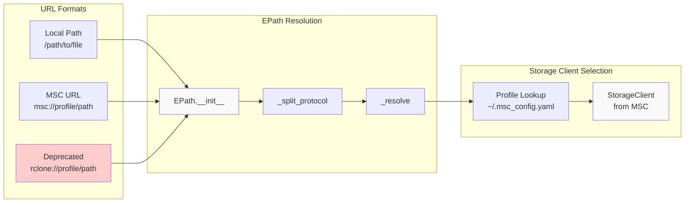
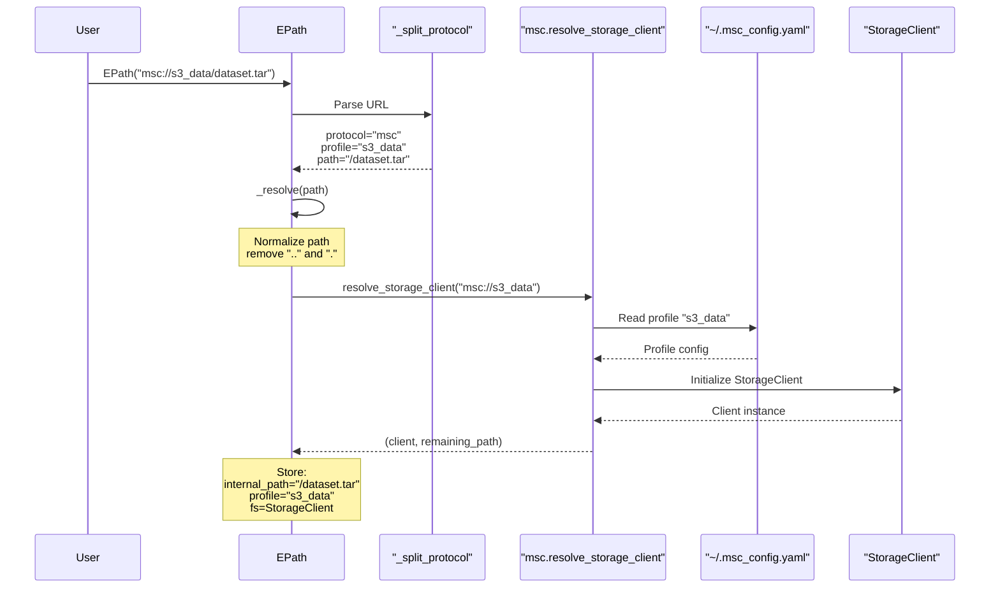
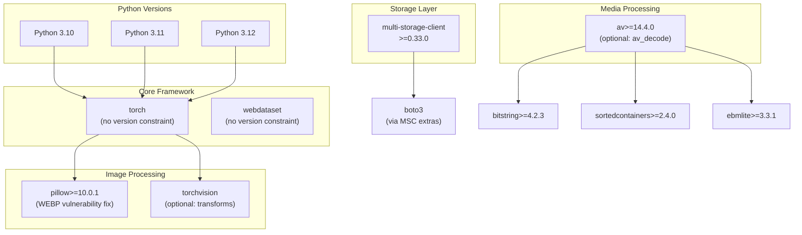

<!-- source: DeepWiki mcp.deepwiki.com · repo NVIDIA/Megatron-Energon · page 1.1 Installation and Setup · fetched 2026-10-26 -->

# Installation and Setup

<details>
<summary>Relevant source files</summary>

The following files were used as context for generating this wiki page:

- [docs/source/advanced/remote_dataset.md](docs/source/advanced/remote_dataset.md)
- [pyproject.toml](pyproject.toml)
- [src/megatron/energon/epathlib/epath.py](src/megatron/energon/epathlib/epath.py)
- [src/megatron/energon/flavors/crude.py](src/megatron/energon/flavors/crude.py)
- [src/megatron/energon/flavors/webdataset/sample_decoder.py](src/megatron/energon/flavors/webdataset/sample_decoder.py)
- [src/megatron/energon/local_copy.py](src/megatron/energon/local_copy.py)
- [tests/test_epathlib.py](tests/test_epathlib.py)
- [uv.lock](uv.lock)

</details>


This page guides you through installing Megatron-Energon, configuring dependencies, and setting up storage access. The installation process supports both basic local file access and optional features for cloud storage, audio/video processing, and development workflows. For information about preparing datasets after installation, see [Dataset Preparation](#3). For information about accessing remote datasets, see [Remote Datasets](#7.2).

## System Requirements

Megatron-Energon requires Python 3.10 or later. The system supports Python 3.10, 3.11, and 3.12.

**Minimum System Configuration:**
- Python: >=3.10
- Operating System: Linux, macOS, Windows (OS Independent)
- Disk Space: Varies by optional features (base: ~500MB, with all features: ~2GB)

Sources: [pyproject.toml:15-22]()

## Installation Methods

### Basic Installation

Install the core package using pip:

```bash
pip install megatron-energon
```

This installs the core dependencies required for local dataset access and basic functionality.

**Core Dependencies Installed:**
- `multi-storage-client>=0.33.0` - Storage abstraction layer
- `torch` - PyTorch framework
- `webdataset` - WebDataset format support
- `pillow>=10.0.1` - Image processing
- `pyyaml`, `rapidyaml>=0.10.0` - YAML parsing
- `numpy` - Numerical operations
- `click` - CLI framework
- `braceexpand`, `tqdm`, `s3fs`, `mfusepy` - Utilities

Sources: [pyproject.toml:23-36]()

### Installation with Optional Features

Megatron-Energon organizes optional dependencies into extras that can be installed individually or in combination:

```bash
# Install with specific extras
pip install megatron-energon[av_decode,s3]

# Install with multiple storage backends
pip install megatron-energon[s3,azure-storage-blob,google-cloud-storage]

# Install with all development tools
pip install megatron-energon[dev,transforms,av_decode]
```

## Optional Feature Groups

The following diagram shows the available optional feature groups and their purposes:

```mermaid
graph TB
    BASE["megatron-energon<br/>(base package)"]
    
    subgraph "Development & Testing"
        DEV["dev<br/>ruff, sphinx, pytest tools"]
        TRANS["transforms<br/>torchvision"]
    end
    
    subgraph "Storage Backends"
        S3["s3<br/>multi-storage-client[boto3]"]
        AIS["aistore<br/>multi-storage-client[aistore]"]
        AZURE["azure-storage-blob<br/>multi-storage-client[azure-storage-blob]"]
        GCS["google-cloud-storage<br/>multi-storage-client[google-cloud-storage]"]
        OCI["oci<br/>multi-storage-client[oci]"]
        HF["huggingface<br/>multi-storage-client[huggingface]"]
    end
    
    subgraph "Media Processing"
        AV["av_decode<br/>bitstring, sortedcontainers,<br/>filetype, ebmlite, av>=14.4.0"]
        GUESS["guess_content<br/>filetype>=1.0.0"]
    end
    
    subgraph "Advanced Features"
        TAR["tar_patcher<br/>numba"]
    end
    
    BASE --> DEV
    BASE --> TRANS
    BASE --> S3
    BASE --> AIS
    BASE --> AZURE
    BASE --> GCS
    BASE --> OCI
    BASE --> HF
    BASE --> AV
    BASE --> GUESS
    BASE --> TAR
    
    style BASE fill:#f9f9f9
```



Sources: [pyproject.toml:38-88]()

### Feature Group Details

| Extra | Purpose | Key Dependencies | Use Case |
|-------|---------|------------------|----------|
| `dev` | Development tools | ruff, sphinx, sphinx-rtd-theme, sphinx-click, myst-parser, soundfile | Code quality, documentation generation, testing |
| `transforms` | Image transformations | torchvision | Advanced image preprocessing pipelines |
| `s3` | Amazon S3 access | multi-storage-client[boto3] | Training on S3-hosted datasets |
| `aistore` | AIStore access | multi-storage-client[aistore] | High-performance object storage |
| `azure-storage-blob` | Azure Blob Storage | multi-storage-client[azure-storage-blob] | Azure-hosted datasets |
| `google-cloud-storage` | Google Cloud Storage | multi-storage-client[google-cloud-storage] | GCS-hosted datasets |
| `oci` | Oracle Cloud Infrastructure | multi-storage-client[oci] | OCI-hosted datasets |
| `huggingface` | Hugging Face Hub | multi-storage-client[huggingface] | Datasets from HF Hub |
| `av_decode` | Audio/video decoding | av>=14.4.0, bitstring>=4.2.3, sortedcontainers>=2.4.0, ebmlite>=3.3.1, filetype>=1.2.0 | Video/audio dataset processing |
| `guess_content` | Content type detection | filetype>=1.0.0 | Automatic file type inference |
| `tar_patcher` | TAR file optimization | numba | Performance optimizations |

Sources: [pyproject.toml:38-88]()

## Storage Backend Configuration

Megatron-Energon uses Multi-Storage Client (MSC) for unified access to local and cloud storage. The `EPath` class provides a pathlib-like interface that transparently handles multiple storage backends.

### MSC Configuration File

Create a configuration file at `~/.msc_config.yaml` (or set `MSC_CONFIG` environment variable to point to it):

```yaml
# Basic profile for S3
s3_data:
  type: s3
  endpoint_url: https://s3.amazonaws.com
  aws_access_key_id: YOUR_ACCESS_KEY
  aws_secret_access_key: YOUR_SECRET_KEY
  region_name: us-west-2

# Azure Blob Storage profile
azure_models:
  type: azure-storage-blob
  connection_string: YOUR_CONNECTION_STRING
  # Or use account name and key:
  # account_name: YOUR_ACCOUNT
  # account_key: YOUR_KEY

# Local storage (default profile)
default:
  type: local
  root: /
```

**Profile Naming:** Profile names are arbitrary strings used in `msc://` URLs. The `default` profile is used for local file access when no protocol is specified.

Sources: [src/megatron/energon/epathlib/epath.py:16-25](), [docs/source/advanced/remote_dataset.md:23-43]()

### Optional: Enable MSC Caching

For faster remote dataset access, enable MSC's local caching:

```yaml
# Add to ~/.msc_config.yaml
cache:
  size: 500G
  use_etag: true
  eviction_policy:
    policy: "fifo"
    refresh_interval: 3600
  cache_backend:
    cache_path: /tmp/msc_cache  # Use local NVMe for best performance
```

**Cache Location:** Use local NVMe storage for `cache_path` when available. Lustre parallel filesystems also work but with reduced performance.

Sources: [docs/source/advanced/remote_dataset.md:26-37]()

### EPath URL Syntax

The `EPath` class resolves storage locations using the following URL patterns:



**URL Patterns:**
- Local: `/path/to/dataset` or `file:///path/to/dataset`
- MSC: `msc://profile_name/path/to/dataset`
- Deprecated: `rclone://profile_name/path` (shows deprecation warning)

Sources: [src/megatron/energon/epathlib/epath.py:34-62](), [src/megatron/energon/epathlib/epath.py:98-103](), [tests/test_epathlib.py:143-161]()

### EPath Initialization Flow



Sources: [src/megatron/energon/epathlib/epath.py:34-62](), [src/megatron/energon/epathlib/epath.py:98-103]()

## CLI Tool Verification

After installation, verify the `energon` command is available:

```bash
# Check energon is installed
energon --help

# Verify version and available commands
energon --version
```

The `energon` CLI provides commands for dataset preparation, mounting, and inspection. The entry point is defined as `energon = "megatron.energon.cli.main:main"` in the package configuration.

Sources: [pyproject.toml:98-99]()

## Common Installation Patterns

### Minimal Installation for Local Training

```bash
pip install megatron-energon
```

Includes: Core dependencies only, local file access via `EPath("default")` profile.

### Cloud Training on S3

```bash
pip install megatron-energon[s3]
```

Includes: S3 storage backend, enables `msc://s3_profile/...` URLs.

### Video/Audio Datasets

```bash
pip install megatron-energon[av_decode]
```

Includes: PyAV integration, AVDecoder for efficient media decoding, Fastseek optimization.

### Full Development Setup

```bash
pip install megatron-energon[dev,transforms,av_decode,s3,azure-storage-blob]
```

Includes: All development tools, storage backends, and media processing capabilities.

Sources: [pyproject.toml:38-88]()

## Dependency Resolution and Compatibility

The package uses `hatch-vcs` for version management and supports three major Python versions:



**Critical Version Constraints:**
- `multi-storage-client>=0.33.0` - Required for storage abstraction
- `pillow>=10.0.1` - Security fix for WEBP vulnerability
- `av>=14.4.0` - Video decoding compatibility (when using `av_decode`)
- `bitstring>=4.2.3`, `sortedcontainers>=2.4.0`, `ebmlite>=3.3.1` - AVDecoder dependencies

Sources: [pyproject.toml:15-36](), [pyproject.toml:73-80]()

## Environment Variables

| Variable | Purpose | Default | Example |
|----------|---------|---------|---------|
| `MSC_CONFIG` | Path to MSC configuration file | `~/.msc_config.yaml` | `/etc/msc/config.yaml` |
| `XDG_CONFIG_HOME` | Base directory for config files | `~/.config` | `/home/user/.config` |
| `HOME` | Home directory (fallback for config) | System default | `/home/user` |

**Configuration Priority:** MSC looks for configuration in this order:
1. File specified by `MSC_CONFIG` environment variable
2. `~/.msc_config.yaml`
3. Rclone configuration at `$XDG_CONFIG_HOME/rclone/rclone.conf` (legacy)

Sources: [tests/test_epathlib.py:136-142](), [docs/source/advanced/remote_dataset.md:39-43]()

## Post-Installation Verification

### Verify Core Installation

```python
from megatron.energon import get_train_dataset
from megatron.energon.epathlib import EPath

# Test local path access
local_path = EPath("/tmp/test.txt")
print(f"Local path: {local_path}")
print(f"Is local: {local_path.is_local()}")

# Test MSC default profile
default_path = EPath("msc://default/tmp/test.txt")
print(f"Default profile path: {default_path}")
```

### Verify Storage Backend

```python
from megatron.energon.epathlib import EPath

# Test S3 profile (requires s3 extra and configuration)
s3_path = EPath("msc://s3_data/my-bucket/dataset")
print(f"S3 path: {s3_path}")
print(f"Is file: {s3_path.is_file()}")
```

### Verify Media Processing

```python
from megatron.energon.flavors.webdataset import SampleDecoder

# Test AVDecoder availability (requires av_decode extra)
decoder = SampleDecoder(av_decode="AVDecoder")
print(f"Decoder config: {decoder.config()}")
```

Sources: [tests/test_epathlib.py:25-92](), [src/megatron/energon/flavors/webdataset/sample_decoder.py:83-104]()

## Troubleshooting

### ImportError: No module named 'multistorageclient'

**Cause:** Base package not installed or installation incomplete.

**Solution:**
```bash
pip install --upgrade megatron-energon
```

### ImportError: No module named 'av'

**Cause:** Audio/video decoding extra not installed.

**Solution:**
```bash
pip install megatron-energon[av_decode]
```

### FileNotFoundError: MSC profile not found

**Cause:** Profile referenced in `msc://` URL not defined in configuration.

**Solution:** Add profile to `~/.msc_config.yaml` or set `MSC_CONFIG` environment variable.

### DeprecationWarning: rclone:// protocol is deprecated

**Cause:** Using legacy `rclone://` URL syntax.

**Solution:** Replace `rclone://profile/path` with `msc://profile/path` in your code.

Sources: [src/megatron/energon/epathlib/epath.py:51-53](), [tests/test_epathlib.py:157-161]()

## Serialization and Multiprocessing

`EPath` objects support pickling for use in multiprocessing contexts. The serialization excludes sensitive credentials:

```python
import pickle
from megatron.energon.epathlib import EPath

path = EPath("msc://s3_data/dataset.tar")
serialized = pickle.dumps(path)  # Credentials not included
restored = pickle.loads(serialized)  # Credentials re-loaded from config

# Credentials are never serialized
assert b"secret_key" not in serialized
```

**Implementation Details:**
- `__getstate__` excludes the `fs` (StorageClient) attribute during serialization
- `__setstate__` reconstructs the StorageClient from the profile name
- This prevents credential leakage in serialized objects

Sources: [src/megatron/energon/epathlib/epath.py:63-73](), [tests/test_epathlib.py:163-166](), [tests/test_epathlib.py:218-264]()

## Next Steps

After installation and configuration:
1. **Prepare datasets**: Use `energon prepare` to index tar files (see [energon prepare Command](#3.1))
2. **Configure metadatasets**: Create YAML configuration files for dataset composition (see [Metadataset Composition](#4.1))
3. **Load data**: Use `get_train_dataset()` or `get_val_dataset()` to create data loaders (see [SavableDataLoader](#4.3))

Sources: [pyproject.toml:1-117]()

---

