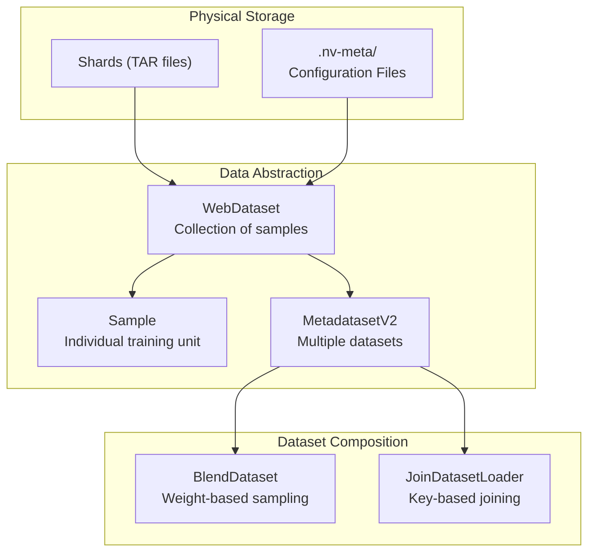
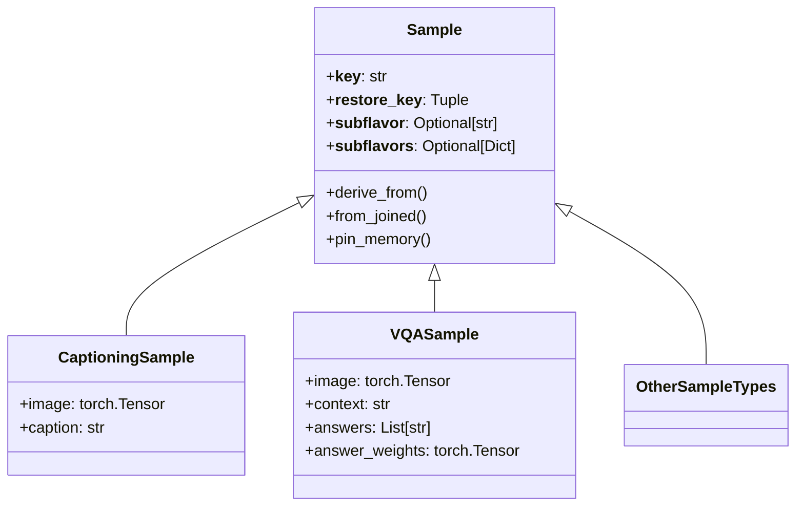
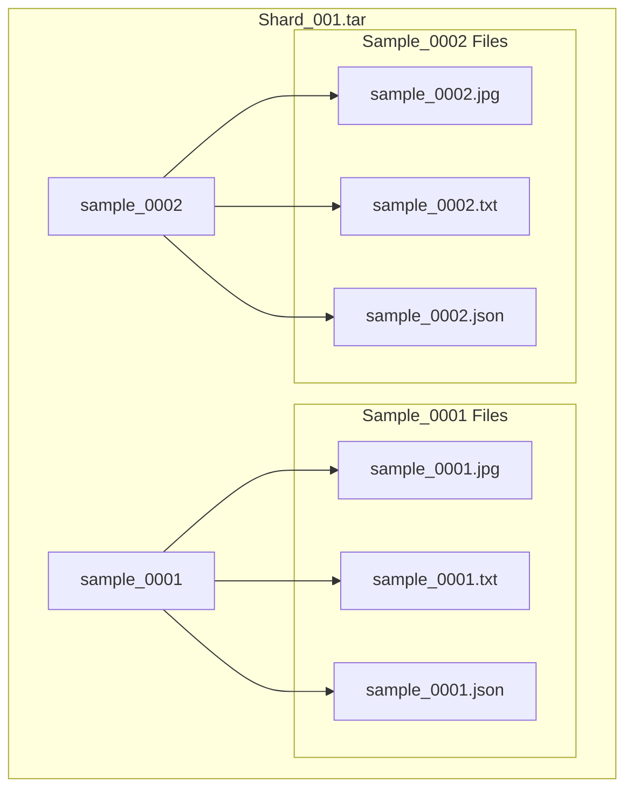
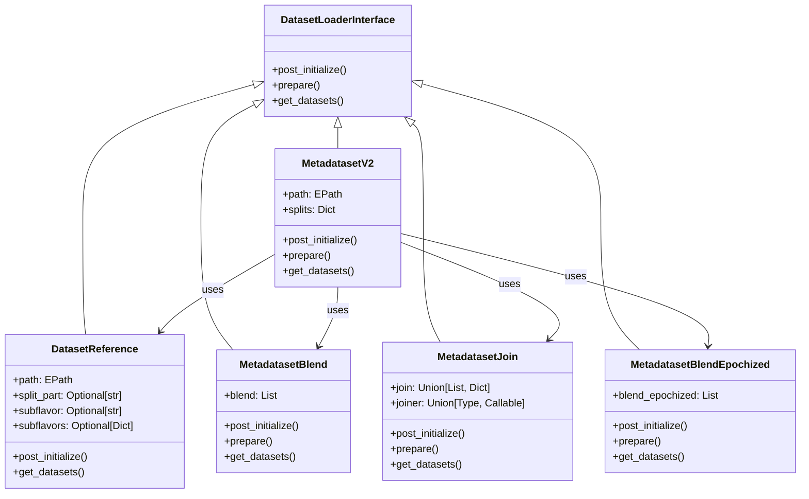
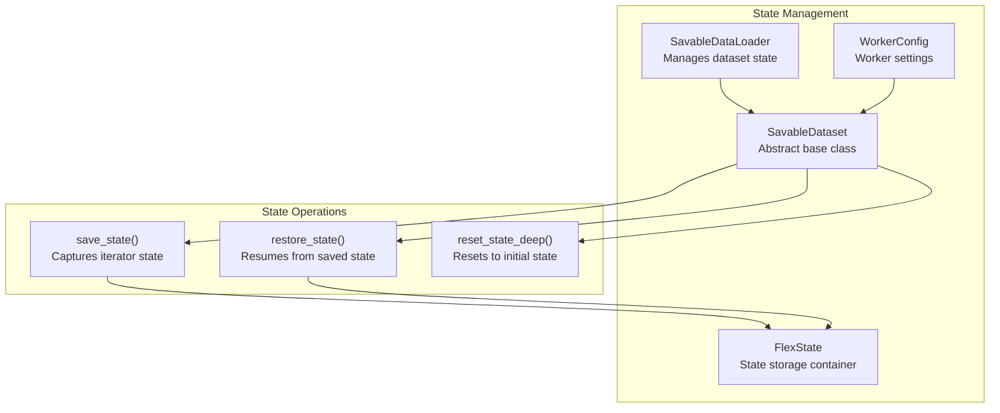
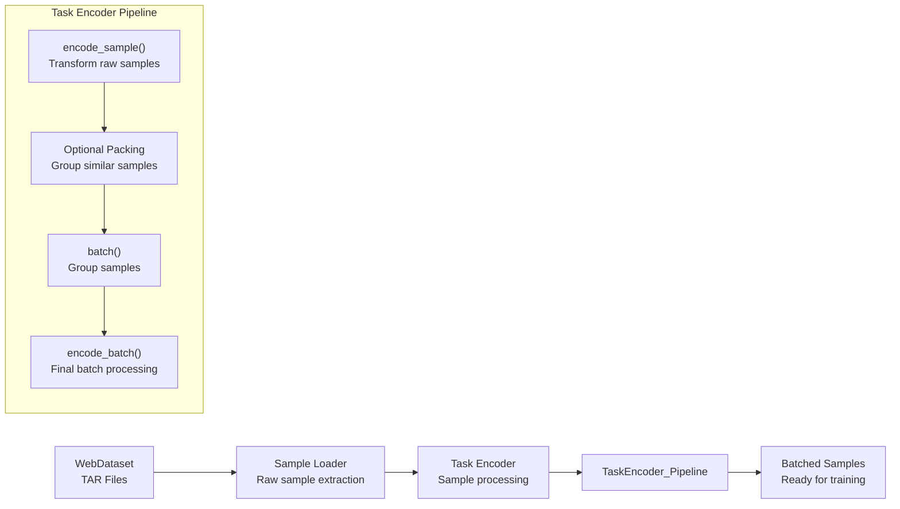
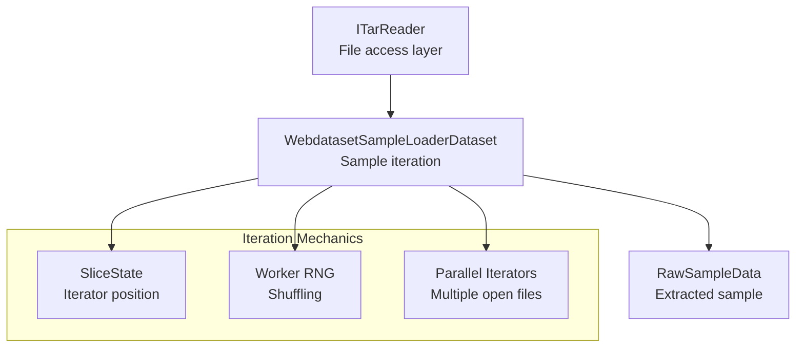
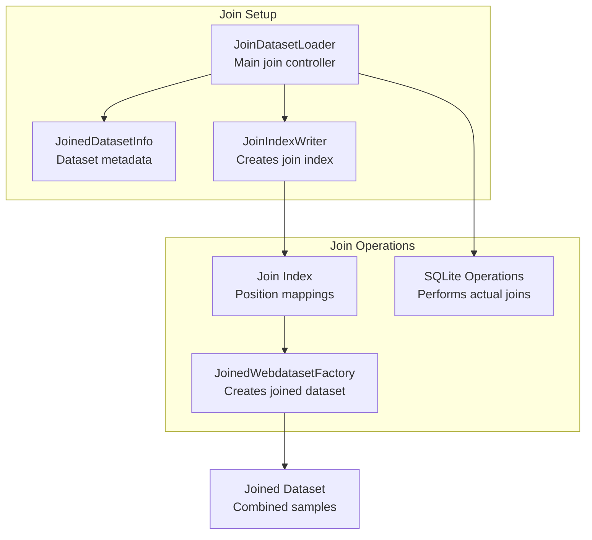

<!-- source: DeepWiki mcp.deepwiki.com · repo NVIDIA/Megatron-Energon · page 2 Core Concepts · fetched 2026-10-26 -->

# Core Concepts

<details>
<summary>Relevant source files</summary>

The following files were used as context for generating this wiki page:

- [src/megatron/energon/loader.py](src/megatron/energon/loader.py)
- [src/megatron/energon/metadataset/metadataset_v2.py](src/megatron/energon/metadataset/metadataset_v2.py)
- [src/megatron/energon/savable_loader.py](src/megatron/energon/savable_loader.py)
- [src/megatron/energon/task_encoder/base.py](src/megatron/energon/task_encoder/base.py)
- [src/megatron/energon/task_encoder/loader.py](src/megatron/energon/task_encoder/loader.py)
- [src/megatron/energon/typed_converter.py](src/megatron/energon/typed_converter.py)
- [src/megatron/energon/wrappers/gc_dataset.py](src/megatron/energon/wrappers/gc_dataset.py)
- [src/megatron/energon/wrappers/mix_batch_dataset.py](src/megatron/energon/wrappers/mix_batch_dataset.py)
- [tests/test_dataset.py](tests/test_dataset.py)
- [tests/test_metadataset_v2.py](tests/test_metadataset_v2.py)

</details>


This document explains the fundamental concepts underlying Megatron-Energon, a multi-modal data loading system designed for efficient training of large language models. It covers the core data structures, processing pipeline, and organizational patterns that form the foundation of the system. For information about specific implementations like the Audio/Video decoder, see [Audio/Video Processing](#5).

## Data Organization

Megatron-Energon organizes data using a hierarchical structure that enables efficient loading, processing, and training with large multi-modal datasets.



Sources: [src/megatron/energon/flavors/base_dataset.py:111-131](). [src/megatron/energon/metadataset/metadataset_v2.py:358-409]().

### Samples

A `Sample` is the atomic unit of data in Megatron-Energon. Samples represent individual training examples with their associated input and output data. All sample types derive from the abstract `Sample` base class.



Every `Sample` has:
- `__key__`: A unique identifier for the sample
- `__restore_key__`: A structured key used for restoring the sample from checkpoints
- `__subflavor__`/`__subflavors__`: Optional metadata for categorizing or configuring samples

Sources: [src/megatron/energon/flavors/base_dataset.py:111-131](). [docs/source/basic/data_prep.md:160-229]().

### WebDataset Format

WebDataset is the underlying data storage format used by Megatron-Energon. It organizes data into tar archives (shards) containing multiple samples.



The WebDataset format provides several advantages:
- **Efficient sequential reading**: tar files optimize for reading sequential chunks
- **Self-contained units**: Each shard can be processed independently
- **Extension-based decoding**: Files are decoded based on their extensions (e.g., `.jpg`, `.json`)

For Megatron-Energon, WebDatasets are enhanced with additional metadata stored in a `.nv-meta` directory, which includes:
- `dataset.yaml`: Sample type definitions and field mappings
- `split.yaml`: Dataset partitioning information (train/val/test)
- `.info.yaml`: Statistics about each shard

Sources: [docs/source/basic/data_prep.md:16-38](). [docs/source/basic/data_prep.md:358-440]().

## Data Loading System

### Metadataset System

The Metadataset system provides a powerful abstraction for combining multiple datasets, enabling complex composition patterns.



The Metadataset system supports several composition patterns:

1. **Blending**: Combines multiple datasets with weight-based sampling
   ```python
   # MetadatasetBlend combines datasets with weighted sampling
   blend:
     - path: dataset1/
       weight: 0.7
     - path: dataset2/
       weight: 0.3
   ```

2. **Joining**: Combines datasets by matching samples based on keys
   ```python
   # MetadatasetJoin combines datasets by matching keys
   join:
     dataset1:
       path: dataset1/
       nonmatch: error
     dataset2:
       path: dataset2/
       nonmatch: skip
   joiner: CombinedSampleType
   ```

3. **Epochized Blending**: Controls how many times each dataset is repeated in an epoch
   ```python
   # MetadatasetBlendEpochized repeats datasets different numbers of times
   blend_epochized:
     - path: dataset1/
       repetitions: 2
     - path: dataset2/
       repetitions: 1
   ```

Sources: [src/megatron/energon/metadataset/metadataset_v2.py:217-320](). [src/megatron/energon/metadataset/metadataset_v2.py:358-409]().

### SavableDataset and State Management

Megatron-Energon provides robust state management for handling checkpoints and resuming training, which is crucial for large-scale training jobs.



The `SavableDataset` class provides the foundation for checkpoint/resume capability:

- **State Saving**: Captures the current state of the dataset iterator, including positions in files and random number generator states
- **State Restoration**: Resumes iteration from exactly the same point
- **Reset Functionality**: Returns the dataset to its initial state

This state management system works across distributed environments, handling the complexities of saving worker-specific states.

Sources: [src/megatron/energon/flavors/base_dataset.py:229-360]().

## Processing Pipeline

The data processing pipeline in Megatron-Energon transforms raw data from storage into batched samples ready for model training.



### Sample Loading

The sample loading process extracts raw data from WebDataset archives and converts it into structured samples:

1. **TAR File Reading**: Extracts raw bytes from files within TAR archives
2. **Decoding**: Converts bytes to appropriate Python objects based on file extensions
3. **Sample Construction**: Assembles the decoded parts into a complete `Sample` object

Sample loading can be customized through:
- **Field Maps**: Simple mappings from file extensions to sample attributes
- **Custom Sample Loaders**: Python functions for more complex transformations

Sources: [src/megatron/energon/flavors/webdataset/sample_loader.py:36-49](). [docs/source/basic/data_prep.md:232-330]().

### Task Encoders

Task encoders define how samples are processed through the pipeline, transforming raw data into model-ready batches. The processing stages include:

1. **Sample Encoding** (`encode_sample`): Transforms individual samples (e.g., image resizing, text tokenization)
2. **Optional Packing** (`select_samples_to_pack`, `pack_selected_samples`): Combines multiple samples into one
3. **Batching** (`batch`): Collates multiple samples into a batch structure
4. **Batch Encoding** (`encode_batch`): Performs final transformations on the entire batch

This pipeline provides flexibility to implement various data transformations while maintaining efficiency.

Sources: [docs/source/basic/task_encoder.md:4-31]().

## WebDataset Sample Loading

Megatron-Energon implements a sophisticated system for loading and iterating through WebDatasets, with features for efficient shuffling and parallel access.



Key features of the WebDataset loading system:

- **Slice-Based Iteration**: Divides datasets into "slices" for efficient distributed processing
- **Configurable Shuffling**: Supports various shuffling strategies:
  - `shuffle_over_epochs=None`: No shuffling, deterministic order
  - `shuffle_over_epochs=1`: Every sample seen exactly once per epoch
  - `shuffle_over_epochs>1`: Samples shuffled across multiple epochs
  - `shuffle_over_epochs=-1`: Infinite shuffling (with replacement)
- **Parallel Slice Iterators**: Can open multiple files simultaneously for increased randomness
- **State Management**: Full support for saving/restoring iterator state

Sources: [src/megatron/energon/flavors/webdataset/sample_loader.py:36-473]().

## Dataset Joining

The `JoinDatasetLoader` enables combining multiple datasets by matching samples with the same keys, similar to a database join operation.



The joining process works as follows:

1. **Preparation**: Creates a join index mapping corresponding samples across datasets
2. **SQLite Joins**: Uses SQLite to efficiently perform the join operations
3. **Join Modes**: Supports different join behaviors:
   - `nonmatch="error"`: Raises an error if keys don't match (inner join)
   - `nonmatch="skip"`: Skips samples with no match (inner join)
   - `nonmatch="none"`: Includes samples with no match (left join)
4. **Sample Combination**: Uses a provided `joiner` function to combine data from matched samples

This powerful mechanism enables creating complex multi-modal datasets from specialized single-modal ones.

Sources: [src/megatron/energon/metadataset/join_dataset_loader.py:341-553]().

## Summary of Core Concepts

| Concept | Purpose | Key Features |
|---------|---------|--------------|
| Sample | Atomic unit of data | Base class for all sample types, supports metadata and serialization |
| WebDataset | Storage format | Efficient tar-based storage, extension-based decoding |
| Metadataset | Dataset composition | Blending, joining, and epochized blending of datasets |
| SavableDataset | State management | Checkpoint/resume capabilities for fault tolerance |
| Task Encoder | Data processing | Multi-stage pipeline for transforming samples into batches |
| Dataset Joining | Data combination | SQL-like joining of datasets by matching keys |

These core concepts provide the foundation for Megatron-Energon's flexible, efficient, and powerful data loading system, enabling the training of large-scale models on complex multi-modal datasets.

---

