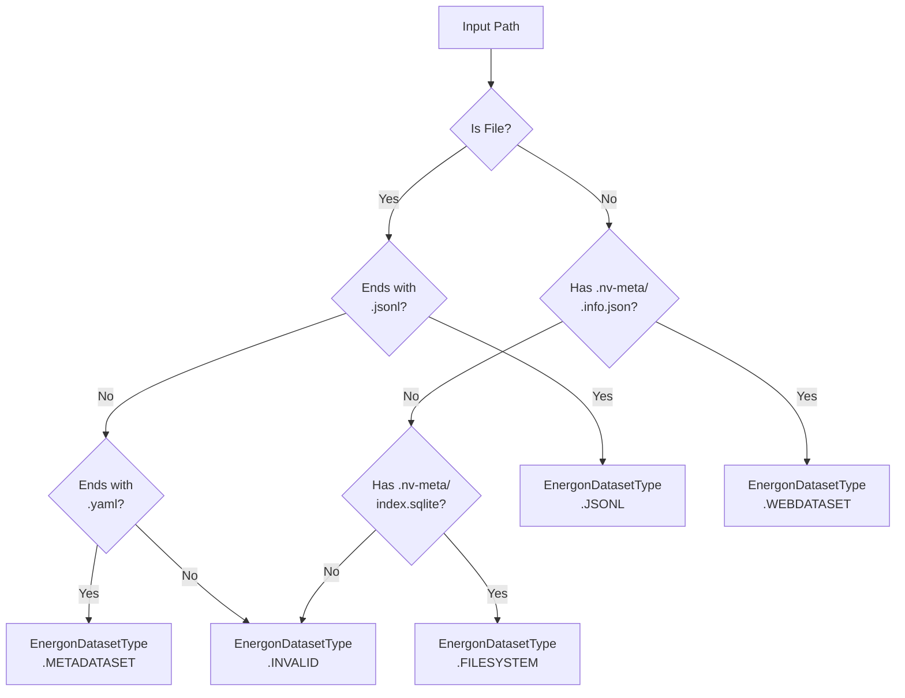
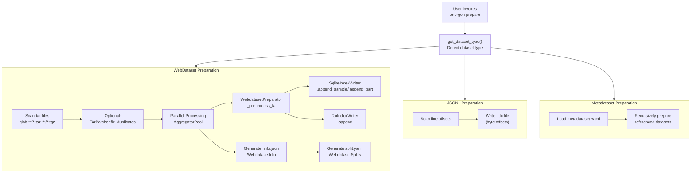
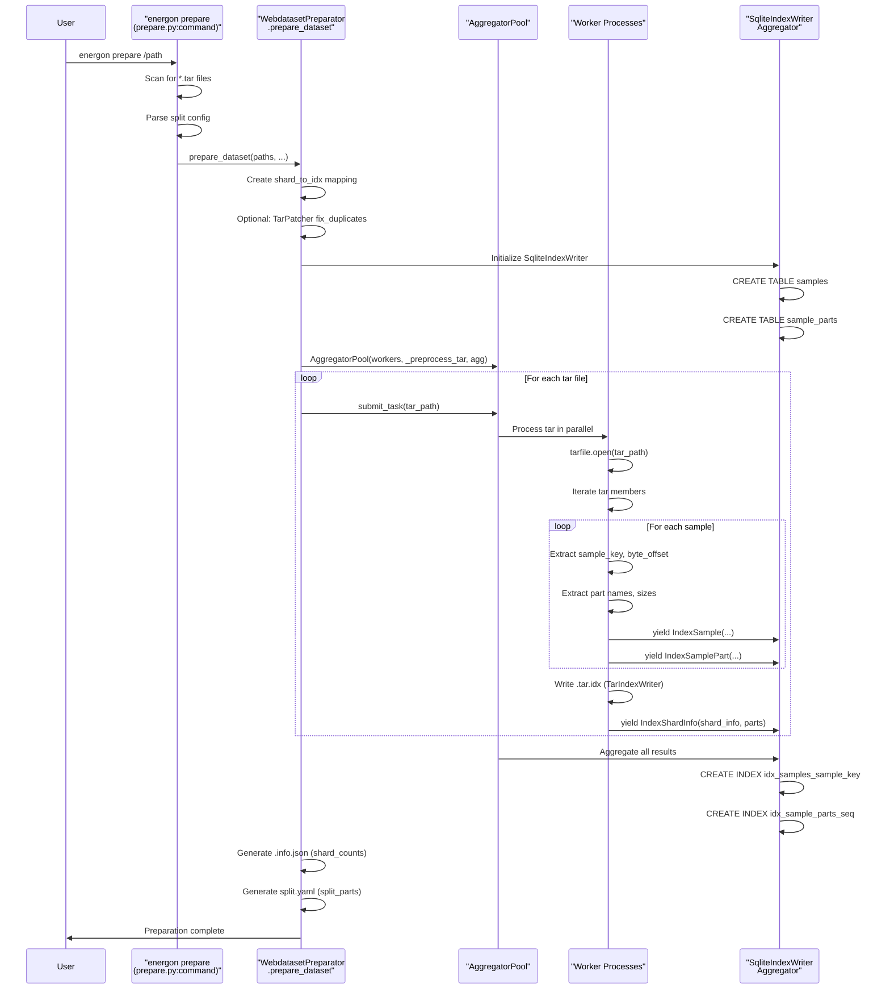
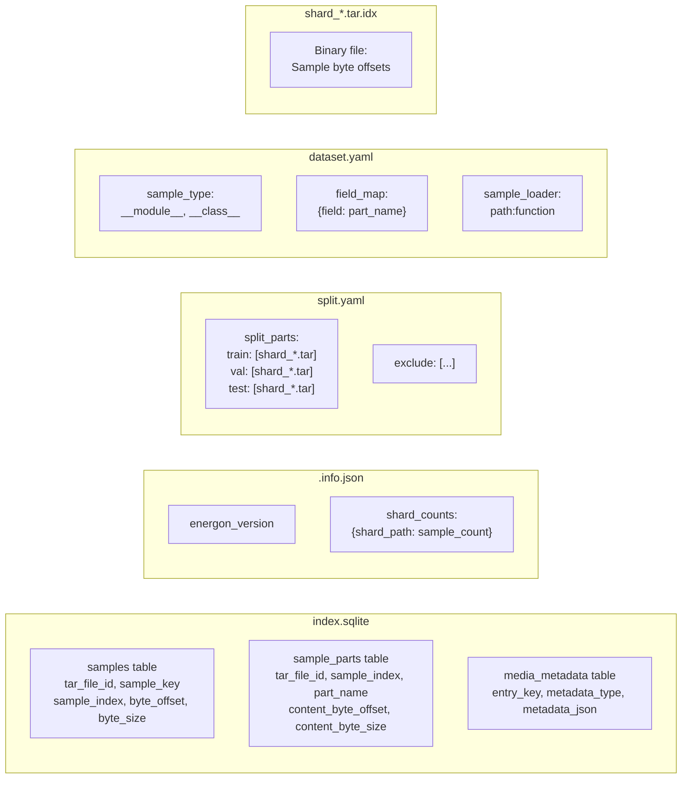
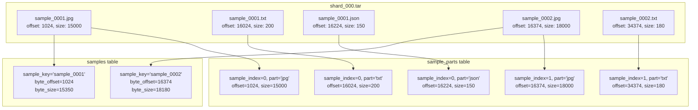
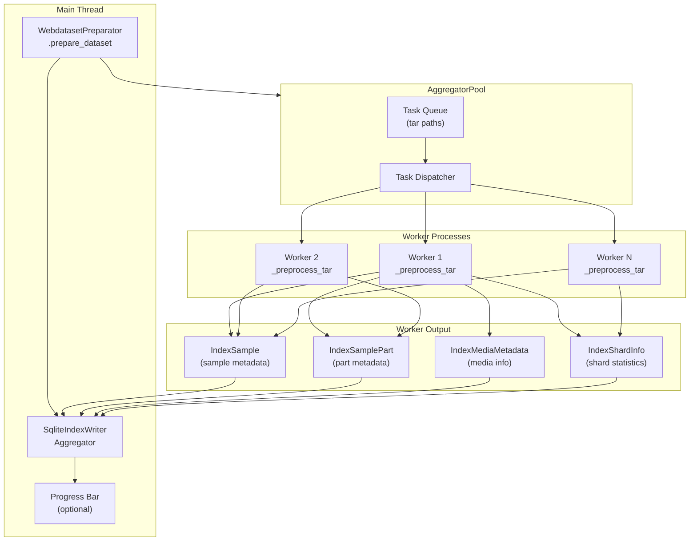
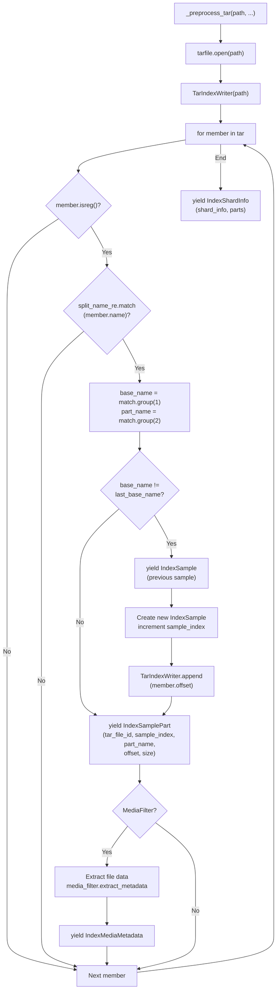
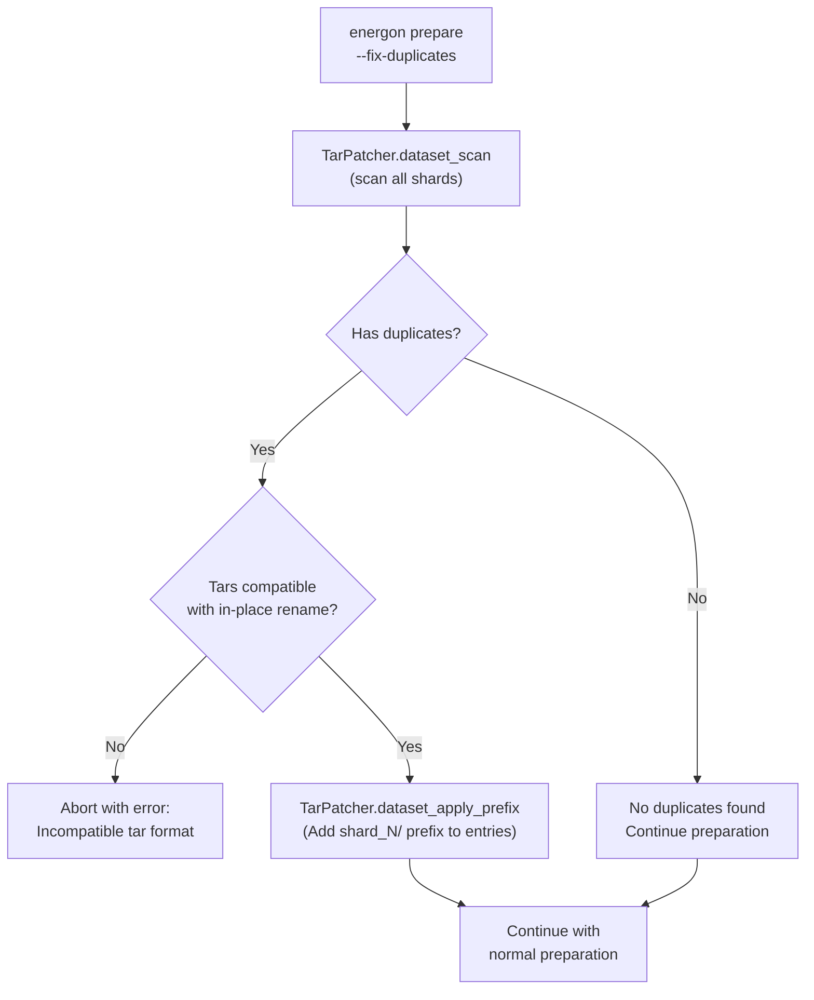

<!-- source: DeepWiki mcp.deepwiki.com · repo NVIDIA/Megatron-Energon · page 3 Dataset Preparation · fetched 2026-10-26 -->

# Dataset Preparation

<details>
<summary>Relevant source files</summary>

The following files were used as context for generating this wiki page:

- [src/megatron/energon/cache/file_store.py](src/megatron/energon/cache/file_store.py)
- [src/megatron/energon/dataset_config.py](src/megatron/energon/dataset_config.py)
- [src/megatron/energon/flavors/webdataset/indexing.py](src/megatron/energon/flavors/webdataset/indexing.py)
- [src/megatron/energon/flavors/webdataset/metadata.py](src/megatron/energon/flavors/webdataset/metadata.py)
- [src/megatron/energon/flavors/webdataset/prepare.py](src/megatron/energon/flavors/webdataset/prepare.py)
- [src/megatron/energon/metadataset/loader.py](src/megatron/energon/metadataset/loader.py)
- [src/megatron/energon/tools/prepare.py](src/megatron/energon/tools/prepare.py)
- [tests/test_jsonl_dataset.py](tests/test_jsonl_dataset.py)

</details>


## Purpose and Scope

Dataset preparation is the process of generating metadata and index structures that enable efficient random access to dataset samples during training. This page covers the overall preparation workflow, dataset types, and the outputs generated during preparation.

For detailed information about the `energon prepare` CLI tool and its options, see [energon prepare Command](#3.1). For in-depth technical details about the indexing system and metadata structures, see [Indexing and Metadata System](#3.2).

## Dataset Types

Megatron-Energon supports multiple dataset formats, each with different preparation requirements. The `get_dataset_type` function [src/megatron/energon/flavors/webdataset/metadata.py:151-176]() identifies the dataset type based on the path structure.

### Supported Dataset Types

| Dataset Type | Format | Requires Preparation | Identifier |
|--------------|--------|---------------------|------------|
| **Webdataset** | Tar archives containing sample files | Yes | Folder with `.nv-meta/.info.json` or `.nv-meta/.info.yaml` |
| **JSONL** | Line-delimited JSON files | Yes (minimal) | File ending in `.jsonl` |
| **Metadataset** | YAML configuration referencing other datasets | Yes (recursive) | File ending in `.yaml` containing metadataset config |
| **Filesystem** | Individual files in directories | Yes (for auxiliary data) | Folder with `.nv-meta/index.sqlite` but no `.info.json` |

**Dataset Type Detection Flow**



**Sources:** [src/megatron/energon/flavors/webdataset/metadata.py:151-176]()

## Preparation Workflow

The preparation workflow varies by dataset type but follows a general pattern: scan the raw data, build indices for random access, and generate metadata files.

### High-Level Preparation Flow



**Sources:** [src/megatron/energon/tools/prepare.py:207-580](), [src/megatron/energon/flavors/webdataset/prepare.py:461-669]()

### WebDataset Preparation Pipeline

The most complex preparation workflow is for WebDataset tar archives. The process uses parallel workers to efficiently index multiple tar files simultaneously.



**Sources:** [src/megatron/energon/flavors/webdataset/prepare.py:461-669](), [src/megatron/energon/flavors/webdataset/prepare.py:214-353]()

## Preparation Output

Dataset preparation generates a `.nv-meta/` directory containing index and metadata files that enable efficient dataset access.

### Directory Structure

```
dataset_root/
├── shard_000.tar
├── shard_001.tar
├── shard_002.tar
└── .nv-meta/
    ├── index.sqlite          # SQLite index with sample pointers
    ├── index.uuid            # Unique dataset identifier
    ├── .info.json            # Dataset metadata (shard counts)
    ├── split.yaml            # Split configuration (train/val/test)
    ├── dataset.yaml          # Dataset configuration (sample type, field_map)
    └── shard_*.tar.idx       # Per-shard tar index files
```

### Metadata Files

**Metadata File Details**



**Sources:** [src/megatron/energon/flavors/webdataset/indexing.py:25-257](), [src/megatron/energon/flavors/webdataset/config.py:1-45]()

### SQLite Index Schema

The `index.sqlite` database is the core of the indexing system, enabling O(1) random access to samples by key and efficient sequential access by shard.

**Schema Definition:**

| Table | Columns | Purpose | Indexes |
|-------|---------|---------|---------|
| `samples` | `tar_file_id`, `sample_key`, `sample_index`, `byte_offset`, `byte_size` | Maps sample keys to tar file locations | `idx_samples_sample_key` (UNIQUE on `sample_key`)<br/>`idx_samples_by_tar_and_idx` (on `tar_file_id, sample_index`) |
| `sample_parts` | `tar_file_id`, `sample_index`, `part_name`, `content_byte_offset`, `content_byte_size` | Maps individual file parts within samples | `idx_sample_parts_seq` (on `tar_file_id, sample_index, content_byte_offset`)<br/>`idx_sample_parts_full` (on all columns) |
| `media_metadata` | `entry_key`, `metadata_type`, `metadata_json` | Stores extracted media metadata (optional) | Primary key on `entry_key` |

**Sources:** [src/megatron/energon/flavors/webdataset/indexing.py:40-134]()

### Sample and Part Indexing

WebDataset samples consist of multiple parts (files with the same base name but different extensions). The indexing system tracks both the overall sample boundaries and individual part locations.



**Sources:** [src/megatron/energon/flavors/webdataset/prepare.py:214-353](), [src/megatron/energon/flavors/webdataset/indexing.py:136-189]()

## Preparation Process Internals

The preparation process uses a multi-threaded architecture to efficiently index large datasets. The `AggregatorPool` pattern enables parallel tar file processing while maintaining consistency in the SQLite database.

### Parallel Processing Architecture



**Sources:** [src/megatron/energon/flavors/webdataset/prepare.py:104-212](), [src/megatron/energon/flavors/webdataset/aggregator_pool.py:1-100]()

### Tar Processing Worker Function

Each worker processes a single tar file using the `_preprocess_tar` method, which yields index entries as it scans the tar file.

**Processing Steps:**

1. **Open tar file** - Open the tar archive in streaming mode
2. **Iterate members** - Process each tar member (file entry)
3. **Group by sample** - Detect sample boundaries when base name changes
4. **Track offsets** - Record byte offsets and sizes for each sample and part
5. **Extract metadata** - Optionally extract media metadata (if `MediaFilterConfig` provided)
6. **Write tar index** - Generate `.tar.idx` file for efficient sequential access
7. **Yield results** - Stream `IndexSample`, `IndexSamplePart`, `IndexMediaMetadata` objects to aggregator

**Code Flow:**



**Sources:** [src/megatron/energon/flavors/webdataset/prepare.py:238-353]()

### Index Aggregation

The `SqliteIndexWriterAggregator` collects results from all workers and writes them to the SQLite database. It implements thread-safe database access and progress tracking.

**Aggregator Lifecycle:**

| Phase | Method | Action |
|-------|--------|--------|
| **Initialization** | `__init__` | Configure database path, options, and progress tracking |
| **Start** | `on_start` | Create `SqliteIndexWriter`, initialize database tables |
| **Processing** | `on_item` | Receive `IndexSample`/`IndexSamplePart`/`IndexMediaMetadata`/`IndexShardInfo` objects, write to database |
| **Completion** | `on_finish` | Create indexes on `samples` and `sample_parts` tables, close database |
| **Result** | `get_final_result_data` | Return aggregated shard information and found part types |

**Sources:** [src/megatron/energon/flavors/webdataset/prepare.py:104-212](), [src/megatron/energon/flavors/webdataset/indexing.py:25-257]()

### Duplicate Key Handling

Starting from recent versions, Megatron-Energon enforces unique sample keys across all shards. The preparation system detects duplicates and can automatically fix them using the `TarPatcher` tool.

**Duplicate Detection and Fixing:**



When duplicates are detected during normal preparation (without `--fix-duplicates`), the system raises a `DuplicateSampleKeyError` [src/megatron/energon/flavors/webdataset/indexing.py:17-22]() and suggests running preparation with the fix flag.

**Sources:** [src/megatron/energon/flavors/webdataset/prepare.py:507-532](), [src/megatron/energon/tools/prepare.py:147-150]()

### Media Metadata Extraction

When media metadata extraction is enabled (via `--media-metadata-by-*` flags), the preparation system can extract and store metadata for images, videos, and audio files.

**Media Metadata Flow:**

```mermaid
graph LR
    User["User: --media-metadata-by-glob<br/>or --media-metadata-by-header<br/>or --media-metadata-by-extension"]
    
    MediaFilterConfig["MediaFilterConfig.parse()<br/>(strategy, patterns)"]
    
    Worker["_preprocess_tar worker"]
    
    CheckFilter{"media_filter.<br/>should_consider_media<br/>(entry_key)?"}
    
    ExtractFile["tar.extractfile(member)<br/>Read file data"]
    
    ExtractMeta["media_filter.extract_metadata<br/>(data, filename)"]
    
    Serialize["serialize_media_metadata<br/>(metadata_type, metadata_json)"]
    
    Yield["yield IndexMediaMetadata<br/>(entry_key, type, json)"]
    
    Aggregator["SqliteIndexWriterAggregator<br/>.append_media_metadata"]
    
    MediaTable["media_metadata table<br/>in index.sqlite"]
    
    User --> MediaFilterConfig
    MediaFilterConfig --> Worker
    Worker --> CheckFilter
    CheckFilter -->|Yes| ExtractFile
    CheckFilter -->|No| Worker
    ExtractFile --> ExtractMeta
    ExtractMeta --> Serialize
    Serialize --> Yield
    Yield --> Aggregator
    Aggregator --> MediaTable
```



The media metadata is stored in the `media_metadata` table [src/megatron/energon/flavors/webdataset/indexing.py:115-134]() and can be accessed later via `FileStore.get_media_metadata()` [src/megatron/energon/cache/file_store.py:50-52]().

**Sources:** [src/megatron/energon/flavors/webdataset/prepare.py:321-339](), [src/megatron/energon/media/extractor.py:1-100](), [src/megatron/energon/media/metadata.py:1-100]()

## Split Configuration

After indexing, the preparation system generates a split configuration file (`split.yaml` or `split.json`) that defines which shards belong to which split (train/val/test).

**Split Generation Modes:**

1. **Ratio-based splitting** (`--split-ratio`): Divide shards by ratios like `0.8,0.1,0.1`
2. **Pattern-based splitting** (`--split-parts`): Assign shards to splits using glob patterns like `train:train/*.tar`

The split file is written as a `WebdatasetSplits` object [src/megatron/energon/flavors/webdataset/structs.py:1-50]() containing:

```yaml
split_parts:
  train: [shard_000.tar, shard_001.tar, ...]
  val: [shard_010.tar, shard_011.tar, ...]
  test: [shard_020.tar]
exclude: []
```

The system uses `braceexpand` [src/megatron/energon/flavors/webdataset/prepare.py:643-651]() to expand patterns and `collapse` [src/megatron/energon/flavors/webdataset/prepare.py:654-657]() to optimize shard lists by combining consecutive patterns.

**Sources:** [src/megatron/energon/flavors/webdataset/prepare.py:619-667](), [src/megatron/energon/flavors/webdataset/structs.py:1-50]()

---

