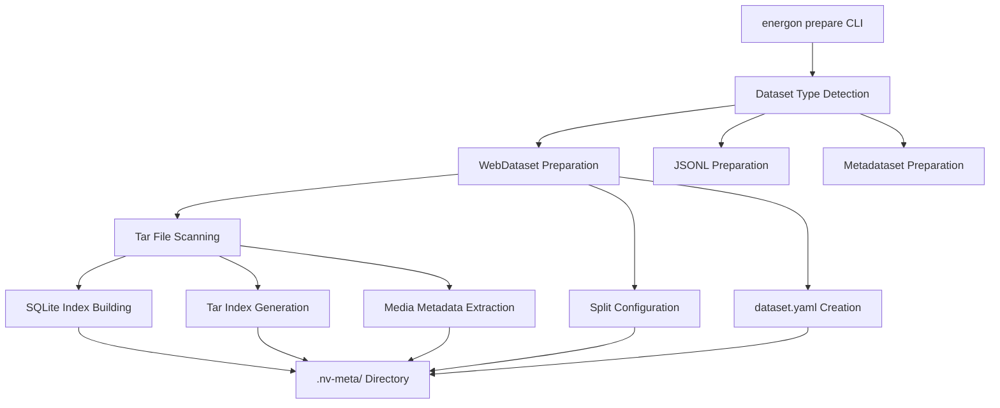
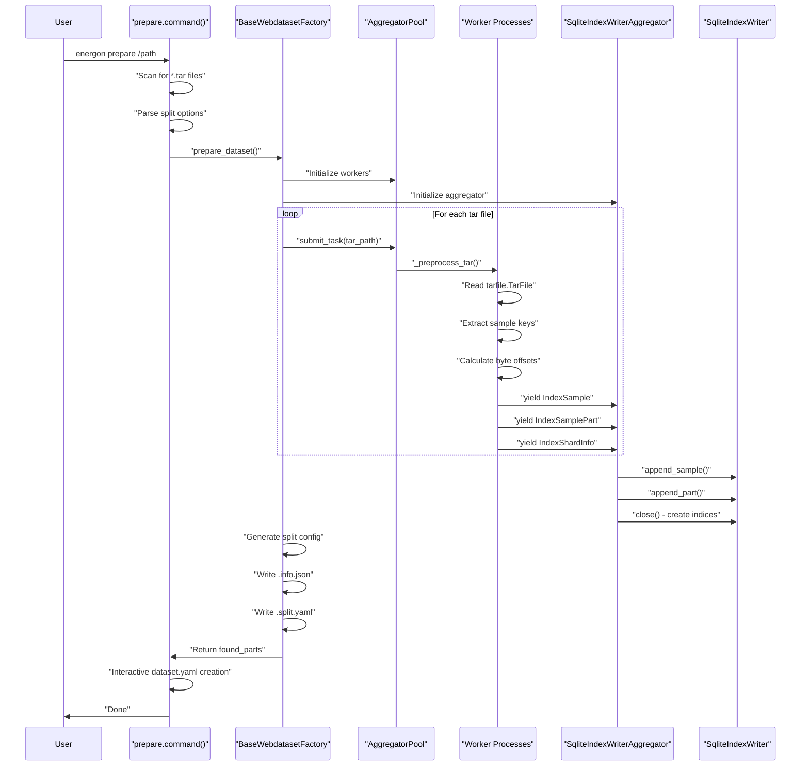
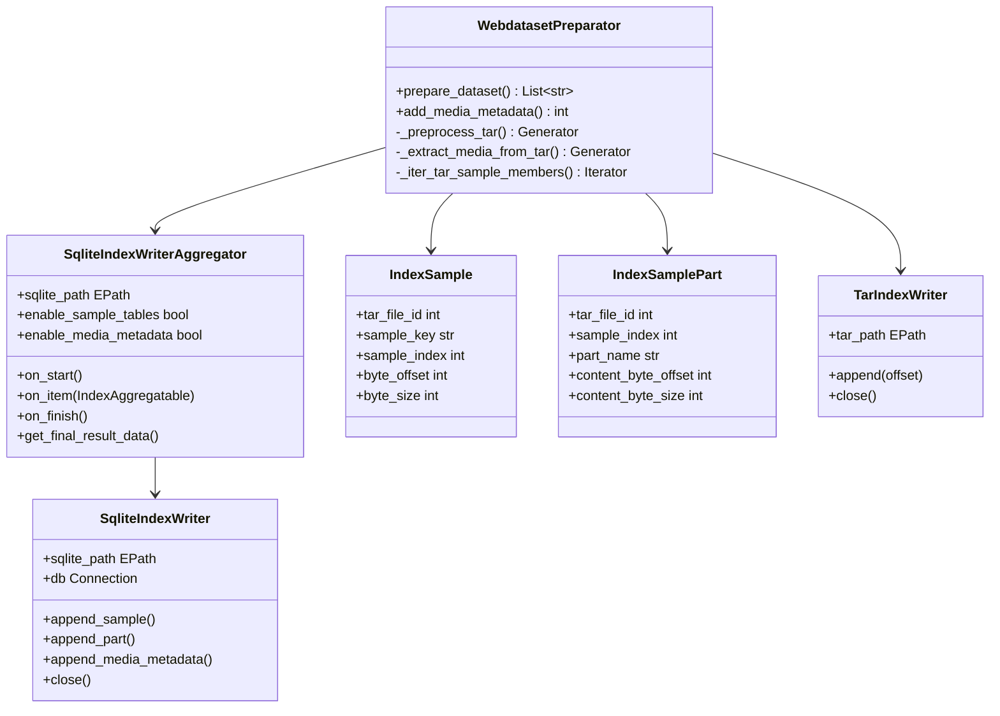
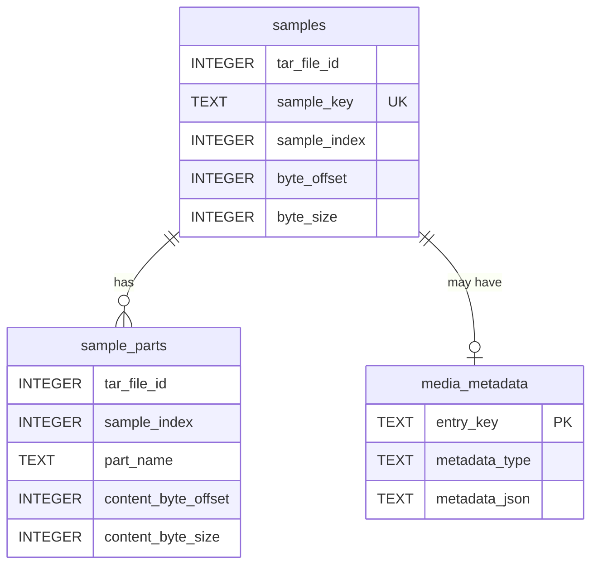
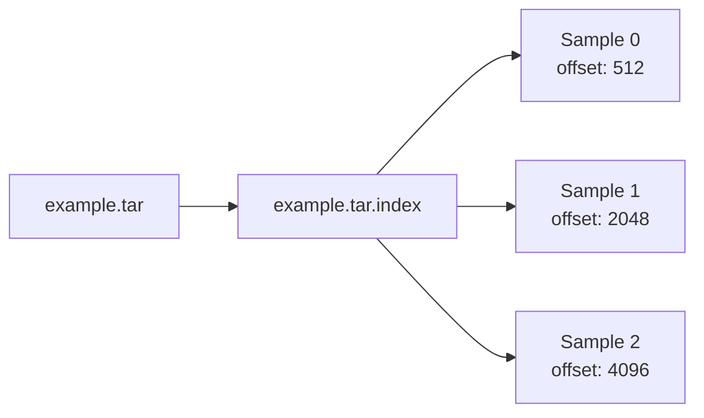
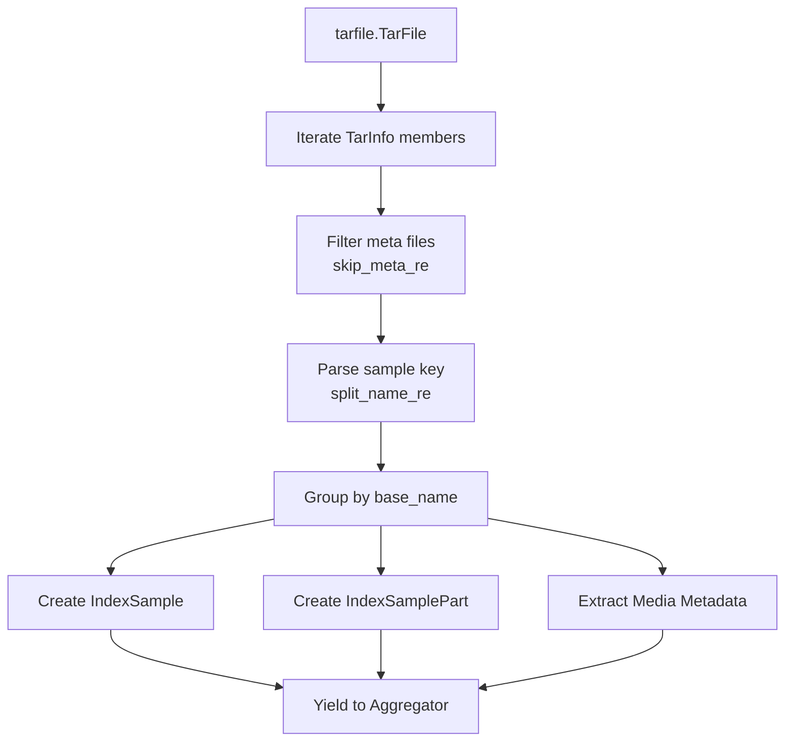
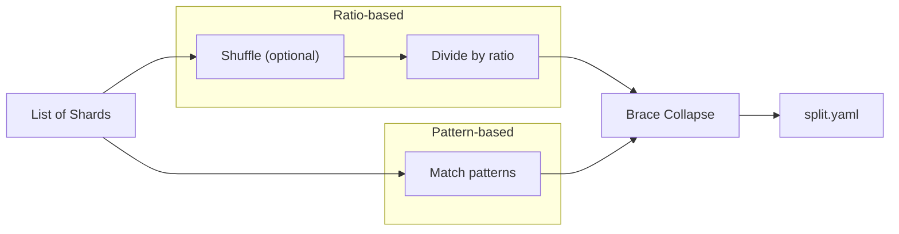
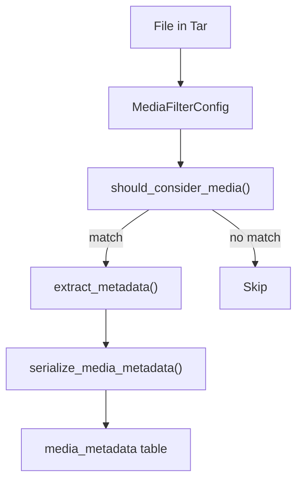
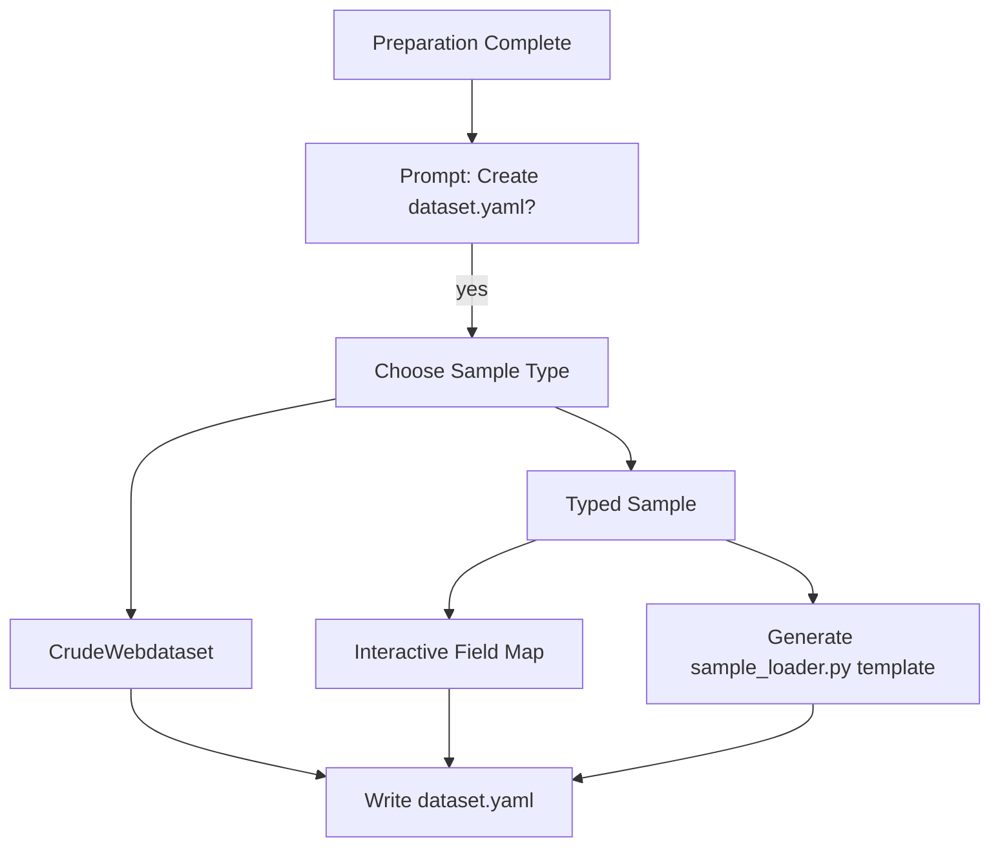
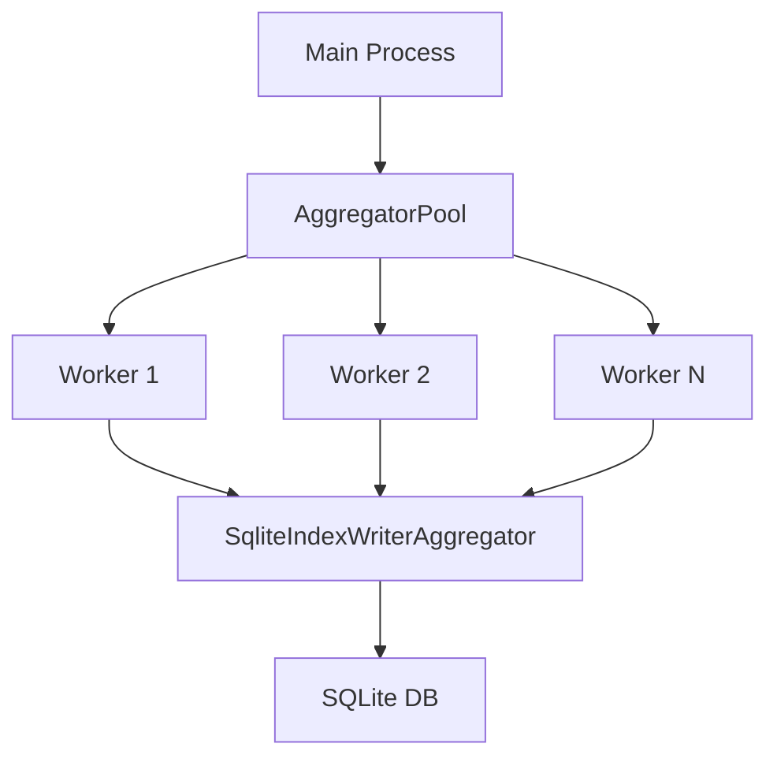

<!-- source: DeepWiki mcp.deepwiki.com · repo NVIDIA/Megatron-Energon · page 3.1 energon prepare Command · fetched 2026-10-26 -->

# energon prepare Command

<details>
<summary>Relevant source files</summary>

The following files were used as context for generating this wiki page:

- [src/megatron/energon/flavors/webdataset/indexing.py](src/megatron/energon/flavors/webdataset/indexing.py)
- [src/megatron/energon/flavors/webdataset/prepare.py](src/megatron/energon/flavors/webdataset/prepare.py)
- [src/megatron/energon/tools/prepare.py](src/megatron/energon/tools/prepare.py)

</details>


This document covers the `energon prepare` CLI tool, which prepares raw datasets for use with Megatron-Energon by building indices and generating metadata. For information about the resulting indexing system and metadata files, see [Indexing and Metadata System](#3.2). For information about how to use prepared datasets in training, see [Data Loading System](#4).

## Purpose and Scope

The `energon prepare` command scans dataset files (tar archives, JSONL files, or metadatasets), builds SQLite-based indices for efficient random access, generates metadata files in the `.nv-meta/` directory, and optionally creates dataset configuration files. This is a required preprocessing step before using datasets with Energon's data loaders.

Sources: [src/megatron/energon/tools/prepare.py:96-206]()

## Command Overview

The `energon prepare` command performs the following operations:

1. **Index Generation**: Scans tar archives and builds SQLite indices mapping sample keys to byte offsets
2. **Metadata Creation**: Generates `.info.json`, `.split.yaml`, and UUID files in `.nv-meta/`
3. **Split Configuration**: Divides dataset into train/val/test splits using ratios or path patterns
4. **Media Metadata Extraction**: Optionally extracts and stores video/audio/image metadata
5. **Dataset Configuration**: Interactively or automatically creates `dataset.yaml` files



**Diagram: energon prepare workflow for different dataset types**

Sources: [src/megatron/energon/tools/prepare.py:187-239](), [src/megatron/energon/flavors/webdataset/prepare.py:462-669]()

## Command Syntax

### Basic Usage

```bash
energon prepare /path/to/dataset [OPTIONS]
```

### Common Options

| Option | Type | Default | Description |
|--------|------|---------|-------------|
| `--progress/--no-progress` | flag | `True` | Show progress bar during indexing |
| `--split-ratio` | string | `None` | Train/val/test split ratio (e.g., "0.8,0.1,0.1" or "8,1,1") |
| `--split-parts` | string | `None` | Path patterns for splits (e.g., "train:train/{000000-009999}.tar") |
| `--exclude` | string | `None` | Regex to exclude tar files |
| `--num-workers` | int | `16` | Number of parallel workers for indexing |
| `--tar-index-only` | flag | `False` | Only regenerate tar indices without other metadata |
| `--shuffle-tars` | flag | `False` | Shuffle tar files before splitting |
| `--fix-duplicates` | flag | `False` | Fix duplicate keys by renaming |
| `--non-interactive` | flag | `False` | Non-interactive mode (no prompts) |
| `--force-overwrite` | flag | `False` | Overwrite existing preparation |
| `--skip-dataset-yaml` | flag | `False` | Skip dataset.yaml creation |

### Media Metadata Options

| Option | Description |
|--------|-------------|
| `--media-metadata-by-glob` | Detect media by glob patterns (e.g., "*.jpg,*.png") |
| `--media-metadata-by-header` | Detect media by binary file headers |
| `--media-metadata-by-extension` | Detect media by standard file extensions |

### Dataset Configuration Options

| Option | Type | Description |
|--------|------|-------------|
| `--dataset-yaml-name` | string | Name of dataset.yaml file (default: "dataset.yaml") |
| `--sample-type` | string | Sample type class name (e.g., "CaptioningSample") |
| `--field-map` | string | JSON field mapping (e.g., '{"image": "jpg", "caption": "txt"}') |

Sources: [src/megatron/energon/tools/prepare.py:96-186]()

## Preparation Process

### WebDataset Preparation



**Diagram: WebDataset preparation sequence showing parallel tar processing**

Sources: [src/megatron/energon/flavors/webdataset/prepare.py:462-669](), [src/megatron/energon/tools/prepare.py:340-351]()

### Key Implementation Classes



**Diagram: Core classes in the preparation system**

Sources: [src/megatron/energon/flavors/webdataset/prepare.py:214-416](), [src/megatron/energon/flavors/webdataset/indexing.py:25-257]()

## Index Generation

### SQLite Index Structure

The preparation process creates a SQLite database at `.nv-meta/index.sqlite` with two primary tables:

**samples table**:
- `tar_file_id`: Integer index of the tar file
- `sample_key`: Unique text key for the sample
- `sample_index`: Position of sample within tar file
- `byte_offset`: Starting byte offset in tar file
- `byte_size`: Size of entire sample in bytes

**sample_parts table**:
- `tar_file_id`: Integer index of the tar file
- `sample_index`: Position of sample within tar file
- `part_name`: Extension/type of the part (e.g., "jpg", "txt", "json")
- `content_byte_offset`: Byte offset to actual content (skipping tar header)
- `content_byte_size`: Size of content



**Diagram: SQLite database schema created by energon prepare**

The database includes indices for efficient queries:
- `idx_samples_sample_key` on `samples(sample_key)` for key lookups
- `idx_samples_by_tar_and_idx` on `samples(tar_file_id, sample_index)` for sequential access
- `idx_sample_parts_seq` on `sample_parts(tar_file_id, sample_index, content_byte_offset)` for sequential part access
- `idx_sample_parts_full` for direct part lookups

Sources: [src/megatron/energon/flavors/webdataset/indexing.py:32-109](), [src/megatron/energon/flavors/webdataset/indexing.py:224-244]()

### Tar Index Files

In addition to the SQLite index, a binary tar index file is created for each tar archive at `<tarfile>.tar.index`. This file contains byte offsets for fast seeking:



**Diagram: Tar index file structure for fast seeking**

The `TarIndexWriter` creates this binary index during tar scanning at [src/megatron/energon/flavors/webdataset/prepare.py:272]().

Sources: [src/megatron/energon/flavors/webdataset/itar.py]() (referenced), [src/megatron/energon/flavors/webdataset/prepare.py:268-272]()

### Sample Processing Flow



**Diagram: Sample extraction from tar files during preparation**

The `_preprocess_tar` method at [src/megatron/energon/flavors/webdataset/prepare.py:239-353]() implements this logic. It yields `IndexAggregatable` objects that are processed by the `SqliteIndexWriterAggregator`.

Sources: [src/megatron/energon/flavors/webdataset/prepare.py:239-353](), [src/megatron/energon/flavors/webdataset/prepare.py:216-236]()

## Split Configuration

### Split Methods

Energon supports two methods for creating dataset splits:

**1. Ratio-based splits** (`--split-ratio`):
```bash
energon prepare /path/to/dataset --split-ratio "0.8,0.1,0.1"
# or equivalently:
energon prepare /path/to/dataset --split-ratio "8,1,1"
```

This divides tar files proportionally into train/val/test splits.

**2. Pattern-based splits** (`--split-parts`):
```bash
energon prepare /path/to/dataset \
  --split-parts "train:train/{000000-009999}.tar" \
  --split-parts "val:val/{00000-00099}.tar" \
  --split-parts "test:test/{00000-00099}.tar"
```

This uses path patterns (with brace expansion) to explicitly assign tar files to splits.

Sources: [src/megatron/energon/tools/prepare.py:294-322](), [src/megatron/energon/flavors/webdataset/prepare.py:619-651]()

### Split Configuration Output

The splits are saved to `.nv-meta/split.yaml`:

```yaml
split_parts:
  train:
    - "train/{000000..009999}.tar"
  val:
    - "val/{00000..00099}.tar"
  test:
    - "test/{00000..00099}.tar"
```

The paths are automatically collapsed using brace expansion for compactness. This is done at [src/megatron/energon/flavors/webdataset/prepare.py:654-657]() using the `collapse` function.



**Diagram: Split configuration generation methods**

Sources: [src/megatron/energon/flavors/webdataset/prepare.py:619-668]()

## Media Metadata Extraction

### Detection Strategies

The `--media-metadata-by-*` flags enable extraction of media file metadata (resolution, duration, codec, etc.). Three detection strategies are available:

| Strategy | Flag | Description |
|----------|------|-------------|
| Glob | `--media-metadata-by-glob "*.jpg,*.mp4"` | Match files by glob patterns |
| Header | `--media-metadata-by-header` | Detect media by inspecting binary headers |
| Extension | `--media-metadata-by-extension` | Use standard file extensions (.jpg, .mp4, etc.) |

These strategies are parsed into a `MediaFilterConfig` object at [src/megatron/energon/tools/prepare.py:223-228]().

Sources: [src/megatron/energon/tools/prepare.py:131-145](), [src/megatron/energon/tools/prepare.py:223-228]()

### Media Metadata Table

When media metadata extraction is enabled, a `media_metadata` table is created in the SQLite database:

- `entry_key`: Full key of the entry (e.g., "sample_000123.jpg")
- `metadata_type`: Type of metadata ("image", "video", "audio")
- `metadata_json`: JSON-serialized metadata

The extraction happens during tar processing at [src/megatron/energon/flavors/webdataset/prepare.py:321-339]() where each file matching the filter is read and its metadata extracted.



**Diagram: Media metadata extraction flow**

Sources: [src/megatron/energon/flavors/webdataset/prepare.py:321-339](), [src/megatron/energon/flavors/webdataset/indexing.py:111-134]()

### Adding Metadata to Existing Datasets

Media metadata can be added to already-prepared datasets using the `add_media_metadata` class method:

```python
WebdatasetPreparator.add_media_metadata(
    parent_path,
    media_filter=MediaFilterConfig.parse(...),
    workers=32
)
```

This reads existing tar files and populates only the `media_metadata` table without regenerating the main indices. Implementation at [src/megatron/energon/flavors/webdataset/prepare.py:671-726]().

Sources: [src/megatron/energon/flavors/webdataset/prepare.py:671-726]()

## Dataset Configuration

### Interactive Configuration

When preparation completes, the command can interactively create a `dataset.yaml` file that defines how to load the dataset. The process:

1. **Sample Type Selection**: Choose a sample type class (e.g., `CaptioningSample`, `TextSample`) or `CrudeWebdataset` for custom processing
2. **Field Mapping**: Either map sample fields to tar file extensions or write a custom `sample_loader.py`



**Diagram: Interactive dataset.yaml creation flow**

Sources: [src/megatron/energon/tools/prepare.py:379-578]()

### Sample Types

The command supports all `Sample` subclasses from `megatron.energon` plus `CrudeWebdataset`:

```python
# List sample types
display_name_and_class = [
    (name, cls)
    for name, cls in inspect.getmembers(data_import)
    if isinstance(cls, type) and issubclass(cls, Sample)
]
```

This discovery happens at [src/megatron/energon/tools/prepare.py:396-401]().

Sources: [src/megatron/energon/tools/prepare.py:394-430]()

### Field Mapping vs Sample Loader

**Field Mapping** (simple approach):
```yaml
sample_type:
  __module__: megatron.energon
  __class__: CaptioningSample
field_map:
  image: jpg
  caption: txt
```

**Sample Loader** (flexible approach):
```yaml
sample_type:
  __module__: megatron.energon
  __class__: CaptioningSample
sample_loader: sample_loader.py:sample_loader
part_filter: sample_loader.py:part_filter
```

The sample loader template is generated at [src/megatron/energon/tools/prepare.py:48-80]() with TODO placeholders for users to fill in.

Sources: [src/megatron/energon/tools/prepare.py:461-572](), [src/megatron/energon/tools/prepare.py:48-80]()

### Non-Interactive Mode

For automation, use non-interactive mode with explicit options:

```bash
energon prepare /path/to/dataset \
  --non-interactive \
  --split-ratio "0.8,0.1,0.1" \
  --sample-type "CaptioningSample" \
  --field-map '{"image": "jpg", "caption": "txt"}'
```

The command requires `--split-ratio` (or `--split-parts` or `--tar-index-only`) in non-interactive mode, validated at [src/megatron/energon/tools/prepare.py:301-305]().

Sources: [src/megatron/energon/tools/prepare.py:152-186](), [src/megatron/energon/tools/prepare.py:301-305]()

## Output Structure

### Generated Files

After running `energon prepare`, the dataset directory contains:

```
/path/to/dataset/
├── train/
│   ├── 000000.tar
│   ├── 000000.tar.index
│   ├── 000001.tar
│   ├── 000001.tar.index
│   └── ...
├── val/
│   └── ...
├── test/
│   └── ...
└── .nv-meta/
    ├── index.sqlite          # SQLite index
    ├── index.uuid            # Dataset UUID
    ├── .info.json            # Shard counts and metadata
    ├── split.yaml            # Split configuration
    └── dataset.yaml          # Dataset definition (optional)
```

Sources: [src/megatron/energon/flavors/webdataset/config.py:9-16]()

### Metadata Files

**`.info.json`**:
```json
{
  "energon_version": "2.0.0",
  "shard_counts": {
    "train/000000.tar": 1000,
    "train/000001.tar": 1000,
    ...
  }
}
```

**`.split.yaml`**:
```yaml
split_parts:
  train: ["train/{000000..009999}.tar"]
  val: ["val/{00000..00099}.tar"]
  test: ["test/{00000..00099}.tar"]
```

**`index.uuid`**:
```
550e8400-e29b-41d4-a716-446655440000
```

The UUID is regenerated whenever the index changes (at [src/megatron/energon/flavors/webdataset/prepare.py:576-579]()), allowing downstream systems to detect dataset changes.

Sources: [src/megatron/energon/flavors/webdataset/prepare.py:604-617](), [src/megatron/energon/flavors/webdataset/prepare.py:660-668](), [src/megatron/energon/flavors/webdataset/prepare.py:576-579]()

## Error Handling

### Duplicate Keys

If the dataset contains duplicate sample keys (same filename in different tars), preparation fails with `DuplicateSampleKeyError`:

```
The data contains duplicate keys (e.g. same filename in different shards).
Example duplicate key: "sample_000123"

Energon does not support duplicate keys anymore, but we offer a tool to fix your dataset.
Run `energon prepare` with `--fix-duplicates` to fix your dataset.
```

The error is caught at [src/megatron/energon/flavors/webdataset/prepare.py:561-574]() and provides remediation instructions.

The `--fix-duplicates` flag uses `TarPatcher` to reorganize files within tar archives, creating subdirectories per shard to ensure uniqueness at [src/megatron/energon/flavors/webdataset/prepare.py:507-532]().

Sources: [src/megatron/energon/flavors/webdataset/prepare.py:561-574](), [src/megatron/energon/flavors/webdataset/prepare.py:507-532](), [src/megatron/energon/flavors/webdataset/indexing.py:17-22]()

### Shard Loading Failures

If a tar file fails to open or is corrupted, the error is logged and the shard is skipped:

```python
except BaseException:
    logger.exception(f"Shard failed to load: {path!r}. Skipping it.")
    yield IndexShardInfo(shard_info=shard_info, parts=set())
    return
```

This happens at [src/megatron/energon/flavors/webdataset/prepare.py:350-353](), allowing preparation to continue even if some shards are corrupted.

Sources: [src/megatron/energon/flavors/webdataset/prepare.py:350-353]()

## Performance Considerations

### Parallel Processing

The command uses an `AggregatorPool` with configurable worker count (`--num-workers`, default 16). Each worker processes one tar file independently:



**Diagram: Parallel tar processing with worker pool**

The pool is initialized at [src/megatron/energon/flavors/webdataset/prepare.py:550-554]() and tasks are submitted at [src/megatron/energon/flavors/webdataset/prepare.py:556-558]().

Sources: [src/megatron/energon/flavors/webdataset/prepare.py:550-560]()

### Index Creation Strategy

SQLite indices are created **after** all samples are inserted (at [src/megatron/energon/flavors/webdataset/indexing.py:224-244]()), not during insertion. This significantly speeds up the bulk insert operation.

The `busy_timeout` pragma is set to 5000ms at [src/megatron/energon/flavors/webdataset/indexing.py:75]() to handle concurrent access during parallel processing.

Sources: [src/megatron/energon/flavors/webdataset/indexing.py:224-244](), [src/megatron/energon/flavors/webdataset/indexing.py:75]()

## Special Dataset Types

### JSONL Datasets

For JSONL datasets (one JSON object per line), preparation is simpler:

```bash
energon prepare /path/to/dataset.jsonl
```

This uses `CrudeJsonlDatasetFactory.prepare_dataset()` at [src/megatron/energon/tools/prepare.py:246](), which only counts samples without building complex indices.

Sources: [src/megatron/energon/tools/prepare.py:240-248]()

### Metadatasets

For metadataset configurations (YAML/JSON files composing multiple datasets):

```bash
energon prepare /path/to/metadataset.yaml
```

This recursively prepares all referenced datasets using `prepare_metadataset()` at [src/megatron/energon/tools/prepare.py:238]().

Sources: [src/megatron/energon/tools/prepare.py:232-239]()

### Filesystem Datasets

Filesystem datasets (loose files in directories) require a different command:

```bash
energon prepare-media /path/to/dataset
```

The `energon prepare` command rejects filesystem datasets with an error at [src/megatron/energon/tools/prepare.py:249-252](), directing users to the correct command.

Sources: [src/megatron/energon/tools/prepare.py:249-252]()

## Implementation Reference

### Key Functions

| Function | Location | Purpose |
|----------|----------|---------|
| `command()` | [src/megatron/energon/tools/prepare.py:187-581]() | Main CLI entry point |
| `WebdatasetPreparator.prepare_dataset()` | [src/megatron/energon/flavors/webdataset/prepare.py:462-669]() | Orchestrates preparation |
| `_preprocess_tar()` | [src/megatron/energon/flavors/webdataset/prepare.py:239-353]() | Processes individual tar files |
| `SqliteIndexWriter.append_sample()` | [src/megatron/energon/flavors/webdataset/indexing.py:136-167]() | Adds sample to index |
| `SqliteIndexWriter.close()` | [src/megatron/energon/flavors/webdataset/indexing.py:217-249]() | Finalizes index with indices |

Sources: [src/megatron/energon/tools/prepare.py:187-581](), [src/megatron/energon/flavors/webdataset/prepare.py:462-669](), [src/megatron/energon/flavors/webdataset/prepare.py:239-353](), [src/megatron/energon/flavors/webdataset/indexing.py:136-167](), [src/megatron/energon/flavors/webdataset/indexing.py:217-249]()

### Configuration Constants

Important constants from [src/megatron/energon/flavors/webdataset/config.py]():

| Constant | Value | Purpose |
|----------|-------|---------|
| `MAIN_FOLDER_NAME` | `.nv-meta` | Metadata directory name |
| `INDEX_SQLITE_FILENAME` | `index.sqlite` | SQLite index filename |
| `INDEX_UUID_FILENAME` | `index.uuid` | Dataset UUID filename |
| `INFO_JSON_FILENAME` | `.info.json` | Dataset info filename |
| `split_name_re` | Regex pattern | Splits sample keys from extensions |
| `skip_meta_re` | Regex pattern | Filters out metadata files |

Sources: [src/megatron/energon/flavors/webdataset/config.py:9-21]()

---

