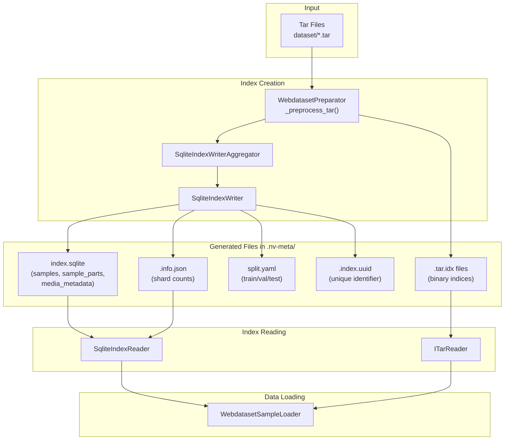
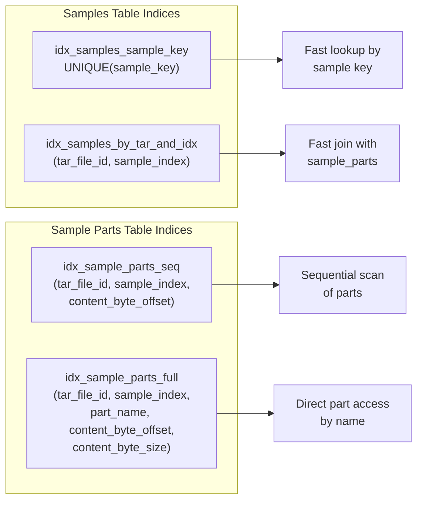
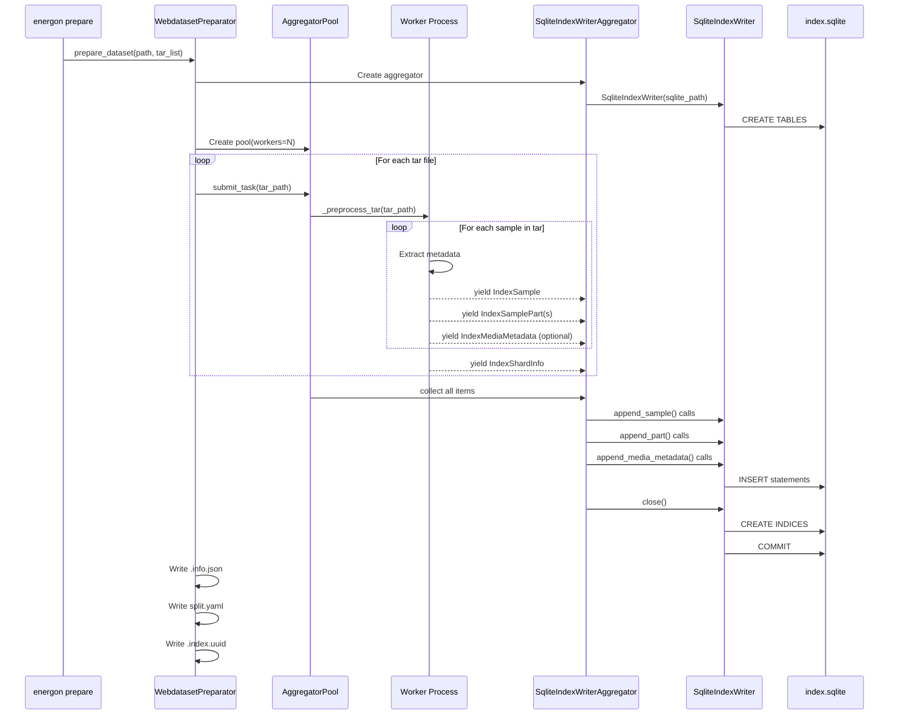
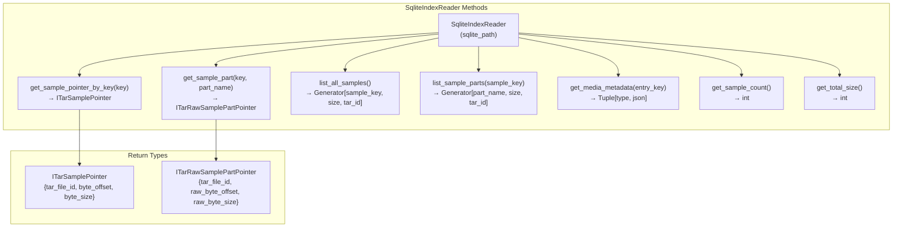
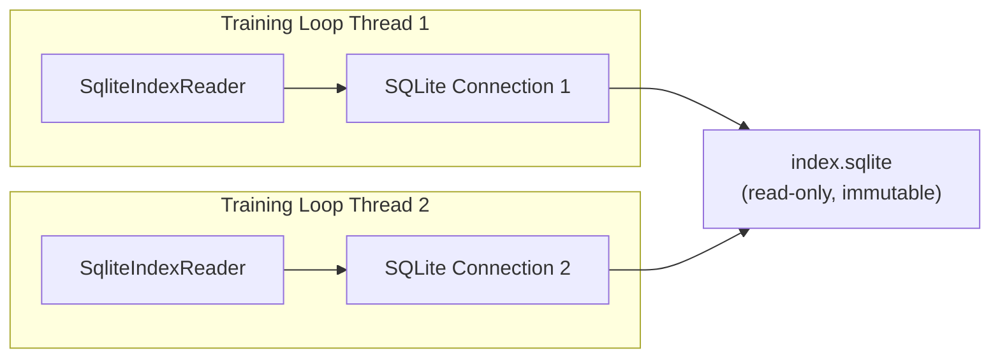
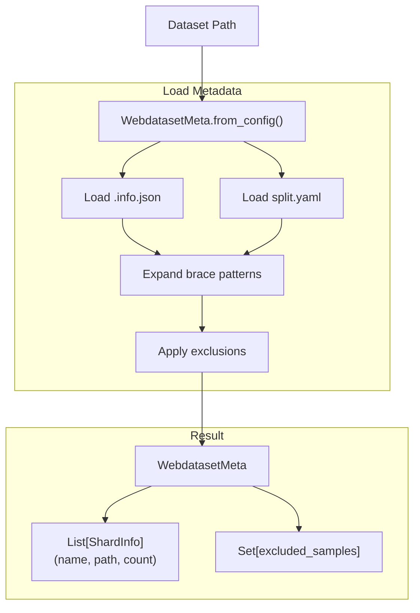
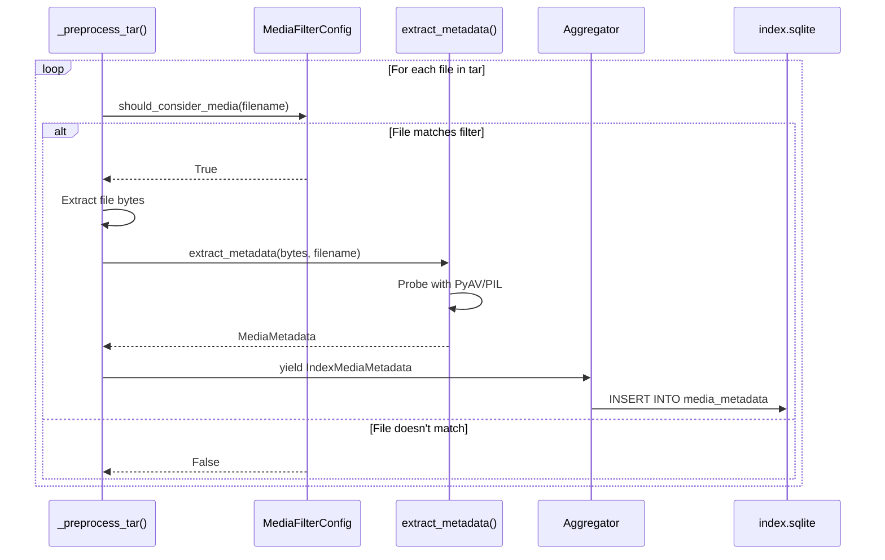
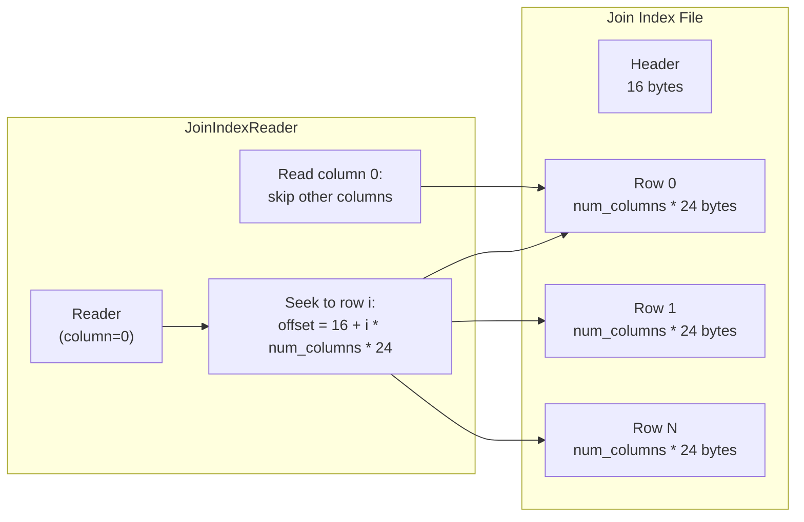
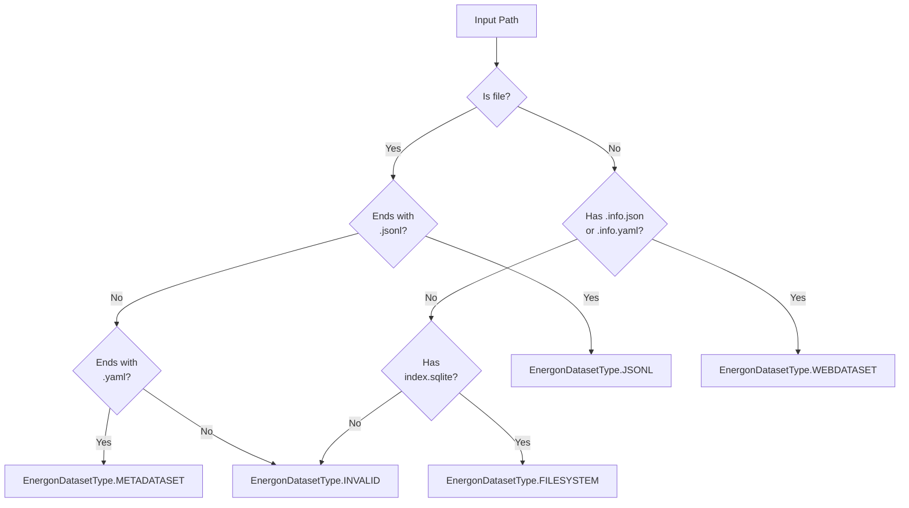

<!-- source: DeepWiki mcp.deepwiki.com · repo NVIDIA/Megatron-Energon · page 3.2 Indexing and Metadata System · fetched 2026-10-26 -->

# Indexing and Metadata System

<details>
<summary>Relevant source files</summary>

The following files were used as context for generating this wiki page:

- [src/megatron/energon/cache/file_store.py](src/megatron/energon/cache/file_store.py)
- [src/megatron/energon/dataset_config.py](src/megatron/energon/dataset_config.py)
- [src/megatron/energon/flavors/webdataset/indexing.py](src/megatron/energon/flavors/webdataset/indexing.py)
- [src/megatron/energon/flavors/webdataset/metadata.py](src/megatron/energon/flavors/webdataset/metadata.py)
- [src/megatron/energon/flavors/webdataset/prepare.py](src/megatron/energon/flavors/webdataset/prepare.py)
- [src/megatron/energon/metadataset/loader.py](src/megatron/energon/metadataset/loader.py)
- [src/megatron/energon/tools/prepare.py](src/megatron/energon/tools/prepare.py)
- [tests/test_jsonl_dataset.py](tests/test_jsonl_dataset.py)

</details>


## Purpose and Scope

The Indexing and Metadata System provides efficient random access to samples stored in webdataset tar archives. It creates and maintains SQLite databases that map sample keys to byte offsets within tar files, enabling direct sample retrieval without scanning entire archives. This system is created by the `energon prepare` command and consumed by the data loading system during training.

This page covers the SQLite index structure, metadata files in `.nv-meta/`, and the indexing process. For the CLI tool that creates these indices, see [energon prepare](#8.1). For how these indices are used during data loading, see [WebDataset Access & ITarReader](#4.2).

---

## System Overview

The indexing system transforms raw webdataset tar archives into a queryable structure by:

1. Scanning all tar files to extract sample keys and byte offsets
2. Storing this information in a SQLite database (`index.sqlite`) 
3. Generating metadata files (`.info.json`, `split.yaml`) that describe the dataset
4. Optionally extracting media metadata (dimensions, duration, etc.) for audio/video files
5. Creating binary tar indices for efficient seeking

All generated files are stored in the `.nv-meta/` directory within the dataset root.

**Key Components Overview**



Sources: [src/megatron/energon/flavors/webdataset/indexing.py:1-633](), [src/megatron/energon/flavors/webdataset/prepare.py:1-727]()

---

## SQLite Database Schema

The core of the indexing system is a SQLite database (`index.sqlite`) containing three main tables.

### Tables and Schema

**Samples Table**

Stores one row per sample with its location and size:

| Column | Type | Description |
|--------|------|-------------|
| `tar_file_id` | INTEGER | Index of the tar file (0-based) |
| `sample_key` | TEXT | Unique sample identifier (e.g., "00001234") |
| `sample_index` | INTEGER | Sample index within the tar file |
| `byte_offset` | INTEGER | Starting byte offset in tar file |
| `byte_size` | INTEGER | Total size of sample in bytes |

**Sample Parts Table**

Stores individual files within each sample (e.g., "image.jpg", "caption.txt"):

| Column | Type | Description |
|--------|------|-------------|
| `tar_file_id` | INTEGER | Index of the tar file |
| `sample_index` | INTEGER | Sample index within tar file |
| `part_name` | TEXT | File extension/part name (e.g., "jpg", "txt") |
| `content_byte_offset` | INTEGER | Byte offset to raw file content |
| `content_byte_size` | INTEGER | Size of file content in bytes |

**Media Metadata Table** (Optional)

Stores extracted metadata for audio/video/image files:

| Column | Type | Description |
|--------|------|-------------|
| `entry_key` | TEXT | Full key (e.g., "00001234.mp4") |
| `metadata_type` | TEXT | Type: "video", "audio", or "image" |
| `metadata_json` | TEXT | JSON-serialized metadata |

**Database Indices**



Sources: [src/megatron/energon/flavors/webdataset/indexing.py:88-134](), [src/megatron/energon/flavors/webdataset/indexing.py:224-244]()

---

## Index Creation Process

The `energon prepare` command orchestrates parallel indexing of tar files using worker processes.

### Index Creation Flow



Sources: [src/megatron/energon/flavors/webdataset/prepare.py:461-669](), [src/megatron/energon/flavors/webdataset/indexing.py:25-257]()

### Parallel Processing Architecture

**SqliteIndexWriter** - Creates the database and tables

```python
# Key class for writing index data
class SqliteIndexWriter:
    sqlite_path: EPath
    db: Optional[sqlite3.Connection]
    enable_sample_tables: bool
    enable_media_metadata: bool
```

Methods:
- `append_sample()` - Adds a sample record
- `append_part()` - Adds a sample part record
- `append_media_metadata()` - Adds media metadata (optional)
- `close()` - Creates indices and commits

**SqliteIndexWriterAggregator** - Coordinates parallel workers

Implements the `BaseAggregator` interface to collect results from worker processes. Each worker yields `IndexAggregatable` items:
- `IndexSample` - Sample metadata (key, offset, size)
- `IndexSamplePart` - Individual file within sample
- `IndexMediaMetadata` - Media properties (optional)
- `IndexShardInfo` - Shard statistics

**WebdatasetPreparator._preprocess_tar()** - Worker function

Processes a single tar file:
1. Opens tar file with `tarfile.TarFile`
2. Iterates through members matching the pattern `basename.extension`
3. Writes binary tar index (`.tar.idx`) for fast seeking
4. Yields sample and part information to aggregator
5. Optionally extracts media metadata from files

Sources: [src/megatron/energon/flavors/webdataset/prepare.py:214-416](), [src/megatron/energon/flavors/webdataset/indexing.py:104-212]()

---

## Index Reading and Usage

During training, the `SqliteIndexReader` provides random access to samples.

### SqliteIndexReader API



Sources: [src/megatron/energon/flavors/webdataset/indexing.py:303-519]()

### Thread Safety with ThreadLocalSqlite

SQLite connections are not thread-safe. The system uses `ThreadLocalSqlite` to maintain per-thread connections:

```python
# Each worker thread gets its own connection
self.db = ThreadLocalSqlite(path, is_uri=True)
```

The database is opened in read-only, immutable mode:
```python
path = f"file:{path}?mode=ro&immutable=1"
```

This allows multiple workers to read concurrently without locking issues.

**Key Usage Pattern**



Sources: [src/megatron/energon/flavors/webdataset/indexing.py:322-339](), [src/megatron/energon/flavors/webdataset/thread_local_sqlite.py]()

---

## Metadata Files in .nv-meta/

The `.nv-meta/` directory contains several configuration and metadata files.

### File Structure

```
dataset/
├── shard_0000.tar
├── shard_0001.tar
├── ...
└── .nv-meta/
    ├── index.sqlite          # SQLite index database
    ├── .info.json            # Dataset info (shard counts, version)
    ├── split.yaml            # Train/val/test split configuration
    ├── .index.uuid           # Unique dataset identifier
    ├── dataset.yaml          # Sample type and field mapping (optional)
    ├── sample_loader.py      # Custom sample loading logic (optional)
    ├── shard_0000.tar.idx    # Binary tar index for shard_0000.tar
    └── shard_0001.tar.idx    # Binary tar index for shard_0001.tar
```

### .info.json Structure

Contains shard counts and version information:

```json
{
  "energon_version": "2.0.0",
  "shard_counts": {
    "shard_0000.tar": 1000,
    "shard_0001.tar": 1000,
    "shard_0002.tar": 950
  }
}
```

**WebdatasetInfo dataclass**:
```python
@edataclass
class WebdatasetInfo:
    energon_version: str
    shard_counts: Dict[str, int]  # shard_name -> sample_count
```

Sources: [src/megatron/energon/flavors/webdataset/structs.py](), [src/megatron/energon/flavors/webdataset/metadata.py:124-140]()

### split.yaml Structure

Defines how shards are split into train/val/test sets:

```yaml
split_parts:
  train:
    - "shard_{0000..0799}.tar"
  val:
    - "shard_{0800..0899}.tar"  
  test:
    - "shard_{0900..0999}.tar"
exclude: []
```

**WebdatasetSplits dataclass**:
```python
@edataclass
class WebdatasetSplits:
    split_parts: Dict[str, List[str]]  # split_name -> list of shard patterns
    exclude: List[str] = field(default_factory=list)
```

The split configuration supports:
- Brace expansion patterns (e.g., `shard_{0000..0999}.tar`)
- Multiple patterns per split
- Exclusion patterns to skip specific shards

Sources: [src/megatron/energon/flavors/webdataset/structs.py](), [src/megatron/energon/flavors/webdataset/metadata.py:59-111]()

### .index.uuid

A unique identifier regenerated whenever the index is modified. Used to detect stale caches or indices.

Sources: [src/megatron/energon/flavors/webdataset/prepare.py:576-579]()

---

## WebdatasetMeta - Metadata Loading

The `WebdatasetMeta` class loads and combines information from `.info.json` and `split.yaml`.

**Loading Process**



**WebdatasetMeta fields**:
```python
@edataclass
class WebdatasetMeta:
    sample_excludes: Set[str]       # Individual samples to skip
    shards: List[ShardInfo]         # Shards in this split
    split_part_files: List[str]     # All files (before exclusion)
    info_shard_files: List[str]     # All files in dataset
```

**ShardInfo structure**:
```python
@edataclass  
class ShardInfo:
    name: str      # Relative path (e.g., "shard_0000.tar")
    path: EPath    # Absolute path
    count: int     # Number of samples in shard
```

Sources: [src/megatron/energon/flavors/webdataset/metadata.py:36-112](), [src/megatron/energon/flavors/webdataset/structs.py]()

---

## Media Metadata Extraction

The indexing system can optionally extract metadata from audio, video, and image files.

### Media Metadata Tables

When media metadata extraction is enabled (`--media-metadata-by-...`), two additional tables are created:

**media_metadata table**:
```sql
CREATE TABLE media_metadata (
    entry_key TEXT PRIMARY KEY,      -- e.g., "00001234.mp4"
    metadata_type TEXT NOT NULL,     -- "video", "audio", or "image"
    metadata_json TEXT NOT NULL      -- JSON-serialized metadata
)
```

**media_filters table**:
```sql
CREATE TABLE media_filters (
    filter_id INTEGER PRIMARY KEY AUTOINCREMENT,
    strategy TEXT NOT NULL,          -- "glob", "header", or "extension"
    patterns TEXT,                   -- Comma-separated patterns (for glob)
    created_at_utc TEXT DEFAULT CURRENT_TIMESTAMP,
    UNIQUE(strategy, patterns)
)
```

### Extraction Strategies

Three strategies for identifying media files:

| Strategy | Flag | Description |
|----------|------|-------------|
| Glob | `--media-metadata-by-glob "*.mp4,*.avi"` | Match file names by glob patterns |
| Header | `--media-metadata-by-header` | Detect by binary file headers (magic bytes) |
| Extension | `--media-metadata-by-extension` | Match by standard extensions (.mp4, .jpg, etc.) |

### Metadata Types

**Video Metadata**:
```json
{
  "duration": 10.5,
  "width": 1920,
  "height": 1080,
  "fps": 30.0,
  "num_frames": 315
}
```

**Audio Metadata**:
```json
{
  "duration": 5.2,
  "sample_rate": 44100,
  "num_channels": 2
}
```

**Image Metadata**:
```json
{
  "width": 1024,
  "height": 768,
  "num_channels": 3
}
```

### Extraction Process



Sources: [src/megatron/energon/flavors/webdataset/prepare.py:321-339](), [src/megatron/energon/media/extractor.py](), [src/megatron/energon/flavors/webdataset/indexing.py:111-134]()

### Adding Media Metadata to Existing Datasets

Media metadata can be added to datasets that were previously indexed without it:

```python
# WebdatasetPreparator.add_media_metadata()
count = add_media_metadata(
    parent_path,
    media_filter=MediaFilterConfig(...),
    workers=32
)
```

This method:
1. Reads existing `.info.json` to get shard list
2. Scans each shard for media files (without re-indexing samples)
3. Extracts metadata and writes to `media_metadata` table
4. Does not modify `samples` or `sample_parts` tables

Sources: [src/megatron/energon/flavors/webdataset/prepare.py:671-727](), [src/megatron/energon/flavors/webdataset/prepare.py:355-416]()

---

## Join Index System

For joined datasets (see [Metadataset Composition](#4.1)), a binary join index file maps primary samples to secondary samples.

### Join Index Format

**Binary Structure**:
```
[8 bytes] Magic: "JIDX0001"
[8 bytes] num_columns (int64)
[For each row]
  [For each column]
    [8 bytes] shard_idx (int64)
    [8 bytes] byte_offset (int64)
    [8 bytes] byte_size (int64)
```

Each row contains location information for one primary sample and its corresponding secondary samples.

### JoinIndexWriter

**Writing join indices**:
```python
class JoinIndexWriter:
    def __init__(self, join_index_path: EPath)
    
    def append(self, *columns: Tuple[int, int, int]):
        # Appends a row with (shard_idx, offset, size) for each column
```

**Example usage**:
```python
with JoinIndexWriter(path) as writer:
    # First row: primary at shard 0, offset 1000; secondary at shard 5, offset 2000
    writer.append((0, 1000, 500), (5, 2000, 300))
    # Second row: different locations
    writer.append((0, 1500, 600), (5, 2300, 400))
```

### JoinIndexReader

**Reading join indices**:
```python
class JoinIndexReader:
    def __init__(self, join_index_path: EPath, column: Optional[int] = None)
    
    def __getitem__(self, idx: int) -> List[Tuple[int, int, int]]:
        # Random access to row idx
    
    def get_as_tensor(self):
        # Load entire index as torch tensor (N, num_columns, 3)
```

**Memory-mapped access pattern**:


The join index supports:
- Random access by row index
- Optional column filtering (read only one column)
- Bulk loading as tensor for GPU operations
- Efficient seeking without loading entire file

Sources: [src/megatron/energon/flavors/webdataset/indexing.py:259-301](), [src/megatron/energon/flavors/webdataset/indexing.py:521-633]()

---

## Dataset Type Detection

The system automatically detects dataset types based on file structure.

**get_dataset_type() Logic**



**EnergonDatasetType enum**:
```python
class EnergonDatasetType(Enum):
    METADATASET = "metadataset"    # .yaml file with blend/join config
    WEBDATASET = "webdataset"      # Directory with .nv-meta/.info.json
    JSONL = "jsonl"                # .jsonl file
    FILESYSTEM = "filesystem"      # Directory with .nv-meta/index.sqlite but no .info
    INVALID = "invalid"            # Unknown format
```

Sources: [src/megatron/energon/flavors/webdataset/metadata.py:28-177]()

---

## File Store Integration

The indexing system integrates with the FileStore abstraction layer to provide access to indexed datasets.

**WebdatasetFileStore**

Provides file-level access to webdataset samples using the SQLite index:

```python
class WebdatasetFileStore(SqliteITarEntryReader, FileStore[bytes]):
    def __init__(self, dataset_path: EPath):
        super().__init__(base_path=dataset_path, key_is_full_entryname=True)
    
    def __getitem__(self, fname: str) -> tuple[bytes, SourceInfo]:
        # Uses SqliteIndexReader to get byte offset
        # Reads directly from tar at that offset
        # Returns file contents and source metadata
    
    def get_media_metadata(self, key: str) -> MediaMetadataBase:
        # Queries media_metadata table if available
```

**SystemFileStore**

For filesystem datasets (loose files on disk with index):

```python
class SystemFileStore(FileStore[bytes]):
    def __init__(self, base_dir: Optional[Union[EPath, str]] = None):
        self.base_dir = EPath(base_dir) if base_dir else None
    
    def get_media_metadata(self, key: str) -> MediaMetadataBase:
        # Queries .nv-meta/index.sqlite for media metadata
```

Both FileStore implementations support media metadata retrieval when available.

Sources: [src/megatron/energon/cache/file_store.py:144-193](), [src/megatron/energon/cache/file_store.py:54-142]()

---

## Index Consistency and Validation

### Duplicate Key Detection

The SQLite schema enforces unique sample keys with a UNIQUE constraint:

```sql
CREATE TABLE samples (
    ...
    sample_key TEXT NOT NULL UNIQUE,
    ...
)
```

When a duplicate key is encountered during indexing:
```python
try:
    self.db.execute("INSERT INTO samples ...", ...)
except sqlite3.IntegrityError as exc:
    raise DuplicateSampleKeyError(sample_key) from exc
```

The `energon prepare` command detects this and suggests using `--fix-duplicates` to automatically rename files within tar archives.

### UUID-Based Index Versioning

The `.index.uuid` file contains a unique identifier regenerated whenever indices are modified. This enables:
- Detecting when cached index data is stale
- Invalidating derived indices (e.g., for blended datasets)
- Ensuring consistency between index and tar files

Sources: [src/megatron/energon/flavors/webdataset/indexing.py:17-23](), [src/megatron/energon/flavors/webdataset/indexing.py:158-167](), [src/megatron/energon/flavors/webdataset/prepare.py:560-574]()

---

## Performance Characteristics

### Index Creation Performance

- **Parallel Processing**: Uses `AggregatorPool` with configurable workers (default 16)
- **Batch Insertions**: SQLite insertions are batched per tar file
- **Late Index Creation**: Database indices created after all data inserted (faster)
- **Binary Format**: Tar indices use efficient binary format for fast seeking

### Query Performance

- **Sample Lookup by Key**: O(log N) via `idx_samples_sample_key` B-tree index
- **Part Lookup**: O(log N) via compound indices
- **Sequential Scan**: Optimized with `idx_sample_parts_seq` covering index
- **Thread-Local Connections**: Each worker maintains separate connection to avoid locking

### Storage Overhead

For a dataset with M samples:
- **SQLite database**: ~100-200 bytes per sample (depends on key length, number of parts)
- **Tar indices**: 8 bytes per sample (just byte offsets)
- **Media metadata**: ~100-500 bytes per media file (varies by metadata complexity)

Sources: [src/megatron/energon/flavors/webdataset/prepare.py:461-669](), [src/megatron/energon/flavors/webdataset/indexing.py:224-249]()

---

