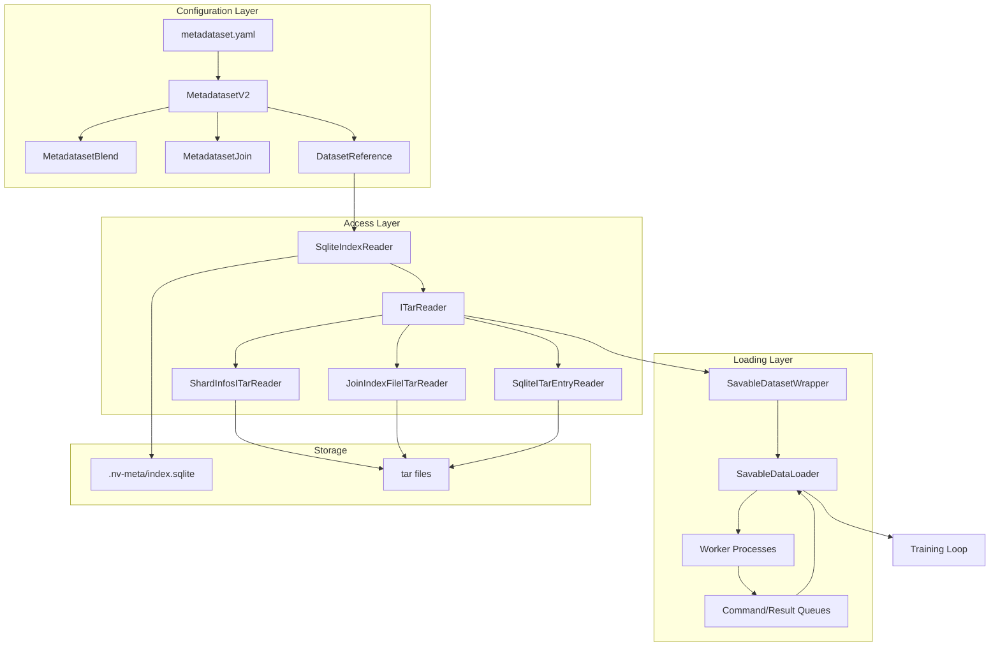
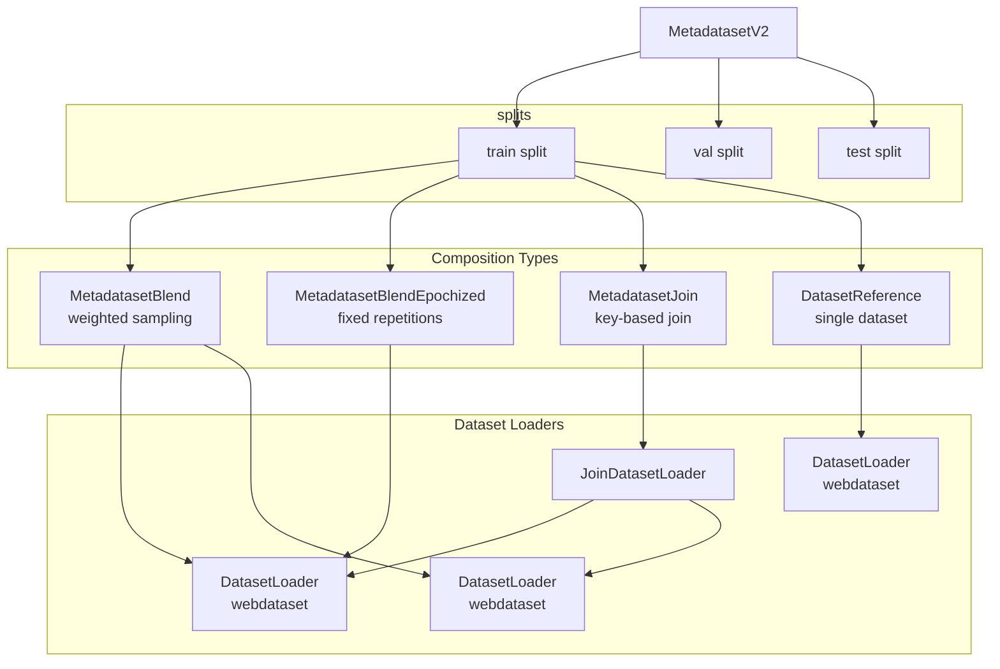
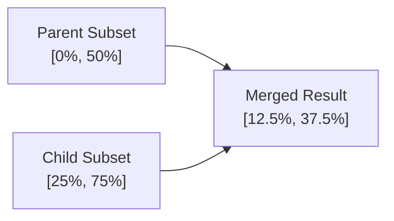
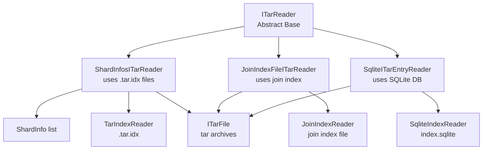
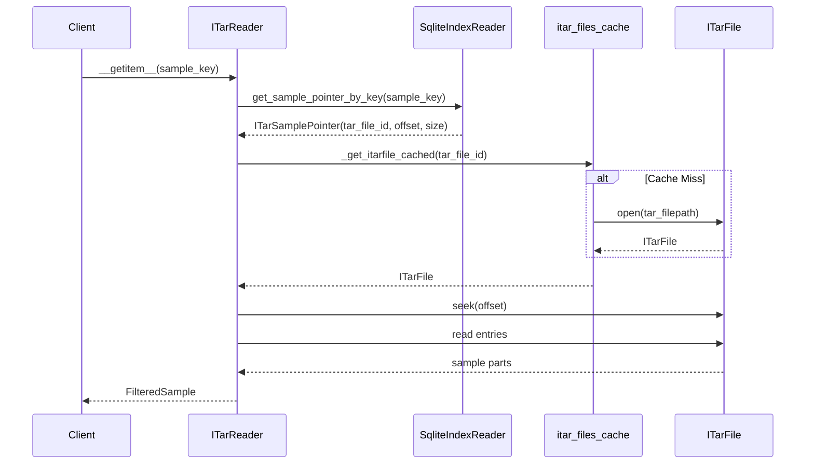
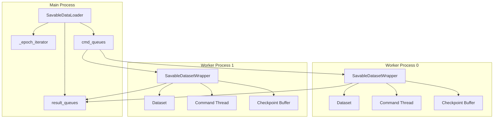
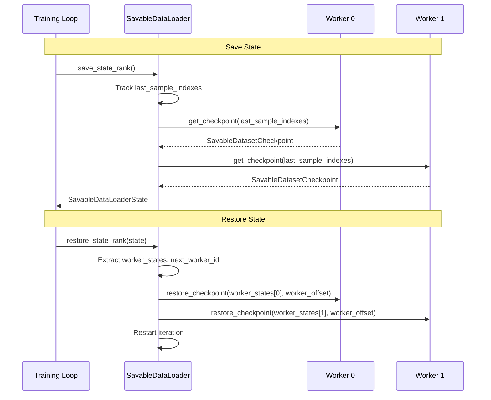
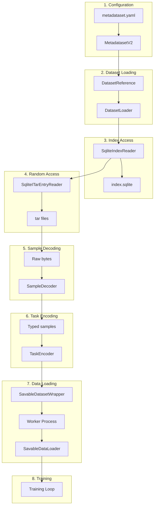

<!-- source: DeepWiki mcp.deepwiki.com · repo NVIDIA/Megatron-Energon · page 4 Data Loading System · fetched 2026-10-26 -->

# Data Loading System

<details>
<summary>Relevant source files</summary>

The following files were used as context for generating this wiki page:

- [src/megatron/energon/flavors/webdataset/itar.py](src/megatron/energon/flavors/webdataset/itar.py)
- [src/megatron/energon/flavors/webdataset/itar_reader.py](src/megatron/energon/flavors/webdataset/itar_reader.py)
- [src/megatron/energon/loader.py](src/megatron/energon/loader.py)
- [src/megatron/energon/metadataset/metadataset_v2.py](src/megatron/energon/metadataset/metadataset_v2.py)
- [src/megatron/energon/savable_loader.py](src/megatron/energon/savable_loader.py)
- [src/megatron/energon/tools/mount.py](src/megatron/energon/tools/mount.py)
- [src/megatron/energon/typed_converter.py](src/megatron/energon/typed_converter.py)
- [src/megatron/energon/wrappers/gc_dataset.py](src/megatron/energon/wrappers/gc_dataset.py)
- [src/megatron/energon/wrappers/mix_batch_dataset.py](src/megatron/energon/wrappers/mix_batch_dataset.py)
- [tests/test_metadataset_v2.py](tests/test_metadataset_v2.py)

</details>


## Purpose and Scope

This document explains how Megatron-Energon loads data from prepared datasets into the training loop. It covers three key components:

1. **Metadataset Composition**: How `MetadatasetV2` allows flexible dataset configuration via YAML files
2. **Tar File Access**: How `ITarReader` implementations provide efficient random access to webdataset tar archives
3. **Checkpointable Loading**: How `SavableDataLoader` enables training interruption and resumption

For details on dataset preparation (indexing and metadata generation), see [Dataset Preparation](#3). For details on data transformation (TaskEncoder pipeline), see [Task Encoders & Data Processing](#5). For in-depth coverage of specific components, see [Metadataset Composition](#4.1), [WebDataset Access & ITarReader](#4.2), and [SavableDataLoader](#4.3).

## Architecture Overview

The data loading system consists of three main layers that work together to deliver batches to the training loop:



**Sources**: [src/megatron/energon/metadataset/metadataset_v2.py:1-611](), [src/megatron/energon/flavors/webdataset/itar_reader.py:1-630](), [src/megatron/energon/savable_loader.py:1-1100]()

## Configuration Layer: MetadatasetV2

The configuration layer allows users to define complex dataset compositions declaratively using YAML files. The root class is `MetadatasetV2`, which references one or more splits (train, val, test), each potentially composed from multiple datasets.

### Core Classes

| Class | Purpose | Key Fields |
|-------|---------|------------|
| `MetadatasetV2` | Root configuration object | `path`, `splits` |
| `DatasetReference` | References a single dataset | `path`, `split_part`, `subflavors`, `shuffle_over_epochs_multiplier` |
| `MetadatasetBlend` | Weighted sampling from datasets | `blend` (list of datasets with `weight`) |
| `MetadatasetBlendEpochized` | Fixed repetitions per epoch | `blend_epochized` (list with `repetitions`) |
| `MetadatasetJoin` | Joins datasets by key | `join`, `joiner` function |

### Metadataset Hierarchy



**Sources**: [src/megatron/energon/metadataset/metadataset_v2.py:559-611](), [src/megatron/energon/metadataset/metadataset_v2.py:176-284](), [src/megatron/energon/metadataset/metadataset_v2.py:415-476]()

### Configuration Example

A typical metadataset configuration looks like:

```yaml
__module__: megatron.energon
__class__: MetadatasetV2
splits:
  train:
    blend:
      - weight: 0.6
        path: dataset1
        subflavors:
          source: config1
      - weight: 0.4
        path: dataset2
```

The `DatasetReference` class resolves paths relative to the metadataset file and determines the dataset type (webdataset, JSONL, or nested metadataset) using `get_dataset_type()`.

**Sources**: [tests/test_metadataset_v2.py:118-151](), [src/megatron/energon/metadataset/metadataset_v2.py:192-234]()

### Subset and Filtering

Datasets support subset selection via the `Subset` class, which can specify:
- **Relative ranges**: `[25%, 75%]` - select the middle 50% of samples
- **Absolute ranges**: `[100, 200]` - select samples 100-199
- **Merging**: Child subsets can be merged with parent subsets in a hierarchy



**Sources**: [src/megatron/energon/metadataset/metadataset_v2.py:70-155](), [src/megatron/energon/metadataset/metadataset_v2.py:158-173]()

## Access Layer: ITarReader

The access layer provides efficient random access to samples stored in tar files. The key abstraction is `ITarReader`, with multiple concrete implementations for different use cases.

### ITarReader Implementations



**Sources**: [src/megatron/energon/flavors/webdataset/itar_reader.py:39-253](), [src/megatron/energon/flavors/webdataset/itar_reader.py:352-446](), [src/megatron/energon/flavors/webdataset/itar_reader.py:255-350](), [src/megatron/energon/flavors/webdataset/itar_reader.py:448-630]()

### Random Access Mechanism

The ITarReader system enables O(1) random access to samples within tar files through indexing:

1. **Sample Location Lookup**: Query the index (SQLite or .tar.idx) to get byte offset and size
2. **Tar File Opening**: Open the tar file (cached to avoid repeated opens)
3. **Direct Seek**: Seek to the byte offset in the tar file
4. **Sample Extraction**: Read the sample bytes and parse the tar structure



**Sources**: [src/megatron/energon/flavors/webdataset/itar_reader.py:105-126](), [src/megatron/energon/flavors/webdataset/itar_reader.py:159-244](), [src/megatron/energon/flavors/webdataset/itar_reader.py:488-494]()

### ITarFile and Offset Reading

The `ITarFile` class extends Python's `tarfile.TarFile` to support random access:

- **Offset Control**: The `offset` attribute controls where to read next
- **Index Files**: `.tar.idx` files contain byte offsets for each sample
- **Caching**: `CachedItarOffsetReader` caches multiple index readers with lookahead optimization

**Sources**: [src/megatron/energon/flavors/webdataset/itar.py:312-381](), [src/megatron/energon/flavors/webdataset/itar.py:186-310]()

## Loading Layer: SavableDataLoader

The loading layer manages worker processes, sample iteration, and state checkpointing. The core class is `SavableDataLoader`, which wraps the dataset in `SavableDatasetWrapper` for multiprocessing support.

### SavableDataLoader Architecture



**Sources**: [src/megatron/energon/savable_loader.py:602-648](), [src/megatron/energon/savable_loader.py:198-424]()

### Checkpointing System

The checkpointing system maintains state at multiple levels to enable exact training resumption:

| State Component | Purpose | Stored In |
|----------------|---------|-----------|
| `SystemRngState` | Random number generator states | `SavableDatasetState.rng` |
| `FlexState` | Dataset hierarchy state | `SavableDatasetState.dataset_state` |
| `sample_index` | Current position in iteration | `SavableDatasetState.sample_index` |
| `next_worker_id` | Next worker to yield from | `SavableDataLoaderState.next_worker_id` |

### Checkpoint Creation and Restoration



**Sources**: [src/megatron/energon/savable_loader.py:842-974](), [src/megatron/energon/savable_loader.py:479-505](), [src/megatron/energon/savable_loader.py:506-538]()

### Worker Communication

Workers communicate with the main process through command and result queues:

1. **Command Queue**: Main process sends commands like `get_checkpoint`
2. **Command Thread**: Each worker runs a thread to process commands
3. **Result Queue**: Workers send results back to main process
4. **Command Lock**: Ensures commands execute atomically without interfering with iteration

**Sources**: [src/megatron/energon/savable_loader.py:275-311](), [src/megatron/energon/savable_loader.py:332-423]()

## Complete Data Flow

The following diagram shows how data flows from configuration through to the training loop:



**Sources**: [src/megatron/energon/metadataset/metadataset_v2.py:591-611](), [src/megatron/energon/flavors/webdataset/itar_reader.py:584-598](), [src/megatron/energon/savable_loader.py:678-792]()

## Public API

The system provides two main entry points for creating loaders:

### get_savable_loader

Creates a `SavableDataLoader` with checkpointing support:

```python
def get_savable_loader(
    dataset: SavableDataset[T],
    *,
    checkpoint_every_sec: float = 60,
    checkpoint_every_min_n_samples: Optional[int] = None,
    n_checkpoints: Optional[int] = None,
    gc_collect_every_n_steps: int = 10,
    prefetch_factor: int = 2,
    cache_pool: Optional[CachePool] = None,
    watchdog_timeout_seconds: Optional[float] = 60,
    watchdog_initial_timeout_seconds: Optional[float] = None,
    fail_on_timeout: bool = False,
) -> SavableDataLoader[T]
```

**Key Parameters**:
- `checkpoint_every_sec`: Minimum time between checkpoints
- `checkpoint_every_min_n_samples`: Minimum samples between checkpoints (default: `num_workers * 2`)
- `n_checkpoints`: Number of checkpoints to keep in memory (default: `prefetch_factor * num_workers + 1`)

**Sources**: [src/megatron/energon/loader.py:16-76]()

### get_loader

Creates a basic `DataLoader` without checkpointing:

```python
def get_loader(
    dataset: SavableDataset[T],
    *,
    prefetch_factor: int = 2,
    cache_pool: Optional[CachePool] = None,
    watchdog_timeout_seconds: Optional[float] = 60,
    watchdog_initial_timeout_seconds: Optional[float] = None,
    fail_on_timeout: bool = False,
) -> BasicDataLoader[T]
```

**Sources**: [src/megatron/energon/loader.py:78-120]()

## Worker Configuration

The `WorkerConfig` class coordinates data distribution across distributed training ranks and local workers:

| Field | Purpose |
|-------|---------|
| `rank` | Current process rank in distributed training |
| `world_size` | Total number of ranks |
| `num_workers` | Number of worker processes per rank |
| `seed_offset` | Random seed offset for reproducibility |

The total number of global workers is `world_size * num_workers`, and each worker gets a unique partition of the data.

**Sources**: [src/megatron/energon/savable_loader.py:52-62](), [tests/test_metadataset_v2.py:232-237]()

## Key Implementation Details

### Checkpoint Buffer Management

`SavableDatasetWrapper` maintains a sliding window of checkpoints:

1. Checkpoints created at regular intervals (time + sample count thresholds)
2. Stored in `_last_checkpoints` list (default size: `prefetch_factor * num_workers + 1`)
3. Oldest checkpoints discarded when buffer full
4. During save, finds checkpoint ≤ requested sample index

**Sources**: [src/megatron/energon/savable_loader.py:424-453](), [src/megatron/energon/savable_loader.py:479-504]()

### Worker Offset Management

To restore the correct worker order after checkpoint restoration:

1. PyTorch DataLoader iterates workers in order (0, 1, 2, ...)
2. After restore, a different worker may need to yield first
3. `worker_id_offset` shifts all worker IDs to achieve this
4. Set via `WorkerConfig.worker_id_offset` in `__iter__`

**Sources**: [src/megatron/energon/savable_loader.py:334-348](), [src/megatron/energon/savable_loader.py:506-538]()

### Cache Management

ITarReader implementations use LRU caching to avoid reopening files:

- `itar_files_cache`: Cache of open `ITarFile` objects (default size: 5)
- `CachedItarOffsetReader`: Cache of `.tar.idx` readers with lookahead optimization
- Files closed when cache full, evicting least recently used

**Sources**: [src/megatron/energon/flavors/webdataset/itar_reader.py:105-126](), [src/megatron/energon/flavors/webdataset/itar.py:186-310]()

---

