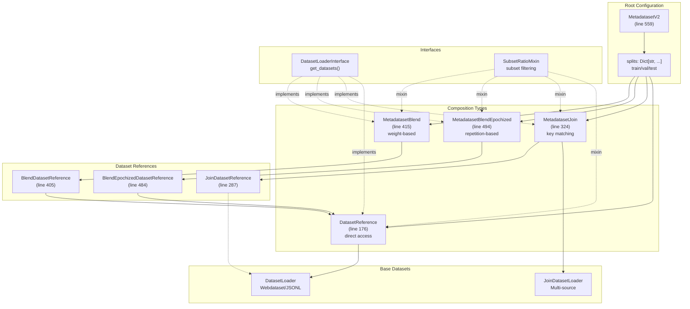
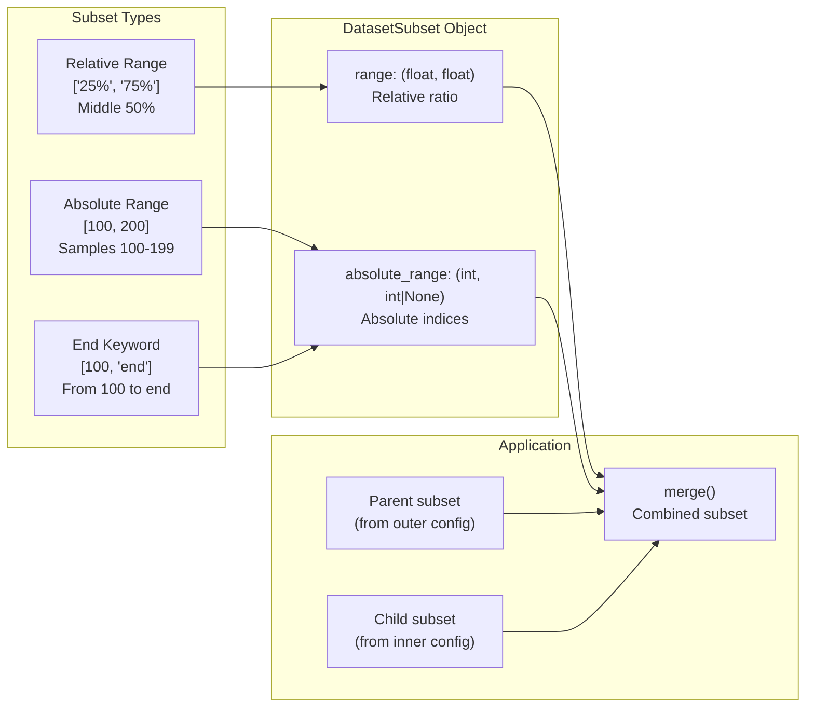
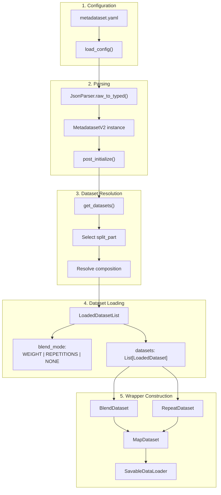

<!-- source: DeepWiki mcp.deepwiki.com · repo NVIDIA/Megatron-Energon · page 4.1 Metadataset Composition · fetched 2026-10-26 -->

# Metadataset Composition

<details>
<summary>Relevant source files</summary>

The following files were used as context for generating this wiki page:

- [src/megatron/energon/metadataset/metadataset_v2.py](src/megatron/energon/metadataset/metadataset_v2.py)
- [src/megatron/energon/typed_converter.py](src/megatron/energon/typed_converter.py)
- [tests/test_crudedataset.py](tests/test_crudedataset.py)
- [tests/test_dataset_det.py](tests/test_dataset_det.py)
- [tests/test_metadataset.py](tests/test_metadataset.py)
- [tests/test_metadataset_fewsamp.py](tests/test_metadataset_fewsamp.py)
- [tests/test_metadataset_v2.py](tests/test_metadataset_v2.py)

</details>


This page documents the **MetadatasetV2** system, which enables declarative composition of multiple datasets through YAML configuration. MetadatasetV2 supports blending datasets with weights, epochized sampling with fixed repetitions, key-based joining of multimodal datasets, and subset filtering.

For information about preparing individual datasets before composition, see [Dataset Preparation](#3). For details on how the composed datasets are loaded and iterated, see [WebDataset Access & ITarReader](#4.2).

---

## Overview

MetadatasetV2 provides a hierarchical configuration system where a single YAML file defines multiple dataset splits (train/val/test), each using different composition strategies. The system resolves these configurations into `LoadedDatasetList` objects that are consumed by the data loading pipeline.

**Key Features:**
- **Weighted Blending**: Sample from multiple datasets according to specified weights
- **Epochized Blending**: Ensure each dataset is seen a fixed number of times per epoch
- **Key-Based Joining**: Combine samples from multiple datasets by matching `__key__` fields
- **Subset Filtering**: Apply range-based filters (relative percentages or absolute indices)
- **Auxiliary Data**: Attach additional datasets for random access during cooking
- **Nested Composition**: Reference other metadatasets for complex hierarchies

Sources: [src/megatron/energon/metadataset/metadataset_v2.py:1-611]()

---

## Core Architecture

### Class Hierarchy



**MetadatasetV2 Class Hierarchy**

Sources: [src/megatron/energon/metadataset/metadataset_v2.py:176-611]()

### Dataset Blend Modes

The system supports three blend modes that determine how samples are distributed across epochs:

| Blend Mode | Usage | Weight/Repetition | Epoch Behavior |
|------------|-------|-------------------|----------------|
| `DATASET_WEIGHT` | `MetadatasetBlend` | `weight: float` | Probabilistic sampling by weight |
| `SAMPLE_REPETITIONS` | `MetadatasetBlendEpochized` | `repetitions: int\|float` | Exact repetitions before epoch boundary |
| `NONE` | Single dataset | N/A | Sequential iteration |

Sources: [src/megatron/energon/metadataset/loader_interface.py](), [src/megatron/energon/metadataset/metadataset_v2.py:415-555]()

---

## Composition Types

### DatasetReference (Direct Access)

The simplest form references a single dataset directly.

**Configuration:**
```yaml
__module__: megatron.energon
__class__: MetadatasetV2
splits:
  train:
    path: /path/to/dataset
    split_part: train  # Optional: override split
    subflavors:        # Optional: add metadata
      custom_key: custom_value
```

**Key Fields:**
- `path` (required): Path to dataset or nested metadataset
- `split_part` (optional): Which split to use from the dataset
- `subflavors` (optional): Additional metadata passed to samples
- `shuffle_over_epochs_multiplier` (optional): Controls epoch shuffling
- `subset` (optional): Range filter for samples
- `aux` (optional): Auxiliary datasets for random access

Sources: [src/megatron/energon/metadataset/metadataset_v2.py:176-284]()

### MetadatasetBlend (Weighted Sampling)

Samples from multiple datasets according to specified weights. Each dataset is weighted, and samples are drawn probabilistically during training.

**Configuration:**
```yaml
__module__: megatron.energon
__class__: MetadatasetV2
splits:
  train:
    blend:
      - weight: 0.5
        path: dataset_a
      - weight: 0.3
        path: dataset_b
      - weight: 0.2
        path: dataset_c
```

**Behavior:**
- Weights are normalized (sum to 1.0 internally)
- Each call to `__next__` samples from one dataset according to weights
- No guarantee on exact sample counts per epoch
- Suitable for large datasets where exact counts don't matter

**Weight Calculation:**
```python
# From metadataset_v2.py:443-470
sum_weight = sum(dataset.weight for dataset in self.blend)
for dataset in self.blend:
    loaded_dataset.weight = loaded_dataset.weight * dataset.weight / sum_weight
```

Sources: [src/megatron/energon/metadataset/metadataset_v2.py:415-476](), [tests/test_metadataset_v2.py:230-258]()

### MetadatasetBlendEpochized (Fixed Repetitions)

Ensures each dataset's samples are seen exactly `repetitions` times before the epoch boundary. This is critical for small datasets where you want deterministic sample counts.

**Configuration:**
```yaml
__module__: megatron.energon
__class__: MetadatasetV2
splits:
  train:
    blend_epochized:
      - repetitions: 2
        path: small_dataset  # 100 samples -> 200 per epoch
      - repetitions: 1.5
        path: large_dataset  # 1000 samples -> 1500 per epoch
```

**Behavior:**
- Each sample from each dataset appears exactly `repetitions` times per epoch
- Fractional repetitions are supported (e.g., `1.5` means 50% of samples appear twice)
- Epoch length = sum of (dataset_size × repetitions) for all datasets
- Guarantees deterministic sample distribution

**Example:**
Given Dataset A (50 samples, repetitions=2) and Dataset B (100 samples, repetitions=1):
- Epoch length: 50×2 + 100×1 = 200 samples
- Each sample from A appears exactly twice
- Each sample from B appears exactly once

Sources: [src/megatron/energon/metadataset/metadataset_v2.py:494-555]()

### MetadatasetJoin (Key-Based Joining)

Combines samples from multiple datasets by matching their `__key__` fields. Essential for multimodal training where different modalities are stored separately.

**Configuration:**
```yaml
__module__: megatron.energon
__class__: MetadatasetV2
splits:
  train:
    join:
      image:
        path: image_dataset
      caption:
        path: caption_dataset
        nonmatch: skip  # skip | none | error
    joiner:
      __module__: my_package
      __class__: JoinedSample  # Must have @staticmethod from_joined()
```

**Joiner Types:**

1. **Class-based Joiner** (using `__class__`):
```python
@edataclass
class JoinedSample(Sample):
    image: torch.Tensor
    caption: str
    
    @staticmethod
    def from_joined(image: ImageSample, caption: TextSample) -> "JoinedSample":
        return JoinedSample.derive_from(image, image=image.image, caption=caption.text)
```

2. **Function-based Joiner** (using `__function__`):
```python
def join_image_caption(image: ImageSample, caption: TextSample) -> MultimodalSample:
    return MultimodalSample.derive_from(image, image=image.image, text=caption.text)
```

**Nonmatch Behavior:**
- `error` (default): Raise exception if key not found in secondary dataset
- `skip`: Skip samples where keys don't match
- `none`: Return `None` for missing values

**Join Preparation:**
When datasets are joined, the system creates a cache file that maps primary keys to secondary dataset indices. This cache is stored in `.cache/` directory next to the metadataset YAML.

Sources: [src/megatron/energon/metadataset/metadataset_v2.py:324-397](), [src/megatron/energon/metadataset/join_dataset_loader.py](), [tests/test_metadataset_v2.py:314-421]()

---

## Configuration Syntax Reference

### Complete Example

```yaml
__module__: megatron.energon
__class__: MetadatasetV2
splits:
  train:
    blend:
      - weight: 4
        path: ./dataset_a
        split_part: train
        subflavors:
          source: metadataset_train
          quality: high
        shuffle_over_epochs_multiplier: 3
        subset:
          range: ["25%", "75%"]  # Middle 50% of dataset
      
      - weight: 1
        join:
          primary:
            path: ./dataset_b
            nonmatch: skip
          secondary:
            path: ./dataset_c
        joiner:
          __module__: my_tasks
          __function__: join_samples
        
  val:
    path: ./dataset_a
    split_part: val
    shuffle_over_epochs_multiplier: null  # No shuffling
```

Sources: [tests/test_metadataset_v2.py:118-175](), [tests/test_metadataset.py:153-211]()

### Field Reference Table

| Field | Type | Applies To | Description |
|-------|------|------------|-------------|
| `path` | `str\|EPath` | All | Path to dataset or metadataset |
| `weight` | `float` | Blend | Sampling weight (normalized) |
| `repetitions` | `int\|float` | BlendEpochized | Exact repetitions per epoch |
| `join` | `List\|Dict` | Join | Datasets to join |
| `joiner` | `Type\|Callable` | Join | Function/class for joining |
| `nonmatch` | `"skip"\|"none"\|"error"` | JoinDatasetReference | Handle missing keys |
| `split_part` | `str` | All | Override split ("train"/"val"/"test") |
| `subflavors` | `Dict[str, Any]` | All | Metadata passed to samples |
| `shuffle_over_epochs_multiplier` | `int\|null` | All | Epoch shuffle factor |
| `subset` | `Subset` | All | Range-based filtering |
| `aux` | `Dict[str, str]` | DatasetReference | Auxiliary datasets |
| `dataset_config` | `str` | DatasetReference | Override dataset.yaml |
| `split_config` | `str` | DatasetReference | Override split.yaml |

Sources: [src/megatron/energon/metadataset/metadataset_v2.py:176-611]()

---

## Subset Filtering

The `subset` field enables range-based filtering of datasets, supporting both relative (percentage) and absolute (index) ranges.

### Subset Configuration



**Subset Range Resolution**

### Syntax Examples

**Relative Range (Percentage):**
```yaml
subset:
  range: ["0%", "50%"]    # First half
  range: ["25%", "75%"]   # Middle 50%
  range: ["80%", "100%"]  # Last 20%
```

**Absolute Range (Indices):**
```yaml
subset:
  range: [0, 100]         # First 100 samples
  range: [100, 200]       # Samples 100-199
  range: [500, "end"]     # From 500 to end
```

### Hierarchical Merging

When subsets are specified at multiple levels (e.g., in nested metadatasets), they are merged:

```python
# From metadataset_v2.py:121-154
def merge(self, parent_subset: DatasetSubset | None) -> DatasetSubset:
    # If parent has relative range [0.25, 0.75] and child has [0, 0.5]:
    # Total range = [0.25 + 0*0.5, 0.25 + 0.5*0.5] = [0.25, 0.5]
    total = my_subset.range[1] - my_subset.range[0]
    return DatasetSubset(
        range=(
            my_subset.range[0] + parent_subset.range[0] * total,
            my_subset.range[0] + parent_subset.range[1] * total,
        ),
        absolute_range=my_subset.absolute_range,
    )
```

**Rules:**
1. Absolute ranges are only allowed on leaf datasets
2. Relative ranges can be nested at any level
3. Absolute range is applied first, then relative range
4. Merging multiplies relative ranges: `child_range * parent_range`

Sources: [src/megatron/energon/metadataset/metadataset_v2.py:70-173](), [src/megatron/energon/flavors/webdataset/structs.py]()

---

## Auxiliary Datasets

Auxiliary datasets provide random access to additional data sources during sample cooking. This is useful for loading side information (e.g., embeddings, metadata) without requiring it to be packed into the main dataset.

### Configuration

```yaml
__module__: megatron.energon
__class__: MetadatasetV2
splits:
  train:
    path: main_dataset
    aux:
      embeddings: embedding_dataset      # WebdatasetFileStore
      metadata: filesystem:///path/data  # SystemFileStore
    subflavors:
      crude_type: with_aux  # Selects cooker
```

### Auxiliary Source Types

**1. WebdatasetFileStore (Dataset Reference):**
```yaml
aux:
  embeddings: /path/to/prepared/dataset
```
Creates a `WebdatasetFileStore` for random access to prepared Energon datasets.

**2. SystemFileStore (Filesystem Reference):**
```yaml
aux:
  raw_files: filesystem:///absolute/path
  raw_files: filesystem://./relative/path
```
Creates a `SystemFileStore` for direct filesystem access.

### Using Auxiliary Data in Cookers

```python
from megatron.energon import Cooker, stateless
from megatron.energon.cache import FileStore

@stateless
@cooker()
def cook_with_aux(sample: dict, embeddings: FileStore, metadata: FileStore) -> MySample:
    # Random access by key
    embedding = embeddings.get(f"{sample['__key__']}.npy", sample)
    meta_info = metadata.get(f"{sample['__key__']}.json", sample)
    
    return MySample(
        text=sample['text'],
        embedding=embedding,
        metadata=meta_info,
    )
```

**Key Points:**
- Auxiliary datasets are passed as `FileStore` parameters to cookers
- Parameter names must match the keys in the `aux` dict
- `FileStore.get()` performs random access by file path
- Second argument to `get()` is the primary sample (for source tracking)

Sources: [src/megatron/energon/metadataset/metadataset_v2.py:35-67](), [src/megatron/energon/metadataset/metadataset_v2.py:188-227](), [tests/test_crudedataset.py:109-117]()

---

## Advanced Features

### Subflavors (Type-Based Selection)

Subflavors provide metadata passed through to samples, enabling conditional processing:

```yaml
splits:
  train:
    blend:
      - weight: 1
        path: dataset_a
        subflavors:
          crude_type: text_only
          quality: high
      - weight: 1
        path: dataset_b
        subflavors:
          crude_type: multimodal
          quality: medium
```

**Cooker Selection:**
```python
class MyTaskEncoder(DefaultTaskEncoder):
    cookers = [
        Cooker(cook_text, has_subflavors={"crude_type": "text_only"}),
        Cooker(cook_multimodal, has_subflavors={"crude_type": "multimodal"}),
    ]
```

Subflavors are hierarchically merged:
1. Base dataset's `dataset.yaml` subflavors
2. MetadatasetV2 reference subflavors
3. Nested metadataset reference subflavors

Sources: [src/megatron/energon/metadataset/metadataset_v2.py:180-183](), [src/megatron/energon/metadataset/metadataset_v2.py:250-252](), [tests/test_metadataset.py:163-177]()

### Shuffle Over Epochs Multiplier

Controls how dataset shuffling changes across epochs:

```yaml
shuffle_over_epochs_multiplier: 3  # Re-shuffle every 3 epochs
shuffle_over_epochs_multiplier: 1  # Re-shuffle every epoch (default)
shuffle_over_epochs_multiplier: -1 # Sample without replacement
shuffle_over_epochs_multiplier: null  # No shuffling
```

**Hierarchical Behavior:**
```python
# From metadataset_v2.py:254-264
if shuffle_over_epochs_multiplier is None or self.shuffle_over_epochs_multiplier is None:
    # No shuffling has override priority
    new_shuffle_over_epochs_multiplier = None
elif shuffle_over_epochs_multiplier == -1 or self.shuffle_over_epochs_multiplier == -1:
    # Without-replacement has next priority
    new_shuffle_over_epochs_multiplier = -1
else:
    # Otherwise multiply
    new_shuffle_over_epochs_multiplier = (
        shuffle_over_epochs_multiplier * self.shuffle_over_epochs_multiplier
    )
```

Sources: [src/megatron/energon/metadataset/metadataset_v2.py:181](), [src/megatron/energon/metadataset/metadataset_v2.py:254-264]()

### Nested Metadatasets

MetadatasetV2 can reference other metadatasets, enabling modular configurations:

```yaml
# outer_metadataset.yaml
__module__: megatron.energon
__class__: MetadatasetV2
splits:
  train:
    blend:
      - weight: 4
        path: ./inner_metadataset.yaml
        split_part: train
      - weight: 1
        path: ./inner_metadataset.yaml
        split_part: val
```

**Resolution Process:**
1. Parse outer metadataset YAML
2. For each `DatasetReference`, check dataset type
3. If `EnergonDatasetType.METADATASET`, recursively load inner metadataset
4. Flatten all datasets into `LoadedDatasetList`

Sources: [src/megatron/energon/metadataset/metadataset_v2.py:196-207](), [tests/test_metadataset_v2.py:260-312]()

---

## Data Flow

### From Configuration to DataLoader



**MetadatasetV2 Data Flow: Configuration to DataLoader**

### LoadedDatasetList Structure

```python
@dataclass
class LoadedDataset:
    dataset: DatasetWrapper  # The actual dataset
    weight: Optional[float]  # For DATASET_WEIGHT mode
    repetitions: Optional[Union[int, float]]  # For SAMPLE_REPETITIONS mode
    aux: Optional[Dict[str, FileStore]]  # Auxiliary datasets

@dataclass  
class LoadedDatasetList:
    blend_mode: DatasetBlendMode  # NONE | DATASET_WEIGHT | SAMPLE_REPETITIONS
    datasets: List[LoadedDataset]  # All datasets in composition
```

Sources: [src/megatron/energon/metadataset/loader_interface.py](), [src/megatron/energon/metadataset/metadataset_v2.py:239-283]()

---

## Practical Examples

### Example 1: Simple Training/Validation Split

```yaml
__module__: megatron.energon
__class__: MetadatasetV2
splits:
  train:
    path: /data/my_dataset
    split_part: train
  val:
    path: /data/my_dataset
    split_part: val
```

### Example 2: Weighted Multi-Domain Training

```yaml
__module__: megatron.energon
__class__: MetadatasetV2
splits:
  train:
    blend:
      - weight: 0.5
        path: /data/web_text
        subflavors: {domain: web}
      - weight: 0.3
        path: /data/books
        subflavors: {domain: books}
      - weight: 0.2
        path: /data/scientific
        subflavors: {domain: scientific}
```

### Example 3: Multimodal Dataset with Joining

```yaml
__module__: megatron.energon
__class__: MetadatasetV2
splits:
  train:
    join:
      video:
        path: /data/video_frames
      audio:
        path: /data/audio_clips
      transcript:
        path: /data/transcripts
        nonmatch: skip
    joiner:
      __module__: my_project.samples
      __class__: MultimodalSample
```

### Example 4: Few-Shot Learning with Repetitions

```yaml
__module__: megatron.energon
__class__: MetadatasetV2
splits:
  train:
    blend_epochized:
      - repetitions: 100
        path: /data/few_shot_examples  # 10 samples -> 1000 per epoch
      - repetitions: 1
        path: /data/main_dataset
```

### Example 5: Curriculum Learning with Subsets

```yaml
__module__: megatron.energon
__class__: MetadatasetV2
splits:
  easy:
    path: /data/training
    subset:
      range: ["0%", "33%"]  # First third (easiest)
  medium:
    path: /data/training
    subset:
      range: ["33%", "66%"]  # Middle third
  hard:
    path: /data/training
    subset:
      range: ["66%", "100%"]  # Last third (hardest)
```

Sources: [tests/test_metadataset_v2.py:230-258](), [tests/test_metadataset_v2.py:314-500](), [tests/test_metadataset_fewsamp.py:157-223]()

---

## Preparation and Caching

### Join Dataset Preparation

When using `MetadatasetJoin`, the system must prepare join indices mapping primary keys to secondary dataset locations:

```bash
energon prepare /path/to/metadataset.yaml
```

This creates cache files in `metadataset.yaml.cache/`:
- `<hash>_join_indices.pkl` - Maps primary keys to secondary indices

**When to Re-prepare:**
- When joining configuration changes
- When secondary datasets are modified
- When you change the `nonmatch` behavior

The system validates cache consistency using config hashes and will raise an error if preparation is stale.

Sources: [src/megatron/energon/metadataset/loader.py](), [tests/test_metadataset_v2.py:738-762]()

### Cache File Cleanup

MetadatasetV2 automatically removes stale cache files:

```python
# From metadataset_v2.py:582-588
cache_path = EPath(self.path.parent / f"{self.path.name}.cache")
remove_files = set(cache_path.glob("*")) - set(files)
for file in remove_files:
    print(f"Cleanup cache file {file}")
    file.unlink()
```

Sources: [src/megatron/energon/metadataset/metadataset_v2.py:570-589]()

---

## API Reference

### Key Methods

**MetadatasetV2:**
- `post_initialize(mds_path: Optional[EPath])` - Resolve paths and initialize inner objects
- `prepare(split_part: Optional[str])` - Prepare join indices and caches
- `get_datasets(*, training: bool, split_part: str, worker_config: WorkerConfig, ...)` - Load datasets for split

**DatasetLoaderInterface (all composition types implement):**
- `post_initialize(mds_path: Optional[EPath])` - Initialize after parsing
- `prepare(split_part: Optional[str])` - Prepare any required indices
- `get_datasets(...)` - Return `LoadedDatasetList` for this configuration

**Subset:**
- `as_dataset_subset() -> DatasetSubset` - Convert string ranges to numeric
- `merge(parent_subset: DatasetSubset) -> DatasetSubset` - Combine with parent subset

Sources: [src/megatron/energon/metadataset/metadataset_v2.py:176-611](), [src/megatron/energon/metadataset/loader_interface.py]()

---

## Best Practices

### Choosing Composition Types

| Use Case | Recommended Type | Reason |
|----------|------------------|--------|
| Large-scale pre-training | `MetadatasetBlend` | Efficient probabilistic sampling |
| Small dataset upsampling | `MetadatasetBlendEpochized` | Guarantee exact repetitions |
| Multimodal alignment | `MetadatasetJoin` | Match by key |
| Simple single dataset | `DatasetReference` | Direct access |

### Performance Considerations

1. **Join Datasets**: Requires preparation step; adds latency for key lookups
2. **Nested Metadatasets**: Increases configuration complexity; flatten when possible
3. **Auxiliary Datasets**: Random access may be slower than sequential reads
4. **Subset Filters**: Applied after loading; doesn't reduce I/O

### Configuration Tips

1. Always run `energon prepare` after modifying join configurations
2. Use relative subsets for reusable configurations
3. Set `shuffle_over_epochs_multiplier: null` for validation splits
4. Document subflavor meanings in comments
5. Test with small subsets before full-scale training

Sources: [tests/test_metadataset_v2.py](), [tests/test_metadataset.py]()

---

