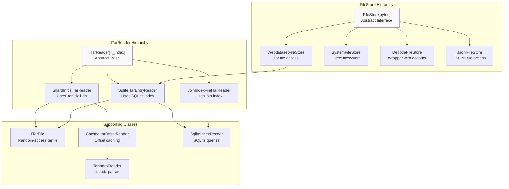
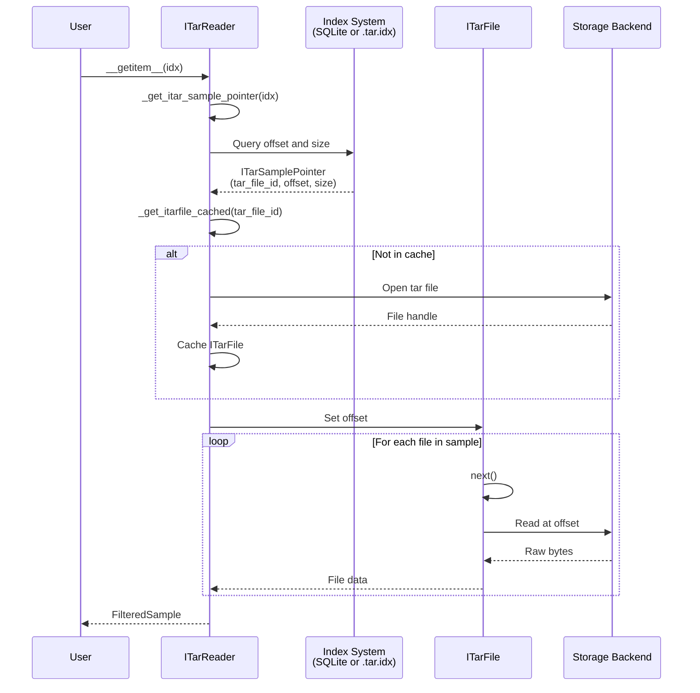
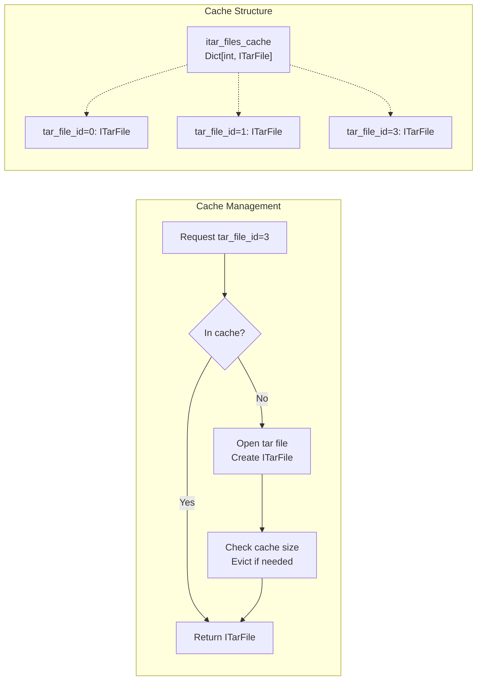
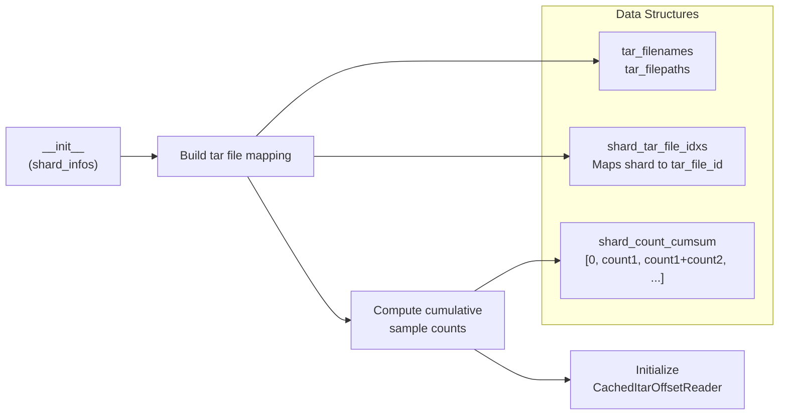
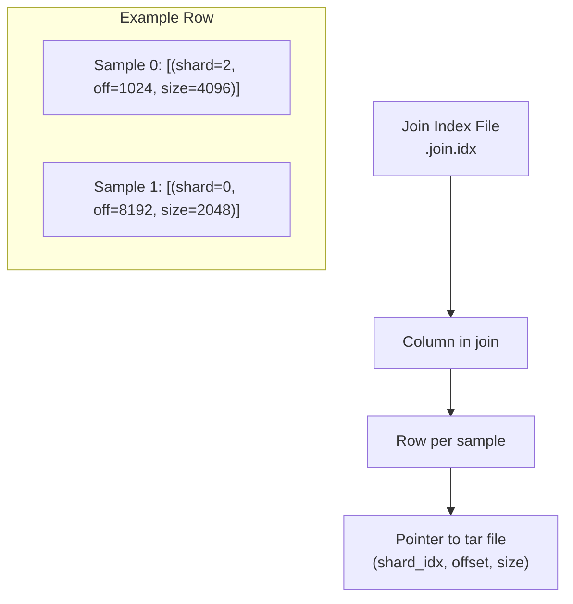
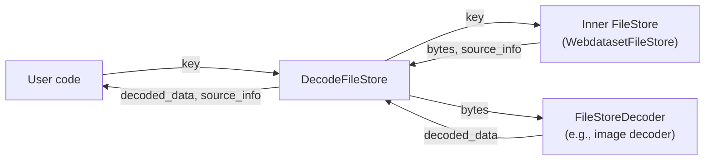
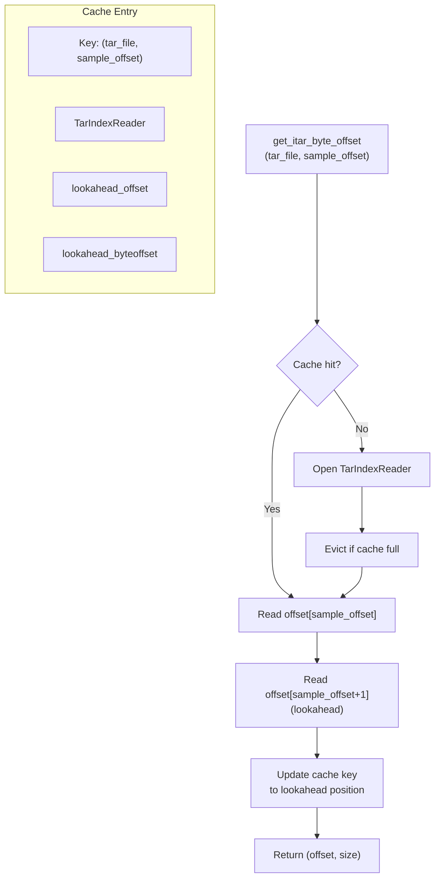
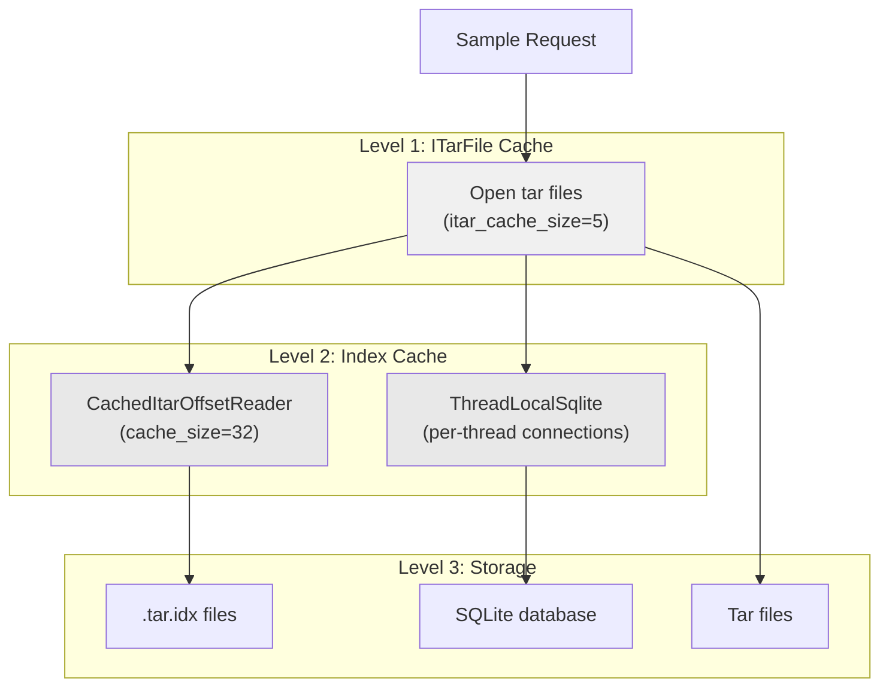
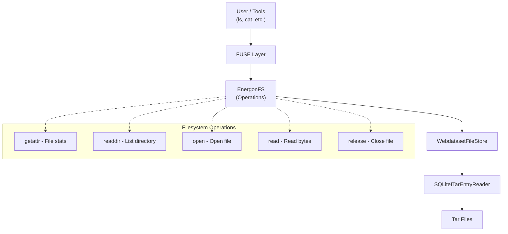

<!-- source: DeepWiki mcp.deepwiki.com · repo NVIDIA/Megatron-Energon · page 4.2 WebDataset Access & ITarReader · fetched 2026-10-26 -->

# WebDataset Access & ITarReader

<details>
<summary>Relevant source files</summary>

The following files were used as context for generating this wiki page:

- [src/megatron/energon/cache/file_store.py](src/megatron/energon/cache/file_store.py)
- [src/megatron/energon/dataset_config.py](src/megatron/energon/dataset_config.py)
- [src/megatron/energon/flavors/webdataset/itar.py](src/megatron/energon/flavors/webdataset/itar.py)
- [src/megatron/energon/flavors/webdataset/itar_reader.py](src/megatron/energon/flavors/webdataset/itar_reader.py)
- [src/megatron/energon/flavors/webdataset/metadata.py](src/megatron/energon/flavors/webdataset/metadata.py)
- [src/megatron/energon/metadataset/loader.py](src/megatron/energon/metadataset/loader.py)
- [src/megatron/energon/tools/mount.py](src/megatron/energon/tools/mount.py)
- [tests/test_jsonl_dataset.py](tests/test_jsonl_dataset.py)

</details>


## Purpose and Scope

This document explains the low-level data access layer in Megatron-Energon, which provides efficient random access to tar archives and other storage backends. This layer sits between the dataset configuration layer (see [4.1](#4.1)) and the sample decoding layer (see [5.3](#5.3)).

**Key components covered:**
- `ITarReader` implementations for random access to WebDataset tar files
- `FileStore` abstraction for unified file access across storage types
- Index-based random access mechanisms using `.tar.idx` files and SQLite databases
- Performance optimizations including caching strategies

**Related topics:**
- For metadataset composition and dataset blending, see [4.1](#4.1)
- For checkpointing and data loader integration, see [4.3](#4.3)
- For storage access with EPath and remote datasets, see [7](#7)

---

## Architecture Overview

The data access layer provides two main abstractions: `ITarReader` for random access to tar archives, and `FileStore` for unified file access. These abstractions enable efficient data retrieval regardless of the underlying storage format.

### Component Hierarchy



**Sources:** [src/megatron/energon/flavors/webdataset/itar_reader.py:39-611](), [src/megatron/energon/cache/file_store.py:18-193]()

### Data Access Flow



**Sources:** [src/megatron/energon/flavors/webdataset/itar_reader.py:159-252](), [src/megatron/energon/flavors/webdataset/itar.py:312-380]()

---

## ITarReader Base Class

The `ITarReader` abstract base class defines the interface for random access to tar file collections. It manages tar file caching, sample filtering, and provides a consistent API across different indexing strategies.

### Class Definition

The base class is generic over the index type `T_index`, which can be `int` for sequential access or `str` for key-based access.

**Key attributes:**
- `base_path: EPath` - Base path for relative tar file paths
- `tar_filenames: List[str]` - List of tar file names
- `tar_filepaths: List[EPath]` - Full paths to tar files
- `part_filter: Optional[Callable[[str], bool]]` - Filter for sample parts (file extensions)
- `sample_filter: Optional[Callable[[str], bool]]` - Filter for samples by key
- `itar_files_cache: Dict[int, ITarFile]` - LRU cache of open tar files
- `itar_cache_size: int` - Maximum number of open tar files (default: 5)

**Abstract methods to implement:**
- `__len__() -> int` - Return total number of samples
- `__str__() -> str` - Return descriptive string
- `_get_itar_sample_pointer(idx: T_index) -> ITarSamplePointer` - Map index to tar file location

**Sources:** [src/megatron/energon/flavors/webdataset/itar_reader.py:39-98]()

### Caching Mechanism

ITarReader maintains an LRU cache of open tar files to avoid repeatedly opening/closing files. When the cache exceeds `itar_cache_size`, the oldest entry is evicted.



**Sources:** [src/megatron/energon/flavors/webdataset/itar_reader.py:105-125]()

### Sample Retrieval Process

The `_get_item_by_sample_pointer` method is the core retrieval logic used by all implementations:

| Step | Action | Details |
|------|--------|---------|
| 1 | Get cached ITarFile | Via `_get_itarfile_cached()` |
| 2 | Position at offset | Set `tar_file.offset = sample_pointer.byte_offset` |
| 3 | Iterate through files | Until reaching `byte_offset + byte_size` |
| 4 | Filter files | Apply `part_filter` or `entry_match_fn` |
| 5 | Extract data | Read each matching file into `group_parts` dict |
| 6 | Return sample | As `FilteredSample` with metadata |

**Sources:** [src/megatron/energon/flavors/webdataset/itar_reader.py:159-244]()

---

## ITarReader Implementations

### ShardInfosITarReader

This reader constructs its sample list from a list of `ShardInfo` objects, which contain tar file paths and sample counts. It uses `.tar.idx` files for byte-level random access.

**Key features:**
- Builds internal mapping from sample index to shard index using cumulative sums
- Uses binary search to locate the shard containing a given sample
- Leverages `CachedItarOffsetReader` for efficient offset lookups
- Optimal for large-scale datasets with many shards

**Initialization:**


**Index lookup:**
```python
# Binary search to find shard
shard_idx = bisect_right(self.shard_count_cumsum, idx) - 1
sample_idx_in_shard = idx - self.shard_count_cumsum[shard_idx]

# Get byte offset from .tar.idx file
byte_offset, byte_size = self.cached_offset_reader.get_itar_byte_offset(
    shard.path, sample_idx_in_shard
)
```

**Sources:** [src/megatron/energon/flavors/webdataset/itar_reader.py:352-445]()

### SqliteITarEntryReader

This reader uses a SQLite database to index samples and their parts. It supports both sample-level access (by sample key) and part-level access (by full entry name like `001.jpg`).

**Key features:**
- SQLite-based indexing for fast key lookups
- Supports both whole sample retrieval and individual part retrieval
- Optional `key_is_full_entryname` mode for direct file access
- Backward compatibility with older index formats
- Media metadata support via SQLite queries

**Database schema:**
The SQLite index contains tables for samples and optionally sample_parts:
- `samples` table: Maps sample keys to tar file locations
- `sample_parts` table: Maps individual file entries to locations (newer versions)
- `media_metadata` table: Stores media file metadata (optional)

**Access modes:**

| Mode | Key Format | Returns | Use Case |
|------|-----------|---------|----------|
| Sample mode | `"001"` | `FilteredSample` with all parts | Standard dataset loading |
| Entry mode | `"001.jpg"` | `(bytes, SourceInfo)` tuple | Direct file access, FileStore |

**Sources:** [src/megatron/energon/flavors/webdataset/itar_reader.py:448-630]()

### JoinIndexFileITarReader

This reader uses join index files to enable dataset joining operations. It reads sample pointers from a join index that references multiple tar files.

**Key features:**
- Supports multi-dataset joining via indexed lookups
- Caches `JoinIndexReader` instances for performance
- Used by `MetadatasetJoin` for combining datasets by key

**Index structure:**


**Sources:** [src/megatron/energon/flavors/webdataset/itar_reader.py:255-350]()

---

## FileStore Abstraction

The `FileStore` interface provides a unified way to access files regardless of their storage format. All FileStore implementations support `__getitem__` for file retrieval and return `(data, SourceInfo)` tuples.

### FileStore Interface

```python
class FileStore[T]:
    def __getitem__(self, key: str) -> tuple[T, SourceInfo]:
        """Retrieve file data by key."""
        ...
    
    def get_path(self) -> str:
        """Return the base path of the dataset."""
        ...
    
    def get_media_metadata(self, key: str) -> MediaMetadataBase:
        """Retrieve media metadata for a file."""
        ...
```

### WebdatasetFileStore

Extends `SqliteITarEntryReader` to provide FileStore interface for tar-based datasets. This is the primary mechanism for accessing prepared WebDataset files.

**Features:**
- Direct file access using full entry names (`"shard/001.jpg"`)
- Efficient byte-level reads from tar files
- Media metadata support from SQLite database
- Used by auxiliary datasets and the mount command

**Usage in mount.py:**
```python
wds_filestore = WebdatasetFileStore(dataset_path)
file_bytes, source_info = wds_filestore["001.jpg"]
```

**Sources:** [src/megatron/energon/cache/file_store.py:144-186](), [src/megatron/energon/tools/mount.py:40-339]()

### SystemFileStore

Reads files directly from the filesystem, used for auxiliary datasets and filesystem-based datasets.

**Features:**
- Direct filesystem access via EPath
- Optional base directory for relative paths
- Media metadata support via SQLite database
- Thread-local SQLite connections for safety

**Key implementation details:**
- Constructs full paths by joining `base_dir` with keys
- Reads files synchronously using `EPath.open()`
- Caches SQLite connection in `ThreadLocalSqlite` wrapper
- Validates media_metadata table existence on first access

**Sources:** [src/megatron/energon/cache/file_store.py:54-141]()

### DecodeFileStore

A wrapper that applies decoding transformations to FileStore data. Implements the decorator pattern for composable data transformations.

**Architecture:**


**Example use case:**
```python
# Wrap a FileStore to decode images on access
decoder = ImageDecoder()
decoded_store = DecodeFileStore(
    inner=WebdatasetFileStore(path),
    decoder=decoder
)
image, source_info = decoded_store["001.jpg"]  # Returns decoded image
```

**Sources:** [src/megatron/energon/cache/file_store.py:18-52]()

---

## Random Access Mechanisms

### ITarFile: Custom Tarfile Implementation

`ITarFile` extends Python's `tarfile.TarFile` to enable random access while keeping the file open. Standard `tarfile` implementations are designed for sequential reads.

**Key modifications:**
- Overrides `next()` to support seeking before reading
- Allows setting `offset` attribute to jump to specific byte positions
- Prevents automatic first-member read during initialization
- Maintains file position for efficient sequential access within a sample

**Usage pattern:**
```python
with open(filename, "rb") as fileobj:
    with ITarFile.open(fileobj=fileobj, mode="r:") as tar:
        tar.offset = 101888  # Jump to specific byte offset
        tarinfo = tar.next()  # Read tar entry at that offset
        data = tar.extractfile(tarinfo).read()
```

**Sources:** [src/megatron/energon/flavors/webdataset/itar.py:312-344]()

### Index Files (.tar.idx)

Index files provide O(1) lookup of byte offsets for samples in tar files. Each `.tar.idx` file contains a sequence of 8-byte unsigned integers representing byte offsets.

**File format:**
```
┌──────────────┬──────────────┬──────────────┬─────┐
│ Offset 0     │ Offset 1     │ Offset 2     │ ... │
│ (8 bytes)    │ (8 bytes)    │ (8 bytes)    │     │
└──────────────┴──────────────┴──────────────┴─────┘
```

**TarIndexReader API:**
- `__getitem__(index: int) -> int` - Get byte offset for sample
- `__len__() -> int` - Number of samples in tar file
- `__iter__() -> Generator[int]` - Iterate all offsets

**TarIndexWriter API:**
- `append(offset: int)` - Add offset to index
- `close(finalize: bool)` - Write index to disk

**Offset calculation:**
Given a sample index `i`, its byte offset is at position `i * 8` in the `.tar.idx` file. The sample spans from `offset[i]` to `offset[i+1]`.

**Sources:** [src/megatron/energon/flavors/webdataset/itar.py:14-107]()

### CachedItarOffsetReader

Provides caching layer for `.tar.idx` file access to optimize sequential and semi-sequential access patterns.

**Caching strategy:**


**Optimization details:**
- Cache key is `(tar_file_path, sample_offset)`
- After reading offset `i`, pre-fetches offset `i+1` for next access
- Updates cache key to `(tar_file_path, i+1)` for sequential reads
- LRU eviction when cache exceeds `cache_size` (default: 32)
- Computes sample size as `offset[i+1] - offset[i]`

**Performance benefit:**
For sequential access, this provides near-zero overhead since the next offset is already cached. For random access, it amortizes index file opening costs.

**Sources:** [src/megatron/energon/flavors/webdataset/itar.py:179-310]()

### SQLite Indexing

SQLite provides more flexible indexing than `.tar.idx` files, supporting key-based lookups and metadata storage.

**Tables used:**
```sql
-- Main sample index
CREATE TABLE samples (
    sample_key TEXT PRIMARY KEY,
    tar_file_id INTEGER,
    byte_offset INTEGER,
    byte_size INTEGER
);

-- Optional: Individual file parts
CREATE TABLE sample_parts (
    sample_key TEXT,
    part_name TEXT,
    tar_file_id INTEGER,
    raw_byte_offset INTEGER,
    raw_byte_size INTEGER,
    PRIMARY KEY (sample_key, part_name)
);

-- Optional: Media metadata
CREATE TABLE media_metadata (
    entry_key TEXT PRIMARY KEY,
    metadata_type TEXT,
    metadata_json TEXT
);
```

**Query patterns:**
- Sample lookup: `SELECT * FROM samples WHERE sample_key = ?`
- Part lookup: `SELECT * FROM sample_parts WHERE sample_key = ? AND part_name = ?`
- All samples: `SELECT sample_key, byte_size, tar_file_id FROM samples`
- Metadata: `SELECT metadata_type, metadata_json FROM media_metadata WHERE entry_key = ?`

**Connection management:**
SQLite connections are managed via `ThreadLocalSqlite` wrapper to ensure thread safety in multi-worker scenarios. Each worker thread gets its own connection.

**Sources:** [src/megatron/energon/flavors/webdataset/indexing.py]() (referenced but not provided), [src/megatron/energon/cache/file_store.py:157-185]()

---

## Performance Optimizations

### Multi-Level Caching

The system employs three levels of caching:



| Cache Level | Purpose | Default Size | Eviction |
|------------|---------|--------------|----------|
| ITarFile cache | Keep tar files open | 5 files | LRU |
| Index cache | Cache offset lookups | 32 entries | LRU |
| SQLite connections | Per-thread DB access | 1 per thread | Thread cleanup |

**Sources:** [src/megatron/energon/flavors/webdataset/itar_reader.py:105-125](), [src/megatron/energon/flavors/webdataset/itar.py:186-310]()

### Sequential Access Optimization

When accessing samples sequentially (common during training), the lookahead mechanism in `CachedItarOffsetReader` eliminates repeated index lookups:

**Access pattern example:**
```
Access sample 0 → Read offset[0], prefetch offset[1] → O(1) index read
Access sample 1 → Use prefetched offset[1], prefetch offset[2] → O(0) index read
Access sample 2 → Use prefetched offset[2], prefetch offset[3] → O(0) index read
...
```

For N sequential accesses, only 1 index file read is needed after the initial read.

**Sources:** [src/megatron/energon/flavors/webdataset/itar.py:238-277]()

### Lazy File Opening

ITarReader implementations open tar files lazily and cache them. Files are only opened when first accessed and closed when evicted from cache or explicitly closed.

**Benefits:**
- Reduced file descriptor usage
- Faster initialization for large shard lists
- Automatic cleanup via LRU eviction

**Trade-off:** Cache size must balance between:
- Too small: Frequent open/close overhead
- Too large: Excessive file descriptors

The default of 5 open files is tuned for typical training scenarios with multiple workers.

**Sources:** [src/megatron/energon/flavors/webdataset/itar_reader.py:105-125]()

### Part Filtering

The `part_filter` parameter enables efficient filtering of file extensions during sample retrieval, avoiding unnecessary reads:

```python
# Only load .jpg files, skip .json and .txt
reader = ShardInfosITarReader(
    base_path=path,
    shard_infos=shards,
    part_filter=lambda ext: ext == "jpg"
)
```

Filtering happens during tar file reading, so unneeded files are skipped without extracting their data.

**Sources:** [src/megatron/energon/flavors/webdataset/itar_reader.py:216-227]()

---

## Integration with FUSE Mount

The `energon mount` command uses `WebdatasetFileStore` to expose datasets as a read-only filesystem via FUSE. This enables browsing and accessing dataset files using standard filesystem tools.

### Mount Architecture



**Mount modes:**

| Mode | Structure | Use Case |
|------|-----------|----------|
| Flat | All files in root directory | Direct access to all sample parts |
| Sample folders | One folder per sample | Organized view of samples |

**Sources:** [src/megatron/energon/tools/mount.py:25-408]()

---

## Usage Examples

### Example 1: Loading with ShardInfosITarReader

```python
from megatron.energon.epathlib import EPath
from megatron.energon.flavors.webdataset.itar_reader import ShardInfosITarReader
from megatron.energon.flavors.webdataset.structs import ShardInfo

# Create shard info list
shard_infos = [
    ShardInfo(name="shard_0000.tar", path=base_path / "shard_0000.tar", count=1000),
    ShardInfo(name="shard_0001.tar", path=base_path / "shard_0001.tar", count=1000),
]

# Initialize reader
reader = ShardInfosITarReader(
    base_path=base_path,
    shard_infos=shard_infos,
    part_filter=lambda ext: ext in ["jpg", "json"],  # Only load these extensions
    itar_cache_size=10  # Keep 10 tar files open
)

# Access samples
sample_0 = reader[0]  # First sample
sample_1000 = reader[1000]  # First sample from second shard

print(f"Total samples: {len(reader)}")  # 2000
```

### Example 2: Using WebdatasetFileStore

```python
from megatron.energon.cache.file_store import WebdatasetFileStore
from megatron.energon.epathlib import EPath

# Initialize file store
store = WebdatasetFileStore(dataset_path=EPath("/path/to/dataset"))

# Access individual files
image_bytes, source_info = store["001.jpg"]
json_bytes, source_info = store["001.json"]

# Get media metadata
from megatron.energon.media.metadata import ImageMetadata
metadata = store.get_media_metadata("001.jpg")
if isinstance(metadata, ImageMetadata):
    print(f"Image size: {metadata.width}x{metadata.height}")

# List all samples
for key, size, tar_id in store.list_all_samples():
    print(f"Sample {key}: {size} bytes in tar {tar_id}")
```

### Example 3: Auxiliary Dataset with SystemFileStore

```python
from megatron.energon.cache.file_store import SystemFileStore
from megatron.energon.epathlib import EPath

# Create file store for filesystem directory
store = SystemFileStore(base_dir=EPath("/data/captions"))

# Access files
caption_bytes, source_info = store["image001.txt"]
caption_text = caption_bytes.decode('utf-8')

print(f"Caption from {source_info.file_names[0]}: {caption_text}")
```

### Example 4: Custom Part Filtering

```python
# Only load specific file types
def image_only_filter(ext: str) -> bool:
    return ext in ["jpg", "png", "jpeg", "webp"]

reader = SqliteITarEntryReader(
    base_path=dataset_path,
    part_filter=image_only_filter,
    itar_cache_size=5
)

# Sample will only contain image files
sample = reader["001"]
print(sample.keys())  # {'__key__', '__shard__', '__sources__', 'jpg'}
```

**Sources:** [src/megatron/energon/flavors/webdataset/itar_reader.py](), [src/megatron/energon/cache/file_store.py]()

---

