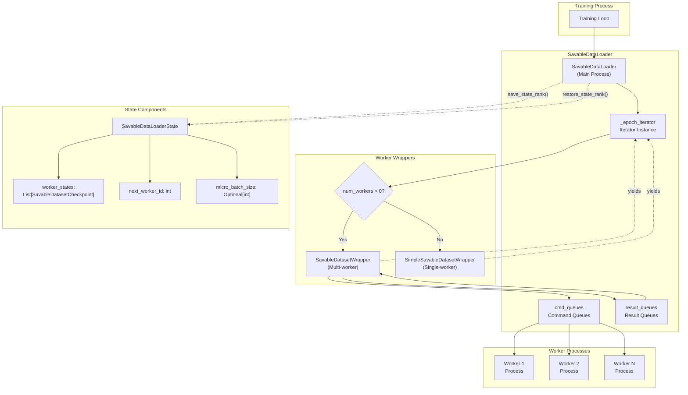
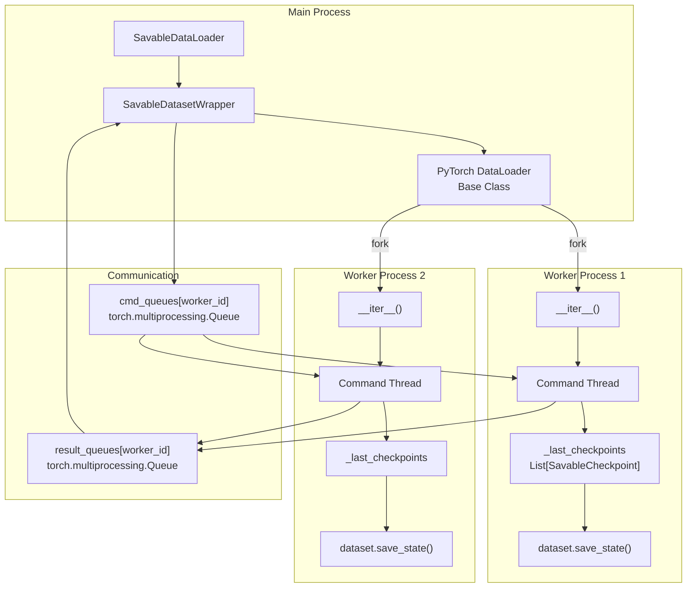
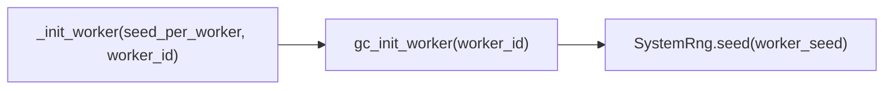
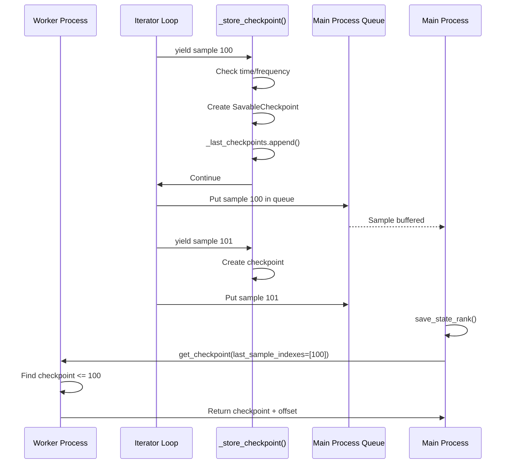
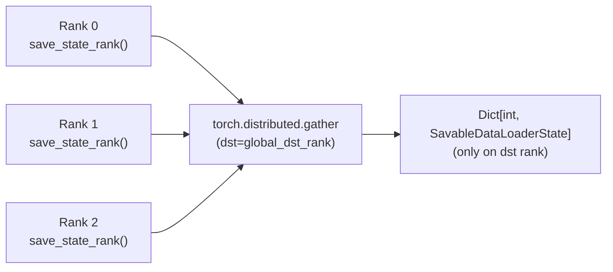
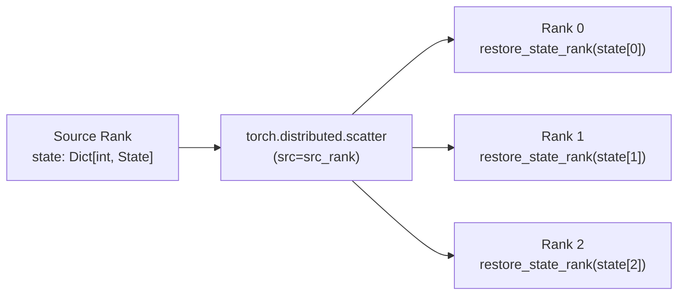
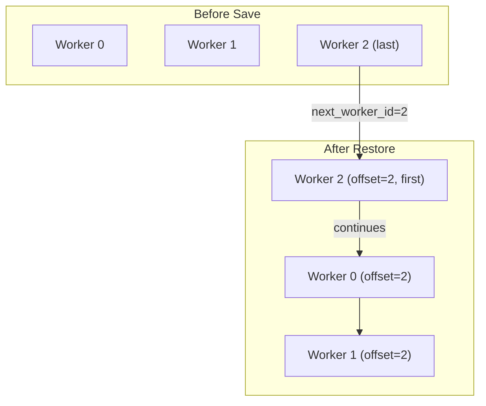

<!-- source: DeepWiki mcp.deepwiki.com · repo NVIDIA/Megatron-Energon · page 4.3 SavableDataLoader · fetched 2026-10-26 -->

# SavableDataLoader

<details>
<summary>Relevant source files</summary>

The following files were used as context for generating this wiki page:

- [src/megatron/energon/loader.py](src/megatron/energon/loader.py)
- [src/megatron/energon/savable_loader.py](src/megatron/energon/savable_loader.py)
- [src/megatron/energon/wrappers/gc_dataset.py](src/megatron/energon/wrappers/gc_dataset.py)
- [src/megatron/energon/wrappers/mix_batch_dataset.py](src/megatron/energon/wrappers/mix_batch_dataset.py)
- [tests/test_crudedataset.py](tests/test_crudedataset.py)
- [tests/test_dataset_det.py](tests/test_dataset_det.py)
- [tests/test_metadataset.py](tests/test_metadataset.py)
- [tests/test_metadataset_fewsamp.py](tests/test_metadataset_fewsamp.py)

</details>


## Purpose and Scope

The `SavableDataLoader` is a PyTorch-compatible data loader that provides checkpoint and restore capabilities for training state management. It enables exact continuation of training by saving the complete state of data iteration, including worker positions, random number generator states, and buffered samples. This component is critical for long-running training jobs that require fault tolerance and the ability to resume from arbitrary points.

For information about the underlying dataset abstractions, see [Core Concepts](#2). For details on dataset transformations that occur before loading, see [Dataset Wrappers](#5.2).

**Sources:** [src/megatron/energon/savable_loader.py:602-647]()

## Architecture Overview

The `SavableDataLoader` extends PyTorch's `DataLoader` and wraps `SavableDataset` instances to enable stateful iteration. The architecture differs based on whether worker processes are used.



**Diagram: SavableDataLoader Architecture with Worker Management**

The loader manages two distinct operational modes:
- **Multi-worker mode**: Uses `SavableDatasetWrapper` with inter-process communication via command and result queues
- **Single-worker mode**: Uses `SimpleSavableDatasetWrapper` with simpler in-process state management

**Sources:** [src/megatron/energon/savable_loader.py:602-799](), [src/megatron/energon/savable_loader.py:64-153]()

## Worker Management

### Multi-Worker Architecture

When `num_workers > 0`, the loader spawns multiple worker processes managed by `SavableDatasetWrapper`. Each worker maintains its own dataset iterator and state.



**Diagram: Multi-Worker Communication Architecture**

Each worker process runs a command thread (`_command_thread`) that listens for commands from the main process via `cmd_queues` and returns results via `result_queues`. This enables the main process to query worker states without interrupting iteration.

**Sources:** [src/megatron/energon/savable_loader.py:198-585](), [src/megatron/energon/savable_loader.py:275-311]()

### Worker Initialization

Workers are initialized with deterministic seeds to ensure reproducibility:



**Diagram: Worker Initialization Sequence**

The `_init_worker` function [src/megatron/energon/savable_loader.py:52-62]() performs:
1. Garbage collection initialization via `gc_init_worker` to freeze pre-fork objects
2. Random seed initialization using `SystemRng.seed` with worker-specific seeds

**Sources:** [src/megatron/energon/savable_loader.py:52-62](), [src/megatron/energon/savable_loader.py:785-788]()

## State Management and Checkpointing

### Checkpoint Components

The loader maintains multiple levels of state to enable exact restoration:

| State Component | Type | Purpose |
|----------------|------|---------|
| `SavableDataLoaderState` | Container | Rank-level state for all workers |
| `worker_states` | `List[SavableDatasetCheckpoint]` | Per-worker checkpoint and offset |
| `next_worker_id` | `int` | Next worker to yield data (for round-robin) |
| `micro_batch_size` | `Optional[int]` | Validation for batch size consistency |
| `SavableDatasetState` | Container | Individual dataset/worker state |
| `rng` | `SystemRngState` | Random number generator states |
| `dataset_state` | `FlexState` | Inner dataset state |
| `sample_index` | `int` | Current sample position |

**Sources:** [src/megatron/energon/savable_loader.py:587-600](), [src/megatron/energon/savable_loader.py:155-170]()

### Internal Checkpoint Mechanism

For multi-worker scenarios, workers maintain a ring buffer of checkpoints to handle the asynchrony between sample yielding and state querying:



**Diagram: Asynchronous Checkpoint Creation in Workers**

Workers create checkpoints at configurable intervals (controlled by `checkpoint_every_sec` and `checkpoint_every_min_n_samples`). When the main process requests a state save, it queries each worker for the checkpoint closest to the last yielded sample index.

**Sources:** [src/megatron/energon/savable_loader.py:424-453](), [src/megatron/energon/savable_loader.py:479-504]()

### State Save Operations

The loader provides two save methods:

#### Rank-Local Save

```python
def save_state_rank() -> SavableDataLoaderState
```

Saves the state for the current rank/process. This includes:
- Worker states and positions for all workers in this rank
- The next worker ID to maintain round-robin order
- Micro batch size for validation

**Sources:** [src/megatron/energon/savable_loader.py:891-950]()

#### Global Save (Distributed)

```python
def save_state_global(global_dst_rank: int) -> Optional[Dict[int, SavableDataLoaderState]]
```

Aggregates states from all ranks in a distributed training setup using `torch.distributed.gather`. Only the destination rank receives the complete state dictionary.



**Diagram: Global State Aggregation in Distributed Training**

**Sources:** [src/megatron/energon/savable_loader.py:952-1011]()

### State Restore Operations

#### Rank-Local Restore

```python
def restore_state_rank(state: Optional[SavableDataLoaderState])
```

Restores the state for the current rank. Must be called before iteration begins. The loader:
1. Validates batch size consistency
2. Distributes worker states to `SavableDatasetWrapper`
3. Sets the worker offset to maintain round-robin order

**Sources:** [src/megatron/energon/savable_loader.py:1013-1052]()

#### Global Restore (Distributed)

```python
def restore_state_global(state: Optional[Dict[int, SavableDataLoaderState]], src_rank: Optional[int])
```

Distributes saved states from a single source rank to all ranks using `torch.distributed.scatter`. Each rank receives only its own state.



**Diagram: Global State Distribution in Distributed Training**

**Sources:** [src/megatron/energon/savable_loader.py:1054-1128]()

## API Reference

### Constructor Parameters

```python
SavableDataLoader(
    dataset: SavableDataset[T],
    *,
    checkpoint_every_sec: float = 60,
    checkpoint_every_min_n_samples: Optional[int] = None,
    n_checkpoints: Optional[int] = None,
    gc_collect_every_n_steps: int = GC_DEFAULT_EVERY_N_ITER,
    gc_freeze_at_start: bool = True,
    prefetch_factor: int = 2,
    cache_pool: Optional[CachePool] = None,
    watchdog_timeout_seconds: Optional[float] = 60,
    watchdog_initial_timeout_seconds: Optional[float] = None,
    fail_on_timeout: bool = False,
)
```

| Parameter | Type | Default | Description |
|-----------|------|---------|-------------|
| `dataset` | `SavableDataset[T]` | Required | The dataset to load |
| `checkpoint_every_sec` | `float` | `60` | Minimum seconds between checkpoints (multi-worker only) |
| `checkpoint_every_min_n_samples` | `Optional[int]` | `num_workers * 2` | Minimum samples between checkpoints |
| `n_checkpoints` | `Optional[int]` | `prefetch_factor * num_workers + 1` | Number of checkpoints to retain |
| `gc_collect_every_n_steps` | `int` | `10` | Steps between garbage collection |
| `gc_freeze_at_start` | `bool` | `True` | Freeze GC at worker start for performance |
| `prefetch_factor` | `int` | `2` | Number of batches to prefetch per worker |
| `cache_pool` | `Optional[CachePool]` | `None` | Cache pool for dataset operations |
| `watchdog_timeout_seconds` | `Optional[float]` | `60` | Timeout for detecting stuck workers |
| `watchdog_initial_timeout_seconds` | `Optional[float]` | `None` | Initial timeout (defaults to `watchdog_timeout_seconds`) |
| `fail_on_timeout` | `bool` | `False` | Stop process on timeout (prints stack trace) |

**Sources:** [src/megatron/energon/savable_loader.py:678-799]()

### Methods

#### `save_state_rank() -> SavableDataLoaderState`

Saves the current state of this rank's data loader.

**Returns:** `SavableDataLoaderState` containing worker states and metadata

**Sources:** [src/megatron/energon/savable_loader.py:891-950]()

#### `save_state_global(global_dst_rank: int) -> Optional[Dict[int, SavableDataLoaderState]]`

Saves state from all ranks and gathers to destination rank.

**Parameters:**
- `global_dst_rank`: Rank to gather states to

**Returns:** Dictionary mapping rank to state (only on destination rank, `None` elsewhere)

**Sources:** [src/megatron/energon/savable_loader.py:952-1011]()

#### `restore_state_rank(state: Optional[SavableDataLoaderState])`

Restores state for this rank. Must be called before iteration.

**Parameters:**
- `state`: Saved state to restore, or `None` to reset

**Sources:** [src/megatron/energon/savable_loader.py:1013-1052]()

#### `restore_state_global(state: Optional[Dict[int, SavableDataLoaderState]], src_rank: Optional[int])`

Distributes states from source rank to all ranks.

**Parameters:**
- `state`: Dictionary of states (only required on `src_rank`)
- `src_rank`: Rank to scatter from, or `None` if all ranks have their state

**Sources:** [src/megatron/energon/savable_loader.py:1054-1128]()

## Usage Patterns

### Basic Save and Restore

```python
from megatron.energon import WorkerConfig, get_train_dataset, get_savable_loader

# Initialize dataset and loader
worker_config = WorkerConfig(rank=0, world_size=1, num_workers=4)
dataset = get_train_dataset(
    "path/to/dataset",
    worker_config=worker_config,
    batch_size=32,
)
loader = get_savable_loader(dataset)

# Training loop
for epoch in range(num_epochs):
    for batch in loader:
        # Train on batch
        train_step(batch)
        
        if should_checkpoint():
            state = loader.save_state_rank()
            save_checkpoint(state)

# Restore from checkpoint
loader = get_savable_loader(dataset)
state = load_checkpoint()
loader.restore_state_rank(state)
```

**Sources:** [tests/test_metadataset.py:626-735](), [tests/test_crudedataset.py:518-568]()

### Distributed Training

```python
import torch.distributed as dist

# Each rank saves its state
rank_state = loader.save_state_rank()

# Gather all states to rank 0
global_state = loader.save_state_global(global_dst_rank=0)

if dist.get_rank() == 0:
    save_checkpoint(global_state)

# Later, restore from rank 0
if dist.get_rank() == 0:
    global_state = load_checkpoint()
else:
    global_state = None

loader.restore_state_global(global_state, src_rank=0)
```

**Sources:** [tests/test_dataset_det.py:518-649]()

## Implementation Details

### Worker Offset Management

To maintain deterministic round-robin worker order across save/restore, the loader uses `WorkerConfig.worker_id_offset`. When restoring, the offset is set to the last worker that yielded data, ensuring the next worker starts in the correct position.



**Diagram: Worker Offset Restoration for Round-Robin Order**

**Sources:** [src/megatron/energon/savable_loader.py:332-349](), [src/megatron/energon/savable_loader.py:836-839]()

### Checkpoint Frequency Control

The checkpoint frequency is controlled by two parameters working together:

1. **Time-based**: `checkpoint_every_sec` - Minimum time between checkpoints
2. **Sample-based**: `checkpoint_every_min_n_samples` - Minimum samples between checkpoints

Both conditions must be satisfied for a checkpoint to be created:

```python
if (
    checkpoint_time + checkpoint_every_sec < current_time
    and last_sample_index + checkpoint_every_min_n_samples <= current_sample_index
):
    create_checkpoint()
```

The `n_checkpoints` parameter (default: `prefetch_factor * num_workers + 1`) ensures enough history is retained to cover all samples buffered in PyTorch's internal queues.

**Sources:** [src/megatron/energon/savable_loader.py:433-442](), [src/megatron/energon/savable_loader.py:780-783]()

### Sample Restore Keys

Each sample yielded by the loader is tagged with a restore key via `add_sample_restore_key`. This enables individual sample restoration for debugging or validation:

```python
sample = add_sample_restore_key(
    src_data, 
    global_worker_id, 
    sample_index, 
    src=self
)
```

The restore key is a tuple that uniquely identifies the sample's source and position, allowing `restore_sample()` to reconstruct it.

**Sources:** [src/megatron/energon/savable_loader.py:115-119](), [src/megatron/energon/savable_loader.py:392-394]()

### Garbage Collection Optimization

The loader wraps datasets in `GcDataset` [src/megatron/energon/wrappers/gc_dataset.py:60-131]() to manage Python garbage collection. The `gc_freeze_at_start` option freezes pre-fork objects to improve GC performance, critical when handling large tensor batches.

**Sources:** [src/megatron/energon/savable_loader.py:732-738](), [src/megatron/energon/wrappers/gc_dataset.py:30-58]()

### Watchdog for Stuck Workers

The loader wraps datasets in `WatchdogDataset` to detect and report stuck workers. When enabled, it monitors iteration progress and prints stack traces if a worker doesn't yield within the timeout period.

**Sources:** [src/megatron/energon/savable_loader.py:724-730]()

## Helper Factory Function

The `get_savable_loader` helper function [src/megatron/energon/loader.py:16-75]() provides a convenient way to instantiate `SavableDataLoader` with sensible defaults:

```python
from megatron.energon import get_savable_loader

loader = get_savable_loader(
    dataset,
    checkpoint_every_sec=120,
    prefetch_factor=4,
)
```

This function handles deprecation warnings and parameter validation.

**Sources:** [src/megatron/energon/loader.py:16-75]()

---

