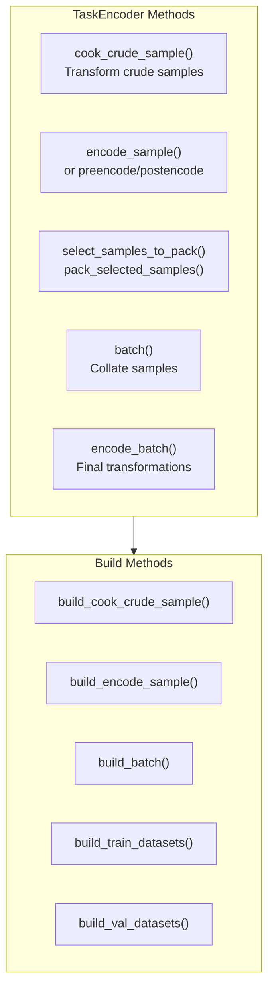
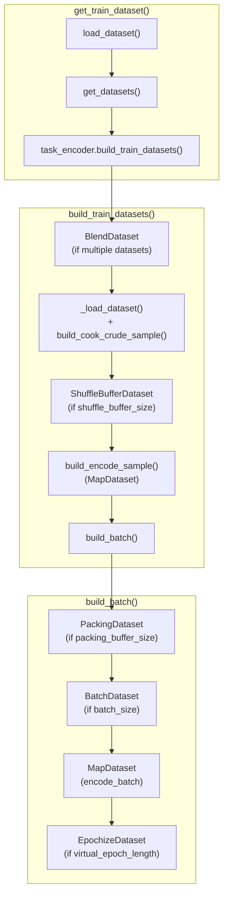
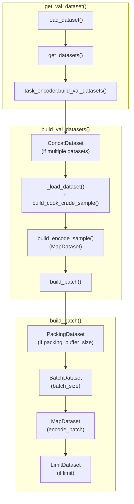

<!-- source: DeepWiki mcp.deepwiki.com · repo NVIDIA/Megatron-Energon · page 5 Task Encoders & Data Processing · fetched 2026-10-26 -->

# Task Encoders & Data Processing

<details>
<summary>Relevant source files</summary>

The following files were used as context for generating this wiki page:

- [src/megatron/energon/task_encoder/base.py](src/megatron/energon/task_encoder/base.py)
- [src/megatron/energon/task_encoder/loader.py](src/megatron/energon/task_encoder/loader.py)
- [src/megatron/energon/wrappers/batch_dataset.py](src/megatron/energon/wrappers/batch_dataset.py)
- [src/megatron/energon/wrappers/group_batch_dataset.py](src/megatron/energon/wrappers/group_batch_dataset.py)
- [src/megatron/energon/wrappers/map_dataset.py](src/megatron/energon/wrappers/map_dataset.py)
- [src/megatron/energon/wrappers/packing_dataset.py](src/megatron/energon/wrappers/packing_dataset.py)
- [tests/test_dataset.py](tests/test_dataset.py)

</details>


## Purpose and Scope

This page provides an overview of Megatron-Energon's data transformation pipeline, which converts raw samples from datasets into batches ready for model training. The pipeline consists of three main components:

1. **TaskEncoder**: Defines the transformation logic for samples and batches (detailed in [TaskEncoder Pipeline](#5.1))
2. **Dataset Wrappers**: Apply transformations, batching, and composition operations (detailed in [Dataset Wrappers](#5.2))
3. **Sample Decoding**: Handles decoding of media files and raw data (detailed in [Sample Decoding](#5.3))

This document provides a high-level overview of how these components work together. For detailed information about the data loading system, see [Data Loading System](#4).

## Data Transformation Pipeline Overview

The data transformation pipeline processes data through multiple stages, from raw dataset samples to batches ready for training:

**High-Level Pipeline Flow**

```mermaid
graph LR
    Dataset["Dataset<br/>(WebDataset/JSONL)"] --> Decode["SampleDecoder<br/>Decode media files"]
    Decode --> Cook["Cookers<br/>Transform to target type"]
    Cook --> Map["MapDataset<br/>encode_sample()"]
    Map --> Pack["PackingDataset<br/>(optional)"]
    Pack --> Batch["BatchDataset<br/>batch()"]
    Batch --> EncBatch["MapDataset<br/>encode_batch()"]
    EncBatch --> Train["Training Loop"]
    
    style Decode fill:#f9f9f9
    style Cook fill:#f9f9f9
    style Map fill:#f9f9f9
    style EncBatch fill:#f9f9f9
```



Sources: [src/megatron/energon/task_encoder/base.py:350-365](), [src/megatron/energon/task_encoder/base.py:728-895]()

The pipeline consists of:

1. **Sample Decoding** ([5.3](#5.3)): `SampleDecoder` handles image, audio, and video decoding from raw bytes
2. **Sample Cooking**: `Cooker` functions transform crude samples into typed samples
3. **Sample Encoding**: `TaskEncoder.encode_sample()` (or `preencode_sample()`/`postencode_sample()`) applies transformations
4. **Packing (Optional)**: `PackingDataset` combines multiple samples into packed sequences
5. **Batching**: `BatchDataset` collects samples into batches using `TaskEncoder.batch()`
6. **Batch Encoding**: `TaskEncoder.encode_batch()` applies final batch-level transformations

Each stage is implemented using **Dataset Wrappers** ([5.2](#5.2)), which are composable transformations that maintain the `SavableDataset` interface for checkpointing.

## TaskEncoder Class

The `TaskEncoder` class defines the transformation logic for the pipeline. It is a generic class with four type parameters that represent data at different stages:

**TaskEncoder Type Parameters**

| Type Parameter | Description | Stage |
|----------------|-------------|-------|
| `T_sample` | Raw sample type from dataset | Input |
| `T_encoded_sample` | Encoded sample type | After `encode_sample()` |
| `T_raw_batch` | Batched sample type | After `batch()` |
| `T_batch` | Final batch type | After `encode_batch()` |

**Key TaskEncoder Methods**



Sources: [src/megatron/energon/task_encoder/base.py:350-481]()

The `TaskEncoder` provides:

- **Transformation methods**: `encode_sample()`, `batch()`, `encode_batch()` - define the processing logic
- **Build methods**: `build_train_datasets()`, `build_val_datasets()` - construct the dataset wrapper pipeline
- **Packing methods**: `select_samples_to_pack()`, `pack_selected_samples()` - optional sequence packing

For detailed information on implementing custom task encoders, see [TaskEncoder Pipeline](#5.1) and [Custom TaskEncoders](#9.3).

### TaskEncoder Variants

**DefaultTaskEncoder**

Provides a simple implementation that passes samples through without modification. Useful as a base when you only need to override specific methods.

**AugmentTaskEncoder**

Wraps an existing `TaskEncoder` to add functionality using the decorator pattern. Useful for composing multiple transformation layers.

Sources: [src/megatron/energon/task_encoder/base.py:350-674]()

## Dataset Wrappers

Dataset wrappers are composable transformations that implement the `SavableDataset` interface. Each wrapper applies a specific transformation while maintaining checkpoint compatibility. Common wrappers include:

**Transformation Wrappers**

| Wrapper | Purpose | Key Parameters |
|---------|---------|----------------|
| `MapDataset` | Applies a function to each sample | `map_fn`, `stateless_map_fn` |
| `PackingDataset` | Packs multiple samples into sequences | `buffer_size`, `pre_packer`, `final_packer` |
| `BatchDataset` | Collects samples into batches | `batch_size`, `batcher`, `drop_last` |
| `GroupBatchDataset` | Groups samples by criterion before batching | `sample_group_key`, `batcher` |

**Composition Wrappers**

| Wrapper | Purpose | Key Parameters |
|---------|---------|----------------|
| `BlendDataset` | Samples from multiple datasets with weights | Dataset tuples with weights |
| `ConcatDataset` | Concatenates datasets sequentially | Multiple datasets |
| `RepeatDataset` | Repeats a dataset (with optional limit) | `repeats` |
| `LimitDataset` | Limits number of samples | `limit` |

**Utility Wrappers**

| Wrapper | Purpose | Key Parameters |
|---------|---------|----------------|
| `ShuffleBufferDataset` | Shuffles samples in a buffer | `size` |
| `EpochizeDataset` | Creates virtual epochs of fixed length | `length` |
| `LogSampleDataset` | Logs samples for debugging | `mode` |

Sources: [src/megatron/energon/wrappers/map_dataset.py:30-216](), [src/megatron/energon/wrappers/packing_dataset.py:34-440](), [src/megatron/energon/wrappers/batch_dataset.py:28-241](), [src/megatron/energon/wrappers/group_batch_dataset.py:53-265]()

For detailed documentation on each wrapper, see [Dataset Wrappers](#5.2).

## Sample Decoding

The `SampleDecoder` handles decoding of raw data from dataset samples into usable Python objects. It supports:

**Image Decoding**

- Configured via `image_decode` parameter
- Options: `"torchrgb"` (default), `"pil"`, `"numpy"`, etc.
- Handles `.jpg`, `.png`, and other image formats

**Audio/Video Decoding**

- Configured via `av_decode` parameter
- Uses `AVDecoder` for media files (`.mp4`, `.mkv`, `.wav`, `.flac`, etc.)
- Supports eager, lazy, and raw decoding modes

**Text Decoding**

- Automatic UTF-8 decoding for text files
- JSON parsing for `.json` files

Sources: [src/megatron/energon/flavors/webdataset/sample_decoder.py:1-300]()

For detailed information on media decoding and the `AVDecoder` system, see [Sample Decoding](#5.3) and [AVDecoder](#6.1).

## Integration with Data Loading

The `TaskEncoder` integrates with the data loading system through the `get_train_dataset()` and `get_val_dataset()` functions, which construct the complete pipeline:

**Training Pipeline Construction**



Sources: [src/megatron/energon/task_encoder/loader.py:107-179](), [src/megatron/energon/task_encoder/base.py:772-894]()

**Validation Pipeline Construction**



Sources: [src/megatron/energon/task_encoder/loader.py:182-234](), [src/megatron/energon/task_encoder/base.py:896-950]()

The `TaskEncoder` methods (`build_cook_crude_sample()`, `build_encode_sample()`, `build_batch()`) construct the appropriate `MapDataset`, `PackingDataset`, and `BatchDataset` wrappers to implement the transformation pipeline.

## Common Use Patterns

### Getting Training Datasets

The `get_train_dataset` function provides a convenient way to create a training dataset pipeline with a TaskEncoder:

```python
dataset = get_train_dataset(
    path="path/to/dataset",
    worker_config=worker_config,
    batch_size=32,
    shuffle_buffer_size=1000,
    task_encoder=my_task_encoder
)
```

Sources: [src/megatron/energon/task_encoder/loader.py:37-120]()

### Creating Validation Datasets

Similarly, `get_val_dataset` creates validation datasets:

```python
dataset = get_val_dataset(
    path="path/to/dataset",
    worker_config=worker_config,
    batch_size=32,
    limit=100,  # Limit validation samples
    task_encoder=my_task_encoder
)
```

Sources: [src/megatron/energon/task_encoder/loader.py:123-185]()

## Customizing Task Encoders

To implement a custom Task Encoder, you can:

1. Extend `TaskEncoder` directly and override methods
2. Use `DefaultTaskEncoder` with custom types
3. Use `AugmentTaskEncoder` to wrap an existing encoder

Example pattern for extending TaskEncoder:

```python
class MyTaskEncoder(TaskEncoder[InputType, EncodedType, BatchType, FinalType]):
    @stateless
    def encode_sample(self, sample: InputType) -> EncodedType:
        # Custom sample encoding logic
        return encoded_sample
        
    @stateless
    def batch(self, samples: List[EncodedType]) -> BatchType:
        # Custom batching logic
        return batch
        
    @stateless
    def encode_batch(self, batch: BatchType) -> FinalType:
        # Custom batch encoding logic
        return final_batch
```

---

