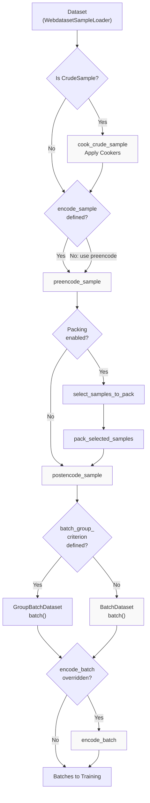
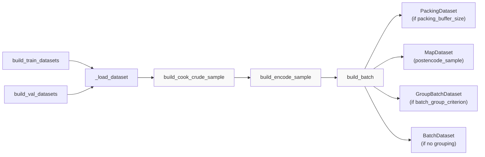
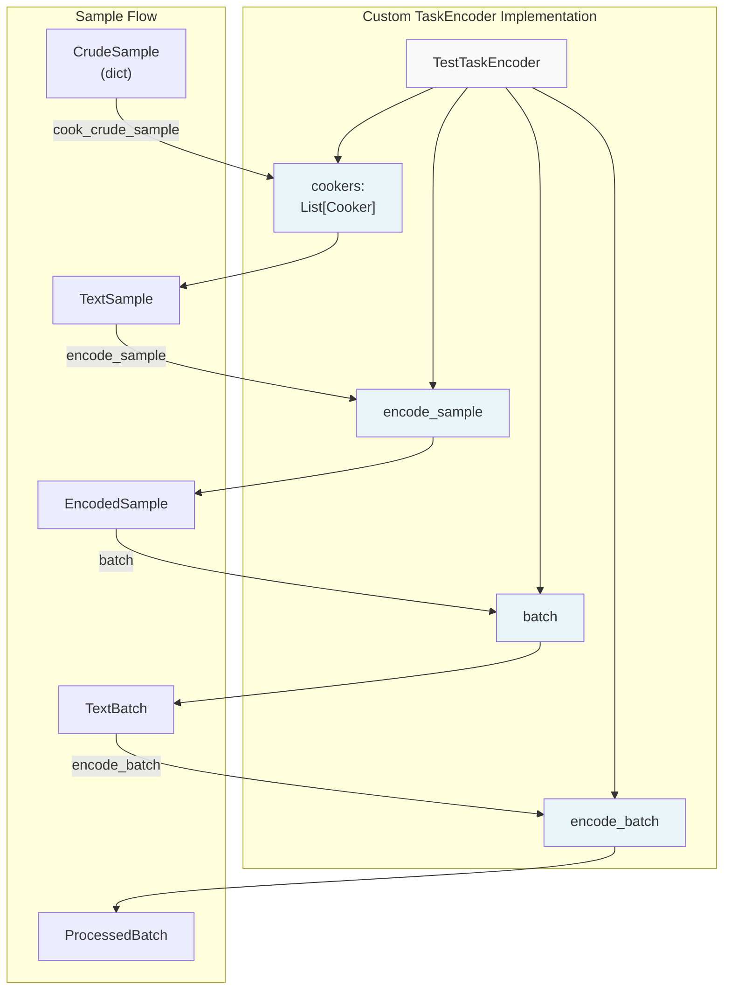
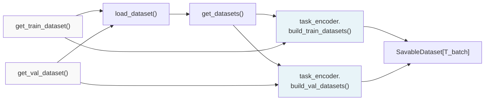

<!-- source: DeepWiki mcp.deepwiki.com · repo NVIDIA/Megatron-Energon · page 5.1 TaskEncoder Pipeline · fetched 2026-10-26 -->

# TaskEncoder Pipeline

<details>
<summary>Relevant source files</summary>

The following files were used as context for generating this wiki page:

- [src/megatron/energon/task_encoder/base.py](src/megatron/energon/task_encoder/base.py)
- [src/megatron/energon/task_encoder/loader.py](src/megatron/energon/task_encoder/loader.py)
- [tests/test_crudedataset.py](tests/test_crudedataset.py)
- [tests/test_dataset.py](tests/test_dataset.py)
- [tests/test_dataset_det.py](tests/test_dataset_det.py)
- [tests/test_metadataset.py](tests/test_metadataset.py)
- [tests/test_metadataset_fewsamp.py](tests/test_metadataset_fewsamp.py)

</details>


## Purpose and Scope

This document describes the **TaskEncoder Pipeline**, which is the core data transformation system in Megatron-Energon. It explains how samples flow from raw data through user-defined transformations to batched tensors ready for training. For information about dataset wrappers that TaskEncoder uses internally, see [Dataset Wrappers](#5.2). For information about sample decoding (image/video/audio processing), see [Sample Decoding](#5.3).

**Sources:** [src/megatron/energon/task_encoder/base.py:1-1500]()

---

## Overview

A `TaskEncoder` defines how raw samples are transformed into training batches. It is a generic abstract base class parameterized by four types:

```
TaskEncoder[T_sample, T_encoded_sample, T_raw_batch, T_batch]
```

- `T_sample`: Input sample type from the dataset
- `T_encoded_sample`: Encoded sample type after transformation
- `T_raw_batch`: Batch type after collation
- `T_batch`: Final batch type after batch encoding

The TaskEncoder orchestrates a sequence of transformations and internally builds a pipeline of dataset wrappers to apply them efficiently.

**Sources:** [src/megatron/energon/task_encoder/base.py:350-365]()

---

## Pipeline Stages

### Complete Data Flow



**TaskEncoder Pipeline Flow Diagram**

This diagram shows the complete decision tree for how samples flow through the TaskEncoder pipeline. Gray boxes indicate user-defined transformation methods.

**Sources:** [src/megatron/energon/task_encoder/base.py:354-365](), [src/megatron/energon/task_encoder/base.py:772-894]()

---

### Stage-by-Stage Description

The TaskEncoder documentation in the code lists the stages explicitly:

| Stage | Method | When Applied | Purpose |
|-------|--------|--------------|---------|
| 0 | Data from dataset | Always | Raw samples from storage |
| 1 | `encode_sample` OR `preencode_sample` | Always | Transform/augment individual samples |
| 2 | `select_samples_to_pack` | If `packing_buffer_size` set | Select which samples to pack together |
| 3 | `postencode_sample` | After packing or if no encode_sample | Post-process samples |
| 4 | `pack_selected_samples` | If `packing_buffer_size` set | Combine selected samples into one |
| 5 | `batch` | Always (if batch_size set) | Collate samples into batch |
| 6 | `encode_batch` | If overridden | Transform entire batch |
| 7 | Yield to main process | Always | Return batch |
| 8 | `Batch.to_device` | In training loop | Move batch to GPU |
| 9 | Pass to network | In training loop | Forward pass |

**Sources:** [src/megatron/energon/task_encoder/base.py:354-365]()

---

### Internal Wrapper Construction

The TaskEncoder builds the pipeline by chaining dataset wrappers. Here are the key internal methods:



**Internal Pipeline Construction Methods**

- `build_train_datasets`: Constructs the full training pipeline
- `build_val_datasets`: Constructs the validation pipeline
- `_load_dataset`: Loads the raw dataset, applies cooking if needed
- `build_cook_crude_sample`: Wraps dataset with MapDataset for cooking
- `build_encode_sample`: Wraps with MapDataset for encoding
- `build_batch`: Adds packing/batching wrappers

**Sources:** [src/megatron/energon/task_encoder/base.py:728-894]()

---

## Method Reference

### cook_crude_sample

**Signature:** `cook_crude_sample(sample: CrudeSample, cooker: Cooker[CrudeSample], aux: dict[str, FileStore]) -> T_sample`

Applies a Cooker to a crude sample. This is used when the dataset is a `CrudeWebdataset` that requires transformation via Cookers. Cookers are functions that transform raw dictionary samples into typed sample objects.

**Decorated with:** `@stateless`

**Sources:** [src/megatron/energon/task_encoder/base.py:403-428]()

---

### encode_sample

**Signature:** `encode_sample(sample: T_sample) -> Union[T_encoded_sample, Generator[T_encoded_sample, None, None]]`

The primary sample transformation method. Encodes a single sample and can optionally be a generator to yield multiple samples or skip samples (by not yielding).

**Key characteristics:**
- Can raise `SkipSample` exception to skip a sample
- Can be a generator function for data augmentation (yields multiple samples from one input)
- If defined, `preencode_sample` and `postencode_sample` must NOT be defined
- Default implementation returns the sample unchanged

**Decorated with:** `@stateless`

**Example usage:**
```python
class MyTaskEncoder(TaskEncoder):
    @stateless
    def encode_sample(self, sample: CaptioningSample) -> EncodedSample:
        return EncodedSample(
            image=process_image(sample.image),
            caption=tokenize(sample.caption),
            __key__=sample.__key__,
            __restore_key__=sample.__restore_key__
        )
```

**Sources:** [src/megatron/energon/task_encoder/base.py:430-438](), [tests/test_dataset.py:466-471]()

---

### preencode_sample

**Signature:** `preencode_sample(sample: T_sample) -> Union[T_sample, Generator[T_sample, None, None]]`

Pre-encodes a sample before packing. Used in conjunction with packing and caching strategies where you want to separate early transformations (pre-packing) from late transformations (post-packing).

**Key characteristics:**
- Use with `postencode_sample` for two-stage encoding
- Cannot be used if `encode_sample` is defined
- Can be a generator
- Applied before packing buffer

**Decorated with:** `@stateless`

**Sources:** [src/megatron/energon/task_encoder/base.py:440-449]()

---

### postencode_sample

**Signature:** `postencode_sample(sample: T_sample) -> T_encoded_sample`

Post-encodes a sample after packing. Applied after samples have been selected and packed together.

**Key characteristics:**
- Use with `preencode_sample` for two-stage encoding
- Cannot be used if `encode_sample` is defined
- Applied after packing (if packing is enabled)
- Applied inside PackingDataset or MapDataset

**Decorated with:** `@stateless`

**Example with packing:**
```python
class MyTaskEncoder(TaskEncoder):
    @stateless
    def preencode_sample(self, sample):
        # Early transformation before packing
        return preprocess(sample)
    
    @stateless
    def postencode_sample(self, sample):
        # Final transformation after packing
        return finalize(sample)
```

**Sources:** [src/megatron/energon/task_encoder/base.py:451-458](), [src/megatron/energon/task_encoder/base.py:586-621]()

---

### batch

**Signature:** `batch(samples: List[T_encoded_sample]) -> T_raw_batch`

Collates a list of samples into a batch. The default implementation uses `_batch` with `generic_batch` as the default collation function.

**Key characteristics:**
- Called for every batch
- Default implementation handles dicts, dataclasses, and namedtuples
- Can be overridden for custom batching logic
- Can raise `SkipSample` to skip an entire batch

**Decorated with:** `@stateless`

**Sources:** [src/megatron/energon/task_encoder/base.py:460-463]()

---

### batch_group_criterion

**Signature:** `batch_group_criterion(sample: T_encoded_sample) -> Tuple[Hashable, Optional[int]]`

Returns a grouping criterion for bucketing samples. Enables dynamic batching where samples are grouped by some property (e.g., sequence length) and batched separately.

**Returns:** `(group_key, batch_size)`
- `group_key`: Hashable key identifying the group
- `batch_size`: Size of batches for this group (must be consistent for same key)

**Key characteristics:**
- Default implementation returns `(None, None)` (no grouping)
- When overridden, uses `GroupBatchDataset` instead of `BatchDataset`
- The bucket size must always be the same for the same bucket key

**Example:**
```python
def batch_group_criterion(self, sample):
    # Group by sequence length buckets
    length = len(sample.tokens)
    bucket = (length // 100) * 100  # Round to nearest 100
    return bucket, 32  # Use batch size 32 for all buckets
```

**Sources:** [src/megatron/energon/task_encoder/base.py:465-474]()

---

### encode_batch

**Signature:** `encode_batch(batch: T_raw_batch) -> Union[T_batch, Generator[T_batch, None, None]]`

Transforms an entire batch. Applied after batching is complete.

**Key characteristics:**
- Can be a generator to yield multiple batches or skip batches
- Can raise `SkipSample` to skip a batch
- Default implementation returns the batch unchanged

**Decorated with:** `@stateless`

**Sources:** [src/megatron/energon/task_encoder/base.py:476-480]()

---

### Packing Methods

#### select_samples_to_pack

**Signature:** `select_samples_to_pack(samples: List[T_encoded_sample]) -> List[List[T_encoded_sample]]`

For packing, selects which samples should be packed together. Called the "pre_packing" stage internally.

**Key characteristics:**
- Only called when `packing_buffer_size` is set
- Receives a full buffer of samples
- Returns a list of lists, where each inner list will be packed into one sample
- Must be implemented if packing is used

**Example:**
```python
def select_samples_to_pack(self, samples):
    # Pack samples by total token count
    packs = []
    current_pack = []
    current_length = 0
    
    for sample in samples:
        sample_length = len(sample.tokens)
        if current_length + sample_length <= MAX_LENGTH:
            current_pack.append(sample)
            current_length += sample_length
        else:
            packs.append(current_pack)
            current_pack = [sample]
            current_length = sample_length
    
    if current_pack:
        packs.append(current_pack)
    
    return packs
```

**Sources:** [src/megatron/energon/task_encoder/base.py:537-550]()

---

#### pack_selected_samples

**Signature:** `pack_selected_samples(samples: List[T_encoded_sample]) -> T_encoded_sample`

Combines a list of samples into a single packed sample. Called the "final_packing" stage internally.

**Key characteristics:**
- Only called when `packing_buffer_size` is set
- Receives one group of samples to pack
- Returns a single sample
- Must be implemented if packing is used

**Decorated with:** `@stateless` (configurable)

**Example:**
```python
@stateless
def pack_selected_samples(self, samples):
    # Concatenate tokens from all samples
    return PackedSample(
        tokens=torch.cat([s.tokens for s in samples]),
        positions=create_position_ids(samples),
        __key__=[s.__key__ for s in samples],
        __restore_key__=tuple(s.__restore_key__ for s in samples)
    )
```

**Sources:** [src/megatron/energon/task_encoder/base.py:552-563](), [tests/test_crudedataset.py:158-164]()

---

## The @stateless Decorator

The `@stateless` decorator marks functions as restorable during checkpointing. It enables the system to re-execute the function with the same inputs when restoring from a checkpoint.

### Basic Usage

```python
from megatron.energon import stateless

@stateless
def encode_sample(self, sample):
    return transform(sample)
```

### With Seed Restoration

For functions that use random operations (augmentations), set `restore_seeds=True`:

```python
@stateless(restore_seeds=True)
def encode_sample(self, sample):
    # Random augmentation will be deterministic on restore
    if random.random() < 0.5:
        sample = flip(sample)
    return sample
```

**How it works:**
1. Saves the outer RNG state before calling the function
2. Sets inner RNG state based on `worker_seed` and `current_sample_index`
3. Calls the function with deterministic random state
4. Restores outer RNG state after function returns

This ensures that when a checkpoint is restored and the same sample index is processed, the same random operations occur.

**Sources:** [src/megatron/energon/task_encoder/base.py:134-246]()

---

### With Failure Tolerance

Control how many consecutive exceptions are tolerated:

```python
@stateless(failure_tolerance=10)
def encode_sample(self, sample):
    # Will tolerate up to 10 consecutive failures
    # before raising FatalSampleError
    return risky_transform(sample)
```

**Default failure tolerance:** `TaskEncoder.__default_failure_tolerance__ = 100`

**Sources:** [src/megatron/energon/task_encoder/base.py:254-256](), [src/megatron/energon/task_encoder/base.py:367]()

---

### Generator Support

The decorator also works with generator functions:

```python
@stateless(restore_seeds=True)
def encode_sample(self, sample):
    # Yield augmented versions
    for _ in range(5):
        yield augment(sample)  # Uses deterministic random state
```

The decorator handles generators specially by:
1. Saving/restoring RNG state before each `yield`
2. Maintaining separate inner/outer RNG states
3. Allowing checkpointing between yields

**Sources:** [src/megatron/energon/task_encoder/base.py:172-218]()

---

## Generic Batching Helpers

### generic_batch Function

**Signature:** `generic_batch(batch: List[Any]) -> Any`

A flexible batching function that automatically handles different data structures:

**Behavior by type:**
- **Tensors:** Pads to max size and stacks (uses `batch_pad_stack`)
- **Dicts:** Recursively applies `generic_batch` to each field
- **Dataclasses:** Recursively batches fields, or calls `from_samples` if defined
- **NamedTuples:** Recursively batches fields
- **Other types:** Returns as list (uses `batch_list`)

**Example:**
```python
samples = [
    {"image": tensor([3, 100, 100]), "caption": "cat"},
    {"image": tensor([3, 120, 80]), "caption": "dog"}
]

batch = generic_batch(samples)
# Result:
# {
#   "image": tensor([2, 3, 120, 100]),  # Padded and stacked
#   "caption": ["cat", "dog"]             # List
# }
```

**Sources:** [src/megatron/energon/task_encoder/base.py:72-99]()

---

### Helper Functions

| Function | Purpose |
|----------|---------|
| `batch_stack` | Stack tensors directly (no padding) |
| `batch_pad_stack` | Pad tensors to max size then stack |
| `batch_list` | Return as-is list |

**Sources:** [src/megatron/energon/task_encoder/base.py:101-118]()

---

## Batch Base Class

The `Batch` class is the recommended base class for batch dataclasses:

```python
from megatron.energon import Batch, edataclass

@edataclass
class MyBatch(Batch):
    images: torch.Tensor
    captions: List[str]
```

**Provides:**
- `pin_memory()`: Automatically pins tensors to GPU memory
- `derive_from(base_batch, **kwargs)`: Create new batch preserving metadata
- `from_samples(samples)`: Default implementation for batching samples

**Metadata fields (inherited):**
- `__key__`: List of sample keys
- `__restore_key__`: Tuple of restore keys for checkpointing
- `__subflavors__`: Optional subflavor information
- `__sources__`: Source information for each sample

**Sources:** [src/megatron/energon/task_encoder/base.py:259-348]()

---

## Complete Example: Custom TaskEncoder

Here's a complete example showing typical TaskEncoder usage patterns:



**Example Custom TaskEncoder with Cooking, Encoding, and Batching**

Example from test code:

```python
from megatron.energon import TaskEncoder, Cooker, stateless, basic_sample_keys

@stateless
def cook_text(sample: dict) -> TextSample:
    return TextSample(
        **basic_sample_keys(sample),
        text=f"<{sample['txt']}>",
    )

@edataclass
class TextBatch(Batch):
    txts: List[str]

class CookingTaskEncoder(DefaultTaskEncoder):
    cookers = [
        Cooker(cook_text, has_subflavors={"crude_type": "txtpkl"}),
    ]
    
    @stateless
    def encode_sample(self, sample: TextSample) -> TextSample:
        # Add prefix to text
        return TextSample.derive_from(
            sample,
            text="[ENCODED] " + sample.text
        )
    
    def batch(self, samples: List[TextSample]) -> TextBatch:
        return TextBatch.from_samples(
            samples,
            txts=[sample.text for sample in samples],
        )
    
    @stateless
    def encode_batch(self, batch: TextBatch) -> TextBatch:
        # Add batch-level processing
        return TextBatch.derive_from(
            batch,
            txts=[txt.upper() for txt in batch.txts],
        )
```

**Usage:**
```python
dataset = get_train_dataset(
    path="path/to/dataset",
    worker_config=worker_config,
    batch_size=32,
    task_encoder=CookingTaskEncoder(),
    shuffle_buffer_size=1000,
)

for batch in get_loader(dataset):
    # batch is TextBatch with uppercase processed text
    print(batch.txts)
```

**Sources:** [tests/test_crudedataset.py:92-165](), [tests/test_dataset.py:462-484]()

---

## Integration with Dataset Loading

The TaskEncoder is integrated into the high-level dataset loading functions:



**TaskEncoder Integration with Dataset Loaders**

The `get_train_dataset` and `get_val_dataset` functions accept a `task_encoder` parameter and use it to build the complete pipeline:

```python
from megatron.energon import get_train_dataset, get_val_dataset

# Training dataset
train_ds = get_train_dataset(
    path="dataset.yaml",
    worker_config=worker_config,
    batch_size=32,
    task_encoder=MyTaskEncoder(),
    shuffle_buffer_size=1000,
    packing_buffer_size=100,  # Enable packing
)

# Validation dataset
val_ds = get_val_dataset(
    path="dataset.yaml",
    worker_config=worker_config,
    batch_size=32,
    task_encoder=MyTaskEncoder(),
)
```

**Sources:** [src/megatron/energon/task_encoder/loader.py:107-179](), [src/megatron/energon/task_encoder/loader.py:182-234]()

---

## DefaultTaskEncoder

A default implementation that works with most basic datasets:

```python
class DefaultTaskEncoder(TaskEncoder[T_sample, T_sample, Batch, Batch]):
    """Default task encoder that performs minimal processing."""
```

**Key characteristics:**
- Generic over sample type `T_sample`
- No encoding (passes samples through)
- Uses `generic_batch` for batching
- Returns `Batch` instances with metadata

**Usage:**
```python
from megatron.energon import DefaultTaskEncoder

# Use as-is for simple datasets
dataset = get_train_dataset(
    path="dataset.yaml",
    worker_config=worker_config,
    batch_size=32,
    task_encoder=DefaultTaskEncoder(),
)

# Or subclass for custom behavior
class MyEncoder(DefaultTaskEncoder):
    @stateless
    def encode_sample(self, sample):
        return process(sample)
```

**Sources:** [src/megatron/energon/task_encoder/base.py:957-1032]()

---

## Failure Tolerance and Error Handling

The TaskEncoder pipeline includes sophisticated error handling:

### Per-Method Failure Tolerance

Each method decorated with `@stateless` can specify its own failure tolerance:

```python
@stateless(failure_tolerance=50)
def encode_sample(self, sample):
    # Will tolerate 50 consecutive failures
    return risky_operation(sample)
```

### Default Failure Tolerance

Set at the class level:

```python
class MyTaskEncoder(TaskEncoder):
    __default_failure_tolerance__ = 200  # Default for all methods
```

### How It Works

1. Wrapper functions (MapDataset, PackingDataset, etc.) track consecutive failures
2. When `failure_tolerance` is exceeded, raises `FatalSampleError`
3. Counter resets on successful sample
4. Setting to `0` disables tolerance (fail immediately)

**Sources:** [src/megatron/energon/task_encoder/base.py:254-256](), [src/megatron/energon/task_encoder/base.py:602-611]()

---

## Type System

The TaskEncoder uses a sophisticated generic type system:

```python
from typing import TypeVar

T_sample = TypeVar("T_sample", bound=Sample)
T_encoded_sample = TypeVar("T_encoded_sample")
T_raw_batch = TypeVar("T_raw_batch")
T_batch = TypeVar("T_batch")

class TaskEncoder(Generic[T_sample, T_encoded_sample, T_raw_batch, T_batch]):
    ...
```

**Type Flow:**
1. Dataset yields `T_sample`
2. After encoding: `T_encoded_sample`
3. After batching: `T_raw_batch`
4. After batch encoding: `T_batch`

This enables full type checking through the entire pipeline when using type hints.

**Sources:** [src/megatron/energon/task_encoder/base.py:61-66](), [src/megatron/energon/task_encoder/base.py:350]()

---

## Key Attributes

### cookers

**Type:** `Sequence[Cooker[T_sample]]`

List of Cooker objects for transforming crude samples. Only used when the dataset is a `CrudeWebdataset`.

```python
class MyTaskEncoder(TaskEncoder):
    cookers = [
        Cooker(cook_func1, has_subflavors={"type": "image"}),
        Cooker(cook_func2, has_subflavors={"type": "text"}),
    ]
```

**Sources:** [src/megatron/energon/task_encoder/base.py:369-371]()

---

### decoder

**Type:** `Optional[SampleDecoder]`

The decoder used for automatic media decoding. Set to `None` to disable automatic decoding.

```python
from megatron.energon.flavors import SampleDecoder

class MyTaskEncoder(TaskEncoder):
    decoder = SampleDecoder(
        image_decode="pilrgb",
        av_decode="AVDecoder",
    )
```

**Sources:** [src/megatron/energon/task_encoder/base.py:373-374]()

---

### Internal Attributes

The TaskEncoder maintains internal state for checkpointing:

- `current_sample_index`: Index of the current sample being processed
- `current_batch_index`: Index of the current batch being processed

These are used for deterministic RNG seeding when `restore_seeds=True`:

```python
@stateless(restore_seeds=True)
def encode_sample(self, sample):
    # RNG is seeded with worker_seed and self.current_sample_index
    return augment(sample)
```

**Sources:** [src/megatron/energon/task_encoder/base.py:184]()

---

## Summary

The TaskEncoder pipeline provides a flexible, type-safe framework for data transformation:

1. **Modular stages**: Each transformation stage is isolated and testable
2. **Stateless checkpointing**: The `@stateless` decorator enables exact restoration
3. **Deterministic randomness**: `restore_seeds=True` ensures reproducible augmentations
4. **Error resilience**: Failure tolerance prevents single bad samples from crashing training
5. **Flexible batching**: Support for standard batching, grouped batching, and packing
6. **Type safety**: Generic types provide compile-time checking throughout the pipeline

For implementing custom TaskEncoders, see [Custom TaskEncoders](#9.3). For understanding the dataset wrappers used internally, see [Dataset Wrappers](#5.2).

---

