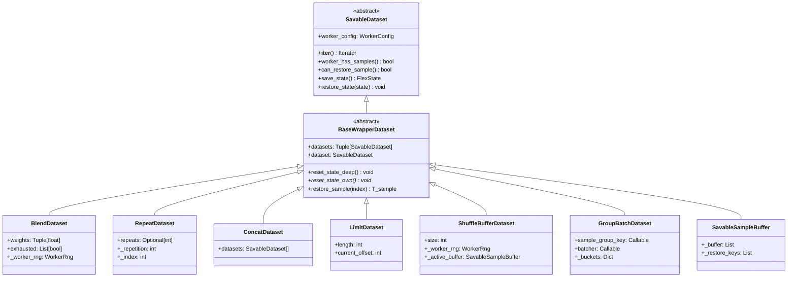
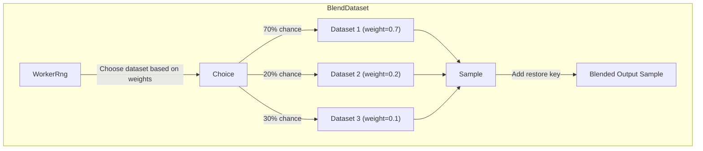
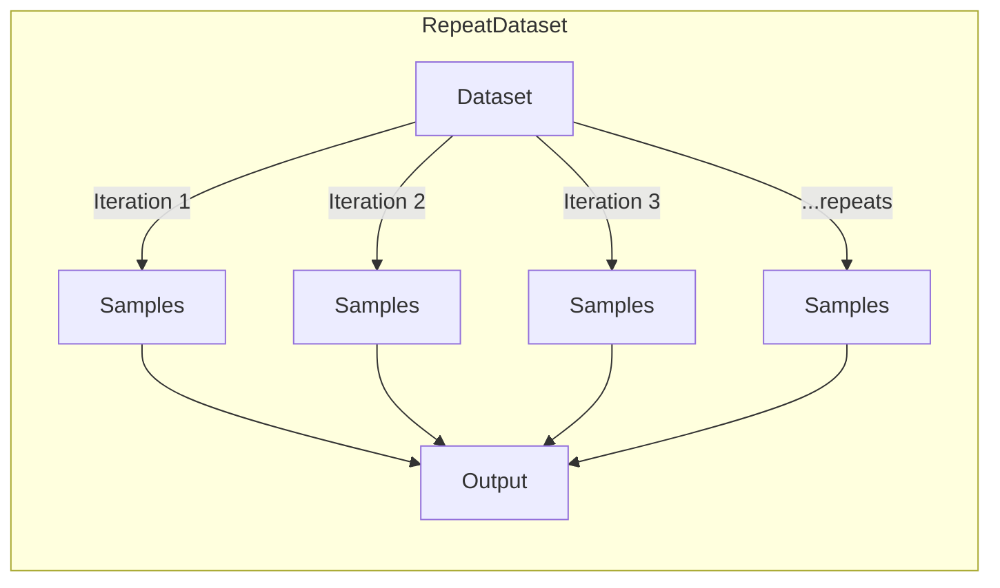
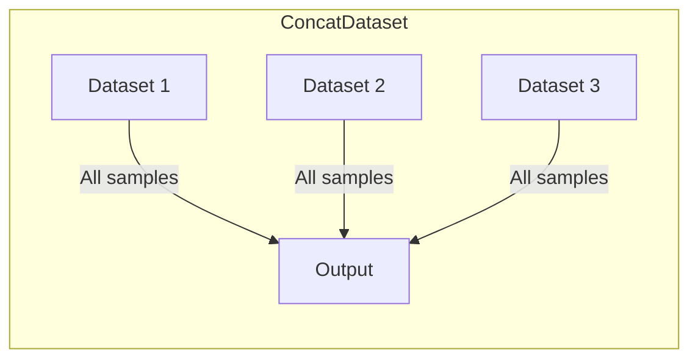
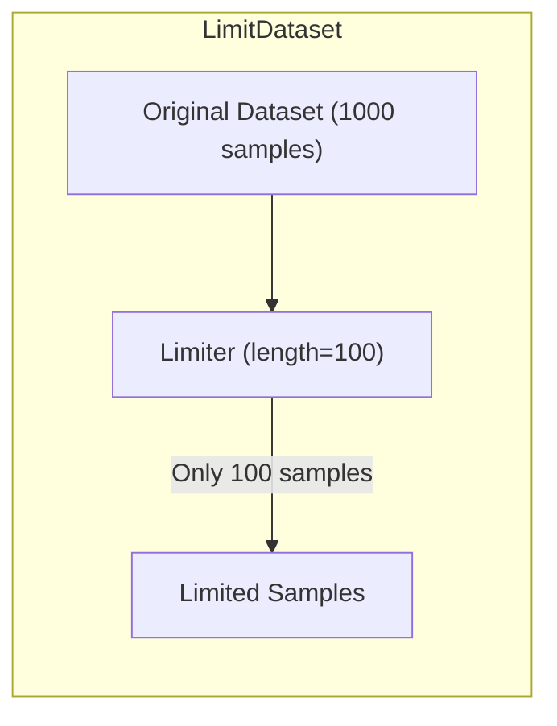
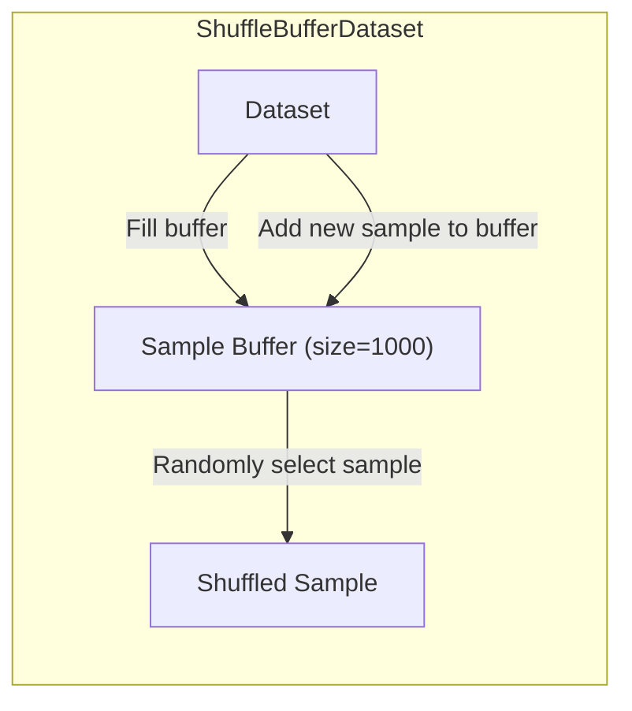
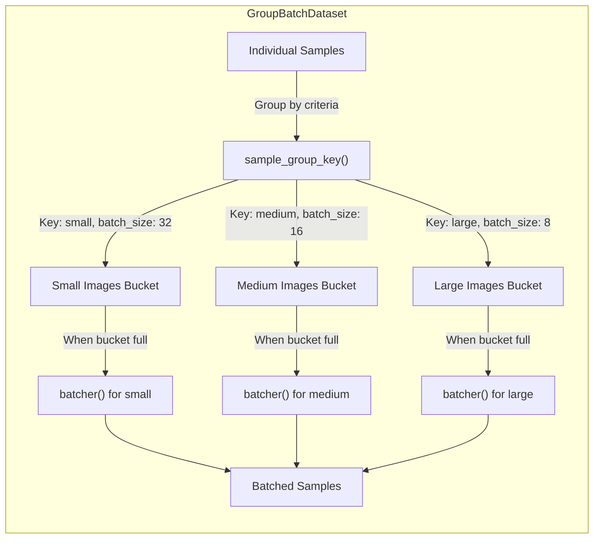
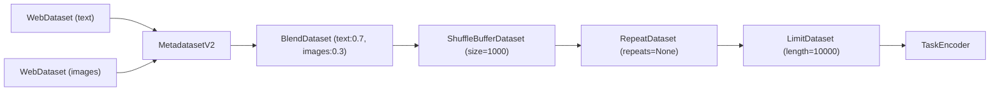
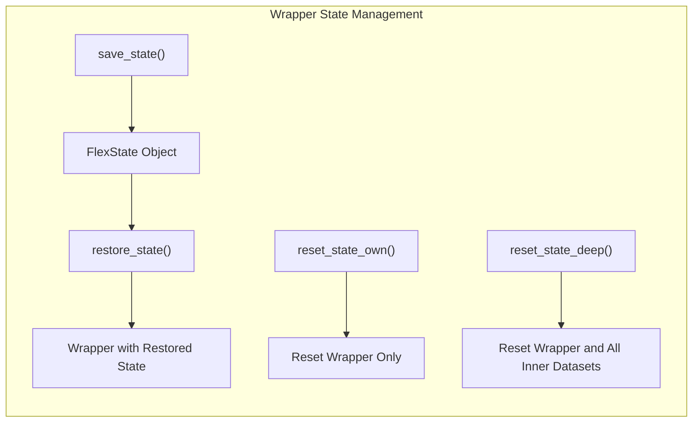
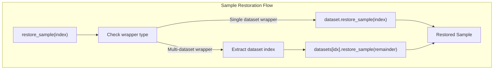

<!-- source: DeepWiki mcp.deepwiki.com · repo NVIDIA/Megatron-Energon · page 5.2 Dataset Wrappers · fetched 2026-10-26 -->

# Dataset Wrappers

<details>
<summary>Relevant source files</summary>

The following files were used as context for generating this wiki page:

- [src/megatron/energon/wrappers/batch_dataset.py](src/megatron/energon/wrappers/batch_dataset.py)
- [src/megatron/energon/wrappers/blend_dataset.py](src/megatron/energon/wrappers/blend_dataset.py)
- [src/megatron/energon/wrappers/concat_dataset.py](src/megatron/energon/wrappers/concat_dataset.py)
- [src/megatron/energon/wrappers/group_batch_dataset.py](src/megatron/energon/wrappers/group_batch_dataset.py)
- [src/megatron/energon/wrappers/limit_dataset.py](src/megatron/energon/wrappers/limit_dataset.py)
- [src/megatron/energon/wrappers/map_dataset.py](src/megatron/energon/wrappers/map_dataset.py)
- [src/megatron/energon/wrappers/packing_dataset.py](src/megatron/energon/wrappers/packing_dataset.py)
- [src/megatron/energon/wrappers/repeat_dataset.py](src/megatron/energon/wrappers/repeat_dataset.py)

</details>


## Introduction

Dataset Wrappers in Megatron-Energon are specialized components that modify or transform datasets in various ways. They serve as building blocks for creating complex dataset behaviors through composition. Each wrapper performs a specific transformation on a dataset, such as blending, repeating, concatenating, limiting, shuffling, or batching data samples.

These wrappers are a critical part of the data management subsystem, enabling flexible data handling between the Metadataset System ([Metadataset System](#3.1)) and the Task Encoders ([Task Encoders & Data Processing](#4)). All wrappers implement the same core interface, making them easily composable.

Sources: [src/megatron/energon/wrappers/base.py:23-56]()

## Architecture

### Wrapper Hierarchy



Sources: [src/megatron/energon/wrappers/base.py:23-56](), [src/megatron/energon/wrappers/blend_dataset.py:16-27](), [src/megatron/energon/wrappers/repeat_dataset.py:14-21](), [src/megatron/energon/wrappers/concat_dataset.py:13-18](), [src/megatron/energon/wrappers/limit_dataset.py:13-20](), [src/megatron/energon/wrappers/shuffle_buffer_dataset.py:15-23](), [src/megatron/energon/wrappers/group_batch_dataset.py:51-69]()

### BaseWrapperDataset

The `BaseWrapperDataset` is the foundation for all dataset wrappers. It extends `SavableDataset` and provides core functionality for:

1. Wrapping one or more datasets
2. Managing and saving state
3. Routing restore requests to the appropriate inner dataset
4. Deep resetting of state

Key aspects of the base wrapper:

- Generic type parameters for input and output sample types
- Support for wrapping single or multiple datasets
- Automatic propagation of worker configuration
- Methods for state management and sample restoration

Sources: [src/megatron/energon/wrappers/base.py:23-119]()

## Available Wrappers

### BlendDataset

`BlendDataset` combines multiple datasets with specified weights for sampling proportions. It is particularly useful for training on a mixture of data sources with different importances.



Key features:
- Takes multiple datasets with associated weights
- Samples from datasets according to their weights 
- Automatically handles exhausted datasets by adjusting weights
- Always produces an infinite iterator
- Adds a restoration key to each sample for state management

Sources: [src/megatron/energon/wrappers/blend_dataset.py:16-119]()

### RepeatDataset

`RepeatDataset` repeats an underlying dataset either indefinitely or a specific number of times.



Key features:
- Can repeat a dataset indefinitely when `repeats=None`
- Supports fractional repeats (e.g., 2.5 repeats for 2 full iterations plus half of the third)
- Can restart or stop after reaching the repeat limit
- Tracks repetition count and index for state management

Sources: [src/megatron/energon/wrappers/repeat_dataset.py:14-107]()

### ConcatDataset

`ConcatDataset` concatenates multiple datasets sequentially. All samples from the first dataset are yielded, followed by all samples from the second dataset, and so on.



Key features:
- Simple concatenation of multiple finite datasets
- Primarily useful for validation or test datasets
- Each sample is tagged with its source dataset index for restoration

Sources: [src/megatron/energon/wrappers/concat_dataset.py:13-51]()

### LimitDataset

`LimitDataset` restricts the number of samples that can be drawn from a dataset, useful for testing or creating smaller validation sets.



Key features:
- Sets a maximum number of samples to yield from the underlying dataset
- Distributes the limit across workers when using multiple workers
- Can reset the underlying dataset after reaching the limit
- Tracks current offset for state management

Sources: [src/megatron/energon/wrappers/limit_dataset.py:13-113]()

### ShuffleBufferDataset

`ShuffleBufferDataset` implements a buffer-based shuffling strategy that maintains a fixed-size buffer of samples and randomly yields samples from this buffer.



Key features:
- Maintains a buffer of samples of specified size
- Randomly selects samples from the buffer to yield
- Replaces yielded samples with new ones from the dataset
- Uses `WorkerRng` for consistent, reproducible randomization
- Particularly useful for huge or infinite datasets where full dataset shuffling is impractical

Sources: [src/megatron/energon/wrappers/shuffle_buffer_dataset.py:15-71]()

### GroupBatchDataset

`GroupBatchDataset` groups and batches samples based on specified criteria, useful for efficiently processing similar samples together.



Key features:
- Groups samples by arbitrary criteria using a key function
- Each group can have its own batch size
- Efficiently processes similar samples together (e.g., grouping by image dimensions)
- Supports error handling for batch creation failures
- Manages complex state with buckets and sample indices

Sources: [src/megatron/energon/wrappers/group_batch_dataset.py:51-261]()

### SavableSampleBuffer

`SavableSampleBuffer` is a special wrapper that provides a buffer for storing samples with state management capabilities.

Key features:
- Maintains a list of samples with their restoration keys
- Supports appending, extending, and popping samples
- Offers indexing and iteration over the buffer
- Can save and restore its state
- Used internally by other wrappers (e.g., ShuffleBufferDataset and GroupBatchDataset)

Sources: [src/megatron/energon/wrappers/buffer.py:25-143]()

## Composing Wrappers

One of the key strengths of dataset wrappers is their composability. Multiple wrappers can be combined to create sophisticated data processing pipelines.

### Composition Example



When composing wrappers, consider the following:

1. **Order matters**: The order in which wrappers are applied affects the resulting behavior. For example, applying `RepeatDataset` before `ShuffleBufferDataset` gives different results than the reverse order.

2. **Resource usage**: Some wrappers like `ShuffleBufferDataset` and `GroupBatchDataset` may use significant memory to buffer samples.

3. **Infinite vs. Finite**: Be careful when using wrappers like `RepeatDataset` with no repeat limit, as they make the dataset infinite and any subsequent wrappers that require a finite dataset may not work correctly.

4. **State management**: All wrappers properly propagate state management operations, allowing complex compositions to be saved and restored correctly.

Sources: [src/megatron/energon/wrappers/base.py:23-56](), [src/megatron/energon/wrappers/blend_dataset.py:16-119](), [src/megatron/energon/wrappers/repeat_dataset.py:14-107](), [src/megatron/energon/wrappers/shuffle_buffer_dataset.py:15-71]()

## State Management

A key feature of Megatron-Energon's dataset wrappers is their robust state management system, which enables checkpointing and resuming data loading from the same point.

### Saving and Restoring State

Each wrapper implements:

1. `save_state()`: Returns a `FlexState` object containing the wrapper's state and the states of all wrapped datasets.
2. `restore_state(state)`: Restores the wrapper's state and forwards appropriate state portions to wrapped datasets.
3. `reset_state_own()`: Resets only the wrapper's internal state.
4. `reset_state_deep()`: Resets the wrapper's state and recursively resets all wrapped datasets.

The state management system is used by the `SavableDataLoader` ([SavableDataLoader](#3.3)) to create checkpoints during training, ensuring that after a restart, the exact same samples are loaded in the same order.



Sources: [src/megatron/energon/wrappers/base.py:93-115](), [src/megatron/energon/wrappers/blend_dataset.py:49-51](), [src/megatron/energon/wrappers/repeat_dataset.py:46-48]()

## Sample Restoration

Another important capability of wrappers is sample restoration, which allows retrieving a specific sample by its restoration key.

Each wrapper adds restoration information to samples it processes, enabling the precise tracking of a sample's origin and transformation history. When a sample needs to be restored, the request is routed through the wrapper hierarchy to the appropriate dataset.



Sources: [src/megatron/energon/wrappers/base.py:79-91]()

## Common Usage Patterns

### Blending Multiple Datasets with Different Weights

```python
blend_dataset = BlendDataset(
    (text_dataset, 0.7),  # 70% text samples
    (image_dataset, 0.3),  # 30% image samples
    worker_config=worker_config
)
```

### Creating an Infinite Dataset for Training

```python
infinite_dataset = RepeatDataset(
    finite_dataset,
    repeats=None,  # Repeat indefinitely
    worker_config=worker_config
)
```

### Shuffling a Large Dataset

```python
shuffled_dataset = ShuffleBufferDataset(
    original_dataset,
    size=10000,  # Buffer size affects shuffling quality
    worker_config=worker_config
)
```

### Grouping Similar Samples for Efficient Processing

```python
# Group images by resolution for efficient batching
grouped_dataset = GroupBatchDataset(
    image_dataset,
    fixed_batch_size=None,  # Use batch size from sample_group_key
    sample_group_key=lambda sample: (get_image_size(sample), get_batch_size_for_size(sample)),
    batcher=batch_images,
    worker_config=worker_config
)
```

### Limiting Dataset Size for Testing

```python
test_dataset = LimitDataset(
    full_dataset,
    length=1000,  # Only use 1000 samples
    reset_after_epoch=True,  # Reset after reaching the limit
    worker_config=worker_config
)
```

Sources: [src/megatron/energon/wrappers/blend_dataset.py:28-44](), [src/megatron/energon/wrappers/repeat_dataset.py:23-44](), [src/megatron/energon/wrappers/shuffle_buffer_dataset.py:24-34](), [src/megatron/energon/wrappers/group_batch_dataset.py:70-104](), [src/megatron/energon/wrappers/limit_dataset.py:21-41]()

## Conclusion

Dataset Wrappers in Megatron-Energon provide a flexible and powerful way to manipulate and transform datasets. Through composition, they enable complex data processing workflows while maintaining proper state management for checkpointing and resumption.

The wrapper system follows a consistent design pattern with standardized interfaces, making it easy to create custom wrappers for specialized needs by extending the `BaseWrapperDataset` class.

For information about how these wrappers integrate with the Task Encoder system for processing individual samples, see [Task Encoders & Data Processing](#4).

---

