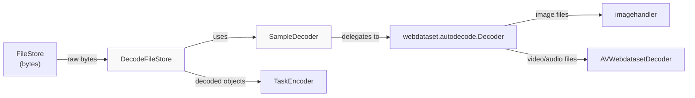
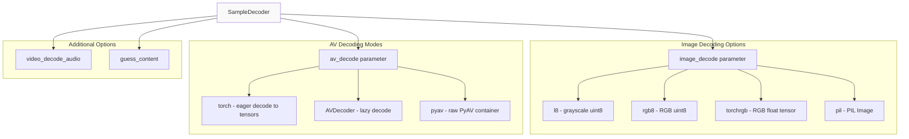
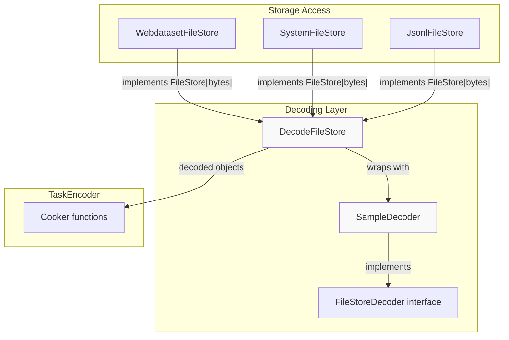
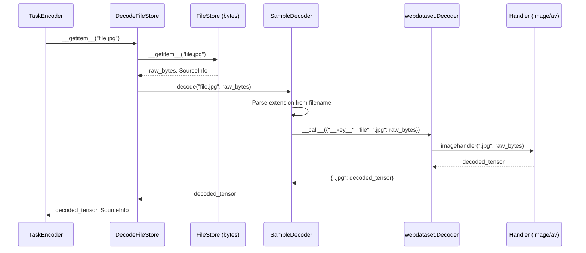
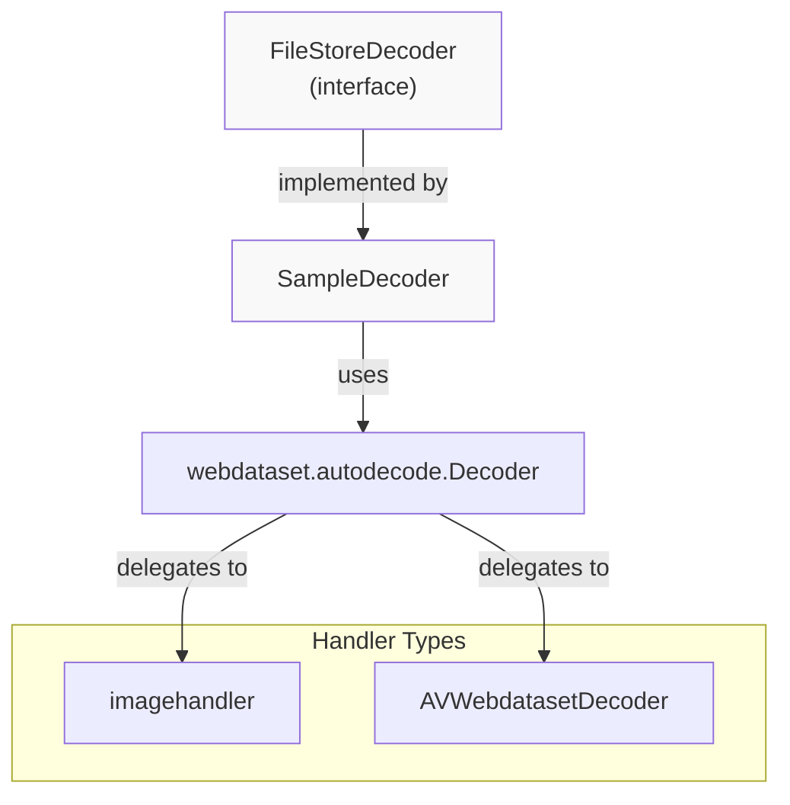

<!-- source: DeepWiki mcp.deepwiki.com · repo NVIDIA/Megatron-Energon · page 5.3 Sample Decoding · fetched 2026-10-26 -->

# Sample Decoding

<details>
<summary>Relevant source files</summary>

The following files were used as context for generating this wiki page:

- [pyproject.toml](pyproject.toml)
- [src/megatron/energon/cache/file_store.py](src/megatron/energon/cache/file_store.py)
- [src/megatron/energon/dataset_config.py](src/megatron/energon/dataset_config.py)
- [src/megatron/energon/flavors/crude.py](src/megatron/energon/flavors/crude.py)
- [src/megatron/energon/flavors/webdataset/metadata.py](src/megatron/energon/flavors/webdataset/metadata.py)
- [src/megatron/energon/flavors/webdataset/sample_decoder.py](src/megatron/energon/flavors/webdataset/sample_decoder.py)
- [src/megatron/energon/metadataset/loader.py](src/megatron/energon/metadataset/loader.py)
- [tests/test_jsonl_dataset.py](tests/test_jsonl_dataset.py)
- [uv.lock](uv.lock)

</details>


## Purpose and Scope

Sample Decoding is the layer responsible for transforming raw bytes from storage into usable Python objects (images, tensors, audio/video data). This occurs after data is read from storage via FileStore but before it reaches the TaskEncoder pipeline. The `SampleDecoder` class provides configurable decoding strategies for different media types including images, videos, and audio files.

For information about the overall data transformation pipeline, see [Task Encoders & Data Processing](#5). For details on how decoded samples are further processed, see [TaskEncoder Pipeline](#5.1).

## Architecture Overview

**Diagram: Sample Decoding in the Data Pipeline**



Sources: [src/megatron/energon/flavors/webdataset/sample_decoder.py:80-143](), [src/megatron/energon/cache/file_store.py:18-52]()

The sample decoding process involves three main components:

1. **FileStore**: Retrieves raw bytes from storage (tar files, jsonl files, or filesystem)
2. **SampleDecoder**: Configures and orchestrates the decoding process
3. **DecodeFileStore**: Wraps a FileStore to automatically apply decoding on access

## SampleDecoder Class

The `SampleDecoder` class is the primary interface for configuring sample decoding behavior. It wraps `webdataset.autodecode.Decoder` and provides configuration for image and audio/video decoding.

**Diagram: SampleDecoder Configuration Options**



Sources: [src/megatron/energon/flavors/webdataset/sample_decoder.py:80-116]()

### Image Decoding Modes

The `image_decode` parameter controls how image files (`.jpg`, `.png`, `.webp`, etc.) are decoded. Available modes:

| Mode | Return Type | Description |
|------|-------------|-------------|
| `l8` | numpy array (uint8) | Grayscale image |
| `rgb8` | numpy array (uint8) | RGB image, 3 channels |
| `rgba8` | numpy array (uint8) | RGBA image, 4 channels |
| `torchl8` | torch.Tensor (uint8) | Grayscale tensor |
| `torchrgb8` | torch.Tensor (uint8) | RGB tensor |
| `torchrgb` | torch.Tensor (float) | RGB float tensor (default) |
| `pil` / `pilrgb` | PIL.Image | PIL Image object |

The default is `torchrgb`, which returns normalized float tensors suitable for neural network input.

Sources: [src/megatron/energon/flavors/webdataset/sample_decoder.py:17-35]()

### Audio/Video Decoding Modes

The `av_decode` parameter controls how audio and video files (`.mp4`, `.mkv`, `.wav`, `.flac`, etc.) are processed:

| Mode | Return Type | Use Case |
|------|-------------|----------|
| `AVDecoder` | `AVDecoder` instance | Lazy decoding with clip extraction (default) |
| `torch` | Decoded tensors | Eager decoding, immediate tensor return |
| `pyav` | `PyAV.Container` | Raw PyAV access for maximum control |

The default `AVDecoder` mode provides memory-efficient lazy decoding, particularly useful for video datasets where only specific clips are needed. See [AVDecoder](#6.1) for details on this mode.

Sources: [src/megatron/energon/flavors/webdataset/sample_decoder.py:37-38](), [src/megatron/energon/flavors/webdataset/sample_decoder.py:87-96]()

### Content Type Guessing

When `guess_content=True`, the decoder uses the `filetype` package to detect file types based on magic bytes rather than file extensions. This is wrapped by the `GuessingHandlerWrapper` class.

Sources: [src/megatron/energon/flavors/webdataset/sample_decoder.py:40-78](), [src/megatron/energon/flavors/webdataset/sample_decoder.py:89]()

## Integration with FileStore

**Diagram: FileStore and Decoder Integration**



Sources: [src/megatron/energon/cache/file_store.py:18-52](), [src/megatron/energon/cache/file_store.py:54-142](), [src/megatron/energon/cache/file_store.py:144-186](), [src/megatron/energon/cache/file_store.py:188-193]()

### DecodeFileStore Wrapper

The `DecodeFileStore` class wraps any `FileStore[bytes]` implementation and applies a decoder to transform raw bytes into decoded objects:

```python
# Conceptual usage (not actual user code)
raw_store = WebdatasetFileStore(dataset_path)
decoder = SampleDecoder(image_decode="torchrgb", av_decode="AVDecoder")
decoded_store = DecodeFileStore(raw_store, decoder=decoder)

# Now accessing files returns decoded objects
image_tensor, source_info = decoded_store["sample_001/image.jpg"]
```

The `DecodeFileStore.__getitem__` method intercepts file access and applies the decoder before returning results.

Sources: [src/megatron/energon/cache/file_store.py:18-52]()

## Decoding Pipeline Flow

**Diagram: Complete Decoding Flow**



Sources: [src/megatron/energon/flavors/webdataset/sample_decoder.py:118-136](), [src/megatron/energon/cache/file_store.py:36-38]()

### Extension Parsing

The `SampleDecoder.decode` method uses a regex pattern to extract the file extension from the filename. The pattern `split_name_re` separates the base name from the extension:

- Input: `"sample_001/image.jpg"`
- Extracted: base=`"sample_001/image"`, ext=`".jpg"`

If the pattern doesn't match (e.g., for raw filenames), the decoder still attempts to process the file, which may succeed if `guess_content=True`.

Sources: [src/megatron/energon/flavors/webdataset/sample_decoder.py:118-133]()

## Configuration Options

### Constructor Parameters

| Parameter | Type | Default | Description |
|-----------|------|---------|-------------|
| `image_decode` | `ImageDecoderType` | `"torchrgb"` | Image decoding format |
| `av_decode` | `AVDecoderType` | `"AVDecoder"` | Audio/video decoding mode |
| `video_decode_audio` | `bool` | `False` | Whether to decode audio streams from video |
| `guess_content` | `bool` | `False` | Use magic bytes for type detection |

Sources: [src/megatron/energon/flavors/webdataset/sample_decoder.py:83-98]()

### Default Decoder Instance

The module provides a pre-configured `DEFAULT_DECODER` instance with default settings:

```python
DEFAULT_DECODER = SampleDecoder()
# Uses: image_decode="torchrgb", av_decode="AVDecoder", 
#       video_decode_audio=False, guess_content=False
```

Sources: [src/megatron/energon/flavors/webdataset/sample_decoder.py:142]()

## Type Definitions

**Diagram: Type Hierarchy**



Sources: [src/megatron/energon/flavors/webdataset/sample_decoder.py:80-143]()

The `SampleDecoder` implements the `FileStoreDecoder` interface, which requires:

- `decode(fname: str, raw: bytes) -> Any`: Transform raw bytes to decoded object

This interface is used by `DecodeFileStore` to apply decoding transparently.

Sources: [src/megatron/energon/cache/file_store.py:7](), [src/megatron/energon/flavors/webdataset/sample_decoder.py:80]()

## Relationship to Crude Samples

When using `CrudeSample` datasets (see [Custom TaskEncoders](#9.3)), samples are typically loaded without automatic decoding. The raw bytes remain in dictionary format under keys like `"jpg"`, `"png"`, `"mp4"`, etc. Users can manually apply decoders in their Cooker functions if needed, or access the raw bytes directly for custom processing.

Sources: [src/megatron/energon/flavors/crude.py:10-51]()

## Dependencies

Sample decoding requires:

- **Core**: `webdataset` package for base decoding functionality
- **Images**: `pillow>=10.0.1` (always included)
- **Audio/Video**: Install `av_decode` optional dependencies:
  ```bash
  pip install megatron-energon[av_decode]
  ```
- **Content Guessing**: Install `guess_content` optional:
  ```bash
  pip install megatron-energon[guess_content]
  ```

Sources: [pyproject.toml:29](), [pyproject.toml:72-84]()

## Error Handling

If required packages are missing:

- Using `av_decode` modes without `av` package will raise an import error
- Using `guess_content=True` without `filetype` package raises: `"filetype is not installed. Install it with 'pip install filetype'"`

Sources: [src/megatron/energon/flavors/webdataset/sample_decoder.py:51-52]()

---

