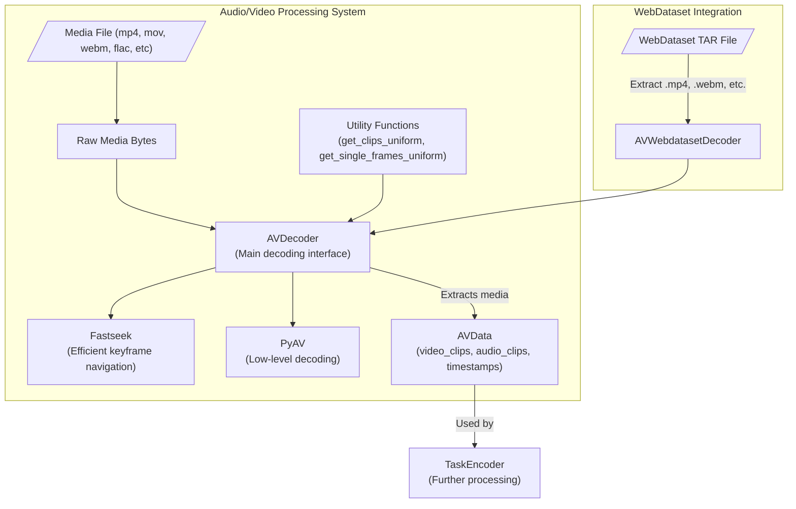
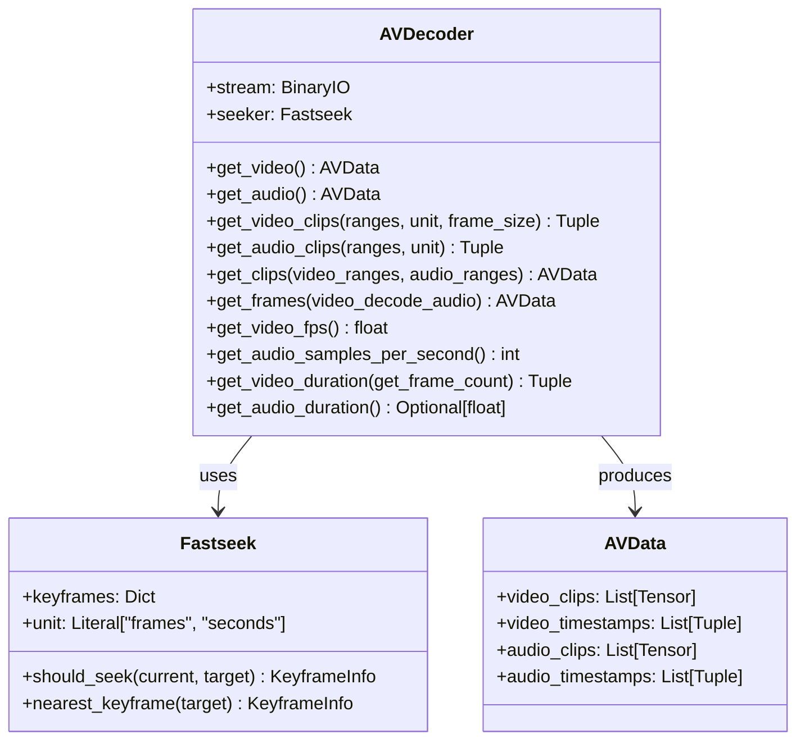
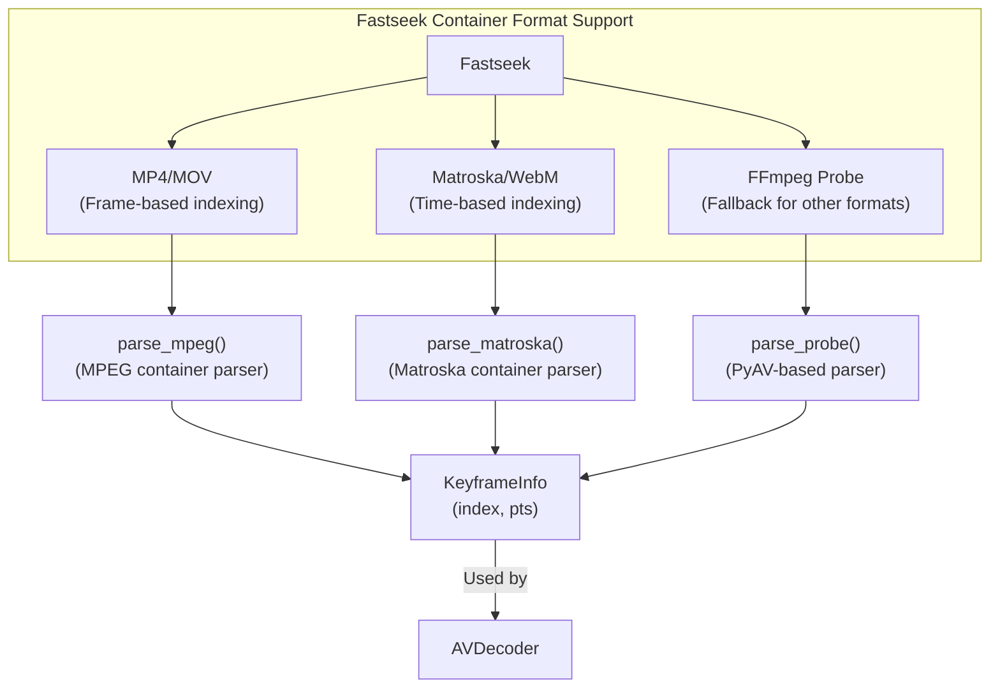
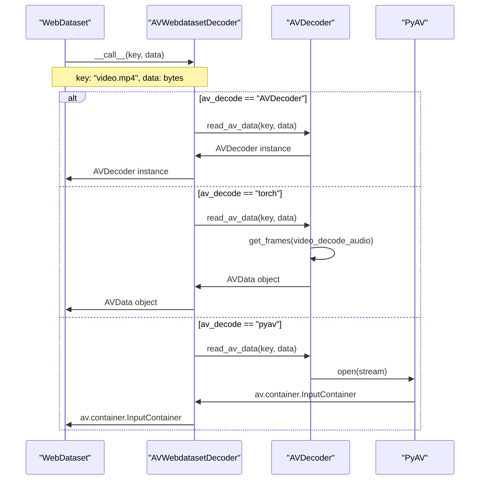

<!-- source: DeepWiki mcp.deepwiki.com · repo NVIDIA/Megatron-Energon · page 6 Audio/Video Processing · fetched 2026-10-26 -->

# Audio/Video Processing

<details>
<summary>Relevant source files</summary>

The following files were used as context for generating this wiki page:

- [src/megatron/energon/av/av_decoder.py](src/megatron/energon/av/av_decoder.py)
- [src/megatron/energon/av/av_init.py](src/megatron/energon/av/av_init.py)
- [tests/test_av_decoder.py](tests/test_av_decoder.py)

</details>


This document provides a comprehensive overview of the audio and video processing capabilities within Megatron-Energon. The system enables efficient decoding, seeking, and extraction of media content from various container formats, making it suitable for training AI models on multimodal data.

For information about how this system integrates with the WebDataset loading pipeline, see [WebDataset & Indexing](#3.2). For details on encoding processed media data for model training, see [Task Encoders & Data Processing](#4).

## System Overview

The Audio/Video Processing system in Megatron-Energon provides optimized decoding of audio and video content with capabilities for precise temporal extraction, seeking, and unified handling of different media formats. It's designed to be both flexible and performant within data loading pipelines.



Sources: [src/megatron/energon/av/av_decoder.py:28-570](), [src/megatron/energon/av/av_data.py:10-20](), [src/megatron/energon/av/fastseek/fastseek.py:15-124]()

## Key Components

### AVDecoder

The `AVDecoder` class is the central component for media processing, providing methods to decode audio and video content with fine-grained control over extraction parameters.



Sources: [src/megatron/energon/av/av_decoder.py:28-569](), [src/megatron/energon/av/av_data.py:11-20]()

#### Key Capabilities

- **Flexible Content Extraction**: Extract entire videos/audio or specific temporal segments
- **Multi-Format Support**: Works with MP4, MOV, WebM, MKV, FLAC, MP3, WAV formats
- **Temporal Control**: Request media clips by time ranges or frame/sample indices
- **Format Conversion**: Resize video frames, reformat audio channels
- **Metadata Access**: Get video frame rate, audio sample rate, media duration

The `AVDecoder` takes a binary stream as input and provides multiple methods for extracting different portions of the media content:

| Method | Purpose |
|--------|---------|
| `get_video()` | Get entire video without audio |
| `get_audio()` | Get entire audio track |
| `get_video_with_audio()` | Get entire video with audio |
| `get_video_clips()` | Get specific video segments |
| `get_audio_clips()` | Get specific audio segments |
| `get_clips()` | Get specific video and audio segments |
| `get_frames()` | Get frames based on file type |

The extracted media is returned in an `AVData` object that contains:
- Video clips as PyTorch tensors with shape `(frames, channels, height, width)`
- Audio clips as PyTorch tensors with shape `(channels, samples)`
- Timestamps for all clips in seconds

Sources: [src/megatron/energon/av/av_decoder.py:54-441](), [src/megatron/energon/av/av_data.py:11-20]()

### Fastseek

The `Fastseek` system greatly improves performance by enabling efficient seeking within video files without decoding unnecessary frames. It works by:

1. Analyzing the video container structure to identify keyframe locations
2. Determining the optimal keyframe to start decoding from
3. Minimizing the amount of frame decoding needed to reach a target position



Sources: [src/megatron/energon/av/fastseek/fastseek.py:15-124](), [src/megatron/energon/av/fastseek/keyframeinfo.py:7-32](), [src/megatron/energon/av/fastseek/containers/mpeg.py:22-233](), [src/megatron/energon/av/fastseek/containers/matroska.py:12-48](), [src/megatron/energon/av/fastseek/containers/probe.py:10-23]()

The unit for seeking depends on the container format:
- **MP4/MOV**: Uses frame numbers (count-based)
- **Matroska/WebM**: Uses timestamps (time-based)
- **Others** (via probe): Uses frame numbers

The `Fastseek` system optimizes media processing by:
1. Skipping unnecessary decoding of intermediate frames
2. Reducing memory consumption
3. Improving extraction speed for specific segments

Sources: [src/megatron/energon/av/fastseek/fastseek.py:69-124]()

### Utility Functions

Megatron-Energon provides utility functions to simplify common media processing tasks:

1. **`get_clips_uniform`**: Extracts an evenly spaced sequence of clips from a media file
   - Useful for sampling video or audio at regular intervals
   - Ensures consistent clip duration
   - Can request video, audio, or both

2. **`get_single_frames_uniform`**: Extracts individual frames at evenly spaced intervals
   - Simplifies the common task of frame sampling
   - Returns frames as a single tensor
   - Optionally returns timestamps

These utilities handle the complexities of proper temporal alignment and resource management.

Sources: [src/megatron/energon/av/utils.py:12-131]()

## WebDataset Integration

The `AVWebdatasetDecoder` class bridges the gap between WebDataset and the audio/video processing system, allowing media files stored in WebDataset archives to be efficiently decoded.



The `AVWebdatasetDecoder` supports three decoding modes:

| Mode | Return Value | Use Case |
|------|--------------|----------|
| `"AVDecoder"` | `AVDecoder` instance | When further processing or seeking is needed |
| `"torch"` | `AVData` object | When immediate tensors are needed |
| `"pyav"` | PyAV container | When low-level PyAV access is needed |

Sources: [src/megatron/energon/av/av_decoder.py:572-650]()

## Implementation Details

### Tensor Formats

The AV processing system produces standardized tensor formats:

- **Video**: Shape `(frames, channels, height, width)` with RGB channels (0-255)
- **Audio**: Shape `(channels, samples)` with audio samples

These formats are compatible with PyTorch's vision and audio libraries.

### Thread Safety Considerations

The system initializes PyAV containers with specific thread settings to avoid deadlocks:

```python
def initialize_av_container(input_container: av.container.InputContainer) -> None:
    for stream in input_container.streams:
        cc = stream.codec_context
        cc.thread_type = "NONE"
        cc.thread_count = 0
```

This is crucial for reliable operation in multi-worker data loading scenarios.

Sources: [src/megatron/energon/av/av_decoder.py:653-665]()

## Usage Examples

### Basic Video Extraction

```python
# Create AVDecoder from bytes
with open("video.mp4", "rb") as f:
    video_bytes = f.read()
    
av_decoder = AVDecoder(io.BytesIO(video_bytes))

# Get full video
av_data = av_decoder.get_video()

# Process video tensor
video_tensor = av_data.video_clips[0]  # Shape: (frames, channels, height, width)
```

### Extracting Uniform Frames

```python
# Extract 16 evenly spaced frames
frames = get_single_frames_uniform(
    av_decoder=av_decoder,
    num_frames=16,
    video_out_frame_size=(224, 224)  # Optional resize
)
```

### Extracting Specific Clips

```python
# Extract specific segments from a video
av_data = av_decoder.get_clips(
    video_clip_ranges=[(30.5, 35.2), (42.0, 48.5)],  # Seconds
    audio_clip_ranges=[(30.5, 35.2), (42.0, 48.5)],  # Seconds
    video_unit="seconds",
    audio_unit="seconds"
)

# First video clip and its timestamps
video_clip_1 = av_data.video_clips[0]
start_time, end_time = av_data.video_timestamps[0]
```

Sources: [tests/test_av_decoder.py:98-180]()

## Performance Considerations

1. **Use `Fastseek` for large files**: The system automatically uses `Fastseek` for efficient navigation in media files.

2. **Batch your extraction requests**: When multiple segments are needed, pass them as a list to `get_clips()` rather than making multiple separate calls.

3. **Choose appropriate resolution**: If you don't need full resolution, use `video_out_frame_size` to resize during decoding.

4. **Consider decoding mode**: Use `AVWebdatasetDecoder` with appropriate `av_decode` mode based on your needs:
   - `"torch"` for immediate tensors
   - `"AVDecoder"` for flexible further processing
   - `"pyav"` for advanced customization

---

