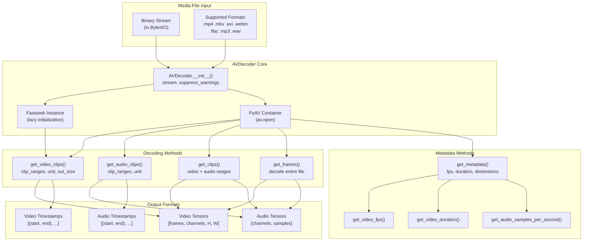
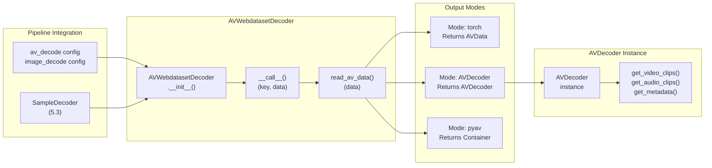
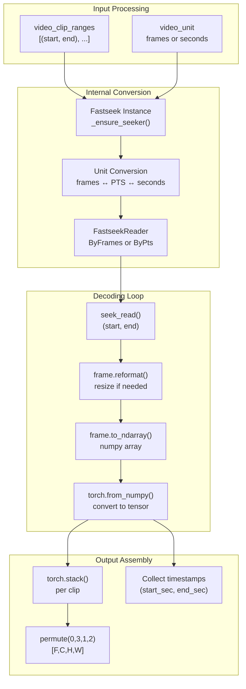
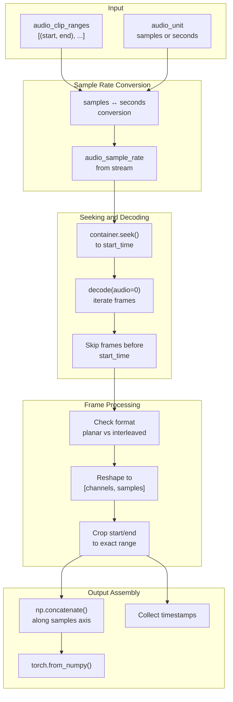
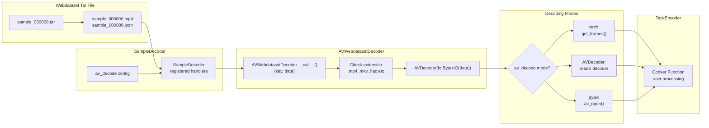

<!-- source: DeepWiki mcp.deepwiki.com · repo NVIDIA/Megatron-Energon · page 6.1 AVDecoder · fetched 2026-10-26 -->

# AVDecoder

<details>
<summary>Relevant source files</summary>

The following files were used as context for generating this wiki page:

- [src/megatron/energon/av/av_decoder.py](src/megatron/energon/av/av_decoder.py)
- [src/megatron/energon/av/av_init.py](src/megatron/energon/av/av_init.py)
- [tests/data/test_audio.flac](tests/data/test_audio.flac)
- [tests/data/test_audio.wav](tests/data/test_audio.wav)
- [tests/test_av_decoder.py](tests/test_av_decoder.py)

</details>


**Purpose**: This document covers the `AVDecoder` class and `AVWebdatasetDecoder` wrapper, which provide flexible audio and video decoding capabilities for media files in the Megatron-Energon pipeline. For information about optimized seeking in video files, see [Fastseek Optimization](#6.2). For general sample decoding in the pipeline, see [Sample Decoding](#5.3).

**Scope**: This page focuses on the AVDecoder API for extracting video clips, audio clips, and metadata from media files. It covers initialization modes, decoding methods, and integration with the data loading pipeline through `AVWebdatasetDecoder`.

---

## Overview

`AVDecoder` is a wrapper around PyAV that enables flexible, on-demand decoding of audio and video files. Unlike traditional decoders that require decoding parameters at initialization, `AVDecoder` allows users to specify decoding parameters at runtime, making it suitable for scenarios where different samples require different processing (e.g., extracting different clip ranges from different videos).

The system provides three decoding modes:
- **Eager mode** (`av_decode="torch"`): Immediately decode to tensors
- **Lazy mode** (`av_decode="AVDecoder"`): Return `AVDecoder` instance for deferred decoding
- **Raw mode** (`av_decode="pyav"`): Return PyAV container for maximum control



**Sources**: [src/megatron/energon/av/av_decoder.py:35-650]()

---

## Class Architecture

### AVDecoder Class

The `AVDecoder` class provides the core decoding functionality. It requires a binary stream as input and maintains optional references to a Fastseek instance for optimized seeking.

| Attribute | Type | Description |
|-----------|------|-------------|
| `stream` | `BinaryIO` | Input binary stream (must be in binary mode) |
| `seeker` | `Fastseek \| None` | Lazy-initialized Fastseek instance for optimized seeking |
| `suppress_warnings` | `bool` | Whether to suppress runtime warnings |

**Sources**: [src/megatron/energon/av/av_decoder.py:35-65]()

### AVWebdatasetDecoder Class

The `AVWebdatasetDecoder` class provides integration with the webdataset pipeline through the `SampleDecoder` system. It acts as a callable decoder that can be registered with `SampleDecoder` to handle media files.

| Parameter | Type | Description |
|-----------|------|-------------|
| `video_decode_audio` | `bool` | Whether to decode audio from video files |
| `av_decode` | `Literal["torch", "AVDecoder", "pyav"]` | Decoding mode |



**Sources**: [src/megatron/energon/av/av_decoder.py:652-729]()

---

## Initialization and Dependencies

### Importing AVDecoder

`AVDecoder` requires optional dependencies that must be installed separately:

```python
# Installation
pip install megatron-energon[av_decode]
```

The module checks for required dependencies at import time and raises an `ImportError` with installation instructions if they are missing:

```python
try:
    import av
    import av.container
    import filetype
    from megatron.energon.av.fastseek.reader import Fastseek
    AV_DECODE_AVAILABLE = True
except ImportError as e:
    AV_DECODE_AVAILABLE = False
    MISSING_DEPENDENCY = str(e)
```

**Sources**: [src/megatron/energon/av/av_decoder.py:12-28]()

### Creating an AVDecoder Instance

```python
import io
from pathlib import Path
from megatron.energon.av import AVDecoder

# From file path
with open("video.mp4", "rb") as f:
    av_decoder = AVDecoder(f)

# From bytes
video_bytes = Path("video.mp4").read_bytes()
av_decoder = AVDecoder(io.BytesIO(video_bytes))

# With warnings suppressed
av_decoder = AVDecoder(stream, suppress_warnings=True)
```

The constructor validates that the stream is opened in binary mode (not text mode) and stores the stream reference for later use.

**Sources**: [src/megatron/energon/av/av_decoder.py:47-59]()

---

## Video Decoding

### Video Clip Extraction

The `get_video_clips()` method extracts specific time ranges or frame ranges from a video:

```python
def get_video_clips(
    self,
    video_clip_ranges: Sequence[tuple[float, float]],
    video_unit: Literal["frames", "seconds"] = "seconds",
    video_out_frame_size: Optional[tuple[int, int]] = None,
) -> tuple[list[torch.Tensor], list[tuple[float, float]]]:
```

**Parameters**:
- `video_clip_ranges`: List of `(start, end)` tuples. The end is **inclusive** and at least one frame is returned per range.
- `video_unit`: Either `"frames"` (frame indices) or `"seconds"` (timestamps)
- `video_out_frame_size`: Optional `(width, height)` for resizing frames

**Returns**:
- `video_clips`: List of tensors with shape `[frames, channels, height, width]`
- `video_timestamps`: List of `(start_time, end_time)` in seconds for each clip



**Key Implementation Details**:

1. **Lazy Fastseek Initialization**: The Fastseek instance is created on first use via `_ensure_seeker()` [src/megatron/energon/av/av_decoder.py:61-65]()

2. **Unit Conversion Logic**: 
   - If requesting frames but only PTS is supported, converts frame indices to PTS units using FPS and time_base
   - If requesting seconds but only frame indices are supported, converts timestamps to frame indices
   - May emit warnings if conversion is required [src/megatron/energon/av/av_decoder.py:119-174]()

3. **Reader Selection**:
   - `FastseekReaderByFrames`: For frame-indexed videos (e.g., MP4)
   - `FastseekReaderByPts`: For PTS-indexed videos (e.g., MKV)

4. **Frame Processing**: Frames are reformatted to RGB24 and optionally resized using bilinear interpolation [src/megatron/energon/av/av_decoder.py:193-203]()

**Sources**: [src/megatron/energon/av/av_decoder.py:78-219]()

### Convenience Methods

The class provides convenience methods that wrap `get_video_clips()`:

| Method | Description | Equivalent To |
|--------|-------------|---------------|
| `get_video()` | Get entire video (no audio) | `get_video_clips([(0, float("inf"))])` |
| `get_video_with_audio()` | Get entire video and audio | `get_clips(video_clip_ranges=[(0, inf)], audio_clip_ranges=[(0, inf)])` |
| `get_frames()` | Auto-detect format and decode | Calls `get_video()` or `get_audio()` based on extension |

**Sources**: [src/megatron/energon/av/av_decoder.py:67-77](), [src/megatron/energon/av/av_decoder.py:370-378](), [src/megatron/energon/av/av_decoder.py:425-451]()

---

## Audio Decoding

### Audio Clip Extraction

The `get_audio_clips()` method extracts audio data from specific time ranges or sample ranges:

```python
def get_audio_clips(
    self,
    audio_clip_ranges: Sequence[tuple[float, float]],
    audio_unit: Literal["samples", "seconds"] = "seconds",
) -> tuple[list[torch.Tensor], list[tuple[float, float]]]:
```

**Parameters**:
- `audio_clip_ranges`: List of `(start, end)` tuples
- `audio_unit`: Either `"samples"` (sample indices) or `"seconds"` (timestamps)

**Returns**:
- `audio_clips`: List of tensors with shape `[channels, samples]`
- `audio_timestamps`: List of `(start_time, end_time)` in seconds for each clip



**Key Implementation Details**:

1. **Sample Rate Conversion**: When `audio_unit="samples"`, the method converts sample indices to seconds using the stream's sample rate [src/megatron/energon/av/av_decoder.py:263-271]()

2. **Precise Clipping**: The method seeks to slightly before the start time and then precisely crops frames to match the exact requested range [src/megatron/energon/av/av_decoder.py:289-314]()

3. **Format Handling**: Audio frames can be planar (already [channels, samples]) or interleaved (needs reshaping) [src/megatron/energon/av/av_decoder.py:276-287]()

4. **End Frame Cropping**: The last frame is cropped to match the desired duration, with logic to adjust by up to 2 samples to account for rounding [src/megatron/energon/av/av_decoder.py:333-354]()

**Sources**: [src/megatron/energon/av/av_decoder.py:231-368]()

### Combined Video and Audio Extraction

The `get_clips()` method extracts both video and audio clips:

```python
def get_clips(
    self,
    video_clip_ranges: Optional[Sequence[tuple[float, float]]] = None,
    audio_clip_ranges: Optional[Sequence[tuple[float, float]]] = None,
    video_unit: Literal["frames", "seconds"] = "seconds",
    audio_unit: Literal["samples", "seconds"] = "seconds",
    video_out_frame_size: Optional[tuple[int, int]] = None,
) -> AVData:
```

This method simply calls `get_video_clips()` and `get_audio_clips()` independently and packages results into an `AVData` object. Either parameter can be `None` to skip that modality.

**Sources**: [src/megatron/energon/av/av_decoder.py:379-423]()

---

## Metadata Extraction

### Comprehensive Metadata Retrieval

The `get_metadata()` method extracts metadata from the media file:

```python
def get_metadata(
    self,
    get_video: bool = True,
    get_video_duration: bool = True,
    get_video_frame_count: bool = True,
    get_video_frame_size: bool = True,
    get_audio: bool = True,
    get_audio_duration: bool = True,
    get_audio_num_samples: bool = False,
) -> AVMetadata:
```

**Returns**: An `AVMetadata` object with the following fields:

| Field | Type | Description |
|-------|------|-------------|
| `video_duration` | `Optional[float]` | Video duration in seconds |
| `video_num_frames` | `Optional[int]` | Total number of video frames |
| `video_fps` | `Optional[float]` | Frames per second |
| `video_width` | `Optional[int]` | Video frame width |
| `video_height` | `Optional[int]` | Video frame height |
| `audio_duration` | `Optional[float]` | Audio duration in seconds |
| `audio_channels` | `Optional[int]` | Number of audio channels |
| `audio_sample_rate` | `Optional[int]` | Audio sample rate (Hz) |
| `audio_num_samples` | `Optional[int]` | Total audio samples |

**Performance Considerations**:

- `get_video_duration=True` may require decoding the entire video if duration is not in the header [src/megatron/energon/av/av_decoder.py:570-587]()
- `get_video_frame_count=True` requires iterating through all packets [src/megatron/energon/av/av_decoder.py:589-592]()
- `get_audio_num_samples=True` requires decoding all audio frames [src/megatron/energon/av/av_decoder.py:612-621]()
- `get_video_frame_size=True` decodes the first frame to get dimensions [src/megatron/energon/av/av_decoder.py:598-606]()

**Sources**: [src/megatron/energon/av/av_decoder.py:540-646]()

### Convenience Metadata Methods

| Method | Returns | Description |
|--------|---------|-------------|
| `get_video_fps()` | `float` | Video frames per second |
| `get_video_duration(get_frame_count=False)` | `(Optional[float], Optional[int])` | Duration and optionally frame count |
| `get_audio_duration()` | `Optional[float]` | Audio duration in seconds |
| `get_audio_samples_per_second()` | `int` | Audio sample rate |
| `has_video_stream()` | `bool` | Check if video stream exists |
| `has_audio_stream()` | `bool` | Check if audio stream exists |

**Sources**: [src/megatron/energon/av/av_decoder.py:462-538]()

---

## Pipeline Integration with AVWebdatasetDecoder

### Integration with SampleDecoder

`AVWebdatasetDecoder` serves as a bridge between webdataset tar files and `AVDecoder`. It is registered with `SampleDecoder` to automatically handle media file extensions.



**Sources**: [src/megatron/energon/av/av_decoder.py:652-729]()

### Decoding Mode Details

#### Eager Mode (`av_decode="torch"`)

Returns decoded tensors immediately. Best for simple use cases where all samples need full decoding:

```python
decoder = AVWebdatasetDecoder(
    video_decode_audio=True,
    av_decode="torch"
)
# Returns: AVData with video_clips and audio_clips as tensors
```

This mode calls `av_decoder.get_frames(video_decode_audio=...)` which auto-detects the media type and decodes accordingly [src/megatron/energon/av/av_decoder.py:724-726]()

#### Lazy Mode (`av_decode="AVDecoder"`)

Returns the `AVDecoder` instance for deferred, flexible decoding. Best for custom processing where different samples need different clip ranges:

```python
decoder = AVWebdatasetDecoder(
    video_decode_audio=False,
    av_decode="AVDecoder"
)
# Returns: AVDecoder instance
# User can later call: decoder.get_video_clips([(start, end)], ...)
```

This is the recommended mode for memory-efficient processing of large videos [src/megatron/energon/av/av_decoder.py:719-720]()

#### Raw Mode (`av_decode="pyav"`)

Returns the PyAV container for maximum control:

```python
decoder = AVWebdatasetDecoder(
    video_decode_audio=False,
    av_decode="pyav"
)
# Returns: av.container.InputContainer
```

This mode provides direct access to the PyAV API for advanced users [src/megatron/energon/av/av_decoder.py:721-722]()

### Supported Media Extensions

The decoder recognizes the following file extensions:

```python
supported_extensions = [
    "mp4", "avi", "mov", "webm", "mkv",  # Video
    "flac", "mp3", "wav", "flv"          # Audio
]
```

Files with other extensions are ignored (returns `None`) [src/megatron/energon/av/av_decoder.py:710-715]()

**Sources**: [src/megatron/energon/av/av_decoder.py:692-728]()

---

## Usage Examples

### Example 1: Extract Uniform Video Frames

```python
import io
from pathlib import Path
from megatron.energon.av import AVDecoder

# Load video
video_bytes = Path("video.mp4").read_bytes()
av_decoder = AVDecoder(io.BytesIO(video_bytes))

# Get metadata
fps = av_decoder.get_video_fps()
duration, num_frames = av_decoder.get_video_duration(get_frame_count=True)

# Extract 16 uniformly spaced frames
import numpy as np
frame_indices = np.linspace(0, num_frames - 1, 16, dtype=int)

clips = []
for frame_idx in frame_indices:
    video_data, timestamps = av_decoder.get_video_clips(
        video_clip_ranges=[(frame_idx, frame_idx)],
        video_unit="frames",
        video_out_frame_size=(224, 224)
    )
    clips.append(video_data[0])

# Stack into single tensor: [16, 3, 224, 224]
video_tensor = torch.cat(clips, dim=0)
```

**Sources**: [tests/test_av_decoder.py:530-553]()

### Example 2: Extract Audio Clips with Video Sync

```python
# Extract video frames and synchronized audio clips
av_decoder = AVDecoder(io.BytesIO(video_bytes))

# Extract clips every 2 seconds
clip_times = [(t, t + 0.05) for t in range(0, 60, 2)]

av_data = av_decoder.get_clips(
    video_clip_ranges=[(t, t) for t, _ in clip_times],  # Single frame
    audio_clip_ranges=clip_times,  # 0.05 second audio clips
    video_unit="seconds",
    audio_unit="seconds"
)

# Process synchronized data
for video_clip, audio_clip in zip(av_data.video_clips, av_data.audio_clips):
    # video_clip: [1, 3, H, W]
    # audio_clip: [channels, samples]
    process_multimodal(video_clip, audio_clip)
```

**Sources**: [tests/test_av_decoder.py:600-643]()

### Example 3: Lazy Decoding in TaskEncoder

```python
from megatron.energon import DefaultTaskEncoder
from megatron.energon.av import AVWebdatasetDecoder

class VideoTaskEncoder(DefaultTaskEncoder):
    def __init__(self):
        super().__init__()
        # Register lazy decoder
        self.sample_decoder.register_handler(
            AVWebdatasetDecoder(
                video_decode_audio=False,
                av_decode="AVDecoder"
            )
        )
    
    def encode_sample(self, sample):
        # sample["mp4"] is an AVDecoder instance
        av_decoder = sample["mp4"]
        
        # Get metadata to decide clip ranges
        duration, num_frames = av_decoder.get_video_duration(get_frame_count=True)
        
        # Extract specific clips based on metadata
        if num_frames > 100:
            # Extract multiple short clips
            clips, _ = av_decoder.get_video_clips(
                video_clip_ranges=[(0, 30), (num_frames//2, num_frames//2 + 30)],
                video_unit="frames"
            )
        else:
            # Extract entire video
            clips = [av_decoder.get_video().video_clips[0]]
        
        return {
            "__key__": sample["__key__"],
            "video": clips[0],
            "caption": sample["json"]["caption"]
        }
```

**Sources**: [src/megatron/energon/av/av_decoder.py:652-729]()

### Example 4: Metadata-Based Filtering

```python
def filter_by_metadata(sample):
    """Filter samples based on video metadata."""
    av_decoder = sample["mp4"]
    
    # Get metadata without expensive operations
    metadata = av_decoder.get_metadata(
        get_video_frame_count=False,  # Skip counting frames
        get_audio_num_samples=False,  # Skip counting samples
    )
    
    # Filter criteria
    if metadata.video_duration is None or metadata.video_duration < 5.0:
        return None  # Skip videos shorter than 5 seconds
    
    if metadata.video_fps is None or metadata.video_fps < 24:
        return None  # Skip low FPS videos
    
    if metadata.video_width < 640 or metadata.video_height < 480:
        return None  # Skip low resolution videos
    
    return sample

# Use in pipeline
dataset = dataset.map(filter_by_metadata).filter(lambda x: x is not None)
```

**Sources**: [src/megatron/energon/av/av_decoder.py:540-646]()

---

## Error Handling and Edge Cases

### Missing Dependencies

If PyAV or other required dependencies are not installed, `AVDecoder.__init__()` raises an `ImportError` with installation instructions:

```python
if not AV_DECODE_AVAILABLE:
    raise ImportError(
        f"AV decoding is not available. Please install the required dependencies with:\n"
        f"pip install megatron-energon[av_decode]\n"
        f"Missing dependency: {MISSING_DEPENDENCY}"
    )
```

**Sources**: [src/megatron/energon/av/av_decoder.py:48-52]()

### Stream Mode Validation

The constructor validates that the stream is in binary mode:

```python
assert "t" not in getattr(stream, "mode", "rb") and not isinstance(stream, io.TextIOBase), (
    "Stream must not be opened in text mode"
)
```

**Sources**: [src/megatron/energon/av/av_decoder.py:57-59]()

### Unit Conversion Warnings

When the requested unit doesn't match the container's native unit, warnings are emitted (unless `suppress_warnings=True`):

```python
if not self.suppress_warnings:
    warnings.warn(
        "Video container unit is frames, but seeking in time units. "
        "The resulting frames may be slightly off.",
        RuntimeWarning,
    )
```

**Sources**: [src/megatron/energon/av/av_decoder.py:136-140](), [src/megatron/energon/av/av_decoder.py:166-170]()

### Unsupported Seeking Modes

If the container doesn't support the required seeking mode, a `ValueError` is raised:

```python
if not self.seeker.frame_index_supported and not self.seeker.pts_supported:
    raise ValueError("Video container does not support seeking in frames or PTS")
```

**Sources**: [src/megatron/energon/av/av_decoder.py:141-142](), [src/megatron/energon/av/av_decoder.py:171-172]()

---

## PyAV Integration and Thread Safety

### Container Initialization

`AVDecoder` uses the `av_open()` helper function to initialize PyAV containers with proper thread configuration:

```python
def av_open(file: BitsType) -> "av.container.InputContainer":
    """Open a file with PyAV.
    
    This function disables additional threads in the container.
    """
    input_container = av.open(file, "r")
    try:
        initialize_av_container(input_container)
    except Exception:
        input_container.close()
        raise
    return input_container
```

The `initialize_av_container()` function disables threading to prevent:
1. Deadlocks in ffmpeg when deallocating containers
2. Fork issues when using PyTorch DataLoader with multiple workers

```python
def initialize_av_container(input_container: "av.container.InputContainer") -> None:
    """Ensure no additional threads are created."""
    for stream in input_container.streams:
        cc = stream.codec_context
        if cc is not None:
            cc.thread_type = "NONE"
            cc.thread_count = 0
```

**Sources**: [src/megatron/energon/av/av_init.py:15-44]()

---

## Performance Characteristics

### Seeking Optimization

`AVDecoder` leverages Fastseek for efficient seeking. When extracting clips:

- **Sequential access**: Minimal overhead, frames are read continuously
- **Forward seeking through keyframe**: Fastseek optimizes by seeking to the keyframe and decoding forward
- **Backward seeking**: Always requires seeking to the previous keyframe and decoding forward

The Fastseek system is covered in detail in [Fastseek Optimization](#6.2).

**Sources**: [src/megatron/energon/av/av_decoder.py:61-65](), [tests/test_av_decoder.py:181-393]()

### Memory Efficiency

Different modes have different memory characteristics:

| Mode | Memory Usage | Use Case |
|------|--------------|----------|
| Eager (`torch`) | High - all frames decoded immediately | Small videos, simple processing |
| Lazy (`AVDecoder`) | Low - decode on demand | Large videos, selective extraction |
| Raw (`pyav`) | Variable - depends on usage | Advanced custom processing |

### Frame Reformatting Cost

Frame reformatting (color space conversion and resizing) is applied per-frame:

```python
frame = frame.reformat(
    width=video_out_frame_size[0],
    height=video_out_frame_size[1],
    format="rgb24",
    interpolation="BILINEAR",
)
```

For performance-critical applications, consider extracting frames at native resolution and resizing in batch using PyTorch transforms.

**Sources**: [src/megatron/energon/av/av_decoder.py:193-201]()

---

## Testing and Validation

The test suite validates multiple aspects of AVDecoder functionality:

| Test Category | Coverage |
|---------------|----------|
| **Format Support** | MP4, MKV, AVI, FLAC, WAV [tests/test_av_decoder.py:85-180]() |
| **Seeking Accuracy** | Frame-by-frame comparison with PyAV baseline [tests/test_av_decoder.py:420-482]() |
| **Timestamp Precision** | Sub-frame timestamp accuracy [tests/test_av_decoder.py:555-598]() |
| **Audio/Video Sync** | Synchronized extraction validation [tests/test_av_decoder.py:600-643]() |
| **Metadata Extraction** | All metadata fields [tests/test_av_decoder.py:483-528]() |
| **Serialization** | Pickle/unpickle support [tests/test_av_decoder.py:645-674]() |
| **Fastseek Integration** | Reader mode selection and seeking [tests/test_av_decoder.py:82-393]() |

**Sources**: [tests/test_av_decoder.py:1-912]()

---

