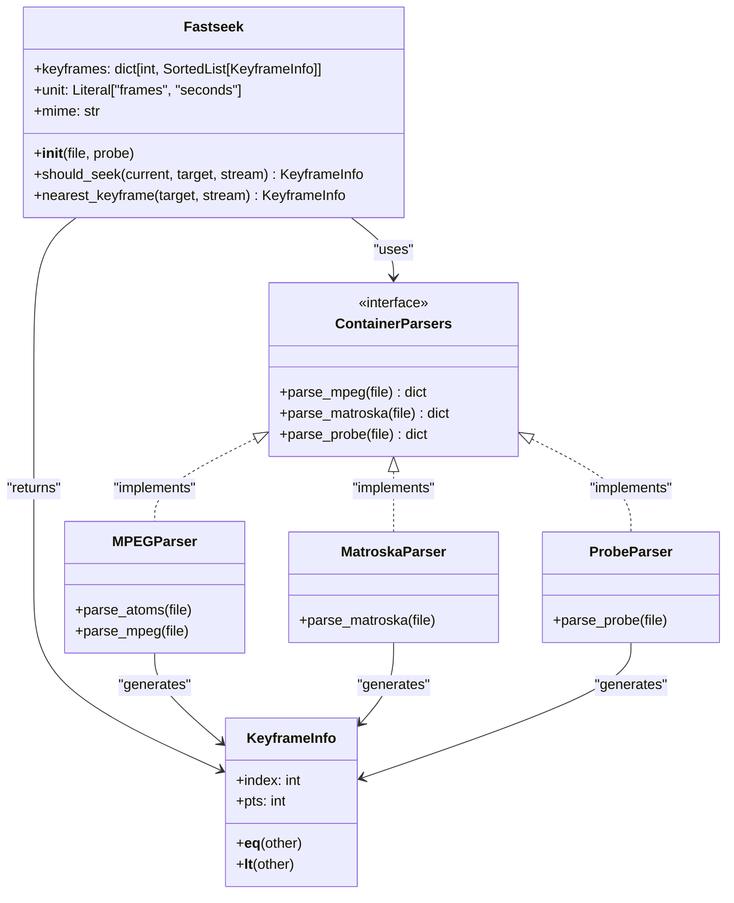
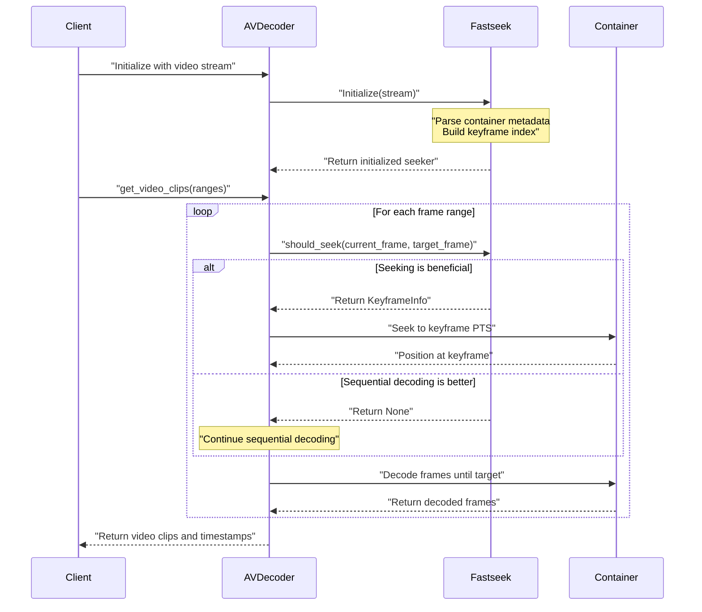
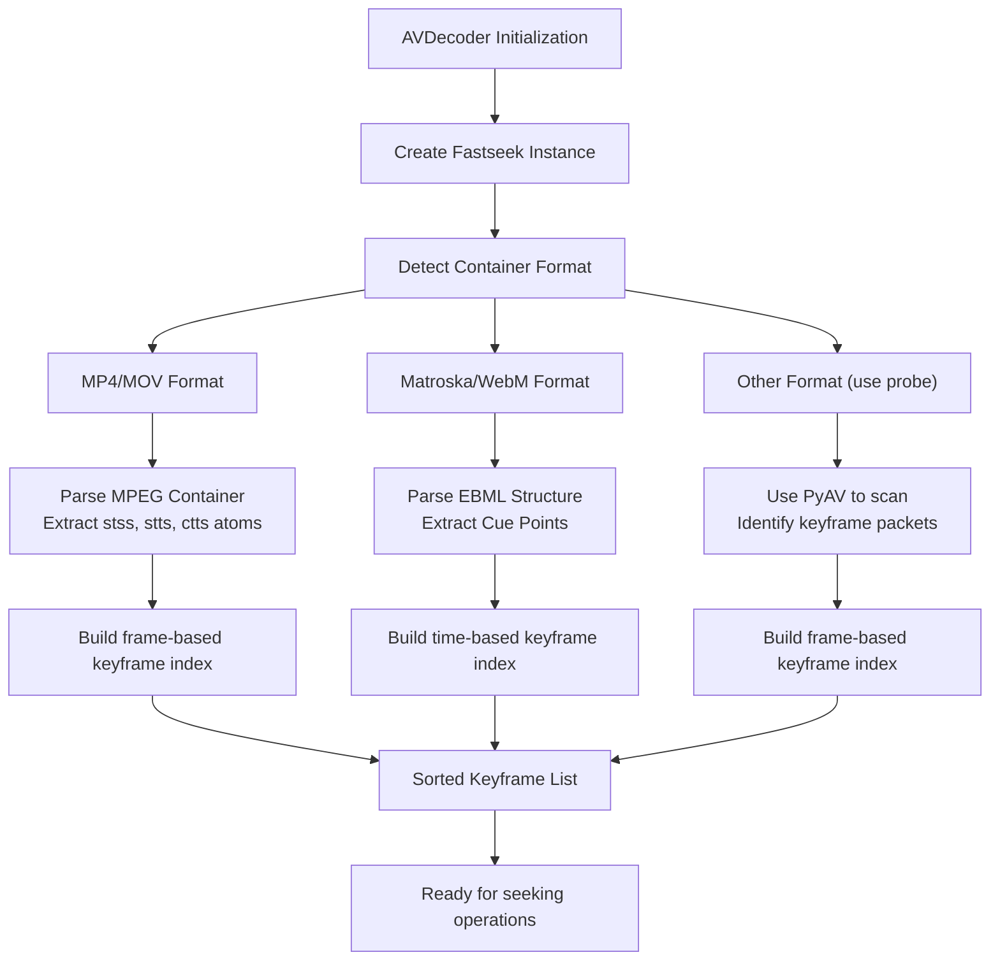

<!-- source: DeepWiki mcp.deepwiki.com · repo NVIDIA/Megatron-Energon · page 6.2 Fastseek Optimization · fetched 2026-10-26 -->

# Fastseek

<details>
<summary>Relevant source files</summary>

The following files were used as context for generating this wiki page:

- [src/megatron/energon/av/av_decoder.py](src/megatron/energon/av/av_decoder.py)
- [src/megatron/energon/av/av_init.py](src/megatron/energon/av/av_init.py)
- [tests/test_av_decoder.py](tests/test_av_decoder.py)

</details>


## Purpose and Scope

Fastseek is a specialized subsystem within Megatron-Energon's audio/video processing architecture that enables efficient navigation within video files. It works by identifying keyframes in video container files with minimal decoding overhead, allowing for optimized seeking operations when extracting specific frames or clips from videos.

This document covers the Fastseek system's architecture, functionality, supported container formats, and how it integrates with the AVDecoder component. For information about the general audio/video decoding capabilities, see [AVDecoder](#5.1).

Sources: [src/megatron/energon/av/fastseek/fastseek.py:15-34](), [src/megatron/energon/av/av_decoder.py:46-50]()

## Core Concepts

### Keyframes and Video Seeking

In video compression, a keyframe (I-frame) contains a complete image, while other frames (P-frames, B-frames) store only differences from previous or future frames. Keyframes are critical for seeking operations because:

- They can be decoded independently without needing prior frames
- They serve as entry points for decoders when jumping to a new position
- They establish reference points for subsequent difference-based frames

Traditional video seeking often requires sequential decoding from the beginning or involves expensive decoder reinitialization. Fastseek optimizes this process by:

1. Parsing video container metadata to build an index of keyframe positions
2. Finding the nearest keyframe before a target position
3. Starting decoding from that keyframe, minimizing the amount of processing needed

Sources: [src/megatron/energon/av/fastseek/fastseek.py:69-97]()

### Container Formats and Units

Different video container formats store and index keyframes differently:

| Container Format | Index Unit | Description |
|------------------|------------|-------------|
| MP4/MOV | Frames | Uses frame numbers as the indexing unit |
| Matroska/WebM | Seconds | Uses timestamps as the indexing unit |
| Others (via probe) | Frames | Uses ffmpeg to extract keyframe information |

The "unit" property in Fastseek (frames vs. seconds) affects how seeking operations work and must be considered when specifying target positions.

Sources: [src/megatron/energon/av/fastseek/fastseek.py:31-67]()

## Architecture and Integration

### Fastseek System Components

Fastseek consists of several components that work together to provide efficient seeking capabilities:

Diagram: Fastseek System Architecture



The main components include:

1. **Fastseek Class**: The primary interface that determines when seeking is beneficial and finds the nearest keyframe
2. **KeyframeInfo Class**: Represents information about a keyframe including its index and presentation timestamp (PTS)
3. **Container Parsers**: Format-specific parsers that extract keyframe information from container metadata:
   - `parse_mpeg` for MP4/MOV containers
   - `parse_matroska` for Matroska/WebM containers
   - `parse_probe` as a fallback for other formats

Sources: [src/megatron/energon/av/fastseek/fastseek.py:1-125](), [src/megatron/energon/av/fastseek/keyframeinfo.py:1-32]()

### Integration with AVDecoder

Fastseek integrates with the `AVDecoder` class, which is responsible for decoding audio and video data:

Diagram: Fastseek Integration with AVDecoder



The integration works as follows:

1. When an `AVDecoder` is initialized, it creates a `Fastseek` instance
2. During video clip extraction, `AVDecoder` calls `Fastseek.should_seek()` to determine if seeking is beneficial
3. If seeking is beneficial, `AVDecoder` positions the container at the keyframe's presentation timestamp
4. The decoder then processes frames until it reaches the target frame

This integration appears in the `get_video_clips` method of `AVDecoder`, where seeking decisions significantly impact performance.

Sources: [src/megatron/energon/av/av_decoder.py:36-54](), [src/megatron/energon/av/av_decoder.py:144-147]()

## Supported Container Formats

### MP4/MOV (MPEG-4)

MP4/MOV container support involves parsing several atoms (data structures) in the container:

- **Sync Sample Atom (stss)**: Contains a list of keyframe positions
- **Time-to-Sample Atom (stts)**: Maps frame numbers to timeline positions
- **Composition Offset Atom (ctts)**: Adjusts presentation timestamps for B-frames
- **Edit List Atom (elst)**: Handles any timeline edits in the video

The MPEG parser navigates these structures to build a comprehensive keyframe index with accurate timestamps.

Sources: [src/megatron/energon/av/fastseek/containers/mpeg.py:1-234]()

### Matroska/WebM

Matroska and WebM container support involves parsing the EBML structure:

- **Cue Points**: Timestamps marking keyframe positions
- **Track Information**: Maps keyframes to specific video tracks

The Matroska parser extracts this information to build a time-based keyframe index.

Sources: [src/megatron/energon/av/fastseek/containers/matroska.py:1-49]()

### Other Formats (via Probe)

For unsupported container formats, Fastseek can use the "probe" approach:

1. Uses PyAV (Python bindings for FFmpeg) to scan the file
2. Identifies keyframes by checking the `is_keyframe` flag on packets
3. Records frame indices and presentation timestamps

While slower than direct parsing, this approach still provides significant performance benefits over sequential decoding.

Sources: [src/megatron/energon/av/fastseek/containers/probe.py:1-24]()

## Key Functionality

### Keyframe Detection Process

Diagram: Keyframe Detection Process



The keyframe detection process varies by container format but generally follows these steps:

1. Detect the container format based on file signature
2. Use the appropriate parser to extract keyframe metadata
3. Build a sorted list of keyframe information
4. Use this index to provide efficient seeking operations

Sources: [src/megatron/energon/av/fastseek/fastseek.py:36-67]()

### Seeking Optimization Logic

The core optimization in Fastseek is the `should_seek()` method, which determines whether seeking to a keyframe is more efficient than sequential decoding:

```python
def should_seek(self, current: int, target: int, stream: int = 0) -> Optional[KeyframeInfo]:
    nearest_iframe: KeyframeInfo = self.nearest_keyframe(target, stream)
    return (
        nearest_iframe
        if (current < nearest_iframe.index <= target) or (target < current)
        else None
    )
```

This method returns a `KeyframeInfo` object when seeking is beneficial, or `None` when sequential decoding is more efficient. The logic:

1. Find the nearest keyframe before the target position
2. If the current position is already past this keyframe but before the target, continue sequential decoding
3. If the target is before the current position, seeking is always required
4. If the nearest keyframe is after the current position but before the target, seeking to the keyframe is more efficient

This intelligent seeking decision significantly improves performance by avoiding unnecessary seek operations.

Sources: [src/megatron/energon/av/fastseek/fastseek.py:69-97]()

## Usage in AVDecoder

The primary usage of Fastseek is within the `get_video_clips` method of `AVDecoder`:

```python
# From AVDecoder.get_video_clips method
if (iframe_info := self.seeker.should_seek(previous_frame_index, start_frame_index)) is not None:
    input_container.seek(iframe_info.pts, stream=input_container.streams.video[0])
    previous_frame_index = iframe_info.index
```

This code demonstrates how `AVDecoder` uses the Fastseek system:

1. It calls `should_seek()` to determine if seeking is beneficial
2. If seeking is beneficial, it seeks to the keyframe's presentation timestamp
3. It updates the current frame position to the keyframe's index
4. It then continues decoding from that point

The integration with unit conversion is also important:

```python
if video_clip_ranges is not None and video_unit != self.seeker.unit:
    # Convert video_clip_ranges to video_unit
    if video_unit == "frames":
        # Convert from frames to seconds
        video_clip_ranges = [
            (
                clip[0] / average_rate,
                clip[1] / average_rate,
            )
            for clip in video_clip_ranges
        ]
    else:
        # Convert from seconds to frames
        video_clip_ranges = [
            (
                clip[0] * average_rate,
                clip[1] * average_rate,
            )
            for clip in video_clip_ranges
        ]
```

This code shows how `AVDecoder` handles the difference between frame-based and time-based units when using Fastseek.

Sources: [src/megatron/energon/av/av_decoder.py:144-147](), [src/megatron/energon/av/av_decoder.py:104-123]()

## Performance Benefits

Fastseek provides significant performance benefits, especially when:

1. **Random access patterns**: When accessing frames non-sequentially or at large distances apart
2. **Long videos**: The longer the video, the more benefit from avoiding full sequential decoding
3. **Extracting short clips**: When extracting small segments from a large video

Test results from the codebase demonstrate these advantages:

```python
# In test_decode_strided_resized, Fastseek enables direct extraction
# of 64 frames distributed throughout the video without sequential decoding
video_tensor = get_single_frames_uniform(
    av_decoder=av_decoder, num_frames=64, video_out_frame_size=(224, 224)
)
```

Without Fastseek, this operation would require sequential decoding of the entire video, which becomes prohibitively expensive for long videos.

Sources: [tests/test_av_decoder.py:120-123]()

## Summary

Fastseek is a critical component in Megatron-Energon's audio/video processing system that:

1. Parses video container metadata to build efficient keyframe indices
2. Makes intelligent decisions about when seeking operations are beneficial
3. Supports multiple container formats with format-specific optimizations
4. Integrates seamlessly with the AVDecoder to provide high-performance video clip extraction

This system enables Megatron-Energon to efficiently process video data in training large language models, particularly when extracting specific clips or frames from longer videos.

---

