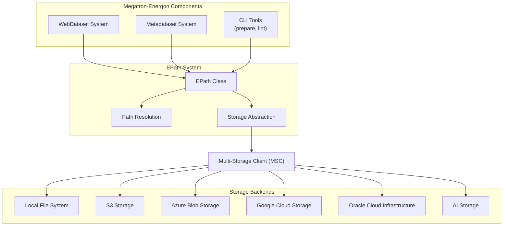
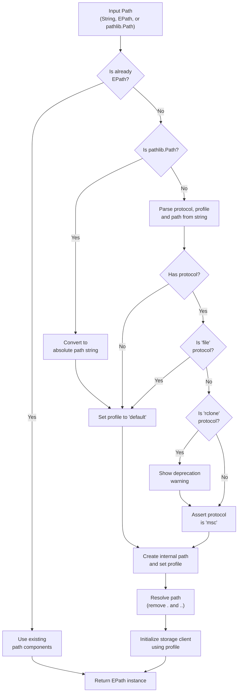
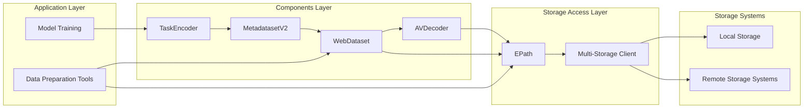

<!-- source: DeepWiki mcp.deepwiki.com · repo NVIDIA/Megatron-Energon · page 7 Storage Access with EPath · fetched 2026-10-26 -->

# Storage Access with EPath

<details>
<summary>Relevant source files</summary>

The following files were used as context for generating this wiki page:

- [docs/source/advanced/remote_dataset.md](docs/source/advanced/remote_dataset.md)
- [src/megatron/energon/epathlib/epath.py](src/megatron/energon/epathlib/epath.py)
- [src/megatron/energon/local_copy.py](src/megatron/energon/local_copy.py)
- [tests/test_epathlib.py](tests/test_epathlib.py)

</details>


## Overview

The EPath system provides a unified interface for accessing both local and remote storage systems within the Megatron-Energon framework. It extends the functionality of Python's standard `pathlib.Path` to seamlessly work with various storage backends, allowing you to use the same code regardless of whether your data is stored locally or in cloud storage like S3, Azure Blob Storage, Google Cloud Storage, or others.

The EPath system serves as the foundation for all file operations in Megatron-Energon, enabling other components to remain agnostic about where data is actually stored. For more details on using remote datasets with Megatron-Energon, see [Remote Datasets](#8.2).

Sources: [src/megatron/energon/epathlib/epath.py:14-219]()

## Architecture

### EPath System Design



Sources: [src/megatron/energon/epathlib/epath.py:14-32](), [docs/source/advanced/remote_dataset.md:4-26]()

### Path Resolution Flow



Sources: [src/megatron/energon/epathlib/epath.py:33-60](), [src/megatron/energon/epathlib/epath.py:74-102]()

## Key Features

### Unified Path Interface

EPath provides a consistent interface for working with paths across different storage systems, making your code storage-agnostic. The same operations work whether you're dealing with local files or remote storage.

Key methods include:

- File operations: `open()`, `read_text()`, `read_bytes()`
- Path properties: `name`, `parent`
- Path navigation: `is_dir()`, `is_file()`
- File manipulation: `move()`, `unlink()`
- Path discovery: `glob()`

Sources: [src/megatron/energon/epathlib/epath.py:115-186]()

### Storage Abstraction

EPath abstracts away the details of connecting to different storage systems by leveraging the Multi-Storage Client (MSC) library. This allows Megatron-Energon to support multiple storage backends with minimal code changes.

### URL-Based Addressing

To access remote storage systems, EPath uses a URL-based addressing scheme:

```
msc://PROFILE_NAME/PATH
```

Where:
- `msc://` is the protocol identifier
- `PROFILE_NAME` references a named configuration in your MSC config file
- `PATH` is the path within that storage system

Sources: [src/megatron/energon/epathlib/epath.py:14-24](), [docs/source/advanced/remote_dataset.md:27-40]()

## Usage Guide

### Basic Path Operations

```python
# Create an EPath for a local file
local_path = EPath("/path/to/local/file.txt")

# Create an EPath for a remote file
remote_path = EPath("msc://s3profile/bucket/path/to/file.txt")

# Combine paths using the / operator
parent_dir = EPath("/data")
child_path = parent_dir / "subset" / "file.txt"  # Results in /data/subset/file.txt

# Access path components
file_name = local_path.name  # "file.txt"
directory = local_path.parent  # EPath("/path/to/local")
```

Sources: [src/megatron/energon/epathlib/epath.py:127-145](), [tests/test_epathlib.py:24-35]()

### File Operations

```python
# Reading files
text_content = path.read_text()
binary_content = path.read_bytes()

# Opening files with context manager
with path.open("rb") as f:
    data = f.read()

# Writing files
with path.open("wb") as f:
    f.write(b"Hello, world!")

# File information
file_size = path.size()
is_directory = path.is_dir()
exists_as_file = path.is_file()

# File manipulation
path.move(destination_path)  # Move file to a new location
path.unlink()  # Delete file
```

Sources: [src/megatron/energon/epathlib/epath.py:109-181](), [tests/test_epathlib.py:36-92]()

### Path Globbing

```python
# Find all .tar files in a directory
for tar_file in path.glob("*.tar"):
    process_file(tar_file)

# Find files matching a pattern
for config_file in path.glob("config_*.yaml"):
    load_config(config_file)
```

Sources: [src/megatron/energon/epathlib/epath.py:155-164](), [tests/test_epathlib.py:93-115]()

## Working with Remote Storage

### Configuration Setup

To use remote storage with EPath, you need to:

1. Install the required dependencies for your storage system:

```bash
pip install megatron-energon[s3,azure-blob-storage,google-cloud-storage,oci,aistore]
```

2. Set up your MSC configuration file (`~/.msc_config.yaml`) with appropriate credentials and settings for each storage profile.

Sources: [docs/source/advanced/remote_dataset.md:9-26]()

### Remote Storage Examples

```python
# Access a dataset from S3
s3_dataset = EPath("msc://s3profile/bucket/datasets/train")

# List files in a remote directory
for file in s3_dataset.glob("*.tar"):
    print(file)

# Open and read a file from Azure Blob Storage
azure_file = EPath("msc://azureprofile/container/config.json")
config_text = azure_file.read_text()

# Write data to Google Cloud Storage
gcs_file = EPath("msc://gcsprofile/bucket/output.csv")
with gcs_file.open("w") as f:
    f.write("data,value\n1,2\n3,4")
```

Sources: [docs/source/advanced/remote_dataset.md:42-56](), [tests/test_epathlib.py:116-156](), [tests/test_epathlib.py:168-209]()

## Integration with Megatron-Energon Components

### EPath as a Foundation for Data Access



Sources: [src/megatron/energon/epathlib/epath.py:14-24]()

### Key Integration Points

1. **WebDataset Integration**: WebDataset uses EPath to access TAR files containing dataset samples, allowing datasets to be stored in remote storage systems.

2. **CLI Tools**: The `energon prepare` and `energon lint` commands leverage EPath to work with datasets regardless of their storage location.

3. **Metadataset System**: The Metadataset system uses EPath to locate and load datasets from various storage locations, enabling dataset blending and joining across storage boundaries.

4. **Audio/Video Decoding**: The AVDecoder system uses EPath for accessing media files stored in various storage systems.

## Advanced Features

### Serialization Support

EPath instances can be serialized using Python's `pickle` module, which is important for multiprocessing and checkpointing. When serialized, EPath objects maintain their path information but do not store any actual file system connections or credentials.

```python
import pickle

# Serialize an EPath instance
path = EPath("msc://s3profile/bucket/file.txt")
serialized = pickle.dumps(path)

# Deserialize back to an EPath instance
path_restored = pickle.loads(serialized)
```

Sources: [src/megatron/energon/epathlib/epath.py:62-72](), [tests/test_epathlib.py:204-209]()

### Multiprocessing Support

EPath is designed to work correctly in multiprocessing environments, which is essential for distributed training and data preparation workflows.

Sources: [tests/test_epathlib.py:210-255]()

## Conclusion

The EPath system provides a crucial abstraction layer in Megatron-Energon, enabling seamless access to data across different storage systems. By using EPath, you can make your code storage-agnostic and easily transition between local development and cloud-based training without changing your data access code.

---

