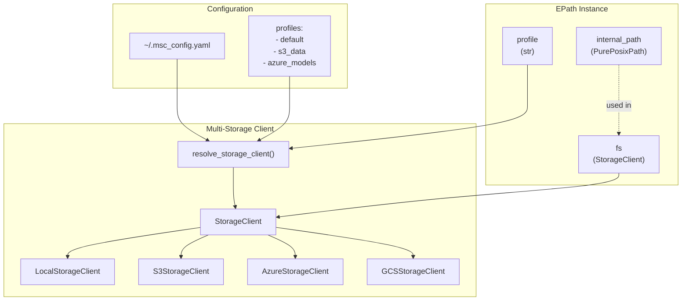
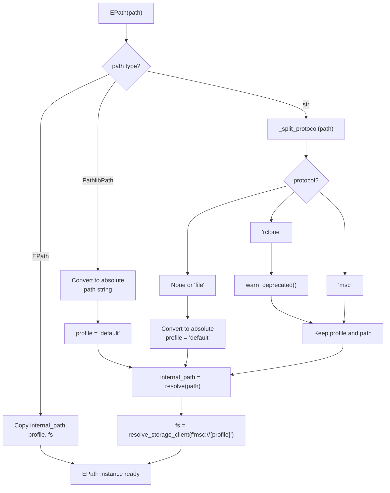
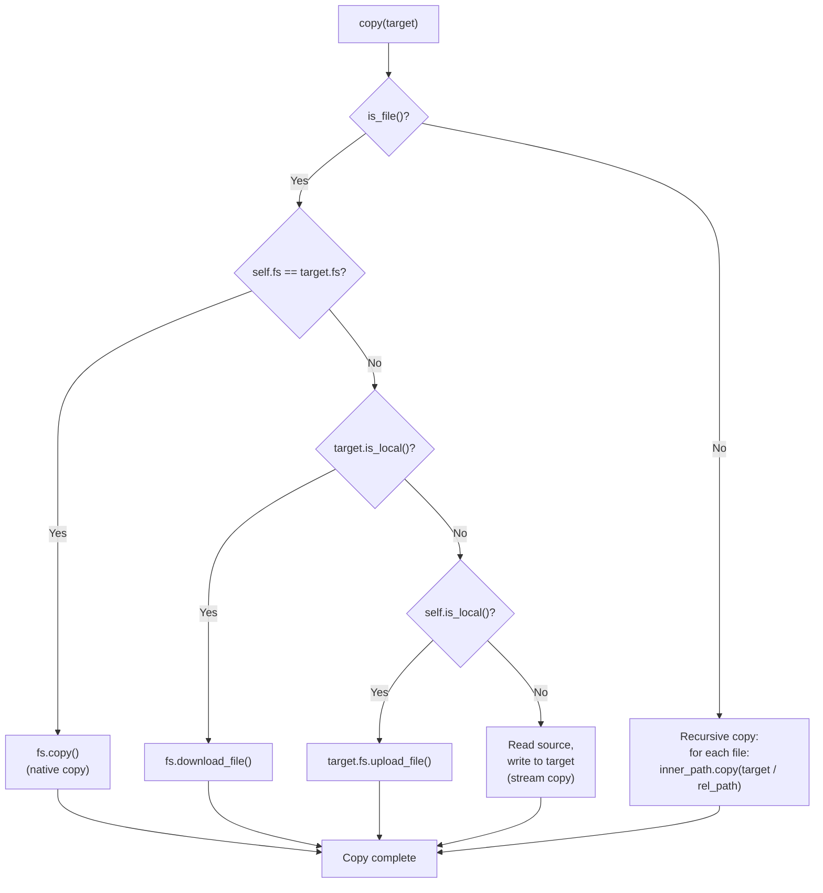
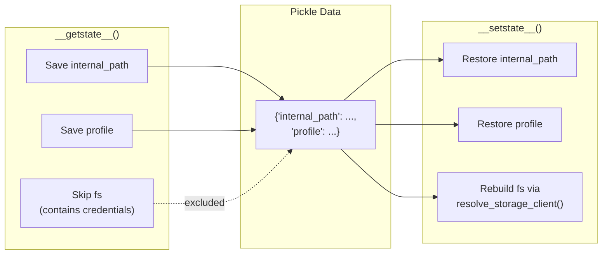
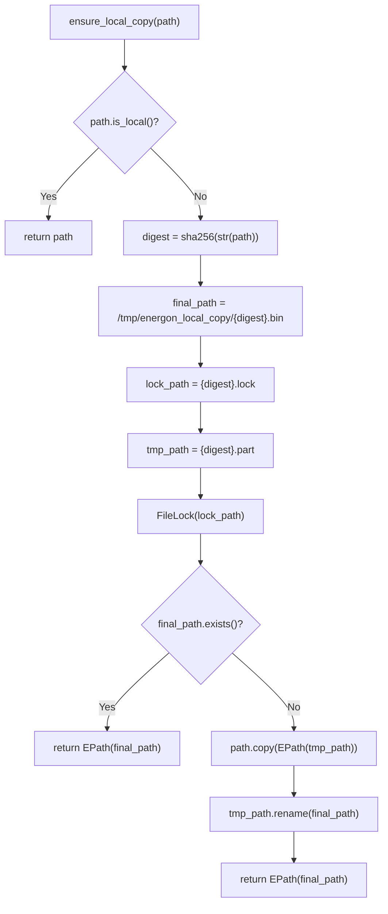

<!-- source: DeepWiki mcp.deepwiki.com · repo NVIDIA/Megatron-Energon · page 7.1 EPath Abstraction · fetched 2026-10-26 -->

# EPath Abstraction

<details>
<summary>Relevant source files</summary>

The following files were used as context for generating this wiki page:

- [docs/source/advanced/remote_dataset.md](docs/source/advanced/remote_dataset.md)
- [src/megatron/energon/epathlib/epath.py](src/megatron/energon/epathlib/epath.py)
- [src/megatron/energon/local_copy.py](src/megatron/energon/local_copy.py)
- [tests/test_epathlib.py](tests/test_epathlib.py)

</details>


## Purpose and Scope

The `EPath` class provides a unified, pathlib-like interface for accessing files across local filesystems and cloud storage backends. It abstracts away the differences between storage systems, enabling transparent file operations on local disks, Amazon S3, Azure Blob Storage, Google Cloud Storage, and other backends supported by Multi-Storage Client (MSC). This abstraction is foundational to Megatron-Energon's multi-storage capabilities, allowing datasets to reside anywhere without requiring application code changes.

For information about configuring remote datasets and caching strategies, see [Remote Datasets](#7.2).

Sources: [src/megatron/energon/epathlib/epath.py:15-25]()

## Architecture Overview

The `EPath` class wraps the Multi-Storage Client library to provide familiar path operations while maintaining storage backend abstraction. Each `EPath` instance contains three key components: an internal path representation, a profile name for storage configuration, and a reference to the underlying storage client.

**EPath Component Architecture**



Sources: [src/megatron/energon/epathlib/epath.py:27-32](), [src/megatron/energon/epathlib/epath.py:58-61]()

## Protocol Handling and Initialization

`EPath` accepts three types of path specifications: plain strings (treated as local paths), `msc://` URLs for Multi-Storage Client access, and `pathlib.Path` objects. The `_split_protocol` method parses URL-style paths to extract the protocol, profile name, and internal path.

**Protocol Parsing Flow**



Sources: [src/megatron/energon/epathlib/epath.py:34-61](), [src/megatron/energon/epathlib/epath.py:97-103]()

### Protocol Format

The URL format for remote paths follows this structure:

```
msc://profile_name/path/to/file
```

| Component | Description | Example |
|-----------|-------------|---------|
| Protocol | Always `msc://` for Multi-Storage Client | `msc://` |
| Profile | Name from `~/.msc_config.yaml` | `s3_data`, `azure_models`, `default` |
| Path | Absolute path within the storage backend | `/datasets/images/000.tar` |

The `default` profile maps to the local filesystem. When a plain path like `/tmp/file.txt` is provided, it is automatically converted to use the `default` profile.

Sources: [src/megatron/energon/epathlib/epath.py:16-24](), [src/megatron/energon/epathlib/epath.py:46-50]()

### Path Resolution

The `_resolve` static method handles path normalization by removing `.` and `..` components. This ensures consistent path representation across different storage backends.

```python
# Examples from test suite:
# "msc://s3/tmp/path/.././subpath.txt" -> "msc://s3/tmp/subpath.txt"
# "msc://s3/tmp/path/subpath.txt" / ".." / "subpath2.txt" -> "msc://s3/tmp/path/subpath2.txt"
```

Sources: [src/megatron/energon/epathlib/epath.py:75-95](), [tests/test_epathlib.py:143-154]()

## Core API Operations

`EPath` implements operations similar to `pathlib.Path`, delegating to the underlying `StorageClient`. All file operations use the `_internal_str_path` property to access the normalized path string.

### File I/O Operations

| Method | Parameters | Returns | Description |
|--------|-----------|---------|-------------|
| `open()` | `mode`, `block_size`, `prefetch_file` | `TextIO` or `BinaryIO` | Open file with specified mode |
| `read_text()` | - | `str` | Read entire file as text |
| `read_bytes()` | - | `bytes` | Read entire file as bytes |
| `write_text()` | `text: str` | `None` | Write text to file |
| `write_bytes()` | `data: bytes` | `None` | Write bytes to file |

Sources: [src/megatron/energon/epathlib/epath.py:110-148]()

### File System Operations

| Method | Parameters | Returns | Description |
|--------|-----------|---------|-------------|
| `is_file()` | - | `bool` | Check if path points to a file |
| `is_dir()` | - | `bool` | Check if path points to a directory |
| `is_local()` | - | `bool` | Check if path uses local filesystem |
| `size()` | - | `int` | Get file size in bytes |
| `glob()` | `pattern: str` | `Generator[EPath]` | Find paths matching pattern |
| `mkdir()` | `exist_ok`, `parents` | `None` | Create directory (no-op for remote) |
| `unlink()` | - | `None` | Delete file |

Sources: [src/megatron/energon/epathlib/epath.py:190-229]()

### Cross-Storage Copy Operations

The `copy` method handles transfers between different storage backends by detecting the source and destination types and selecting the optimal strategy:

**Copy Operation Decision Tree**



Sources: [src/megatron/energon/epathlib/epath.py:150-171]()

## Path Manipulation

`EPath` supports pathlib-style path composition and navigation using the `/` operator and property accessors.

### Path Properties and Composition

| Operation | Code Example | Result |
|-----------|--------------|--------|
| Get filename | `path.name` | `"file.txt"` |
| Get parent | `path.parent` | Parent directory path |
| Join paths | `path / "subdir" / "file.txt"` | Composed path |
| Change suffix | `path.with_suffix(".json")` | Path with new extension |
| Relative path | `path.relative_to(other)` | Relative path string |
| Get URL | `path.url` | `"msc://profile/path"` or absolute local path |

The `/` operator handles several special cases:
- If `other` is an `EPath`, it returns `other` (always absolute)
- If `other` starts with `/` or contains `://`, it creates a new `EPath` from `other`
- Otherwise, it appends `other` to `self.internal_path`

Sources: [src/megatron/energon/epathlib/epath.py:174-245]()

### URL Representation

The `url` property returns the canonical string representation:
- Local paths: Returns the absolute filesystem path (e.g., `/tmp/file.txt`)
- Remote paths: Returns the MSC URL (e.g., `msc://s3_data/bucket/file.txt`)

This property is used by `__str__()` and `__repr__()` for string conversion.

Sources: [src/megatron/energon/epathlib/epath.py:184-188](), [src/megatron/energon/epathlib/epath.py:252-256]()

## Serialization and Pickling

`EPath` implements custom serialization via `__getstate__` and `__setstate__` to avoid leaking storage credentials when pickled. The `fs` (StorageClient) attribute is excluded from serialization and reconstructed on deserialization using `resolve_storage_client`.

**Serialization Flow**



This design ensures that `EPath` objects can be safely passed between processes (e.g., to DataLoader workers) without exposing sensitive credentials in the serialized form.

Sources: [src/megatron/energon/epathlib/epath.py:63-73](), [tests/test_epathlib.py:163-166](), [tests/test_epathlib.py:212-216]()

### Multiprocessing Support

`EPath` works correctly with both `fork` and `spawn` multiprocessing start methods. When using `spawn`, the entire `EPath` object is pickled and unpickled in the child process, triggering the credential-safe serialization mechanism. When using `fork`, the `fs` attribute is copied directly but remains functional.

Sources: [tests/test_epathlib.py:218-238](), [tests/test_epathlib.py:240-263]()

## Local Copy Helper

For operations requiring local file access (e.g., certain decoders or external tools), the `ensure_local_copy` function automatically downloads remote files to a temporary directory with locking to prevent race conditions.

**ensure_local_copy() Flow**



The function uses a SHA-256 hash of the path string as the filename to ensure unique, deterministic local paths. File locking prevents multiple processes from downloading the same file simultaneously.

Sources: [src/megatron/energon/local_copy.py:15-49]()

### Usage Pattern

```python
# Remote file that needs local access
remote_path = EPath("msc://s3_data/models/checkpoint.pt")

# Ensure it's available locally
local_path = ensure_local_copy(remote_path)

# Now local_path points to /tmp/energon_local_copy/{hash}.bin
# Can be used with tools requiring filesystem access
```

The temporary directory defaults to `/tmp/energon_local_copy` but can be customized by modifying `LOCAL_COPY_TMP_DIR`.

Sources: [src/megatron/energon/local_copy.py:12-12](), [src/megatron/energon/local_copy.py:31-47]()

## Code Entity Reference

This table maps conceptual components to their implementation locations:

| Component | Class/Function | File | Description |
|-----------|---------------|------|-------------|
| Main abstraction | `EPath` | [src/megatron/energon/epathlib/epath.py:15-267]() | Primary path abstraction class |
| Protocol parsing | `EPath._split_protocol()` | [src/megatron/energon/epathlib/epath.py:97-103]() | Extract protocol, profile, path from URL |
| Path normalization | `EPath._resolve()` | [src/megatron/energon/epathlib/epath.py:75-95]() | Remove `.` and `..` components |
| Storage client resolution | `msc.resolve_storage_client()` | Multi-Storage Client library | Get `StorageClient` for profile |
| Local copy utility | `ensure_local_copy()` | [src/megatron/energon/local_copy.py:15-49]() | Download remote files to temp directory |
| Internal path representation | `PurePosixPath` | Python stdlib | POSIX path without filesystem access |
| Storage backend | `msc.StorageClient` | Multi-Storage Client library | Abstract storage interface |

Sources: [src/megatron/energon/epathlib/epath.py:1-267](), [src/megatron/energon/local_copy.py:1-50]()

---

