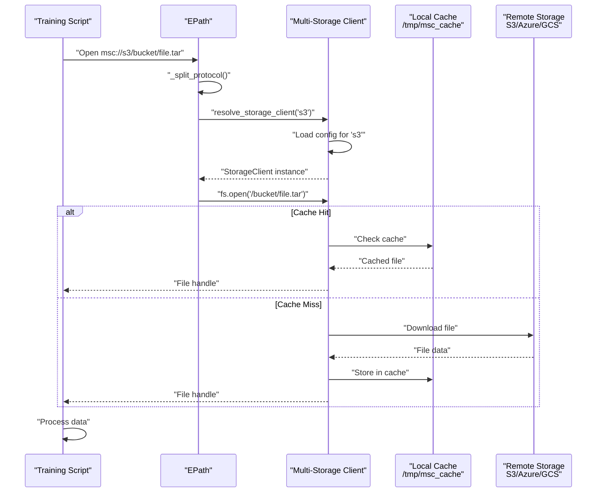
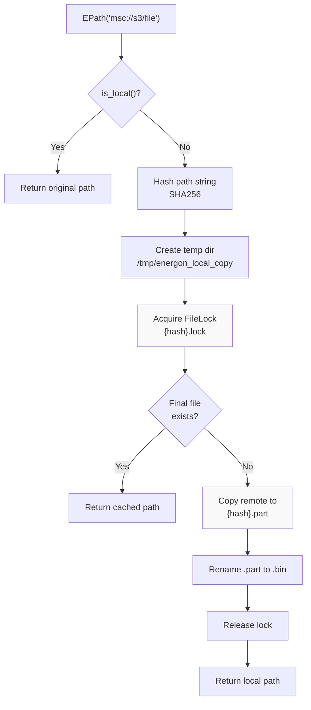

<!-- source: DeepWiki mcp.deepwiki.com · repo NVIDIA/Megatron-Energon · page 7.2 Remote Datasets · fetched 2026-10-26 -->

# Remote Datasets

<details>
<summary>Relevant source files</summary>

The following files were used as context for generating this wiki page:

- [docs/source/advanced/remote_dataset.md](docs/source/advanced/remote_dataset.md)
- [pyproject.toml](pyproject.toml)
- [src/megatron/energon/epathlib/epath.py](src/megatron/energon/epathlib/epath.py)
- [src/megatron/energon/flavors/crude.py](src/megatron/energon/flavors/crude.py)
- [src/megatron/energon/flavors/webdataset/sample_decoder.py](src/megatron/energon/flavors/webdataset/sample_decoder.py)
- [src/megatron/energon/local_copy.py](src/megatron/energon/local_copy.py)
- [tests/test_epathlib.py](tests/test_epathlib.py)
- [uv.lock](uv.lock)

</details>


This page covers the practical aspects of working with datasets stored on remote cloud storage systems (S3, Azure Blob Storage, Google Cloud Storage, etc.) within Megatron-Energon. It explains installation requirements, configuration setup, caching strategies, and usage patterns for remote data access.

For information about the underlying EPath API and protocol handling, see [EPath Abstraction](#7.1).

---

## Overview

Megatron-Energon supports transparent access to datasets stored on remote object storage through the Multi-Storage Client (MSC) library. This enables training and validation directly from cloud storage without requiring data to be copied locally first. Remote dataset access is achieved through `msc://` protocol URLs that can be used anywhere a local path would be accepted.

Sources: [docs/source/advanced/remote_dataset.md:1-77](), [src/megatron/energon/epathlib/epath.py:15-25]()

---

## Installation

### Required Dependencies

To use remote datasets, install Megatron-Energon with the appropriate storage backend extras. Available storage backends include:

| Extra | Storage Backend | Use Case |
|-------|----------------|----------|
| `s3` | Amazon S3 | AWS S3 and S3-compatible storage |
| `aistore` | AIStore | High-performance object storage |
| `azure-storage-blob` | Azure Blob Storage | Microsoft Azure storage |
| `google-cloud-storage` | Google Cloud Storage | GCP storage buckets |
| `oci` | Oracle Cloud Infrastructure | OCI object storage |
| `huggingface` | Hugging Face Hub | Access datasets from HF Hub |

Install one or more backends:

```bash
pip install megatron-energon[s3,azure-storage-blob]
```

The base `multi-storage-client` package is automatically included as a core dependency.

Sources: [pyproject.toml:52-70](), [docs/source/advanced/remote_dataset.md:10-21]()

---

## Multi-Storage Client Configuration

### Configuration File Setup

MSC uses a YAML configuration file to define storage profiles. Create a configuration file at `~/.msc_config.yaml` or specify a custom location via the `MSC_CONFIG` environment variable:

```bash
export MSC_CONFIG=/path/to/msc_config.yaml
```

### Basic Configuration Structure

```yaml
# Define storage profiles
profiles:
  s3_data:
    type: s3
    endpoint: https://s3.amazonaws.com
    region: us-west-2
    access_key_id: ${AWS_ACCESS_KEY_ID}
    secret_access_key: ${AWS_SECRET_ACCESS_KEY}
  
  azure_datasets:
    type: azure
    account_name: mystorageaccount
    account_key: ${AZURE_STORAGE_KEY}
  
  gcs_models:
    type: gcs
    project: my-project
    credentials_file: /path/to/credentials.json

# Optional: Enable local caching
cache:
  size: 500G
  use_etag: true
  eviction_policy:
    policy: "fifo"
    refresh_interval: 3600
  cache_backend:
    cache_path: /tmp/msc_cache
```

### Rclone Compatibility

MSC supports reading from existing rclone configurations as a fallback. The system automatically resolves profiles from both MSC and rclone configs.

Sources: [docs/source/advanced/remote_dataset.md:23-43](), [src/megatron/energon/epathlib/epath.py:61-73]()

---

## Remote Dataset URL Syntax

### URL Format

Remote datasets are accessed using the `msc://` protocol:

```
msc://PROFILE_NAME/PATH
```

Where:
- `PROFILE_NAME`: The name of a storage profile defined in MSC config
- `PATH`: The path within that storage backend (bucket/container and object path)

### URL Examples

```python
# S3 dataset
"msc://s3_data/my-bucket/datasets/webdataset-train"

# Azure Blob Storage
"msc://azure_datasets/container/path/to/dataset"

# Google Cloud Storage
"msc://gcs_models/bucket-name/checkpoints"

# Local filesystem (using 'default' profile)
"msc://default/data/local-dataset"
```

### Protocol Resolution

```mermaid
graph LR
    URL["msc://profile/path"]
    PARSE["EPath._split_protocol"]
    RESOLVE["msc.resolve_storage_client"]
    CONFIG["MSC Config<br/>~/.msc_config.yaml"]
    CLIENT["StorageClient"]
    
    URL --> PARSE
    PARSE -->|"protocol='msc'<br/>profile='profile'<br/>path='/path'"| RESOLVE
    RESOLVE --> CONFIG
    CONFIG -->|"profile settings"| CLIENT
    CLIENT -->|"fs operations"| FS["Storage Backend<br/>S3/Azure/GCS/etc"]
    
    style PARSE fill:#f9f9f9
    style RESOLVE fill:#f9f9f9
    style CLIENT fill:#f9f9f9
```



Sources: [src/megatron/energon/epathlib/epath.py:34-62](), [src/megatron/energon/epathlib/epath.py:98-103]()

---

## Using Remote Datasets in Practice

### In Dataset Loading Functions

Remote URLs can be used directly with `get_train_dataset()` and `get_val_dataset()`:

```python
from megatron.energon import get_train_dataset

ds = get_train_dataset(
    'msc://s3_data/training-bucket/webdataset-v2',
    batch_size=32,
    shuffle_buffer_size=1000,
    max_samples_per_sequence=512,
)
```

### In Metadataset Configurations

Remote paths work seamlessly in metadataset YAML files:

```yaml
# metadataset.yaml
__module__: metadataset

splits:
  train:
    datasets:
      - path: msc://s3_data/bucket/dataset-1
        weight: 0.6
      - path: msc://azure_datasets/container/dataset-2
        weight: 0.4
  
  val:
    path: msc://gcs_models/validation-bucket/val-set
```

### With CLI Tools

Remote URLs are supported in all CLI commands:

```bash
# Prepare a remote dataset
energon prepare msc://s3_data/raw-data/tars --output-path msc://s3_data/prepared-data

# Mount a remote dataset for inspection
energon mount msc://s3_data/dataset /mnt/dataset

# Lint a remote dataset
energon lint msc://azure_datasets/webdataset-path
```

Note: Preparation and linting operations on remote storage may be slower due to network latency.

Sources: [docs/source/advanced/remote_dataset.md:61-76](), [src/megatron/energon/epathlib/epath.py:126-149]()

---

## Remote Dataset Access Workflow



Sources: [src/megatron/energon/epathlib/epath.py:34-73](), [src/megatron/energon/epathlib/epath.py:126-132]()

---

## Caching Strategies

### Local Caching Configuration

MSC provides built-in caching to reduce network traffic and improve performance. Configure caching in the MSC config file:

```yaml
cache:
  # Maximum cache size (supports K, M, G, T suffixes)
  size: 500G
  
  # Use ETags for cache invalidation
  use_etag: true
  
  # Eviction policy configuration
  eviction_policy:
    policy: "fifo"  # Options: fifo, lru, lfu
    refresh_interval: 3600  # Check interval in seconds
  
  # Cache storage location
  cache_backend:
    cache_path: /fast/nvme/msc_cache  # Prefer fast local storage
```

### Cache Location Recommendations

| Storage Type | Performance | Use Case |
|--------------|-------------|----------|
| Local NVMe SSD | Excellent | Production training with high I/O demands |
| Local SSD | Good | General training workloads |
| Lustre/Network FS | Fair | Shared storage in cluster environments |
| tmpfs/RAM | Excellent | Small datasets, limited by memory |

### Cache Behavior

- **First Access**: File is downloaded from remote storage and cached locally
- **Subsequent Access**: Served from local cache (validated by ETag if enabled)
- **Cache Full**: Oldest entries evicted based on configured policy
- **Stale Data**: ETags ensure cached files match remote versions

Sources: [docs/source/advanced/remote_dataset.md:26-37]()

---

## Local Copy Mechanism

### When Local Files Are Required

Some operations require actual local file paths (not file handles). For these cases, Megatron-Energon provides the `ensure_local_copy()` function:

```python
from megatron.energon.local_copy import ensure_local_copy
from megatron.energon.epathlib import EPath

remote_path = EPath("msc://s3_data/models/checkpoint.pt")
local_path = ensure_local_copy(remote_path)
# local_path is now a local EPath at /tmp/energon_local_copy/<hash>.bin
```

### Local Copy Workflow



### Implementation Details

- **Location**: Files are copied to `/tmp/energon_local_copy/`
- **Naming**: Files are named using SHA256 hash of the original path
- **Concurrency**: `FileLock` prevents race conditions when multiple processes access the same file
- **Cleanup**: Files persist across runs to avoid re-downloading; manual cleanup required

Sources: [src/megatron/energon/local_copy.py:1-50]()

---

## EPath Operations on Remote Datasets

### File Operations

EPath provides pathlib-like operations that work transparently across local and remote storage:

```python
from megatron.energon.epathlib import EPath

# Basic file operations
remote_file = EPath("msc://s3_data/dataset/file.tar")
remote_file.is_file()  # Check if file exists
remote_file.size()      # Get file size
remote_file.read_bytes()  # Read entire file
remote_file.write_bytes(b"data")  # Write to file

# Directory operations
remote_dir = EPath("msc://s3_data/dataset")
remote_dir.is_dir()  # Check if directory exists

# Globbing
for tar_file in remote_dir.glob("*.tar"):
    print(tar_file)

# Path manipulation
sub_path = remote_dir / "subset" / "file.txt"
parent = sub_path.parent
```

### Cross-Storage Copying

EPath supports copying files between different storage backends:

```python
# Copy from S3 to Azure
source = EPath("msc://s3_data/source/dataset.tar")
target = EPath("msc://azure_datasets/backup/dataset.tar")
source.copy(target)

# Copy from remote to local
remote = EPath("msc://gcs_models/checkpoint.pt")
local = EPath("/local/storage/checkpoint.pt")
remote.copy(local)
```

### Copy Implementation Strategy

The `copy()` method automatically selects the optimal strategy:
1. **Same filesystem**: Uses native copy/move operations [epath.py:158-159]()
2. **Remote to local**: Uses `download_file()` [epath.py:160-161]()
3. **Local to remote**: Uses `upload_file()` [epath.py:162-163]()
4. **Different remotes**: Streams through memory [epath.py:165-166]()

Sources: [src/megatron/energon/epathlib/epath.py:110-267](), [tests/test_epathlib.py:174-216]()

---

## Storage Backend Configuration Examples

### Amazon S3

```yaml
profiles:
  s3_production:
    type: s3
    endpoint: https://s3.amazonaws.com
    region: us-west-2
    access_key_id: ${AWS_ACCESS_KEY_ID}
    secret_access_key: ${AWS_SECRET_ACCESS_KEY}
    # Optional: S3-compatible endpoints
    # endpoint: https://minio.example.com
```

Usage:
```python
dataset_path = "msc://s3_production/my-bucket/datasets/train"
```

### Azure Blob Storage

```yaml
profiles:
  azure_training:
    type: azure
    account_name: myaccount
    account_key: ${AZURE_STORAGE_KEY}
    # Alternative: Use connection string
    # connection_string: ${AZURE_CONNECTION_STRING}
```

Usage:
```python
dataset_path = "msc://azure_training/container-name/path/to/dataset"
```

### Google Cloud Storage

```yaml
profiles:
  gcs_datasets:
    type: gcs
    project: my-gcp-project
    credentials_file: /path/to/service-account.json
    # Alternative: Use default credentials
    # use_default_credentials: true
```

Usage:
```python
dataset_path = "msc://gcs_datasets/bucket-name/datasets/validation"
```

### AIStore

```yaml
profiles:
  aistore_cluster:
    type: aistore
    endpoint: http://aistore.cluster.local:8080
```

Usage:
```python
dataset_path = "msc://aistore_cluster/ais://bucket/dataset"
```

Sources: [pyproject.toml:52-70](), [docs/source/advanced/remote_dataset.md:23-25]()

---

## Multiprocessing and Serialization

### Pickling Support

EPath instances can be safely pickled and unpickled across process boundaries. Credentials are intentionally excluded from serialization:

```python
from megatron.energon.epathlib import EPath
import pickle

path = EPath("msc://s3_data/dataset/file.tar")
serialized = pickle.dumps(path)
# Credentials are NOT included in serialized data
deserialized = pickle.loads(serialized)
# StorageClient is re-initialized on unpickling
```

### Implementation Details

The `__getstate__()` and `__setstate__()` methods handle serialization:
- **Saved**: `internal_path`, `profile` name [epath.py:63-68]()
- **Excluded**: `fs` (StorageClient instance) containing credentials
- **Restored**: `fs` is re-created from profile on unpickling [epath.py:70-73]()

### Multiprocessing Compatibility

EPath works correctly with both `fork` and `spawn` multiprocessing start methods:

```python
import multiprocessing
from megatron.energon.epathlib import EPath

def worker(path: EPath):
    # Path is automatically re-initialized in worker process
    data = path.read_bytes()
    return len(data)

if __name__ == "__main__":
    path = EPath("msc://s3_data/dataset/file.tar")
    
    # Works with spawn (pickling)
    multiprocessing.set_start_method("spawn")
    with multiprocessing.Pool(4) as pool:
        results = pool.map(worker, [path] * 4)
```

Sources: [src/megatron/energon/epathlib/epath.py:63-73](), [tests/test_epathlib.py:218-263]()

---

## Best Practices

### Performance Optimization

1. **Enable Local Caching**: Always configure MSC caching for production workloads to minimize redundant downloads
2. **Use Fast Storage**: Configure cache on NVMe/SSD rather than network filesystems when possible
3. **Optimize Cache Size**: Set cache size based on working set size and available storage
4. **Enable ETag Validation**: Use `use_etag: true` to ensure cache coherency without sacrificing performance

### Network Efficiency

1. **Batch Operations**: When preparing datasets remotely, prepare locally first, then upload the completed dataset
2. **Glob Carefully**: Remote glob operations list all objects, which can be slow for large directories
3. **Stream When Possible**: ITarReader streams tar files without downloading entire archives
4. **Monitor Bandwidth**: Track data transfer costs in cloud environments

### Configuration Management

1. **Use Environment Variables**: Store credentials in environment variables referenced in MSC config
2. **Profile Per Environment**: Create separate profiles for development, staging, and production
3. **Version Control**: Keep sanitized MSC configs (without credentials) in version control
4. **Shared Configs**: Use network-accessible config files for cluster-wide consistency

### Debugging and Troubleshooting

1. **Test Connectivity**: Verify storage backend access before training:
   ```python
   from megatron.energon.epathlib import EPath
   test_path = EPath("msc://profile/bucket/test.txt")
   test_path.write_text("test")
   assert test_path.is_file()
   test_path.unlink()
   ```

2. **Check Cache Status**: Monitor cache directory usage and eviction rates
3. **Enable MSC Logging**: Set MSC log level for detailed debugging
4. **Verify Credentials**: Ensure credential environment variables are set correctly

### Security Considerations

1. **Credential Storage**: Never commit credentials to version control
2. **Use IAM Roles**: Prefer role-based access over static credentials when possible
3. **Restrict Permissions**: Use minimal required permissions (read-only for training data)
4. **Audit Access**: Monitor storage access logs for unusual patterns

Sources: [docs/source/advanced/remote_dataset.md:26-37]()

---

## Common Patterns and Examples

### Pattern: Mixed Local and Remote Datasets

Combine local and remote datasets in a single metadataset:

```yaml
__module__: metadataset

splits:
  train:
    blend:
      - path: /local/nvme/cached-dataset
        weight: 0.7
      - path: msc://s3_data/supplemental-dataset
        weight: 0.3
```

### Pattern: Progressive Data Loading

Start training on cached data while remote data downloads:

```python
from megatron.energon import get_train_dataset
from megatron.energon.epathlib import EPath

# Ensure critical data is cached
critical_path = EPath("msc://s3_data/critical-dataset")
for file in critical_path.glob("*.tar"):
    _ = file.size()  # Triggers cache download

# Start training
dataset = get_train_dataset(critical_path, batch_size=32)
```

### Pattern: Disaster Recovery

Automatically fail over to backup storage:

```python
from megatron.energon.epathlib import EPath

primary = EPath("msc://primary_s3/dataset")
backup = EPath("msc://backup_azure/dataset")

dataset_path = primary if primary.is_dir() else backup
```

Sources: [docs/source/advanced/remote_dataset.md:61-76]()

---

