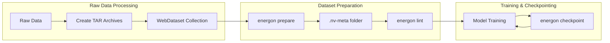
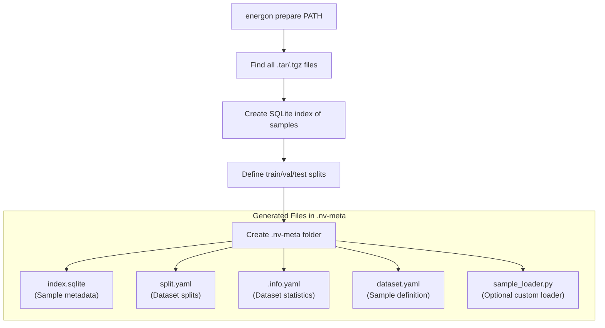
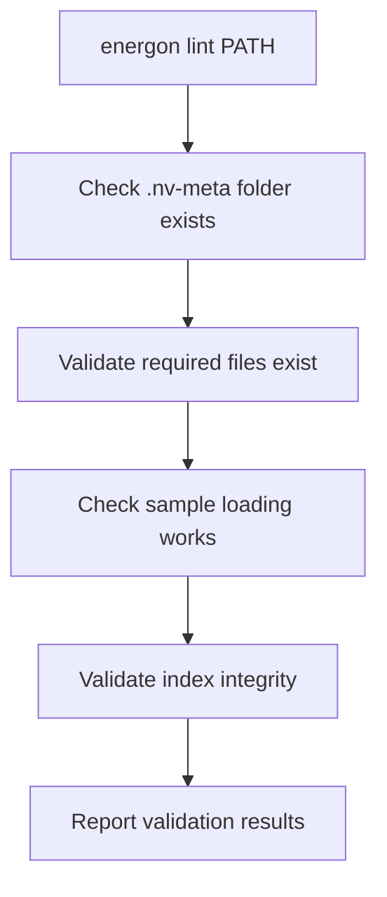
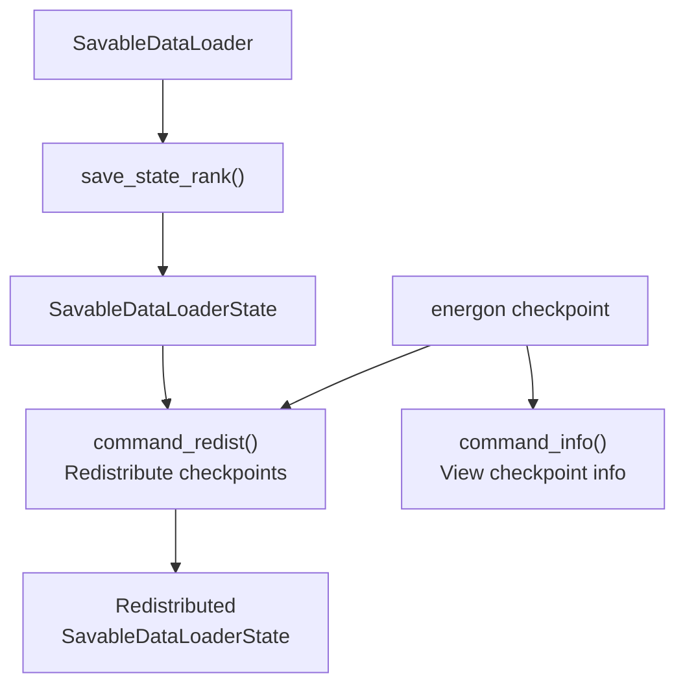
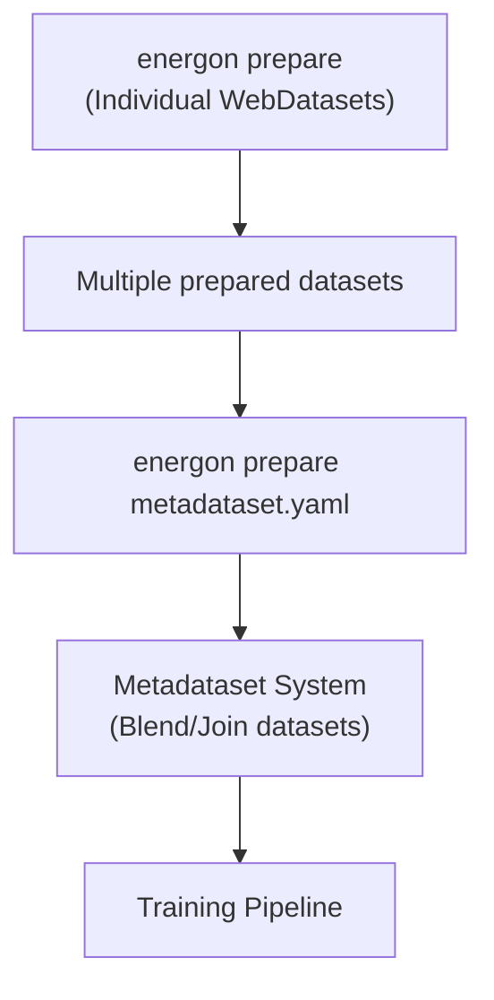

<!-- source: DeepWiki mcp.deepwiki.com · repo NVIDIA/Megatron-Energon · page 8 CLI Tools and Utilities · fetched 2026-10-26 -->

# Tools and CLI Commands

<details>
<summary>Relevant source files</summary>

The following files were used as context for generating this wiki page:

- [src/megatron/energon/flavors/webdataset/indexing.py](src/megatron/energon/flavors/webdataset/indexing.py)
- [src/megatron/energon/flavors/webdataset/itar.py](src/megatron/energon/flavors/webdataset/itar.py)
- [src/megatron/energon/flavors/webdataset/itar_reader.py](src/megatron/energon/flavors/webdataset/itar_reader.py)
- [src/megatron/energon/flavors/webdataset/prepare.py](src/megatron/energon/flavors/webdataset/prepare.py)
- [src/megatron/energon/tools/mount.py](src/megatron/energon/tools/mount.py)
- [src/megatron/energon/tools/prepare.py](src/megatron/energon/tools/prepare.py)

</details>


This page documents the command-line interface (CLI) tools provided by Megatron-Energon. These tools help with dataset preparation, validation, and checkpoint management - essential operations when working with large-scale multi-modal datasets. For information about using these datasets programmatically within your code, see [Data Loading System](#3).

## Overview of Available Tools

Megatron-Energon provides the following CLI commands:

| Command | Purpose |
|---------|---------|
| `energon prepare` | Prepares WebDataset archives for use with Energon by creating necessary metadata files |
| `energon lint` | Validates Energon datasets to ensure they meet requirements and can be loaded correctly |
| `energon checkpoint` | Manages training checkpoints for restoring and redistributing saved states |

Let's visualize how these tools fit into the data preparation and training workflow:



Sources: [README.md:64-68](), [src/megatron/energon/tools/prepare.py:130-134]()

## Installation and Access

All CLI tools are installed automatically when you install the Megatron-Energon package:

```bash
pip install megatron-energon
```

After installation, the `energon` command will be available in your environment. You can verify installation by running:

```bash
energon --help
```

Sources: [README.md:43-52](), [docs/source/intro/installation.md:10-18]()

## Dataset Preparation with `energon prepare`

The `energon prepare` command is a powerful tool for preparing WebDataset archives for use with Megatron-Energon. It creates the necessary metadata structures, indexing, and configuration files.

### Command Syntax and Options

```bash
energon prepare [OPTIONS] PATH
```

Key options include:

| Option | Description |
|--------|-------------|
| `--progress/--no-progress` | Show or hide progress bar (default: show) |
| `--split-parts` | Path pattern for parts in the form 'train:train/{000000-009999}.tar' |
| `--exclude` | Exclude tar file paths matching this regex |
| `--num-workers` | Number of workers to use to index tar files (default: 16) |
| `--tar-index-only` | Only (re)generate the tar-index |
| `--shuffle-tars` | If set, the tar files will be shuffled before splitting |

Sources: [src/megatron/energon/tools/prepare.py:85-127]()

### Workflow and Files Generated

When you run `energon prepare`, the tool follows this process:



The tool will guide you through an interactive process to:

1. Identify and index all tar files in your dataset
2. Define train/validation/test splits (by ratio or pattern)
3. Select an appropriate sample type for your dataset
4. Create a mapping from WebDataset fields to your sample fields
5. Generate all required configuration files

Sources: [src/megatron/energon/tools/prepare.py:120-394](), [src/megatron/energon/flavors/webdataset/prepare.py:236-368]()

### Dataset Configuration Files

The `prepare` command creates several important files in the `.nv-meta` folder:

1. `index.sqlite` - A SQLite database containing metadata about all samples in the dataset
2. `split.yaml` - Configuration of train/validation/test splits
3. `.info.yaml` - Basic information about the dataset (shard counts, etc.)
4. `dataset.yaml` - Definition of the sample format and field mappings
5. `sample_loader.py` (optional) - Custom Python code for sample loading

The `dataset.yaml` file is particularly important as it defines how samples are loaded:

```yaml
# Example dataset.yaml
sample_type:
  __module__: "megatron.energon"
  __class__: "ExampleSample"
field_map:
  text: "txt"
  image: "jpg"
```

Alternatively, for more complex cases, a custom sample loader can be used:

```yaml
# Example dataset.yaml with custom loader
sample_type:
  __module__: "megatron.energon"
  __class__: "ExampleSample"
sample_loader: "sample_loader.py:sample_loader"
part_filter: "sample_loader.py:part_filter"
```

Sources: [src/megatron/energon/tools/prepare.py:300-394](), [src/megatron/energon/flavors/webdataset/prepare.py:324-366]()

## Dataset Validation with `energon lint`

The `energon lint` command validates that a dataset meets the requirements for use with Megatron-Energon. While the code for this command isn't explicitly provided in the files you shared, it's mentioned in the README and diagrams.

### Command Syntax

```bash
energon lint PATH
```

### Validation Process

The lint command performs these checks:



This command helps ensure that your dataset is properly prepared and will work correctly with Megatron-Energon's data loading system.

Sources: [README.md:67-68]()

## Checkpoint Management

Based on the provided diagrams, Megatron-Energon includes checkpoint management tools, although the full implementation details aren't in the provided files.

### Checkpoint Commands

The checkpoint tools appear to provide functionality like:



These tools help manage the state of data loaders during training, allowing you to:
- Save the current state of the data loader
- View information about existing checkpoints
- Redistribute checkpoints for different parallelism configurations

This is particularly important for fault tolerance in large-scale distributed training.

Sources: System Architecture Diagrams

## Usage Examples

### Preparing a WebDataset

```bash
# Basic usage
energon prepare /path/to/dataset

# With custom split pattern
energon prepare --split-parts "train:train/{000000-009999}.tar" --split-parts "val:val/{000000-000099}.tar" /path/to/dataset

# With multiple workers for faster indexing
energon prepare --num-workers 32 /path/to/dataset
```

### Validating a Dataset

```bash
# Basic usage
energon lint /path/to/dataset
```

### Working with Checkpoints

```bash
# View checkpoint information (based on diagram inference)
energon checkpoint info /path/to/checkpoint

# Redistribute a checkpoint (based on diagram inference)
energon checkpoint redist --world-size 8 /path/to/checkpoint /path/to/output
```

## Integration with Metadataset System

The CLI tools integrate closely with the Metadataset system for dataset composition:



If you provide a YAML file to `energon prepare` instead of a directory, it will prepare a metadataset configuration that combines multiple individual datasets.

Sources: [src/megatron/energon/tools/prepare.py:136-138]()

## Summary

The Megatron-Energon CLI tools provide a comprehensive suite of utilities for working with large-scale multi-modal datasets:

1. **Dataset Preparation**: `energon prepare` for creating Energon-compatible datasets with proper indexing and configuration
2. **Dataset Validation**: `energon lint` for verifying dataset integrity and compatibility
3. **Checkpoint Management**: Tools for saving, inspecting, and redistributing training checkpoints

These tools integrate with the core data loading infrastructure described in [Data Loading System](#3) and [Metadataset System](#3.1) to provide a complete workflow for preparing and using datasets with Megatron-Energon.

---

