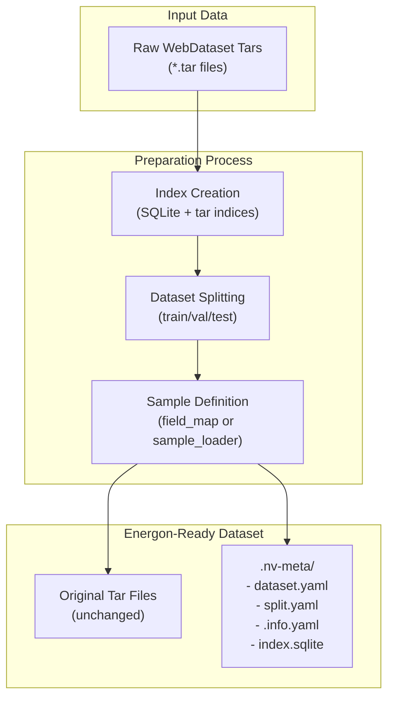
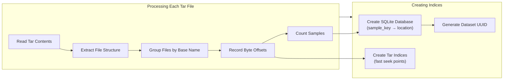
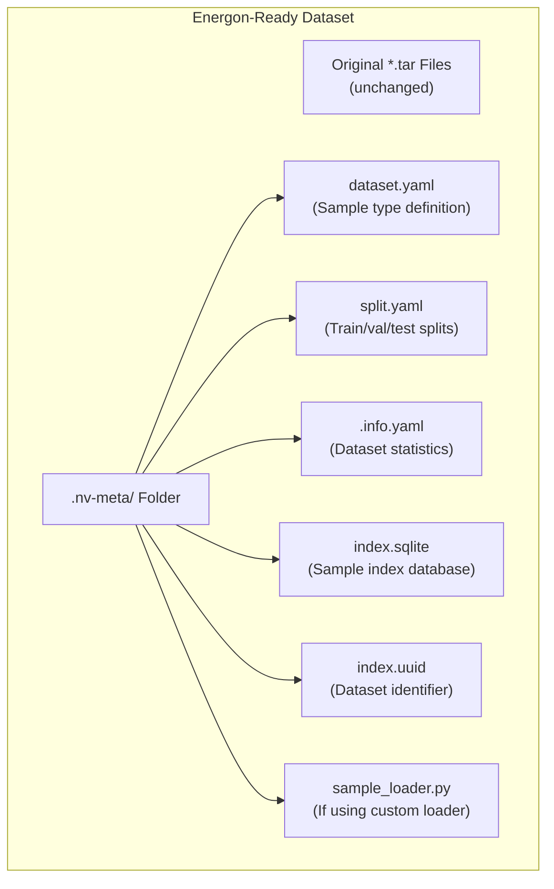
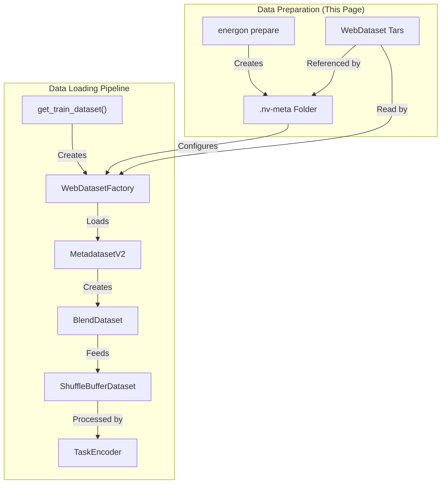

<!-- source: DeepWiki mcp.deepwiki.com · repo NVIDIA/Megatron-Energon · page 8.1 energon prepare · fetched 2026-10-26 -->

# Dataset Preparation

<details>
<summary>Relevant source files</summary>

The following files were used as context for generating this wiki page:

- [src/megatron/energon/flavors/webdataset/indexing.py](src/megatron/energon/flavors/webdataset/indexing.py)
- [src/megatron/energon/flavors/webdataset/prepare.py](src/megatron/energon/flavors/webdataset/prepare.py)
- [src/megatron/energon/tools/prepare.py](src/megatron/energon/tools/prepare.py)

</details>


This page documents the process of preparing datasets for use with Megatron-Energon using the `energon prepare` command-line tool. Dataset preparation is a crucial first step that converts your raw data into a format that Megatron-Energon can efficiently load, index, and access.

This document focuses specifically on the preparation phase. For information about loading and using the prepared datasets, see [Data Loading System](#3), and for information about data decoding options, see [Data Decoding](#4.2).

## Overview of Dataset Preparation

The dataset preparation process transforms standard WebDataset tar archives into a fully-indexed, metadata-enriched format compatible with Megatron-Energon's advanced data loading capabilities. The preparation process does not modify your original data files; instead, it creates additional metadata files that enable efficient random access, train/val/test splits, and specialized data loading.



Sources: [src/megatron/energon/tools/prepare.py:120-135](). [src/megatron/energon/flavors/webdataset/prepare.py:236-269]().

## Prerequisites

Before running the preparation tool, you need:

1. A collection of tar files organized in WebDataset format
2. Each tar file should contain samples with consistent naming patterns
3. Each sample should consist of files with the same basename but different extensions

For more details on the expected WebDataset format, see the [Data Decoding](#4.2) page.

## Using the `energon prepare` Command

The `energon prepare` command is the primary tool for preparing datasets. It offers both an interactive mode and command-line options for customization.

### Basic Usage

```bash
energon prepare /path/to/dataset
```

When run in interactive mode, the tool will:

1. Scan for tar files in the specified directory
2. Ask for train/val/test split ratios
3. Display sample contents for review
4. Guide you through sample type and mapping selection
5. Create the necessary metadata files in a `.nv-meta` folder

### Command Line Options

| Option | Description |
|--------|-------------|
| `--progress/--no-progress` | Show/hide progress bar (default: show) |
| `--split-parts` | Specify custom split patterns (can be used multiple times) |
| `--exclude` | Regex pattern to exclude tar files |
| `--num-workers` | Number of workers for parallel indexing (default: 16) |
| `--tar-index-only` | Only regenerate the tar index |
| `--shuffle-tars` | Shuffle tar files before splitting |

Sources: [src/megatron/energon/tools/prepare.py:85-128]().

### Splitting Datasets

There are two ways to split your dataset:

1. **Ratio-based splitting** (interactive): Specify ratios like "8,1,1" for 80% train, 10% validation, 10% test.
2. **Pattern-based splitting** (via command line): Specify patterns for each split.

For pattern-based splitting:

```bash
energon prepare --split-parts 'train:train/.*' --split-parts 'val:val/.*' /path/to/dataset
```

Sources: [src/megatron/energon/tools/prepare.py:174-192](). [src/megatron/energon/flavors/webdataset/prepare.py:330-367]().

## Dataset Indexing Process

During preparation, Megatron-Energon creates indexes that enable efficient random access to samples within tar archives. This is a critical step that makes the dataset usable with Megatron-Energon's advanced data loading features.



Sources: [src/megatron/energon/flavors/webdataset/prepare.py:109-189](). [src/megatron/energon/flavors/webdataset/indexing.py:14-108]().

## Sample Type and Loading Definition

After indexing, you'll define how your dataset samples should be interpreted. Megatron-Energon offers several built-in sample types, and you'll need to choose one or create a custom type.

### Sample Types

When running `energon prepare`, you'll be presented with available sample types, such as:

- `CaptioningSample`: For image-caption pairs
- `ImageSample`: For image-only datasets
- `TextSample`: For text-only datasets
- `VQASample`: For visual question answering
- And many others

The sample type defines the expected structure and data types for each sample.

Sources: [docs/source/basic/data_prep.md:161-229]().

### Sample Loading Methods

There are three ways to define how raw data is loaded into your chosen sample type:

1. **Field Map** (simplest): Direct mapping from file extensions to sample fields
2. **Sample Loader** (flexible): Custom Python code for more complex conversions
3. **CrudeWebdataset** (advanced): Raw data passed to TaskEncoder for processing

Let's examine each method:

#### Field Map

A field map directly maps file extensions to sample attributes:

```yaml
# Example dataset.yaml with field map
sample_type:
  __module__: megatron.energon
  __class__: CaptioningSample
field_map:
  image: jpg
  caption: txt
```

This approach works well for simple datasets where files map directly to sample fields.

#### Sample Loader

For more complex data transformations, you can use a custom sample loader:

```yaml
# Example dataset.yaml with sample loader
sample_type:
  __module__: megatron.energon
  __class__: OCRSample
sample_loader: sample_loader.py:sample_loader
part_filter: sample_loader.py:part_filter
```

The tool will generate a template `sample_loader.py` file that you can customize.

#### CrudeWebdataset

For the most complex scenarios, you can select `CrudeWebdataset` during preparation, which defers all processing to your TaskEncoder:

```yaml
# Example dataset.yaml for CrudeWebdataset
__module__: megatron.energon
__class__: CrudeWebdataset
```

Sources: [src/megatron/energon/tools/prepare.py:260-292](). [docs/source/basic/data_prep.md:231-347]().

## Output Directory Structure

After running `energon prepare`, your dataset directory will contain:



Sources: [src/megatron/energon/flavors/webdataset/prepare.py:277-307](). [docs/source/basic/data_prep.md:352-371]().

### Key Metadata Files

#### dataset.yaml

This file defines how samples are loaded from the WebDataset tar files. It specifies:
- The sample type class to use
- Either a field map or a sample loader reference
- Optional part filters to include/exclude certain file types

#### split.yaml

This file defines the train/validation/test splits:
```yaml
exclude: []  # Optional excluded samples
split_parts:
  train:
    - path/to/shard1.tar
    - path/to/shard2.tar
  val:
    - path/to/shard3.tar
  test:
    - path/to/shard4.tar
```

#### .info.yaml

Contains statistics about the dataset:
```yaml
shard_counts:
  path/to/shard1.tar: 1223
  path/to/shard2.tar: 1420
  path/to/shard3.tar: 1418
  path/to/shard4.tar: 1358
```

Sources: [docs/source/basic/data_prep.md:373-440]().

## Integration with Data Loading Pipeline

The prepared dataset integrates into Megatron-Energon's data loading pipeline as the entry point for all training and validation data.



Sources: [docs/source/basic/data_prep.md:10-16]().

## Handling Special Cases

### Duplicate Keys

The preparation tool checks for duplicate sample keys within your dataset. Duplicate keys are problematic because:
1. They prevent using the dataset in joined datasets
2. They can cause unexpected behavior during training

If duplicates are found, you'll see a warning and can choose to continue or abort.

Sources: [src/megatron/energon/tools/prepare.py:222-236]().

### Custom Sample Types

If none of the built-in sample types fit your needs, you have two options:
1. Extend Megatron-Energon with a new sample type (recommended for common patterns)
2. Use `CrudeWebdataset` and handle all processing in your TaskEncoder

Sources: [src/megatron/energon/tools/prepare.py:284-292]().

### Remote Datasets

When preparing datasets stored in remote storage systems, be aware that SQLite index operations require local file system access. The tool will automatically handle this by creating the index locally and then optionally copying it to the remote location.

Sources: [src/megatron/energon/flavors/webdataset/indexing.py:36-42]().

## Best Practices

1. **Unique Sample Keys**: Ensure each sample has a unique identifier
2. **Balanced Shards**: Try to have roughly equal numbers of samples per shard
3. **Consistent Structure**: Maintain consistent file naming and structure within shards
4. **Verify Sample Loading**: After preparation, test loading a few samples to verify correct configuration
5. **Maintain Original Data**: Keep original tar files unchanged for reproducibility

## Troubleshooting

| Issue | Solution |
|-------|----------|
| No tar files found | Check path and file extensions |
| Duplicate keys detected | Consider regenerating your dataset with unique keys |
| Invalid sample loader | Check for syntax errors or missing dependencies |
| Sample decoding failures | Verify file formats match expected decoders |
| SQLite permission errors | Check directory permissions |

---

