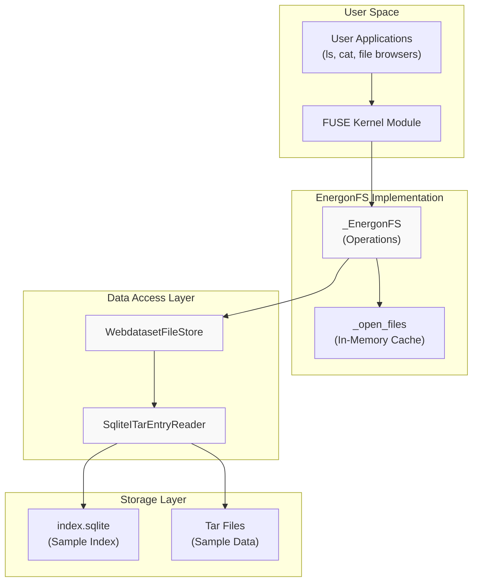
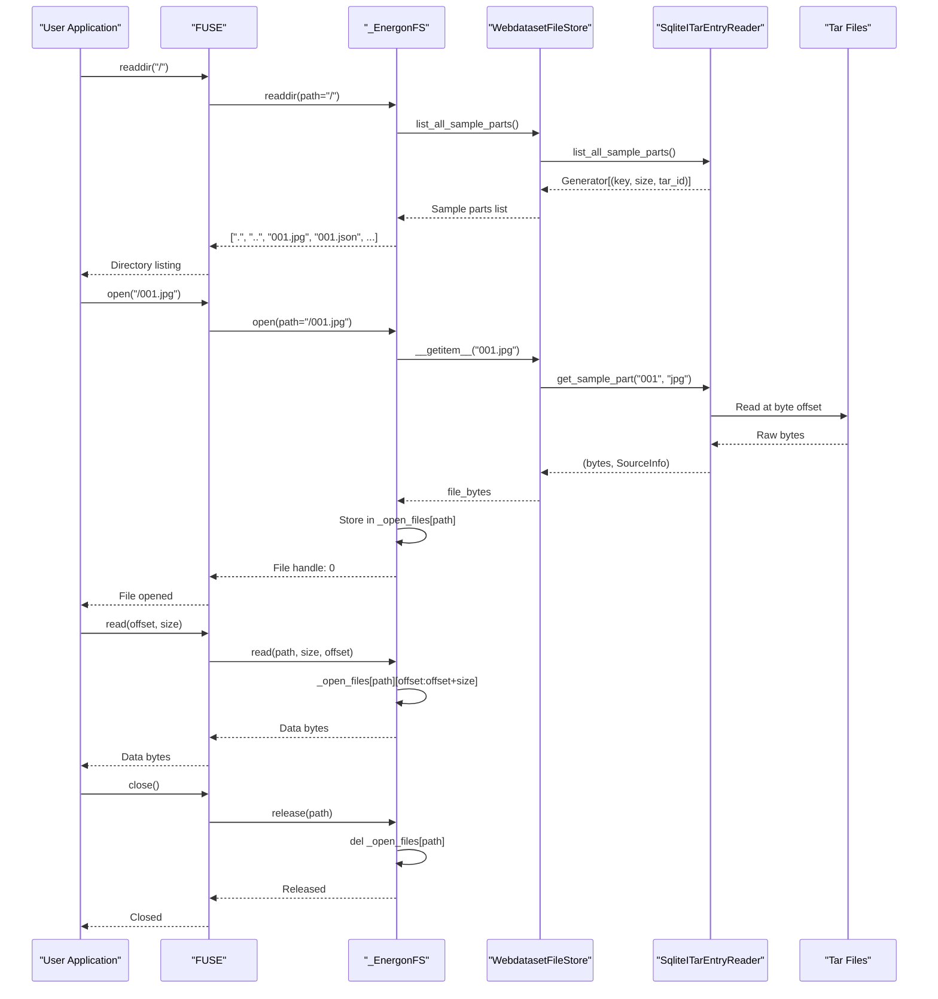
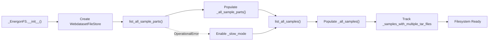
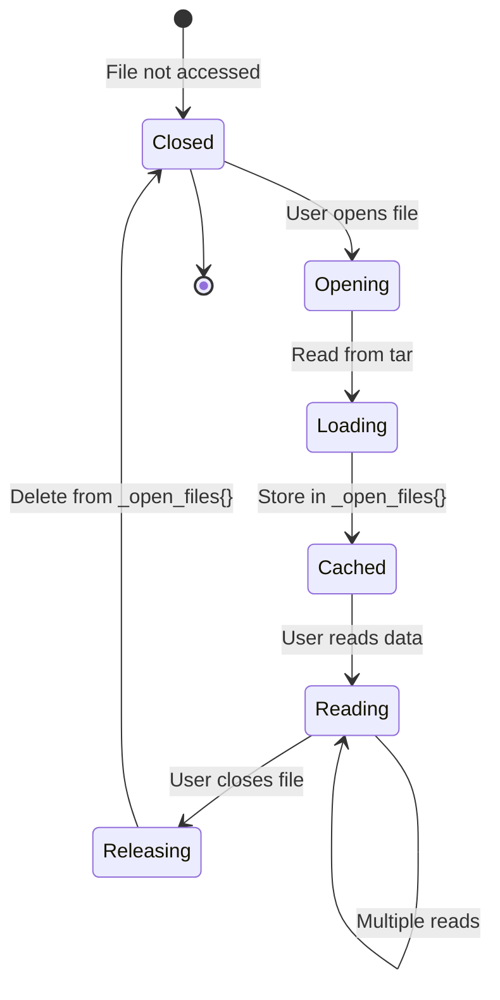

<!-- source: DeepWiki mcp.deepwiki.com · repo NVIDIA/Megatron-Energon · page 8.2 energon mount · fetched 2026-10-26 -->

# energon mount

<details>
<summary>Relevant source files</summary>

The following files were used as context for generating this wiki page:

- [src/megatron/energon/flavors/webdataset/itar.py](src/megatron/energon/flavors/webdataset/itar.py)
- [src/megatron/energon/flavors/webdataset/itar_reader.py](src/megatron/energon/flavors/webdataset/itar_reader.py)
- [src/megatron/energon/tools/mount.py](src/megatron/energon/tools/mount.py)

</details>


This page documents the `energon mount` CLI tool, which exposes a prepared Energon WebDataset as a read-only FUSE filesystem. This allows users to browse and access dataset contents using standard filesystem tools like `ls`, `cat`, and file browsers, without writing custom data loading code.

For information about dataset preparation, see [energon prepare](#8.1). For details on the underlying WebDataset access layer, see [WebDataset Access & ITarReader](#4.2).

---

## Purpose and Scope

The `energon mount` command creates a virtual filesystem that transparently exposes tar-archived WebDataset samples as regular files. This is useful for:

- **Dataset exploration**: Browse samples with standard tools (`ls`, `find`, file managers)
- **Visual inspection**: Open images/videos directly in viewers without extraction
- **Debugging**: Verify dataset structure and contents
- **Integration**: Use datasets with tools that expect regular file paths

The mount is read-only and leverages the SQLite index created by `energon prepare` to provide efficient random access to tar contents without extracting files.

Sources: [src/megatron/energon/tools/mount.py:1-408]()

---

## Prerequisites

### Required Dependencies

The mount feature requires the following optional dependencies:

| Dependency | Purpose | Installation |
|------------|---------|--------------|
| `mfusepy` | Python FUSE bindings | `pip install mfusepy` |
| `libfuse` | FUSE system library | System package manager |

On Linux:
```bash
# Install FUSE library
apt-get install fuse3 libfuse3-dev  # Debian/Ubuntu
yum install fuse3 fuse3-devel       # RHEL/CentOS

# Install Python bindings
pip install mfusepy
```

If these dependencies are not available, the `energon mount` command will report that mounting is unavailable.

### Dataset Requirements

The dataset must be:
1. **Prepared with `energon prepare`**: The SQLite index must exist in `.nv-meta/index.sqlite`
2. **Locally accessible**: The tar files and index must be on a filesystem accessible to the mount process
3. **Not corrupted**: All tar files referenced in the index must be readable

Sources: [src/megatron/energon/tools/mount.py:342-344](), [src/megatron/energon/tools/mount.py:377-408]()

---

## Command-Line Interface

### Basic Usage

```bash
energon mount <PATH> <MOUNTPOINT> [OPTIONS]
```

### Arguments

| Argument | Type | Description |
|----------|------|-------------|
| `PATH` | Directory path | Path to the prepared dataset (contains `.nv-meta/`) |
| `MOUNTPOINT` | Directory path | Empty directory where filesystem will be mounted |

### Options

| Option | Flag | Default | Description |
|--------|------|---------|-------------|
| `--detach` | `-d` | `False` | Run mount process in background (daemon mode) |
| `--sample-folders` | `-s` | `False` | Enable sample folders mode (see below) |
| `--allow-slow` | `-w` | `False` | Allow slow mode for datasets prepared with older Energon versions |

### Examples

**Mount in foreground with flat structure:**
```bash
energon mount /data/my_dataset /mnt/dataset
# Press Ctrl+C to unmount
```

**Mount in background with sample folders:**
```bash
energon mount /data/my_dataset /mnt/dataset --detach --sample-folders
# To unmount: fusermount -u /mnt/dataset
```

**Mount dataset prepared with older Energon:**
```bash
energon mount /data/old_dataset /mnt/dataset --allow-slow --sample-folders
```

Sources: [src/megatron/energon/tools/mount.py:347-408]()

---

## Filesystem Modes

### Flat Mode (Default)

In flat mode, all sample parts appear as files in a single root directory. Each file is named with the pattern `<sample_key>.<extension>`.

**Example Structure:**
```
/mnt/dataset/
├── 000001.jpg
├── 000001.json
├── 000001.txt
├── 000002.jpg
├── 000002.json
└── 000002.txt
```

**Command:**
```bash
energon mount /data/my_dataset /mnt/dataset
```

**Use Cases:**
- Simple browsing and searching
- Programmatic access with glob patterns
- Minimal directory traversal overhead

### Sample Folders Mode

In sample folders mode, each sample appears as a directory containing its parts as files. The directory is named with the sample key, and files inside are named with just the extension.

**Example Structure:**
```
/mnt/dataset/
├── 000001/
│   ├── jpg
│   ├── json
│   └── txt
├── 000002/
│   ├── jpg
│   ├── json
│   └── txt
```

**Command:**
```bash
energon mount /data/my_dataset /mnt/dataset --sample-folders
```

**Use Cases:**
- Logical grouping by sample
- Easier visual inspection of multi-part samples
- Closer to WebDataset conceptual structure

Sources: [src/megatron/energon/tools/mount.py:364-368](), [src/megatron/energon/tools/mount.py:227-264]()

---

## Architecture and Implementation

### System Architecture



**Description**: The mount system integrates with the Linux FUSE kernel module to expose dataset contents as a virtual filesystem. User applications interact with the mounted directory using standard system calls, which FUSE routes to the `_EnergonFS` Operations implementation. This implementation uses `WebdatasetFileStore` to query the SQLite index and retrieve sample data from tar files on demand.

Sources: [src/megatron/energon/tools/mount.py:25-344]()

### Data Access Flow



**Description**: This diagram shows the complete lifecycle of accessing a file through the mounted filesystem. Directory listings query the SQLite index for all samples/parts. File opens retrieve the entire file content into memory (cached in `_open_files`), and subsequent reads serve data from this cache. Files are released from memory when closed.

Sources: [src/megatron/energon/tools/mount.py:214-333]()

---

## FUSE Operations Implementation

### Core Operations

The `_EnergonFS` class implements the FUSE `Operations` interface. Key methods:

| Operation | Method | Purpose | Implementation |
|-----------|--------|---------|----------------|
| `getattr` | `getattr(path, fh)` | Get file/directory attributes (size, mode, timestamps) | Queries `_all_sample_parts` or `_all_samples` dictionaries [mount.py:107-192]() |
| `readdir` | `readdir(path, fh)` | List directory contents | Returns sample keys or sample parts from cached dictionaries [mount.py:214-264]() |
| `open` | `open(path, flags)` | Open file for reading | Retrieves file bytes via `WebdatasetFileStore` and caches in `_open_files` [mount.py:266-299]() |
| `read` | `read(path, size, offset, fh)` | Read data from open file | Returns slice from cached bytes in `_open_files` [mount.py:301-318]() |
| `release` | `release(path, fh)` | Close file | Removes entry from `_open_files` cache [mount.py:320-333]() |
| `statfs` | `statfs(path)` | Get filesystem statistics | Computes total size from `get_total_size()` [mount.py:86-105]() |

### Initialization Process



**Description**: During initialization, the filesystem queries the SQLite index to build in-memory dictionaries of all samples and sample parts. This provides O(1) lookup for attribute queries. If the index lacks the `sample_parts` table (older Energon versions), slow mode is enabled, which queries the tar files directly on demand.

Sources: [src/megatron/energon/tools/mount.py:30-84]()

### File Attribute Structure

Each file/directory returns attributes matching the POSIX `stat` structure:

```python
# Example attributes for a sample part file
{
    'st_mode': 0o444 | stat.S_IFREG,  # Read-only regular file
    'st_nlink': 1,                     # Single link
    'st_size': 123456,                 # File size in bytes
    'st_ctime': 1234567890.0,          # Creation time
    'st_mtime': 1234567890.0,          # Modification time
    'st_atime': 1234567890.0,          # Access time
    'st_uid': 1000,                    # Owner UID
    'st_gid': 1000,                    # Owner GID
}
```

Timestamps are set to the modification time of the SQLite index file. File permissions are always read-only (`0o444` for files, `0o555` for directories).

Sources: [src/megatron/energon/tools/mount.py:107-192]()

---

## Memory Management and Caching

### File Data Caching Strategy

When a file is opened via `open()`, the entire file content is read from the tar archive and stored in the `_open_files` dictionary:

```python
# src/megatron/energon/tools/mount.py:266-299
def open(self, path: str, flags: int = 0) -> int:
    # ... path processing ...
    file_bytes, _ = self._wds_filestore[path]
    assert isinstance(file_bytes, bytes)
    self._open_files[path] = file_bytes  # Cache entire file
    return 0  # Dummy file handle
```

**Key Characteristics:**
- **Eager loading**: Entire file loaded on open, not on read
- **In-memory storage**: Bytes held in RAM until file is closed
- **Read optimization**: Subsequent reads are served from memory
- **Memory pressure**: Multiple open files consume RAM proportional to their sizes

### Cache Lifecycle



**Description**: Files transition through distinct states in the cache. Once opened and loaded, they remain in memory for the duration of the file handle's lifetime. The cache is explicitly managed—no automatic eviction occurs.

Sources: [src/megatron/energon/tools/mount.py:266-333]()

---

## Slow Mode for Legacy Datasets

### When Slow Mode is Required

Slow mode is necessary when mounting datasets prepared with older versions of Energon that did not create the `sample_parts` table in the SQLite index. This table is required for efficient listing of individual sample parts.

**Detection:**
```python
# src/megatron/energon/tools/mount.py:44-58
try:
    for key, size, tar_file_id in self._wds_filestore.list_all_sample_parts():
        # Populate cache...
except OperationalError:
    if not allow_slow_mode:
        raise RuntimeError("Dataset requires --allow-slow")
    else:
        self._slow_mode = True
```

### Slow Mode Behavior

In slow mode, sample parts are discovered on-demand by reading the tar files:

| Operation | Fast Mode | Slow Mode |
|-----------|-----------|-----------|
| List root directory | Query `sample_parts` table | Query `samples` table only |
| List sample folder | Query `sample_parts` table | Read tar file, extract part names |
| Get file attributes | Lookup in `_all_sample_parts` | Read tar file if not cached |
| Performance | O(1) dictionary lookup | O(n) tar file scanning per sample |

**Slow Mode Implications:**
- **Sample folders mode required**: Flat mode is unsupported in slow mode
- **First access delay**: Each sample's first `ls` scans the tar file
- **Caching**: Discovered parts are cached in `_all_sample_parts` for subsequent accesses
- **Higher latency**: Expect significant delays when browsing large samples

Sources: [src/megatron/energon/tools/mount.py:43-58](), [src/megatron/energon/tools/mount.py:159-166](), [src/megatron/energon/tools/mount.py:244-245]()

---

## Multi-Tar Warning Files

### Duplicate Sample Keys

When a sample key exists in multiple tar files (e.g., after dataset concatenation), the filesystem can only expose one version. A warning is surfaced to the user:

**In flat mode:**
```
/mnt/dataset/
├── 000001.jpg          # From first tar file
├── 000001.json         # From first tar file
└── 000001.WARNING_SAME_KEY_IN_MULTIPLE_TAR_FILES  # Warning marker
```

**In sample folders mode:**
```
/mnt/dataset/000001/
├── jpg                 # From first tar file
├── json                # From first tar file
└── WARNING_SAME_KEY_IN_MULTIPLE_TAR_FILES  # Warning marker
```

The warning file has special attributes (`st_mode=0o000 | stat.S_IFBLK`) and zero size, making it visually distinct in directory listings.

### Resolution

To access data from all tar files containing a duplicate key:
1. Use the underlying `WebdatasetFileStore` API directly
2. Re-prepare the dataset with unique keys
3. Use dataset composition features to manage multiple sources

Sources: [src/megatron/energon/tools/mount.py:16](), [src/megatron/energon/tools/mount.py:60-66](), [src/megatron/energon/tools/mount.py:141-148](), [src/megatron/energon/tools/mount.py:253-254](), [src/megatron/energon/tools/mount.py:263-264]()

---

## Code Entity Reference

### Primary Classes and Functions

| Entity | Location | Purpose |
|--------|----------|---------|
| `_EnergonFS` | [mount.py:25-340]() | FUSE Operations implementation |
| `EnergonFS` | [mount.py:341]() | Public alias for `_EnergonFS` (or None if unavailable) |
| `command()` | [mount.py:347-408]() | Click CLI command entry point |
| `WebdatasetFileStore` | Used via import | Provides indexed access to tar contents |
| `SqliteITarEntryReader` | Used indirectly | Queries SQLite index for sample locations |

### Key Instance Variables

```python
class _EnergonFS:
    _wds_filestore: WebdatasetFileStore     # Data access layer
    _all_sample_parts: Dict[str, int]       # Maps "key.ext" -> size
    _all_samples: Dict[str, int]            # Maps "key" -> total_size
    _samples_with_multiple_tar_files: Set[str]  # Keys in multiple tars
    _open_files: Dict[str, bytes]           # Currently opened files
    _slow_mode: bool                        # Legacy dataset mode
    _sample_folders: bool                   # Filesystem layout mode
    _uid: int                               # File owner UID
    _gid: int                               # File owner GID
    _mtime: float                           # Modification timestamp
    _total_size: Optional[int]              # Cached total dataset size
```

Sources: [src/megatron/energon/tools/mount.py:25-84]()

---

## Limitations and Considerations

### Performance Characteristics

| Aspect | Performance | Notes |
|--------|-------------|-------|
| **Directory listings** | Fast | Pre-cached in memory during initialization |
| **File open** | Moderate to Slow | Reads entire file from tar (may involve network I/O) |
| **File read** | Fast | Served from in-memory cache |
| **Random access** | Fast | SQLite index provides O(1) lookup |
| **Large files** | Memory-bound | Entire file loaded into RAM |
| **Concurrent access** | Limited | Single-threaded FUSE operations |

### Resource Constraints

**Memory Usage:**
- Initial overhead: ~(number_of_samples × 100 bytes) for dictionaries
- Per-open-file: Size of the opened file
- Example: Opening 10 HD images (~5MB each) = 50MB + base overhead

**Filesystem Features:**
- ❌ **Write operations**: Not supported (read-only mount)
- ❌ **Symlinks**: Not implemented
- ❌ **Extended attributes**: Not implemented
- ❌ **Memory-mapped I/O**: Not supported (files cached in Python)
- ✅ **Byte-range reads**: Supported via in-memory slicing
- ✅ **Directory traversal**: Fully supported

### Common Issues

**Mount fails with "fuse not installed":**
```bash
pip install mfusepy
apt-get install fuse3 libfuse3-dev
```

**"No such file or directory" when accessing files:**
- Verify dataset was prepared with `energon prepare`
- Check that `.nv-meta/index.sqlite` exists
- Ensure tar files haven't been moved or deleted

**High memory usage:**
- Close files after reading
- Avoid keeping many files open simultaneously
- Consider using dataset APIs directly for batch processing

**Permission denied:**
- FUSE requires user to have permission to mount
- May need `user_allow_other` in `/etc/fuse.conf`
- Root privileges may be required on some systems

Sources: [src/megatron/energon/tools/mount.py:1-408]()

---

## Unmounting

### Foreground Mount

Press `Ctrl+C` in the terminal running the mount command. The FUSE library handles cleanup automatically.

### Background Mount

Use the `fusermount` utility:

```bash
# Linux with FUSE 2
fusermount -u /mnt/dataset

# Linux with FUSE 3
fusermount3 -u /mnt/dataset

# macOS
umount /mnt/dataset
```

### Cleanup on Unmount

The `destroy()` method is called when the filesystem is unmounted:

```python
def destroy(self, path: str) -> None:
    print("Closing energon mount.")
    if len(self._open_files) > 0:
        print(f"Number of still open files: {len(self._open_files)}")
    self._wds_filestore.close()
```

This closes the `WebdatasetFileStore`, releasing SQLite connections and open file handles.

Sources: [src/megatron/energon/tools/mount.py:335-339]()

---

