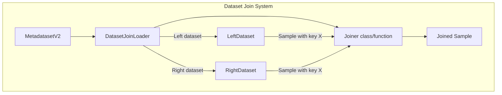
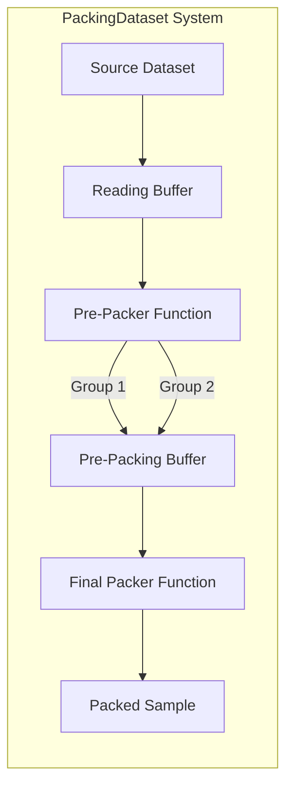
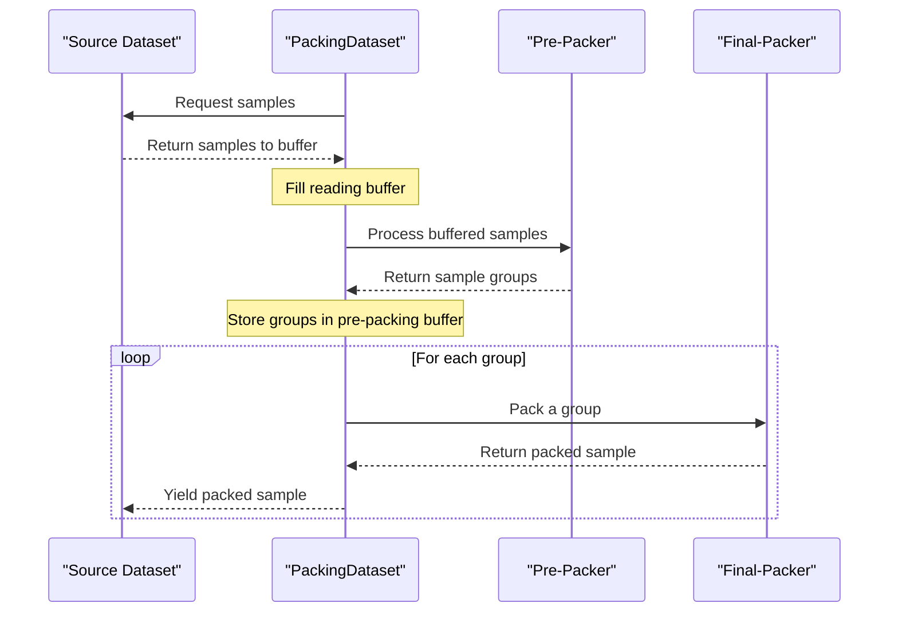

<!-- source: DeepWiki mcp.deepwiki.com · repo NVIDIA/Megatron-Energon · page 9 Advanced Topics · fetched 2026-10-26 -->

# Advanced Topics

<details>
<summary>Relevant source files</summary>

The following files were used as context for generating this wiki page:

- [src/megatron/energon/loader.py](src/megatron/energon/loader.py)
- [src/megatron/energon/savable_loader.py](src/megatron/energon/savable_loader.py)
- [src/megatron/energon/task_encoder/base.py](src/megatron/energon/task_encoder/base.py)
- [src/megatron/energon/task_encoder/loader.py](src/megatron/energon/task_encoder/loader.py)
- [src/megatron/energon/wrappers/gc_dataset.py](src/megatron/energon/wrappers/gc_dataset.py)
- [src/megatron/energon/wrappers/mix_batch_dataset.py](src/megatron/energon/wrappers/mix_batch_dataset.py)
- [tests/test_crudedataset.py](tests/test_crudedataset.py)
- [tests/test_dataset.py](tests/test_dataset.py)
- [tests/test_dataset_det.py](tests/test_dataset_det.py)
- [tests/test_metadataset.py](tests/test_metadataset.py)
- [tests/test_metadataset_fewsamp.py](tests/test_metadataset_fewsamp.py)

</details>


This page covers advanced usage patterns and specialized functionality in Megatron-Energon. It is intended for users who are already familiar with the basic concepts and want to leverage more sophisticated features of the data loading system. This document focuses on dataset joining techniques, sequence packing for efficient training, and other advanced configuration patterns.

For information on basic dataset configuration, see [Core Concepts](#2). For details on the data loading architecture, see [Data Loading System](#3).

## Dataset Joining

The Megatron-Energon system supports joining multiple datasets based on common keys, similar to SQL joins in databases. This is particularly useful when you have related data split across multiple datasets that need to be combined during training.

### Join Types

Megatron-Energon supports two primary join types:

| Join Type | Description | Configuration |
|-----------|-------------|---------------|
| Inner Join | Only samples that have matching keys in all datasets are included | Default behavior when `nonmatch` is not specified |
| Left Join | All samples from the left dataset are included; samples without matches in the right dataset are skipped | Specified with `nonmatch: skip` in the right dataset configuration |

### Join Configuration

To join datasets, you need to define a join configuration in your metadataset YAML file:

```yaml
splits:
  train:
    join:
      dataset1:
        path: path/to/dataset1
        # Dataset 1 configuration
      dataset2:
        path: path/to/dataset2
        nonmatch: skip  # For left join
        # Dataset 2 configuration
    joiner:
      __module__: your.module
      __class__: YourJoinedSampleClass  # Class-based joiner
      # OR
      __function__: your_joiner_function  # Function-based joiner
```

The `joiner` specifies how to combine samples from the joined datasets:

1. **Class-based joiner**: Must have a static `from_joined` method that takes samples from each dataset and returns a combined sample
2. **Function-based joiner**: A function that takes samples from each dataset and returns a combined sample



Sources: [tests/test_metadataset_v2.py:313-419](), [tests/test_metadataset_v2.py:422-498]()

### Example: Custom Joiner Class

To create a custom joiner class, define a class that inherits from `Sample` and implements a `from_joined` static method:

```python
@dataclass_slots
class MyJoinedSample(Sample):
    text1: torch.Tensor
    text2: torch.Tensor

    @staticmethod
    def from_joined(ds1: TextSample, ds2: TextSample) -> "MyJoinedSample":
        return MyJoinedSample.derive_from(
            ds1,
            text1=ds1.text,
            text2=ds2.text,
        )
```

### Example: Function-Based Joiner

Alternatively, you can use a simple function as a joiner:

```python
def my_joiner(text1: TextSample, text2: TextSample) -> MyJoinedSample:
    return MyJoinedSample.derive_from(
        text1, 
        text1=f"processed_{text1.text}", 
        text2=f"processed_{text2.text}"
    )
```

Sources: [tests/test_metadataset_v2.py:59-73](), [tests/test_metadataset_v2.py:72-73]()

### Joining Multiple Datasets

You can create complex join configurations by nesting joins within blend configurations:

```yaml
splits:
  train:
    blend:
      - weight: 1
        join:
          text1:
            path: dataset1
          text2:
            path: dataset2
            nonmatch: skip
        joiner:
          __module__: my.module
          __function__: my_joiner_function
      - weight: 2
        join:
          text1:
            path: dataset3
          text2:
            path: dataset4
        joiner:
          __module__: my.module
          __class__: MyJoinerClass
```

Sources: [tests/test_metadataset_v2.py:433-456](), [tests/test_metadataset_v2.py:580-614]()

## Sequence Packing

Sequence packing is an advanced technique to improve training efficiency by combining multiple shorter sequences into a single packed sequence. This reduces padding waste and can significantly increase throughput for datasets with variable-length inputs.

### The Packing Process

The packing process in Megatron-Energon consists of two main stages:

1. **Pre-packing**: Selects groups of samples to be packed together based on their properties (e.g., length)
2. **Final packing**: Combines each group into a single packed sample



Sources: [src/megatron/energon/wrappers/packing_dataset.py:31-158]()

### Using the PackingDataset

To use sequence packing, you create a `PackingDataset` wrapper around your dataset:

```python
from megatron.energon.wrappers.packing_dataset import PackingDataset

# Define your pre-packer function
def my_pre_packer(samples: List[MySample]) -> List[List[MySample]]:
    # Group samples based on some criteria (e.g., length)
    result = []
    current_group = []
    current_length = 0
    max_length = 2048
    
    for sample in samples:
        if current_length + len(sample.text) <= max_length:
            current_group.append(sample)
            current_length += len(sample.text)
        else:
            if current_group:
                result.append(current_group)
            current_group = [sample]
            current_length = len(sample.text)
    
    if current_group:
        result.append(current_group)
    
    return result

# Define your final packer function
def my_final_packer(sample_group: List[MySample]) -> PackedSample:
    # Combine the group into a single packed sample
    # ...implementation...
    return packed_sample

# Create the packing dataset
packing_dataset = PackingDataset(
    dataset=my_dataset,
    buffer_size=1000,  # Buffer size for packing
    pre_packer=my_pre_packer,
    final_packer=my_final_packer,
    final_packer_stateless=True,  # Enable sample restoration
    worker_config=worker_config
)
```

Sources: [src/megatron/energon/wrappers/packing_dataset.py:71-102]()

### Implementing Efficient Packers

For optimal performance, consider these recommendations when implementing packers:

1. **Pre-packer design**:
   - Group samples with similar lengths to minimize padding waste
   - Consider other attributes like token distribution for balanced batches
   - Use efficient algorithms to minimize overhead

2. **Final packer design**:
   - Append special tokens as needed for your model architecture
   - Create appropriate attention masks for packed sequences
   - Include metadata to identify original sample boundaries



Sources: [src/megatron/energon/wrappers/packing_dataset.py:130-264]()

### State Management with Packing

The `PackingDataset` supports state saving and restoration for fault tolerance, but requires the final packer to be stateless. This means it should produce deterministic outputs for the same inputs:

```python
# Enable state management by setting final_packer_stateless to True
packing_dataset = PackingDataset(
    dataset=my_dataset,
    buffer_size=1000,
    pre_packer=my_pre_packer,
    final_packer=my_final_packer,
    final_packer_stateless=True,  # Required for state management
    worker_config=worker_config
)
```

When the `final_packer_stateless` flag is set to `True`, the `PackingDataset` will:

1. Track restore keys for all input samples
2. Associate restore keys with each packed output
3. Support the `restore_sample` operation to recreate packed samples deterministically

Sources: [src/megatron/energon/wrappers/packing_dataset.py:265-305]()

## Epoch-Based Dataset Repetition

In some training scenarios, you might want to repeat certain datasets more than others within an epoch. Megatron-Energon supports this through the `blend_epochized` configuration.

### Configuring Epoch-Based Repetition

The `blend_epochized` mode allows you to specify how many times each dataset should be repeated in an epoch:

```yaml
splits:
  train:
    blend_epochized:
      - repetitions: 2  # Repeat dataset1 twice per epoch
        path: dataset1
        # Other dataset1 configuration
      - repetitions: 3  # Repeat dataset2 three times per epoch
        path: dataset2
        # Other dataset2 configuration
```

This is different from the standard `blend` mode, which uses weights to determine sampling probabilities. With `blend_epochized`:

1. Each dataset appears exactly the specified number of times
2. The system preserves epoch boundaries
3. State can be saved and restored mid-epoch

Sources: [tests/test_metadataset_v2.py:792-848]()

### Fractional Repetitions

You can also use fractional repetition values to include only a portion of a dataset in each epoch:

```yaml
splits:
  train:
    blend_epochized:
      - repetitions: 0.7  # Include 70% of dataset1 in each epoch
        path: dataset1
        # Other dataset1 configuration
      - repetitions: 1.5  # Include dataset2 once, plus 50% more
        path: dataset2
        # Other dataset2 configuration
```

When using fractional repetitions:

- Values < 1.0 will include only that fraction of the dataset
- Values > 1.0 will include the entire dataset, plus that fraction of it again
- The system ensures deterministic sample selection across runs

Sources: [tests/test_metadataset_v2.py:925-946](), [tests/test_metadataset_v2.py:969-982]()

## Working with the Type System

Megatron-Energon includes a powerful type system for converting between Python objects and configuration formats. This is particularly useful for advanced use cases involving custom sample types and configurations.

### JsonParser for Type Conversion

The `JsonParser` class enables conversion between raw data (like YAML configurations) and typed Python objects:

```python
from megatron.energon.typed_converter import JsonParser

# Create a parser
parser = JsonParser(strict=True)

# Convert configuration to typed object
config_dict = {
    "__module__": "my.module",
    "__class__": "MyConfigClass",
    "param1": 42,
    "param2": "value"
}
typed_config = parser.raw_to_typed(config_dict, MyConfigClass, allow_imports=True)

# Use the typed object
result = typed_config.process()
```

The parser supports:

1. Dataclasses and NamedTuples
2. Nested structures with lists, dicts, and primitive types
3. Dynamic class instantiation via `__module__` and `__class__` keys

Sources: [src/megatron/energon/typed_converter.py:64-195](), [src/megatron/energon/typed_converter.py:197-541]()

### Custom Type Registration

For complex custom types, you can create specialized conversion logic by implementing appropriate methods in your classes:

```python
class MyCustomType:
    # Custom conversion from raw data
    @classmethod
    def from_dict(cls, data: dict) -> "MyCustomType":
        # Convert raw data to instance
        return cls(...)
    
    # Custom conversion to raw data
    def to_dict(self) -> dict:
        # Convert instance to raw data
        return {...}
```

This is particularly useful for types that need special handling, such as tensor-based samples or complex validation logic.

### Override System for Configuration Tuning

The `override` method in `JsonParser` allows modifying existing configuration objects without rebuilding them from scratch:

```python
from megatron.energon.typed_converter import JsonParser

# Create a parser
parser = JsonParser()

# Override specific fields
modified_config = parser.override(
    original_config,
    {
        "param1": 100,             # Override simple value
        "nested.field": "newval",   # Override nested field
        "complex": '{"a": 1, "b": 2}'  # Override with JSON string
    }
)
```

This is useful for:

1. Applying command-line overrides to configuration files
2. Experimental parameter tuning
3. Environment-specific configuration adjustments

Sources: [src/megatron/energon/typed_converter.py:657-1067]()

## Watchdog System for Error Detection

Megatron-Energon includes a watchdog mechanism to detect and handle worker processes that become stuck or unresponsive during data loading.

### Configuring the Watchdog

The watchdog system can be configured when creating a dataset:

```python
train_dataset = get_train_dataset(
    dataset_path,
    worker_config=worker_config,
    batch_size=32,
    watchdog_timeout_seconds=30,  # Detect workers stuck for 30+ seconds
    fail_on_timeout=True,  # Raise an exception on timeout
)
```

When enabled, the watchdog monitors each data loading stage and takes action if a worker exceeds the specified timeout:

1. If `fail_on_timeout=True`, it raises an exception to terminate the job
2. If `fail_on_timeout=False`, it logs a warning but allows the job to continue

Sources: [tests/test_metadataset_v2.py:1101-1146]()

### Custom Error Handlers

For more advanced error handling, you can provide custom error handlers to dataset wrappers:

```python
def my_error_handler(exception: Exception, samples: List[Sample]) -> None:
    # Log the error with additional context
    logger.error(f"Error processing samples: {exception}")
    for sample in samples:
        logger.error(f"  Sample ID: {sample.__key__}")
    
    # Take additional actions
    # ...

# Use the custom error handler with a PackingDataset
packing_dataset = PackingDataset(
    dataset=my_dataset,
    buffer_size=1000,
    pre_packer=my_pre_packer,
    final_packer=my_final_packer,
    error_handler=my_error_handler,
    worker_config=worker_config
)
```

Custom error handlers can provide:

1. Enhanced logging with sample-specific context
2. Metrics collection for error analysis
3. Sample filtering or recovery mechanisms

Sources: [src/megatron/energon/wrappers/packing_dataset.py:99-100](), [src/megatron/energon/wrappers/packing_dataset.py:220-225]()

## Summary

This page has covered several advanced topics in Megatron-Energon:

1. **Dataset Joining**: Combining multiple datasets using common keys
2. **Sequence Packing**: Efficiently packing sequences for improved training performance
3. **Epoch-Based Dataset Repetition**: Controlling dataset repetition within epochs
4. **Type System**: Working with the advanced type system for configuration
5. **Watchdog System**: Detecting and handling stuck worker processes

These advanced features enable sophisticated data loading patterns that can significantly enhance training efficiency and flexibility for large language models.

For more information about working with remote datasets, see [Remote Datasets](#8.2). For detailed information about the checkpoint management system, see [Checkpoint Management](#7.2).

---

