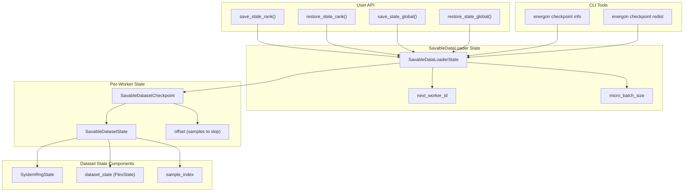
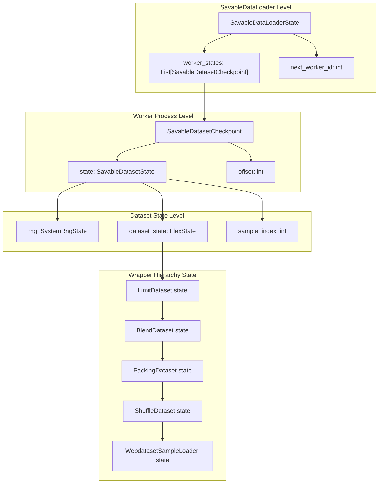
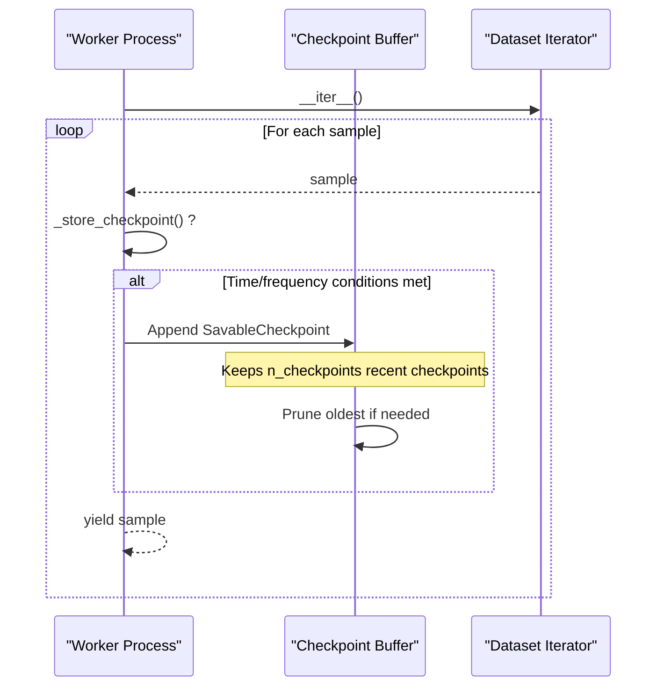
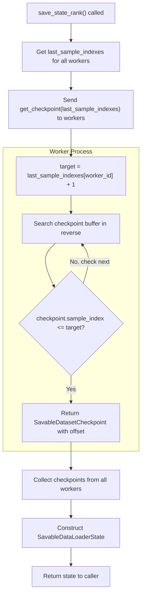
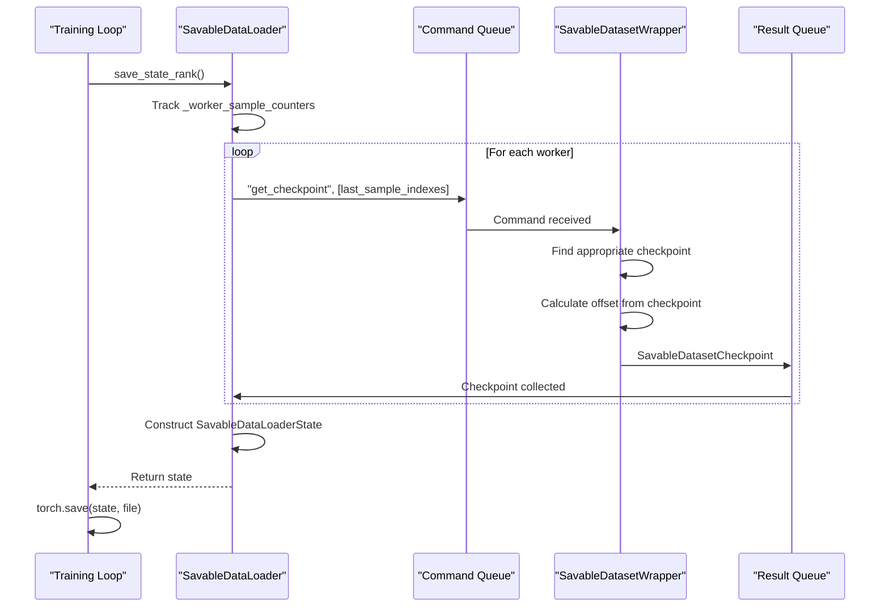
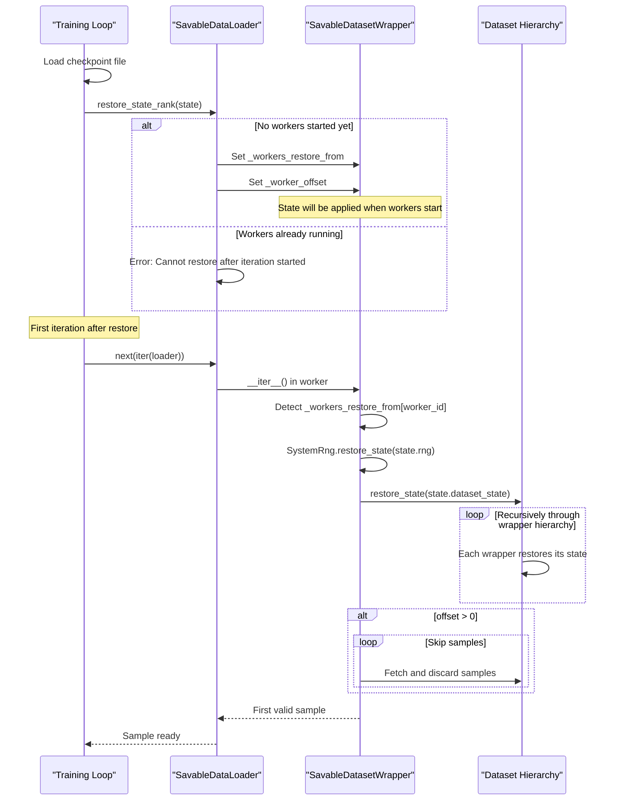
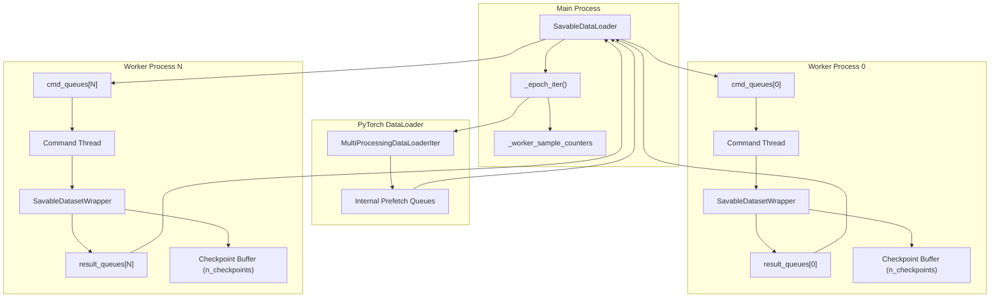
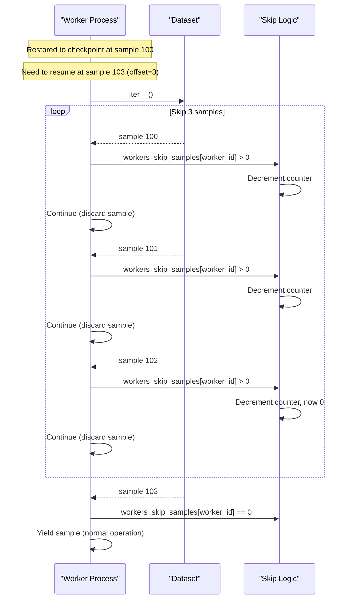
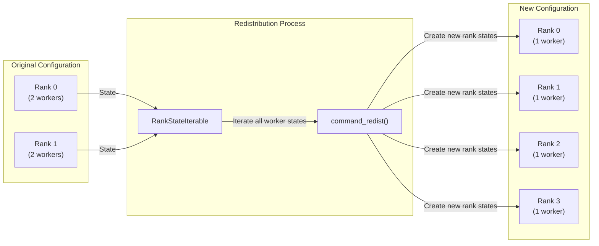

<!-- source: DeepWiki mcp.deepwiki.com · repo NVIDIA/Megatron-Energon · page 9.1 Checkpointing and State Management · fetched 2026-10-26 -->

# Checkpointing and State Management

<details>
<summary>Relevant source files</summary>

The following files were used as context for generating this wiki page:

- [src/megatron/energon/loader.py](src/megatron/energon/loader.py)
- [src/megatron/energon/savable_loader.py](src/megatron/energon/savable_loader.py)
- [src/megatron/energon/wrappers/gc_dataset.py](src/megatron/energon/wrappers/gc_dataset.py)
- [src/megatron/energon/wrappers/mix_batch_dataset.py](src/megatron/energon/wrappers/mix_batch_dataset.py)
- [tests/test_crudedataset.py](tests/test_crudedataset.py)
- [tests/test_dataset_det.py](tests/test_dataset_det.py)
- [tests/test_metadataset.py](tests/test_metadataset.py)
- [tests/test_metadataset_fewsamp.py](tests/test_metadataset_fewsamp.py)

</details>


This page provides a deep dive into the state management system in Megatron-Energon, which enables fault-tolerant data loading through comprehensive state preservation and restoration. The system maintains state at multiple levels of the data loading hierarchy to ensure exact training resumption after interruptions or configuration changes.

For information about the SavableDataLoader API, see page 4.3.
For information about distributed training and worker configuration, see page 9.2.

## Overview

Megatron-Energon's state management system operates at multiple levels to capture the complete state of the data loading pipeline. State is tracked and saved for:

1. **Random Number Generators (RNG)** - All sources of randomness (PyTorch, NumPy, Python random) for deterministic sampling
2. **Buffer States** - Partially filled buffers in wrappers like PackingDataset and BatchDataset
3. **Sample Indices** - Current position within each dataset and wrapper in the hierarchy
4. **Dataset Metadata** - Configuration, file offsets, shard information, and worker assignments

The system supports two primary use cases:

1. **Fault Tolerance** - Resume training from exactly the same data point after interruption or preemption
2. **Checkpoint Redistribution** - Change the number of ranks or workers while preserving the deterministic data sequence

This multi-level approach ensures that every aspect of the data loading state can be precisely reconstructed, enabling seamless training continuation even across different hardware configurations.

**Diagram: State Management Architecture Overview**



Sources: [src/megatron/energon/savable_loader.py:156-196](), [src/megatron/energon/savable_loader.py:588-600]()

## State Hierarchy and Components

The state management system captures state at multiple levels of the data loading hierarchy. Understanding this hierarchy is essential for working with checkpoints.

**Diagram: State Hierarchy in Dataset Wrappers**



Sources: [src/megatron/energon/savable_loader.py:156-196](), [src/megatron/energon/wrappers/base.py:1-100]()

### Core Classes

#### SavableDataLoader

The main interface for checkpoint operations. Located in [src/megatron/energon/savable_loader.py:602-647](), it provides:

- `save_state_rank()` - Saves state for the current rank
- `restore_state_rank(state)` - Restores state for the current rank
- `save_state_global(global_dst_rank)` - Collects state from all ranks using torch.distributed
- `restore_state_global(state, src_rank)` - Distributes state to all ranks

#### SavableDataLoaderState

Defined in [src/megatron/energon/savable_loader.py:588-600](), contains:

| Field | Type | Purpose |
|-------|------|---------|
| `worker_states` | `List[SavableDatasetCheckpoint]` | State for each worker process |
| `next_worker_id` | `int` | Next worker to emit a sample (maintains deterministic order) |
| `micro_batch_size` | `Optional[int]` | Used for compatibility validation on restore |

#### SavableDatasetCheckpoint

Defined in [src/megatron/energon/savable_loader.py:188-196](), represents a checkpoint for a single worker:

| Field | Type | Purpose |
|-------|------|---------|
| `state` | `Optional[SavableDatasetState]` | The dataset state at checkpoint time |
| `offset` | `int` | Number of samples to skip from the checkpoint position |

The offset mechanism allows the system to restore to positions between checkpoints by skipping forward.

#### SavableDatasetState

Defined in [src/megatron/energon/savable_loader.py:156-169](), contains the core state components:

| Field | Type | Purpose |
|-------|------|---------|
| `rng` | `SystemRngState` | Random number generator states (torch, numpy, python random) |
| `dataset_state` | `FlexState` | Nested state from all dataset wrappers in the hierarchy |
| `sample_index` | `int` | Current sample index in this worker |

#### SavableCheckpoint

Internal class used by `SavableDatasetWrapper` [src/megatron/energon/savable_loader.py:173-185]() to maintain multiple checkpoint snapshots:

| Field | Type | Purpose |
|-------|------|---------|
| `state` | `Optional[SavableDatasetState]` | The dataset state at this checkpoint |
| `checkpoint_time` | `float` | Time when checkpoint was created (for pruning old checkpoints) |
| `sample_index` | `int` | Sample index at checkpoint time |

### State Propagation Through Wrappers

Each wrapper dataset in the hierarchy (e.g., `LimitDataset`, `BlendDataset`, `PackingDataset`) implements:

- `save_state() -> FlexState` - Returns current state as a dictionary
- `restore_state(state: FlexState)` - Restores from saved state

The state is saved recursively through the wrapper chain. For example, a `PackingDataset` saves:
- Its internal buffer of partially packed samples
- The state of its child dataset

Sources: [src/megatron/energon/flavors/base_dataset.py:1-100](), [src/megatron/energon/wrappers/base.py:1-150]()

## Internal Checkpointing Mechanism

When using worker processes, the `SavableDatasetWrapper` maintains a rolling buffer of recent checkpoints to handle the asynchronous nature of data loading. This internal mechanism is separate from user-initiated checkpoints.

**Diagram: Internal Checkpoint Buffer Management**



Sources: [src/megatron/energon/savable_loader.py:424-453]()

### Checkpoint Frequency Parameters

The checkpoint frequency is controlled by parameters passed to `SavableDataLoader` [src/megatron/energon/savable_loader.py:678-720]():

| Parameter | Default | Purpose |
|-----------|---------|---------|
| `checkpoint_every_sec` | 60 | Minimum seconds between internal checkpoints |
| `checkpoint_every_min_n_samples` | `num_workers * 2` | Minimum samples between checkpoints |
| `n_checkpoints` | `prefetch_factor * num_workers + 1` | Number of checkpoints to keep in memory |

The checkpoint is created when both conditions are met:
```python
if (
    last_checkpoint_time + checkpoint_every_sec < current_time
    and last_checkpoint_index + checkpoint_every_min_n_samples <= current_index
):
    _store_checkpoint()
```

**Why n_checkpoints must be large enough**: PyTorch's DataLoader prefetches samples into internal queues. The oldest checkpoint must be old enough to account for all samples buffered in these queues. This is why the default is `prefetch_factor * num_workers + 1`.

Sources: [src/megatron/energon/savable_loader.py:424-453](), [src/megatron/energon/savable_loader.py:745-783]()

### Checkpoint Lookup Process

When `save_state_rank()` is called, the system determines which checkpoint to use:

**Diagram: Checkpoint Selection Algorithm**



Sources: [src/megatron/energon/savable_loader.py:479-504]()

## Checkpoint Creation Process

The process of creating and saving a checkpoint involves collecting state from worker processes and aggregating it at the loader level.

**Diagram: State Collection Flow**



Sources: [src/megatron/energon/savable_loader.py:851-924]()

### State Saving API

The `SavableDataLoader` provides two main methods for saving state:

#### save_state_rank()

Saves the state for the current rank. Returns a `SavableDataLoaderState` object that can be serialized with `torch.save()`.

```python
# Save state to a file
state = loader.save_state_rank()
torch.save(state, f"checkpoint_rank{rank}.pt")
```

This method:
1. Queries all worker processes for their current checkpoint
2. Collects the `next_worker_id` to maintain sample order
3. Stores the current `micro_batch_size` for validation
4. Returns immediately without blocking on distributed operations

Sources: [src/megatron/energon/savable_loader.py:851-924]()

#### save_state_global()

In distributed training with multiple ranks, collects state from all ranks to a destination rank using `torch.distributed.gather()`.

```python
# In distributed training, save state to rank 0
state = loader.save_state_global(global_dst_rank=0)
if torch.distributed.get_rank() == 0:
    # Only rank 0 receives the list of all rank states
    torch.save(state, "global_checkpoint.pt")
```

This method:
1. Calls `save_state_rank()` on each rank
2. Uses `torch.distributed.gather()` to collect all states to `global_dst_rank`
3. Returns `List[SavableDataLoaderState]` on destination rank, `None` on others
4. Blocks until all ranks complete their gathering operation

Sources: [src/megatron/energon/savable_loader.py:1021-1124]()

## Checkpoint Restoration Process

Restoring from a checkpoint requires reinitializing the same data loading pipeline with the same configuration, then applying the saved state.

**Diagram: State Restoration Flow**



Sources: [src/megatron/energon/savable_loader.py:926-1019](), [src/megatron/energon/savable_loader.py:332-423]()

### Worker Offset Mechanism

The `worker_offset` is a critical component for maintaining deterministic sample order after restoration. PyTorch's DataLoader iterates through workers in round-robin order (0, 1, 2, ..., N-1, 0, 1, ...). To resume at the exact point, the system must ensure the same worker emits the next sample.

The offset is stored in `WorkerConfig.worker_id_offset` [src/megatron/energon/worker.py:1-150]() and applied in the worker process:

```python
# In worker process __iter__
WorkerConfig.worker_id_offset = self._worker_offset
self._worker_id = self.worker_config.rank_worker_id()
```

This shifts the worker IDs so that the correct worker becomes worker 0 from PyTorch's perspective.

Sources: [src/megatron/energon/savable_loader.py:332-347](), [src/megatron/energon/savable_loader.py:506-538]()

### State Restoration API

#### restore_state_rank()

Restores the state for the current rank. Must be called before starting iteration.

```python
# Load state from a file
state = torch.load(f"checkpoint_rank{rank}.pt")
loader.restore_state_rank(state)

# Now iterate - workers will restore state on first iteration
for batch in loader:
    process(batch)
```

Important constraints:
- Must be called before the first call to `__iter__()`
- Workers must not have started yet (no persistent workers)
- The dataset configuration must exactly match the original

Sources: [src/megatron/energon/savable_loader.py:926-1019]()

#### restore_state_global()

In distributed training, distributes state from a source rank to all ranks using `torch.distributed.scatter()`.

```python
# In distributed training, restore state from rank 0
state = None
if torch.distributed.get_rank() == 0:
    # Only rank 0 loads the global checkpoint
    state = torch.load("global_checkpoint.pt")

# Scatter distributes the appropriate state to each rank
loader.restore_state_global(state, src_rank=0)
```

This method:
1. Uses `torch.distributed.scatter()` to distribute states from source rank
2. Each rank receives its corresponding `SavableDataLoaderState`
3. Calls `restore_state_rank()` internally on each rank
4. Blocks until all ranks complete the scatter operation

Sources: [src/megatron/energon/savable_loader.py:1126-1200]()

## Multi-Worker State Management

The checkpointing system becomes significantly more complex when using multiple worker processes due to the asynchronous nature of data loading and PyTorch's internal buffering.

**Diagram: Worker Process Communication Architecture**



Sources: [src/megatron/energon/savable_loader.py:198-347]()

### Asynchronous Data Loading Challenges

#### Challenge 1: Prefetch Queue Buffering

PyTorch's DataLoader prefetches samples into internal queues. When `save_state_rank()` is called, samples are in various states:

| Location | State | Handled By |
|----------|-------|------------|
| Already yielded to training loop | Processed | Tracked by `_worker_sample_counters` |
| In PyTorch's prefetch queues | Buffered | Checkpoint buffer must be deep enough |
| Currently being computed in worker | In-flight | Worker creates checkpoint before yield |
| Not yet processed by worker | Future | Captured in dataset state |

The `n_checkpoints` parameter must be large enough to span all buffered samples.

Sources: [src/megatron/energon/savable_loader.py:745-783]()

#### Challenge 2: Worker Thread Synchronization

Each worker runs two threads:

1. **Main iteration thread**: Yields samples to PyTorch DataLoader
2. **Command thread**: Processes checkpoint requests from main process

The command thread [src/megatron/energon/savable_loader.py:275-311]() uses a lock to ensure thread safety:

```python
def _command_thread(self):
    while self._running:
        cmd_args = self._cmd_queues[self._worker_id].get(timeout=1)
        with self._command_lock:
            cmd = cmd_args[0]
            fn = getattr(self, cmd)
            self._result_queues[self._worker_id].put({self._worker_id: fn(*cmd_args[1:])})
```

The main iteration thread releases the lock only when yielding samples [src/megatron/energon/savable_loader.py:397-407](), ensuring commands are processed between sample yields.

#### Challenge 3: Deterministic Worker Ordering

PyTorch's DataLoader internally tracks which worker should emit the next sample. This "next worker ID" cannot be restored in PyTorch's DataLoader, so the system uses `worker_id_offset` to shift worker IDs.

If `next_worker_id = 2` at checkpoint time:
- On restore, set `worker_id_offset = 2`
- Worker 2 becomes effective worker 0
- Worker 3 becomes effective worker 1
- etc.

This ensures the same sequence of workers emits samples after restoration.

Sources: [src/megatron/energon/savable_loader.py:332-347](), [src/megatron/energon/savable_loader.py:836-868]()

### Sample Skipping After Restoration

When restoring from a checkpoint, workers may need to skip samples to reach the exact restoration point. This happens because checkpoints are created at discrete intervals, not after every sample.

**Diagram: Sample Skipping Process**



Sources: [src/megatron/energon/savable_loader.py:377-390]()

## Checkpoint Redistribution

One of the key features of the checkpoint management system is the ability to redistribute checkpoints for different training configurations (e.g., changing the number of GPUs).



Sources: [src/megatron/energon/tools/checkpoint.py:216-300]()

### Using the Redistribution Tool

The `energon checkpoint redist` command allows redistributing checkpoints from one configuration to another:

```bash
# Redistribute from a 2-rank checkpoint to a 4-rank configuration
energon checkpoint redist checkpoint_rank0.pt checkpoint_rank1.pt output_path/ --new-world-size 4
```

This command:
1. Reads the input checkpoint files
2. Analyzes the current configuration (2 ranks with 2 workers each)
3. Redistributes the worker states for the new configuration (4 ranks with 1 worker each)
4. Creates new checkpoint files in the output path

Sources: [src/megatron/energon/tools/checkpoint.py:216-300](), [src/megatron/energon/cli/main.py:1-39]()

### Redistribution Process

The redistribution process follows these steps:

1. **Load Original Checkpoints**: Read checkpoint files from original configuration
2. **Extract Worker States**: Extract all worker states from original checkpoints
3. **Determine New Configuration**: Calculate new workers per rank
4. **Redistribute States**: Distribute worker states to new ranks
5. **Save New Checkpoints**: Write new checkpoint files for the new configuration

This process preserves the deterministic sequence of data while allowing flexible scaling of training configurations.

Sources: [src/megatron/energon/tools/checkpoint.py:216-300]()

## CLI Tool Reference

Megatron-Energon provides command-line tools for working with checkpoints.

### `energon checkpoint info`

Displays information about a checkpoint:

```bash
energon checkpoint info checkpoint_rank0.pt checkpoint_rank1.pt
```

Example output:
```
Checkpoint type: Per-rank checkpoint files
Number of DP ranks: 2
Number of workers per DP rank: 2

Detailed information:
  Rank 0 (checkpoint_rank0.pt):
    Next worker ID: 1
    Number of worker states: 2
  Rank 1 (checkpoint_rank1.pt):
    Next worker ID: 0
    Number of worker states: 2
```

Sources: [src/megatron/energon/tools/checkpoint.py:302-337]()

### `energon checkpoint redist`

Redistributes checkpoint files for a different configuration:

```bash
energon checkpoint redist [INPUT_FILES...] [OUTPUT_PATH] --new-world-size [N]
```

- `INPUT_FILES`: One or more checkpoint files from the original configuration
- `OUTPUT_PATH`: Directory where new checkpoint files will be written
- `--new-world-size`: Number of ranks in the new configuration

Sources: [src/megatron/energon/tools/checkpoint.py:216-300]()

## Troubleshooting Common Issues

### Issue: "Cannot restore in worker process"

```
AssertionError: Cannot restore in worker process
```

**Cause**: `restore_state_rank()` was called after workers have started iterating.

**Solution**: Call `restore_state_rank()` immediately after creating the loader, before any iteration:

```python
loader = get_savable_loader(dataset)
loader.restore_state_rank(state)  # Must be before any iteration
for batch in loader:
    ...
```

Sources: [src/megatron/energon/savable_loader.py:519]()

### Issue: Checkpoint size too large

**Cause**: The checkpoint buffer is too deep, storing too many historical states.

**Solution**: Reduce `n_checkpoints` parameter:

```python
loader = get_savable_loader(
    dataset,
    n_checkpoints=10,  # Reduce from default
)
```

Note: Must be at least `prefetch_factor * num_workers + 1` to handle PyTorch's prefetch buffer.

Sources: [src/megatron/energon/savable_loader.py:747-749]()

### Issue: Restored training produces different results

**Cause**: The dataset configuration doesn't match, or RNG state wasn't properly restored.

**Solutions**:
1. Verify dataset paths and configuration are identical
2. Check that `worker_config` parameters match (rank, world_size, num_workers)
3. Ensure no additional randomness is introduced in custom `TaskEncoder` methods (use `@stateless(restore_seeds=True)` decorator)

Sources: [tests/test_dataset_det.py:359-429]()

### Issue: "No checkpoint found" when saving state

**Cause**: The checkpoint buffer hasn't accumulated enough checkpoints yet, or checkpoint frequency is too low.

**Solution**: For testing, force immediate checkpoints:

```python
loader = get_savable_loader(
    dataset,
    checkpoint_every_sec=0,  # Save immediately
    checkpoint_every_min_n_samples=1,  # After every sample
)
```

Sources: [tests/test_crudedataset.py:536-538]()

## Best Practices

### When to Checkpoint

| Scenario | Recommendation |
|----------|----------------|
| Long training runs (days) | Save every 15-60 minutes |
| Short experiments | Save every epoch or every N iterations |
| Preemptible infrastructure | Save frequently (every 5-10 minutes) |
| Multi-day training | Keep multiple checkpoint versions |

### Checkpoint Storage

**File naming convention**:
```python
# Per-rank checkpoints
f"checkpoint_epoch{epoch}_iter{iteration}_rank{rank}.pt"

# Global checkpoint
f"checkpoint_epoch{epoch}_iter{iteration}_global.pt"
```

**Pruning old checkpoints**:
```python
# Keep only the last 3 checkpoints
checkpoints = sorted(checkpoint_dir.glob("checkpoint_*.pt"))
for old_checkpoint in checkpoints[:-3]:
    old_checkpoint.unlink()
```

### Configuration Consistency

When restoring, these must match exactly:
- Dataset paths and split configurations
- `worker_config` parameters (rank, world_size, num_workers)
- `batch_size` and other data loading parameters
- TaskEncoder class and configuration

The loader validates `micro_batch_size` on restore [src/megatron/energon/savable_loader.py:960-981]() but cannot validate everything.

### Distributed Training Patterns

**Pattern 1: Individual rank checkpoints**
```python
# Each rank saves its own state
state = loader.save_state_rank()
torch.save(state, f"checkpoint_rank{rank}.pt")
```

**Pattern 2: Centralized checkpoint**
```python
# Gather all states to rank 0
state = loader.save_state_global(global_dst_rank=0)
if rank == 0:
    torch.save(state, "checkpoint_global.pt")
```

**Pattern 2 is recommended** for easier checkpoint management and redistribution.

Sources: [src/megatron/energon/savable_loader.py:851-1200]()

## Integration with Training Loops

To integrate checkpoint management with your training loop:

```python
# Initialize dataset and loader
dataset = get_train_dataset(...)
loader = get_savable_loader(dataset)

# Training loop with checkpointing
for epoch in range(epochs):
    for batch_idx, batch in enumerate(loader):
        # Process batch and train model
        ...
        
        # Save checkpoint periodically
        if batch_idx % save_frequency == 0:
            state = loader.save_state_rank()
            torch.save({
                "model_state": model.state_dict(),
                "optimizer_state": optimizer.state_dict(),
                "dataloader_state": state
            }, f"checkpoint_epoch{epoch}_batch{batch_idx}.pt")
```

When resuming training:

```python
# Load checkpoint
checkpoint = torch.load("checkpoint_epoch5_batch100.pt")

# Restore model and optimizer states
model.load_state_dict(checkpoint["model_state"])
optimizer.load_state_dict(checkpoint["optimizer_state"])

# Initialize dataset and loader
dataset = get_train_dataset(...)
loader = get_savable_loader(dataset)

# Restore dataloader state
loader.restore_state_rank(checkpoint["dataloader_state"])

# Continue training from where we left off
for batch_idx, batch in enumerate(loader):
    # Process batch and train model
    ...
```

Sources: [src/megatron/energon/loader.py:15-63]()

---

