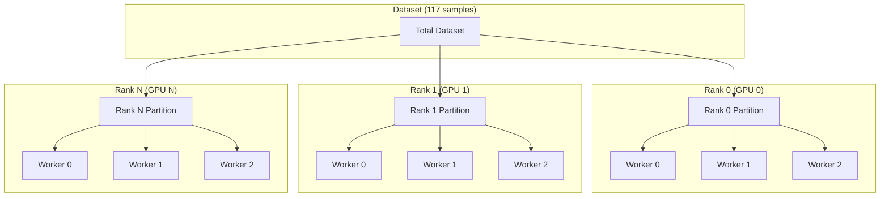
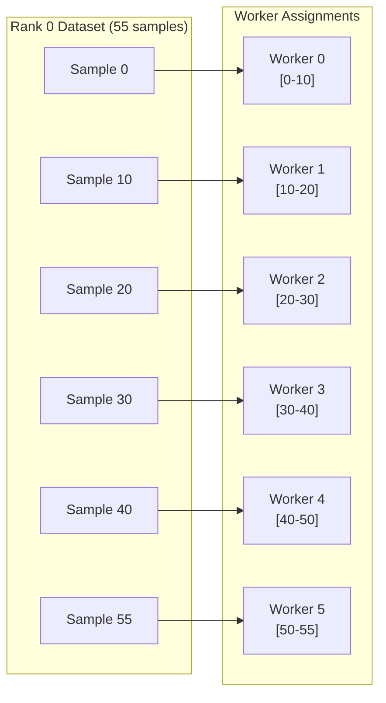
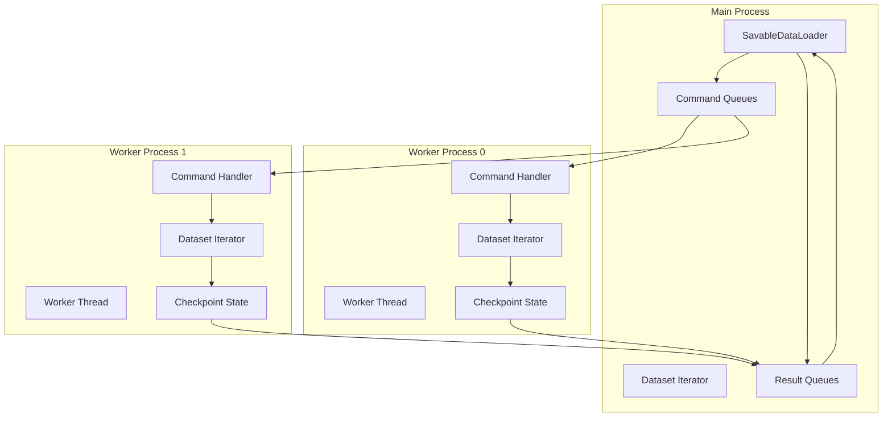
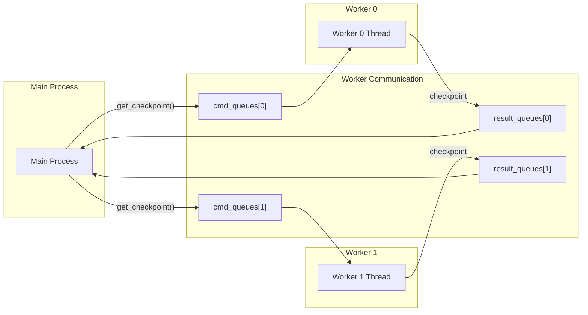
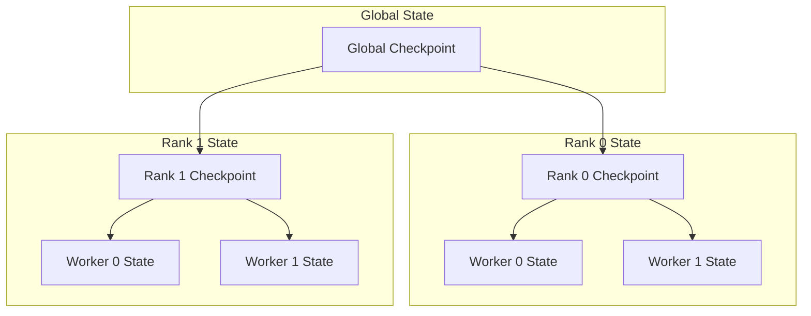
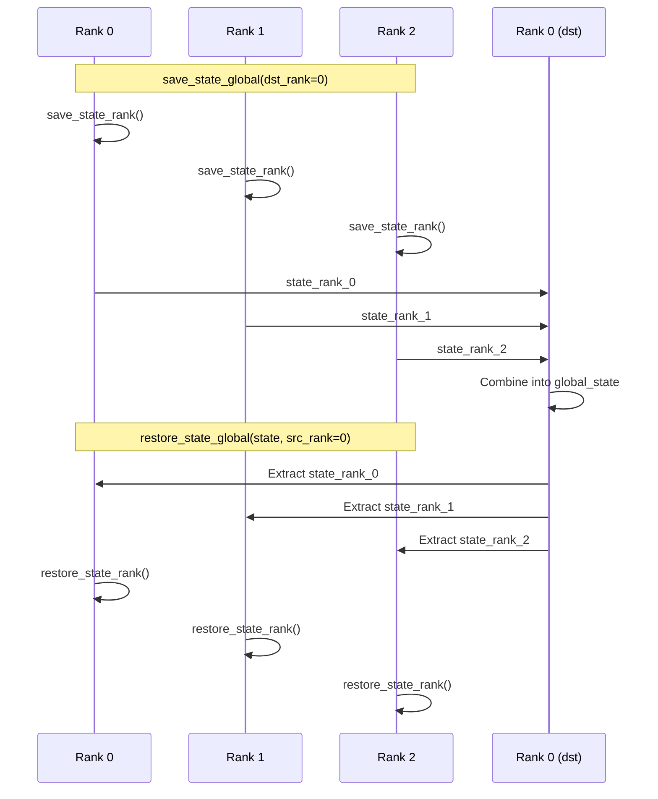
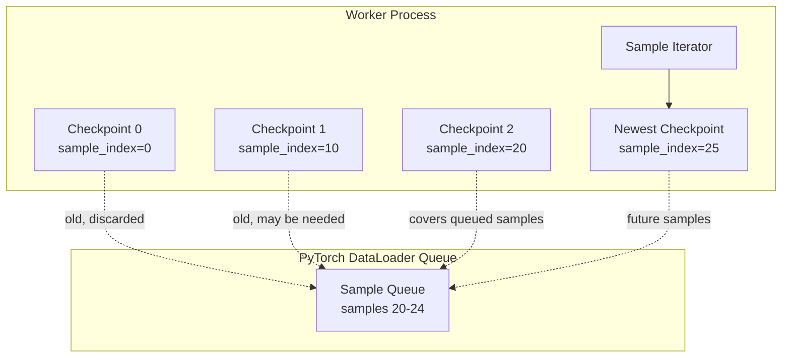

<!-- source: DeepWiki mcp.deepwiki.com · repo NVIDIA/Megatron-Energon · page 9.2 Distributed Training · fetched 2026-10-26 -->

# Distributed Training

<details>
<summary>Relevant source files</summary>

The following files were used as context for generating this wiki page:

- [src/megatron/energon/loader.py](src/megatron/energon/loader.py)
- [src/megatron/energon/savable_loader.py](src/megatron/energon/savable_loader.py)
- [src/megatron/energon/wrappers/gc_dataset.py](src/megatron/energon/wrappers/gc_dataset.py)
- [src/megatron/energon/wrappers/mix_batch_dataset.py](src/megatron/energon/wrappers/mix_batch_dataset.py)
- [tests/test_crudedataset.py](tests/test_crudedataset.py)
- [tests/test_dataset_det.py](tests/test_dataset_det.py)
- [tests/test_metadataset.py](tests/test_metadataset.py)
- [tests/test_metadataset_fewsamp.py](tests/test_metadataset_fewsamp.py)

</details>


## Purpose and Scope

This document explains how Megatron-Energon handles distributed training scenarios where data must be partitioned across multiple GPU ranks and worker processes. It covers the `WorkerConfig` abstraction, data partitioning strategies, deterministic sampling guarantees, and state management for distributed checkpointing.

For information about checkpointing and state management mechanics, see [Checkpointing and State Management](#9.1). For custom data transformation logic, see [Custom TaskEncoders](#9.3).

## WorkerConfig: The Core Abstraction

The `WorkerConfig` class is the central configuration object that defines how data is distributed across ranks and workers in a distributed training setup.

**Key Configuration Parameters**

| Parameter | Type | Description |
|-----------|------|-------------|
| `rank` | `int` | The global rank of the current process (0 to world_size-1) |
| `world_size` | `int` | Total number of distributed processes (GPU ranks) |
| `num_workers` | `int` | Number of worker processes per rank for data loading |
| `seed_offset` | `int` | Seed offset for deterministic sampling |
| `data_parallel_group` | `Optional` | PyTorch distributed process group for data parallelism |

**WorkerConfig Initialization**

```python
# Single rank, no multiprocessing
worker_config = WorkerConfig(rank=0, world_size=1, num_workers=0)

# Distributed training: 8 GPUs, 4 workers per GPU
worker_config = WorkerConfig(rank=0, world_size=8, num_workers=4)
```

Sources: [src/megatron/energon/worker.py](), [tests/test_metadataset.py:264-270](), [tests/test_crudedataset.py:478-483]()

## Data Partitioning Architecture

Megatron-Energon employs a two-level partitioning strategy: first at the rank level (across GPUs), then at the worker level (across worker processes within each rank).

**Partitioning Hierarchy**



Sources: [tests/test_metadataset.py:502-624]()

### Rank-Level Partitioning

Each rank receives a disjoint subset of the dataset. The partitioning happens at the dataset construction level, where shard ranges are computed for each rank.

**Sample Assignment Example**

For a dataset with 117 samples and 3 ranks with 2 workers each (6 global workers total):

| Global Worker ID | Rank | Worker | Samples Assigned |
|------------------|------|--------|------------------|
| 0 | 0 | 0 | 19-20 samples |
| 1 | 0 | 1 | 19-20 samples |
| 2 | 1 | 0 | 19-20 samples |
| 3 | 1 | 1 | 19-20 samples |
| 4 | 2 | 0 | 19-20 samples |
| 5 | 2 | 1 | 19-20 samples |

The assignment uses a generalized bit-reversal sequence to ensure balanced distribution even when the number of samples is not perfectly divisible by the number of workers.

Sources: [tests/test_metadataset.py:502-624](), [tests/test_metadataset_fewsamp.py:224-256]()

### Worker-Level Partitioning

Within each rank, data is further partitioned across worker processes. Each worker iterates over its assigned slice of samples independently.

**Worker Slice Offsets**



Sources: [tests/test_metadataset.py:533-540](), [src/megatron/energon/savable_loader.py:769-798]()

### Global Worker Identification

Each worker has both a local and global identifier:

```python
# Local worker ID within the rank
local_worker_id = worker_config.rank_worker_id()

# Global worker ID across all ranks
global_worker_id = worker_config.global_worker_id()
# Computed as: rank * num_workers + local_worker_id
```

Sources: [src/megatron/energon/savable_loader.py:104-105](), [src/megatron/energon/savable_loader.py:335-336]()

## Worker Process Management

When `num_workers > 0`, `SavableDataLoader` spawns worker processes using PyTorch's multiprocessing infrastructure. Each worker independently iterates over its data partition.

**Worker Process Architecture**



Sources: [src/megatron/energon/savable_loader.py:232-347]()

### Worker Initialization

Each worker process is initialized with:
1. A unique random seed based on rank and worker ID
2. Garbage collection optimization (`gc_init_worker`)
3. Worker ID offset for proper dataset slicing

**Initialization Sequence**

```python
def _init_worker(seed_per_worker: List[int], worker_id: int):
    # Initialize GC for CUDA tensors
    gc_init_worker(worker_id)
    
    # Set random seed deterministically
    worker_seed = seed_per_worker[worker_id]
    SystemRng.seed(worker_seed)
```

Sources: [src/megatron/energon/savable_loader.py:52-62](), [src/megatron/energon/wrappers/gc_dataset.py:30-58]()

### Command and Result Queues

The main process communicates with workers through multiprocessing queues:



**Command Thread Implementation**

Each worker runs a command thread that listens for requests from the main process:

```python
# Worker command thread processes requests
def _command_thread(self):
    while self._running:
        cmd_args = self._cmd_queues[self._worker_id].get(timeout=1)
        cmd = cmd_args[0]
        fn = getattr(self, cmd)
        result = fn(*cmd_args[1:])
        self._result_queues[self._worker_id].put({self._worker_id: result})
```

Sources: [src/megatron/energon/savable_loader.py:216-310](), [src/megatron/energon/savable_loader.py:740-743]()

## Deterministic Sampling

Megatron-Energon ensures deterministic sample ordering across different configurations through careful seed management and RNG state tracking.

**Deterministic Guarantees**

| Scenario | Guarantee |
|----------|-----------|
| Same configuration, different runs | Identical sample order |
| Different number of workers | Identical sample order (if same rank/world_size) |
| State restore | Exact continuation from checkpoint |
| TaskEncoder randomness | Reproducible with `@stateless(restore_seeds=True)` |

### RNG Seeding Strategy

Each worker receives a deterministic seed computed from the rank, worker ID, and seed offset:

```python
# Seed computation for each worker
worker_seed = self.worker_config.worker_seed(worker_id)
# worker_seed = base_seed + rank * num_workers + worker_id + seed_offset

SystemRng.seed(worker_seed)
```

This ensures that:
1. Each worker has a unique, deterministic seed
2. Different ranks produce different random sequences
3. Changing `seed_offset` produces a completely different shuffle

Sources: [src/megatron/energon/savable_loader.py:786-788](), [tests/test_dataset_det.py:233-304]()

### TaskEncoder Determinism

The `@stateless` decorator with `restore_seeds=True` ensures reproducible randomness in data transformations:

```python
class TestTaskEncoder(DefaultTaskEncoder):
    @stateless(restore_seeds=True)
    def encode_sample(self, sample: TextSample) -> TextSample:
        # Random operations here will be deterministic
        rand_str = f"_{torch.randint(0, 1000, (1,)).item()}"
        return TextSample(text=sample.text + rand_str)
```

When restoring from a checkpoint, the RNG state is restored to produce identical random values.

Sources: [tests/test_dataset_det.py:306-430]()

## State Management in Distributed Settings

Distributed training requires coordinating state across multiple processes. Megatron-Energon provides both rank-local and global state management.

**State Management Levels**



Sources: [src/megatron/energon/savable_loader.py:587-600](), [src/megatron/energon/savable_loader.py:881-1032]()

### Rank-Local State

Each rank independently saves its state, including all worker states:

```python
# Save state for current rank
state = loader.save_state_rank()
# Returns: SavableDataLoaderState containing worker states

# Restore state on current rank
loader.restore_state_rank(state)
```

**SavableDataLoaderState Structure**

```python
@edataclass
class SavableDataLoaderState(State):
    # State for each worker process
    worker_states: List[Union[SavableDatasetCheckpoint, FlexState]]
    # Which worker will emit the next sample
    next_worker_id: int
    # Batch size used (for validation)
    micro_batch_size: Optional[int]
```

Sources: [src/megatron/energon/savable_loader.py:587-600](), [src/megatron/energon/savable_loader.py:903-940]()

### Global State

For distributed training, global state aggregates all rank states to a single process:

```python
# Save global state (gathers from all ranks to dst_rank)
global_state = loader.save_state_global(global_dst_rank=0)
# Only rank 0 receives non-None state

# Restore global state (broadcasts from src_rank to all ranks)
loader.restore_state_global(global_state, src_rank=0)
```

**Global State Gathering**



Sources: [src/megatron/energon/savable_loader.py:943-1032](), [tests/test_dataset_det.py:518-648]()

### Worker Checkpoint Management

Each worker maintains multiple checkpoints to handle the latency between sample emission and retrieval:

**Checkpoint Buffer**



When saving state, the system:
1. Identifies which samples have been consumed from the queue
2. Finds the oldest checkpoint that covers those samples
3. Computes the offset (number of samples to skip) from that checkpoint

Sources: [src/megatron/energon/savable_loader.py:424-504](), [src/megatron/energon/savable_loader.py:746-783]()

## Worker ID Offset for State Restoration

When restoring state, PyTorch's DataLoader iterates workers in a fixed order. To restore the correct worker order, Megatron-Energon uses a worker ID offset:

```python
# Set worker offset globally before workers start
WorkerConfig.worker_id_offset = self._worker_offset

# Each worker computes its effective ID
self._worker_id = self.worker_config.rank_worker_id()
# Uses: (pytorch_worker_id + worker_id_offset) % num_workers
```

This ensures that the worker that should emit the next sample is first in the iteration order.

Sources: [src/megatron/energon/savable_loader.py:333-339](), [src/megatron/energon/savable_loader.py:506-538]()

## Best Practices

**Choosing Worker Configuration**

| Scenario | Recommended Configuration |
|----------|--------------------------|
| Small datasets, fast I/O | `num_workers=0` (no multiprocessing overhead) |
| Large datasets, slow I/O | `num_workers=4-8` per rank |
| Many small files | Higher `num_workers` for parallelism |
| Large batches | Higher `prefetch_factor` |

**Checkpoint Frequency**

For distributed training with workers, configure checkpoint frequency based on:
- `checkpoint_every_sec`: Time between checkpoints (default 60s)
- `checkpoint_every_min_n_samples`: Minimum samples between checkpoints (default `num_workers * 2`)
- `n_checkpoints`: Number of checkpoints to buffer (default `prefetch_factor * num_workers + 1`)

**Deterministic Training**

To ensure reproducibility:
1. Set `seed_offset` consistently across runs
2. Use `@stateless(restore_seeds=True)` in TaskEncoder methods
3. Set PyTorch's global seed before creating the dataset
4. Use the same `num_workers` and `world_size` when resuming

Sources: [src/megatron/energon/savable_loader.py:678-789](), [src/megatron/energon/loader.py:16-75]()

## Example: Multi-Rank Training Setup

```python
import torch.distributed as dist

# Initialize distributed training
dist.init_process_group(backend="nccl", init_method="tcp://...", 
                        world_size=8, rank=rank)

# Configure data loading
worker_config = WorkerConfig(
    rank=rank,
    world_size=8,
    num_workers=4,
    seed_offset=42
)

# Create dataset
dataset = get_train_dataset(
    path="s3://datasets/my_dataset",
    worker_config=worker_config,
    batch_size=32,
    shuffle_buffer_size=1000
)

# Create loader with checkpointing
loader = get_savable_loader(
    dataset,
    checkpoint_every_sec=120,
    checkpoint_every_min_n_samples=8
)

# Training loop
for epoch in range(num_epochs):
    for batch in loader:
        # Train step
        loss = model(batch)
        loss.backward()
        optimizer.step()
        
        # Periodic checkpoint
        if step % checkpoint_interval == 0:
            state = loader.save_state_global(global_dst_rank=0)
            if rank == 0:
                torch.save(state, f"checkpoint_{step}.pt")
```

Sources: [tests/test_dataset_det.py:518-648](), [src/megatron/energon/loader.py:16-119]()

---

