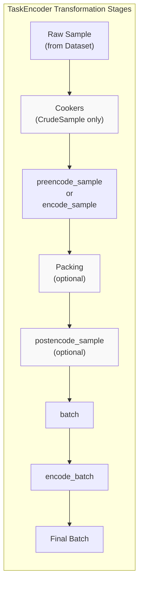
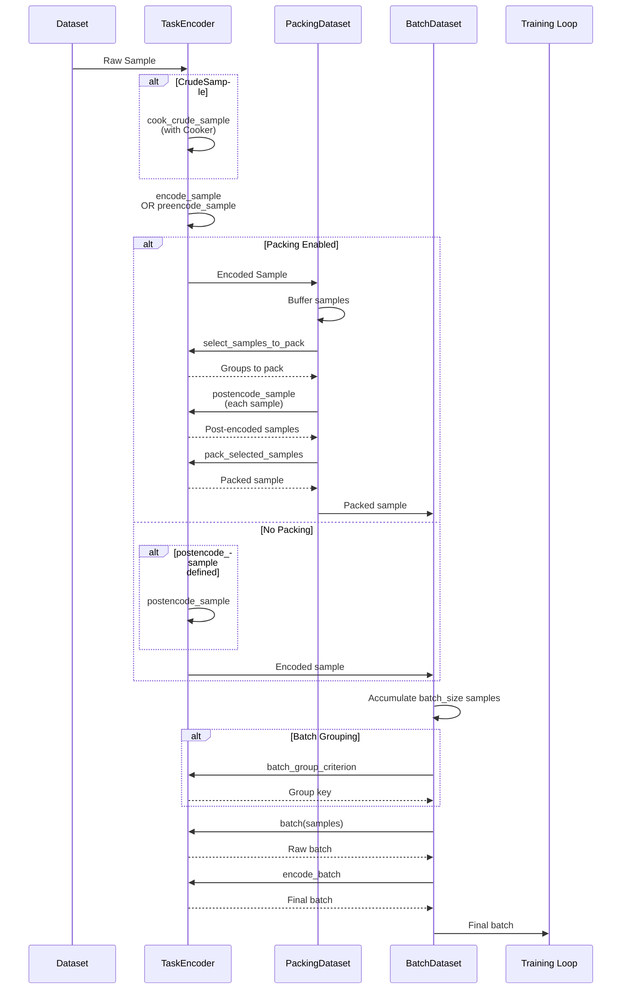
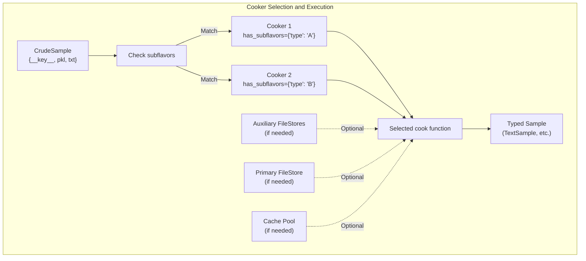
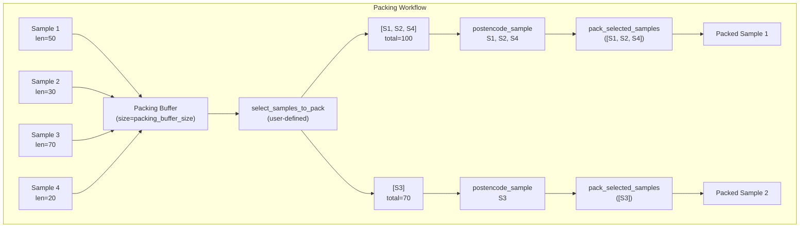

<!-- source: DeepWiki mcp.deepwiki.com · repo NVIDIA/Megatron-Energon · page 9.3 Custom TaskEncoders · fetched 2026-10-26 -->

# Custom TaskEncoders

<details>
<summary>Relevant source files</summary>

The following files were used as context for generating this wiki page:

- [src/megatron/energon/task_encoder/base.py](src/megatron/energon/task_encoder/base.py)
- [src/megatron/energon/task_encoder/loader.py](src/megatron/energon/task_encoder/loader.py)
- [tests/test_crudedataset.py](tests/test_crudedataset.py)
- [tests/test_dataset.py](tests/test_dataset.py)
- [tests/test_dataset_det.py](tests/test_dataset_det.py)
- [tests/test_metadataset.py](tests/test_metadataset.py)
- [tests/test_metadataset_fewsamp.py](tests/test_metadataset_fewsamp.py)

</details>


## Purpose and Scope

This page provides a comprehensive guide for implementing custom TaskEncoders to transform data samples and batches in your data loading pipeline. Custom TaskEncoders enable you to apply domain-specific preprocessing, augmentations, tokenization, and batching strategies tailored to your model's requirements.

For information about the TaskEncoder pipeline architecture and built-in wrappers, see [TaskEncoder Pipeline](#5.1). For basic usage of TaskEncoder with standard datasets, see [Task Encoders & Data Processing](#5).

**Sources:** [src/megatron/energon/task_encoder/base.py:350-365]()

---

## TaskEncoder Overview

### What is a TaskEncoder?

A `TaskEncoder` is a customizable transformation pipeline that processes raw samples into model-ready batches. It provides hooks at multiple stages of the data loading process, enabling fine-grained control over data transformation.



**Diagram: TaskEncoder Processing Pipeline**

The base `TaskEncoder` class is generic over four type parameters:

| Type Parameter | Description | Example |
|----------------|-------------|---------|
| `T_sample` | Input sample type from dataset | `CaptioningSample` |
| `T_encoded_sample` | Sample type after encoding | `EncodedCaptioningSample` |
| `T_raw_batch` | Batch type before final encoding | `CaptioningRawBatch` |
| `T_batch` | Final batch type to training loop | `CaptioningBatch` |

**Sources:** [src/megatron/energon/task_encoder/base.py:350-365](), [src/megatron/energon/task_encoder/base.py:61-66]()

---

## The TaskEncoder Lifecycle

### Processing Stages

The TaskEncoder processes data through the following stages in order:



**Diagram: TaskEncoder Lifecycle Sequence**

### Method Descriptions

| Method | Purpose | Must be @stateless | Can Skip |
|--------|---------|-------------------|----------|
| `cook_crude_sample` | Transform `CrudeSample` to typed sample | ✅ Yes | Only for CrudeWebdataset |
| `encode_sample` | Single-stage encoding | ✅ Yes | If using preencode/postencode |
| `preencode_sample` | Pre-packing encoding | ✅ Yes | If using encode_sample |
| `postencode_sample` | Post-packing encoding | ✅ Yes | If not needed |
| `select_samples_to_pack` | Choose samples for packing | ❌ No | If not using packing |
| `pack_selected_samples` | Combine selected samples | ✅ Yes | If not using packing |
| `batch_group_criterion` | Group samples into batches | ❌ No | For simple batching |
| `batch` | Collate samples into batch | ✅ Yes | Never (has default) |
| `encode_batch` | Transform raw batch | ✅ Yes | If not needed |

**Sources:** [src/megatron/energon/task_encoder/base.py:403-481](), [src/megatron/energon/task_encoder/base.py:537-563]()

---

## The @stateless Decorator

### Why @stateless is Critical

The `@stateless` decorator marks methods that can be checkpointed and restored. This is **essential** for training resumption in distributed settings.

```python
from megatron.energon import stateless, TaskEncoder, Sample
import torch

class MyTaskEncoder(TaskEncoder):
    @stateless
    def encode_sample(self, sample: Sample) -> Sample:
        # This method's state can be saved/restored
        return process_sample(sample)
```

**Key Rules:**
1. Methods marked `@stateless` must be **deterministic** or use seeded randomness
2. Methods that modify `self` attributes should **not** be marked stateless
3. Cooker functions passed to `Cooker()` must be stateless

### Restoring Random Seeds

For methods that use randomness (e.g., data augmentation), use `@stateless(restore_seeds=True)`:

```python
class AugmentingTaskEncoder(TaskEncoder):
    @stateless(restore_seeds=True)
    def encode_sample(self, sample: ImageSample) -> ImageSample:
        # Random operations will be deterministic on checkpoint restore
        augmented_image = random_crop(sample.image)
        noise = torch.randn_like(augmented_image)  # Seeded by restore_seeds
        return ImageSample.derive_from(sample, image=augmented_image + noise)
```

When `restore_seeds=True`:
- The RNG is seeded based on `worker_seed` and `current_sample_index`
- On checkpoint restore, the same seed will be used for the same sample
- Enables exact training reproducibility

### Failure Tolerance

Control how many consecutive errors are tolerated before raising `FatalSampleError`:

```python
@stateless(failure_tolerance=10)
def encode_sample(self, sample: Sample) -> Sample:
    # Will skip up to 10 consecutive failing samples
    return risky_operation(sample)
```

**Sources:** [src/megatron/energon/task_encoder/base.py:124-257](), [tests/test_dataset_det.py:306-357]()

---

## Implementing Custom Transformations

### encode_sample vs preencode_sample/postencode_sample

You must use **either** `encode_sample` **or** the `preencode_sample`/`postencode_sample` pair, but not both.

#### Single-Stage Encoding

Use `encode_sample` for simple transformations:

```python
from megatron.energon import DefaultTaskEncoder, CaptioningSample, stateless
import torch

class SimpleCaptioningEncoder(DefaultTaskEncoder):
    @stateless
    def encode_sample(self, sample: CaptioningSample) -> EncodedSample:
        # Tokenize caption
        caption_ids = self.tokenizer.encode(sample.caption)
        
        # Normalize image
        image = sample.image / 255.0
        
        return EncodedSample.derive_from(
            sample,
            image=image,
            caption_ids=torch.tensor(caption_ids)
        )
```

#### Two-Stage Encoding (with Packing)

Use `preencode_sample` + `postencode_sample` when using packing:

```python
class PackingCaptioningEncoder(DefaultTaskEncoder):
    @stateless
    def preencode_sample(self, sample: CaptioningSample) -> PreEncodedSample:
        # Do minimal processing before packing
        caption_ids = self.tokenizer.encode(sample.caption)
        return PreEncodedSample.derive_from(
            sample,
            image=sample.image,
            caption_ids=caption_ids,
            length=len(caption_ids)
        )
    
    @stateless
    def postencode_sample(self, sample: PreEncodedSample) -> EncodedSample:
        # Final processing after packing
        image = torch.tensor(sample.image) / 255.0
        caption_ids = torch.tensor(sample.caption_ids)
        return EncodedSample.derive_from(
            sample,
            image=image,
            caption_ids=caption_ids
        )
```

**When to use which:**
- **encode_sample**: Simple pipelines without packing
- **preencode + postencode**: When using packing, or when you want to cache intermediate results

**Sources:** [src/megatron/energon/task_encoder/base.py:431-458](), [src/megatron/energon/task_encoder/base.py:744-770]()

### Yielding Multiple Samples

Any encoding method can be a **generator** to produce multiple samples from one input:

```python
class MultiSampleEncoder(DefaultTaskEncoder):
    @stateless
    def encode_sample(self, sample: ImageSample):
        # Generate multiple crops from one image
        for i in range(5):
            crop = random_crop(sample.image, size=224)
            yield ImageSample.derive_from(
                sample,
                image=crop,
                __key__=f"{sample.__key__}_crop{i}"
            )
```

This is useful for:
- Data augmentation (multiple views per sample)
- Splitting long sequences into chunks
- Unpacking compound samples

**Sources:** [src/megatron/energon/task_encoder/base.py:431-458]()

### Skipping Samples

Raise `SkipSample` to filter out samples:

```python
from megatron.energon import SkipSample

class FilteringEncoder(DefaultTaskEncoder):
    @stateless
    def encode_sample(self, sample: Sample) -> Sample:
        if not self.is_valid(sample):
            raise SkipSample("Invalid sample")
        return sample
```

**Sources:** [src/megatron/energon/task_encoder/base.py:434-437]()

---

## Cookers for CrudeWebdataset

### What are Cookers?

`Cooker` objects transform `CrudeSample` (raw dictionaries from webdatasets) into typed `Sample` objects. They are only used with `CrudeWebdataset`.



**Diagram: Cooker Selection and Execution**

### Basic Cooker Example

```python
from megatron.energon import Cooker, stateless, basic_sample_keys
from megatron.energon import TextSample

@stateless
def cook_text(sample: dict) -> TextSample:
    """Cook a crude sample into a TextSample."""
    return TextSample(
        **basic_sample_keys(sample),  # Handles __key__, __restore_key__, etc.
        text=sample['txt'].decode('utf-8')
    )

class MyCookingEncoder(DefaultTaskEncoder):
    # Register cookers
    cookers = [
        Cooker(cook_text),
    ]
```

**Sources:** [tests/test_crudedataset.py:92-98](), [tests/test_crudedataset.py:142-157]()

### Cooker with Subflavors

Use subflavors to select different cookers for different sample types:

```python
@stateless
def cook_text_type_a(sample: dict) -> TextSample:
    return TextSample(
        **basic_sample_keys(sample),
        text=f"Type A: {sample['txt'].decode()}"
    )

@stateless
def cook_text_type_b(sample: dict) -> TextSample:
    return TextSample(
        **basic_sample_keys(sample),
        text=f"Type B: {sample['txt'].decode()}"
    )

class MultiTypeCookingEncoder(DefaultTaskEncoder):
    cookers = [
        Cooker(cook_text_type_a, has_subflavors={'type': 'A'}),
        Cooker(cook_text_type_b, has_subflavors={'type': 'B'}),
    ]
```

The cooker whose `has_subflavors` matches the dataset's `subflavors` configuration will be selected.

**Sources:** [tests/test_crudedataset.py:142-157](), [src/megatron/energon/task_encoder/cooking.py]()

### Cooker with Auxiliary Data Access

Cookers can access auxiliary datasets (configured in metadataset YAML) via `FileStore`:

```python
from megatron.energon.cache import FileStore

@stateless
def cook_with_aux(sample: dict, auxiliary: FileStore) -> TextSample:
    """Cook with access to auxiliary dataset."""
    # Load related data from auxiliary dataset
    aux_data = auxiliary.get(f"{sample['__key__']}.metadata", sample)
    
    return TextSample(
        **basic_sample_keys(sample),
        text=f"{sample['txt'].decode()} - {aux_data}"
    )

class AuxCookingEncoder(DefaultTaskEncoder):
    cookers = [
        Cooker(cook_with_aux),
    ]
```

Auxiliary datasets are specified in the metadataset configuration:
```yaml
splits:
  train:
    path: main_dataset
    aux:
      auxiliary: path/to/auxiliary_dataset
```

**Sources:** [tests/test_crudedataset.py:109-117](), [tests/test_crudedataset.py:569-627]()

### Cooker with Primary and Cache Access

Use the `@cooker` decorator with flags to access primary dataset and cache pool:

```python
from megatron.energon.task_encoder.cooking import cooker
from megatron.energon.cache import CachePool, Lazy

@stateless
@cooker(need_primary=True, need_cache=True)
def cook_with_cache(
    sample: dict,
    primary: FileStore,
    cache: CachePool
) -> LazyTextSample:
    """Cook with primary and cache access."""
    # Get current sample text
    text = sample['txt'].decode()
    
    # Create lazy reference to next sample from primary
    next_key = f"{int(sample['__key__']) + 1:06d}.txt"
    next_text = cache.get_lazy(primary, next_key)
    
    return LazyTextSample(
        **basic_sample_keys(sample),
        txt=text,
        next_txt=next_text  # Lazy[str] - loaded on demand
    )

class LazyCookingEncoder(DefaultTaskEncoder):
    cookers = [
        Cooker(cook_with_cache),
    ]
```

The `Lazy` object will load the data only when accessed (e.g., `sample.next_txt.get(sample)`).

**Sources:** [tests/test_crudedataset.py:183-196](), [tests/test_crudedataset.py:198-225]()

---

## Custom Batching

### Custom Collation

Override the `batch` method to customize how samples are collated into batches:

```python
from typing import List
from megatron.energon import Batch, generic_batch, batch_pad_stack

class CustomBatchEncoder(DefaultTaskEncoder):
    @stateless
    def batch(self, samples: List[EncodedSample]) -> CustomBatch:
        # Custom batching logic
        images = batch_pad_stack([s.image for s in samples])
        captions = [s.caption for s in samples]  # Keep as list
        lengths = torch.tensor([len(s.caption) for s in samples])
        
        return CustomBatch(
            __key__=[s.__key__ for s in samples],
            __restore_key__=tuple(s.__restore_key__ for s in samples),
            images=images,
            captions=captions,
            lengths=lengths
        )
```

**Utility functions for batching:**

| Function | Purpose |
|----------|---------|
| `generic_batch` | Automatically pad/stack tensors, list other types |
| `batch_stack` | Stack tensors (requires same shape) |
| `batch_pad_stack` | Pad to max size and stack |
| `batch_list` | Keep as list |

**Sources:** [src/megatron/energon/task_encoder/base.py:72-119](), [src/megatron/energon/task_encoder/base.py:460-481]()

### Batch Grouping

Use `batch_group_criterion` to group samples by characteristics (e.g., sequence length):

```python
from typing import Hashable, Optional, Tuple

class GroupedBatchEncoder(DefaultTaskEncoder):
    def batch_group_criterion(
        self, sample: EncodedSample
    ) -> Tuple[Hashable, Optional[int]]:
        # Group by sequence length bucket, batch size 16
        length_bucket = (len(sample.caption) // 100) * 100
        return length_bucket, 16
```

This enables:
- **Dynamic batching** by grouping similar-length sequences
- **Per-group batch sizes** (e.g., smaller batches for longer sequences)

Returns:
- **Tuple[group_key, batch_size]**: Samples with same `group_key` are batched together
- If `batch_size` is `None`, uses the `batch_size` parameter from `get_train_dataset`

**Sources:** [src/megatron/energon/task_encoder/base.py:465-474](), [src/megatron/energon/task_encoder/base.py:623-645]()

---

## Custom Packing

Packing combines multiple samples into a single packed sample, useful for efficient training on variable-length sequences.



**Diagram: Packing Workflow**

### Implementing Packing

To enable packing, implement both `select_samples_to_pack` and `pack_selected_samples`:

```python
from typing import List

class PackingEncoder(DefaultTaskEncoder):
    @stateless
    def preencode_sample(self, sample: CaptioningSample) -> PreEncodedSample:
        caption_ids = self.tokenizer.encode(sample.caption)
        return PreEncodedSample.derive_from(
            sample,
            caption_ids=caption_ids,
            length=len(caption_ids)
        )
    
    def select_samples_to_pack(
        self, samples: List[PreEncodedSample]
    ) -> List[List[PreEncodedSample]]:
        """Group samples to pack based on total length <= max_length."""
        max_length = 512
        groups = []
        current_group = []
        current_length = 0
        
        for sample in samples:
            if current_length + sample.length <= max_length:
                current_group.append(sample)
                current_length += sample.length
            else:
                if current_group:
                    groups.append(current_group)
                current_group = [sample]
                current_length = sample.length
        
        if current_group:
            groups.append(current_group)
        
        return groups
    
    @stateless
    def pack_selected_samples(
        self, samples: List[PreEncodedSample]
    ) -> EncodedSample:
        """Concatenate caption_ids from multiple samples."""
        packed_ids = []
        for sample in samples:
            packed_ids.extend(sample.caption_ids)
            packed_ids.append(self.sep_token_id)  # Separator
        
        return EncodedSample.derive_from(
            samples[0],  # Use first sample's metadata
            caption_ids=torch.tensor(packed_ids),
            num_packed=len(samples)
        )
```

### Enabling Packing in get_train_dataset

```python
dataset = get_train_dataset(
    path,
    task_encoder=PackingEncoder(),
    batch_size=16,
    packing_buffer_size=100,  # Buffer 100 samples before packing
    worker_config=worker_config
)
```

**Key Points:**
- `select_samples_to_pack` is **not** marked `@stateless` (buffer state doesn't need checkpointing)
- `pack_selected_samples` **must** be marked `@stateless` (applied during restore)
- `postencode_sample` (if defined) is applied **after** packing selection but **before** packing

**Sources:** [src/megatron/energon/task_encoder/base.py:537-563](), [src/megatron/energon/task_encoder/base.py:575-621](), [tests/test_crudedataset.py:158-164]()

---

## Complete Examples

### Example 1: Simple Image Classification Encoder

```python
from megatron.energon import DefaultTaskEncoder, ImageSample, Batch, stateless
import torch
import torchvision.transforms as T

@edataclass
class ClassificationBatch(Batch):
    images: torch.Tensor
    labels: torch.Tensor

class ImageClassificationEncoder(DefaultTaskEncoder):
    def __init__(self, num_classes: int):
        super().__init__()
        self.num_classes = num_classes
        self.transform = T.Compose([
            T.Resize(224),
            T.ToTensor(),
            T.Normalize(mean=[0.485, 0.456, 0.406],
                       std=[0.229, 0.224, 0.225])
        ])
    
    @stateless(restore_seeds=True)
    def encode_sample(self, sample: ImageSample) -> ImageSample:
        # Apply transforms with deterministic randomness
        image = self.transform(sample.image)
        return ImageSample.derive_from(sample, image=image)
    
    @stateless
    def batch(self, samples: List[ImageSample]) -> ClassificationBatch:
        images = torch.stack([s.image for s in samples])
        labels = torch.tensor([s.label for s in samples])
        return ClassificationBatch.from_samples(
            samples,
            images=images,
            labels=labels
        )
```

### Example 2: Text Packing Encoder with Cooker

```python
from megatron.energon import (
    DefaultTaskEncoder, TextSample, Cooker, 
    stateless, basic_sample_keys, Batch
)
from typing import List
import torch

@edataclass
class TextBatch(Batch):
    input_ids: torch.Tensor
    attention_mask: torch.Tensor
    num_packed: List[int]

@stateless
def cook_text(sample: dict) -> TextSample:
    return TextSample(
        **basic_sample_keys(sample),
        text=sample['txt'].decode('utf-8')
    )

class TextPackingEncoder(DefaultTaskEncoder):
    cookers = [Cooker(cook_text)]
    
    def __init__(self, tokenizer, max_length: int = 512):
        super().__init__()
        self.tokenizer = tokenizer
        self.max_length = max_length
    
    @stateless
    def preencode_sample(self, sample: TextSample) -> dict:
        tokens = self.tokenizer.encode(sample.text)
        return {
            '__key__': sample.__key__,
            '__restore_key__': sample.__restore_key__,
            'tokens': tokens,
            'length': len(tokens)
        }
    
    def select_samples_to_pack(self, samples: List[dict]) -> List[List[dict]]:
        """Pack samples to fill max_length."""
        groups = []
        current_group = []
        current_len = 0
        
        for sample in samples:
            if current_len + sample['length'] <= self.max_length:
                current_group.append(sample)
                current_len += sample['length']
            else:
                if current_group:
                    groups.append(current_group)
                current_group = [sample]
                current_len = sample['length']
        
        if current_group:
            groups.append(current_group)
        return groups
    
    @stateless
    def pack_selected_samples(self, samples: List[dict]) -> dict:
        """Concatenate tokens from packed samples."""
        all_tokens = []
        for sample in samples:
            all_tokens.extend(sample['tokens'])
        
        return {
            '__key__': '|'.join(s['__key__'] for s in samples),
            '__restore_key__': tuple(s['__restore_key__'] for s in samples),
            'input_ids': all_tokens,
            'num_packed': len(samples)
        }
    
    @stateless
    def batch(self, samples: List[dict]) -> TextBatch:
        # Pad sequences
        max_len = max(len(s['input_ids']) for s in samples)
        input_ids = []
        attention_mask = []
        
        for sample in samples:
            ids = sample['input_ids']
            pad_len = max_len - len(ids)
            input_ids.append(ids + [0] * pad_len)
            attention_mask.append([1] * len(ids) + [0] * pad_len)
        
        return TextBatch(
            __key__=[s['__key__'] for s in samples],
            __restore_key__=tuple(s['__restore_key__'] for s in samples),
            input_ids=torch.tensor(input_ids),
            attention_mask=torch.tensor(attention_mask),
            num_packed=[s['num_packed'] for s in samples]
        )
```

### Example 3: Multi-Modal Encoder with Auxiliary Data

```python
from megatron.energon import DefaultTaskEncoder, Cooker, stateless
from megatron.energon.cache import FileStore
import torch

@stateless
def cook_multimodal(
    sample: dict,
    captions: FileStore
) -> MultiModalSample:
    """Cook with auxiliary caption dataset."""
    # Get caption from auxiliary dataset
    caption = captions.get(f"{sample['__key__']}.txt", sample)
    
    return MultiModalSample(
        **basic_sample_keys(sample),
        image=sample['jpg'],
        caption=caption.decode('utf-8')
    )

class MultiModalEncoder(DefaultTaskEncoder):
    cookers = [Cooker(cook_multimodal)]
    
    def __init__(self, image_processor, tokenizer):
        super().__init__()
        self.image_processor = image_processor
        self.tokenizer = tokenizer
    
    @stateless
    def encode_sample(self, sample: MultiModalSample) -> EncodedSample:
        image_features = self.image_processor(sample.image)
        text_tokens = self.tokenizer.encode(sample.caption)
        
        return EncodedSample.derive_from(
            sample,
            image_features=image_features,
            text_tokens=text_tokens
        )
```

**Sources:** [tests/test_dataset.py:462-485](), [tests/test_crudedataset.py:142-225](), [tests/test_dataset_det.py:306-357]()

---

## Best Practices

### Determinism and Checkpointing

1. **Always use `@stateless`** on transformation methods (`encode_sample`, `cook`, `pack_selected_samples`, etc.)
2. **Use `restore_seeds=True`** when applying random augmentations
3. **Don't modify `self` attributes** in stateless methods
4. **Test checkpoint restore** to ensure reproducibility

### Performance

1. **Minimize work in `preencode_sample`** if using packing (it's called for every sample in buffer)
2. **Use lazy loading** (`Lazy[T]`) for expensive operations that may not be needed
3. **Cache expensive computations** using the `cache` parameter in cookers
4. **Batch expensive operations** in `encode_batch` rather than per-sample

### Error Handling

1. **Set appropriate `failure_tolerance`** based on expected error rates
2. **Use `SkipSample`** for graceful filtering rather than raising exceptions
3. **Validate samples early** in `preencode_sample` to avoid wasted packing work

### Type Safety

1. **Define dataclasses** for sample and batch types (use `@edataclass`)
2. **Specify generic type parameters** on `TaskEncoder` for better IDE support
3. **Use `derive_from`** to preserve metadata fields when creating new samples

**Sources:** [src/megatron/energon/task_encoder/base.py:134-246](), [src/megatron/energon/edataclass.py]()

---

## Related Documentation

- [TaskEncoder Pipeline](#5.1) - Architecture and built-in wrappers
- [Dataset Wrappers](#5.2) - MapDataset, PackingDataset, etc.
- [Sample Decoding](#5.3) - Image and media decoding options
- [Checkpointing and State Management](#9.1) - Deep dive into state saving
- [Distributed Training](#9.2) - Worker configuration and data partitioning