# Page: Overview

# Overview

<details>
<summary>Relevant source files</summary>

The following files were used as context for generating this wiki page:

- [pyproject.toml](pyproject.toml)
- [src/megatron/energon/flavors/crude.py](src/megatron/energon/flavors/crude.py)
- [src/megatron/energon/flavors/webdataset/sample_decoder.py](src/megatron/energon/flavors/webdataset/sample_decoder.py)
- [src/megatron/energon/metadataset/metadataset_v2.py](src/megatron/energon/metadataset/metadataset_v2.py)
- [src/megatron/energon/typed_converter.py](src/megatron/energon/typed_converter.py)
- [tests/test_metadataset_v2.py](tests/test_metadataset_v2.py)
- [uv.lock](uv.lock)

</details>


Megatron-Energon is a high-performance, multi-modal data loader designed for large-scale distributed training. It provides efficient random access to datasets stored in tar archives, flexible dataset composition, checkpointable data loading, and comprehensive support for images, text, audio, and video.

This document provides an architectural overview of the system. For installation instructions, see [Installation and Setup](#1.1). For detailed information about specific subsystems, refer to the sections on [Core Concepts](#2), [Dataset Preparation](#3), [Data Loading](#4), [Task Encoders](#5), [Audio/Video Processing](#6), [Storage Access](#7), [CLI Tools](#8), and [Advanced Topics](#9).

## Purpose and Scope

Megatron-Energon addresses key challenges in training large-scale models:

- **Efficient Data Access**: Random access to samples in tar archives without decompression overhead
- **Dataset Composition**: Flexible blending, joining, and concatenation of heterogeneous datasets
- **Fault Tolerance**: Exact checkpointing and restoration of data loader state for long-running training jobs
- **Multi-Modal Support**: Unified handling of text, images, audio, and video data
- **Storage Flexibility**: Transparent access to data on local filesystems, S3, Azure Blob Storage, GCS, and other backends
- **Distributed Training**: Deterministic sample partitioning across multiple GPUs and nodes

**Sources:** [pyproject.toml:12](), [pyproject.toml:23-36]()

## Key Features

| Feature | Description |
|---------|-------------|
| **WebDataset Format** | Uses tar archives with SQLite indices for efficient random access |
| **MetadatasetV2** | Declarative YAML configuration for dataset composition (blending, joining) |
| **SavableDataLoader** | Checkpointable data loader with exact state restoration |
| **TaskEncoder Pipeline** | User-defined transformation pipeline with hooks for pre/post-encoding |
| **AVDecoder** | Efficient audio/video decoding with keyframe indexing (Fastseek) |
| **EPath Abstraction** | Uniform API for local and cloud storage access |
| **CLI Tools** | `energon prepare` for indexing, `energon mount` for FUSE filesystem |

**Sources:** [src/megatron/energon/metadataset/metadataset_v2.py:1-611]()

## System Architecture

Megatron-Energon is organized into seven functional layers that transform raw data files into training batches:

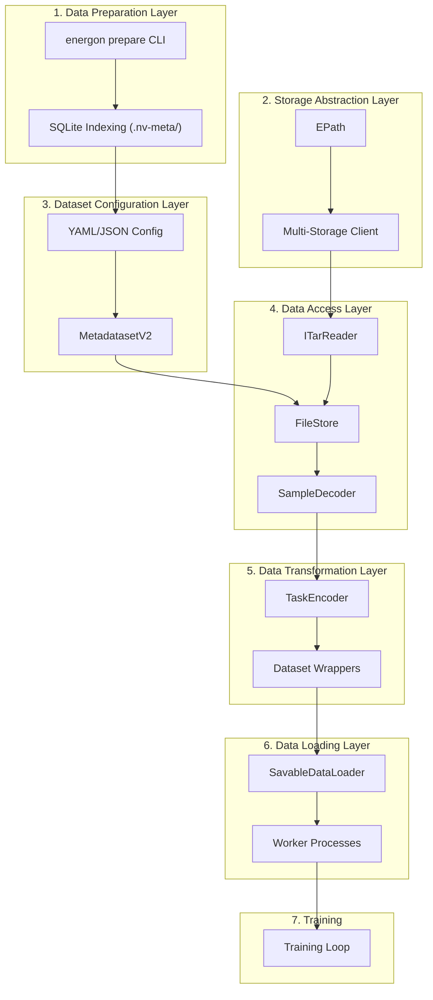

**Architecture Overview:**

1. **Data Preparation**: Index tar files and generate metadata for efficient access
2. **Storage Abstraction**: Provide uniform access across storage backends
3. **Dataset Configuration**: Define dataset composition (blending, splitting, joining)
4. **Data Access**: Read samples from tar archives at specific byte offsets
5. **Data Transformation**: Apply user-defined transformations via TaskEncoder
6. **Data Loading**: Batch, pack, and deliver samples to training with checkpointing
7. **Training**: Consume batches in the training loop

**Sources:** [src/megatron/energon/metadataset/metadataset_v2.py:1-611]()

## Core Components

### Configuration and Dataset Composition

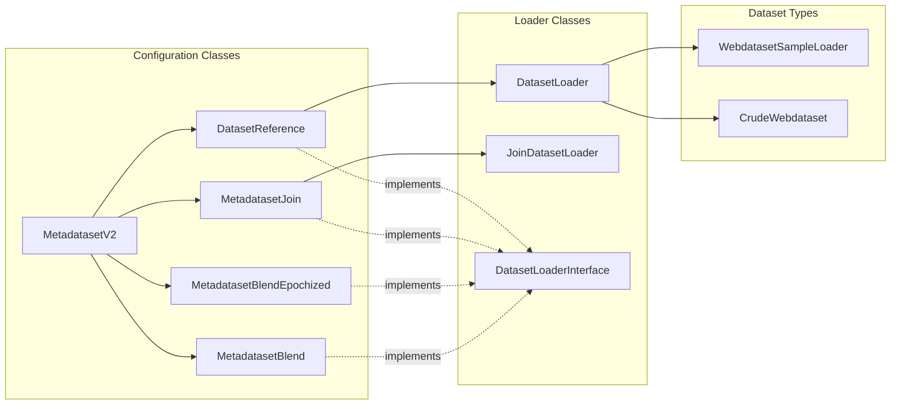

**Key Classes:**

| Class | Purpose | Location |
|-------|---------|----------|
| `MetadatasetV2` | Root configuration object for dataset composition | [src/megatron/energon/metadataset/metadataset_v2.py:559-611]() |
| `MetadatasetBlend` | Weighted sampling from multiple datasets | [src/megatron/energon/metadataset/metadataset_v2.py:415-476]() |
| `MetadatasetBlendEpochized` | Fixed repetitions per epoch | [src/megatron/energon/metadataset/metadataset_v2.py:494-556]() |
| `MetadatasetJoin` | Key-based joining of datasets | [src/megatron/energon/metadataset/metadataset_v2.py:324-397]() |
| `DatasetReference` | Reference to a base dataset | [src/megatron/energon/metadataset/metadataset_v2.py:176-284]() |
| `DatasetLoader` | Loads samples from prepared datasets | Referenced in [src/megatron/energon/metadataset/metadataset_v2.py:209]() |
| `JoinDatasetLoader` | Implements joining logic | Referenced in [src/megatron/energon/metadataset/metadataset_v2.py:361]() |

**Sources:** [src/megatron/energon/metadataset/metadataset_v2.py:34-611]()

### Data Processing Pipeline

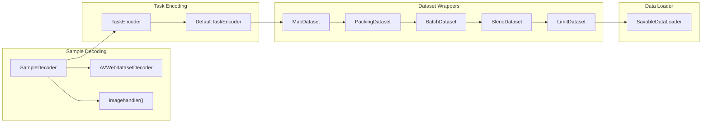

**Key Classes:**

| Class | Purpose | Location |
|-------|---------|----------|
| `SampleDecoder` | Decodes raw bytes into typed objects (images, video, etc.) | [src/megatron/energon/flavors/webdataset/sample_decoder.py:80-143]() |
| `AVWebdatasetDecoder` | Handles audio/video decoding with multiple modes | Referenced in [src/megatron/energon/flavors/webdataset/sample_decoder.py:110-113]() |
| `TaskEncoder` | User-defined transformation pipeline | Referenced throughout |
| `DefaultTaskEncoder` | Default no-op task encoder | Referenced in [tests/test_metadataset_v2.py:35]() |
| `SavableDataLoader` | Checkpointable PyTorch DataLoader | Referenced in [tests/test_metadataset_v2.py:26]() |

**Sources:** [src/megatron/energon/flavors/webdataset/sample_decoder.py:1-143]()

### Storage and Access

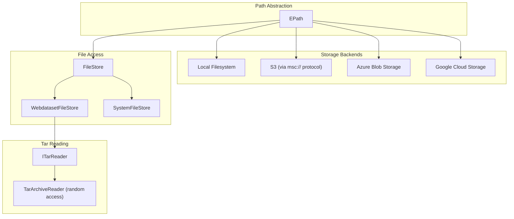

**Key Classes:**

| Class | Purpose | Location |
|-------|---------|----------|
| `EPath` | Multi-storage path abstraction | [src/megatron/energon/typed_converter.py:521-532]() |
| `FileStore` | Abstract interface for file storage | Referenced in [src/megatron/energon/metadataset/metadataset_v2.py:8]() |
| `WebdatasetFileStore` | FileStore for prepared datasets | [src/megatron/energon/metadataset/metadataset_v2.py:52]() |
| `SystemFileStore` | FileStore for regular filesystems | [src/megatron/energon/metadataset/metadataset_v2.py:66]() |
| `ITarReader` | Random access to tar archives | Referenced in architecture diagrams |

**Sources:** [src/megatron/energon/metadataset/metadataset_v2.py:8-66](), [src/megatron/energon/typed_converter.py:521-532]()

## Data Flow Overview

The following diagram illustrates how data flows from preparation through to the training loop:

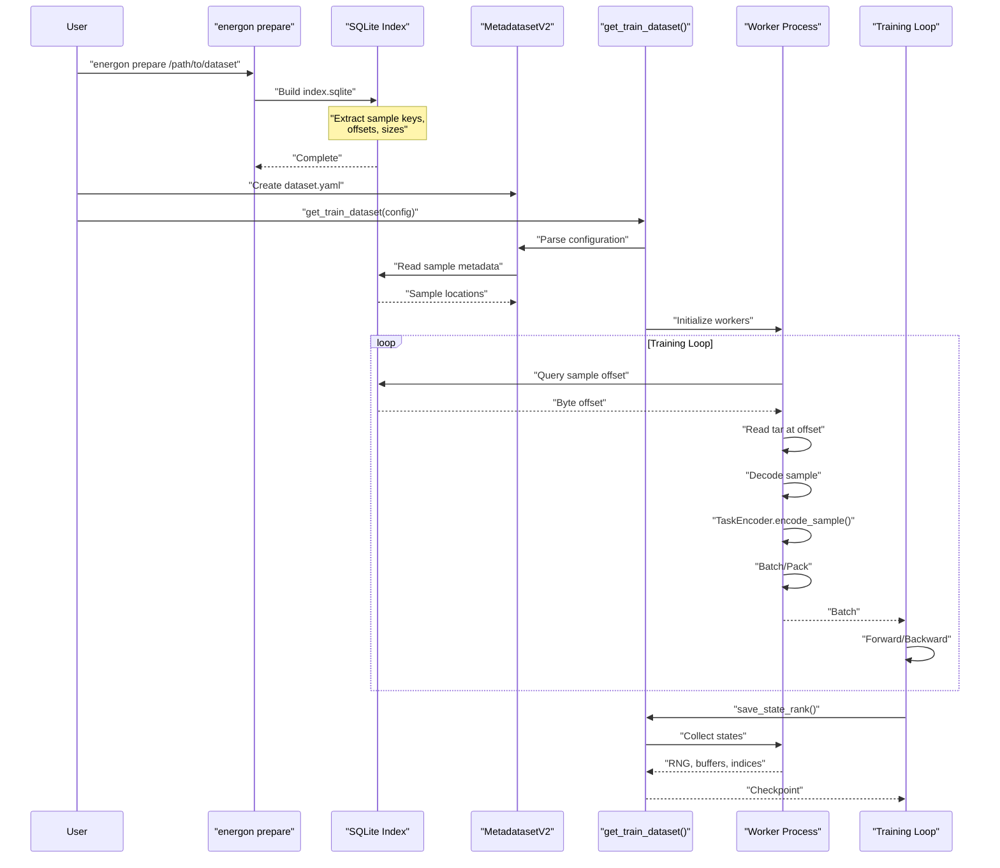

**Data Flow Stages:**

1. **Preparation**: `energon prepare` scans tar files and builds SQLite indices mapping sample keys to byte offsets
2. **Configuration**: User creates YAML configuration defining dataset composition
3. **Initialization**: `get_train_dataset()` parses configuration and initializes worker processes
4. **Sample Loading**: Workers query indices, read tar files at specific offsets, decode samples
5. **Transformation**: TaskEncoder applies user-defined transformations
6. **Batching**: Samples are packed/batched according to configuration
7. **Training**: Batches are consumed by the training loop
8. **Checkpointing**: Data loader state (RNG, buffers, indices) is saved for resumption

**Sources:** [tests/test_metadataset_v2.py:230-259]()

## Sample Types and Decoding

Megatron-Energon supports multiple sample types through a flexible decoding system:

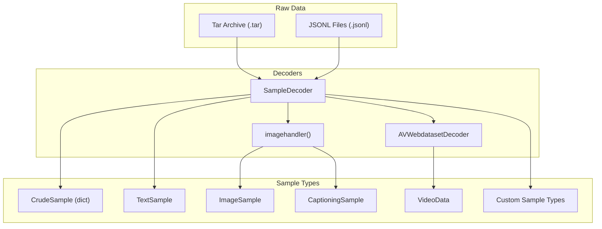

**Decoder Configuration:**

| Parameter | Options | Description |
|-----------|---------|-------------|
| `image_decode` | `torchrgb`, `pil`, `l8`, `rgb8`, etc. | Image decoding format | 
| `av_decode` | `AVDecoder`, `torch`, `pyav` | Video/audio decoding mode |
| `video_decode_audio` | `True`, `False` | Whether to decode audio from video |
| `guess_content` | `True`, `False` | Auto-detect file type using content |

**Sources:** [src/megatron/energon/flavors/webdataset/sample_decoder.py:80-143](), [src/megatron/energon/flavors/crude.py:10-52]()

## Typical Usage Pattern

A typical workflow with Megatron-Energon follows these steps:

1. **Prepare datasets**: Run `energon prepare` on raw tar files to build indices
2. **Create configuration**: Define `metadataset.yaml` specifying dataset composition
3. **Define TaskEncoder**: Implement custom `TaskEncoder` for data transformations
4. **Initialize loader**: Call `get_train_dataset()` with configuration and worker config
5. **Training loop**: Iterate over batches, save checkpoints periodically
6. **Resume training**: Restore data loader state from checkpoint

**Example Configuration Structure:**

```yaml
__module__: megatron.energon
__class__: MetadatasetV2
splits:
  train:
    blend:
      - weight: 0.7
        path: dataset1
      - weight: 0.3
        path: dataset2
  val:
    path: validation_dataset
```

For detailed installation and setup instructions, see [Installation and Setup](#1.1). For core concepts like TaskEncoder and Metadataset, see [Core Concepts](#2).

**Sources:** [tests/test_metadataset_v2.py:118-151](), [src/megatron/energon/metadataset/metadataset_v2.py:559-611]()

## Configuration System

Megatron-Energon uses a typed configuration system based on YAML/JSON with support for:

- **Type Resolution**: Automatic instantiation of classes from `__module__` and `__class__` fields
- **Type Validation**: Runtime validation of configuration against Python type annotations
- **Nested Composition**: Recursive composition of dataset configurations
- **Auxiliary Data**: Attachment of secondary data sources to primary datasets

The configuration system is implemented in `JsonParser` which converts raw dictionaries to typed objects:

**Sources:** [src/megatron/energon/typed_converter.py:64-196](), [src/megatron/energon/metadataset/metadataset_v2.py:192-234]()

## Next Steps

- **Installation**: See [Installation and Setup](#1.1) for dependency installation and configuration
- **Core Concepts**: See [Core Concepts](#2) for detailed explanation of TaskEncoder, Metadataset, and SavableDataset
- **Dataset Preparation**: See [Dataset Preparation](#3) for indexing raw datasets with `energon prepare`
- **Data Loading**: See [Data Loading System](#4) for understanding metadataset composition and loading
- **Task Encoders**: See [Task Encoders & Data Processing](#5) for implementing custom data transformations
- **Media Processing**: See [Audio/Video Processing](#6) for AVDecoder and Fastseek optimization
- **Storage**: See [Storage Access with EPath](#7) for multi-cloud storage configuration
- **CLI Tools**: See [CLI Tools and Utilities](#8) for command-line interface reference
- **Advanced Topics**: See [Advanced Topics](#9) for checkpointing, distributed training, and custom extensions

---

# Page: Installation and Setup

# Installation and Setup

<details>
<summary>Relevant source files</summary>

The following files were used as context for generating this wiki page:

- [docs/source/advanced/remote_dataset.md](docs/source/advanced/remote_dataset.md)
- [pyproject.toml](pyproject.toml)
- [src/megatron/energon/epathlib/epath.py](src/megatron/energon/epathlib/epath.py)
- [src/megatron/energon/flavors/crude.py](src/megatron/energon/flavors/crude.py)
- [src/megatron/energon/flavors/webdataset/sample_decoder.py](src/megatron/energon/flavors/webdataset/sample_decoder.py)
- [src/megatron/energon/local_copy.py](src/megatron/energon/local_copy.py)
- [tests/test_epathlib.py](tests/test_epathlib.py)
- [uv.lock](uv.lock)

</details>


This page guides you through installing Megatron-Energon, configuring dependencies, and setting up storage access. The installation process supports both basic local file access and optional features for cloud storage, audio/video processing, and development workflows. For information about preparing datasets after installation, see [Dataset Preparation](#3). For information about accessing remote datasets, see [Remote Datasets](#7.2).

## System Requirements

Megatron-Energon requires Python 3.10 or later. The system supports Python 3.10, 3.11, and 3.12.

**Minimum System Configuration:**
- Python: >=3.10
- Operating System: Linux, macOS, Windows (OS Independent)
- Disk Space: Varies by optional features (base: ~500MB, with all features: ~2GB)

Sources: [pyproject.toml:15-22]()

## Installation Methods

### Basic Installation

Install the core package using pip:

```bash
pip install megatron-energon
```

This installs the core dependencies required for local dataset access and basic functionality.

**Core Dependencies Installed:**
- `multi-storage-client>=0.33.0` - Storage abstraction layer
- `torch` - PyTorch framework
- `webdataset` - WebDataset format support
- `pillow>=10.0.1` - Image processing
- `pyyaml`, `rapidyaml>=0.10.0` - YAML parsing
- `numpy` - Numerical operations
- `click` - CLI framework
- `braceexpand`, `tqdm`, `s3fs`, `mfusepy` - Utilities

Sources: [pyproject.toml:23-36]()

### Installation with Optional Features

Megatron-Energon organizes optional dependencies into extras that can be installed individually or in combination:

```bash
# Install with specific extras
pip install megatron-energon[av_decode,s3]

# Install with multiple storage backends
pip install megatron-energon[s3,azure-storage-blob,google-cloud-storage]

# Install with all development tools
pip install megatron-energon[dev,transforms,av_decode]
```

## Optional Feature Groups

The following diagram shows the available optional feature groups and their purposes:

```mermaid
graph TB
    BASE["megatron-energon<br/>(base package)"]
    
    subgraph "Development & Testing"
        DEV["dev<br/>ruff, sphinx, pytest tools"]
        TRANS["transforms<br/>torchvision"]
    end
    
    subgraph "Storage Backends"
        S3["s3<br/>multi-storage-client[boto3]"]
        AIS["aistore<br/>multi-storage-client[aistore]"]
        AZURE["azure-storage-blob<br/>multi-storage-client[azure-storage-blob]"]
        GCS["google-cloud-storage<br/>multi-storage-client[google-cloud-storage]"]
        OCI["oci<br/>multi-storage-client[oci]"]
        HF["huggingface<br/>multi-storage-client[huggingface]"]
    end
    
    subgraph "Media Processing"
        AV["av_decode<br/>bitstring, sortedcontainers,<br/>filetype, ebmlite, av>=14.4.0"]
        GUESS["guess_content<br/>filetype>=1.0.0"]
    end
    
    subgraph "Advanced Features"
        TAR["tar_patcher<br/>numba"]
    end
    
    BASE --> DEV
    BASE --> TRANS
    BASE --> S3
    BASE --> AIS
    BASE --> AZURE
    BASE --> GCS
    BASE --> OCI
    BASE --> HF
    BASE --> AV
    BASE --> GUESS
    BASE --> TAR
    
    style BASE fill:#f9f9f9
```

Sources: [pyproject.toml:38-88]()

### Feature Group Details

| Extra | Purpose | Key Dependencies | Use Case |
|-------|---------|------------------|----------|
| `dev` | Development tools | ruff, sphinx, sphinx-rtd-theme, sphinx-click, myst-parser, soundfile | Code quality, documentation generation, testing |
| `transforms` | Image transformations | torchvision | Advanced image preprocessing pipelines |
| `s3` | Amazon S3 access | multi-storage-client[boto3] | Training on S3-hosted datasets |
| `aistore` | AIStore access | multi-storage-client[aistore] | High-performance object storage |
| `azure-storage-blob` | Azure Blob Storage | multi-storage-client[azure-storage-blob] | Azure-hosted datasets |
| `google-cloud-storage` | Google Cloud Storage | multi-storage-client[google-cloud-storage] | GCS-hosted datasets |
| `oci` | Oracle Cloud Infrastructure | multi-storage-client[oci] | OCI-hosted datasets |
| `huggingface` | Hugging Face Hub | multi-storage-client[huggingface] | Datasets from HF Hub |
| `av_decode` | Audio/video decoding | av>=14.4.0, bitstring>=4.2.3, sortedcontainers>=2.4.0, ebmlite>=3.3.1, filetype>=1.2.0 | Video/audio dataset processing |
| `guess_content` | Content type detection | filetype>=1.0.0 | Automatic file type inference |
| `tar_patcher` | TAR file optimization | numba | Performance optimizations |

Sources: [pyproject.toml:38-88]()

## Storage Backend Configuration

Megatron-Energon uses Multi-Storage Client (MSC) for unified access to local and cloud storage. The `EPath` class provides a pathlib-like interface that transparently handles multiple storage backends.

### MSC Configuration File

Create a configuration file at `~/.msc_config.yaml` (or set `MSC_CONFIG` environment variable to point to it):

```yaml
# Basic profile for S3
s3_data:
  type: s3
  endpoint_url: https://s3.amazonaws.com
  aws_access_key_id: YOUR_ACCESS_KEY
  aws_secret_access_key: YOUR_SECRET_KEY
  region_name: us-west-2

# Azure Blob Storage profile
azure_models:
  type: azure-storage-blob
  connection_string: YOUR_CONNECTION_STRING
  # Or use account name and key:
  # account_name: YOUR_ACCOUNT
  # account_key: YOUR_KEY

# Local storage (default profile)
default:
  type: local
  root: /
```

**Profile Naming:** Profile names are arbitrary strings used in `msc://` URLs. The `default` profile is used for local file access when no protocol is specified.

Sources: [src/megatron/energon/epathlib/epath.py:16-25](), [docs/source/advanced/remote_dataset.md:23-43]()

### Optional: Enable MSC Caching

For faster remote dataset access, enable MSC's local caching:

```yaml
# Add to ~/.msc_config.yaml
cache:
  size: 500G
  use_etag: true
  eviction_policy:
    policy: "fifo"
    refresh_interval: 3600
  cache_backend:
    cache_path: /tmp/msc_cache  # Use local NVMe for best performance
```

**Cache Location:** Use local NVMe storage for `cache_path` when available. Lustre parallel filesystems also work but with reduced performance.

Sources: [docs/source/advanced/remote_dataset.md:26-37]()

### EPath URL Syntax

The `EPath` class resolves storage locations using the following URL patterns:

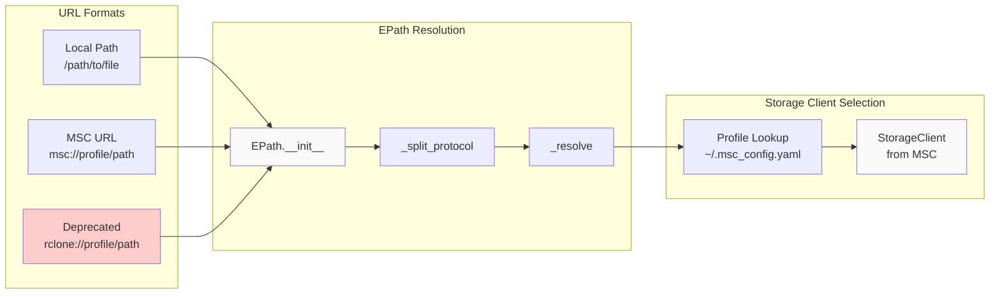

**URL Patterns:**
- Local: `/path/to/dataset` or `file:///path/to/dataset`
- MSC: `msc://profile_name/path/to/dataset`
- Deprecated: `rclone://profile_name/path` (shows deprecation warning)

Sources: [src/megatron/energon/epathlib/epath.py:34-62](), [src/megatron/energon/epathlib/epath.py:98-103](), [tests/test_epathlib.py:143-161]()

### EPath Initialization Flow

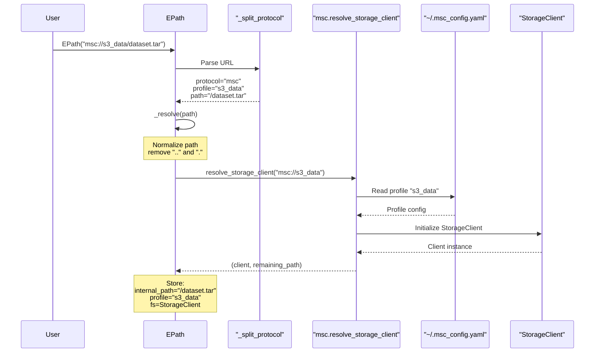

Sources: [src/megatron/energon/epathlib/epath.py:34-62](), [src/megatron/energon/epathlib/epath.py:98-103]()

## CLI Tool Verification

After installation, verify the `energon` command is available:

```bash
# Check energon is installed
energon --help

# Verify version and available commands
energon --version
```

The `energon` CLI provides commands for dataset preparation, mounting, and inspection. The entry point is defined as `energon = "megatron.energon.cli.main:main"` in the package configuration.

Sources: [pyproject.toml:98-99]()

## Common Installation Patterns

### Minimal Installation for Local Training

```bash
pip install megatron-energon
```

Includes: Core dependencies only, local file access via `EPath("default")` profile.

### Cloud Training on S3

```bash
pip install megatron-energon[s3]
```

Includes: S3 storage backend, enables `msc://s3_profile/...` URLs.

### Video/Audio Datasets

```bash
pip install megatron-energon[av_decode]
```

Includes: PyAV integration, AVDecoder for efficient media decoding, Fastseek optimization.

### Full Development Setup

```bash
pip install megatron-energon[dev,transforms,av_decode,s3,azure-storage-blob]
```

Includes: All development tools, storage backends, and media processing capabilities.

Sources: [pyproject.toml:38-88]()

## Dependency Resolution and Compatibility

The package uses `hatch-vcs` for version management and supports three major Python versions:

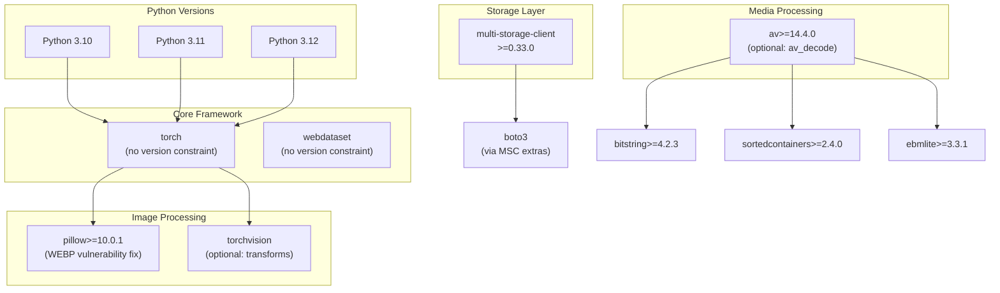

**Critical Version Constraints:**
- `multi-storage-client>=0.33.0` - Required for storage abstraction
- `pillow>=10.0.1` - Security fix for WEBP vulnerability
- `av>=14.4.0` - Video decoding compatibility (when using `av_decode`)
- `bitstring>=4.2.3`, `sortedcontainers>=2.4.0`, `ebmlite>=3.3.1` - AVDecoder dependencies

Sources: [pyproject.toml:15-36](), [pyproject.toml:73-80]()

## Environment Variables

| Variable | Purpose | Default | Example |
|----------|---------|---------|---------|
| `MSC_CONFIG` | Path to MSC configuration file | `~/.msc_config.yaml` | `/etc/msc/config.yaml` |
| `XDG_CONFIG_HOME` | Base directory for config files | `~/.config` | `/home/user/.config` |
| `HOME` | Home directory (fallback for config) | System default | `/home/user` |

**Configuration Priority:** MSC looks for configuration in this order:
1. File specified by `MSC_CONFIG` environment variable
2. `~/.msc_config.yaml`
3. Rclone configuration at `$XDG_CONFIG_HOME/rclone/rclone.conf` (legacy)

Sources: [tests/test_epathlib.py:136-142](), [docs/source/advanced/remote_dataset.md:39-43]()

## Post-Installation Verification

### Verify Core Installation

```python
from megatron.energon import get_train_dataset
from megatron.energon.epathlib import EPath

# Test local path access
local_path = EPath("/tmp/test.txt")
print(f"Local path: {local_path}")
print(f"Is local: {local_path.is_local()}")

# Test MSC default profile
default_path = EPath("msc://default/tmp/test.txt")
print(f"Default profile path: {default_path}")
```

### Verify Storage Backend

```python
from megatron.energon.epathlib import EPath

# Test S3 profile (requires s3 extra and configuration)
s3_path = EPath("msc://s3_data/my-bucket/dataset")
print(f"S3 path: {s3_path}")
print(f"Is file: {s3_path.is_file()}")
```

### Verify Media Processing

```python
from megatron.energon.flavors.webdataset import SampleDecoder

# Test AVDecoder availability (requires av_decode extra)
decoder = SampleDecoder(av_decode="AVDecoder")
print(f"Decoder config: {decoder.config()}")
```

Sources: [tests/test_epathlib.py:25-92](), [src/megatron/energon/flavors/webdataset/sample_decoder.py:83-104]()

## Troubleshooting

### ImportError: No module named 'multistorageclient'

**Cause:** Base package not installed or installation incomplete.

**Solution:**
```bash
pip install --upgrade megatron-energon
```

### ImportError: No module named 'av'

**Cause:** Audio/video decoding extra not installed.

**Solution:**
```bash
pip install megatron-energon[av_decode]
```

### FileNotFoundError: MSC profile not found

**Cause:** Profile referenced in `msc://` URL not defined in configuration.

**Solution:** Add profile to `~/.msc_config.yaml` or set `MSC_CONFIG` environment variable.

### DeprecationWarning: rclone:// protocol is deprecated

**Cause:** Using legacy `rclone://` URL syntax.

**Solution:** Replace `rclone://profile/path` with `msc://profile/path` in your code.

Sources: [src/megatron/energon/epathlib/epath.py:51-53](), [tests/test_epathlib.py:157-161]()

## Serialization and Multiprocessing

`EPath` objects support pickling for use in multiprocessing contexts. The serialization excludes sensitive credentials:

```python
import pickle
from megatron.energon.epathlib import EPath

path = EPath("msc://s3_data/dataset.tar")
serialized = pickle.dumps(path)  # Credentials not included
restored = pickle.loads(serialized)  # Credentials re-loaded from config

# Credentials are never serialized
assert b"secret_key" not in serialized
```

**Implementation Details:**
- `__getstate__` excludes the `fs` (StorageClient) attribute during serialization
- `__setstate__` reconstructs the StorageClient from the profile name
- This prevents credential leakage in serialized objects

Sources: [src/megatron/energon/epathlib/epath.py:63-73](), [tests/test_epathlib.py:163-166](), [tests/test_epathlib.py:218-264]()

## Next Steps

After installation and configuration:
1. **Prepare datasets**: Use `energon prepare` to index tar files (see [energon prepare Command](#3.1))
2. **Configure metadatasets**: Create YAML configuration files for dataset composition (see [Metadataset Composition](#4.1))
3. **Load data**: Use `get_train_dataset()` or `get_val_dataset()` to create data loaders (see [SavableDataLoader](#4.3))

Sources: [pyproject.toml:1-117]()

---

# Page: Core Concepts

# Core Concepts

<details>
<summary>Relevant source files</summary>

The following files were used as context for generating this wiki page:

- [src/megatron/energon/loader.py](src/megatron/energon/loader.py)
- [src/megatron/energon/metadataset/metadataset_v2.py](src/megatron/energon/metadataset/metadataset_v2.py)
- [src/megatron/energon/savable_loader.py](src/megatron/energon/savable_loader.py)
- [src/megatron/energon/task_encoder/base.py](src/megatron/energon/task_encoder/base.py)
- [src/megatron/energon/task_encoder/loader.py](src/megatron/energon/task_encoder/loader.py)
- [src/megatron/energon/typed_converter.py](src/megatron/energon/typed_converter.py)
- [src/megatron/energon/wrappers/gc_dataset.py](src/megatron/energon/wrappers/gc_dataset.py)
- [src/megatron/energon/wrappers/mix_batch_dataset.py](src/megatron/energon/wrappers/mix_batch_dataset.py)
- [tests/test_dataset.py](tests/test_dataset.py)
- [tests/test_metadataset_v2.py](tests/test_metadataset_v2.py)

</details>


This document explains the fundamental concepts underlying Megatron-Energon, a multi-modal data loading system designed for efficient training of large language models. It covers the core data structures, processing pipeline, and organizational patterns that form the foundation of the system. For information about specific implementations like the Audio/Video decoder, see [Audio/Video Processing](#5).

## Data Organization

Megatron-Energon organizes data using a hierarchical structure that enables efficient loading, processing, and training with large multi-modal datasets.

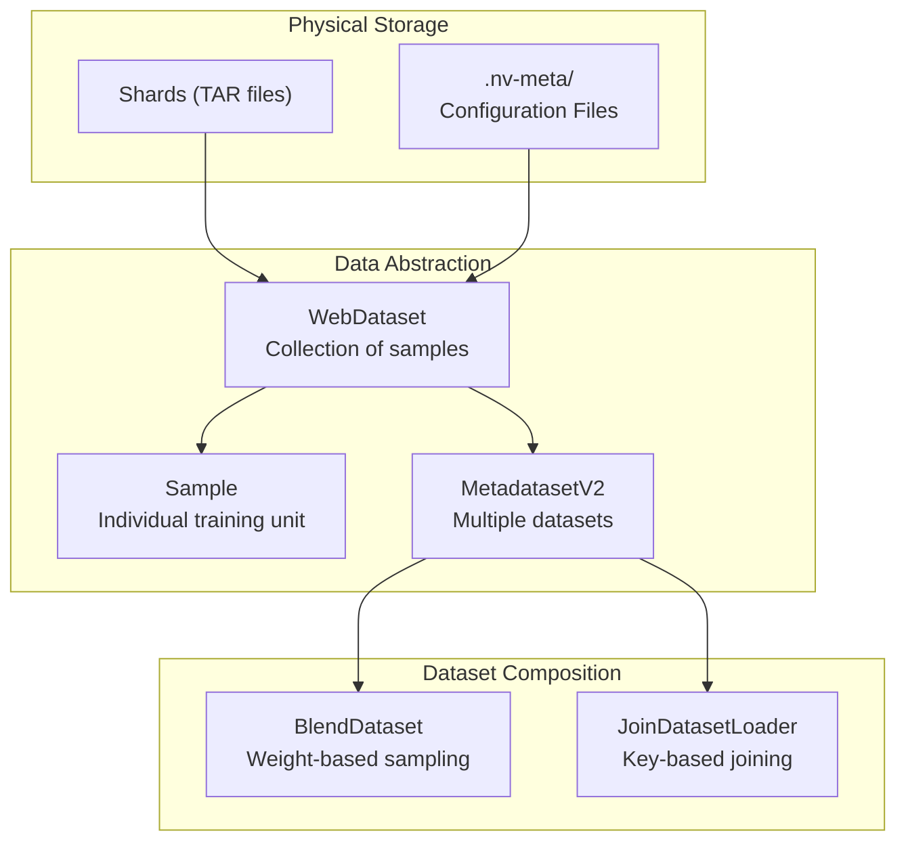

Sources: [src/megatron/energon/flavors/base_dataset.py:111-131](). [src/megatron/energon/metadataset/metadataset_v2.py:358-409]().

### Samples

A `Sample` is the atomic unit of data in Megatron-Energon. Samples represent individual training examples with their associated input and output data. All sample types derive from the abstract `Sample` base class.

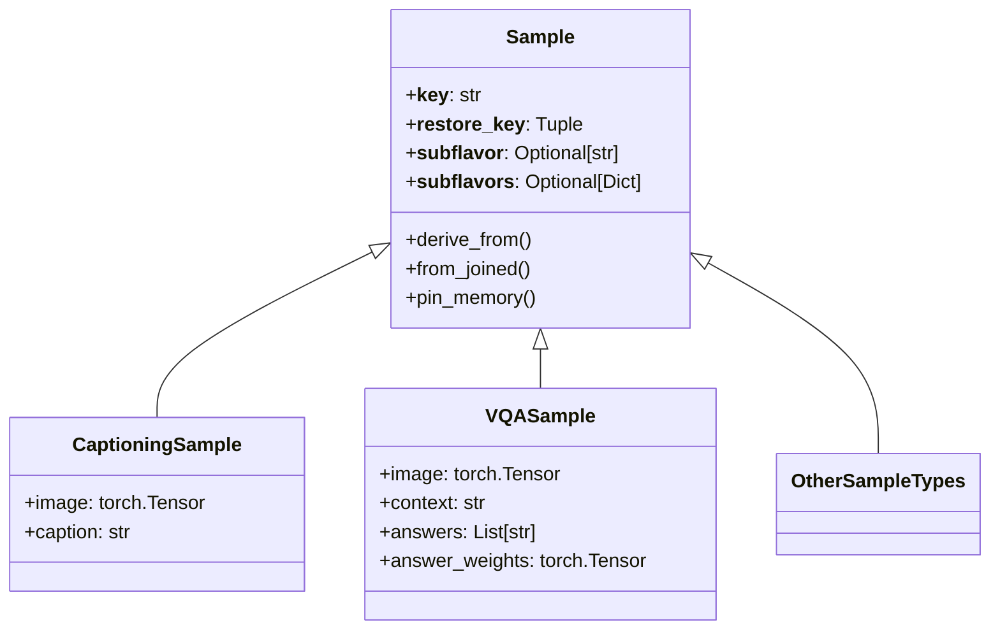

Every `Sample` has:
- `__key__`: A unique identifier for the sample
- `__restore_key__`: A structured key used for restoring the sample from checkpoints
- `__subflavor__`/`__subflavors__`: Optional metadata for categorizing or configuring samples

Sources: [src/megatron/energon/flavors/base_dataset.py:111-131](). [docs/source/basic/data_prep.md:160-229]().

### WebDataset Format

WebDataset is the underlying data storage format used by Megatron-Energon. It organizes data into tar archives (shards) containing multiple samples.

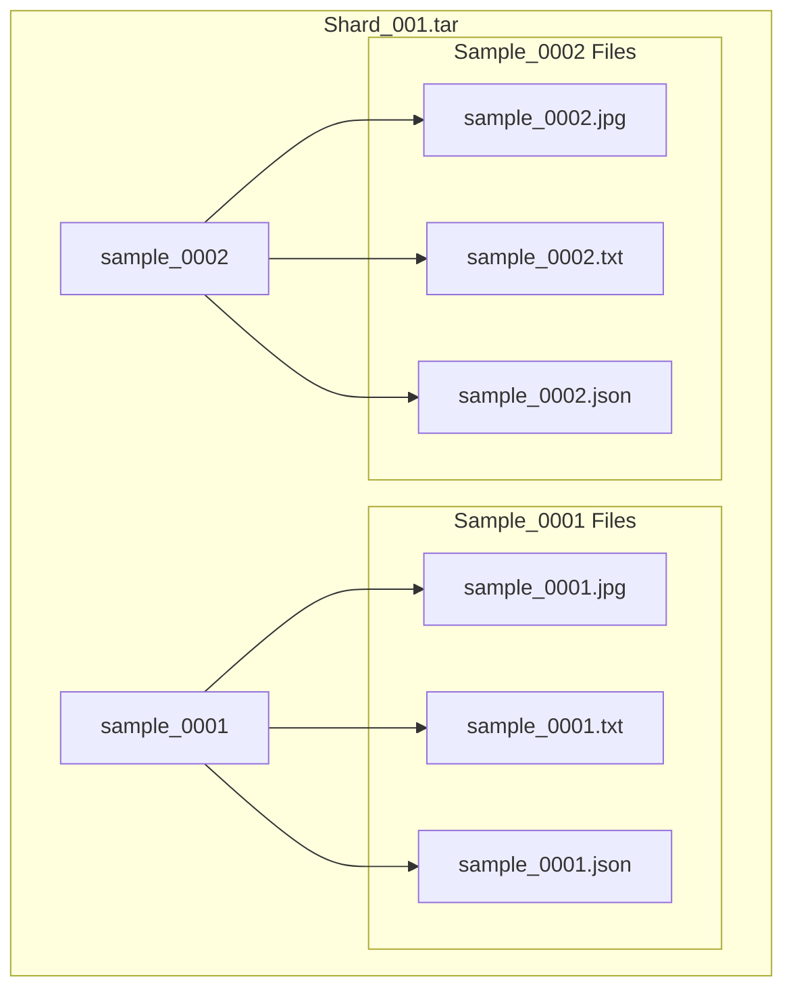

The WebDataset format provides several advantages:
- **Efficient sequential reading**: tar files optimize for reading sequential chunks
- **Self-contained units**: Each shard can be processed independently
- **Extension-based decoding**: Files are decoded based on their extensions (e.g., `.jpg`, `.json`)

For Megatron-Energon, WebDatasets are enhanced with additional metadata stored in a `.nv-meta` directory, which includes:
- `dataset.yaml`: Sample type definitions and field mappings
- `split.yaml`: Dataset partitioning information (train/val/test)
- `.info.yaml`: Statistics about each shard

Sources: [docs/source/basic/data_prep.md:16-38](). [docs/source/basic/data_prep.md:358-440]().

## Data Loading System

### Metadataset System

The Metadataset system provides a powerful abstraction for combining multiple datasets, enabling complex composition patterns.

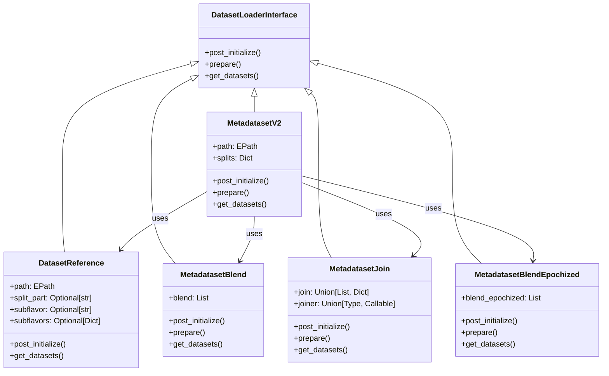

The Metadataset system supports several composition patterns:

1. **Blending**: Combines multiple datasets with weight-based sampling
   ```python
   # MetadatasetBlend combines datasets with weighted sampling
   blend:
     - path: dataset1/
       weight: 0.7
     - path: dataset2/
       weight: 0.3
   ```

2. **Joining**: Combines datasets by matching samples based on keys
   ```python
   # MetadatasetJoin combines datasets by matching keys
   join:
     dataset1:
       path: dataset1/
       nonmatch: error
     dataset2:
       path: dataset2/
       nonmatch: skip
   joiner: CombinedSampleType
   ```

3. **Epochized Blending**: Controls how many times each dataset is repeated in an epoch
   ```python
   # MetadatasetBlendEpochized repeats datasets different numbers of times
   blend_epochized:
     - path: dataset1/
       repetitions: 2
     - path: dataset2/
       repetitions: 1
   ```

Sources: [src/megatron/energon/metadataset/metadataset_v2.py:217-320](). [src/megatron/energon/metadataset/metadataset_v2.py:358-409]().

### SavableDataset and State Management

Megatron-Energon provides robust state management for handling checkpoints and resuming training, which is crucial for large-scale training jobs.

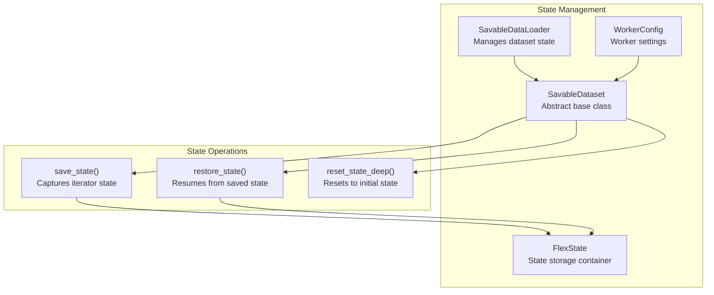

The `SavableDataset` class provides the foundation for checkpoint/resume capability:

- **State Saving**: Captures the current state of the dataset iterator, including positions in files and random number generator states
- **State Restoration**: Resumes iteration from exactly the same point
- **Reset Functionality**: Returns the dataset to its initial state

This state management system works across distributed environments, handling the complexities of saving worker-specific states.

Sources: [src/megatron/energon/flavors/base_dataset.py:229-360]().

## Processing Pipeline

The data processing pipeline in Megatron-Energon transforms raw data from storage into batched samples ready for model training.

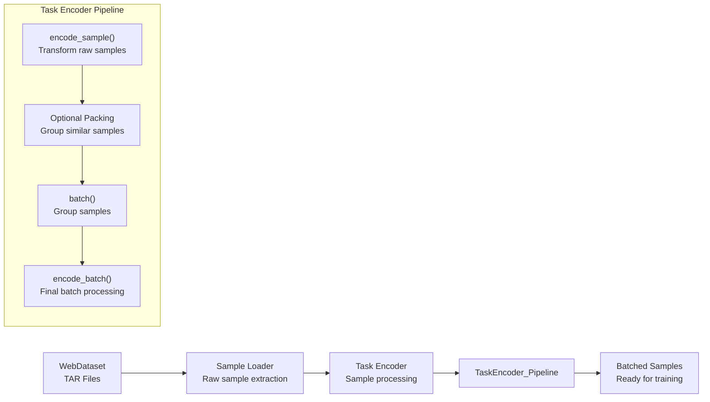

### Sample Loading

The sample loading process extracts raw data from WebDataset archives and converts it into structured samples:

1. **TAR File Reading**: Extracts raw bytes from files within TAR archives
2. **Decoding**: Converts bytes to appropriate Python objects based on file extensions
3. **Sample Construction**: Assembles the decoded parts into a complete `Sample` object

Sample loading can be customized through:
- **Field Maps**: Simple mappings from file extensions to sample attributes
- **Custom Sample Loaders**: Python functions for more complex transformations

Sources: [src/megatron/energon/flavors/webdataset/sample_loader.py:36-49](). [docs/source/basic/data_prep.md:232-330]().

### Task Encoders

Task encoders define how samples are processed through the pipeline, transforming raw data into model-ready batches. The processing stages include:

1. **Sample Encoding** (`encode_sample`): Transforms individual samples (e.g., image resizing, text tokenization)
2. **Optional Packing** (`select_samples_to_pack`, `pack_selected_samples`): Combines multiple samples into one
3. **Batching** (`batch`): Collates multiple samples into a batch structure
4. **Batch Encoding** (`encode_batch`): Performs final transformations on the entire batch

This pipeline provides flexibility to implement various data transformations while maintaining efficiency.

Sources: [docs/source/basic/task_encoder.md:4-31]().

## WebDataset Sample Loading

Megatron-Energon implements a sophisticated system for loading and iterating through WebDatasets, with features for efficient shuffling and parallel access.

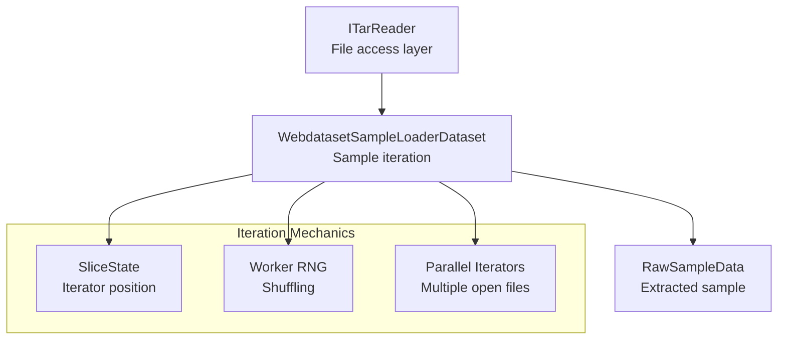

Key features of the WebDataset loading system:

- **Slice-Based Iteration**: Divides datasets into "slices" for efficient distributed processing
- **Configurable Shuffling**: Supports various shuffling strategies:
  - `shuffle_over_epochs=None`: No shuffling, deterministic order
  - `shuffle_over_epochs=1`: Every sample seen exactly once per epoch
  - `shuffle_over_epochs>1`: Samples shuffled across multiple epochs
  - `shuffle_over_epochs=-1`: Infinite shuffling (with replacement)
- **Parallel Slice Iterators**: Can open multiple files simultaneously for increased randomness
- **State Management**: Full support for saving/restoring iterator state

Sources: [src/megatron/energon/flavors/webdataset/sample_loader.py:36-473]().

## Dataset Joining

The `JoinDatasetLoader` enables combining multiple datasets by matching samples with the same keys, similar to a database join operation.

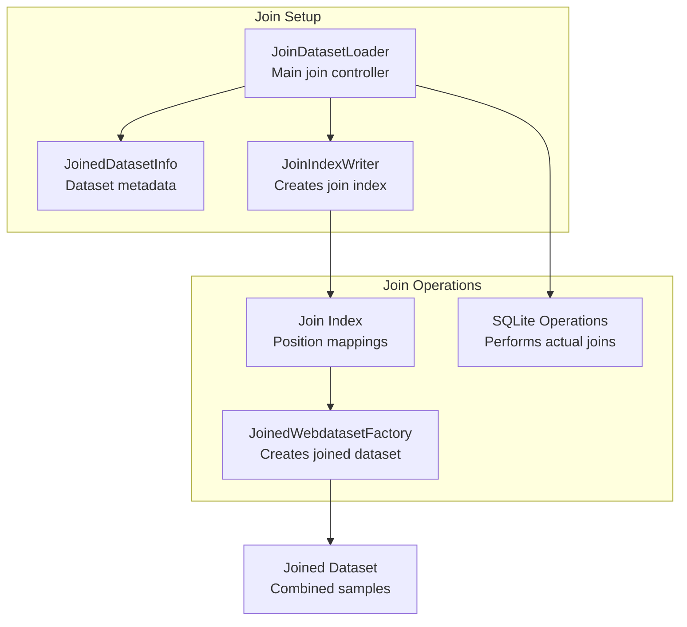

The joining process works as follows:

1. **Preparation**: Creates a join index mapping corresponding samples across datasets
2. **SQLite Joins**: Uses SQLite to efficiently perform the join operations
3. **Join Modes**: Supports different join behaviors:
   - `nonmatch="error"`: Raises an error if keys don't match (inner join)
   - `nonmatch="skip"`: Skips samples with no match (inner join)
   - `nonmatch="none"`: Includes samples with no match (left join)
4. **Sample Combination**: Uses a provided `joiner` function to combine data from matched samples

This powerful mechanism enables creating complex multi-modal datasets from specialized single-modal ones.

Sources: [src/megatron/energon/metadataset/join_dataset_loader.py:341-553]().

## Summary of Core Concepts

| Concept | Purpose | Key Features |
|---------|---------|--------------|
| Sample | Atomic unit of data | Base class for all sample types, supports metadata and serialization |
| WebDataset | Storage format | Efficient tar-based storage, extension-based decoding |
| Metadataset | Dataset composition | Blending, joining, and epochized blending of datasets |
| SavableDataset | State management | Checkpoint/resume capabilities for fault tolerance |
| Task Encoder | Data processing | Multi-stage pipeline for transforming samples into batches |
| Dataset Joining | Data combination | SQL-like joining of datasets by matching keys |

These core concepts provide the foundation for Megatron-Energon's flexible, efficient, and powerful data loading system, enabling the training of large-scale models on complex multi-modal datasets.

---

# Page: Dataset Preparation

# Dataset Preparation

<details>
<summary>Relevant source files</summary>

The following files were used as context for generating this wiki page:

- [src/megatron/energon/cache/file_store.py](src/megatron/energon/cache/file_store.py)
- [src/megatron/energon/dataset_config.py](src/megatron/energon/dataset_config.py)
- [src/megatron/energon/flavors/webdataset/indexing.py](src/megatron/energon/flavors/webdataset/indexing.py)
- [src/megatron/energon/flavors/webdataset/metadata.py](src/megatron/energon/flavors/webdataset/metadata.py)
- [src/megatron/energon/flavors/webdataset/prepare.py](src/megatron/energon/flavors/webdataset/prepare.py)
- [src/megatron/energon/metadataset/loader.py](src/megatron/energon/metadataset/loader.py)
- [src/megatron/energon/tools/prepare.py](src/megatron/energon/tools/prepare.py)
- [tests/test_jsonl_dataset.py](tests/test_jsonl_dataset.py)

</details>


## Purpose and Scope

Dataset preparation is the process of generating metadata and index structures that enable efficient random access to dataset samples during training. This page covers the overall preparation workflow, dataset types, and the outputs generated during preparation.

For detailed information about the `energon prepare` CLI tool and its options, see [energon prepare Command](#3.1). For in-depth technical details about the indexing system and metadata structures, see [Indexing and Metadata System](#3.2).

## Dataset Types

Megatron-Energon supports multiple dataset formats, each with different preparation requirements. The `get_dataset_type` function [src/megatron/energon/flavors/webdataset/metadata.py:151-176]() identifies the dataset type based on the path structure.

### Supported Dataset Types

| Dataset Type | Format | Requires Preparation | Identifier |
|--------------|--------|---------------------|------------|
| **Webdataset** | Tar archives containing sample files | Yes | Folder with `.nv-meta/.info.json` or `.nv-meta/.info.yaml` |
| **JSONL** | Line-delimited JSON files | Yes (minimal) | File ending in `.jsonl` |
| **Metadataset** | YAML configuration referencing other datasets | Yes (recursive) | File ending in `.yaml` containing metadataset config |
| **Filesystem** | Individual files in directories | Yes (for auxiliary data) | Folder with `.nv-meta/index.sqlite` but no `.info.json` |

**Dataset Type Detection Flow**

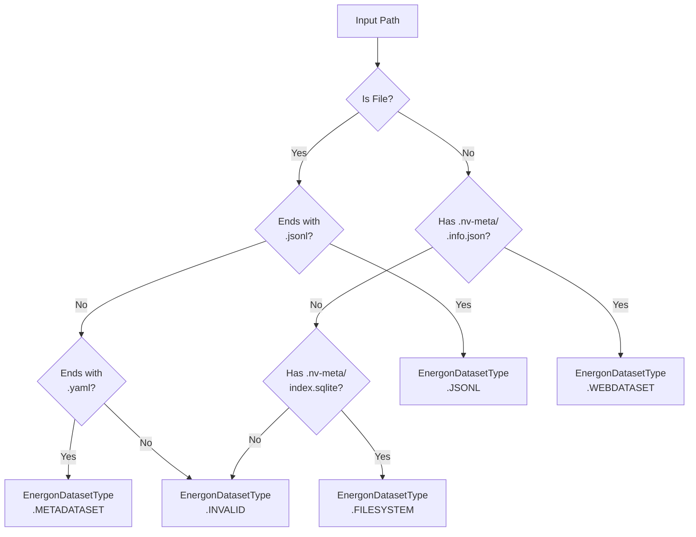

**Sources:** [src/megatron/energon/flavors/webdataset/metadata.py:151-176]()

## Preparation Workflow

The preparation workflow varies by dataset type but follows a general pattern: scan the raw data, build indices for random access, and generate metadata files.

### High-Level Preparation Flow

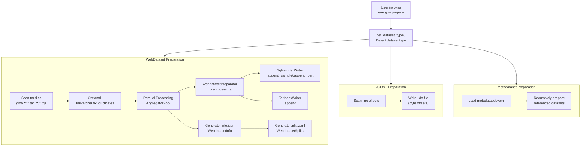

**Sources:** [src/megatron/energon/tools/prepare.py:207-580](), [src/megatron/energon/flavors/webdataset/prepare.py:461-669]()

### WebDataset Preparation Pipeline

The most complex preparation workflow is for WebDataset tar archives. The process uses parallel workers to efficiently index multiple tar files simultaneously.

```mermaid
sequenceDiagram
    participant User
    participant PrepTool as "energon prepare<br/>(prepare.py:command)"
    participant Prep as "WebdatasetPreparator<br/>.prepare_dataset"
    participant Pool as "AggregatorPool"
    participant Workers as "Worker Processes"
    participant Agg as "SqliteIndexWriter<br/>Aggregator"
    
    User->>PrepTool: energon prepare /path
    PrepTool->>PrepTool: Scan for *.tar files
    PrepTool->>PrepTool: Parse split config
    
    PrepTool->>Prep: prepare_dataset(paths, ...)
    Prep->>Prep: Create shard_to_idx mapping
    Prep->>Prep: Optional: TarPatcher fix_duplicates
    
    Prep->>Agg: Initialize SqliteIndexWriter
    Agg->>Agg: CREATE TABLE samples
    Agg->>Agg: CREATE TABLE sample_parts
    
    Prep->>Pool: AggregatorPool(workers, _preprocess_tar, agg)
    
    loop For each tar file
        Prep->>Pool: submit_task(tar_path)
        Pool->>Workers: Process tar in parallel
        Workers->>Workers: tarfile.open(tar_path)
        Workers->>Workers: Iterate tar members
        
        loop For each sample
            Workers->>Workers: Extract sample_key, byte_offset
            Workers->>Workers: Extract part names, sizes
            Workers->>Agg: yield IndexSample(...)
            Workers->>Agg: yield IndexSamplePart(...)
        end
        
        Workers->>Workers: Write .tar.idx (TarIndexWriter)
        Workers->>Agg: yield IndexShardInfo(shard_info, parts)
    end
    
    Pool->>Agg: Aggregate all results
    Agg->>Agg: CREATE INDEX idx_samples_sample_key
    Agg->>Agg: CREATE INDEX idx_sample_parts_seq
    
    Prep->>Prep: Generate .info.json (shard_counts)
    Prep->>Prep: Generate split.yaml (split_parts)
    Prep->>User: Preparation complete
```

**Sources:** [src/megatron/energon/flavors/webdataset/prepare.py:461-669](), [src/megatron/energon/flavors/webdataset/prepare.py:214-353]()

## Preparation Output

Dataset preparation generates a `.nv-meta/` directory containing index and metadata files that enable efficient dataset access.

### Directory Structure

```
dataset_root/
├── shard_000.tar
├── shard_001.tar
├── shard_002.tar
└── .nv-meta/
    ├── index.sqlite          # SQLite index with sample pointers
    ├── index.uuid            # Unique dataset identifier
    ├── .info.json            # Dataset metadata (shard counts)
    ├── split.yaml            # Split configuration (train/val/test)
    ├── dataset.yaml          # Dataset configuration (sample type, field_map)
    └── shard_*.tar.idx       # Per-shard tar index files
```

### Metadata Files

**Metadata File Details**

```mermaid
graph LR
    subgraph IndexSqlite["index.sqlite"]
        SamplesTable["samples table<br/>tar_file_id, sample_key<br/>sample_index, byte_offset, byte_size"]
        PartsTable["sample_parts table<br/>tar_file_id, sample_index, part_name<br/>content_byte_offset, content_byte_size"]
        MediaTable["media_metadata table<br/>entry_key, metadata_type, metadata_json"]
    end
    
    subgraph InfoJson[".info.json"]
        EnergyVer["energon_version"]
        ShardCounts["shard_counts:<br/>{shard_path: sample_count}"]
    end
    
    subgraph SplitYaml["split.yaml"]
        SplitParts["split_parts:<br/>train: [shard_*.tar]<br/>val: [shard_*.tar]<br/>test: [shard_*.tar]"]
        Excludes["exclude: [...]"]
    end
    
    subgraph DatasetYaml["dataset.yaml"]
        SampleType["sample_type:<br/>__module__, __class__"]
        FieldMap["field_map:<br/>{field: part_name}"]
        SampleLoader["sample_loader:<br/>path:function"]
    end
    
    subgraph TarIdx["shard_*.tar.idx"]
        Offsets["Binary file:<br/>Sample byte offsets"]
    end
```

**Sources:** [src/megatron/energon/flavors/webdataset/indexing.py:25-257](), [src/megatron/energon/flavors/webdataset/config.py:1-45]()

### SQLite Index Schema

The `index.sqlite` database is the core of the indexing system, enabling O(1) random access to samples by key and efficient sequential access by shard.

**Schema Definition:**

| Table | Columns | Purpose | Indexes |
|-------|---------|---------|---------|
| `samples` | `tar_file_id`, `sample_key`, `sample_index`, `byte_offset`, `byte_size` | Maps sample keys to tar file locations | `idx_samples_sample_key` (UNIQUE on `sample_key`)<br/>`idx_samples_by_tar_and_idx` (on `tar_file_id, sample_index`) |
| `sample_parts` | `tar_file_id`, `sample_index`, `part_name`, `content_byte_offset`, `content_byte_size` | Maps individual file parts within samples | `idx_sample_parts_seq` (on `tar_file_id, sample_index, content_byte_offset`)<br/>`idx_sample_parts_full` (on all columns) |
| `media_metadata` | `entry_key`, `metadata_type`, `metadata_json` | Stores extracted media metadata (optional) | Primary key on `entry_key` |

**Sources:** [src/megatron/energon/flavors/webdataset/indexing.py:40-134]()

### Sample and Part Indexing

WebDataset samples consist of multiple parts (files with the same base name but different extensions). The indexing system tracks both the overall sample boundaries and individual part locations.

```mermaid
flowchart TB
    subgraph TarFile["shard_000.tar"]
        S1["sample_0001.jpg<br/>offset: 1024, size: 15000"]
        S2["sample_0001.txt<br/>offset: 16024, size: 200"]
        S3["sample_0001.json<br/>offset: 16224, size: 150"]
        S4["sample_0002.jpg<br/>offset: 16374, size: 18000"]
        S5["sample_0002.txt<br/>offset: 34374, size: 180"]
    end
    
    subgraph SamplesIdx["samples table"]
        Samp1["sample_key='sample_0001'<br/>byte_offset=1024<br/>byte_size=15350"]
        Samp2["sample_key='sample_0002'<br/>byte_offset=16374<br/>byte_size=18180"]
    end
    
    subgraph PartsIdx["sample_parts table"]
        P1["sample_index=0, part='jpg'<br/>offset=1024, size=15000"]
        P2["sample_index=0, part='txt'<br/>offset=16024, size=200"]
        P3["sample_index=0, part='json'<br/>offset=16224, size=150"]
        P4["sample_index=1, part='jpg'<br/>offset=16374, size=18000"]
        P5["sample_index=1, part='txt'<br/>offset=34374, size=180"]
    end
    
    S1 --> P1
    S2 --> P2
    S3 --> P3
    S1 --> Samp1
    
    S4 --> P4
    S5 --> P5
    S4 --> Samp2
```

**Sources:** [src/megatron/energon/flavors/webdataset/prepare.py:214-353](), [src/megatron/energon/flavors/webdataset/indexing.py:136-189]()

## Preparation Process Internals

The preparation process uses a multi-threaded architecture to efficiently index large datasets. The `AggregatorPool` pattern enables parallel tar file processing while maintaining consistency in the SQLite database.

### Parallel Processing Architecture

```mermaid
flowchart TB
    subgraph MainThread["Main Thread"]
        Coordinator["WebdatasetPreparator<br/>.prepare_dataset"]
        Aggregator["SqliteIndexWriter<br/>Aggregator"]
        Progress["Progress Bar<br/>(optional)"]
    end
    
    subgraph AggregatorPoolClass["AggregatorPool"]
        TaskQueue["Task Queue<br/>(tar paths)"]
        Dispatcher["Task Dispatcher"]
    end
    
    subgraph Workers["Worker Processes"]
        W1["Worker 1<br/>_preprocess_tar"]
        W2["Worker 2<br/>_preprocess_tar"]
        W3["Worker N<br/>_preprocess_tar"]
    end
    
    subgraph WorkerOutput["Worker Output"]
        IS["IndexSample<br/>(sample metadata)"]
        IP["IndexSamplePart<br/>(part metadata)"]
        IM["IndexMediaMetadata<br/>(media info)"]
        II["IndexShardInfo<br/>(shard statistics)"]
    end
    
    Coordinator --> AggregatorPoolClass
    Coordinator --> Aggregator
    
    TaskQueue --> Dispatcher
    Dispatcher --> W1
    Dispatcher --> W2
    Dispatcher --> W3
    
    W1 --> IS
    W1 --> IP
    W1 --> IM
    W1 --> II
    
    W2 --> IS
    W2 --> IP
    
    W3 --> IS
    W3 --> II
    
    IS --> Aggregator
    IP --> Aggregator
    IM --> Aggregator
    II --> Aggregator
    
    Aggregator --> Progress
```

**Sources:** [src/megatron/energon/flavors/webdataset/prepare.py:104-212](), [src/megatron/energon/flavors/webdataset/aggregator_pool.py:1-100]()

### Tar Processing Worker Function

Each worker processes a single tar file using the `_preprocess_tar` method, which yields index entries as it scans the tar file.

**Processing Steps:**

1. **Open tar file** - Open the tar archive in streaming mode
2. **Iterate members** - Process each tar member (file entry)
3. **Group by sample** - Detect sample boundaries when base name changes
4. **Track offsets** - Record byte offsets and sizes for each sample and part
5. **Extract metadata** - Optionally extract media metadata (if `MediaFilterConfig` provided)
6. **Write tar index** - Generate `.tar.idx` file for efficient sequential access
7. **Yield results** - Stream `IndexSample`, `IndexSamplePart`, `IndexMediaMetadata` objects to aggregator

**Code Flow:**

```mermaid
graph TD
    Start["_preprocess_tar(path, ...)"]
    OpenTar["tarfile.open(path)"]
    InitTarIdx["TarIndexWriter(path)"]
    
    IterMembers["for member in tar"]
    CheckReg{"member.isreg()?"}
    MatchName{"split_name_re.match<br/>(member.name)?"}
    
    ExtractNames["base_name = match.group(1)<br/>part_name = match.group(2)"]
    CheckNewSample{"base_name !=<br/>last_base_name?"}
    
    YieldPrevSample["yield IndexSample<br/>(previous sample)"]
    RecordNewSample["Create new IndexSample<br/>increment sample_index"]
    AppendTarIdx["TarIndexWriter.append<br/>(member.offset)"]
    
    YieldPart["yield IndexSamplePart<br/>(tar_file_id, sample_index, part_name,<br/>offset, size)"]
    
    CheckMedia{"MediaFilter?"}
    ExtractMedia["Extract file data<br/>media_filter.extract_metadata"]
    YieldMedia["yield IndexMediaMetadata"]
    
    NextMember["Next member"]
    Done["yield IndexShardInfo<br/>(shard_info, parts)"]
    
    Start --> OpenTar
    OpenTar --> InitTarIdx
    InitTarIdx --> IterMembers
    
    IterMembers --> CheckReg
    CheckReg -->|No| NextMember
    CheckReg -->|Yes| MatchName
    MatchName -->|No| NextMember
    MatchName -->|Yes| ExtractNames
    
    ExtractNames --> CheckNewSample
    CheckNewSample -->|Yes| YieldPrevSample
    YieldPrevSample --> RecordNewSample
    RecordNewSample --> AppendTarIdx
    CheckNewSample -->|No| YieldPart
    AppendTarIdx --> YieldPart
    
    YieldPart --> CheckMedia
    CheckMedia -->|Yes| ExtractMedia
    ExtractMedia --> YieldMedia
    YieldMedia --> NextMember
    CheckMedia -->|No| NextMember
    
    NextMember --> IterMembers
    IterMembers -->|End| Done
```

**Sources:** [src/megatron/energon/flavors/webdataset/prepare.py:238-353]()

### Index Aggregation

The `SqliteIndexWriterAggregator` collects results from all workers and writes them to the SQLite database. It implements thread-safe database access and progress tracking.

**Aggregator Lifecycle:**

| Phase | Method | Action |
|-------|--------|--------|
| **Initialization** | `__init__` | Configure database path, options, and progress tracking |
| **Start** | `on_start` | Create `SqliteIndexWriter`, initialize database tables |
| **Processing** | `on_item` | Receive `IndexSample`/`IndexSamplePart`/`IndexMediaMetadata`/`IndexShardInfo` objects, write to database |
| **Completion** | `on_finish` | Create indexes on `samples` and `sample_parts` tables, close database |
| **Result** | `get_final_result_data` | Return aggregated shard information and found part types |

**Sources:** [src/megatron/energon/flavors/webdataset/prepare.py:104-212](), [src/megatron/energon/flavors/webdataset/indexing.py:25-257]()

### Duplicate Key Handling

Starting from recent versions, Megatron-Energon enforces unique sample keys across all shards. The preparation system detects duplicates and can automatically fix them using the `TarPatcher` tool.

**Duplicate Detection and Fixing:**

```mermaid
flowchart TD
    PrepStart["energon prepare<br/>--fix-duplicates"]
    
    Scan["TarPatcher.dataset_scan<br/>(scan all shards)"]
    CheckDups{"Has duplicates?"}
    
    CheckCompat{"Tars compatible<br/>with in-place rename?"}
    
    Abort["Abort with error:<br/>Incompatible tar format"]
    
    Fix["TarPatcher.dataset_apply_prefix<br/>(Add shard_N/ prefix to entries)"]
    
    Continue["Continue with<br/>normal preparation"]
    
    NoDups["No duplicates found<br/>Continue preparation"]
    
    PrepStart --> Scan
    Scan --> CheckDups
    
    CheckDups -->|Yes| CheckCompat
    CheckDups -->|No| NoDups
    
    CheckCompat -->|Yes| Fix
    CheckCompat -->|No| Abort
    
    Fix --> Continue
    NoDups --> Continue
```

When duplicates are detected during normal preparation (without `--fix-duplicates`), the system raises a `DuplicateSampleKeyError` [src/megatron/energon/flavors/webdataset/indexing.py:17-22]() and suggests running preparation with the fix flag.

**Sources:** [src/megatron/energon/flavors/webdataset/prepare.py:507-532](), [src/megatron/energon/tools/prepare.py:147-150]()

### Media Metadata Extraction

When media metadata extraction is enabled (via `--media-metadata-by-*` flags), the preparation system can extract and store metadata for images, videos, and audio files.

**Media Metadata Flow:**

```mermaid
graph LR
    User["User: --media-metadata-by-glob<br/>or --media-metadata-by-header<br/>or --media-metadata-by-extension"]
    
    MediaFilterConfig["MediaFilterConfig.parse()<br/>(strategy, patterns)"]
    
    Worker["_preprocess_tar worker"]
    
    CheckFilter{"media_filter.<br/>should_consider_media<br/>(entry_key)?"}
    
    ExtractFile["tar.extractfile(member)<br/>Read file data"]
    
    ExtractMeta["media_filter.extract_metadata<br/>(data, filename)"]
    
    Serialize["serialize_media_metadata<br/>(metadata_type, metadata_json)"]
    
    Yield["yield IndexMediaMetadata<br/>(entry_key, type, json)"]
    
    Aggregator["SqliteIndexWriterAggregator<br/>.append_media_metadata"]
    
    MediaTable["media_metadata table<br/>in index.sqlite"]
    
    User --> MediaFilterConfig
    MediaFilterConfig --> Worker
    Worker --> CheckFilter
    CheckFilter -->|Yes| ExtractFile
    CheckFilter -->|No| Worker
    ExtractFile --> ExtractMeta
    ExtractMeta --> Serialize
    Serialize --> Yield
    Yield --> Aggregator
    Aggregator --> MediaTable
```

The media metadata is stored in the `media_metadata` table [src/megatron/energon/flavors/webdataset/indexing.py:115-134]() and can be accessed later via `FileStore.get_media_metadata()` [src/megatron/energon/cache/file_store.py:50-52]().

**Sources:** [src/megatron/energon/flavors/webdataset/prepare.py:321-339](), [src/megatron/energon/media/extractor.py:1-100](), [src/megatron/energon/media/metadata.py:1-100]()

## Split Configuration

After indexing, the preparation system generates a split configuration file (`split.yaml` or `split.json`) that defines which shards belong to which split (train/val/test).

**Split Generation Modes:**

1. **Ratio-based splitting** (`--split-ratio`): Divide shards by ratios like `0.8,0.1,0.1`
2. **Pattern-based splitting** (`--split-parts`): Assign shards to splits using glob patterns like `train:train/*.tar`

The split file is written as a `WebdatasetSplits` object [src/megatron/energon/flavors/webdataset/structs.py:1-50]() containing:

```yaml
split_parts:
  train: [shard_000.tar, shard_001.tar, ...]
  val: [shard_010.tar, shard_011.tar, ...]
  test: [shard_020.tar]
exclude: []
```

The system uses `braceexpand` [src/megatron/energon/flavors/webdataset/prepare.py:643-651]() to expand patterns and `collapse` [src/megatron/energon/flavors/webdataset/prepare.py:654-657]() to optimize shard lists by combining consecutive patterns.

**Sources:** [src/megatron/energon/flavors/webdataset/prepare.py:619-667](), [src/megatron/energon/flavors/webdataset/structs.py:1-50]()

---

# Page: energon prepare Command

# energon prepare Command

<details>
<summary>Relevant source files</summary>

The following files were used as context for generating this wiki page:

- [src/megatron/energon/flavors/webdataset/indexing.py](src/megatron/energon/flavors/webdataset/indexing.py)
- [src/megatron/energon/flavors/webdataset/prepare.py](src/megatron/energon/flavors/webdataset/prepare.py)
- [src/megatron/energon/tools/prepare.py](src/megatron/energon/tools/prepare.py)

</details>


This document covers the `energon prepare` CLI tool, which prepares raw datasets for use with Megatron-Energon by building indices and generating metadata. For information about the resulting indexing system and metadata files, see [Indexing and Metadata System](#3.2). For information about how to use prepared datasets in training, see [Data Loading System](#4).

## Purpose and Scope

The `energon prepare` command scans dataset files (tar archives, JSONL files, or metadatasets), builds SQLite-based indices for efficient random access, generates metadata files in the `.nv-meta/` directory, and optionally creates dataset configuration files. This is a required preprocessing step before using datasets with Energon's data loaders.

Sources: [src/megatron/energon/tools/prepare.py:96-206]()

## Command Overview

The `energon prepare` command performs the following operations:

1. **Index Generation**: Scans tar archives and builds SQLite indices mapping sample keys to byte offsets
2. **Metadata Creation**: Generates `.info.json`, `.split.yaml`, and UUID files in `.nv-meta/`
3. **Split Configuration**: Divides dataset into train/val/test splits using ratios or path patterns
4. **Media Metadata Extraction**: Optionally extracts and stores video/audio/image metadata
5. **Dataset Configuration**: Interactively or automatically creates `dataset.yaml` files

```mermaid
graph TB
    CLI["energon prepare CLI"]
    DETECT["Dataset Type Detection"]
    WD["WebDataset Preparation"]
    JSONL["JSONL Preparation"]
    META["Metadataset Preparation"]
    
    SCAN["Tar File Scanning"]
    INDEX["SQLite Index Building"]
    TARINDEX["Tar Index Generation"]
    SPLIT["Split Configuration"]
    MEDIA["Media Metadata Extraction"]
    YAML["dataset.yaml Creation"]
    
    OUTPUT[".nv-meta/ Directory"]
    
    CLI --> DETECT
    DETECT --> WD
    DETECT --> JSONL
    DETECT --> META
    
    WD --> SCAN
    SCAN --> INDEX
    SCAN --> TARINDEX
    SCAN --> MEDIA
    WD --> SPLIT
    WD --> YAML
    
    INDEX --> OUTPUT
    TARINDEX --> OUTPUT
    SPLIT --> OUTPUT
    MEDIA --> OUTPUT
    YAML --> OUTPUT
```

**Diagram: energon prepare workflow for different dataset types**

Sources: [src/megatron/energon/tools/prepare.py:187-239](), [src/megatron/energon/flavors/webdataset/prepare.py:462-669]()

## Command Syntax

### Basic Usage

```bash
energon prepare /path/to/dataset [OPTIONS]
```

### Common Options

| Option | Type | Default | Description |
|--------|------|---------|-------------|
| `--progress/--no-progress` | flag | `True` | Show progress bar during indexing |
| `--split-ratio` | string | `None` | Train/val/test split ratio (e.g., "0.8,0.1,0.1" or "8,1,1") |
| `--split-parts` | string | `None` | Path patterns for splits (e.g., "train:train/{000000-009999}.tar") |
| `--exclude` | string | `None` | Regex to exclude tar files |
| `--num-workers` | int | `16` | Number of parallel workers for indexing |
| `--tar-index-only` | flag | `False` | Only regenerate tar indices without other metadata |
| `--shuffle-tars` | flag | `False` | Shuffle tar files before splitting |
| `--fix-duplicates` | flag | `False` | Fix duplicate keys by renaming |
| `--non-interactive` | flag | `False` | Non-interactive mode (no prompts) |
| `--force-overwrite` | flag | `False` | Overwrite existing preparation |
| `--skip-dataset-yaml` | flag | `False` | Skip dataset.yaml creation |

### Media Metadata Options

| Option | Description |
|--------|-------------|
| `--media-metadata-by-glob` | Detect media by glob patterns (e.g., "*.jpg,*.png") |
| `--media-metadata-by-header` | Detect media by binary file headers |
| `--media-metadata-by-extension` | Detect media by standard file extensions |

### Dataset Configuration Options

| Option | Type | Description |
|--------|------|-------------|
| `--dataset-yaml-name` | string | Name of dataset.yaml file (default: "dataset.yaml") |
| `--sample-type` | string | Sample type class name (e.g., "CaptioningSample") |
| `--field-map` | string | JSON field mapping (e.g., '{"image": "jpg", "caption": "txt"}') |

Sources: [src/megatron/energon/tools/prepare.py:96-186]()

## Preparation Process

### WebDataset Preparation

```mermaid
sequenceDiagram
    participant User
    participant CLI as "prepare.command()"
    participant Factory as "BaseWebdatasetFactory"
    participant Pool as "AggregatorPool"
    participant Workers as "Worker Processes"
    participant Agg as "SqliteIndexWriterAggregator"
    participant Writer as "SqliteIndexWriter"
    
    User->>CLI: energon prepare /path
    CLI->>CLI: "Scan for *.tar files"
    CLI->>CLI: "Parse split options"
    
    CLI->>Factory: "prepare_dataset()"
    Factory->>Pool: "Initialize workers"
    Factory->>Agg: "Initialize aggregator"
    
    loop For each tar file
        Factory->>Pool: "submit_task(tar_path)"
        Pool->>Workers: "_preprocess_tar()"
        Workers->>Workers: "Read tarfile.TarFile"
        Workers->>Workers: "Extract sample keys"
        Workers->>Workers: "Calculate byte offsets"
        Workers->>Agg: "yield IndexSample"
        Workers->>Agg: "yield IndexSamplePart"
        Workers->>Agg: "yield IndexShardInfo"
    end
    
    Agg->>Writer: "append_sample()"
    Agg->>Writer: "append_part()"
    
    Agg->>Writer: "close() - create indices"
    
    Factory->>Factory: "Generate split config"
    Factory->>Factory: "Write .info.json"
    Factory->>Factory: "Write .split.yaml"
    Factory->>CLI: "Return found_parts"
    
    CLI->>CLI: "Interactive dataset.yaml creation"
    CLI->>User: "Done"
```

**Diagram: WebDataset preparation sequence showing parallel tar processing**

Sources: [src/megatron/energon/flavors/webdataset/prepare.py:462-669](), [src/megatron/energon/tools/prepare.py:340-351]()

### Key Implementation Classes

```mermaid
classDiagram
    class WebdatasetPreparator {
        +prepare_dataset() List~str~
        +add_media_metadata() int
        -_preprocess_tar() Generator
        -_extract_media_from_tar() Generator
        -_iter_tar_sample_members() Iterator
    }
    
    class SqliteIndexWriterAggregator {
        +sqlite_path EPath
        +enable_sample_tables bool
        +enable_media_metadata bool
        +on_start()
        +on_item(IndexAggregatable)
        +on_finish()
        +get_final_result_data()
    }
    
    class SqliteIndexWriter {
        +sqlite_path EPath
        +db Connection
        +append_sample()
        +append_part()
        +append_media_metadata()
        +close()
    }
    
    class IndexSample {
        +tar_file_id int
        +sample_key str
        +sample_index int
        +byte_offset int
        +byte_size int
    }
    
    class IndexSamplePart {
        +tar_file_id int
        +sample_index int
        +part_name str
        +content_byte_offset int
        +content_byte_size int
    }
    
    class TarIndexWriter {
        +tar_path EPath
        +append(offset)
        +close()
    }
    
    WebdatasetPreparator --> SqliteIndexWriterAggregator
    SqliteIndexWriterAggregator --> SqliteIndexWriter
    WebdatasetPreparator --> IndexSample
    WebdatasetPreparator --> IndexSamplePart
    WebdatasetPreparator --> TarIndexWriter
```

**Diagram: Core classes in the preparation system**

Sources: [src/megatron/energon/flavors/webdataset/prepare.py:214-416](), [src/megatron/energon/flavors/webdataset/indexing.py:25-257]()

## Index Generation

### SQLite Index Structure

The preparation process creates a SQLite database at `.nv-meta/index.sqlite` with two primary tables:

**samples table**:
- `tar_file_id`: Integer index of the tar file
- `sample_key`: Unique text key for the sample
- `sample_index`: Position of sample within tar file
- `byte_offset`: Starting byte offset in tar file
- `byte_size`: Size of entire sample in bytes

**sample_parts table**:
- `tar_file_id`: Integer index of the tar file
- `sample_index`: Position of sample within tar file
- `part_name`: Extension/type of the part (e.g., "jpg", "txt", "json")
- `content_byte_offset`: Byte offset to actual content (skipping tar header)
- `content_byte_size`: Size of content

```mermaid
erDiagram
    samples {
        INTEGER tar_file_id
        TEXT sample_key UK
        INTEGER sample_index
        INTEGER byte_offset
        INTEGER byte_size
    }
    
    sample_parts {
        INTEGER tar_file_id
        INTEGER sample_index
        TEXT part_name
        INTEGER content_byte_offset
        INTEGER content_byte_size
    }
    
    media_metadata {
        TEXT entry_key PK
        TEXT metadata_type
        TEXT metadata_json
    }
    
    samples ||--o{ sample_parts : "has"
    samples ||--o| media_metadata : "may have"
```

**Diagram: SQLite database schema created by energon prepare**

The database includes indices for efficient queries:
- `idx_samples_sample_key` on `samples(sample_key)` for key lookups
- `idx_samples_by_tar_and_idx` on `samples(tar_file_id, sample_index)` for sequential access
- `idx_sample_parts_seq` on `sample_parts(tar_file_id, sample_index, content_byte_offset)` for sequential part access
- `idx_sample_parts_full` for direct part lookups

Sources: [src/megatron/energon/flavors/webdataset/indexing.py:32-109](), [src/megatron/energon/flavors/webdataset/indexing.py:224-244]()

### Tar Index Files

In addition to the SQLite index, a binary tar index file is created for each tar archive at `<tarfile>.tar.index`. This file contains byte offsets for fast seeking:

```mermaid
graph LR
    TAR["example.tar"]
    TIDX["example.tar.index"]
    SAMPLE0["Sample 0<br/>offset: 512"]
    SAMPLE1["Sample 1<br/>offset: 2048"]
    SAMPLE2["Sample 2<br/>offset: 4096"]
    
    TAR --> TIDX
    TIDX --> SAMPLE0
    TIDX --> SAMPLE1
    TIDX --> SAMPLE2
```

**Diagram: Tar index file structure for fast seeking**

The `TarIndexWriter` creates this binary index during tar scanning at [src/megatron/energon/flavors/webdataset/prepare.py:272]().

Sources: [src/megatron/energon/flavors/webdataset/itar.py]() (referenced), [src/megatron/energon/flavors/webdataset/prepare.py:268-272]()

### Sample Processing Flow

```mermaid
graph TB
    TARFILE["tarfile.TarFile"]
    ITERATE["Iterate TarInfo members"]
    FILTER["Filter meta files<br/>skip_meta_re"]
    PARSE["Parse sample key<br/>split_name_re"]
    
    GROUP["Group by base_name"]
    
    SAMPLE["Create IndexSample"]
    PARTS["Create IndexSamplePart"]
    MEDIA["Extract Media Metadata"]
    
    YIELD["Yield to Aggregator"]
    
    TARFILE --> ITERATE
    ITERATE --> FILTER
    FILTER --> PARSE
    PARSE --> GROUP
    
    GROUP --> SAMPLE
    GROUP --> PARTS
    GROUP --> MEDIA
    
    SAMPLE --> YIELD
    PARTS --> YIELD
    MEDIA --> YIELD
```

**Diagram: Sample extraction from tar files during preparation**

The `_preprocess_tar` method at [src/megatron/energon/flavors/webdataset/prepare.py:239-353]() implements this logic. It yields `IndexAggregatable` objects that are processed by the `SqliteIndexWriterAggregator`.

Sources: [src/megatron/energon/flavors/webdataset/prepare.py:239-353](), [src/megatron/energon/flavors/webdataset/prepare.py:216-236]()

## Split Configuration

### Split Methods

Energon supports two methods for creating dataset splits:

**1. Ratio-based splits** (`--split-ratio`):
```bash
energon prepare /path/to/dataset --split-ratio "0.8,0.1,0.1"
# or equivalently:
energon prepare /path/to/dataset --split-ratio "8,1,1"
```

This divides tar files proportionally into train/val/test splits.

**2. Pattern-based splits** (`--split-parts`):
```bash
energon prepare /path/to/dataset \
  --split-parts "train:train/{000000-009999}.tar" \
  --split-parts "val:val/{00000-00099}.tar" \
  --split-parts "test:test/{00000-00099}.tar"
```

This uses path patterns (with brace expansion) to explicitly assign tar files to splits.

Sources: [src/megatron/energon/tools/prepare.py:294-322](), [src/megatron/energon/flavors/webdataset/prepare.py:619-651]()

### Split Configuration Output

The splits are saved to `.nv-meta/split.yaml`:

```yaml
split_parts:
  train:
    - "train/{000000..009999}.tar"
  val:
    - "val/{00000..00099}.tar"
  test:
    - "test/{00000..00099}.tar"
```

The paths are automatically collapsed using brace expansion for compactness. This is done at [src/megatron/energon/flavors/webdataset/prepare.py:654-657]() using the `collapse` function.

```mermaid
graph LR
    SHARDS["List of Shards"]
    
    subgraph "Ratio-based"
        SHUFFLE["Shuffle (optional)"]
        DIVIDE["Divide by ratio"]
    end
    
    subgraph "Pattern-based"
        PATTERNS["Match patterns"]
    end
    
    COLLAPSE["Brace Collapse"]
    OUTPUT["split.yaml"]
    
    SHARDS --> SHUFFLE
    SHARDS --> PATTERNS
    SHUFFLE --> DIVIDE
    DIVIDE --> COLLAPSE
    PATTERNS --> COLLAPSE
    COLLAPSE --> OUTPUT
```

**Diagram: Split configuration generation methods**

Sources: [src/megatron/energon/flavors/webdataset/prepare.py:619-668]()

## Media Metadata Extraction

### Detection Strategies

The `--media-metadata-by-*` flags enable extraction of media file metadata (resolution, duration, codec, etc.). Three detection strategies are available:

| Strategy | Flag | Description |
|----------|------|-------------|
| Glob | `--media-metadata-by-glob "*.jpg,*.mp4"` | Match files by glob patterns |
| Header | `--media-metadata-by-header` | Detect media by inspecting binary headers |
| Extension | `--media-metadata-by-extension` | Use standard file extensions (.jpg, .mp4, etc.) |

These strategies are parsed into a `MediaFilterConfig` object at [src/megatron/energon/tools/prepare.py:223-228]().

Sources: [src/megatron/energon/tools/prepare.py:131-145](), [src/megatron/energon/tools/prepare.py:223-228]()

### Media Metadata Table

When media metadata extraction is enabled, a `media_metadata` table is created in the SQLite database:

- `entry_key`: Full key of the entry (e.g., "sample_000123.jpg")
- `metadata_type`: Type of metadata ("image", "video", "audio")
- `metadata_json`: JSON-serialized metadata

The extraction happens during tar processing at [src/megatron/energon/flavors/webdataset/prepare.py:321-339]() where each file matching the filter is read and its metadata extracted.

```mermaid
graph TB
    FILE["File in Tar"]
    FILTER["MediaFilterConfig"]
    CHECK["should_consider_media()"]
    EXTRACT["extract_metadata()"]
    SERIALIZE["serialize_media_metadata()"]
    STORE["media_metadata table"]
    
    FILE --> FILTER
    FILTER --> CHECK
    CHECK -->|match| EXTRACT
    EXTRACT --> SERIALIZE
    SERIALIZE --> STORE
    CHECK -->|no match| END[Skip]
```

**Diagram: Media metadata extraction flow**

Sources: [src/megatron/energon/flavors/webdataset/prepare.py:321-339](), [src/megatron/energon/flavors/webdataset/indexing.py:111-134]()

### Adding Metadata to Existing Datasets

Media metadata can be added to already-prepared datasets using the `add_media_metadata` class method:

```python
WebdatasetPreparator.add_media_metadata(
    parent_path,
    media_filter=MediaFilterConfig.parse(...),
    workers=32
)
```

This reads existing tar files and populates only the `media_metadata` table without regenerating the main indices. Implementation at [src/megatron/energon/flavors/webdataset/prepare.py:671-726]().

Sources: [src/megatron/energon/flavors/webdataset/prepare.py:671-726]()

## Dataset Configuration

### Interactive Configuration

When preparation completes, the command can interactively create a `dataset.yaml` file that defines how to load the dataset. The process:

1. **Sample Type Selection**: Choose a sample type class (e.g., `CaptioningSample`, `TextSample`) or `CrudeWebdataset` for custom processing
2. **Field Mapping**: Either map sample fields to tar file extensions or write a custom `sample_loader.py`

```mermaid
graph TB
    START["Preparation Complete"]
    PROMPT["Prompt: Create dataset.yaml?"]
    CHOOSE["Choose Sample Type"]
    
    CRUDE["CrudeWebdataset"]
    TYPED["Typed Sample"]
    
    FIELDMAP["Interactive Field Map"]
    SAMPLELOADER["Generate sample_loader.py template"]
    
    WRITE["Write dataset.yaml"]
    
    START --> PROMPT
    PROMPT -->|yes| CHOOSE
    CHOOSE --> CRUDE
    CHOOSE --> TYPED
    
    CRUDE --> WRITE
    TYPED --> FIELDMAP
    TYPED --> SAMPLELOADER
    
    FIELDMAP --> WRITE
    SAMPLELOADER --> WRITE
```

**Diagram: Interactive dataset.yaml creation flow**

Sources: [src/megatron/energon/tools/prepare.py:379-578]()

### Sample Types

The command supports all `Sample` subclasses from `megatron.energon` plus `CrudeWebdataset`:

```python
# List sample types
display_name_and_class = [
    (name, cls)
    for name, cls in inspect.getmembers(data_import)
    if isinstance(cls, type) and issubclass(cls, Sample)
]
```

This discovery happens at [src/megatron/energon/tools/prepare.py:396-401]().

Sources: [src/megatron/energon/tools/prepare.py:394-430]()

### Field Mapping vs Sample Loader

**Field Mapping** (simple approach):
```yaml
sample_type:
  __module__: megatron.energon
  __class__: CaptioningSample
field_map:
  image: jpg
  caption: txt
```

**Sample Loader** (flexible approach):
```yaml
sample_type:
  __module__: megatron.energon
  __class__: CaptioningSample
sample_loader: sample_loader.py:sample_loader
part_filter: sample_loader.py:part_filter
```

The sample loader template is generated at [src/megatron/energon/tools/prepare.py:48-80]() with TODO placeholders for users to fill in.

Sources: [src/megatron/energon/tools/prepare.py:461-572](), [src/megatron/energon/tools/prepare.py:48-80]()

### Non-Interactive Mode

For automation, use non-interactive mode with explicit options:

```bash
energon prepare /path/to/dataset \
  --non-interactive \
  --split-ratio "0.8,0.1,0.1" \
  --sample-type "CaptioningSample" \
  --field-map '{"image": "jpg", "caption": "txt"}'
```

The command requires `--split-ratio` (or `--split-parts` or `--tar-index-only`) in non-interactive mode, validated at [src/megatron/energon/tools/prepare.py:301-305]().

Sources: [src/megatron/energon/tools/prepare.py:152-186](), [src/megatron/energon/tools/prepare.py:301-305]()

## Output Structure

### Generated Files

After running `energon prepare`, the dataset directory contains:

```
/path/to/dataset/
├── train/
│   ├── 000000.tar
│   ├── 000000.tar.index
│   ├── 000001.tar
│   ├── 000001.tar.index
│   └── ...
├── val/
│   └── ...
├── test/
│   └── ...
└── .nv-meta/
    ├── index.sqlite          # SQLite index
    ├── index.uuid            # Dataset UUID
    ├── .info.json            # Shard counts and metadata
    ├── split.yaml            # Split configuration
    └── dataset.yaml          # Dataset definition (optional)
```

Sources: [src/megatron/energon/flavors/webdataset/config.py:9-16]()

### Metadata Files

**`.info.json`**:
```json
{
  "energon_version": "2.0.0",
  "shard_counts": {
    "train/000000.tar": 1000,
    "train/000001.tar": 1000,
    ...
  }
}
```

**`.split.yaml`**:
```yaml
split_parts:
  train: ["train/{000000..009999}.tar"]
  val: ["val/{00000..00099}.tar"]
  test: ["test/{00000..00099}.tar"]
```

**`index.uuid`**:
```
550e8400-e29b-41d4-a716-446655440000
```

The UUID is regenerated whenever the index changes (at [src/megatron/energon/flavors/webdataset/prepare.py:576-579]()), allowing downstream systems to detect dataset changes.

Sources: [src/megatron/energon/flavors/webdataset/prepare.py:604-617](), [src/megatron/energon/flavors/webdataset/prepare.py:660-668](), [src/megatron/energon/flavors/webdataset/prepare.py:576-579]()

## Error Handling

### Duplicate Keys

If the dataset contains duplicate sample keys (same filename in different tars), preparation fails with `DuplicateSampleKeyError`:

```
The data contains duplicate keys (e.g. same filename in different shards).
Example duplicate key: "sample_000123"

Energon does not support duplicate keys anymore, but we offer a tool to fix your dataset.
Run `energon prepare` with `--fix-duplicates` to fix your dataset.
```

The error is caught at [src/megatron/energon/flavors/webdataset/prepare.py:561-574]() and provides remediation instructions.

The `--fix-duplicates` flag uses `TarPatcher` to reorganize files within tar archives, creating subdirectories per shard to ensure uniqueness at [src/megatron/energon/flavors/webdataset/prepare.py:507-532]().

Sources: [src/megatron/energon/flavors/webdataset/prepare.py:561-574](), [src/megatron/energon/flavors/webdataset/prepare.py:507-532](), [src/megatron/energon/flavors/webdataset/indexing.py:17-22]()

### Shard Loading Failures

If a tar file fails to open or is corrupted, the error is logged and the shard is skipped:

```python
except BaseException:
    logger.exception(f"Shard failed to load: {path!r}. Skipping it.")
    yield IndexShardInfo(shard_info=shard_info, parts=set())
    return
```

This happens at [src/megatron/energon/flavors/webdataset/prepare.py:350-353](), allowing preparation to continue even if some shards are corrupted.

Sources: [src/megatron/energon/flavors/webdataset/prepare.py:350-353]()

## Performance Considerations

### Parallel Processing

The command uses an `AggregatorPool` with configurable worker count (`--num-workers`, default 16). Each worker processes one tar file independently:

```mermaid
graph TB
    MAIN["Main Process"]
    POOL["AggregatorPool"]
    W1["Worker 1"]
    W2["Worker 2"]
    WN["Worker N"]
    AGG["SqliteIndexWriterAggregator"]
    DB["SQLite DB"]
    
    MAIN --> POOL
    POOL --> W1
    POOL --> W2
    POOL --> WN
    
    W1 --> AGG
    W2 --> AGG
    WN --> AGG
    
    AGG --> DB
```

**Diagram: Parallel tar processing with worker pool**

The pool is initialized at [src/megatron/energon/flavors/webdataset/prepare.py:550-554]() and tasks are submitted at [src/megatron/energon/flavors/webdataset/prepare.py:556-558]().

Sources: [src/megatron/energon/flavors/webdataset/prepare.py:550-560]()

### Index Creation Strategy

SQLite indices are created **after** all samples are inserted (at [src/megatron/energon/flavors/webdataset/indexing.py:224-244]()), not during insertion. This significantly speeds up the bulk insert operation.

The `busy_timeout` pragma is set to 5000ms at [src/megatron/energon/flavors/webdataset/indexing.py:75]() to handle concurrent access during parallel processing.

Sources: [src/megatron/energon/flavors/webdataset/indexing.py:224-244](), [src/megatron/energon/flavors/webdataset/indexing.py:75]()

## Special Dataset Types

### JSONL Datasets

For JSONL datasets (one JSON object per line), preparation is simpler:

```bash
energon prepare /path/to/dataset.jsonl
```

This uses `CrudeJsonlDatasetFactory.prepare_dataset()` at [src/megatron/energon/tools/prepare.py:246](), which only counts samples without building complex indices.

Sources: [src/megatron/energon/tools/prepare.py:240-248]()

### Metadatasets

For metadataset configurations (YAML/JSON files composing multiple datasets):

```bash
energon prepare /path/to/metadataset.yaml
```

This recursively prepares all referenced datasets using `prepare_metadataset()` at [src/megatron/energon/tools/prepare.py:238]().

Sources: [src/megatron/energon/tools/prepare.py:232-239]()

### Filesystem Datasets

Filesystem datasets (loose files in directories) require a different command:

```bash
energon prepare-media /path/to/dataset
```

The `energon prepare` command rejects filesystem datasets with an error at [src/megatron/energon/tools/prepare.py:249-252](), directing users to the correct command.

Sources: [src/megatron/energon/tools/prepare.py:249-252]()

## Implementation Reference

### Key Functions

| Function | Location | Purpose |
|----------|----------|---------|
| `command()` | [src/megatron/energon/tools/prepare.py:187-581]() | Main CLI entry point |
| `WebdatasetPreparator.prepare_dataset()` | [src/megatron/energon/flavors/webdataset/prepare.py:462-669]() | Orchestrates preparation |
| `_preprocess_tar()` | [src/megatron/energon/flavors/webdataset/prepare.py:239-353]() | Processes individual tar files |
| `SqliteIndexWriter.append_sample()` | [src/megatron/energon/flavors/webdataset/indexing.py:136-167]() | Adds sample to index |
| `SqliteIndexWriter.close()` | [src/megatron/energon/flavors/webdataset/indexing.py:217-249]() | Finalizes index with indices |

Sources: [src/megatron/energon/tools/prepare.py:187-581](), [src/megatron/energon/flavors/webdataset/prepare.py:462-669](), [src/megatron/energon/flavors/webdataset/prepare.py:239-353](), [src/megatron/energon/flavors/webdataset/indexing.py:136-167](), [src/megatron/energon/flavors/webdataset/indexing.py:217-249]()

### Configuration Constants

Important constants from [src/megatron/energon/flavors/webdataset/config.py]():

| Constant | Value | Purpose |
|----------|-------|---------|
| `MAIN_FOLDER_NAME` | `.nv-meta` | Metadata directory name |
| `INDEX_SQLITE_FILENAME` | `index.sqlite` | SQLite index filename |
| `INDEX_UUID_FILENAME` | `index.uuid` | Dataset UUID filename |
| `INFO_JSON_FILENAME` | `.info.json` | Dataset info filename |
| `split_name_re` | Regex pattern | Splits sample keys from extensions |
| `skip_meta_re` | Regex pattern | Filters out metadata files |

Sources: [src/megatron/energon/flavors/webdataset/config.py:9-21]()

---

# Page: Indexing and Metadata System

# Indexing and Metadata System

<details>
<summary>Relevant source files</summary>

The following files were used as context for generating this wiki page:

- [src/megatron/energon/cache/file_store.py](src/megatron/energon/cache/file_store.py)
- [src/megatron/energon/dataset_config.py](src/megatron/energon/dataset_config.py)
- [src/megatron/energon/flavors/webdataset/indexing.py](src/megatron/energon/flavors/webdataset/indexing.py)
- [src/megatron/energon/flavors/webdataset/metadata.py](src/megatron/energon/flavors/webdataset/metadata.py)
- [src/megatron/energon/flavors/webdataset/prepare.py](src/megatron/energon/flavors/webdataset/prepare.py)
- [src/megatron/energon/metadataset/loader.py](src/megatron/energon/metadataset/loader.py)
- [src/megatron/energon/tools/prepare.py](src/megatron/energon/tools/prepare.py)
- [tests/test_jsonl_dataset.py](tests/test_jsonl_dataset.py)

</details>


## Purpose and Scope

The Indexing and Metadata System provides efficient random access to samples stored in webdataset tar archives. It creates and maintains SQLite databases that map sample keys to byte offsets within tar files, enabling direct sample retrieval without scanning entire archives. This system is created by the `energon prepare` command and consumed by the data loading system during training.

This page covers the SQLite index structure, metadata files in `.nv-meta/`, and the indexing process. For the CLI tool that creates these indices, see [energon prepare](#8.1). For how these indices are used during data loading, see [WebDataset Access & ITarReader](#4.2).

---

## System Overview

The indexing system transforms raw webdataset tar archives into a queryable structure by:

1. Scanning all tar files to extract sample keys and byte offsets
2. Storing this information in a SQLite database (`index.sqlite`) 
3. Generating metadata files (`.info.json`, `split.yaml`) that describe the dataset
4. Optionally extracting media metadata (dimensions, duration, etc.) for audio/video files
5. Creating binary tar indices for efficient seeking

All generated files are stored in the `.nv-meta/` directory within the dataset root.

**Key Components Overview**

```mermaid
graph TB
    subgraph "Input"
        TAR["Tar Files<br/>dataset/*.tar"]
    end
    
    subgraph "Index Creation"
        PREP["WebdatasetPreparator<br/>_preprocess_tar()"]
        AGG["SqliteIndexWriterAggregator"]
        WRITER["SqliteIndexWriter"]
    end
    
    subgraph "Generated Files in .nv-meta/"
        SQLITE["index.sqlite<br/>(samples, sample_parts,<br/>media_metadata)"]
        INFO[".info.json<br/>(shard counts)"]
        SPLIT["split.yaml<br/>(train/val/test)"]
        UUID[".index.uuid<br/>(unique identifier)"]
        TARINDEX[".tar.idx files<br/>(binary indices)"]
    end
    
    subgraph "Index Reading"
        READER["SqliteIndexReader"]
        ITAR["ITarReader"]
    end
    
    subgraph "Data Loading"
        LOADER["WebdatasetSampleLoader"]
    end
    
    TAR --> PREP
    PREP --> AGG
    AGG --> WRITER
    WRITER --> SQLITE
    WRITER --> INFO
    WRITER --> SPLIT
    WRITER --> UUID
    PREP --> TARINDEX
    
    SQLITE --> READER
    INFO --> READER
    TARINDEX --> ITAR
    
    READER --> LOADER
    ITAR --> LOADER
```

Sources: [src/megatron/energon/flavors/webdataset/indexing.py:1-633](), [src/megatron/energon/flavors/webdataset/prepare.py:1-727]()

---

## SQLite Database Schema

The core of the indexing system is a SQLite database (`index.sqlite`) containing three main tables.

### Tables and Schema

**Samples Table**

Stores one row per sample with its location and size:

| Column | Type | Description |
|--------|------|-------------|
| `tar_file_id` | INTEGER | Index of the tar file (0-based) |
| `sample_key` | TEXT | Unique sample identifier (e.g., "00001234") |
| `sample_index` | INTEGER | Sample index within the tar file |
| `byte_offset` | INTEGER | Starting byte offset in tar file |
| `byte_size` | INTEGER | Total size of sample in bytes |

**Sample Parts Table**

Stores individual files within each sample (e.g., "image.jpg", "caption.txt"):

| Column | Type | Description |
|--------|------|-------------|
| `tar_file_id` | INTEGER | Index of the tar file |
| `sample_index` | INTEGER | Sample index within tar file |
| `part_name` | TEXT | File extension/part name (e.g., "jpg", "txt") |
| `content_byte_offset` | INTEGER | Byte offset to raw file content |
| `content_byte_size` | INTEGER | Size of file content in bytes |

**Media Metadata Table** (Optional)

Stores extracted metadata for audio/video/image files:

| Column | Type | Description |
|--------|------|-------------|
| `entry_key` | TEXT | Full key (e.g., "00001234.mp4") |
| `metadata_type` | TEXT | Type: "video", "audio", or "image" |
| `metadata_json` | TEXT | JSON-serialized metadata |

**Database Indices**

```mermaid
graph LR
    subgraph "Samples Table Indices"
        IDX1["idx_samples_sample_key<br/>UNIQUE(sample_key)"]
        IDX2["idx_samples_by_tar_and_idx<br/>(tar_file_id, sample_index)"]
    end
    
    subgraph "Sample Parts Table Indices"
        IDX3["idx_sample_parts_seq<br/>(tar_file_id, sample_index,<br/>content_byte_offset)"]
        IDX4["idx_sample_parts_full<br/>(tar_file_id, sample_index,<br/>part_name, content_byte_offset,<br/>content_byte_size)"]
    end
    
    IDX1 --> Q1["Fast lookup by<br/>sample key"]
    IDX2 --> Q2["Fast join with<br/>sample_parts"]
    IDX3 --> Q3["Sequential scan<br/>of parts"]
    IDX4 --> Q4["Direct part access<br/>by name"]
```

Sources: [src/megatron/energon/flavors/webdataset/indexing.py:88-134](), [src/megatron/energon/flavors/webdataset/indexing.py:224-244]()

---

## Index Creation Process

The `energon prepare` command orchestrates parallel indexing of tar files using worker processes.

### Index Creation Flow

```mermaid
sequenceDiagram
    participant CLI as energon prepare
    participant PREP as WebdatasetPreparator
    participant POOL as AggregatorPool
    participant WORKER as Worker Process
    participant AGG as SqliteIndexWriterAggregator
    participant WRITER as SqliteIndexWriter
    participant DB as index.sqlite
    
    CLI->>PREP: prepare_dataset(path, tar_list)
    PREP->>AGG: Create aggregator
    AGG->>WRITER: SqliteIndexWriter(sqlite_path)
    WRITER->>DB: CREATE TABLES
    
    PREP->>POOL: Create pool(workers=N)
    
    loop For each tar file
        PREP->>POOL: submit_task(tar_path)
        POOL->>WORKER: _preprocess_tar(tar_path)
        
        loop For each sample in tar
            WORKER->>WORKER: Extract metadata
            WORKER-->>AGG: yield IndexSample
            WORKER-->>AGG: yield IndexSamplePart(s)
            WORKER-->>AGG: yield IndexMediaMetadata (optional)
        end
        
        WORKER-->>AGG: yield IndexShardInfo
    end
    
    POOL->>AGG: collect all items
    AGG->>WRITER: append_sample() calls
    AGG->>WRITER: append_part() calls
    AGG->>WRITER: append_media_metadata() calls
    WRITER->>DB: INSERT statements
    
    AGG->>WRITER: close()
    WRITER->>DB: CREATE INDICES
    WRITER->>DB: COMMIT
    
    PREP->>PREP: Write .info.json
    PREP->>PREP: Write split.yaml
    PREP->>PREP: Write .index.uuid
```

Sources: [src/megatron/energon/flavors/webdataset/prepare.py:461-669](), [src/megatron/energon/flavors/webdataset/indexing.py:25-257]()

### Parallel Processing Architecture

**SqliteIndexWriter** - Creates the database and tables

```python
# Key class for writing index data
class SqliteIndexWriter:
    sqlite_path: EPath
    db: Optional[sqlite3.Connection]
    enable_sample_tables: bool
    enable_media_metadata: bool
```

Methods:
- `append_sample()` - Adds a sample record
- `append_part()` - Adds a sample part record
- `append_media_metadata()` - Adds media metadata (optional)
- `close()` - Creates indices and commits

**SqliteIndexWriterAggregator** - Coordinates parallel workers

Implements the `BaseAggregator` interface to collect results from worker processes. Each worker yields `IndexAggregatable` items:
- `IndexSample` - Sample metadata (key, offset, size)
- `IndexSamplePart` - Individual file within sample
- `IndexMediaMetadata` - Media properties (optional)
- `IndexShardInfo` - Shard statistics

**WebdatasetPreparator._preprocess_tar()** - Worker function

Processes a single tar file:
1. Opens tar file with `tarfile.TarFile`
2. Iterates through members matching the pattern `basename.extension`
3. Writes binary tar index (`.tar.idx`) for fast seeking
4. Yields sample and part information to aggregator
5. Optionally extracts media metadata from files

Sources: [src/megatron/energon/flavors/webdataset/prepare.py:214-416](), [src/megatron/energon/flavors/webdataset/indexing.py:104-212]()

---

## Index Reading and Usage

During training, the `SqliteIndexReader` provides random access to samples.

### SqliteIndexReader API

```mermaid
graph TB
    subgraph "SqliteIndexReader Methods"
        READER["SqliteIndexReader<br/>(sqlite_path)"]
        
        M1["get_sample_pointer_by_key(key)<br/>→ ITarSamplePointer"]
        M2["get_sample_part(key, part_name)<br/>→ ITarRawSamplePartPointer"]
        M3["list_all_samples()<br/>→ Generator[sample_key, size, tar_id]"]
        M4["list_sample_parts(sample_key)<br/>→ Generator[part_name, size, tar_id]"]
        M5["get_media_metadata(entry_key)<br/>→ Tuple[type, json]"]
        M6["get_sample_count()<br/>→ int"]
        M7["get_total_size()<br/>→ int"]
    end
    
    subgraph "Return Types"
        PTR["ITarSamplePointer<br/>{tar_file_id, byte_offset, byte_size}"]
        PART_PTR["ITarRawSamplePartPointer<br/>{tar_file_id, raw_byte_offset, raw_byte_size}"]
    end
    
    READER --> M1
    READER --> M2
    READER --> M3
    READER --> M4
    READER --> M5
    READER --> M6
    READER --> M7
    
    M1 --> PTR
    M2 --> PART_PTR
```

Sources: [src/megatron/energon/flavors/webdataset/indexing.py:303-519]()

### Thread Safety with ThreadLocalSqlite

SQLite connections are not thread-safe. The system uses `ThreadLocalSqlite` to maintain per-thread connections:

```python
# Each worker thread gets its own connection
self.db = ThreadLocalSqlite(path, is_uri=True)
```

The database is opened in read-only, immutable mode:
```python
path = f"file:{path}?mode=ro&immutable=1"
```

This allows multiple workers to read concurrently without locking issues.

**Key Usage Pattern**

```mermaid
graph LR
    subgraph "Training Loop Thread 1"
        T1_READER["SqliteIndexReader"]
        T1_CONN["SQLite Connection 1"]
    end
    
    subgraph "Training Loop Thread 2"
        T2_READER["SqliteIndexReader"]
        T2_CONN["SQLite Connection 2"]
    end
    
    DB["index.sqlite<br/>(read-only, immutable)"]
    
    T1_READER --> T1_CONN
    T2_READER --> T2_CONN
    T1_CONN --> DB
    T2_CONN --> DB
```

Sources: [src/megatron/energon/flavors/webdataset/indexing.py:322-339](), [src/megatron/energon/flavors/webdataset/thread_local_sqlite.py]()

---

## Metadata Files in .nv-meta/

The `.nv-meta/` directory contains several configuration and metadata files.

### File Structure

```
dataset/
├── shard_0000.tar
├── shard_0001.tar
├── ...
└── .nv-meta/
    ├── index.sqlite          # SQLite index database
    ├── .info.json            # Dataset info (shard counts, version)
    ├── split.yaml            # Train/val/test split configuration
    ├── .index.uuid           # Unique dataset identifier
    ├── dataset.yaml          # Sample type and field mapping (optional)
    ├── sample_loader.py      # Custom sample loading logic (optional)
    ├── shard_0000.tar.idx    # Binary tar index for shard_0000.tar
    └── shard_0001.tar.idx    # Binary tar index for shard_0001.tar
```

### .info.json Structure

Contains shard counts and version information:

```json
{
  "energon_version": "2.0.0",
  "shard_counts": {
    "shard_0000.tar": 1000,
    "shard_0001.tar": 1000,
    "shard_0002.tar": 950
  }
}
```

**WebdatasetInfo dataclass**:
```python
@edataclass
class WebdatasetInfo:
    energon_version: str
    shard_counts: Dict[str, int]  # shard_name -> sample_count
```

Sources: [src/megatron/energon/flavors/webdataset/structs.py](), [src/megatron/energon/flavors/webdataset/metadata.py:124-140]()

### split.yaml Structure

Defines how shards are split into train/val/test sets:

```yaml
split_parts:
  train:
    - "shard_{0000..0799}.tar"
  val:
    - "shard_{0800..0899}.tar"  
  test:
    - "shard_{0900..0999}.tar"
exclude: []
```

**WebdatasetSplits dataclass**:
```python
@edataclass
class WebdatasetSplits:
    split_parts: Dict[str, List[str]]  # split_name -> list of shard patterns
    exclude: List[str] = field(default_factory=list)
```

The split configuration supports:
- Brace expansion patterns (e.g., `shard_{0000..0999}.tar`)
- Multiple patterns per split
- Exclusion patterns to skip specific shards

Sources: [src/megatron/energon/flavors/webdataset/structs.py](), [src/megatron/energon/flavors/webdataset/metadata.py:59-111]()

### .index.uuid

A unique identifier regenerated whenever the index is modified. Used to detect stale caches or indices.

Sources: [src/megatron/energon/flavors/webdataset/prepare.py:576-579]()

---

## WebdatasetMeta - Metadata Loading

The `WebdatasetMeta` class loads and combines information from `.info.json` and `split.yaml`.

**Loading Process**

```mermaid
graph TD
    PATH["Dataset Path"]
    
    subgraph "Load Metadata"
        LOAD["WebdatasetMeta.from_config()"]
        INFO["Load .info.json"]
        SPLIT["Load split.yaml"]
        EXPAND["Expand brace patterns"]
        FILTER["Apply exclusions"]
    end
    
    subgraph "Result"
        META["WebdatasetMeta"]
        SHARDS["List[ShardInfo]<br/>(name, path, count)"]
        EXCLUDES["Set[excluded_samples]"]
    end
    
    PATH --> LOAD
    LOAD --> INFO
    LOAD --> SPLIT
    INFO --> EXPAND
    SPLIT --> EXPAND
    EXPAND --> FILTER
    FILTER --> META
    META --> SHARDS
    META --> EXCLUDES
```

**WebdatasetMeta fields**:
```python
@edataclass
class WebdatasetMeta:
    sample_excludes: Set[str]       # Individual samples to skip
    shards: List[ShardInfo]         # Shards in this split
    split_part_files: List[str]     # All files (before exclusion)
    info_shard_files: List[str]     # All files in dataset
```

**ShardInfo structure**:
```python
@edataclass  
class ShardInfo:
    name: str      # Relative path (e.g., "shard_0000.tar")
    path: EPath    # Absolute path
    count: int     # Number of samples in shard
```

Sources: [src/megatron/energon/flavors/webdataset/metadata.py:36-112](), [src/megatron/energon/flavors/webdataset/structs.py]()

---

## Media Metadata Extraction

The indexing system can optionally extract metadata from audio, video, and image files.

### Media Metadata Tables

When media metadata extraction is enabled (`--media-metadata-by-...`), two additional tables are created:

**media_metadata table**:
```sql
CREATE TABLE media_metadata (
    entry_key TEXT PRIMARY KEY,      -- e.g., "00001234.mp4"
    metadata_type TEXT NOT NULL,     -- "video", "audio", or "image"
    metadata_json TEXT NOT NULL      -- JSON-serialized metadata
)
```

**media_filters table**:
```sql
CREATE TABLE media_filters (
    filter_id INTEGER PRIMARY KEY AUTOINCREMENT,
    strategy TEXT NOT NULL,          -- "glob", "header", or "extension"
    patterns TEXT,                   -- Comma-separated patterns (for glob)
    created_at_utc TEXT DEFAULT CURRENT_TIMESTAMP,
    UNIQUE(strategy, patterns)
)
```

### Extraction Strategies

Three strategies for identifying media files:

| Strategy | Flag | Description |
|----------|------|-------------|
| Glob | `--media-metadata-by-glob "*.mp4,*.avi"` | Match file names by glob patterns |
| Header | `--media-metadata-by-header` | Detect by binary file headers (magic bytes) |
| Extension | `--media-metadata-by-extension` | Match by standard extensions (.mp4, .jpg, etc.) |

### Metadata Types

**Video Metadata**:
```json
{
  "duration": 10.5,
  "width": 1920,
  "height": 1080,
  "fps": 30.0,
  "num_frames": 315
}
```

**Audio Metadata**:
```json
{
  "duration": 5.2,
  "sample_rate": 44100,
  "num_channels": 2
}
```

**Image Metadata**:
```json
{
  "width": 1024,
  "height": 768,
  "num_channels": 3
}
```

### Extraction Process

```mermaid
sequenceDiagram
    participant PREP as _preprocess_tar()
    participant FILTER as MediaFilterConfig
    participant EXTRACT as extract_metadata()
    participant AGG as Aggregator
    participant DB as index.sqlite
    
    loop For each file in tar
        PREP->>FILTER: should_consider_media(filename)
        alt File matches filter
            FILTER-->>PREP: True
            PREP->>PREP: Extract file bytes
            PREP->>EXTRACT: extract_metadata(bytes, filename)
            EXTRACT->>EXTRACT: Probe with PyAV/PIL
            EXTRACT-->>PREP: MediaMetadata
            PREP->>AGG: yield IndexMediaMetadata
            AGG->>DB: INSERT INTO media_metadata
        else File doesn't match
            FILTER-->>PREP: False
        end
    end
```

Sources: [src/megatron/energon/flavors/webdataset/prepare.py:321-339](), [src/megatron/energon/media/extractor.py](), [src/megatron/energon/flavors/webdataset/indexing.py:111-134]()

### Adding Media Metadata to Existing Datasets

Media metadata can be added to datasets that were previously indexed without it:

```python
# WebdatasetPreparator.add_media_metadata()
count = add_media_metadata(
    parent_path,
    media_filter=MediaFilterConfig(...),
    workers=32
)
```

This method:
1. Reads existing `.info.json` to get shard list
2. Scans each shard for media files (without re-indexing samples)
3. Extracts metadata and writes to `media_metadata` table
4. Does not modify `samples` or `sample_parts` tables

Sources: [src/megatron/energon/flavors/webdataset/prepare.py:671-727](), [src/megatron/energon/flavors/webdataset/prepare.py:355-416]()

---

## Join Index System

For joined datasets (see [Metadataset Composition](#4.1)), a binary join index file maps primary samples to secondary samples.

### Join Index Format

**Binary Structure**:
```
[8 bytes] Magic: "JIDX0001"
[8 bytes] num_columns (int64)
[For each row]
  [For each column]
    [8 bytes] shard_idx (int64)
    [8 bytes] byte_offset (int64)
    [8 bytes] byte_size (int64)
```

Each row contains location information for one primary sample and its corresponding secondary samples.

### JoinIndexWriter

**Writing join indices**:
```python
class JoinIndexWriter:
    def __init__(self, join_index_path: EPath)
    
    def append(self, *columns: Tuple[int, int, int]):
        # Appends a row with (shard_idx, offset, size) for each column
```

**Example usage**:
```python
with JoinIndexWriter(path) as writer:
    # First row: primary at shard 0, offset 1000; secondary at shard 5, offset 2000
    writer.append((0, 1000, 500), (5, 2000, 300))
    # Second row: different locations
    writer.append((0, 1500, 600), (5, 2300, 400))
```

### JoinIndexReader

**Reading join indices**:
```python
class JoinIndexReader:
    def __init__(self, join_index_path: EPath, column: Optional[int] = None)
    
    def __getitem__(self, idx: int) -> List[Tuple[int, int, int]]:
        # Random access to row idx
    
    def get_as_tensor(self):
        # Load entire index as torch tensor (N, num_columns, 3)
```

**Memory-mapped access pattern**:
```mermaid
graph LR
    subgraph "Join Index File"
        HEADER["Header<br/>16 bytes"]
        ROW0["Row 0<br/>num_columns * 24 bytes"]
        ROW1["Row 1<br/>num_columns * 24 bytes"]
        ROWN["Row N<br/>num_columns * 24 bytes"]
    end
    
    subgraph "JoinIndexReader"
        READER["Reader<br/>(column=0)"]
        SEEK["Seek to row i:<br/>offset = 16 + i * num_columns * 24"]
        READ["Read column 0:<br/>skip other columns"]
    end
    
    READER --> SEEK
    SEEK --> ROW0
    SEEK --> ROW1
    SEEK --> ROWN
    READ --> ROW0
```

The join index supports:
- Random access by row index
- Optional column filtering (read only one column)
- Bulk loading as tensor for GPU operations
- Efficient seeking without loading entire file

Sources: [src/megatron/energon/flavors/webdataset/indexing.py:259-301](), [src/megatron/energon/flavors/webdataset/indexing.py:521-633]()

---

## Dataset Type Detection

The system automatically detects dataset types based on file structure.

**get_dataset_type() Logic**

```mermaid
graph TD
    PATH["Input Path"]
    
    CHECK_FILE{"Is file?"}
    CHECK_JSONL{"Ends with<br/>.jsonl?"}
    CHECK_YAML{"Ends with<br/>.yaml?"}
    
    CHECK_INFO{"Has .info.json<br/>or .info.yaml?"}
    CHECK_SQLITE{"Has<br/>index.sqlite?"}
    
    TYPE_JSONL["EnergonDatasetType.JSONL"]
    TYPE_META["EnergonDatasetType.METADATASET"]
    TYPE_WDS["EnergonDatasetType.WEBDATASET"]
    TYPE_FS["EnergonDatasetType.FILESYSTEM"]
    TYPE_INVALID["EnergonDatasetType.INVALID"]
    
    PATH --> CHECK_FILE
    CHECK_FILE -->|Yes| CHECK_JSONL
    CHECK_FILE -->|No| CHECK_INFO
    
    CHECK_JSONL -->|Yes| TYPE_JSONL
    CHECK_JSONL -->|No| CHECK_YAML
    CHECK_YAML -->|Yes| TYPE_META
    CHECK_YAML -->|No| TYPE_INVALID
    
    CHECK_INFO -->|Yes| TYPE_WDS
    CHECK_INFO -->|No| CHECK_SQLITE
    CHECK_SQLITE -->|Yes| TYPE_FS
    CHECK_SQLITE -->|No| TYPE_INVALID
```

**EnergonDatasetType enum**:
```python
class EnergonDatasetType(Enum):
    METADATASET = "metadataset"    # .yaml file with blend/join config
    WEBDATASET = "webdataset"      # Directory with .nv-meta/.info.json
    JSONL = "jsonl"                # .jsonl file
    FILESYSTEM = "filesystem"      # Directory with .nv-meta/index.sqlite but no .info
    INVALID = "invalid"            # Unknown format
```

Sources: [src/megatron/energon/flavors/webdataset/metadata.py:28-177]()

---

## File Store Integration

The indexing system integrates with the FileStore abstraction layer to provide access to indexed datasets.

**WebdatasetFileStore**

Provides file-level access to webdataset samples using the SQLite index:

```python
class WebdatasetFileStore(SqliteITarEntryReader, FileStore[bytes]):
    def __init__(self, dataset_path: EPath):
        super().__init__(base_path=dataset_path, key_is_full_entryname=True)
    
    def __getitem__(self, fname: str) -> tuple[bytes, SourceInfo]:
        # Uses SqliteIndexReader to get byte offset
        # Reads directly from tar at that offset
        # Returns file contents and source metadata
    
    def get_media_metadata(self, key: str) -> MediaMetadataBase:
        # Queries media_metadata table if available
```

**SystemFileStore**

For filesystem datasets (loose files on disk with index):

```python
class SystemFileStore(FileStore[bytes]):
    def __init__(self, base_dir: Optional[Union[EPath, str]] = None):
        self.base_dir = EPath(base_dir) if base_dir else None
    
    def get_media_metadata(self, key: str) -> MediaMetadataBase:
        # Queries .nv-meta/index.sqlite for media metadata
```

Both FileStore implementations support media metadata retrieval when available.

Sources: [src/megatron/energon/cache/file_store.py:144-193](), [src/megatron/energon/cache/file_store.py:54-142]()

---

## Index Consistency and Validation

### Duplicate Key Detection

The SQLite schema enforces unique sample keys with a UNIQUE constraint:

```sql
CREATE TABLE samples (
    ...
    sample_key TEXT NOT NULL UNIQUE,
    ...
)
```

When a duplicate key is encountered during indexing:
```python
try:
    self.db.execute("INSERT INTO samples ...", ...)
except sqlite3.IntegrityError as exc:
    raise DuplicateSampleKeyError(sample_key) from exc
```

The `energon prepare` command detects this and suggests using `--fix-duplicates` to automatically rename files within tar archives.

### UUID-Based Index Versioning

The `.index.uuid` file contains a unique identifier regenerated whenever indices are modified. This enables:
- Detecting when cached index data is stale
- Invalidating derived indices (e.g., for blended datasets)
- Ensuring consistency between index and tar files

Sources: [src/megatron/energon/flavors/webdataset/indexing.py:17-23](), [src/megatron/energon/flavors/webdataset/indexing.py:158-167](), [src/megatron/energon/flavors/webdataset/prepare.py:560-574]()

---

## Performance Characteristics

### Index Creation Performance

- **Parallel Processing**: Uses `AggregatorPool` with configurable workers (default 16)
- **Batch Insertions**: SQLite insertions are batched per tar file
- **Late Index Creation**: Database indices created after all data inserted (faster)
- **Binary Format**: Tar indices use efficient binary format for fast seeking

### Query Performance

- **Sample Lookup by Key**: O(log N) via `idx_samples_sample_key` B-tree index
- **Part Lookup**: O(log N) via compound indices
- **Sequential Scan**: Optimized with `idx_sample_parts_seq` covering index
- **Thread-Local Connections**: Each worker maintains separate connection to avoid locking

### Storage Overhead

For a dataset with M samples:
- **SQLite database**: ~100-200 bytes per sample (depends on key length, number of parts)
- **Tar indices**: 8 bytes per sample (just byte offsets)
- **Media metadata**: ~100-500 bytes per media file (varies by metadata complexity)

Sources: [src/megatron/energon/flavors/webdataset/prepare.py:461-669](), [src/megatron/energon/flavors/webdataset/indexing.py:224-249]()

---

# Page: Data Loading System

# Data Loading System

<details>
<summary>Relevant source files</summary>

The following files were used as context for generating this wiki page:

- [src/megatron/energon/flavors/webdataset/itar.py](src/megatron/energon/flavors/webdataset/itar.py)
- [src/megatron/energon/flavors/webdataset/itar_reader.py](src/megatron/energon/flavors/webdataset/itar_reader.py)
- [src/megatron/energon/loader.py](src/megatron/energon/loader.py)
- [src/megatron/energon/metadataset/metadataset_v2.py](src/megatron/energon/metadataset/metadataset_v2.py)
- [src/megatron/energon/savable_loader.py](src/megatron/energon/savable_loader.py)
- [src/megatron/energon/tools/mount.py](src/megatron/energon/tools/mount.py)
- [src/megatron/energon/typed_converter.py](src/megatron/energon/typed_converter.py)
- [src/megatron/energon/wrappers/gc_dataset.py](src/megatron/energon/wrappers/gc_dataset.py)
- [src/megatron/energon/wrappers/mix_batch_dataset.py](src/megatron/energon/wrappers/mix_batch_dataset.py)
- [tests/test_metadataset_v2.py](tests/test_metadataset_v2.py)

</details>


## Purpose and Scope

This document explains how Megatron-Energon loads data from prepared datasets into the training loop. It covers three key components:

1. **Metadataset Composition**: How `MetadatasetV2` allows flexible dataset configuration via YAML files
2. **Tar File Access**: How `ITarReader` implementations provide efficient random access to webdataset tar archives
3. **Checkpointable Loading**: How `SavableDataLoader` enables training interruption and resumption

For details on dataset preparation (indexing and metadata generation), see [Dataset Preparation](#3). For details on data transformation (TaskEncoder pipeline), see [Task Encoders & Data Processing](#5). For in-depth coverage of specific components, see [Metadataset Composition](#4.1), [WebDataset Access & ITarReader](#4.2), and [SavableDataLoader](#4.3).

## Architecture Overview

The data loading system consists of three main layers that work together to deliver batches to the training loop:

```mermaid
graph TB
    subgraph "Configuration Layer"
        YAML[metadataset.yaml]
        MDSv2[MetadatasetV2]
        BLEND[MetadatasetBlend]
        JOIN[MetadatasetJoin]
        DREF[DatasetReference]
    end
    
    subgraph "Access Layer"
        SQLITE[SqliteIndexReader]
        ITAR[ITarReader]
        SHARD[ShardInfosITarReader]
        JOINR[JoinIndexFileITarReader]
        ENTRY[SqliteITarEntryReader]
    end
    
    subgraph "Loading Layer"
        WRAP[SavableDatasetWrapper]
        SDL[SavableDataLoader]
        WORKERS[Worker Processes]
        QUEUE[Command/Result Queues]
    end
    
    subgraph "Storage"
        INDEX[.nv-meta/index.sqlite]
        TAR[tar files]
    end
    
    YAML --> MDSv2
    MDSv2 --> BLEND
    MDSv2 --> JOIN
    MDSv2 --> DREF
    
    DREF --> SQLITE
    SQLITE --> INDEX
    SQLITE --> ITAR
    
    ITAR --> SHARD
    ITAR --> JOINR
    ITAR --> ENTRY
    
    SHARD --> TAR
    JOINR --> TAR
    ENTRY --> TAR
    
    ITAR --> WRAP
    WRAP --> SDL
    SDL --> WORKERS
    WORKERS --> QUEUE
    QUEUE --> SDL
    
    SDL --> TRAIN[Training Loop]
```

**Sources**: [src/megatron/energon/metadataset/metadataset_v2.py:1-611](), [src/megatron/energon/flavors/webdataset/itar_reader.py:1-630](), [src/megatron/energon/savable_loader.py:1-1100]()

## Configuration Layer: MetadatasetV2

The configuration layer allows users to define complex dataset compositions declaratively using YAML files. The root class is `MetadatasetV2`, which references one or more splits (train, val, test), each potentially composed from multiple datasets.

### Core Classes

| Class | Purpose | Key Fields |
|-------|---------|------------|
| `MetadatasetV2` | Root configuration object | `path`, `splits` |
| `DatasetReference` | References a single dataset | `path`, `split_part`, `subflavors`, `shuffle_over_epochs_multiplier` |
| `MetadatasetBlend` | Weighted sampling from datasets | `blend` (list of datasets with `weight`) |
| `MetadatasetBlendEpochized` | Fixed repetitions per epoch | `blend_epochized` (list with `repetitions`) |
| `MetadatasetJoin` | Joins datasets by key | `join`, `joiner` function |

### Metadataset Hierarchy

```mermaid
graph TB
    MDS[MetadatasetV2]
    
    subgraph "splits"
        TRAIN["train split"]
        VAL["val split"]
        TEST["test split"]
    end
    
    subgraph "Composition Types"
        BLEND[MetadatasetBlend<br/>weighted sampling]
        BEPOCH[MetadatasetBlendEpochized<br/>fixed repetitions]
        JOIN[MetadatasetJoin<br/>key-based join]
        DREF[DatasetReference<br/>single dataset]
    end
    
    subgraph "Dataset Loaders"
        DL1[DatasetLoader<br/>webdataset]
        DL2[DatasetLoader<br/>webdataset]
        DL3[DatasetLoader<br/>webdataset]
        JDL[JoinDatasetLoader]
    end
    
    MDS --> TRAIN
    MDS --> VAL
    MDS --> TEST
    
    TRAIN --> BLEND
    TRAIN --> BEPOCH
    TRAIN --> JOIN
    TRAIN --> DREF
    
    BLEND --> DL1
    BLEND --> DL2
    BEPOCH --> DL1
    JOIN --> JDL
    DREF --> DL3
    
    JDL --> DL1
    JDL --> DL2
```

**Sources**: [src/megatron/energon/metadataset/metadataset_v2.py:559-611](), [src/megatron/energon/metadataset/metadataset_v2.py:176-284](), [src/megatron/energon/metadataset/metadataset_v2.py:415-476]()

### Configuration Example

A typical metadataset configuration looks like:

```yaml
__module__: megatron.energon
__class__: MetadatasetV2
splits:
  train:
    blend:
      - weight: 0.6
        path: dataset1
        subflavors:
          source: config1
      - weight: 0.4
        path: dataset2
```

The `DatasetReference` class resolves paths relative to the metadataset file and determines the dataset type (webdataset, JSONL, or nested metadataset) using `get_dataset_type()`.

**Sources**: [tests/test_metadataset_v2.py:118-151](), [src/megatron/energon/metadataset/metadataset_v2.py:192-234]()

### Subset and Filtering

Datasets support subset selection via the `Subset` class, which can specify:
- **Relative ranges**: `[25%, 75%]` - select the middle 50% of samples
- **Absolute ranges**: `[100, 200]` - select samples 100-199
- **Merging**: Child subsets can be merged with parent subsets in a hierarchy

```mermaid
graph LR
    PARENT["Parent Subset<br/>[0%, 50%]"]
    CHILD["Child Subset<br/>[25%, 75%]"]
    MERGED["Merged Result<br/>[12.5%, 37.5%]"]
    
    PARENT --> MERGED
    CHILD --> MERGED
```

**Sources**: [src/megatron/energon/metadataset/metadataset_v2.py:70-155](), [src/megatron/energon/metadataset/metadataset_v2.py:158-173]()

## Access Layer: ITarReader

The access layer provides efficient random access to samples stored in tar files. The key abstraction is `ITarReader`, with multiple concrete implementations for different use cases.

### ITarReader Implementations

```mermaid
graph TB
    BASE[ITarReader<br/>Abstract Base]
    
    SHARD[ShardInfosITarReader<br/>uses .tar.idx files]
    JOIN[JoinIndexFileITarReader<br/>uses join index]
    SQLITE[SqliteITarEntryReader<br/>uses SQLite DB]
    
    BASE --> SHARD
    BASE --> JOIN
    BASE --> SQLITE
    
    SHARDINFO[ShardInfo list]
    TARINDEX[TarIndexReader<br/>.tar.idx]
    JOININDEX[JoinIndexReader<br/>join index file]
    SQLITEDB[SqliteIndexReader<br/>index.sqlite]
    
    SHARD --> SHARDINFO
    SHARD --> TARINDEX
    JOIN --> JOININDEX
    SQLITE --> SQLITEDB
    
    TARFILE[ITarFile<br/>tar archives]
    
    SHARD --> TARFILE
    JOIN --> TARFILE
    SQLITE --> TARFILE
```

**Sources**: [src/megatron/energon/flavors/webdataset/itar_reader.py:39-253](), [src/megatron/energon/flavors/webdataset/itar_reader.py:352-446](), [src/megatron/energon/flavors/webdataset/itar_reader.py:255-350](), [src/megatron/energon/flavors/webdataset/itar_reader.py:448-630]()

### Random Access Mechanism

The ITarReader system enables O(1) random access to samples within tar files through indexing:

1. **Sample Location Lookup**: Query the index (SQLite or .tar.idx) to get byte offset and size
2. **Tar File Opening**: Open the tar file (cached to avoid repeated opens)
3. **Direct Seek**: Seek to the byte offset in the tar file
4. **Sample Extraction**: Read the sample bytes and parse the tar structure

```mermaid
sequenceDiagram
    participant Client
    participant ITarReader
    participant Index as SqliteIndexReader
    participant Cache as itar_files_cache
    participant TarFile as ITarFile
    
    Client->>ITarReader: __getitem__(sample_key)
    ITarReader->>Index: get_sample_pointer_by_key(sample_key)
    Index-->>ITarReader: ITarSamplePointer(tar_file_id, offset, size)
    
    ITarReader->>Cache: _get_itarfile_cached(tar_file_id)
    alt Cache Miss
        Cache->>TarFile: open(tar_filepath)
        TarFile-->>Cache: ITarFile
    end
    Cache-->>ITarReader: ITarFile
    
    ITarReader->>TarFile: seek(offset)
    ITarReader->>TarFile: read entries
    TarFile-->>ITarReader: sample parts
    
    ITarReader-->>Client: FilteredSample
```

**Sources**: [src/megatron/energon/flavors/webdataset/itar_reader.py:105-126](), [src/megatron/energon/flavors/webdataset/itar_reader.py:159-244](), [src/megatron/energon/flavors/webdataset/itar_reader.py:488-494]()

### ITarFile and Offset Reading

The `ITarFile` class extends Python's `tarfile.TarFile` to support random access:

- **Offset Control**: The `offset` attribute controls where to read next
- **Index Files**: `.tar.idx` files contain byte offsets for each sample
- **Caching**: `CachedItarOffsetReader` caches multiple index readers with lookahead optimization

**Sources**: [src/megatron/energon/flavors/webdataset/itar.py:312-381](), [src/megatron/energon/flavors/webdataset/itar.py:186-310]()

## Loading Layer: SavableDataLoader

The loading layer manages worker processes, sample iteration, and state checkpointing. The core class is `SavableDataLoader`, which wraps the dataset in `SavableDatasetWrapper` for multiprocessing support.

### SavableDataLoader Architecture

```mermaid
graph TB
    subgraph "Main Process"
        SDL[SavableDataLoader]
        ITER[_epoch_iterator]
        CMDQ[cmd_queues]
        RESQ[result_queues]
    end
    
    subgraph "Worker Process 0"
        W0[SavableDatasetWrapper]
        DS0[Dataset]
        CMD0[Command Thread]
        BUF0[Checkpoint Buffer]
    end
    
    subgraph "Worker Process 1"
        W1[SavableDatasetWrapper]
        DS1[Dataset]
        CMD1[Command Thread]
        BUF1[Checkpoint Buffer]
    end
    
    SDL --> ITER
    SDL --> CMDQ
    SDL --> RESQ
    
    CMDQ --> W0
    CMDQ --> W1
    W0 --> RESQ
    W1 --> RESQ
    
    W0 --> DS0
    W0 --> CMD0
    W0 --> BUF0
    
    W1 --> DS1
    W1 --> CMD1
    W1 --> BUF1
```

**Sources**: [src/megatron/energon/savable_loader.py:602-648](), [src/megatron/energon/savable_loader.py:198-424]()

### Checkpointing System

The checkpointing system maintains state at multiple levels to enable exact training resumption:

| State Component | Purpose | Stored In |
|----------------|---------|-----------|
| `SystemRngState` | Random number generator states | `SavableDatasetState.rng` |
| `FlexState` | Dataset hierarchy state | `SavableDatasetState.dataset_state` |
| `sample_index` | Current position in iteration | `SavableDatasetState.sample_index` |
| `next_worker_id` | Next worker to yield from | `SavableDataLoaderState.next_worker_id` |

### Checkpoint Creation and Restoration

```mermaid
sequenceDiagram
    participant Train as Training Loop
    participant SDL as SavableDataLoader
    participant W0 as Worker 0
    participant W1 as Worker 1
    
    Note over Train,W1: Save State
    Train->>SDL: save_state_rank()
    SDL->>SDL: Track last_sample_indexes
    SDL->>W0: get_checkpoint(last_sample_indexes)
    W0-->>SDL: SavableDatasetCheckpoint
    SDL->>W1: get_checkpoint(last_sample_indexes)
    W1-->>SDL: SavableDatasetCheckpoint
    SDL-->>Train: SavableDataLoaderState
    
    Note over Train,W1: Restore State
    Train->>SDL: restore_state_rank(state)
    SDL->>SDL: Extract worker_states, next_worker_id
    SDL->>W0: restore_checkpoint(worker_states[0], worker_offset)
    SDL->>W1: restore_checkpoint(worker_states[1], worker_offset)
    SDL->>SDL: Restart iteration
```

**Sources**: [src/megatron/energon/savable_loader.py:842-974](), [src/megatron/energon/savable_loader.py:479-505](), [src/megatron/energon/savable_loader.py:506-538]()

### Worker Communication

Workers communicate with the main process through command and result queues:

1. **Command Queue**: Main process sends commands like `get_checkpoint`
2. **Command Thread**: Each worker runs a thread to process commands
3. **Result Queue**: Workers send results back to main process
4. **Command Lock**: Ensures commands execute atomically without interfering with iteration

**Sources**: [src/megatron/energon/savable_loader.py:275-311](), [src/megatron/energon/savable_loader.py:332-423]()

## Complete Data Flow

The following diagram shows how data flows from configuration through to the training loop:

```mermaid
graph TB
    subgraph "1. Configuration"
        YAML[metadataset.yaml]
        MDSv2[MetadatasetV2]
    end
    
    subgraph "2. Dataset Loading"
        DREF[DatasetReference]
        LOADER[DatasetLoader]
    end
    
    subgraph "3. Index Access"
        SQLITE[SqliteIndexReader]
        INDEX[index.sqlite]
    end
    
    subgraph "4. Random Access"
        ITAR[SqliteITarEntryReader]
        TARFILE[tar files]
    end
    
    subgraph "5. Sample Decoding"
        DECODE[SampleDecoder]
        RAW[Raw bytes]
    end
    
    subgraph "6. Task Encoding"
        TASK[TaskEncoder]
        SAMPLE[Typed samples]
    end
    
    subgraph "7. Data Loading"
        WRAPPER[SavableDatasetWrapper]
        SDL[SavableDataLoader]
        WORKER[Worker Process]
    end
    
    subgraph "8. Training"
        TRAIN[Training Loop]
    end
    
    YAML --> MDSv2
    MDSv2 --> DREF
    DREF --> LOADER
    LOADER --> SQLITE
    SQLITE --> INDEX
    SQLITE --> ITAR
    ITAR --> TARFILE
    TARFILE --> RAW
    RAW --> DECODE
    DECODE --> SAMPLE
    SAMPLE --> TASK
    TASK --> WRAPPER
    WRAPPER --> WORKER
    WORKER --> SDL
    SDL --> TRAIN
```

**Sources**: [src/megatron/energon/metadataset/metadataset_v2.py:591-611](), [src/megatron/energon/flavors/webdataset/itar_reader.py:584-598](), [src/megatron/energon/savable_loader.py:678-792]()

## Public API

The system provides two main entry points for creating loaders:

### get_savable_loader

Creates a `SavableDataLoader` with checkpointing support:

```python
def get_savable_loader(
    dataset: SavableDataset[T],
    *,
    checkpoint_every_sec: float = 60,
    checkpoint_every_min_n_samples: Optional[int] = None,
    n_checkpoints: Optional[int] = None,
    gc_collect_every_n_steps: int = 10,
    prefetch_factor: int = 2,
    cache_pool: Optional[CachePool] = None,
    watchdog_timeout_seconds: Optional[float] = 60,
    watchdog_initial_timeout_seconds: Optional[float] = None,
    fail_on_timeout: bool = False,
) -> SavableDataLoader[T]
```

**Key Parameters**:
- `checkpoint_every_sec`: Minimum time between checkpoints
- `checkpoint_every_min_n_samples`: Minimum samples between checkpoints (default: `num_workers * 2`)
- `n_checkpoints`: Number of checkpoints to keep in memory (default: `prefetch_factor * num_workers + 1`)

**Sources**: [src/megatron/energon/loader.py:16-76]()

### get_loader

Creates a basic `DataLoader` without checkpointing:

```python
def get_loader(
    dataset: SavableDataset[T],
    *,
    prefetch_factor: int = 2,
    cache_pool: Optional[CachePool] = None,
    watchdog_timeout_seconds: Optional[float] = 60,
    watchdog_initial_timeout_seconds: Optional[float] = None,
    fail_on_timeout: bool = False,
) -> BasicDataLoader[T]
```

**Sources**: [src/megatron/energon/loader.py:78-120]()

## Worker Configuration

The `WorkerConfig` class coordinates data distribution across distributed training ranks and local workers:

| Field | Purpose |
|-------|---------|
| `rank` | Current process rank in distributed training |
| `world_size` | Total number of ranks |
| `num_workers` | Number of worker processes per rank |
| `seed_offset` | Random seed offset for reproducibility |

The total number of global workers is `world_size * num_workers`, and each worker gets a unique partition of the data.

**Sources**: [src/megatron/energon/savable_loader.py:52-62](), [tests/test_metadataset_v2.py:232-237]()

## Key Implementation Details

### Checkpoint Buffer Management

`SavableDatasetWrapper` maintains a sliding window of checkpoints:

1. Checkpoints created at regular intervals (time + sample count thresholds)
2. Stored in `_last_checkpoints` list (default size: `prefetch_factor * num_workers + 1`)
3. Oldest checkpoints discarded when buffer full
4. During save, finds checkpoint ≤ requested sample index

**Sources**: [src/megatron/energon/savable_loader.py:424-453](), [src/megatron/energon/savable_loader.py:479-504]()

### Worker Offset Management

To restore the correct worker order after checkpoint restoration:

1. PyTorch DataLoader iterates workers in order (0, 1, 2, ...)
2. After restore, a different worker may need to yield first
3. `worker_id_offset` shifts all worker IDs to achieve this
4. Set via `WorkerConfig.worker_id_offset` in `__iter__`

**Sources**: [src/megatron/energon/savable_loader.py:334-348](), [src/megatron/energon/savable_loader.py:506-538]()

### Cache Management

ITarReader implementations use LRU caching to avoid reopening files:

- `itar_files_cache`: Cache of open `ITarFile` objects (default size: 5)
- `CachedItarOffsetReader`: Cache of `.tar.idx` readers with lookahead optimization
- Files closed when cache full, evicting least recently used

**Sources**: [src/megatron/energon/flavors/webdataset/itar_reader.py:105-126](), [src/megatron/energon/flavors/webdataset/itar.py:186-310]()

---

# Page: Metadataset Composition

# Metadataset Composition

<details>
<summary>Relevant source files</summary>

The following files were used as context for generating this wiki page:

- [src/megatron/energon/metadataset/metadataset_v2.py](src/megatron/energon/metadataset/metadataset_v2.py)
- [src/megatron/energon/typed_converter.py](src/megatron/energon/typed_converter.py)
- [tests/test_crudedataset.py](tests/test_crudedataset.py)
- [tests/test_dataset_det.py](tests/test_dataset_det.py)
- [tests/test_metadataset.py](tests/test_metadataset.py)
- [tests/test_metadataset_fewsamp.py](tests/test_metadataset_fewsamp.py)
- [tests/test_metadataset_v2.py](tests/test_metadataset_v2.py)

</details>


This page documents the **MetadatasetV2** system, which enables declarative composition of multiple datasets through YAML configuration. MetadatasetV2 supports blending datasets with weights, epochized sampling with fixed repetitions, key-based joining of multimodal datasets, and subset filtering.

For information about preparing individual datasets before composition, see [Dataset Preparation](#3). For details on how the composed datasets are loaded and iterated, see [WebDataset Access & ITarReader](#4.2).

---

## Overview

MetadatasetV2 provides a hierarchical configuration system where a single YAML file defines multiple dataset splits (train/val/test), each using different composition strategies. The system resolves these configurations into `LoadedDatasetList` objects that are consumed by the data loading pipeline.

**Key Features:**
- **Weighted Blending**: Sample from multiple datasets according to specified weights
- **Epochized Blending**: Ensure each dataset is seen a fixed number of times per epoch
- **Key-Based Joining**: Combine samples from multiple datasets by matching `__key__` fields
- **Subset Filtering**: Apply range-based filters (relative percentages or absolute indices)
- **Auxiliary Data**: Attach additional datasets for random access during cooking
- **Nested Composition**: Reference other metadatasets for complex hierarchies

Sources: [src/megatron/energon/metadataset/metadataset_v2.py:1-611]()

---

## Core Architecture

### Class Hierarchy

```mermaid
graph TB
    subgraph "Root Configuration"
        MDSv2["MetadatasetV2<br/>(line 559)"]
        SPLITS["splits: Dict[str, ...]<br/>train/val/test"]
    end
    
    subgraph "Composition Types"
        BLEND["MetadatasetBlend<br/>(line 415)<br/>weight-based"]
        BEPOCH["MetadatasetBlendEpochized<br/>(line 494)<br/>repetition-based"]
        JOIN["MetadatasetJoin<br/>(line 324)<br/>key matching"]
        DREF["DatasetReference<br/>(line 176)<br/>direct access"]
    end
    
    subgraph "Dataset References"
        BLENDREF["BlendDatasetReference<br/>(line 405)"]
        BEPOCHREF["BlendEpochizedDatasetReference<br/>(line 484)"]
        JOINREF["JoinDatasetReference<br/>(line 287)"]
    end
    
    subgraph "Base Datasets"
        WDLOADER["DatasetLoader<br/>Webdataset/JSONL"]
        JOINLOADER["JoinDatasetLoader<br/>Multi-source"]
    end
    
    subgraph "Interfaces"
        IFACE["DatasetLoaderInterface<br/>get_datasets()"]
        SUBSET["SubsetRatioMixin<br/>subset filtering"]
    end
    
    MDSv2 --> SPLITS
    SPLITS --> BLEND
    SPLITS --> BEPOCH
    SPLITS --> JOIN
    SPLITS --> DREF
    
    BLEND --> BLENDREF
    BEPOCH --> BEPOCHREF
    JOIN --> JOINREF
    
    BLENDREF --> DREF
    BEPOCHREF --> DREF
    JOINREF -.-> WDLOADER
    DREF --> WDLOADER
    
    JOIN --> JOINLOADER
    
    IFACE -.->|implements| BLEND
    IFACE -.->|implements| BEPOCH
    IFACE -.->|implements| JOIN
    IFACE -.->|implements| DREF
    
    SUBSET -.->|mixin| BLEND
    SUBSET -.->|mixin| BEPOCH
    SUBSET -.->|mixin| JOIN
    SUBSET -.->|mixin| DREF
```

**MetadatasetV2 Class Hierarchy**

Sources: [src/megatron/energon/metadataset/metadataset_v2.py:176-611]()

### Dataset Blend Modes

The system supports three blend modes that determine how samples are distributed across epochs:

| Blend Mode | Usage | Weight/Repetition | Epoch Behavior |
|------------|-------|-------------------|----------------|
| `DATASET_WEIGHT` | `MetadatasetBlend` | `weight: float` | Probabilistic sampling by weight |
| `SAMPLE_REPETITIONS` | `MetadatasetBlendEpochized` | `repetitions: int\|float` | Exact repetitions before epoch boundary |
| `NONE` | Single dataset | N/A | Sequential iteration |

Sources: [src/megatron/energon/metadataset/loader_interface.py](), [src/megatron/energon/metadataset/metadataset_v2.py:415-555]()

---

## Composition Types

### DatasetReference (Direct Access)

The simplest form references a single dataset directly.

**Configuration:**
```yaml
__module__: megatron.energon
__class__: MetadatasetV2
splits:
  train:
    path: /path/to/dataset
    split_part: train  # Optional: override split
    subflavors:        # Optional: add metadata
      custom_key: custom_value
```

**Key Fields:**
- `path` (required): Path to dataset or nested metadataset
- `split_part` (optional): Which split to use from the dataset
- `subflavors` (optional): Additional metadata passed to samples
- `shuffle_over_epochs_multiplier` (optional): Controls epoch shuffling
- `subset` (optional): Range filter for samples
- `aux` (optional): Auxiliary datasets for random access

Sources: [src/megatron/energon/metadataset/metadataset_v2.py:176-284]()

### MetadatasetBlend (Weighted Sampling)

Samples from multiple datasets according to specified weights. Each dataset is weighted, and samples are drawn probabilistically during training.

**Configuration:**
```yaml
__module__: megatron.energon
__class__: MetadatasetV2
splits:
  train:
    blend:
      - weight: 0.5
        path: dataset_a
      - weight: 0.3
        path: dataset_b
      - weight: 0.2
        path: dataset_c
```

**Behavior:**
- Weights are normalized (sum to 1.0 internally)
- Each call to `__next__` samples from one dataset according to weights
- No guarantee on exact sample counts per epoch
- Suitable for large datasets where exact counts don't matter

**Weight Calculation:**
```python
# From metadataset_v2.py:443-470
sum_weight = sum(dataset.weight for dataset in self.blend)
for dataset in self.blend:
    loaded_dataset.weight = loaded_dataset.weight * dataset.weight / sum_weight
```

Sources: [src/megatron/energon/metadataset/metadataset_v2.py:415-476](), [tests/test_metadataset_v2.py:230-258]()

### MetadatasetBlendEpochized (Fixed Repetitions)

Ensures each dataset's samples are seen exactly `repetitions` times before the epoch boundary. This is critical for small datasets where you want deterministic sample counts.

**Configuration:**
```yaml
__module__: megatron.energon
__class__: MetadatasetV2
splits:
  train:
    blend_epochized:
      - repetitions: 2
        path: small_dataset  # 100 samples -> 200 per epoch
      - repetitions: 1.5
        path: large_dataset  # 1000 samples -> 1500 per epoch
```

**Behavior:**
- Each sample from each dataset appears exactly `repetitions` times per epoch
- Fractional repetitions are supported (e.g., `1.5` means 50% of samples appear twice)
- Epoch length = sum of (dataset_size × repetitions) for all datasets
- Guarantees deterministic sample distribution

**Example:**
Given Dataset A (50 samples, repetitions=2) and Dataset B (100 samples, repetitions=1):
- Epoch length: 50×2 + 100×1 = 200 samples
- Each sample from A appears exactly twice
- Each sample from B appears exactly once

Sources: [src/megatron/energon/metadataset/metadataset_v2.py:494-555]()

### MetadatasetJoin (Key-Based Joining)

Combines samples from multiple datasets by matching their `__key__` fields. Essential for multimodal training where different modalities are stored separately.

**Configuration:**
```yaml
__module__: megatron.energon
__class__: MetadatasetV2
splits:
  train:
    join:
      image:
        path: image_dataset
      caption:
        path: caption_dataset
        nonmatch: skip  # skip | none | error
    joiner:
      __module__: my_package
      __class__: JoinedSample  # Must have @staticmethod from_joined()
```

**Joiner Types:**

1. **Class-based Joiner** (using `__class__`):
```python
@edataclass
class JoinedSample(Sample):
    image: torch.Tensor
    caption: str
    
    @staticmethod
    def from_joined(image: ImageSample, caption: TextSample) -> "JoinedSample":
        return JoinedSample.derive_from(image, image=image.image, caption=caption.text)
```

2. **Function-based Joiner** (using `__function__`):
```python
def join_image_caption(image: ImageSample, caption: TextSample) -> MultimodalSample:
    return MultimodalSample.derive_from(image, image=image.image, text=caption.text)
```

**Nonmatch Behavior:**
- `error` (default): Raise exception if key not found in secondary dataset
- `skip`: Skip samples where keys don't match
- `none`: Return `None` for missing values

**Join Preparation:**
When datasets are joined, the system creates a cache file that maps primary keys to secondary dataset indices. This cache is stored in `.cache/` directory next to the metadataset YAML.

Sources: [src/megatron/energon/metadataset/metadataset_v2.py:324-397](), [src/megatron/energon/metadataset/join_dataset_loader.py](), [tests/test_metadataset_v2.py:314-421]()

---

## Configuration Syntax Reference

### Complete Example

```yaml
__module__: megatron.energon
__class__: MetadatasetV2
splits:
  train:
    blend:
      - weight: 4
        path: ./dataset_a
        split_part: train
        subflavors:
          source: metadataset_train
          quality: high
        shuffle_over_epochs_multiplier: 3
        subset:
          range: ["25%", "75%"]  # Middle 50% of dataset
      
      - weight: 1
        join:
          primary:
            path: ./dataset_b
            nonmatch: skip
          secondary:
            path: ./dataset_c
        joiner:
          __module__: my_tasks
          __function__: join_samples
        
  val:
    path: ./dataset_a
    split_part: val
    shuffle_over_epochs_multiplier: null  # No shuffling
```

Sources: [tests/test_metadataset_v2.py:118-175](), [tests/test_metadataset.py:153-211]()

### Field Reference Table

| Field | Type | Applies To | Description |
|-------|------|------------|-------------|
| `path` | `str\|EPath` | All | Path to dataset or metadataset |
| `weight` | `float` | Blend | Sampling weight (normalized) |
| `repetitions` | `int\|float` | BlendEpochized | Exact repetitions per epoch |
| `join` | `List\|Dict` | Join | Datasets to join |
| `joiner` | `Type\|Callable` | Join | Function/class for joining |
| `nonmatch` | `"skip"\|"none"\|"error"` | JoinDatasetReference | Handle missing keys |
| `split_part` | `str` | All | Override split ("train"/"val"/"test") |
| `subflavors` | `Dict[str, Any]` | All | Metadata passed to samples |
| `shuffle_over_epochs_multiplier` | `int\|null` | All | Epoch shuffle factor |
| `subset` | `Subset` | All | Range-based filtering |
| `aux` | `Dict[str, str]` | DatasetReference | Auxiliary datasets |
| `dataset_config` | `str` | DatasetReference | Override dataset.yaml |
| `split_config` | `str` | DatasetReference | Override split.yaml |

Sources: [src/megatron/energon/metadataset/metadataset_v2.py:176-611]()

---

## Subset Filtering

The `subset` field enables range-based filtering of datasets, supporting both relative (percentage) and absolute (index) ranges.

### Subset Configuration

```mermaid
graph LR
    subgraph "Subset Types"
        REL["Relative Range<br/>['25%', '75%']<br/>Middle 50%"]
        ABS["Absolute Range<br/>[100, 200]<br/>Samples 100-199"]
        END["End Keyword<br/>[100, 'end']<br/>From 100 to end"]
    end
    
    subgraph "DatasetSubset Object"
        RANGE["range: (float, float)<br/>Relative ratio"]
        ABSRANGE["absolute_range: (int, int|None)<br/>Absolute indices"]
    end
    
    subgraph "Application"
        PARENT["Parent subset<br/>(from outer config)"]
        CHILD["Child subset<br/>(from inner config)"]
        MERGE["merge()<br/>Combined subset"]
    end
    
    REL --> RANGE
    ABS --> ABSRANGE
    END --> ABSRANGE
    
    RANGE --> MERGE
    ABSRANGE --> MERGE
    PARENT --> MERGE
    CHILD --> MERGE
```

**Subset Range Resolution**

### Syntax Examples

**Relative Range (Percentage):**
```yaml
subset:
  range: ["0%", "50%"]    # First half
  range: ["25%", "75%"]   # Middle 50%
  range: ["80%", "100%"]  # Last 20%
```

**Absolute Range (Indices):**
```yaml
subset:
  range: [0, 100]         # First 100 samples
  range: [100, 200]       # Samples 100-199
  range: [500, "end"]     # From 500 to end
```

### Hierarchical Merging

When subsets are specified at multiple levels (e.g., in nested metadatasets), they are merged:

```python
# From metadataset_v2.py:121-154
def merge(self, parent_subset: DatasetSubset | None) -> DatasetSubset:
    # If parent has relative range [0.25, 0.75] and child has [0, 0.5]:
    # Total range = [0.25 + 0*0.5, 0.25 + 0.5*0.5] = [0.25, 0.5]
    total = my_subset.range[1] - my_subset.range[0]
    return DatasetSubset(
        range=(
            my_subset.range[0] + parent_subset.range[0] * total,
            my_subset.range[0] + parent_subset.range[1] * total,
        ),
        absolute_range=my_subset.absolute_range,
    )
```

**Rules:**
1. Absolute ranges are only allowed on leaf datasets
2. Relative ranges can be nested at any level
3. Absolute range is applied first, then relative range
4. Merging multiplies relative ranges: `child_range * parent_range`

Sources: [src/megatron/energon/metadataset/metadataset_v2.py:70-173](), [src/megatron/energon/flavors/webdataset/structs.py]()

---

## Auxiliary Datasets

Auxiliary datasets provide random access to additional data sources during sample cooking. This is useful for loading side information (e.g., embeddings, metadata) without requiring it to be packed into the main dataset.

### Configuration

```yaml
__module__: megatron.energon
__class__: MetadatasetV2
splits:
  train:
    path: main_dataset
    aux:
      embeddings: embedding_dataset      # WebdatasetFileStore
      metadata: filesystem:///path/data  # SystemFileStore
    subflavors:
      crude_type: with_aux  # Selects cooker
```

### Auxiliary Source Types

**1. WebdatasetFileStore (Dataset Reference):**
```yaml
aux:
  embeddings: /path/to/prepared/dataset
```
Creates a `WebdatasetFileStore` for random access to prepared Energon datasets.

**2. SystemFileStore (Filesystem Reference):**
```yaml
aux:
  raw_files: filesystem:///absolute/path
  raw_files: filesystem://./relative/path
```
Creates a `SystemFileStore` for direct filesystem access.

### Using Auxiliary Data in Cookers

```python
from megatron.energon import Cooker, stateless
from megatron.energon.cache import FileStore

@stateless
@cooker()
def cook_with_aux(sample: dict, embeddings: FileStore, metadata: FileStore) -> MySample:
    # Random access by key
    embedding = embeddings.get(f"{sample['__key__']}.npy", sample)
    meta_info = metadata.get(f"{sample['__key__']}.json", sample)
    
    return MySample(
        text=sample['text'],
        embedding=embedding,
        metadata=meta_info,
    )
```

**Key Points:**
- Auxiliary datasets are passed as `FileStore` parameters to cookers
- Parameter names must match the keys in the `aux` dict
- `FileStore.get()` performs random access by file path
- Second argument to `get()` is the primary sample (for source tracking)

Sources: [src/megatron/energon/metadataset/metadataset_v2.py:35-67](), [src/megatron/energon/metadataset/metadataset_v2.py:188-227](), [tests/test_crudedataset.py:109-117]()

---

## Advanced Features

### Subflavors (Type-Based Selection)

Subflavors provide metadata passed through to samples, enabling conditional processing:

```yaml
splits:
  train:
    blend:
      - weight: 1
        path: dataset_a
        subflavors:
          crude_type: text_only
          quality: high
      - weight: 1
        path: dataset_b
        subflavors:
          crude_type: multimodal
          quality: medium
```

**Cooker Selection:**
```python
class MyTaskEncoder(DefaultTaskEncoder):
    cookers = [
        Cooker(cook_text, has_subflavors={"crude_type": "text_only"}),
        Cooker(cook_multimodal, has_subflavors={"crude_type": "multimodal"}),
    ]
```

Subflavors are hierarchically merged:
1. Base dataset's `dataset.yaml` subflavors
2. MetadatasetV2 reference subflavors
3. Nested metadataset reference subflavors

Sources: [src/megatron/energon/metadataset/metadataset_v2.py:180-183](), [src/megatron/energon/metadataset/metadataset_v2.py:250-252](), [tests/test_metadataset.py:163-177]()

### Shuffle Over Epochs Multiplier

Controls how dataset shuffling changes across epochs:

```yaml
shuffle_over_epochs_multiplier: 3  # Re-shuffle every 3 epochs
shuffle_over_epochs_multiplier: 1  # Re-shuffle every epoch (default)
shuffle_over_epochs_multiplier: -1 # Sample without replacement
shuffle_over_epochs_multiplier: null  # No shuffling
```

**Hierarchical Behavior:**
```python
# From metadataset_v2.py:254-264
if shuffle_over_epochs_multiplier is None or self.shuffle_over_epochs_multiplier is None:
    # No shuffling has override priority
    new_shuffle_over_epochs_multiplier = None
elif shuffle_over_epochs_multiplier == -1 or self.shuffle_over_epochs_multiplier == -1:
    # Without-replacement has next priority
    new_shuffle_over_epochs_multiplier = -1
else:
    # Otherwise multiply
    new_shuffle_over_epochs_multiplier = (
        shuffle_over_epochs_multiplier * self.shuffle_over_epochs_multiplier
    )
```

Sources: [src/megatron/energon/metadataset/metadataset_v2.py:181](), [src/megatron/energon/metadataset/metadataset_v2.py:254-264]()

### Nested Metadatasets

MetadatasetV2 can reference other metadatasets, enabling modular configurations:

```yaml
# outer_metadataset.yaml
__module__: megatron.energon
__class__: MetadatasetV2
splits:
  train:
    blend:
      - weight: 4
        path: ./inner_metadataset.yaml
        split_part: train
      - weight: 1
        path: ./inner_metadataset.yaml
        split_part: val
```

**Resolution Process:**
1. Parse outer metadataset YAML
2. For each `DatasetReference`, check dataset type
3. If `EnergonDatasetType.METADATASET`, recursively load inner metadataset
4. Flatten all datasets into `LoadedDatasetList`

Sources: [src/megatron/energon/metadataset/metadataset_v2.py:196-207](), [tests/test_metadataset_v2.py:260-312]()

---

## Data Flow

### From Configuration to DataLoader

```mermaid
graph TB
    subgraph "1. Configuration"
        YAML["metadataset.yaml"]
        LOAD["load_config()"]
    end
    
    subgraph "2. Parsing"
        PARSE["JsonParser.raw_to_typed()"]
        MDSv2["MetadatasetV2 instance"]
        POSTINIT["post_initialize()"]
    end
    
    subgraph "3. Dataset Resolution"
        GETDS["get_datasets()"]
        SPLITSEL["Select split_part"]
        COMPOSE["Resolve composition"]
    end
    
    subgraph "4. Dataset Loading"
        LOADED["LoadedDatasetList"]
        BLENDMODE["blend_mode:<br/>WEIGHT | REPETITIONS | NONE"]
        DATASETS["datasets: List[LoadedDataset]"]
    end
    
    subgraph "5. Wrapper Construction"
        BLEND_W["BlendDataset"]
        REPEAT["RepeatDataset"]
        MAP["MapDataset"]
        LOADER["SavableDataLoader"]
    end
    
    YAML --> LOAD
    LOAD --> PARSE
    PARSE --> MDSv2
    MDSv2 --> POSTINIT
    
    POSTINIT --> GETDS
    GETDS --> SPLITSEL
    SPLITSEL --> COMPOSE
    
    COMPOSE --> LOADED
    LOADED --> BLENDMODE
    LOADED --> DATASETS
    
    DATASETS --> BLEND_W
    DATASETS --> REPEAT
    BLEND_W --> MAP
    REPEAT --> MAP
    MAP --> LOADER
```

**MetadatasetV2 Data Flow: Configuration to DataLoader**

### LoadedDatasetList Structure

```python
@dataclass
class LoadedDataset:
    dataset: DatasetWrapper  # The actual dataset
    weight: Optional[float]  # For DATASET_WEIGHT mode
    repetitions: Optional[Union[int, float]]  # For SAMPLE_REPETITIONS mode
    aux: Optional[Dict[str, FileStore]]  # Auxiliary datasets

@dataclass  
class LoadedDatasetList:
    blend_mode: DatasetBlendMode  # NONE | DATASET_WEIGHT | SAMPLE_REPETITIONS
    datasets: List[LoadedDataset]  # All datasets in composition
```

Sources: [src/megatron/energon/metadataset/loader_interface.py](), [src/megatron/energon/metadataset/metadataset_v2.py:239-283]()

---

## Practical Examples

### Example 1: Simple Training/Validation Split

```yaml
__module__: megatron.energon
__class__: MetadatasetV2
splits:
  train:
    path: /data/my_dataset
    split_part: train
  val:
    path: /data/my_dataset
    split_part: val
```

### Example 2: Weighted Multi-Domain Training

```yaml
__module__: megatron.energon
__class__: MetadatasetV2
splits:
  train:
    blend:
      - weight: 0.5
        path: /data/web_text
        subflavors: {domain: web}
      - weight: 0.3
        path: /data/books
        subflavors: {domain: books}
      - weight: 0.2
        path: /data/scientific
        subflavors: {domain: scientific}
```

### Example 3: Multimodal Dataset with Joining

```yaml
__module__: megatron.energon
__class__: MetadatasetV2
splits:
  train:
    join:
      video:
        path: /data/video_frames
      audio:
        path: /data/audio_clips
      transcript:
        path: /data/transcripts
        nonmatch: skip
    joiner:
      __module__: my_project.samples
      __class__: MultimodalSample
```

### Example 4: Few-Shot Learning with Repetitions

```yaml
__module__: megatron.energon
__class__: MetadatasetV2
splits:
  train:
    blend_epochized:
      - repetitions: 100
        path: /data/few_shot_examples  # 10 samples -> 1000 per epoch
      - repetitions: 1
        path: /data/main_dataset
```

### Example 5: Curriculum Learning with Subsets

```yaml
__module__: megatron.energon
__class__: MetadatasetV2
splits:
  easy:
    path: /data/training
    subset:
      range: ["0%", "33%"]  # First third (easiest)
  medium:
    path: /data/training
    subset:
      range: ["33%", "66%"]  # Middle third
  hard:
    path: /data/training
    subset:
      range: ["66%", "100%"]  # Last third (hardest)
```

Sources: [tests/test_metadataset_v2.py:230-258](), [tests/test_metadataset_v2.py:314-500](), [tests/test_metadataset_fewsamp.py:157-223]()

---

## Preparation and Caching

### Join Dataset Preparation

When using `MetadatasetJoin`, the system must prepare join indices mapping primary keys to secondary dataset locations:

```bash
energon prepare /path/to/metadataset.yaml
```

This creates cache files in `metadataset.yaml.cache/`:
- `<hash>_join_indices.pkl` - Maps primary keys to secondary indices

**When to Re-prepare:**
- When joining configuration changes
- When secondary datasets are modified
- When you change the `nonmatch` behavior

The system validates cache consistency using config hashes and will raise an error if preparation is stale.

Sources: [src/megatron/energon/metadataset/loader.py](), [tests/test_metadataset_v2.py:738-762]()

### Cache File Cleanup

MetadatasetV2 automatically removes stale cache files:

```python
# From metadataset_v2.py:582-588
cache_path = EPath(self.path.parent / f"{self.path.name}.cache")
remove_files = set(cache_path.glob("*")) - set(files)
for file in remove_files:
    print(f"Cleanup cache file {file}")
    file.unlink()
```

Sources: [src/megatron/energon/metadataset/metadataset_v2.py:570-589]()

---

## API Reference

### Key Methods

**MetadatasetV2:**
- `post_initialize(mds_path: Optional[EPath])` - Resolve paths and initialize inner objects
- `prepare(split_part: Optional[str])` - Prepare join indices and caches
- `get_datasets(*, training: bool, split_part: str, worker_config: WorkerConfig, ...)` - Load datasets for split

**DatasetLoaderInterface (all composition types implement):**
- `post_initialize(mds_path: Optional[EPath])` - Initialize after parsing
- `prepare(split_part: Optional[str])` - Prepare any required indices
- `get_datasets(...)` - Return `LoadedDatasetList` for this configuration

**Subset:**
- `as_dataset_subset() -> DatasetSubset` - Convert string ranges to numeric
- `merge(parent_subset: DatasetSubset) -> DatasetSubset` - Combine with parent subset

Sources: [src/megatron/energon/metadataset/metadataset_v2.py:176-611](), [src/megatron/energon/metadataset/loader_interface.py]()

---

## Best Practices

### Choosing Composition Types

| Use Case | Recommended Type | Reason |
|----------|------------------|--------|
| Large-scale pre-training | `MetadatasetBlend` | Efficient probabilistic sampling |
| Small dataset upsampling | `MetadatasetBlendEpochized` | Guarantee exact repetitions |
| Multimodal alignment | `MetadatasetJoin` | Match by key |
| Simple single dataset | `DatasetReference` | Direct access |

### Performance Considerations

1. **Join Datasets**: Requires preparation step; adds latency for key lookups
2. **Nested Metadatasets**: Increases configuration complexity; flatten when possible
3. **Auxiliary Datasets**: Random access may be slower than sequential reads
4. **Subset Filters**: Applied after loading; doesn't reduce I/O

### Configuration Tips

1. Always run `energon prepare` after modifying join configurations
2. Use relative subsets for reusable configurations
3. Set `shuffle_over_epochs_multiplier: null` for validation splits
4. Document subflavor meanings in comments
5. Test with small subsets before full-scale training

Sources: [tests/test_metadataset_v2.py](), [tests/test_metadataset.py]()

---

# Page: WebDataset Access & ITarReader

# WebDataset Access & ITarReader

<details>
<summary>Relevant source files</summary>

The following files were used as context for generating this wiki page:

- [src/megatron/energon/cache/file_store.py](src/megatron/energon/cache/file_store.py)
- [src/megatron/energon/dataset_config.py](src/megatron/energon/dataset_config.py)
- [src/megatron/energon/flavors/webdataset/itar.py](src/megatron/energon/flavors/webdataset/itar.py)
- [src/megatron/energon/flavors/webdataset/itar_reader.py](src/megatron/energon/flavors/webdataset/itar_reader.py)
- [src/megatron/energon/flavors/webdataset/metadata.py](src/megatron/energon/flavors/webdataset/metadata.py)
- [src/megatron/energon/metadataset/loader.py](src/megatron/energon/metadataset/loader.py)
- [src/megatron/energon/tools/mount.py](src/megatron/energon/tools/mount.py)
- [tests/test_jsonl_dataset.py](tests/test_jsonl_dataset.py)

</details>


## Purpose and Scope

This document explains the low-level data access layer in Megatron-Energon, which provides efficient random access to tar archives and other storage backends. This layer sits between the dataset configuration layer (see [4.1](#4.1)) and the sample decoding layer (see [5.3](#5.3)).

**Key components covered:**
- `ITarReader` implementations for random access to WebDataset tar files
- `FileStore` abstraction for unified file access across storage types
- Index-based random access mechanisms using `.tar.idx` files and SQLite databases
- Performance optimizations including caching strategies

**Related topics:**
- For metadataset composition and dataset blending, see [4.1](#4.1)
- For checkpointing and data loader integration, see [4.3](#4.3)
- For storage access with EPath and remote datasets, see [7](#7)

---

## Architecture Overview

The data access layer provides two main abstractions: `ITarReader` for random access to tar archives, and `FileStore` for unified file access. These abstractions enable efficient data retrieval regardless of the underlying storage format.

### Component Hierarchy

```mermaid
graph TB
    subgraph "ITarReader Hierarchy"
        ITAR["ITarReader[T_index]<br/>Abstract Base"]
        SHARD["ShardInfosITarReader<br/>Uses .tar.idx files"]
        SQLITE["SqliteITarEntryReader<br/>Uses SQLite index"]
        JOIN["JoinIndexFileITarReader<br/>Uses join index"]
        
        ITAR --> SHARD
        ITAR --> SQLITE
        ITAR --> JOIN
    end
    
    subgraph "FileStore Hierarchy"
        FS["FileStore[bytes]<br/>Abstract Interface"]
        WDSFS["WebdatasetFileStore<br/>Tar file access"]
        SYSFS["SystemFileStore<br/>Direct filesystem"]
        DECFS["DecodeFileStore<br/>Wrapper with decoder"]
        JSONLFS["JsonlFileStore<br/>JSONL file access"]
        
        FS --> WDSFS
        FS --> SYSFS
        FS --> DECFS
        FS --> JSONLFS
    end
    
    subgraph "Supporting Classes"
        ITARFILE["ITarFile<br/>Random-access tarfile"]
        TARIDX["TarIndexReader<br/>.tar.idx parser"]
        CACHE["CachedItarOffsetReader<br/>Offset caching"]
        SQLREADER["SqliteIndexReader<br/>SQLite queries"]
    end
    
    SHARD --> CACHE
    CACHE --> TARIDX
    SHARD --> ITARFILE
    SQLITE --> SQLREADER
    SQLITE --> ITARFILE
    JOIN --> SQLREADER
    WDSFS --> SQLITE
    
    style ITAR fill:#f9f9f9
    style FS fill:#f9f9f9
```

**Sources:** [src/megatron/energon/flavors/webdataset/itar_reader.py:39-611](), [src/megatron/energon/cache/file_store.py:18-193]()

### Data Access Flow

```mermaid
sequenceDiagram
    participant User
    participant Reader as ITarReader
    participant Index as Index System<br/>(SQLite or .tar.idx)
    participant ITar as ITarFile
    participant Storage as Storage Backend
    
    User->>Reader: __getitem__(idx)
    Reader->>Reader: _get_itar_sample_pointer(idx)
    Reader->>Index: Query offset and size
    Index-->>Reader: ITarSamplePointer<br/>(tar_file_id, offset, size)
    
    Reader->>Reader: _get_itarfile_cached(tar_file_id)
    alt Not in cache
        Reader->>Storage: Open tar file
        Storage-->>Reader: File handle
        Reader->>Reader: Cache ITarFile
    end
    
    Reader->>ITar: Set offset
    loop For each file in sample
        ITar->>ITar: next()
        ITar->>Storage: Read at offset
        Storage-->>ITar: Raw bytes
        ITar-->>Reader: File data
    end
    
    Reader-->>User: FilteredSample
```

**Sources:** [src/megatron/energon/flavors/webdataset/itar_reader.py:159-252](), [src/megatron/energon/flavors/webdataset/itar.py:312-380]()

---

## ITarReader Base Class

The `ITarReader` abstract base class defines the interface for random access to tar file collections. It manages tar file caching, sample filtering, and provides a consistent API across different indexing strategies.

### Class Definition

The base class is generic over the index type `T_index`, which can be `int` for sequential access or `str` for key-based access.

**Key attributes:**
- `base_path: EPath` - Base path for relative tar file paths
- `tar_filenames: List[str]` - List of tar file names
- `tar_filepaths: List[EPath]` - Full paths to tar files
- `part_filter: Optional[Callable[[str], bool]]` - Filter for sample parts (file extensions)
- `sample_filter: Optional[Callable[[str], bool]]` - Filter for samples by key
- `itar_files_cache: Dict[int, ITarFile]` - LRU cache of open tar files
- `itar_cache_size: int` - Maximum number of open tar files (default: 5)

**Abstract methods to implement:**
- `__len__() -> int` - Return total number of samples
- `__str__() -> str` - Return descriptive string
- `_get_itar_sample_pointer(idx: T_index) -> ITarSamplePointer` - Map index to tar file location

**Sources:** [src/megatron/energon/flavors/webdataset/itar_reader.py:39-98]()

### Caching Mechanism

ITarReader maintains an LRU cache of open tar files to avoid repeatedly opening/closing files. When the cache exceeds `itar_cache_size`, the oldest entry is evicted.

```mermaid
graph LR
    subgraph "Cache Management"
        REQ["Request tar_file_id=3"]
        CHECK{"In cache?"}
        OPEN["Open tar file<br/>Create ITarFile"]
        EVICT["Check cache size<br/>Evict if needed"]
        RETURN["Return ITarFile"]
        
        REQ --> CHECK
        CHECK -->|Yes| RETURN
        CHECK -->|No| OPEN
        OPEN --> EVICT
        EVICT --> RETURN
    end
    
    subgraph "Cache Structure"
        DICT["itar_files_cache<br/>Dict[int, ITarFile]"]
        E1["tar_file_id=0: ITarFile"]
        E2["tar_file_id=1: ITarFile"]
        E3["tar_file_id=3: ITarFile"]
        
        DICT -.-> E1
        DICT -.-> E2
        DICT -.-> E3
    end
```

**Sources:** [src/megatron/energon/flavors/webdataset/itar_reader.py:105-125]()

### Sample Retrieval Process

The `_get_item_by_sample_pointer` method is the core retrieval logic used by all implementations:

| Step | Action | Details |
|------|--------|---------|
| 1 | Get cached ITarFile | Via `_get_itarfile_cached()` |
| 2 | Position at offset | Set `tar_file.offset = sample_pointer.byte_offset` |
| 3 | Iterate through files | Until reaching `byte_offset + byte_size` |
| 4 | Filter files | Apply `part_filter` or `entry_match_fn` |
| 5 | Extract data | Read each matching file into `group_parts` dict |
| 6 | Return sample | As `FilteredSample` with metadata |

**Sources:** [src/megatron/energon/flavors/webdataset/itar_reader.py:159-244]()

---

## ITarReader Implementations

### ShardInfosITarReader

This reader constructs its sample list from a list of `ShardInfo` objects, which contain tar file paths and sample counts. It uses `.tar.idx` files for byte-level random access.

**Key features:**
- Builds internal mapping from sample index to shard index using cumulative sums
- Uses binary search to locate the shard containing a given sample
- Leverages `CachedItarOffsetReader` for efficient offset lookups
- Optimal for large-scale datasets with many shards

**Initialization:**
```mermaid
graph LR
    INIT["__init__<br/>(shard_infos)"]
    BUILD["Build tar file mapping"]
    CUMSUM["Compute cumulative<br/>sample counts"]
    CACHE["Initialize<br/>CachedItarOffsetReader"]
    
    INIT --> BUILD
    BUILD --> CUMSUM
    CUMSUM --> CACHE
    
    subgraph "Data Structures"
        TARFILES["tar_filenames<br/>tar_filepaths"]
        IDXS["shard_tar_file_idxs<br/>Maps shard to tar_file_id"]
        CUMSUMS["shard_count_cumsum<br/>[0, count1, count1+count2, ...]"]
    end
    
    BUILD --> TARFILES
    BUILD --> IDXS
    CUMSUM --> CUMSUMS
```

**Index lookup:**
```python
# Binary search to find shard
shard_idx = bisect_right(self.shard_count_cumsum, idx) - 1
sample_idx_in_shard = idx - self.shard_count_cumsum[shard_idx]

# Get byte offset from .tar.idx file
byte_offset, byte_size = self.cached_offset_reader.get_itar_byte_offset(
    shard.path, sample_idx_in_shard
)
```

**Sources:** [src/megatron/energon/flavors/webdataset/itar_reader.py:352-445]()

### SqliteITarEntryReader

This reader uses a SQLite database to index samples and their parts. It supports both sample-level access (by sample key) and part-level access (by full entry name like `001.jpg`).

**Key features:**
- SQLite-based indexing for fast key lookups
- Supports both whole sample retrieval and individual part retrieval
- Optional `key_is_full_entryname` mode for direct file access
- Backward compatibility with older index formats
- Media metadata support via SQLite queries

**Database schema:**
The SQLite index contains tables for samples and optionally sample_parts:
- `samples` table: Maps sample keys to tar file locations
- `sample_parts` table: Maps individual file entries to locations (newer versions)
- `media_metadata` table: Stores media file metadata (optional)

**Access modes:**

| Mode | Key Format | Returns | Use Case |
|------|-----------|---------|----------|
| Sample mode | `"001"` | `FilteredSample` with all parts | Standard dataset loading |
| Entry mode | `"001.jpg"` | `(bytes, SourceInfo)` tuple | Direct file access, FileStore |

**Sources:** [src/megatron/energon/flavors/webdataset/itar_reader.py:448-630]()

### JoinIndexFileITarReader

This reader uses join index files to enable dataset joining operations. It reads sample pointers from a join index that references multiple tar files.

**Key features:**
- Supports multi-dataset joining via indexed lookups
- Caches `JoinIndexReader` instances for performance
- Used by `MetadatasetJoin` for combining datasets by key

**Index structure:**
```mermaid
graph TB
    JOINIDX["Join Index File<br/>.join.idx"]
    COL["Column in join"]
    ROW["Row per sample"]
    PTR["Pointer to tar file<br/>(shard_idx, offset, size)"]
    
    JOINIDX --> COL
    COL --> ROW
    ROW --> PTR
    
    subgraph "Example Row"
        R1["Sample 0: [(shard=2, off=1024, size=4096)]"]
        R2["Sample 1: [(shard=0, off=8192, size=2048)]"]
    end
```

**Sources:** [src/megatron/energon/flavors/webdataset/itar_reader.py:255-350]()

---

## FileStore Abstraction

The `FileStore` interface provides a unified way to access files regardless of their storage format. All FileStore implementations support `__getitem__` for file retrieval and return `(data, SourceInfo)` tuples.

### FileStore Interface

```python
class FileStore[T]:
    def __getitem__(self, key: str) -> tuple[T, SourceInfo]:
        """Retrieve file data by key."""
        ...
    
    def get_path(self) -> str:
        """Return the base path of the dataset."""
        ...
    
    def get_media_metadata(self, key: str) -> MediaMetadataBase:
        """Retrieve media metadata for a file."""
        ...
```

### WebdatasetFileStore

Extends `SqliteITarEntryReader` to provide FileStore interface for tar-based datasets. This is the primary mechanism for accessing prepared WebDataset files.

**Features:**
- Direct file access using full entry names (`"shard/001.jpg"`)
- Efficient byte-level reads from tar files
- Media metadata support from SQLite database
- Used by auxiliary datasets and the mount command

**Usage in mount.py:**
```python
wds_filestore = WebdatasetFileStore(dataset_path)
file_bytes, source_info = wds_filestore["001.jpg"]
```

**Sources:** [src/megatron/energon/cache/file_store.py:144-186](), [src/megatron/energon/tools/mount.py:40-339]()

### SystemFileStore

Reads files directly from the filesystem, used for auxiliary datasets and filesystem-based datasets.

**Features:**
- Direct filesystem access via EPath
- Optional base directory for relative paths
- Media metadata support via SQLite database
- Thread-local SQLite connections for safety

**Key implementation details:**
- Constructs full paths by joining `base_dir` with keys
- Reads files synchronously using `EPath.open()`
- Caches SQLite connection in `ThreadLocalSqlite` wrapper
- Validates media_metadata table existence on first access

**Sources:** [src/megatron/energon/cache/file_store.py:54-141]()

### DecodeFileStore

A wrapper that applies decoding transformations to FileStore data. Implements the decorator pattern for composable data transformations.

**Architecture:**
```mermaid
graph LR
    USER["User code"]
    DECODE["DecodeFileStore"]
    DECODER["FileStoreDecoder<br/>(e.g., image decoder)"]
    INNER["Inner FileStore<br/>(WebdatasetFileStore)"]
    
    USER -->|"key"| DECODE
    DECODE -->|"key"| INNER
    INNER -->|"bytes, source_info"| DECODE
    DECODE -->|"bytes"| DECODER
    DECODER -->|"decoded_data"| DECODE
    DECODE -->|"decoded_data, source_info"| USER
```

**Example use case:**
```python
# Wrap a FileStore to decode images on access
decoder = ImageDecoder()
decoded_store = DecodeFileStore(
    inner=WebdatasetFileStore(path),
    decoder=decoder
)
image, source_info = decoded_store["001.jpg"]  # Returns decoded image
```

**Sources:** [src/megatron/energon/cache/file_store.py:18-52]()

---

## Random Access Mechanisms

### ITarFile: Custom Tarfile Implementation

`ITarFile` extends Python's `tarfile.TarFile` to enable random access while keeping the file open. Standard `tarfile` implementations are designed for sequential reads.

**Key modifications:**
- Overrides `next()` to support seeking before reading
- Allows setting `offset` attribute to jump to specific byte positions
- Prevents automatic first-member read during initialization
- Maintains file position for efficient sequential access within a sample

**Usage pattern:**
```python
with open(filename, "rb") as fileobj:
    with ITarFile.open(fileobj=fileobj, mode="r:") as tar:
        tar.offset = 101888  # Jump to specific byte offset
        tarinfo = tar.next()  # Read tar entry at that offset
        data = tar.extractfile(tarinfo).read()
```

**Sources:** [src/megatron/energon/flavors/webdataset/itar.py:312-344]()

### Index Files (.tar.idx)

Index files provide O(1) lookup of byte offsets for samples in tar files. Each `.tar.idx` file contains a sequence of 8-byte unsigned integers representing byte offsets.

**File format:**
```
┌──────────────┬──────────────┬──────────────┬─────┐
│ Offset 0     │ Offset 1     │ Offset 2     │ ... │
│ (8 bytes)    │ (8 bytes)    │ (8 bytes)    │     │
└──────────────┴──────────────┴──────────────┴─────┘
```

**TarIndexReader API:**
- `__getitem__(index: int) -> int` - Get byte offset for sample
- `__len__() -> int` - Number of samples in tar file
- `__iter__() -> Generator[int]` - Iterate all offsets

**TarIndexWriter API:**
- `append(offset: int)` - Add offset to index
- `close(finalize: bool)` - Write index to disk

**Offset calculation:**
Given a sample index `i`, its byte offset is at position `i * 8` in the `.tar.idx` file. The sample spans from `offset[i]` to `offset[i+1]`.

**Sources:** [src/megatron/energon/flavors/webdataset/itar.py:14-107]()

### CachedItarOffsetReader

Provides caching layer for `.tar.idx` file access to optimize sequential and semi-sequential access patterns.

**Caching strategy:**
```mermaid
graph TB
    REQ["get_itar_byte_offset<br/>(tar_file, sample_offset)"]
    CACHE{"Cache hit?"}
    OPEN["Open TarIndexReader"]
    READ["Read offset[sample_offset]"]
    LOOKAHEAD["Read offset[sample_offset+1]<br/>(lookahead)"]
    UPDATE["Update cache key<br/>to lookahead position"]
    EVICT["Evict if cache full"]
    RET["Return (offset, size)"]
    
    REQ --> CACHE
    CACHE -->|No| OPEN
    CACHE -->|Yes| READ
    OPEN --> EVICT
    EVICT --> READ
    READ --> LOOKAHEAD
    LOOKAHEAD --> UPDATE
    UPDATE --> RET
    
    subgraph "Cache Entry"
        KEY["Key: (tar_file, sample_offset)"]
        READER["TarIndexReader"]
        LOOK["lookahead_offset"]
        LOOKBYTE["lookahead_byteoffset"]
    end
```

**Optimization details:**
- Cache key is `(tar_file_path, sample_offset)`
- After reading offset `i`, pre-fetches offset `i+1` for next access
- Updates cache key to `(tar_file_path, i+1)` for sequential reads
- LRU eviction when cache exceeds `cache_size` (default: 32)
- Computes sample size as `offset[i+1] - offset[i]`

**Performance benefit:**
For sequential access, this provides near-zero overhead since the next offset is already cached. For random access, it amortizes index file opening costs.

**Sources:** [src/megatron/energon/flavors/webdataset/itar.py:179-310]()

### SQLite Indexing

SQLite provides more flexible indexing than `.tar.idx` files, supporting key-based lookups and metadata storage.

**Tables used:**
```sql
-- Main sample index
CREATE TABLE samples (
    sample_key TEXT PRIMARY KEY,
    tar_file_id INTEGER,
    byte_offset INTEGER,
    byte_size INTEGER
);

-- Optional: Individual file parts
CREATE TABLE sample_parts (
    sample_key TEXT,
    part_name TEXT,
    tar_file_id INTEGER,
    raw_byte_offset INTEGER,
    raw_byte_size INTEGER,
    PRIMARY KEY (sample_key, part_name)
);

-- Optional: Media metadata
CREATE TABLE media_metadata (
    entry_key TEXT PRIMARY KEY,
    metadata_type TEXT,
    metadata_json TEXT
);
```

**Query patterns:**
- Sample lookup: `SELECT * FROM samples WHERE sample_key = ?`
- Part lookup: `SELECT * FROM sample_parts WHERE sample_key = ? AND part_name = ?`
- All samples: `SELECT sample_key, byte_size, tar_file_id FROM samples`
- Metadata: `SELECT metadata_type, metadata_json FROM media_metadata WHERE entry_key = ?`

**Connection management:**
SQLite connections are managed via `ThreadLocalSqlite` wrapper to ensure thread safety in multi-worker scenarios. Each worker thread gets its own connection.

**Sources:** [src/megatron/energon/flavors/webdataset/indexing.py]() (referenced but not provided), [src/megatron/energon/cache/file_store.py:157-185]()

---

## Performance Optimizations

### Multi-Level Caching

The system employs three levels of caching:

```mermaid
graph TB
    REQUEST["Sample Request"]
    
    subgraph "Level 1: ITarFile Cache"
        L1["Open tar files<br/>(itar_cache_size=5)"]
    end
    
    subgraph "Level 2: Index Cache"
        L2A["CachedItarOffsetReader<br/>(cache_size=32)"]
        L2B["ThreadLocalSqlite<br/>(per-thread connections)"]
    end
    
    subgraph "Level 3: Storage"
        L3A[".tar.idx files"]
        L3B["SQLite database"]
        L3C["Tar files"]
    end
    
    REQUEST --> L1
    L1 --> L2A
    L1 --> L2B
    L2A --> L3A
    L2B --> L3B
    L1 --> L3C
    
    style L1 fill:#f0f0f0
    style L2A fill:#e8e8e8
    style L2B fill:#e8e8e8
```

| Cache Level | Purpose | Default Size | Eviction |
|------------|---------|--------------|----------|
| ITarFile cache | Keep tar files open | 5 files | LRU |
| Index cache | Cache offset lookups | 32 entries | LRU |
| SQLite connections | Per-thread DB access | 1 per thread | Thread cleanup |

**Sources:** [src/megatron/energon/flavors/webdataset/itar_reader.py:105-125](), [src/megatron/energon/flavors/webdataset/itar.py:186-310]()

### Sequential Access Optimization

When accessing samples sequentially (common during training), the lookahead mechanism in `CachedItarOffsetReader` eliminates repeated index lookups:

**Access pattern example:**
```
Access sample 0 → Read offset[0], prefetch offset[1] → O(1) index read
Access sample 1 → Use prefetched offset[1], prefetch offset[2] → O(0) index read
Access sample 2 → Use prefetched offset[2], prefetch offset[3] → O(0) index read
...
```

For N sequential accesses, only 1 index file read is needed after the initial read.

**Sources:** [src/megatron/energon/flavors/webdataset/itar.py:238-277]()

### Lazy File Opening

ITarReader implementations open tar files lazily and cache them. Files are only opened when first accessed and closed when evicted from cache or explicitly closed.

**Benefits:**
- Reduced file descriptor usage
- Faster initialization for large shard lists
- Automatic cleanup via LRU eviction

**Trade-off:** Cache size must balance between:
- Too small: Frequent open/close overhead
- Too large: Excessive file descriptors

The default of 5 open files is tuned for typical training scenarios with multiple workers.

**Sources:** [src/megatron/energon/flavors/webdataset/itar_reader.py:105-125]()

### Part Filtering

The `part_filter` parameter enables efficient filtering of file extensions during sample retrieval, avoiding unnecessary reads:

```python
# Only load .jpg files, skip .json and .txt
reader = ShardInfosITarReader(
    base_path=path,
    shard_infos=shards,
    part_filter=lambda ext: ext == "jpg"
)
```

Filtering happens during tar file reading, so unneeded files are skipped without extracting their data.

**Sources:** [src/megatron/energon/flavors/webdataset/itar_reader.py:216-227]()

---

## Integration with FUSE Mount

The `energon mount` command uses `WebdatasetFileStore` to expose datasets as a read-only filesystem via FUSE. This enables browsing and accessing dataset files using standard filesystem tools.

### Mount Architecture

```mermaid
graph TB
    USER["User / Tools<br/>(ls, cat, etc.)"]
    FUSE["FUSE Layer"]
    EFS["EnergonFS<br/>(Operations)"]
    WDSFS["WebdatasetFileStore"]
    SQLITE["SQLiteITarEntryReader"]
    TAR["Tar Files"]
    
    USER --> FUSE
    FUSE --> EFS
    EFS --> WDSFS
    WDSFS --> SQLITE
    SQLITE --> TAR
    
    subgraph "Filesystem Operations"
        GETATTR["getattr - File stats"]
        READDIR["readdir - List directory"]
        OPEN["open - Open file"]
        READ["read - Read bytes"]
        RELEASE["release - Close file"]
    end
    
    EFS -.-> GETATTR
    EFS -.-> READDIR
    EFS -.-> OPEN
    EFS -.-> READ
    EFS -.-> RELEASE
```

**Mount modes:**

| Mode | Structure | Use Case |
|------|-----------|----------|
| Flat | All files in root directory | Direct access to all sample parts |
| Sample folders | One folder per sample | Organized view of samples |

**Sources:** [src/megatron/energon/tools/mount.py:25-408]()

---

## Usage Examples

### Example 1: Loading with ShardInfosITarReader

```python
from megatron.energon.epathlib import EPath
from megatron.energon.flavors.webdataset.itar_reader import ShardInfosITarReader
from megatron.energon.flavors.webdataset.structs import ShardInfo

# Create shard info list
shard_infos = [
    ShardInfo(name="shard_0000.tar", path=base_path / "shard_0000.tar", count=1000),
    ShardInfo(name="shard_0001.tar", path=base_path / "shard_0001.tar", count=1000),
]

# Initialize reader
reader = ShardInfosITarReader(
    base_path=base_path,
    shard_infos=shard_infos,
    part_filter=lambda ext: ext in ["jpg", "json"],  # Only load these extensions
    itar_cache_size=10  # Keep 10 tar files open
)

# Access samples
sample_0 = reader[0]  # First sample
sample_1000 = reader[1000]  # First sample from second shard

print(f"Total samples: {len(reader)}")  # 2000
```

### Example 2: Using WebdatasetFileStore

```python
from megatron.energon.cache.file_store import WebdatasetFileStore
from megatron.energon.epathlib import EPath

# Initialize file store
store = WebdatasetFileStore(dataset_path=EPath("/path/to/dataset"))

# Access individual files
image_bytes, source_info = store["001.jpg"]
json_bytes, source_info = store["001.json"]

# Get media metadata
from megatron.energon.media.metadata import ImageMetadata
metadata = store.get_media_metadata("001.jpg")
if isinstance(metadata, ImageMetadata):
    print(f"Image size: {metadata.width}x{metadata.height}")

# List all samples
for key, size, tar_id in store.list_all_samples():
    print(f"Sample {key}: {size} bytes in tar {tar_id}")
```

### Example 3: Auxiliary Dataset with SystemFileStore

```python
from megatron.energon.cache.file_store import SystemFileStore
from megatron.energon.epathlib import EPath

# Create file store for filesystem directory
store = SystemFileStore(base_dir=EPath("/data/captions"))

# Access files
caption_bytes, source_info = store["image001.txt"]
caption_text = caption_bytes.decode('utf-8')

print(f"Caption from {source_info.file_names[0]}: {caption_text}")
```

### Example 4: Custom Part Filtering

```python
# Only load specific file types
def image_only_filter(ext: str) -> bool:
    return ext in ["jpg", "png", "jpeg", "webp"]

reader = SqliteITarEntryReader(
    base_path=dataset_path,
    part_filter=image_only_filter,
    itar_cache_size=5
)

# Sample will only contain image files
sample = reader["001"]
print(sample.keys())  # {'__key__', '__shard__', '__sources__', 'jpg'}
```

**Sources:** [src/megatron/energon/flavors/webdataset/itar_reader.py](), [src/megatron/energon/cache/file_store.py]()

---

# Page: SavableDataLoader

# SavableDataLoader

<details>
<summary>Relevant source files</summary>

The following files were used as context for generating this wiki page:

- [src/megatron/energon/loader.py](src/megatron/energon/loader.py)
- [src/megatron/energon/savable_loader.py](src/megatron/energon/savable_loader.py)
- [src/megatron/energon/wrappers/gc_dataset.py](src/megatron/energon/wrappers/gc_dataset.py)
- [src/megatron/energon/wrappers/mix_batch_dataset.py](src/megatron/energon/wrappers/mix_batch_dataset.py)
- [tests/test_crudedataset.py](tests/test_crudedataset.py)
- [tests/test_dataset_det.py](tests/test_dataset_det.py)
- [tests/test_metadataset.py](tests/test_metadataset.py)
- [tests/test_metadataset_fewsamp.py](tests/test_metadataset_fewsamp.py)

</details>


## Purpose and Scope

The `SavableDataLoader` is a PyTorch-compatible data loader that provides checkpoint and restore capabilities for training state management. It enables exact continuation of training by saving the complete state of data iteration, including worker positions, random number generator states, and buffered samples. This component is critical for long-running training jobs that require fault tolerance and the ability to resume from arbitrary points.

For information about the underlying dataset abstractions, see [Core Concepts](#2). For details on dataset transformations that occur before loading, see [Dataset Wrappers](#5.2).

**Sources:** [src/megatron/energon/savable_loader.py:602-647]()

## Architecture Overview

The `SavableDataLoader` extends PyTorch's `DataLoader` and wraps `SavableDataset` instances to enable stateful iteration. The architecture differs based on whether worker processes are used.

```mermaid
graph TB
    subgraph "Training Process"
        TRAIN["Training Loop"]
    end
    
    subgraph "SavableDataLoader"
        SDL["SavableDataLoader<br/>(Main Process)"]
        EPOCH["_epoch_iterator<br/>Iterator Instance"]
        CMD["cmd_queues<br/>Command Queues"]
        RES["result_queues<br/>Result Queues"]
    end
    
    subgraph "Worker Wrappers"
        WRAP_CHOICE{"num_workers > 0?"}
        MULTI["SavableDatasetWrapper<br/>(Multi-worker)"]
        SIMPLE["SimpleSavableDatasetWrapper<br/>(Single-worker)"]
    end
    
    subgraph "Worker Processes"
        W1["Worker 1<br/>Process"]
        W2["Worker 2<br/>Process"]
        WN["Worker N<br/>Process"]
    end
    
    subgraph "State Components"
        STATE["SavableDataLoaderState"]
        WSTATES["worker_states:<br/>List[SavableDatasetCheckpoint]"]
        NEXT["next_worker_id: int"]
        MBS["micro_batch_size: Optional[int]"]
    end
    
    TRAIN --> SDL
    SDL --> EPOCH
    EPOCH --> WRAP_CHOICE
    
    WRAP_CHOICE -->|"Yes"| MULTI
    WRAP_CHOICE -->|"No"| SIMPLE
    
    MULTI --> CMD
    MULTI --> RES
    
    CMD --> W1
    CMD --> W2
    CMD --> WN
    
    RES --> MULTI
    
    MULTI -.->|"yields"| EPOCH
    SIMPLE -.->|"yields"| EPOCH
    
    SDL -.->|"save_state_rank()"| STATE
    STATE --> WSTATES
    STATE --> NEXT
    STATE --> MBS
    
    SDL -.->|"restore_state_rank()"| STATE
```

**Diagram: SavableDataLoader Architecture with Worker Management**

The loader manages two distinct operational modes:
- **Multi-worker mode**: Uses `SavableDatasetWrapper` with inter-process communication via command and result queues
- **Single-worker mode**: Uses `SimpleSavableDatasetWrapper` with simpler in-process state management

**Sources:** [src/megatron/energon/savable_loader.py:602-799](), [src/megatron/energon/savable_loader.py:64-153]()

## Worker Management

### Multi-Worker Architecture

When `num_workers > 0`, the loader spawns multiple worker processes managed by `SavableDatasetWrapper`. Each worker maintains its own dataset iterator and state.

```mermaid
graph TB
    subgraph "Main Process"
        MAIN["SavableDataLoader"]
        DATASET["SavableDatasetWrapper"]
        TORCH_DL["PyTorch DataLoader<br/>Base Class"]
    end
    
    subgraph "Worker Process 1"
        W1_ITER["__iter__()"]
        W1_CMD["Command Thread"]
        W1_STATE["_last_checkpoints<br/>List[SavableCheckpoint]"]
        W1_DS["dataset.save_state()"]
    end
    
    subgraph "Worker Process 2"
        W2_ITER["__iter__()"]
        W2_CMD["Command Thread"]
        W2_STATE["_last_checkpoints"]
        W2_DS["dataset.save_state()"]
    end
    
    subgraph "Communication"
        CMD_Q["cmd_queues[worker_id]<br/>torch.multiprocessing.Queue"]
        RES_Q["result_queues[worker_id]<br/>torch.multiprocessing.Queue"]
    end
    
    MAIN --> DATASET
    DATASET --> TORCH_DL
    
    TORCH_DL -->|"fork"| W1_ITER
    TORCH_DL -->|"fork"| W2_ITER
    
    W1_ITER --> W1_CMD
    W1_CMD --> W1_STATE
    W1_STATE --> W1_DS
    
    W2_ITER --> W2_CMD
    W2_CMD --> W2_STATE
    W2_STATE --> W2_DS
    
    DATASET --> CMD_Q
    CMD_Q --> W1_CMD
    CMD_Q --> W2_CMD
    
    W1_CMD --> RES_Q
    W2_CMD --> RES_Q
    RES_Q --> DATASET
```

**Diagram: Multi-Worker Communication Architecture**

Each worker process runs a command thread (`_command_thread`) that listens for commands from the main process via `cmd_queues` and returns results via `result_queues`. This enables the main process to query worker states without interrupting iteration.

**Sources:** [src/megatron/energon/savable_loader.py:198-585](), [src/megatron/energon/savable_loader.py:275-311]()

### Worker Initialization

Workers are initialized with deterministic seeds to ensure reproducibility:

```mermaid
graph LR
    INIT["_init_worker(seed_per_worker, worker_id)"]
    GC["gc_init_worker(worker_id)"]
    SEED["SystemRng.seed(worker_seed)"]
    
    INIT --> GC
    GC --> SEED
```

**Diagram: Worker Initialization Sequence**

The `_init_worker` function [src/megatron/energon/savable_loader.py:52-62]() performs:
1. Garbage collection initialization via `gc_init_worker` to freeze pre-fork objects
2. Random seed initialization using `SystemRng.seed` with worker-specific seeds

**Sources:** [src/megatron/energon/savable_loader.py:52-62](), [src/megatron/energon/savable_loader.py:785-788]()

## State Management and Checkpointing

### Checkpoint Components

The loader maintains multiple levels of state to enable exact restoration:

| State Component | Type | Purpose |
|----------------|------|---------|
| `SavableDataLoaderState` | Container | Rank-level state for all workers |
| `worker_states` | `List[SavableDatasetCheckpoint]` | Per-worker checkpoint and offset |
| `next_worker_id` | `int` | Next worker to yield data (for round-robin) |
| `micro_batch_size` | `Optional[int]` | Validation for batch size consistency |
| `SavableDatasetState` | Container | Individual dataset/worker state |
| `rng` | `SystemRngState` | Random number generator states |
| `dataset_state` | `FlexState` | Inner dataset state |
| `sample_index` | `int` | Current sample position |

**Sources:** [src/megatron/energon/savable_loader.py:587-600](), [src/megatron/energon/savable_loader.py:155-170]()

### Internal Checkpoint Mechanism

For multi-worker scenarios, workers maintain a ring buffer of checkpoints to handle the asynchrony between sample yielding and state querying:

```mermaid
sequenceDiagram
    participant Worker as Worker Process
    participant Iter as Iterator Loop
    participant Store as _store_checkpoint()
    participant Queue as Main Process Queue
    participant Main as Main Process
    
    Iter->>Store: yield sample 100
    Store->>Store: Check time/frequency
    Store->>Store: Create SavableCheckpoint
    Store->>Store: _last_checkpoints.append()
    Store->>Iter: Continue
    
    Iter->>Queue: Put sample 100 in queue
    Queue-->>Main: Sample buffered
    
    Iter->>Store: yield sample 101
    Store->>Store: Create checkpoint
    Iter->>Queue: Put sample 101
    
    Main->>Main: save_state_rank()
    Main->>Worker: get_checkpoint(last_sample_indexes=[100])
    Worker->>Worker: Find checkpoint <= 100
    Worker->>Main: Return checkpoint + offset
```

**Diagram: Asynchronous Checkpoint Creation in Workers**

Workers create checkpoints at configurable intervals (controlled by `checkpoint_every_sec` and `checkpoint_every_min_n_samples`). When the main process requests a state save, it queries each worker for the checkpoint closest to the last yielded sample index.

**Sources:** [src/megatron/energon/savable_loader.py:424-453](), [src/megatron/energon/savable_loader.py:479-504]()

### State Save Operations

The loader provides two save methods:

#### Rank-Local Save

```python
def save_state_rank() -> SavableDataLoaderState
```

Saves the state for the current rank/process. This includes:
- Worker states and positions for all workers in this rank
- The next worker ID to maintain round-robin order
- Micro batch size for validation

**Sources:** [src/megatron/energon/savable_loader.py:891-950]()

#### Global Save (Distributed)

```python
def save_state_global(global_dst_rank: int) -> Optional[Dict[int, SavableDataLoaderState]]
```

Aggregates states from all ranks in a distributed training setup using `torch.distributed.gather`. Only the destination rank receives the complete state dictionary.

```mermaid
graph LR
    R0["Rank 0<br/>save_state_rank()"]
    R1["Rank 1<br/>save_state_rank()"]
    R2["Rank 2<br/>save_state_rank()"]
    
    GATHER["torch.distributed.gather<br/>(dst=global_dst_rank)"]
    
    RESULT["Dict[int, SavableDataLoaderState]<br/>(only on dst rank)"]
    
    R0 --> GATHER
    R1 --> GATHER
    R2 --> GATHER
    
    GATHER --> RESULT
```

**Diagram: Global State Aggregation in Distributed Training**

**Sources:** [src/megatron/energon/savable_loader.py:952-1011]()

### State Restore Operations

#### Rank-Local Restore

```python
def restore_state_rank(state: Optional[SavableDataLoaderState])
```

Restores the state for the current rank. Must be called before iteration begins. The loader:
1. Validates batch size consistency
2. Distributes worker states to `SavableDatasetWrapper`
3. Sets the worker offset to maintain round-robin order

**Sources:** [src/megatron/energon/savable_loader.py:1013-1052]()

#### Global Restore (Distributed)

```python
def restore_state_global(state: Optional[Dict[int, SavableDataLoaderState]], src_rank: Optional[int])
```

Distributes saved states from a single source rank to all ranks using `torch.distributed.scatter`. Each rank receives only its own state.

```mermaid
graph LR
    SRC["Source Rank<br/>state: Dict[int, State]"]
    
    SCATTER["torch.distributed.scatter<br/>(src=src_rank)"]
    
    R0["Rank 0<br/>restore_state_rank(state[0])"]
    R1["Rank 1<br/>restore_state_rank(state[1])"]
    R2["Rank 2<br/>restore_state_rank(state[2])"]
    
    SRC --> SCATTER
    SCATTER --> R0
    SCATTER --> R1
    SCATTER --> R2
```

**Diagram: Global State Distribution in Distributed Training**

**Sources:** [src/megatron/energon/savable_loader.py:1054-1128]()

## API Reference

### Constructor Parameters

```python
SavableDataLoader(
    dataset: SavableDataset[T],
    *,
    checkpoint_every_sec: float = 60,
    checkpoint_every_min_n_samples: Optional[int] = None,
    n_checkpoints: Optional[int] = None,
    gc_collect_every_n_steps: int = GC_DEFAULT_EVERY_N_ITER,
    gc_freeze_at_start: bool = True,
    prefetch_factor: int = 2,
    cache_pool: Optional[CachePool] = None,
    watchdog_timeout_seconds: Optional[float] = 60,
    watchdog_initial_timeout_seconds: Optional[float] = None,
    fail_on_timeout: bool = False,
)
```

| Parameter | Type | Default | Description |
|-----------|------|---------|-------------|
| `dataset` | `SavableDataset[T]` | Required | The dataset to load |
| `checkpoint_every_sec` | `float` | `60` | Minimum seconds between checkpoints (multi-worker only) |
| `checkpoint_every_min_n_samples` | `Optional[int]` | `num_workers * 2` | Minimum samples between checkpoints |
| `n_checkpoints` | `Optional[int]` | `prefetch_factor * num_workers + 1` | Number of checkpoints to retain |
| `gc_collect_every_n_steps` | `int` | `10` | Steps between garbage collection |
| `gc_freeze_at_start` | `bool` | `True` | Freeze GC at worker start for performance |
| `prefetch_factor` | `int` | `2` | Number of batches to prefetch per worker |
| `cache_pool` | `Optional[CachePool]` | `None` | Cache pool for dataset operations |
| `watchdog_timeout_seconds` | `Optional[float]` | `60` | Timeout for detecting stuck workers |
| `watchdog_initial_timeout_seconds` | `Optional[float]` | `None` | Initial timeout (defaults to `watchdog_timeout_seconds`) |
| `fail_on_timeout` | `bool` | `False` | Stop process on timeout (prints stack trace) |

**Sources:** [src/megatron/energon/savable_loader.py:678-799]()

### Methods

#### `save_state_rank() -> SavableDataLoaderState`

Saves the current state of this rank's data loader.

**Returns:** `SavableDataLoaderState` containing worker states and metadata

**Sources:** [src/megatron/energon/savable_loader.py:891-950]()

#### `save_state_global(global_dst_rank: int) -> Optional[Dict[int, SavableDataLoaderState]]`

Saves state from all ranks and gathers to destination rank.

**Parameters:**
- `global_dst_rank`: Rank to gather states to

**Returns:** Dictionary mapping rank to state (only on destination rank, `None` elsewhere)

**Sources:** [src/megatron/energon/savable_loader.py:952-1011]()

#### `restore_state_rank(state: Optional[SavableDataLoaderState])`

Restores state for this rank. Must be called before iteration.

**Parameters:**
- `state`: Saved state to restore, or `None` to reset

**Sources:** [src/megatron/energon/savable_loader.py:1013-1052]()

#### `restore_state_global(state: Optional[Dict[int, SavableDataLoaderState]], src_rank: Optional[int])`

Distributes states from source rank to all ranks.

**Parameters:**
- `state`: Dictionary of states (only required on `src_rank`)
- `src_rank`: Rank to scatter from, or `None` if all ranks have their state

**Sources:** [src/megatron/energon/savable_loader.py:1054-1128]()

## Usage Patterns

### Basic Save and Restore

```python
from megatron.energon import WorkerConfig, get_train_dataset, get_savable_loader

# Initialize dataset and loader
worker_config = WorkerConfig(rank=0, world_size=1, num_workers=4)
dataset = get_train_dataset(
    "path/to/dataset",
    worker_config=worker_config,
    batch_size=32,
)
loader = get_savable_loader(dataset)

# Training loop
for epoch in range(num_epochs):
    for batch in loader:
        # Train on batch
        train_step(batch)
        
        if should_checkpoint():
            state = loader.save_state_rank()
            save_checkpoint(state)

# Restore from checkpoint
loader = get_savable_loader(dataset)
state = load_checkpoint()
loader.restore_state_rank(state)
```

**Sources:** [tests/test_metadataset.py:626-735](), [tests/test_crudedataset.py:518-568]()

### Distributed Training

```python
import torch.distributed as dist

# Each rank saves its state
rank_state = loader.save_state_rank()

# Gather all states to rank 0
global_state = loader.save_state_global(global_dst_rank=0)

if dist.get_rank() == 0:
    save_checkpoint(global_state)

# Later, restore from rank 0
if dist.get_rank() == 0:
    global_state = load_checkpoint()
else:
    global_state = None

loader.restore_state_global(global_state, src_rank=0)
```

**Sources:** [tests/test_dataset_det.py:518-649]()

## Implementation Details

### Worker Offset Management

To maintain deterministic round-robin worker order across save/restore, the loader uses `WorkerConfig.worker_id_offset`. When restoring, the offset is set to the last worker that yielded data, ensuring the next worker starts in the correct position.

```mermaid
graph TB
    subgraph "Before Save"
        W0_B["Worker 0"]
        W1_B["Worker 1"]
        W2_B["Worker 2 (last)"]
    end
    
    subgraph "After Restore"
        W0_A["Worker 0 (offset=2)"]
        W1_A["Worker 1 (offset=2)"]
        W2_A["Worker 2 (offset=2, first)"]
    end
    
    W2_B -->|"next_worker_id=2"| W2_A
    W2_A -->|"continues"| W0_A
    W0_A --> W1_A
```

**Diagram: Worker Offset Restoration for Round-Robin Order**

**Sources:** [src/megatron/energon/savable_loader.py:332-349](), [src/megatron/energon/savable_loader.py:836-839]()

### Checkpoint Frequency Control

The checkpoint frequency is controlled by two parameters working together:

1. **Time-based**: `checkpoint_every_sec` - Minimum time between checkpoints
2. **Sample-based**: `checkpoint_every_min_n_samples` - Minimum samples between checkpoints

Both conditions must be satisfied for a checkpoint to be created:

```python
if (
    checkpoint_time + checkpoint_every_sec < current_time
    and last_sample_index + checkpoint_every_min_n_samples <= current_sample_index
):
    create_checkpoint()
```

The `n_checkpoints` parameter (default: `prefetch_factor * num_workers + 1`) ensures enough history is retained to cover all samples buffered in PyTorch's internal queues.

**Sources:** [src/megatron/energon/savable_loader.py:433-442](), [src/megatron/energon/savable_loader.py:780-783]()

### Sample Restore Keys

Each sample yielded by the loader is tagged with a restore key via `add_sample_restore_key`. This enables individual sample restoration for debugging or validation:

```python
sample = add_sample_restore_key(
    src_data, 
    global_worker_id, 
    sample_index, 
    src=self
)
```

The restore key is a tuple that uniquely identifies the sample's source and position, allowing `restore_sample()` to reconstruct it.

**Sources:** [src/megatron/energon/savable_loader.py:115-119](), [src/megatron/energon/savable_loader.py:392-394]()

### Garbage Collection Optimization

The loader wraps datasets in `GcDataset` [src/megatron/energon/wrappers/gc_dataset.py:60-131]() to manage Python garbage collection. The `gc_freeze_at_start` option freezes pre-fork objects to improve GC performance, critical when handling large tensor batches.

**Sources:** [src/megatron/energon/savable_loader.py:732-738](), [src/megatron/energon/wrappers/gc_dataset.py:30-58]()

### Watchdog for Stuck Workers

The loader wraps datasets in `WatchdogDataset` to detect and report stuck workers. When enabled, it monitors iteration progress and prints stack traces if a worker doesn't yield within the timeout period.

**Sources:** [src/megatron/energon/savable_loader.py:724-730]()

## Helper Factory Function

The `get_savable_loader` helper function [src/megatron/energon/loader.py:16-75]() provides a convenient way to instantiate `SavableDataLoader` with sensible defaults:

```python
from megatron.energon import get_savable_loader

loader = get_savable_loader(
    dataset,
    checkpoint_every_sec=120,
    prefetch_factor=4,
)
```

This function handles deprecation warnings and parameter validation.

**Sources:** [src/megatron/energon/loader.py:16-75]()

---

# Page: Task Encoders & Data Processing

# Task Encoders & Data Processing

<details>
<summary>Relevant source files</summary>

The following files were used as context for generating this wiki page:

- [src/megatron/energon/task_encoder/base.py](src/megatron/energon/task_encoder/base.py)
- [src/megatron/energon/task_encoder/loader.py](src/megatron/energon/task_encoder/loader.py)
- [src/megatron/energon/wrappers/batch_dataset.py](src/megatron/energon/wrappers/batch_dataset.py)
- [src/megatron/energon/wrappers/group_batch_dataset.py](src/megatron/energon/wrappers/group_batch_dataset.py)
- [src/megatron/energon/wrappers/map_dataset.py](src/megatron/energon/wrappers/map_dataset.py)
- [src/megatron/energon/wrappers/packing_dataset.py](src/megatron/energon/wrappers/packing_dataset.py)
- [tests/test_dataset.py](tests/test_dataset.py)

</details>


## Purpose and Scope

This page provides an overview of Megatron-Energon's data transformation pipeline, which converts raw samples from datasets into batches ready for model training. The pipeline consists of three main components:

1. **TaskEncoder**: Defines the transformation logic for samples and batches (detailed in [TaskEncoder Pipeline](#5.1))
2. **Dataset Wrappers**: Apply transformations, batching, and composition operations (detailed in [Dataset Wrappers](#5.2))
3. **Sample Decoding**: Handles decoding of media files and raw data (detailed in [Sample Decoding](#5.3))

This document provides a high-level overview of how these components work together. For detailed information about the data loading system, see [Data Loading System](#4).

## Data Transformation Pipeline Overview

The data transformation pipeline processes data through multiple stages, from raw dataset samples to batches ready for training:

**High-Level Pipeline Flow**

```mermaid
graph LR
    Dataset["Dataset<br/>(WebDataset/JSONL)"] --> Decode["SampleDecoder<br/>Decode media files"]
    Decode --> Cook["Cookers<br/>Transform to target type"]
    Cook --> Map["MapDataset<br/>encode_sample()"]
    Map --> Pack["PackingDataset<br/>(optional)"]
    Pack --> Batch["BatchDataset<br/>batch()"]
    Batch --> EncBatch["MapDataset<br/>encode_batch()"]
    EncBatch --> Train["Training Loop"]
    
    style Decode fill:#f9f9f9
    style Cook fill:#f9f9f9
    style Map fill:#f9f9f9
    style EncBatch fill:#f9f9f9
```

Sources: [src/megatron/energon/task_encoder/base.py:350-365](), [src/megatron/energon/task_encoder/base.py:728-895]()

The pipeline consists of:

1. **Sample Decoding** ([5.3](#5.3)): `SampleDecoder` handles image, audio, and video decoding from raw bytes
2. **Sample Cooking**: `Cooker` functions transform crude samples into typed samples
3. **Sample Encoding**: `TaskEncoder.encode_sample()` (or `preencode_sample()`/`postencode_sample()`) applies transformations
4. **Packing (Optional)**: `PackingDataset` combines multiple samples into packed sequences
5. **Batching**: `BatchDataset` collects samples into batches using `TaskEncoder.batch()`
6. **Batch Encoding**: `TaskEncoder.encode_batch()` applies final batch-level transformations

Each stage is implemented using **Dataset Wrappers** ([5.2](#5.2)), which are composable transformations that maintain the `SavableDataset` interface for checkpointing.

## TaskEncoder Class

The `TaskEncoder` class defines the transformation logic for the pipeline. It is a generic class with four type parameters that represent data at different stages:

**TaskEncoder Type Parameters**

| Type Parameter | Description | Stage |
|----------------|-------------|-------|
| `T_sample` | Raw sample type from dataset | Input |
| `T_encoded_sample` | Encoded sample type | After `encode_sample()` |
| `T_raw_batch` | Batched sample type | After `batch()` |
| `T_batch` | Final batch type | After `encode_batch()` |

**Key TaskEncoder Methods**

```mermaid
graph TB
    subgraph Methods["TaskEncoder Methods"]
        Cook["cook_crude_sample()<br/>Transform crude samples"]
        Encode["encode_sample()<br/>or preencode/postencode"]
        Pack["select_samples_to_pack()<br/>pack_selected_samples()"]
        Batch["batch()<br/>Collate samples"]
        EncBatch["encode_batch()<br/>Final transformations"]
    end
    
    subgraph Build["Build Methods"]
        BuildCook["build_cook_crude_sample()"]
        BuildEncode["build_encode_sample()"]
        BuildBatch["build_batch()"]
        BuildTrain["build_train_datasets()"]
        BuildVal["build_val_datasets()"]
    end
    
    Methods --> Build
```

Sources: [src/megatron/energon/task_encoder/base.py:350-481]()

The `TaskEncoder` provides:

- **Transformation methods**: `encode_sample()`, `batch()`, `encode_batch()` - define the processing logic
- **Build methods**: `build_train_datasets()`, `build_val_datasets()` - construct the dataset wrapper pipeline
- **Packing methods**: `select_samples_to_pack()`, `pack_selected_samples()` - optional sequence packing

For detailed information on implementing custom task encoders, see [TaskEncoder Pipeline](#5.1) and [Custom TaskEncoders](#9.3).

### TaskEncoder Variants

**DefaultTaskEncoder**

Provides a simple implementation that passes samples through without modification. Useful as a base when you only need to override specific methods.

**AugmentTaskEncoder**

Wraps an existing `TaskEncoder` to add functionality using the decorator pattern. Useful for composing multiple transformation layers.

Sources: [src/megatron/energon/task_encoder/base.py:350-674]()

## Dataset Wrappers

Dataset wrappers are composable transformations that implement the `SavableDataset` interface. Each wrapper applies a specific transformation while maintaining checkpoint compatibility. Common wrappers include:

**Transformation Wrappers**

| Wrapper | Purpose | Key Parameters |
|---------|---------|----------------|
| `MapDataset` | Applies a function to each sample | `map_fn`, `stateless_map_fn` |
| `PackingDataset` | Packs multiple samples into sequences | `buffer_size`, `pre_packer`, `final_packer` |
| `BatchDataset` | Collects samples into batches | `batch_size`, `batcher`, `drop_last` |
| `GroupBatchDataset` | Groups samples by criterion before batching | `sample_group_key`, `batcher` |

**Composition Wrappers**

| Wrapper | Purpose | Key Parameters |
|---------|---------|----------------|
| `BlendDataset` | Samples from multiple datasets with weights | Dataset tuples with weights |
| `ConcatDataset` | Concatenates datasets sequentially | Multiple datasets |
| `RepeatDataset` | Repeats a dataset (with optional limit) | `repeats` |
| `LimitDataset` | Limits number of samples | `limit` |

**Utility Wrappers**

| Wrapper | Purpose | Key Parameters |
|---------|---------|----------------|
| `ShuffleBufferDataset` | Shuffles samples in a buffer | `size` |
| `EpochizeDataset` | Creates virtual epochs of fixed length | `length` |
| `LogSampleDataset` | Logs samples for debugging | `mode` |

Sources: [src/megatron/energon/wrappers/map_dataset.py:30-216](), [src/megatron/energon/wrappers/packing_dataset.py:34-440](), [src/megatron/energon/wrappers/batch_dataset.py:28-241](), [src/megatron/energon/wrappers/group_batch_dataset.py:53-265]()

For detailed documentation on each wrapper, see [Dataset Wrappers](#5.2).

## Sample Decoding

The `SampleDecoder` handles decoding of raw data from dataset samples into usable Python objects. It supports:

**Image Decoding**

- Configured via `image_decode` parameter
- Options: `"torchrgb"` (default), `"pil"`, `"numpy"`, etc.
- Handles `.jpg`, `.png`, and other image formats

**Audio/Video Decoding**

- Configured via `av_decode` parameter
- Uses `AVDecoder` for media files (`.mp4`, `.mkv`, `.wav`, `.flac`, etc.)
- Supports eager, lazy, and raw decoding modes

**Text Decoding**

- Automatic UTF-8 decoding for text files
- JSON parsing for `.json` files

Sources: [src/megatron/energon/flavors/webdataset/sample_decoder.py:1-300]()

For detailed information on media decoding and the `AVDecoder` system, see [Sample Decoding](#5.3) and [AVDecoder](#6.1).

## Integration with Data Loading

The `TaskEncoder` integrates with the data loading system through the `get_train_dataset()` and `get_val_dataset()` functions, which construct the complete pipeline:

**Training Pipeline Construction**

```mermaid
graph TB
    subgraph "get_train_dataset()"
        LoadDS["load_dataset()"] --> GetDS["get_datasets()"]
        GetDS --> BuildTrain["task_encoder.build_train_datasets()"]
    end
    
    subgraph "build_train_datasets()"
        Blend["BlendDataset<br/>(if multiple datasets)"] --> LoadCook["_load_dataset()<br/>+ build_cook_crude_sample()"]
        LoadCook --> Shuffle["ShuffleBufferDataset<br/>(if shuffle_buffer_size)"]
        Shuffle --> EncSample["build_encode_sample()<br/>(MapDataset)"]
        EncSample --> BuildBatch["build_batch()"]
    end
    
    subgraph "build_batch()"
        PackOpt["PackingDataset<br/>(if packing_buffer_size)"] --> BatchOpt["BatchDataset<br/>(if batch_size)"]
        BatchOpt --> EncBatch["MapDataset<br/>(encode_batch)"]
        EncBatch --> Epoch["EpochizeDataset<br/>(if virtual_epoch_length)"]
    end
    
    BuildTrain --> Blend
    BuildBatch --> PackOpt
```

Sources: [src/megatron/energon/task_encoder/loader.py:107-179](), [src/megatron/energon/task_encoder/base.py:772-894]()

**Validation Pipeline Construction**

```mermaid
graph TB
    subgraph "get_val_dataset()"
        LoadDS["load_dataset()"] --> GetDS["get_datasets()"]
        GetDS --> BuildVal["task_encoder.build_val_datasets()"]
    end
    
    subgraph "build_val_datasets()"
        Concat["ConcatDataset<br/>(if multiple datasets)"] --> LoadCook["_load_dataset()<br/>+ build_cook_crude_sample()"]
        LoadCook --> EncSample["build_encode_sample()<br/>(MapDataset)"]
        EncSample --> BuildBatch["build_batch()"]
    end
    
    subgraph "build_batch()"
        PackOpt["PackingDataset<br/>(if packing_buffer_size)"] --> BatchOpt["BatchDataset<br/>(batch_size)"]
        BatchOpt --> EncBatch["MapDataset<br/>(encode_batch)"]
        EncBatch --> Limit["LimitDataset<br/>(if limit)"]
    end
    
    BuildVal --> Concat
    BuildBatch --> PackOpt
```

Sources: [src/megatron/energon/task_encoder/loader.py:182-234](), [src/megatron/energon/task_encoder/base.py:896-950]()

The `TaskEncoder` methods (`build_cook_crude_sample()`, `build_encode_sample()`, `build_batch()`) construct the appropriate `MapDataset`, `PackingDataset`, and `BatchDataset` wrappers to implement the transformation pipeline.

## Common Use Patterns

### Getting Training Datasets

The `get_train_dataset` function provides a convenient way to create a training dataset pipeline with a TaskEncoder:

```python
dataset = get_train_dataset(
    path="path/to/dataset",
    worker_config=worker_config,
    batch_size=32,
    shuffle_buffer_size=1000,
    task_encoder=my_task_encoder
)
```

Sources: [src/megatron/energon/task_encoder/loader.py:37-120]()

### Creating Validation Datasets

Similarly, `get_val_dataset` creates validation datasets:

```python
dataset = get_val_dataset(
    path="path/to/dataset",
    worker_config=worker_config,
    batch_size=32,
    limit=100,  # Limit validation samples
    task_encoder=my_task_encoder
)
```

Sources: [src/megatron/energon/task_encoder/loader.py:123-185]()

## Customizing Task Encoders

To implement a custom Task Encoder, you can:

1. Extend `TaskEncoder` directly and override methods
2. Use `DefaultTaskEncoder` with custom types
3. Use `AugmentTaskEncoder` to wrap an existing encoder

Example pattern for extending TaskEncoder:

```python
class MyTaskEncoder(TaskEncoder[InputType, EncodedType, BatchType, FinalType]):
    @stateless
    def encode_sample(self, sample: InputType) -> EncodedType:
        # Custom sample encoding logic
        return encoded_sample
        
    @stateless
    def batch(self, samples: List[EncodedType]) -> BatchType:
        # Custom batching logic
        return batch
        
    @stateless
    def encode_batch(self, batch: BatchType) -> FinalType:
        # Custom batch encoding logic
        return final_batch
```

---

# Page: TaskEncoder Pipeline

# TaskEncoder Pipeline

<details>
<summary>Relevant source files</summary>

The following files were used as context for generating this wiki page:

- [src/megatron/energon/task_encoder/base.py](src/megatron/energon/task_encoder/base.py)
- [src/megatron/energon/task_encoder/loader.py](src/megatron/energon/task_encoder/loader.py)
- [tests/test_crudedataset.py](tests/test_crudedataset.py)
- [tests/test_dataset.py](tests/test_dataset.py)
- [tests/test_dataset_det.py](tests/test_dataset_det.py)
- [tests/test_metadataset.py](tests/test_metadataset.py)
- [tests/test_metadataset_fewsamp.py](tests/test_metadataset_fewsamp.py)

</details>


## Purpose and Scope

This document describes the **TaskEncoder Pipeline**, which is the core data transformation system in Megatron-Energon. It explains how samples flow from raw data through user-defined transformations to batched tensors ready for training. For information about dataset wrappers that TaskEncoder uses internally, see [Dataset Wrappers](#5.2). For information about sample decoding (image/video/audio processing), see [Sample Decoding](#5.3).

**Sources:** [src/megatron/energon/task_encoder/base.py:1-1500]()

---

## Overview

A `TaskEncoder` defines how raw samples are transformed into training batches. It is a generic abstract base class parameterized by four types:

```
TaskEncoder[T_sample, T_encoded_sample, T_raw_batch, T_batch]
```

- `T_sample`: Input sample type from the dataset
- `T_encoded_sample`: Encoded sample type after transformation
- `T_raw_batch`: Batch type after collation
- `T_batch`: Final batch type after batch encoding

The TaskEncoder orchestrates a sequence of transformations and internally builds a pipeline of dataset wrappers to apply them efficiently.

**Sources:** [src/megatron/energon/task_encoder/base.py:350-365]()

---

## Pipeline Stages

### Complete Data Flow

```mermaid
graph TB
    DS["Dataset<br/>(WebdatasetSampleLoader)"]
    CRUDE{"Is CrudeSample?"}
    COOK["cook_crude_sample<br/>Apply Cookers"]
    ENCODE{"encode_sample<br/>defined?"}
    PRE["preencode_sample"]
    PACK{"Packing<br/>enabled?"}
    SELECT["select_samples_to_pack"]
    PACKFN["pack_selected_samples"]
    POST["postencode_sample"]
    GROUP{"batch_group_<br/>criterion<br/>defined?"}
    GROUPBATCH["GroupBatchDataset<br/>batch()"]
    BATCH["BatchDataset<br/>batch()"]
    ENCBATCH{"encode_batch<br/>overridden?"}
    ENCBATCHFN["encode_batch"]
    OUT["Batches to Training"]
    
    DS --> CRUDE
    CRUDE -->|Yes| COOK
    CRUDE -->|No| ENCODE
    COOK --> ENCODE
    
    ENCODE -->|Yes| PRE
    ENCODE -->|No: use preencode| PRE
    
    PRE --> PACK
    
    PACK -->|Yes| SELECT
    PACK -->|No| POST
    
    SELECT --> PACKFN
    PACKFN --> POST
    
    POST --> GROUP
    
    GROUP -->|Yes| GROUPBATCH
    GROUP -->|No| BATCH
    
    GROUPBATCH --> ENCBATCH
    BATCH --> ENCBATCH
    
    ENCBATCH -->|Yes| ENCBATCHFN
    ENCBATCH -->|No| OUT
    
    ENCBATCHFN --> OUT
    
    style COOK fill:#f9f9f9
    style PRE fill:#f9f9f9
    style POST fill:#f9f9f9
    style BATCH fill:#f9f9f9
    style ENCBATCHFN fill:#f9f9f9
```

**TaskEncoder Pipeline Flow Diagram**

This diagram shows the complete decision tree for how samples flow through the TaskEncoder pipeline. Gray boxes indicate user-defined transformation methods.

**Sources:** [src/megatron/energon/task_encoder/base.py:354-365](), [src/megatron/energon/task_encoder/base.py:772-894]()

---

### Stage-by-Stage Description

The TaskEncoder documentation in the code lists the stages explicitly:

| Stage | Method | When Applied | Purpose |
|-------|--------|--------------|---------|
| 0 | Data from dataset | Always | Raw samples from storage |
| 1 | `encode_sample` OR `preencode_sample` | Always | Transform/augment individual samples |
| 2 | `select_samples_to_pack` | If `packing_buffer_size` set | Select which samples to pack together |
| 3 | `postencode_sample` | After packing or if no encode_sample | Post-process samples |
| 4 | `pack_selected_samples` | If `packing_buffer_size` set | Combine selected samples into one |
| 5 | `batch` | Always (if batch_size set) | Collate samples into batch |
| 6 | `encode_batch` | If overridden | Transform entire batch |
| 7 | Yield to main process | Always | Return batch |
| 8 | `Batch.to_device` | In training loop | Move batch to GPU |
| 9 | Pass to network | In training loop | Forward pass |

**Sources:** [src/megatron/energon/task_encoder/base.py:354-365]()

---

### Internal Wrapper Construction

The TaskEncoder builds the pipeline by chaining dataset wrappers. Here are the key internal methods:

```mermaid
graph LR
    BTD["build_train_datasets"]
    BVD["build_val_datasets"]
    LOAD["_load_dataset"]
    COOK["build_cook_crude_sample"]
    ENC["build_encode_sample"]
    BATCH["build_batch"]
    
    BTD --> LOAD
    BVD --> LOAD
    LOAD --> COOK
    COOK --> ENC
    ENC --> BATCH
    
    BATCH --> PACK["PackingDataset<br/>(if packing_buffer_size)"]
    BATCH --> MAP["MapDataset<br/>(postencode_sample)"]
    BATCH --> GRP["GroupBatchDataset<br/>(if batch_group_criterion)"]
    BATCH --> BATCHDS["BatchDataset<br/>(if no grouping)"]
    
    style COOK fill:#f9f9f9
    style ENC fill:#f9f9f9
    style BATCH fill:#f9f9f9
```

**Internal Pipeline Construction Methods**

- `build_train_datasets`: Constructs the full training pipeline
- `build_val_datasets`: Constructs the validation pipeline
- `_load_dataset`: Loads the raw dataset, applies cooking if needed
- `build_cook_crude_sample`: Wraps dataset with MapDataset for cooking
- `build_encode_sample`: Wraps with MapDataset for encoding
- `build_batch`: Adds packing/batching wrappers

**Sources:** [src/megatron/energon/task_encoder/base.py:728-894]()

---

## Method Reference

### cook_crude_sample

**Signature:** `cook_crude_sample(sample: CrudeSample, cooker: Cooker[CrudeSample], aux: dict[str, FileStore]) -> T_sample`

Applies a Cooker to a crude sample. This is used when the dataset is a `CrudeWebdataset` that requires transformation via Cookers. Cookers are functions that transform raw dictionary samples into typed sample objects.

**Decorated with:** `@stateless`

**Sources:** [src/megatron/energon/task_encoder/base.py:403-428]()

---

### encode_sample

**Signature:** `encode_sample(sample: T_sample) -> Union[T_encoded_sample, Generator[T_encoded_sample, None, None]]`

The primary sample transformation method. Encodes a single sample and can optionally be a generator to yield multiple samples or skip samples (by not yielding).

**Key characteristics:**
- Can raise `SkipSample` exception to skip a sample
- Can be a generator function for data augmentation (yields multiple samples from one input)
- If defined, `preencode_sample` and `postencode_sample` must NOT be defined
- Default implementation returns the sample unchanged

**Decorated with:** `@stateless`

**Example usage:**
```python
class MyTaskEncoder(TaskEncoder):
    @stateless
    def encode_sample(self, sample: CaptioningSample) -> EncodedSample:
        return EncodedSample(
            image=process_image(sample.image),
            caption=tokenize(sample.caption),
            __key__=sample.__key__,
            __restore_key__=sample.__restore_key__
        )
```

**Sources:** [src/megatron/energon/task_encoder/base.py:430-438](), [tests/test_dataset.py:466-471]()

---

### preencode_sample

**Signature:** `preencode_sample(sample: T_sample) -> Union[T_sample, Generator[T_sample, None, None]]`

Pre-encodes a sample before packing. Used in conjunction with packing and caching strategies where you want to separate early transformations (pre-packing) from late transformations (post-packing).

**Key characteristics:**
- Use with `postencode_sample` for two-stage encoding
- Cannot be used if `encode_sample` is defined
- Can be a generator
- Applied before packing buffer

**Decorated with:** `@stateless`

**Sources:** [src/megatron/energon/task_encoder/base.py:440-449]()

---

### postencode_sample

**Signature:** `postencode_sample(sample: T_sample) -> T_encoded_sample`

Post-encodes a sample after packing. Applied after samples have been selected and packed together.

**Key characteristics:**
- Use with `preencode_sample` for two-stage encoding
- Cannot be used if `encode_sample` is defined
- Applied after packing (if packing is enabled)
- Applied inside PackingDataset or MapDataset

**Decorated with:** `@stateless`

**Example with packing:**
```python
class MyTaskEncoder(TaskEncoder):
    @stateless
    def preencode_sample(self, sample):
        # Early transformation before packing
        return preprocess(sample)
    
    @stateless
    def postencode_sample(self, sample):
        # Final transformation after packing
        return finalize(sample)
```

**Sources:** [src/megatron/energon/task_encoder/base.py:451-458](), [src/megatron/energon/task_encoder/base.py:586-621]()

---

### batch

**Signature:** `batch(samples: List[T_encoded_sample]) -> T_raw_batch`

Collates a list of samples into a batch. The default implementation uses `_batch` with `generic_batch` as the default collation function.

**Key characteristics:**
- Called for every batch
- Default implementation handles dicts, dataclasses, and namedtuples
- Can be overridden for custom batching logic
- Can raise `SkipSample` to skip an entire batch

**Decorated with:** `@stateless`

**Sources:** [src/megatron/energon/task_encoder/base.py:460-463]()

---

### batch_group_criterion

**Signature:** `batch_group_criterion(sample: T_encoded_sample) -> Tuple[Hashable, Optional[int]]`

Returns a grouping criterion for bucketing samples. Enables dynamic batching where samples are grouped by some property (e.g., sequence length) and batched separately.

**Returns:** `(group_key, batch_size)`
- `group_key`: Hashable key identifying the group
- `batch_size`: Size of batches for this group (must be consistent for same key)

**Key characteristics:**
- Default implementation returns `(None, None)` (no grouping)
- When overridden, uses `GroupBatchDataset` instead of `BatchDataset`
- The bucket size must always be the same for the same bucket key

**Example:**
```python
def batch_group_criterion(self, sample):
    # Group by sequence length buckets
    length = len(sample.tokens)
    bucket = (length // 100) * 100  # Round to nearest 100
    return bucket, 32  # Use batch size 32 for all buckets
```

**Sources:** [src/megatron/energon/task_encoder/base.py:465-474]()

---

### encode_batch

**Signature:** `encode_batch(batch: T_raw_batch) -> Union[T_batch, Generator[T_batch, None, None]]`

Transforms an entire batch. Applied after batching is complete.

**Key characteristics:**
- Can be a generator to yield multiple batches or skip batches
- Can raise `SkipSample` to skip a batch
- Default implementation returns the batch unchanged

**Decorated with:** `@stateless`

**Sources:** [src/megatron/energon/task_encoder/base.py:476-480]()

---

### Packing Methods

#### select_samples_to_pack

**Signature:** `select_samples_to_pack(samples: List[T_encoded_sample]) -> List[List[T_encoded_sample]]`

For packing, selects which samples should be packed together. Called the "pre_packing" stage internally.

**Key characteristics:**
- Only called when `packing_buffer_size` is set
- Receives a full buffer of samples
- Returns a list of lists, where each inner list will be packed into one sample
- Must be implemented if packing is used

**Example:**
```python
def select_samples_to_pack(self, samples):
    # Pack samples by total token count
    packs = []
    current_pack = []
    current_length = 0
    
    for sample in samples:
        sample_length = len(sample.tokens)
        if current_length + sample_length <= MAX_LENGTH:
            current_pack.append(sample)
            current_length += sample_length
        else:
            packs.append(current_pack)
            current_pack = [sample]
            current_length = sample_length
    
    if current_pack:
        packs.append(current_pack)
    
    return packs
```

**Sources:** [src/megatron/energon/task_encoder/base.py:537-550]()

---

#### pack_selected_samples

**Signature:** `pack_selected_samples(samples: List[T_encoded_sample]) -> T_encoded_sample`

Combines a list of samples into a single packed sample. Called the "final_packing" stage internally.

**Key characteristics:**
- Only called when `packing_buffer_size` is set
- Receives one group of samples to pack
- Returns a single sample
- Must be implemented if packing is used

**Decorated with:** `@stateless` (configurable)

**Example:**
```python
@stateless
def pack_selected_samples(self, samples):
    # Concatenate tokens from all samples
    return PackedSample(
        tokens=torch.cat([s.tokens for s in samples]),
        positions=create_position_ids(samples),
        __key__=[s.__key__ for s in samples],
        __restore_key__=tuple(s.__restore_key__ for s in samples)
    )
```

**Sources:** [src/megatron/energon/task_encoder/base.py:552-563](), [tests/test_crudedataset.py:158-164]()

---

## The @stateless Decorator

The `@stateless` decorator marks functions as restorable during checkpointing. It enables the system to re-execute the function with the same inputs when restoring from a checkpoint.

### Basic Usage

```python
from megatron.energon import stateless

@stateless
def encode_sample(self, sample):
    return transform(sample)
```

### With Seed Restoration

For functions that use random operations (augmentations), set `restore_seeds=True`:

```python
@stateless(restore_seeds=True)
def encode_sample(self, sample):
    # Random augmentation will be deterministic on restore
    if random.random() < 0.5:
        sample = flip(sample)
    return sample
```

**How it works:**
1. Saves the outer RNG state before calling the function
2. Sets inner RNG state based on `worker_seed` and `current_sample_index`
3. Calls the function with deterministic random state
4. Restores outer RNG state after function returns

This ensures that when a checkpoint is restored and the same sample index is processed, the same random operations occur.

**Sources:** [src/megatron/energon/task_encoder/base.py:134-246]()

---

### With Failure Tolerance

Control how many consecutive exceptions are tolerated:

```python
@stateless(failure_tolerance=10)
def encode_sample(self, sample):
    # Will tolerate up to 10 consecutive failures
    # before raising FatalSampleError
    return risky_transform(sample)
```

**Default failure tolerance:** `TaskEncoder.__default_failure_tolerance__ = 100`

**Sources:** [src/megatron/energon/task_encoder/base.py:254-256](), [src/megatron/energon/task_encoder/base.py:367]()

---

### Generator Support

The decorator also works with generator functions:

```python
@stateless(restore_seeds=True)
def encode_sample(self, sample):
    # Yield augmented versions
    for _ in range(5):
        yield augment(sample)  # Uses deterministic random state
```

The decorator handles generators specially by:
1. Saving/restoring RNG state before each `yield`
2. Maintaining separate inner/outer RNG states
3. Allowing checkpointing between yields

**Sources:** [src/megatron/energon/task_encoder/base.py:172-218]()

---

## Generic Batching Helpers

### generic_batch Function

**Signature:** `generic_batch(batch: List[Any]) -> Any`

A flexible batching function that automatically handles different data structures:

**Behavior by type:**
- **Tensors:** Pads to max size and stacks (uses `batch_pad_stack`)
- **Dicts:** Recursively applies `generic_batch` to each field
- **Dataclasses:** Recursively batches fields, or calls `from_samples` if defined
- **NamedTuples:** Recursively batches fields
- **Other types:** Returns as list (uses `batch_list`)

**Example:**
```python
samples = [
    {"image": tensor([3, 100, 100]), "caption": "cat"},
    {"image": tensor([3, 120, 80]), "caption": "dog"}
]

batch = generic_batch(samples)
# Result:
# {
#   "image": tensor([2, 3, 120, 100]),  # Padded and stacked
#   "caption": ["cat", "dog"]             # List
# }
```

**Sources:** [src/megatron/energon/task_encoder/base.py:72-99]()

---

### Helper Functions

| Function | Purpose |
|----------|---------|
| `batch_stack` | Stack tensors directly (no padding) |
| `batch_pad_stack` | Pad tensors to max size then stack |
| `batch_list` | Return as-is list |

**Sources:** [src/megatron/energon/task_encoder/base.py:101-118]()

---

## Batch Base Class

The `Batch` class is the recommended base class for batch dataclasses:

```python
from megatron.energon import Batch, edataclass

@edataclass
class MyBatch(Batch):
    images: torch.Tensor
    captions: List[str]
```

**Provides:**
- `pin_memory()`: Automatically pins tensors to GPU memory
- `derive_from(base_batch, **kwargs)`: Create new batch preserving metadata
- `from_samples(samples)`: Default implementation for batching samples

**Metadata fields (inherited):**
- `__key__`: List of sample keys
- `__restore_key__`: Tuple of restore keys for checkpointing
- `__subflavors__`: Optional subflavor information
- `__sources__`: Source information for each sample

**Sources:** [src/megatron/energon/task_encoder/base.py:259-348]()

---

## Complete Example: Custom TaskEncoder

Here's a complete example showing typical TaskEncoder usage patterns:

```mermaid
graph TB
    subgraph "Custom TaskEncoder Implementation"
        TE["TestTaskEncoder"]
        COOK["cookers:<br/>List[Cooker]"]
        ENC["encode_sample"]
        BATCH["batch"]
        ENCB["encode_batch"]
    end
    
    subgraph "Sample Flow"
        RAW["CrudeSample<br/>(dict)"]
        COOKED["TextSample"]
        ENCODED["EncodedSample"]
        BATCHED["TextBatch"]
        FINAL["ProcessedBatch"]
    end
    
    TE --> COOK
    TE --> ENC
    TE --> BATCH
    TE --> ENCB
    
    RAW -->|cook_crude_sample| COOK
    COOK --> COOKED
    COOKED -->|encode_sample| ENC
    ENC --> ENCODED
    ENCODED -->|batch| BATCH
    BATCH --> BATCHED
    BATCHED -->|encode_batch| ENCB
    ENCB --> FINAL
    
    style TE fill:#f9f9f9
    style COOK fill:#e8f4f8
    style ENC fill:#e8f4f8
    style BATCH fill:#e8f4f8
    style ENCB fill:#e8f4f8
```

**Example Custom TaskEncoder with Cooking, Encoding, and Batching**

Example from test code:

```python
from megatron.energon import TaskEncoder, Cooker, stateless, basic_sample_keys

@stateless
def cook_text(sample: dict) -> TextSample:
    return TextSample(
        **basic_sample_keys(sample),
        text=f"<{sample['txt']}>",
    )

@edataclass
class TextBatch(Batch):
    txts: List[str]

class CookingTaskEncoder(DefaultTaskEncoder):
    cookers = [
        Cooker(cook_text, has_subflavors={"crude_type": "txtpkl"}),
    ]
    
    @stateless
    def encode_sample(self, sample: TextSample) -> TextSample:
        # Add prefix to text
        return TextSample.derive_from(
            sample,
            text="[ENCODED] " + sample.text
        )
    
    def batch(self, samples: List[TextSample]) -> TextBatch:
        return TextBatch.from_samples(
            samples,
            txts=[sample.text for sample in samples],
        )
    
    @stateless
    def encode_batch(self, batch: TextBatch) -> TextBatch:
        # Add batch-level processing
        return TextBatch.derive_from(
            batch,
            txts=[txt.upper() for txt in batch.txts],
        )
```

**Usage:**
```python
dataset = get_train_dataset(
    path="path/to/dataset",
    worker_config=worker_config,
    batch_size=32,
    task_encoder=CookingTaskEncoder(),
    shuffle_buffer_size=1000,
)

for batch in get_loader(dataset):
    # batch is TextBatch with uppercase processed text
    print(batch.txts)
```

**Sources:** [tests/test_crudedataset.py:92-165](), [tests/test_dataset.py:462-484]()

---

## Integration with Dataset Loading

The TaskEncoder is integrated into the high-level dataset loading functions:

```mermaid
graph LR
    GTD["get_train_dataset()"]
    GVD["get_val_dataset()"]
    LD["load_dataset()"]
    GD["get_datasets()"]
    BT["task_encoder.<br/>build_train_datasets()"]
    BV["task_encoder.<br/>build_val_datasets()"]
    DS["SavableDataset[T_batch]"]
    
    GTD --> LD
    GVD --> LD
    LD --> GD
    GD --> BT
    GD --> BV
    GTD --> BT
    GVD --> BV
    BT --> DS
    BV --> DS
    
    style GTD fill:#f9f9f9
    style GVD fill:#f9f9f9
    style BT fill:#e8f4f8
    style BV fill:#e8f4f8
```

**TaskEncoder Integration with Dataset Loaders**

The `get_train_dataset` and `get_val_dataset` functions accept a `task_encoder` parameter and use it to build the complete pipeline:

```python
from megatron.energon import get_train_dataset, get_val_dataset

# Training dataset
train_ds = get_train_dataset(
    path="dataset.yaml",
    worker_config=worker_config,
    batch_size=32,
    task_encoder=MyTaskEncoder(),
    shuffle_buffer_size=1000,
    packing_buffer_size=100,  # Enable packing
)

# Validation dataset
val_ds = get_val_dataset(
    path="dataset.yaml",
    worker_config=worker_config,
    batch_size=32,
    task_encoder=MyTaskEncoder(),
)
```

**Sources:** [src/megatron/energon/task_encoder/loader.py:107-179](), [src/megatron/energon/task_encoder/loader.py:182-234]()

---

## DefaultTaskEncoder

A default implementation that works with most basic datasets:

```python
class DefaultTaskEncoder(TaskEncoder[T_sample, T_sample, Batch, Batch]):
    """Default task encoder that performs minimal processing."""
```

**Key characteristics:**
- Generic over sample type `T_sample`
- No encoding (passes samples through)
- Uses `generic_batch` for batching
- Returns `Batch` instances with metadata

**Usage:**
```python
from megatron.energon import DefaultTaskEncoder

# Use as-is for simple datasets
dataset = get_train_dataset(
    path="dataset.yaml",
    worker_config=worker_config,
    batch_size=32,
    task_encoder=DefaultTaskEncoder(),
)

# Or subclass for custom behavior
class MyEncoder(DefaultTaskEncoder):
    @stateless
    def encode_sample(self, sample):
        return process(sample)
```

**Sources:** [src/megatron/energon/task_encoder/base.py:957-1032]()

---

## Failure Tolerance and Error Handling

The TaskEncoder pipeline includes sophisticated error handling:

### Per-Method Failure Tolerance

Each method decorated with `@stateless` can specify its own failure tolerance:

```python
@stateless(failure_tolerance=50)
def encode_sample(self, sample):
    # Will tolerate 50 consecutive failures
    return risky_operation(sample)
```

### Default Failure Tolerance

Set at the class level:

```python
class MyTaskEncoder(TaskEncoder):
    __default_failure_tolerance__ = 200  # Default for all methods
```

### How It Works

1. Wrapper functions (MapDataset, PackingDataset, etc.) track consecutive failures
2. When `failure_tolerance` is exceeded, raises `FatalSampleError`
3. Counter resets on successful sample
4. Setting to `0` disables tolerance (fail immediately)

**Sources:** [src/megatron/energon/task_encoder/base.py:254-256](), [src/megatron/energon/task_encoder/base.py:602-611]()

---

## Type System

The TaskEncoder uses a sophisticated generic type system:

```python
from typing import TypeVar

T_sample = TypeVar("T_sample", bound=Sample)
T_encoded_sample = TypeVar("T_encoded_sample")
T_raw_batch = TypeVar("T_raw_batch")
T_batch = TypeVar("T_batch")

class TaskEncoder(Generic[T_sample, T_encoded_sample, T_raw_batch, T_batch]):
    ...
```

**Type Flow:**
1. Dataset yields `T_sample`
2. After encoding: `T_encoded_sample`
3. After batching: `T_raw_batch`
4. After batch encoding: `T_batch`

This enables full type checking through the entire pipeline when using type hints.

**Sources:** [src/megatron/energon/task_encoder/base.py:61-66](), [src/megatron/energon/task_encoder/base.py:350]()

---

## Key Attributes

### cookers

**Type:** `Sequence[Cooker[T_sample]]`

List of Cooker objects for transforming crude samples. Only used when the dataset is a `CrudeWebdataset`.

```python
class MyTaskEncoder(TaskEncoder):
    cookers = [
        Cooker(cook_func1, has_subflavors={"type": "image"}),
        Cooker(cook_func2, has_subflavors={"type": "text"}),
    ]
```

**Sources:** [src/megatron/energon/task_encoder/base.py:369-371]()

---

### decoder

**Type:** `Optional[SampleDecoder]`

The decoder used for automatic media decoding. Set to `None` to disable automatic decoding.

```python
from megatron.energon.flavors import SampleDecoder

class MyTaskEncoder(TaskEncoder):
    decoder = SampleDecoder(
        image_decode="pilrgb",
        av_decode="AVDecoder",
    )
```

**Sources:** [src/megatron/energon/task_encoder/base.py:373-374]()

---

### Internal Attributes

The TaskEncoder maintains internal state for checkpointing:

- `current_sample_index`: Index of the current sample being processed
- `current_batch_index`: Index of the current batch being processed

These are used for deterministic RNG seeding when `restore_seeds=True`:

```python
@stateless(restore_seeds=True)
def encode_sample(self, sample):
    # RNG is seeded with worker_seed and self.current_sample_index
    return augment(sample)
```

**Sources:** [src/megatron/energon/task_encoder/base.py:184]()

---

## Summary

The TaskEncoder pipeline provides a flexible, type-safe framework for data transformation:

1. **Modular stages**: Each transformation stage is isolated and testable
2. **Stateless checkpointing**: The `@stateless` decorator enables exact restoration
3. **Deterministic randomness**: `restore_seeds=True` ensures reproducible augmentations
4. **Error resilience**: Failure tolerance prevents single bad samples from crashing training
5. **Flexible batching**: Support for standard batching, grouped batching, and packing
6. **Type safety**: Generic types provide compile-time checking throughout the pipeline

For implementing custom TaskEncoders, see [Custom TaskEncoders](#9.3). For understanding the dataset wrappers used internally, see [Dataset Wrappers](#5.2).

---

# Page: Dataset Wrappers

# Dataset Wrappers

<details>
<summary>Relevant source files</summary>

The following files were used as context for generating this wiki page:

- [src/megatron/energon/wrappers/batch_dataset.py](src/megatron/energon/wrappers/batch_dataset.py)
- [src/megatron/energon/wrappers/blend_dataset.py](src/megatron/energon/wrappers/blend_dataset.py)
- [src/megatron/energon/wrappers/concat_dataset.py](src/megatron/energon/wrappers/concat_dataset.py)
- [src/megatron/energon/wrappers/group_batch_dataset.py](src/megatron/energon/wrappers/group_batch_dataset.py)
- [src/megatron/energon/wrappers/limit_dataset.py](src/megatron/energon/wrappers/limit_dataset.py)
- [src/megatron/energon/wrappers/map_dataset.py](src/megatron/energon/wrappers/map_dataset.py)
- [src/megatron/energon/wrappers/packing_dataset.py](src/megatron/energon/wrappers/packing_dataset.py)
- [src/megatron/energon/wrappers/repeat_dataset.py](src/megatron/energon/wrappers/repeat_dataset.py)

</details>


## Introduction

Dataset Wrappers in Megatron-Energon are specialized components that modify or transform datasets in various ways. They serve as building blocks for creating complex dataset behaviors through composition. Each wrapper performs a specific transformation on a dataset, such as blending, repeating, concatenating, limiting, shuffling, or batching data samples.

These wrappers are a critical part of the data management subsystem, enabling flexible data handling between the Metadataset System ([Metadataset System](#3.1)) and the Task Encoders ([Task Encoders & Data Processing](#4)). All wrappers implement the same core interface, making them easily composable.

Sources: [src/megatron/energon/wrappers/base.py:23-56]()

## Architecture

### Wrapper Hierarchy

```mermaid
classDiagram
    class SavableDataset {
        <<abstract>>
        +worker_config: WorkerConfig
        +__iter__() Iterator
        +worker_has_samples() bool
        +can_restore_sample() bool
        +save_state() FlexState
        +restore_state(state) void
    }
    
    class BaseWrapperDataset {
        <<abstract>>
        +datasets: Tuple[SavableDataset]
        +dataset: SavableDataset
        +reset_state_deep() void
        +reset_state_own() void*
        +restore_sample(index) T_sample
    }
    
    class BlendDataset {
        +weights: Tuple[float]
        +exhausted: List[bool]
        +_worker_rng: WorkerRng
    }
    
    class RepeatDataset {
        +repeats: Optional[int]
        +_repetition: int
        +_index: int
    }
    
    class ConcatDataset {
        +datasets: SavableDataset[]
    }
    
    class LimitDataset {
        +length: int
        +current_offset: int
    }
    
    class ShuffleBufferDataset {
        +size: int
        +_worker_rng: WorkerRng
        +_active_buffer: SavableSampleBuffer
    }
    
    class GroupBatchDataset {
        +sample_group_key: Callable
        +batcher: Callable
        +_buckets: Dict
    }
    
    class SavableSampleBuffer {
        +_buffer: List
        +_restore_keys: List
    }
    
    SavableDataset <|-- BaseWrapperDataset
    BaseWrapperDataset <|-- BlendDataset
    BaseWrapperDataset <|-- RepeatDataset
    BaseWrapperDataset <|-- ConcatDataset
    BaseWrapperDataset <|-- LimitDataset
    BaseWrapperDataset <|-- ShuffleBufferDataset
    BaseWrapperDataset <|-- GroupBatchDataset
    BaseWrapperDataset <|-- SavableSampleBuffer
```

Sources: [src/megatron/energon/wrappers/base.py:23-56](), [src/megatron/energon/wrappers/blend_dataset.py:16-27](), [src/megatron/energon/wrappers/repeat_dataset.py:14-21](), [src/megatron/energon/wrappers/concat_dataset.py:13-18](), [src/megatron/energon/wrappers/limit_dataset.py:13-20](), [src/megatron/energon/wrappers/shuffle_buffer_dataset.py:15-23](), [src/megatron/energon/wrappers/group_batch_dataset.py:51-69]()

### BaseWrapperDataset

The `BaseWrapperDataset` is the foundation for all dataset wrappers. It extends `SavableDataset` and provides core functionality for:

1. Wrapping one or more datasets
2. Managing and saving state
3. Routing restore requests to the appropriate inner dataset
4. Deep resetting of state

Key aspects of the base wrapper:

- Generic type parameters for input and output sample types
- Support for wrapping single or multiple datasets
- Automatic propagation of worker configuration
- Methods for state management and sample restoration

Sources: [src/megatron/energon/wrappers/base.py:23-119]()

## Available Wrappers

### BlendDataset

`BlendDataset` combines multiple datasets with specified weights for sampling proportions. It is particularly useful for training on a mixture of data sources with different importances.

```mermaid
flowchart TD
    subgraph BlendDatasetFlow["BlendDataset"]
        direction LR
        DS1["Dataset 1 (weight=0.7)"]
        DS2["Dataset 2 (weight=0.2)"]
        DS3["Dataset 3 (weight=0.1)"]
        
        RNG["WorkerRng"]
        RNG -- "Choose dataset based on weights" --> Choice
        
        Choice --> |"70% chance"| DS1
        Choice --> |"20% chance"| DS2
        Choice --> |"30% chance"| DS3
        
        DS1 --> Sample
        DS2 --> Sample
        DS3 --> Sample
        
        Sample --> |"Add restore key"| OutputSample["Blended Output Sample"]
    end
```

Key features:
- Takes multiple datasets with associated weights
- Samples from datasets according to their weights 
- Automatically handles exhausted datasets by adjusting weights
- Always produces an infinite iterator
- Adds a restoration key to each sample for state management

Sources: [src/megatron/energon/wrappers/blend_dataset.py:16-119]()

### RepeatDataset

`RepeatDataset` repeats an underlying dataset either indefinitely or a specific number of times.

```mermaid
flowchart LR
    subgraph RepeatDatasetFlow["RepeatDataset"]
        direction TB
        Dataset --> |"Iteration 1"| Samples1["Samples"]
        Dataset --> |"Iteration 2"| Samples2["Samples"]
        Dataset --> |"Iteration 3"| Samples3["Samples"]
        Dataset --> |"...repeats"| SamplesN["Samples"]
        
        Samples1 --> Output
        Samples2 --> Output
        Samples3 --> Output
        SamplesN --> Output
    end
```

Key features:
- Can repeat a dataset indefinitely when `repeats=None`
- Supports fractional repeats (e.g., 2.5 repeats for 2 full iterations plus half of the third)
- Can restart or stop after reaching the repeat limit
- Tracks repetition count and index for state management

Sources: [src/megatron/energon/wrappers/repeat_dataset.py:14-107]()

### ConcatDataset

`ConcatDataset` concatenates multiple datasets sequentially. All samples from the first dataset are yielded, followed by all samples from the second dataset, and so on.

```mermaid
flowchart LR
    subgraph ConcatDatasetFlow["ConcatDataset"]
        DS1["Dataset 1"] --> |"All samples"| Output
        DS2["Dataset 2"] --> |"All samples"| Output
        DS3["Dataset 3"] --> |"All samples"| Output
    end
```

Key features:
- Simple concatenation of multiple finite datasets
- Primarily useful for validation or test datasets
- Each sample is tagged with its source dataset index for restoration

Sources: [src/megatron/energon/wrappers/concat_dataset.py:13-51]()

### LimitDataset

`LimitDataset` restricts the number of samples that can be drawn from a dataset, useful for testing or creating smaller validation sets.

```mermaid
flowchart LR
    subgraph LimitDatasetFlow["LimitDataset"]
        Dataset["Original Dataset (1000 samples)"] --> Limiter["Limiter (length=100)"]
        Limiter --> |"Only 100 samples"| Output["Limited Samples"]
    end
```

Key features:
- Sets a maximum number of samples to yield from the underlying dataset
- Distributes the limit across workers when using multiple workers
- Can reset the underlying dataset after reaching the limit
- Tracks current offset for state management

Sources: [src/megatron/energon/wrappers/limit_dataset.py:13-113]()

### ShuffleBufferDataset

`ShuffleBufferDataset` implements a buffer-based shuffling strategy that maintains a fixed-size buffer of samples and randomly yields samples from this buffer.

```mermaid
flowchart TD
    subgraph ShuffleBufferFlow["ShuffleBufferDataset"]
        direction TB
        Dataset --> |"Fill buffer"| Buffer["Sample Buffer (size=1000)"]
        Buffer --> |"Randomly select sample"| Output["Shuffled Sample"]
        Dataset --> |"Add new sample to buffer"| Buffer
    end
```

Key features:
- Maintains a buffer of samples of specified size
- Randomly selects samples from the buffer to yield
- Replaces yielded samples with new ones from the dataset
- Uses `WorkerRng` for consistent, reproducible randomization
- Particularly useful for huge or infinite datasets where full dataset shuffling is impractical

Sources: [src/megatron/energon/wrappers/shuffle_buffer_dataset.py:15-71]()

### GroupBatchDataset

`GroupBatchDataset` groups and batches samples based on specified criteria, useful for efficiently processing similar samples together.

```mermaid
flowchart TD
    subgraph GroupBatchDatasetFlow["GroupBatchDataset"]
        direction TB
        Samples["Individual Samples"] --> |"Group by criteria"| GroupingFunction["sample_group_key()"]
        
        GroupingFunction --> |"Key: small, batch_size: 32"| Bucket1["Small Images Bucket"]
        GroupingFunction --> |"Key: medium, batch_size: 16"| Bucket2["Medium Images Bucket"]
        GroupingFunction --> |"Key: large, batch_size: 8"| Bucket3["Large Images Bucket"]
        
        Bucket1 --> |"When bucket full"| Batcher1["batcher() for small"]
        Bucket2 --> |"When bucket full"| Batcher2["batcher() for medium"]
        Bucket3 --> |"When bucket full"| Batcher3["batcher() for large"]
        
        Batcher1 --> Batches["Batched Samples"]
        Batcher2 --> Batches
        Batcher3 --> Batches
    end
```

Key features:
- Groups samples by arbitrary criteria using a key function
- Each group can have its own batch size
- Efficiently processes similar samples together (e.g., grouping by image dimensions)
- Supports error handling for batch creation failures
- Manages complex state with buckets and sample indices

Sources: [src/megatron/energon/wrappers/group_batch_dataset.py:51-261]()

### SavableSampleBuffer

`SavableSampleBuffer` is a special wrapper that provides a buffer for storing samples with state management capabilities.

Key features:
- Maintains a list of samples with their restoration keys
- Supports appending, extending, and popping samples
- Offers indexing and iteration over the buffer
- Can save and restore its state
- Used internally by other wrappers (e.g., ShuffleBufferDataset and GroupBatchDataset)

Sources: [src/megatron/energon/wrappers/buffer.py:25-143]()

## Composing Wrappers

One of the key strengths of dataset wrappers is their composability. Multiple wrappers can be combined to create sophisticated data processing pipelines.

### Composition Example

```mermaid
flowchart LR
    WebDataset1["WebDataset (text)"] --> MetadatasetV2
    WebDataset2["WebDataset (images)"] --> MetadatasetV2
    
    MetadatasetV2 --> BlendDataset["BlendDataset (text:0.7, images:0.3)"]
    BlendDataset --> ShuffleBufferDataset["ShuffleBufferDataset (size=1000)"]
    ShuffleBufferDataset --> RepeatDataset["RepeatDataset (repeats=None)"]
    RepeatDataset --> LimitDataset["LimitDataset (length=10000)"]
    LimitDataset --> TaskEncoder
```

When composing wrappers, consider the following:

1. **Order matters**: The order in which wrappers are applied affects the resulting behavior. For example, applying `RepeatDataset` before `ShuffleBufferDataset` gives different results than the reverse order.

2. **Resource usage**: Some wrappers like `ShuffleBufferDataset` and `GroupBatchDataset` may use significant memory to buffer samples.

3. **Infinite vs. Finite**: Be careful when using wrappers like `RepeatDataset` with no repeat limit, as they make the dataset infinite and any subsequent wrappers that require a finite dataset may not work correctly.

4. **State management**: All wrappers properly propagate state management operations, allowing complex compositions to be saved and restored correctly.

Sources: [src/megatron/energon/wrappers/base.py:23-56](), [src/megatron/energon/wrappers/blend_dataset.py:16-119](), [src/megatron/energon/wrappers/repeat_dataset.py:14-107](), [src/megatron/energon/wrappers/shuffle_buffer_dataset.py:15-71]()

## State Management

A key feature of Megatron-Energon's dataset wrappers is their robust state management system, which enables checkpointing and resuming data loading from the same point.

### Saving and Restoring State

Each wrapper implements:

1. `save_state()`: Returns a `FlexState` object containing the wrapper's state and the states of all wrapped datasets.
2. `restore_state(state)`: Restores the wrapper's state and forwards appropriate state portions to wrapped datasets.
3. `reset_state_own()`: Resets only the wrapper's internal state.
4. `reset_state_deep()`: Resets the wrapper's state and recursively resets all wrapped datasets.

The state management system is used by the `SavableDataLoader` ([SavableDataLoader](#3.3)) to create checkpoints during training, ensuring that after a restart, the exact same samples are loaded in the same order.

```mermaid
flowchart TD
    subgraph StateManagement["Wrapper State Management"]
        direction TB
        SaveState["save_state()"] --> FlexState["FlexState Object"]
        FlexState --> RestoreState["restore_state()"]
        RestoreState --> RestoredWrapper["Wrapper with Restored State"]
        
        ResetOwn["reset_state_own()"] --> ResetWrapper["Reset Wrapper Only"]
        ResetDeep["reset_state_deep()"] --> ResetAll["Reset Wrapper and All Inner Datasets"]
    end
```

Sources: [src/megatron/energon/wrappers/base.py:93-115](), [src/megatron/energon/wrappers/blend_dataset.py:49-51](), [src/megatron/energon/wrappers/repeat_dataset.py:46-48]()

## Sample Restoration

Another important capability of wrappers is sample restoration, which allows retrieving a specific sample by its restoration key.

Each wrapper adds restoration information to samples it processes, enabling the precise tracking of a sample's origin and transformation history. When a sample needs to be restored, the request is routed through the wrapper hierarchy to the appropriate dataset.

```mermaid
flowchart TD
    subgraph SampleRestoration["Sample Restoration Flow"]
        RestoreRequest["restore_sample(index)"] --> WrapperCheck["Check wrapper type"]
        WrapperCheck --> |"Single dataset wrapper"| InnerRestore1["dataset.restore_sample(index)"]
        WrapperCheck --> |"Multi-dataset wrapper"| ExtractInfo["Extract dataset index"]
        ExtractInfo --> InnerRestore2["datasets[idx].restore_sample(remainder)"]
        
        InnerRestore1 --> RestoredSample["Restored Sample"]
        InnerRestore2 --> RestoredSample
    end
```

Sources: [src/megatron/energon/wrappers/base.py:79-91]()

## Common Usage Patterns

### Blending Multiple Datasets with Different Weights

```python
blend_dataset = BlendDataset(
    (text_dataset, 0.7),  # 70% text samples
    (image_dataset, 0.3),  # 30% image samples
    worker_config=worker_config
)
```

### Creating an Infinite Dataset for Training

```python
infinite_dataset = RepeatDataset(
    finite_dataset,
    repeats=None,  # Repeat indefinitely
    worker_config=worker_config
)
```

### Shuffling a Large Dataset

```python
shuffled_dataset = ShuffleBufferDataset(
    original_dataset,
    size=10000,  # Buffer size affects shuffling quality
    worker_config=worker_config
)
```

### Grouping Similar Samples for Efficient Processing

```python
# Group images by resolution for efficient batching
grouped_dataset = GroupBatchDataset(
    image_dataset,
    fixed_batch_size=None,  # Use batch size from sample_group_key
    sample_group_key=lambda sample: (get_image_size(sample), get_batch_size_for_size(sample)),
    batcher=batch_images,
    worker_config=worker_config
)
```

### Limiting Dataset Size for Testing

```python
test_dataset = LimitDataset(
    full_dataset,
    length=1000,  # Only use 1000 samples
    reset_after_epoch=True,  # Reset after reaching the limit
    worker_config=worker_config
)
```

Sources: [src/megatron/energon/wrappers/blend_dataset.py:28-44](), [src/megatron/energon/wrappers/repeat_dataset.py:23-44](), [src/megatron/energon/wrappers/shuffle_buffer_dataset.py:24-34](), [src/megatron/energon/wrappers/group_batch_dataset.py:70-104](), [src/megatron/energon/wrappers/limit_dataset.py:21-41]()

## Conclusion

Dataset Wrappers in Megatron-Energon provide a flexible and powerful way to manipulate and transform datasets. Through composition, they enable complex data processing workflows while maintaining proper state management for checkpointing and resumption.

The wrapper system follows a consistent design pattern with standardized interfaces, making it easy to create custom wrappers for specialized needs by extending the `BaseWrapperDataset` class.

For information about how these wrappers integrate with the Task Encoder system for processing individual samples, see [Task Encoders & Data Processing](#4).

---

# Page: Sample Decoding

# Sample Decoding

<details>
<summary>Relevant source files</summary>

The following files were used as context for generating this wiki page:

- [pyproject.toml](pyproject.toml)
- [src/megatron/energon/cache/file_store.py](src/megatron/energon/cache/file_store.py)
- [src/megatron/energon/dataset_config.py](src/megatron/energon/dataset_config.py)
- [src/megatron/energon/flavors/crude.py](src/megatron/energon/flavors/crude.py)
- [src/megatron/energon/flavors/webdataset/metadata.py](src/megatron/energon/flavors/webdataset/metadata.py)
- [src/megatron/energon/flavors/webdataset/sample_decoder.py](src/megatron/energon/flavors/webdataset/sample_decoder.py)
- [src/megatron/energon/metadataset/loader.py](src/megatron/energon/metadataset/loader.py)
- [tests/test_jsonl_dataset.py](tests/test_jsonl_dataset.py)
- [uv.lock](uv.lock)

</details>


## Purpose and Scope

Sample Decoding is the layer responsible for transforming raw bytes from storage into usable Python objects (images, tensors, audio/video data). This occurs after data is read from storage via FileStore but before it reaches the TaskEncoder pipeline. The `SampleDecoder` class provides configurable decoding strategies for different media types including images, videos, and audio files.

For information about the overall data transformation pipeline, see [Task Encoders & Data Processing](#5). For details on how decoded samples are further processed, see [TaskEncoder Pipeline](#5.1).

## Architecture Overview

**Diagram: Sample Decoding in the Data Pipeline**

```mermaid
graph LR
    FS["FileStore<br/>(bytes)"]
    DFS["DecodeFileStore"]
    SD["SampleDecoder"]
    WD["webdataset.autodecode.Decoder"]
    IH["imagehandler"]
    AVD["AVWebdatasetDecoder"]
    TE["TaskEncoder"]
    
    FS -->|"raw bytes"| DFS
    DFS -->|"uses"| SD
    SD -->|"delegates to"| WD
    WD -->|"image files"| IH
    WD -->|"video/audio files"| AVD
    DFS -->|"decoded objects"| TE
    
    style SD fill:#f9f9f9
    style DFS fill:#f9f9f9
```

Sources: [src/megatron/energon/flavors/webdataset/sample_decoder.py:80-143](), [src/megatron/energon/cache/file_store.py:18-52]()

The sample decoding process involves three main components:

1. **FileStore**: Retrieves raw bytes from storage (tar files, jsonl files, or filesystem)
2. **SampleDecoder**: Configures and orchestrates the decoding process
3. **DecodeFileStore**: Wraps a FileStore to automatically apply decoding on access

## SampleDecoder Class

The `SampleDecoder` class is the primary interface for configuring sample decoding behavior. It wraps `webdataset.autodecode.Decoder` and provides configuration for image and audio/video decoding.

**Diagram: SampleDecoder Configuration Options**

```mermaid
graph TB
    SD["SampleDecoder"]
    
    subgraph "Image Decoding Options"
        IMG_OPTS["image_decode parameter"]
        L8["l8 - grayscale uint8"]
        RGB8["rgb8 - RGB uint8"]
        TORCH["torchrgb - RGB float tensor"]
        PIL["pil - PIL Image"]
    end
    
    subgraph "AV Decoding Modes"
        AV_OPTS["av_decode parameter"]
        EAGER["torch - eager decode to tensors"]
        LAZY["AVDecoder - lazy decode"]
        RAW["pyav - raw PyAV container"]
    end
    
    subgraph "Additional Options"
        AUDIO["video_decode_audio"]
        GUESS["guess_content"]
    end
    
    SD --> IMG_OPTS
    SD --> AV_OPTS
    SD --> AUDIO
    SD --> GUESS
    
    IMG_OPTS --> L8
    IMG_OPTS --> RGB8
    IMG_OPTS --> TORCH
    IMG_OPTS --> PIL
    
    AV_OPTS --> EAGER
    AV_OPTS --> LAZY
    AV_OPTS --> RAW
    
    style SD fill:#f9f9f9
```

Sources: [src/megatron/energon/flavors/webdataset/sample_decoder.py:80-116]()

### Image Decoding Modes

The `image_decode` parameter controls how image files (`.jpg`, `.png`, `.webp`, etc.) are decoded. Available modes:

| Mode | Return Type | Description |
|------|-------------|-------------|
| `l8` | numpy array (uint8) | Grayscale image |
| `rgb8` | numpy array (uint8) | RGB image, 3 channels |
| `rgba8` | numpy array (uint8) | RGBA image, 4 channels |
| `torchl8` | torch.Tensor (uint8) | Grayscale tensor |
| `torchrgb8` | torch.Tensor (uint8) | RGB tensor |
| `torchrgb` | torch.Tensor (float) | RGB float tensor (default) |
| `pil` / `pilrgb` | PIL.Image | PIL Image object |

The default is `torchrgb`, which returns normalized float tensors suitable for neural network input.

Sources: [src/megatron/energon/flavors/webdataset/sample_decoder.py:17-35]()

### Audio/Video Decoding Modes

The `av_decode` parameter controls how audio and video files (`.mp4`, `.mkv`, `.wav`, `.flac`, etc.) are processed:

| Mode | Return Type | Use Case |
|------|-------------|----------|
| `AVDecoder` | `AVDecoder` instance | Lazy decoding with clip extraction (default) |
| `torch` | Decoded tensors | Eager decoding, immediate tensor return |
| `pyav` | `PyAV.Container` | Raw PyAV access for maximum control |

The default `AVDecoder` mode provides memory-efficient lazy decoding, particularly useful for video datasets where only specific clips are needed. See [AVDecoder](#6.1) for details on this mode.

Sources: [src/megatron/energon/flavors/webdataset/sample_decoder.py:37-38](), [src/megatron/energon/flavors/webdataset/sample_decoder.py:87-96]()

### Content Type Guessing

When `guess_content=True`, the decoder uses the `filetype` package to detect file types based on magic bytes rather than file extensions. This is wrapped by the `GuessingHandlerWrapper` class.

Sources: [src/megatron/energon/flavors/webdataset/sample_decoder.py:40-78](), [src/megatron/energon/flavors/webdataset/sample_decoder.py:89]()

## Integration with FileStore

**Diagram: FileStore and Decoder Integration**

```mermaid
graph TB
    subgraph "Storage Access"
        WFS["WebdatasetFileStore"]
        SFS["SystemFileStore"]
        JFS["JsonlFileStore"]
    end
    
    subgraph "Decoding Layer"
        DFS["DecodeFileStore"]
        SD["SampleDecoder"]
        FSD["FileStoreDecoder interface"]
    end
    
    subgraph "TaskEncoder"
        COOK["Cooker functions"]
    end
    
    WFS -->|"implements FileStore[bytes]"| DFS
    SFS -->|"implements FileStore[bytes]"| DFS
    JFS -->|"implements FileStore[bytes]"| DFS
    
    DFS -->|"wraps with"| SD
    SD -->|"implements"| FSD
    
    DFS -->|"decoded objects"| COOK
    
    style DFS fill:#f9f9f9
    style SD fill:#f9f9f9
```

Sources: [src/megatron/energon/cache/file_store.py:18-52](), [src/megatron/energon/cache/file_store.py:54-142](), [src/megatron/energon/cache/file_store.py:144-186](), [src/megatron/energon/cache/file_store.py:188-193]()

### DecodeFileStore Wrapper

The `DecodeFileStore` class wraps any `FileStore[bytes]` implementation and applies a decoder to transform raw bytes into decoded objects:

```python
# Conceptual usage (not actual user code)
raw_store = WebdatasetFileStore(dataset_path)
decoder = SampleDecoder(image_decode="torchrgb", av_decode="AVDecoder")
decoded_store = DecodeFileStore(raw_store, decoder=decoder)

# Now accessing files returns decoded objects
image_tensor, source_info = decoded_store["sample_001/image.jpg"]
```

The `DecodeFileStore.__getitem__` method intercepts file access and applies the decoder before returning results.

Sources: [src/megatron/energon/cache/file_store.py:18-52]()

## Decoding Pipeline Flow

**Diagram: Complete Decoding Flow**

```mermaid
sequenceDiagram
    participant TE as TaskEncoder
    participant DFS as DecodeFileStore
    participant FS as FileStore (bytes)
    participant SD as SampleDecoder
    participant WD as webdataset.Decoder
    participant H as Handler (image/av)
    
    TE->>DFS: __getitem__("file.jpg")
    DFS->>FS: __getitem__("file.jpg")
    FS-->>DFS: raw_bytes, SourceInfo
    DFS->>SD: decode("file.jpg", raw_bytes)
    SD->>SD: Parse extension from filename
    SD->>WD: __call__({"__key__": "file", ".jpg": raw_bytes})
    WD->>H: imagehandler(".jpg", raw_bytes)
    H-->>WD: decoded_tensor
    WD-->>SD: {".jpg": decoded_tensor}
    SD-->>DFS: decoded_tensor
    DFS-->>TE: decoded_tensor, SourceInfo
```

Sources: [src/megatron/energon/flavors/webdataset/sample_decoder.py:118-136](), [src/megatron/energon/cache/file_store.py:36-38]()

### Extension Parsing

The `SampleDecoder.decode` method uses a regex pattern to extract the file extension from the filename. The pattern `split_name_re` separates the base name from the extension:

- Input: `"sample_001/image.jpg"`
- Extracted: base=`"sample_001/image"`, ext=`".jpg"`

If the pattern doesn't match (e.g., for raw filenames), the decoder still attempts to process the file, which may succeed if `guess_content=True`.

Sources: [src/megatron/energon/flavors/webdataset/sample_decoder.py:118-133]()

## Configuration Options

### Constructor Parameters

| Parameter | Type | Default | Description |
|-----------|------|---------|-------------|
| `image_decode` | `ImageDecoderType` | `"torchrgb"` | Image decoding format |
| `av_decode` | `AVDecoderType` | `"AVDecoder"` | Audio/video decoding mode |
| `video_decode_audio` | `bool` | `False` | Whether to decode audio streams from video |
| `guess_content` | `bool` | `False` | Use magic bytes for type detection |

Sources: [src/megatron/energon/flavors/webdataset/sample_decoder.py:83-98]()

### Default Decoder Instance

The module provides a pre-configured `DEFAULT_DECODER` instance with default settings:

```python
DEFAULT_DECODER = SampleDecoder()
# Uses: image_decode="torchrgb", av_decode="AVDecoder", 
#       video_decode_audio=False, guess_content=False
```

Sources: [src/megatron/energon/flavors/webdataset/sample_decoder.py:142]()

## Type Definitions

**Diagram: Type Hierarchy**

```mermaid
graph TB
    FSD["FileStoreDecoder<br/>(interface)"]
    SD["SampleDecoder"]
    WD["webdataset.autodecode.Decoder"]
    
    subgraph "Handler Types"
        IMG["imagehandler"]
        AVW["AVWebdatasetDecoder"]
    end
    
    FSD -->|"implemented by"| SD
    SD -->|"uses"| WD
    WD -->|"delegates to"| IMG
    WD -->|"delegates to"| AVW
    
    style FSD fill:#f9f9f9
    style SD fill:#f9f9f9
```

Sources: [src/megatron/energon/flavors/webdataset/sample_decoder.py:80-143]()

The `SampleDecoder` implements the `FileStoreDecoder` interface, which requires:

- `decode(fname: str, raw: bytes) -> Any`: Transform raw bytes to decoded object

This interface is used by `DecodeFileStore` to apply decoding transparently.

Sources: [src/megatron/energon/cache/file_store.py:7](), [src/megatron/energon/flavors/webdataset/sample_decoder.py:80]()

## Relationship to Crude Samples

When using `CrudeSample` datasets (see [Custom TaskEncoders](#9.3)), samples are typically loaded without automatic decoding. The raw bytes remain in dictionary format under keys like `"jpg"`, `"png"`, `"mp4"`, etc. Users can manually apply decoders in their Cooker functions if needed, or access the raw bytes directly for custom processing.

Sources: [src/megatron/energon/flavors/crude.py:10-51]()

## Dependencies

Sample decoding requires:

- **Core**: `webdataset` package for base decoding functionality
- **Images**: `pillow>=10.0.1` (always included)
- **Audio/Video**: Install `av_decode` optional dependencies:
  ```bash
  pip install megatron-energon[av_decode]
  ```
- **Content Guessing**: Install `guess_content` optional:
  ```bash
  pip install megatron-energon[guess_content]
  ```

Sources: [pyproject.toml:29](), [pyproject.toml:72-84]()

## Error Handling

If required packages are missing:

- Using `av_decode` modes without `av` package will raise an import error
- Using `guess_content=True` without `filetype` package raises: `"filetype is not installed. Install it with 'pip install filetype'"`

Sources: [src/megatron/energon/flavors/webdataset/sample_decoder.py:51-52]()

---

# Page: Audio/Video Processing

# Audio/Video Processing

<details>
<summary>Relevant source files</summary>

The following files were used as context for generating this wiki page:

- [src/megatron/energon/av/av_decoder.py](src/megatron/energon/av/av_decoder.py)
- [src/megatron/energon/av/av_init.py](src/megatron/energon/av/av_init.py)
- [tests/test_av_decoder.py](tests/test_av_decoder.py)

</details>


This document provides a comprehensive overview of the audio and video processing capabilities within Megatron-Energon. The system enables efficient decoding, seeking, and extraction of media content from various container formats, making it suitable for training AI models on multimodal data.

For information about how this system integrates with the WebDataset loading pipeline, see [WebDataset & Indexing](#3.2). For details on encoding processed media data for model training, see [Task Encoders & Data Processing](#4).

## System Overview

The Audio/Video Processing system in Megatron-Energon provides optimized decoding of audio and video content with capabilities for precise temporal extraction, seeking, and unified handling of different media formats. It's designed to be both flexible and performant within data loading pipelines.

```mermaid
graph TD
    subgraph "Audio/Video Processing System"
        InputData[/"Media File (mp4, mov, webm, flac, etc)"/] --> MediaBytes["Raw Media Bytes"]
        MediaBytes --> AVDecoder["AVDecoder<br>(Main decoding interface)"]
        AVDecoder --> Fastseek["Fastseek<br>(Efficient keyframe navigation)"]
        AVDecoder --> PyAV["PyAV<br>(Low-level decoding)"]
        AVDecoder --> |"Extracts media"| AVData["AVData<br>(video_clips, audio_clips, timestamps)"]
        
        Utils["Utility Functions<br>(get_clips_uniform, get_single_frames_uniform)"] --> AVDecoder
    end
    
    subgraph "WebDataset Integration"
        WebdatasetFile[/"WebDataset TAR File"/] --> |"Extract .mp4, .webm, etc."| AVWebdatasetDecoder["AVWebdatasetDecoder"]
        AVWebdatasetDecoder --> AVDecoder
    end
    
    AVData --> |"Used by"| TaskEncoder["TaskEncoder<br>(Further processing)"]
```

Sources: [src/megatron/energon/av/av_decoder.py:28-570](), [src/megatron/energon/av/av_data.py:10-20](), [src/megatron/energon/av/fastseek/fastseek.py:15-124]()

## Key Components

### AVDecoder

The `AVDecoder` class is the central component for media processing, providing methods to decode audio and video content with fine-grained control over extraction parameters.

```mermaid
classDiagram
    class AVDecoder {
        +stream: BinaryIO
        +seeker: Fastseek
        +get_video() AVData
        +get_audio() AVData
        +get_video_clips(ranges, unit, frame_size) Tuple
        +get_audio_clips(ranges, unit) Tuple
        +get_clips(video_ranges, audio_ranges) AVData
        +get_frames(video_decode_audio) AVData
        +get_video_fps() float
        +get_audio_samples_per_second() int
        +get_video_duration(get_frame_count) Tuple
        +get_audio_duration() Optional[float]
    }
    
    class AVData {
        +video_clips: List[Tensor]
        +video_timestamps: List[Tuple]
        +audio_clips: List[Tensor]
        +audio_timestamps: List[Tuple]
    }
    
    class Fastseek {
        +keyframes: Dict
        +unit: Literal["frames", "seconds"]
        +should_seek(current, target) KeyframeInfo
        +nearest_keyframe(target) KeyframeInfo
    }
    
    AVDecoder --> Fastseek : uses
    AVDecoder --> AVData : produces
```

Sources: [src/megatron/energon/av/av_decoder.py:28-569](), [src/megatron/energon/av/av_data.py:11-20]()

#### Key Capabilities

- **Flexible Content Extraction**: Extract entire videos/audio or specific temporal segments
- **Multi-Format Support**: Works with MP4, MOV, WebM, MKV, FLAC, MP3, WAV formats
- **Temporal Control**: Request media clips by time ranges or frame/sample indices
- **Format Conversion**: Resize video frames, reformat audio channels
- **Metadata Access**: Get video frame rate, audio sample rate, media duration

The `AVDecoder` takes a binary stream as input and provides multiple methods for extracting different portions of the media content:

| Method | Purpose |
|--------|---------|
| `get_video()` | Get entire video without audio |
| `get_audio()` | Get entire audio track |
| `get_video_with_audio()` | Get entire video with audio |
| `get_video_clips()` | Get specific video segments |
| `get_audio_clips()` | Get specific audio segments |
| `get_clips()` | Get specific video and audio segments |
| `get_frames()` | Get frames based on file type |

The extracted media is returned in an `AVData` object that contains:
- Video clips as PyTorch tensors with shape `(frames, channels, height, width)`
- Audio clips as PyTorch tensors with shape `(channels, samples)`
- Timestamps for all clips in seconds

Sources: [src/megatron/energon/av/av_decoder.py:54-441](), [src/megatron/energon/av/av_data.py:11-20]()

### Fastseek

The `Fastseek` system greatly improves performance by enabling efficient seeking within video files without decoding unnecessary frames. It works by:

1. Analyzing the video container structure to identify keyframe locations
2. Determining the optimal keyframe to start decoding from
3. Minimizing the amount of frame decoding needed to reach a target position

```mermaid
graph TD
    subgraph "Fastseek Container Format Support"
        Fastseek["Fastseek"] --> MP4_MOV["MP4/MOV<br>(Frame-based indexing)"]
        Fastseek --> Matroska["Matroska/WebM<br>(Time-based indexing)"]
        Fastseek --> FFmpegProbe["FFmpeg Probe<br>(Fallback for other formats)"]
    end
    
    MP4_MOV --> MPEG_Parser["parse_mpeg()<br>(MPEG container parser)"]
    Matroska --> Matroska_Parser["parse_matroska()<br>(Matroska container parser)"]
    FFmpegProbe --> Probe_Parser["parse_probe()<br>(PyAV-based parser)"]
    
    MPEG_Parser --> KeyframeInfo["KeyframeInfo<br>(index, pts)"]
    Matroska_Parser --> KeyframeInfo
    Probe_Parser --> KeyframeInfo
    
    KeyframeInfo --> |"Used by"| AVDecoder
```

Sources: [src/megatron/energon/av/fastseek/fastseek.py:15-124](), [src/megatron/energon/av/fastseek/keyframeinfo.py:7-32](), [src/megatron/energon/av/fastseek/containers/mpeg.py:22-233](), [src/megatron/energon/av/fastseek/containers/matroska.py:12-48](), [src/megatron/energon/av/fastseek/containers/probe.py:10-23]()

The unit for seeking depends on the container format:
- **MP4/MOV**: Uses frame numbers (count-based)
- **Matroska/WebM**: Uses timestamps (time-based)
- **Others** (via probe): Uses frame numbers

The `Fastseek` system optimizes media processing by:
1. Skipping unnecessary decoding of intermediate frames
2. Reducing memory consumption
3. Improving extraction speed for specific segments

Sources: [src/megatron/energon/av/fastseek/fastseek.py:69-124]()

### Utility Functions

Megatron-Energon provides utility functions to simplify common media processing tasks:

1. **`get_clips_uniform`**: Extracts an evenly spaced sequence of clips from a media file
   - Useful for sampling video or audio at regular intervals
   - Ensures consistent clip duration
   - Can request video, audio, or both

2. **`get_single_frames_uniform`**: Extracts individual frames at evenly spaced intervals
   - Simplifies the common task of frame sampling
   - Returns frames as a single tensor
   - Optionally returns timestamps

These utilities handle the complexities of proper temporal alignment and resource management.

Sources: [src/megatron/energon/av/utils.py:12-131]()

## WebDataset Integration

The `AVWebdatasetDecoder` class bridges the gap between WebDataset and the audio/video processing system, allowing media files stored in WebDataset archives to be efficiently decoded.

```mermaid
sequenceDiagram
    participant WDS as "WebDataset"
    participant AVWDS as "AVWebdatasetDecoder"
    participant AVD as "AVDecoder"
    participant PyAV as "PyAV"
    
    WDS->>AVWDS: __call__(key, data)
    Note over WDS,AVWDS: key: "video.mp4", data: bytes
    
    alt av_decode == "AVDecoder"
        AVWDS->>AVD: read_av_data(key, data)
        AVD->>AVWDS: AVDecoder instance
        AVWDS->>WDS: AVDecoder instance
    else av_decode == "torch"
        AVWDS->>AVD: read_av_data(key, data)
        AVD->>AVD: get_frames(video_decode_audio)
        AVD->>AVWDS: AVData object
        AVWDS->>WDS: AVData object
    else av_decode == "pyav"
        AVWDS->>AVD: read_av_data(key, data)
        AVD->>PyAV: open(stream)
        PyAV->>AVWDS: av.container.InputContainer
        AVWDS->>WDS: av.container.InputContainer
    end
```

The `AVWebdatasetDecoder` supports three decoding modes:

| Mode | Return Value | Use Case |
|------|--------------|----------|
| `"AVDecoder"` | `AVDecoder` instance | When further processing or seeking is needed |
| `"torch"` | `AVData` object | When immediate tensors are needed |
| `"pyav"` | PyAV container | When low-level PyAV access is needed |

Sources: [src/megatron/energon/av/av_decoder.py:572-650]()

## Implementation Details

### Tensor Formats

The AV processing system produces standardized tensor formats:

- **Video**: Shape `(frames, channels, height, width)` with RGB channels (0-255)
- **Audio**: Shape `(channels, samples)` with audio samples

These formats are compatible with PyTorch's vision and audio libraries.

### Thread Safety Considerations

The system initializes PyAV containers with specific thread settings to avoid deadlocks:

```python
def initialize_av_container(input_container: av.container.InputContainer) -> None:
    for stream in input_container.streams:
        cc = stream.codec_context
        cc.thread_type = "NONE"
        cc.thread_count = 0
```

This is crucial for reliable operation in multi-worker data loading scenarios.

Sources: [src/megatron/energon/av/av_decoder.py:653-665]()

## Usage Examples

### Basic Video Extraction

```python
# Create AVDecoder from bytes
with open("video.mp4", "rb") as f:
    video_bytes = f.read()
    
av_decoder = AVDecoder(io.BytesIO(video_bytes))

# Get full video
av_data = av_decoder.get_video()

# Process video tensor
video_tensor = av_data.video_clips[0]  # Shape: (frames, channels, height, width)
```

### Extracting Uniform Frames

```python
# Extract 16 evenly spaced frames
frames = get_single_frames_uniform(
    av_decoder=av_decoder,
    num_frames=16,
    video_out_frame_size=(224, 224)  # Optional resize
)
```

### Extracting Specific Clips

```python
# Extract specific segments from a video
av_data = av_decoder.get_clips(
    video_clip_ranges=[(30.5, 35.2), (42.0, 48.5)],  # Seconds
    audio_clip_ranges=[(30.5, 35.2), (42.0, 48.5)],  # Seconds
    video_unit="seconds",
    audio_unit="seconds"
)

# First video clip and its timestamps
video_clip_1 = av_data.video_clips[0]
start_time, end_time = av_data.video_timestamps[0]
```

Sources: [tests/test_av_decoder.py:98-180]()

## Performance Considerations

1. **Use `Fastseek` for large files**: The system automatically uses `Fastseek` for efficient navigation in media files.

2. **Batch your extraction requests**: When multiple segments are needed, pass them as a list to `get_clips()` rather than making multiple separate calls.

3. **Choose appropriate resolution**: If you don't need full resolution, use `video_out_frame_size` to resize during decoding.

4. **Consider decoding mode**: Use `AVWebdatasetDecoder` with appropriate `av_decode` mode based on your needs:
   - `"torch"` for immediate tensors
   - `"AVDecoder"` for flexible further processing
   - `"pyav"` for advanced customization

---

# Page: AVDecoder

# AVDecoder

<details>
<summary>Relevant source files</summary>

The following files were used as context for generating this wiki page:

- [src/megatron/energon/av/av_decoder.py](src/megatron/energon/av/av_decoder.py)
- [src/megatron/energon/av/av_init.py](src/megatron/energon/av/av_init.py)
- [tests/data/test_audio.flac](tests/data/test_audio.flac)
- [tests/data/test_audio.wav](tests/data/test_audio.wav)
- [tests/test_av_decoder.py](tests/test_av_decoder.py)

</details>


**Purpose**: This document covers the `AVDecoder` class and `AVWebdatasetDecoder` wrapper, which provide flexible audio and video decoding capabilities for media files in the Megatron-Energon pipeline. For information about optimized seeking in video files, see [Fastseek Optimization](#6.2). For general sample decoding in the pipeline, see [Sample Decoding](#5.3).

**Scope**: This page focuses on the AVDecoder API for extracting video clips, audio clips, and metadata from media files. It covers initialization modes, decoding methods, and integration with the data loading pipeline through `AVWebdatasetDecoder`.

---

## Overview

`AVDecoder` is a wrapper around PyAV that enables flexible, on-demand decoding of audio and video files. Unlike traditional decoders that require decoding parameters at initialization, `AVDecoder` allows users to specify decoding parameters at runtime, making it suitable for scenarios where different samples require different processing (e.g., extracting different clip ranges from different videos).

The system provides three decoding modes:
- **Eager mode** (`av_decode="torch"`): Immediately decode to tensors
- **Lazy mode** (`av_decode="AVDecoder"`): Return `AVDecoder` instance for deferred decoding
- **Raw mode** (`av_decode="pyav"`): Return PyAV container for maximum control

```mermaid
graph TB
    subgraph "Media File Input"
        BYTES["Binary Stream<br/>(io.BytesIO)"]
        EXTS["Supported Formats<br/>.mp4 .mkv .avi .webm<br/>.flac .mp3 .wav"]
    end
    
    subgraph "AVDecoder Core"
        INIT["AVDecoder.__init__()<br/>stream, suppress_warnings"]
        SEEKER["Fastseek Instance<br/>(lazy initialization)"]
        PYAV["PyAV Container<br/>(av.open)"]
    end
    
    subgraph "Decoding Methods"
        VCLIPS["get_video_clips()<br/>clip_ranges, unit, out_size"]
        ACLIPS["get_audio_clips()<br/>clip_ranges, unit"]
        CLIPS["get_clips()<br/>video + audio ranges"]
        FRAMES["get_frames()<br/>decode entire file"]
    end
    
    subgraph "Output Formats"
        VTENSOR["Video Tensors<br/>[frames, channels, H, W]"]
        ATENSOR["Audio Tensors<br/>[channels, samples]"]
        VTIME["Video Timestamps<br/>[(start, end), ...]"]
        ATIME["Audio Timestamps<br/>[(start, end), ...]"]
    end
    
    subgraph "Metadata Methods"
        META["get_metadata()<br/>fps, duration, dimensions"]
        FPS["get_video_fps()"]
        DUR["get_video_duration()"]
        SPS["get_audio_samples_per_second()"]
    end
    
    BYTES --> INIT
    EXTS --> INIT
    INIT --> SEEKER
    INIT --> PYAV
    
    SEEKER --> VCLIPS
    PYAV --> VCLIPS
    PYAV --> ACLIPS
    PYAV --> CLIPS
    PYAV --> FRAMES
    
    VCLIPS --> VTENSOR
    VCLIPS --> VTIME
    ACLIPS --> ATENSOR
    ACLIPS --> ATIME
    CLIPS --> VTENSOR
    CLIPS --> ATENSOR
    FRAMES --> VTENSOR
    FRAMES --> ATENSOR
    
    PYAV --> META
    META --> FPS
    META --> DUR
    META --> SPS
```

**Sources**: [src/megatron/energon/av/av_decoder.py:35-650]()

---

## Class Architecture

### AVDecoder Class

The `AVDecoder` class provides the core decoding functionality. It requires a binary stream as input and maintains optional references to a Fastseek instance for optimized seeking.

| Attribute | Type | Description |
|-----------|------|-------------|
| `stream` | `BinaryIO` | Input binary stream (must be in binary mode) |
| `seeker` | `Fastseek \| None` | Lazy-initialized Fastseek instance for optimized seeking |
| `suppress_warnings` | `bool` | Whether to suppress runtime warnings |

**Sources**: [src/megatron/energon/av/av_decoder.py:35-65]()

### AVWebdatasetDecoder Class

The `AVWebdatasetDecoder` class provides integration with the webdataset pipeline through the `SampleDecoder` system. It acts as a callable decoder that can be registered with `SampleDecoder` to handle media files.

| Parameter | Type | Description |
|-----------|------|-------------|
| `video_decode_audio` | `bool` | Whether to decode audio from video files |
| `av_decode` | `Literal["torch", "AVDecoder", "pyav"]` | Decoding mode |

```mermaid
graph LR
    subgraph "Pipeline Integration"
        SAMPLE["SampleDecoder<br/>(5.3)"]
        CONFIG["av_decode config<br/>image_decode config"]
    end
    
    subgraph "AVWebdatasetDecoder"
        AVWD["AVWebdatasetDecoder<br/>.__init__()"]
        CALL["__call__()<br/>(key, data)"]
        READ["read_av_data()<br/>(data)"]
    end
    
    subgraph "Output Modes"
        TORCH["Mode: torch<br/>Returns AVData"]
        DECODER["Mode: AVDecoder<br/>Returns AVDecoder"]
        PYAVC["Mode: pyav<br/>Returns Container"]
    end
    
    subgraph "AVDecoder Instance"
        AVD["AVDecoder<br/>instance"]
        METHODS["get_video_clips()<br/>get_audio_clips()<br/>get_metadata()"]
    end
    
    CONFIG --> AVWD
    SAMPLE --> AVWD
    AVWD --> CALL
    CALL --> READ
    
    READ --> TORCH
    READ --> DECODER
    READ --> PYAVC
    
    DECODER --> AVD
    AVD --> METHODS
```

**Sources**: [src/megatron/energon/av/av_decoder.py:652-729]()

---

## Initialization and Dependencies

### Importing AVDecoder

`AVDecoder` requires optional dependencies that must be installed separately:

```python
# Installation
pip install megatron-energon[av_decode]
```

The module checks for required dependencies at import time and raises an `ImportError` with installation instructions if they are missing:

```python
try:
    import av
    import av.container
    import filetype
    from megatron.energon.av.fastseek.reader import Fastseek
    AV_DECODE_AVAILABLE = True
except ImportError as e:
    AV_DECODE_AVAILABLE = False
    MISSING_DEPENDENCY = str(e)
```

**Sources**: [src/megatron/energon/av/av_decoder.py:12-28]()

### Creating an AVDecoder Instance

```python
import io
from pathlib import Path
from megatron.energon.av import AVDecoder

# From file path
with open("video.mp4", "rb") as f:
    av_decoder = AVDecoder(f)

# From bytes
video_bytes = Path("video.mp4").read_bytes()
av_decoder = AVDecoder(io.BytesIO(video_bytes))

# With warnings suppressed
av_decoder = AVDecoder(stream, suppress_warnings=True)
```

The constructor validates that the stream is opened in binary mode (not text mode) and stores the stream reference for later use.

**Sources**: [src/megatron/energon/av/av_decoder.py:47-59]()

---

## Video Decoding

### Video Clip Extraction

The `get_video_clips()` method extracts specific time ranges or frame ranges from a video:

```python
def get_video_clips(
    self,
    video_clip_ranges: Sequence[tuple[float, float]],
    video_unit: Literal["frames", "seconds"] = "seconds",
    video_out_frame_size: Optional[tuple[int, int]] = None,
) -> tuple[list[torch.Tensor], list[tuple[float, float]]]:
```

**Parameters**:
- `video_clip_ranges`: List of `(start, end)` tuples. The end is **inclusive** and at least one frame is returned per range.
- `video_unit`: Either `"frames"` (frame indices) or `"seconds"` (timestamps)
- `video_out_frame_size`: Optional `(width, height)` for resizing frames

**Returns**:
- `video_clips`: List of tensors with shape `[frames, channels, height, width]`
- `video_timestamps`: List of `(start_time, end_time)` in seconds for each clip

```mermaid
graph TB
    subgraph "Input Processing"
        RANGES["video_clip_ranges<br/>[(start, end), ...]"]
        UNIT["video_unit<br/>frames or seconds"]
    end
    
    subgraph "Internal Conversion"
        SEEKER["Fastseek Instance<br/>_ensure_seeker()"]
        CONV["Unit Conversion<br/>frames ↔ PTS ↔ seconds"]
        READER["FastseekReader<br/>ByFrames or ByPts"]
    end
    
    subgraph "Decoding Loop"
        SEEK["seek_read()<br/>(start, end)"]
        REFORMAT["frame.reformat()<br/>resize if needed"]
        NDARRAY["frame.to_ndarray()<br/>numpy array"]
        TENSOR["torch.from_numpy()<br/>convert to tensor"]
    end
    
    subgraph "Output Assembly"
        STACK["torch.stack()<br/>per clip"]
        PERMUTE["permute(0,3,1,2)<br/>[F,C,H,W]"]
        TIMES["Collect timestamps<br/>(start_sec, end_sec)"]
    end
    
    RANGES --> SEEKER
    UNIT --> SEEKER
    SEEKER --> CONV
    CONV --> READER
    
    READER --> SEEK
    SEEK --> REFORMAT
    REFORMAT --> NDARRAY
    NDARRAY --> TENSOR
    
    TENSOR --> STACK
    STACK --> PERMUTE
    TENSOR --> TIMES
```

**Key Implementation Details**:

1. **Lazy Fastseek Initialization**: The Fastseek instance is created on first use via `_ensure_seeker()` [src/megatron/energon/av/av_decoder.py:61-65]()

2. **Unit Conversion Logic**: 
   - If requesting frames but only PTS is supported, converts frame indices to PTS units using FPS and time_base
   - If requesting seconds but only frame indices are supported, converts timestamps to frame indices
   - May emit warnings if conversion is required [src/megatron/energon/av/av_decoder.py:119-174]()

3. **Reader Selection**:
   - `FastseekReaderByFrames`: For frame-indexed videos (e.g., MP4)
   - `FastseekReaderByPts`: For PTS-indexed videos (e.g., MKV)

4. **Frame Processing**: Frames are reformatted to RGB24 and optionally resized using bilinear interpolation [src/megatron/energon/av/av_decoder.py:193-203]()

**Sources**: [src/megatron/energon/av/av_decoder.py:78-219]()

### Convenience Methods

The class provides convenience methods that wrap `get_video_clips()`:

| Method | Description | Equivalent To |
|--------|-------------|---------------|
| `get_video()` | Get entire video (no audio) | `get_video_clips([(0, float("inf"))])` |
| `get_video_with_audio()` | Get entire video and audio | `get_clips(video_clip_ranges=[(0, inf)], audio_clip_ranges=[(0, inf)])` |
| `get_frames()` | Auto-detect format and decode | Calls `get_video()` or `get_audio()` based on extension |

**Sources**: [src/megatron/energon/av/av_decoder.py:67-77](), [src/megatron/energon/av/av_decoder.py:370-378](), [src/megatron/energon/av/av_decoder.py:425-451]()

---

## Audio Decoding

### Audio Clip Extraction

The `get_audio_clips()` method extracts audio data from specific time ranges or sample ranges:

```python
def get_audio_clips(
    self,
    audio_clip_ranges: Sequence[tuple[float, float]],
    audio_unit: Literal["samples", "seconds"] = "seconds",
) -> tuple[list[torch.Tensor], list[tuple[float, float]]]:
```

**Parameters**:
- `audio_clip_ranges`: List of `(start, end)` tuples
- `audio_unit`: Either `"samples"` (sample indices) or `"seconds"` (timestamps)

**Returns**:
- `audio_clips`: List of tensors with shape `[channels, samples]`
- `audio_timestamps`: List of `(start_time, end_time)` in seconds for each clip

```mermaid
graph TB
    subgraph "Input"
        ARANGES["audio_clip_ranges<br/>[(start, end), ...]"]
        AUNIT["audio_unit<br/>samples or seconds"]
    end
    
    subgraph "Sample Rate Conversion"
        RATE["audio_sample_rate<br/>from stream"]
        CONV["samples ↔ seconds<br/>conversion"]
    end
    
    subgraph "Seeking and Decoding"
        SEEK["container.seek()<br/>to start_time"]
        DECODE["decode(audio=0)<br/>iterate frames"]
        SKIP["Skip frames before<br/>start_time"]
    end
    
    subgraph "Frame Processing"
        PLANAR["Check format<br/>planar vs interleaved"]
        RESHAPE["Reshape to<br/>[channels, samples]"]
        CROP["Crop start/end<br/>to exact range"]
    end
    
    subgraph "Output Assembly"
        CONCAT["np.concatenate()<br/>along samples axis"]
        TOTORCH["torch.from_numpy()"]
        TIMES["Collect timestamps"]
    end
    
    ARANGES --> CONV
    AUNIT --> CONV
    CONV --> RATE
    
    RATE --> SEEK
    SEEK --> DECODE
    DECODE --> SKIP
    
    SKIP --> PLANAR
    PLANAR --> RESHAPE
    RESHAPE --> CROP
    
    CROP --> CONCAT
    CONCAT --> TOTORCH
    CROP --> TIMES
```

**Key Implementation Details**:

1. **Sample Rate Conversion**: When `audio_unit="samples"`, the method converts sample indices to seconds using the stream's sample rate [src/megatron/energon/av/av_decoder.py:263-271]()

2. **Precise Clipping**: The method seeks to slightly before the start time and then precisely crops frames to match the exact requested range [src/megatron/energon/av/av_decoder.py:289-314]()

3. **Format Handling**: Audio frames can be planar (already [channels, samples]) or interleaved (needs reshaping) [src/megatron/energon/av/av_decoder.py:276-287]()

4. **End Frame Cropping**: The last frame is cropped to match the desired duration, with logic to adjust by up to 2 samples to account for rounding [src/megatron/energon/av/av_decoder.py:333-354]()

**Sources**: [src/megatron/energon/av/av_decoder.py:231-368]()

### Combined Video and Audio Extraction

The `get_clips()` method extracts both video and audio clips:

```python
def get_clips(
    self,
    video_clip_ranges: Optional[Sequence[tuple[float, float]]] = None,
    audio_clip_ranges: Optional[Sequence[tuple[float, float]]] = None,
    video_unit: Literal["frames", "seconds"] = "seconds",
    audio_unit: Literal["samples", "seconds"] = "seconds",
    video_out_frame_size: Optional[tuple[int, int]] = None,
) -> AVData:
```

This method simply calls `get_video_clips()` and `get_audio_clips()` independently and packages results into an `AVData` object. Either parameter can be `None` to skip that modality.

**Sources**: [src/megatron/energon/av/av_decoder.py:379-423]()

---

## Metadata Extraction

### Comprehensive Metadata Retrieval

The `get_metadata()` method extracts metadata from the media file:

```python
def get_metadata(
    self,
    get_video: bool = True,
    get_video_duration: bool = True,
    get_video_frame_count: bool = True,
    get_video_frame_size: bool = True,
    get_audio: bool = True,
    get_audio_duration: bool = True,
    get_audio_num_samples: bool = False,
) -> AVMetadata:
```

**Returns**: An `AVMetadata` object with the following fields:

| Field | Type | Description |
|-------|------|-------------|
| `video_duration` | `Optional[float]` | Video duration in seconds |
| `video_num_frames` | `Optional[int]` | Total number of video frames |
| `video_fps` | `Optional[float]` | Frames per second |
| `video_width` | `Optional[int]` | Video frame width |
| `video_height` | `Optional[int]` | Video frame height |
| `audio_duration` | `Optional[float]` | Audio duration in seconds |
| `audio_channels` | `Optional[int]` | Number of audio channels |
| `audio_sample_rate` | `Optional[int]` | Audio sample rate (Hz) |
| `audio_num_samples` | `Optional[int]` | Total audio samples |

**Performance Considerations**:

- `get_video_duration=True` may require decoding the entire video if duration is not in the header [src/megatron/energon/av/av_decoder.py:570-587]()
- `get_video_frame_count=True` requires iterating through all packets [src/megatron/energon/av/av_decoder.py:589-592]()
- `get_audio_num_samples=True` requires decoding all audio frames [src/megatron/energon/av/av_decoder.py:612-621]()
- `get_video_frame_size=True` decodes the first frame to get dimensions [src/megatron/energon/av/av_decoder.py:598-606]()

**Sources**: [src/megatron/energon/av/av_decoder.py:540-646]()

### Convenience Metadata Methods

| Method | Returns | Description |
|--------|---------|-------------|
| `get_video_fps()` | `float` | Video frames per second |
| `get_video_duration(get_frame_count=False)` | `(Optional[float], Optional[int])` | Duration and optionally frame count |
| `get_audio_duration()` | `Optional[float]` | Audio duration in seconds |
| `get_audio_samples_per_second()` | `int` | Audio sample rate |
| `has_video_stream()` | `bool` | Check if video stream exists |
| `has_audio_stream()` | `bool` | Check if audio stream exists |

**Sources**: [src/megatron/energon/av/av_decoder.py:462-538]()

---

## Pipeline Integration with AVWebdatasetDecoder

### Integration with SampleDecoder

`AVWebdatasetDecoder` serves as a bridge between webdataset tar files and `AVDecoder`. It is registered with `SampleDecoder` to automatically handle media file extensions.

```mermaid
graph LR
    subgraph "Webdataset Tar File"
        TAR["sample_000000.tar"]
        SAMPLE["sample_000000.mp4<br/>sample_000000.json"]
    end
    
    subgraph "SampleDecoder"
        SD["SampleDecoder<br/>registered handlers"]
        CONFIG["av_decode config"]
    end
    
    subgraph "AVWebdatasetDecoder"
        AVWD["AVWebdatasetDecoder.__call__()<br/>(key, data)"]
        CHECK["Check extension<br/>.mp4 .mkv .flac etc"]
        CREATE["AVDecoder(io.BytesIO(data))"]
    end
    
    subgraph "Decoding Modes"
        MODE{"av_decode mode?"}
        EAGER["torch:<br/>get_frames()"]
        LAZY["AVDecoder:<br/>return decoder"]
        RAW["pyav:<br/>av_open()"]
    end
    
    subgraph "TaskEncoder"
        COOK["Cooker Function<br/>user processing"]
    end
    
    TAR --> SAMPLE
    SAMPLE --> SD
    CONFIG --> SD
    SD --> AVWD
    
    AVWD --> CHECK
    CHECK --> CREATE
    CREATE --> MODE
    
    MODE --> EAGER
    MODE --> LAZY
    MODE --> RAW
    
    EAGER --> COOK
    LAZY --> COOK
    RAW --> COOK
```

**Sources**: [src/megatron/energon/av/av_decoder.py:652-729]()

### Decoding Mode Details

#### Eager Mode (`av_decode="torch"`)

Returns decoded tensors immediately. Best for simple use cases where all samples need full decoding:

```python
decoder = AVWebdatasetDecoder(
    video_decode_audio=True,
    av_decode="torch"
)
# Returns: AVData with video_clips and audio_clips as tensors
```

This mode calls `av_decoder.get_frames(video_decode_audio=...)` which auto-detects the media type and decodes accordingly [src/megatron/energon/av/av_decoder.py:724-726]()

#### Lazy Mode (`av_decode="AVDecoder"`)

Returns the `AVDecoder` instance for deferred, flexible decoding. Best for custom processing where different samples need different clip ranges:

```python
decoder = AVWebdatasetDecoder(
    video_decode_audio=False,
    av_decode="AVDecoder"
)
# Returns: AVDecoder instance
# User can later call: decoder.get_video_clips([(start, end)], ...)
```

This is the recommended mode for memory-efficient processing of large videos [src/megatron/energon/av/av_decoder.py:719-720]()

#### Raw Mode (`av_decode="pyav"`)

Returns the PyAV container for maximum control:

```python
decoder = AVWebdatasetDecoder(
    video_decode_audio=False,
    av_decode="pyav"
)
# Returns: av.container.InputContainer
```

This mode provides direct access to the PyAV API for advanced users [src/megatron/energon/av/av_decoder.py:721-722]()

### Supported Media Extensions

The decoder recognizes the following file extensions:

```python
supported_extensions = [
    "mp4", "avi", "mov", "webm", "mkv",  # Video
    "flac", "mp3", "wav", "flv"          # Audio
]
```

Files with other extensions are ignored (returns `None`) [src/megatron/energon/av/av_decoder.py:710-715]()

**Sources**: [src/megatron/energon/av/av_decoder.py:692-728]()

---

## Usage Examples

### Example 1: Extract Uniform Video Frames

```python
import io
from pathlib import Path
from megatron.energon.av import AVDecoder

# Load video
video_bytes = Path("video.mp4").read_bytes()
av_decoder = AVDecoder(io.BytesIO(video_bytes))

# Get metadata
fps = av_decoder.get_video_fps()
duration, num_frames = av_decoder.get_video_duration(get_frame_count=True)

# Extract 16 uniformly spaced frames
import numpy as np
frame_indices = np.linspace(0, num_frames - 1, 16, dtype=int)

clips = []
for frame_idx in frame_indices:
    video_data, timestamps = av_decoder.get_video_clips(
        video_clip_ranges=[(frame_idx, frame_idx)],
        video_unit="frames",
        video_out_frame_size=(224, 224)
    )
    clips.append(video_data[0])

# Stack into single tensor: [16, 3, 224, 224]
video_tensor = torch.cat(clips, dim=0)
```

**Sources**: [tests/test_av_decoder.py:530-553]()

### Example 2: Extract Audio Clips with Video Sync

```python
# Extract video frames and synchronized audio clips
av_decoder = AVDecoder(io.BytesIO(video_bytes))

# Extract clips every 2 seconds
clip_times = [(t, t + 0.05) for t in range(0, 60, 2)]

av_data = av_decoder.get_clips(
    video_clip_ranges=[(t, t) for t, _ in clip_times],  # Single frame
    audio_clip_ranges=clip_times,  # 0.05 second audio clips
    video_unit="seconds",
    audio_unit="seconds"
)

# Process synchronized data
for video_clip, audio_clip in zip(av_data.video_clips, av_data.audio_clips):
    # video_clip: [1, 3, H, W]
    # audio_clip: [channels, samples]
    process_multimodal(video_clip, audio_clip)
```

**Sources**: [tests/test_av_decoder.py:600-643]()

### Example 3: Lazy Decoding in TaskEncoder

```python
from megatron.energon import DefaultTaskEncoder
from megatron.energon.av import AVWebdatasetDecoder

class VideoTaskEncoder(DefaultTaskEncoder):
    def __init__(self):
        super().__init__()
        # Register lazy decoder
        self.sample_decoder.register_handler(
            AVWebdatasetDecoder(
                video_decode_audio=False,
                av_decode="AVDecoder"
            )
        )
    
    def encode_sample(self, sample):
        # sample["mp4"] is an AVDecoder instance
        av_decoder = sample["mp4"]
        
        # Get metadata to decide clip ranges
        duration, num_frames = av_decoder.get_video_duration(get_frame_count=True)
        
        # Extract specific clips based on metadata
        if num_frames > 100:
            # Extract multiple short clips
            clips, _ = av_decoder.get_video_clips(
                video_clip_ranges=[(0, 30), (num_frames//2, num_frames//2 + 30)],
                video_unit="frames"
            )
        else:
            # Extract entire video
            clips = [av_decoder.get_video().video_clips[0]]
        
        return {
            "__key__": sample["__key__"],
            "video": clips[0],
            "caption": sample["json"]["caption"]
        }
```

**Sources**: [src/megatron/energon/av/av_decoder.py:652-729]()

### Example 4: Metadata-Based Filtering

```python
def filter_by_metadata(sample):
    """Filter samples based on video metadata."""
    av_decoder = sample["mp4"]
    
    # Get metadata without expensive operations
    metadata = av_decoder.get_metadata(
        get_video_frame_count=False,  # Skip counting frames
        get_audio_num_samples=False,  # Skip counting samples
    )
    
    # Filter criteria
    if metadata.video_duration is None or metadata.video_duration < 5.0:
        return None  # Skip videos shorter than 5 seconds
    
    if metadata.video_fps is None or metadata.video_fps < 24:
        return None  # Skip low FPS videos
    
    if metadata.video_width < 640 or metadata.video_height < 480:
        return None  # Skip low resolution videos
    
    return sample

# Use in pipeline
dataset = dataset.map(filter_by_metadata).filter(lambda x: x is not None)
```

**Sources**: [src/megatron/energon/av/av_decoder.py:540-646]()

---

## Error Handling and Edge Cases

### Missing Dependencies

If PyAV or other required dependencies are not installed, `AVDecoder.__init__()` raises an `ImportError` with installation instructions:

```python
if not AV_DECODE_AVAILABLE:
    raise ImportError(
        f"AV decoding is not available. Please install the required dependencies with:\n"
        f"pip install megatron-energon[av_decode]\n"
        f"Missing dependency: {MISSING_DEPENDENCY}"
    )
```

**Sources**: [src/megatron/energon/av/av_decoder.py:48-52]()

### Stream Mode Validation

The constructor validates that the stream is in binary mode:

```python
assert "t" not in getattr(stream, "mode", "rb") and not isinstance(stream, io.TextIOBase), (
    "Stream must not be opened in text mode"
)
```

**Sources**: [src/megatron/energon/av/av_decoder.py:57-59]()

### Unit Conversion Warnings

When the requested unit doesn't match the container's native unit, warnings are emitted (unless `suppress_warnings=True`):

```python
if not self.suppress_warnings:
    warnings.warn(
        "Video container unit is frames, but seeking in time units. "
        "The resulting frames may be slightly off.",
        RuntimeWarning,
    )
```

**Sources**: [src/megatron/energon/av/av_decoder.py:136-140](), [src/megatron/energon/av/av_decoder.py:166-170]()

### Unsupported Seeking Modes

If the container doesn't support the required seeking mode, a `ValueError` is raised:

```python
if not self.seeker.frame_index_supported and not self.seeker.pts_supported:
    raise ValueError("Video container does not support seeking in frames or PTS")
```

**Sources**: [src/megatron/energon/av/av_decoder.py:141-142](), [src/megatron/energon/av/av_decoder.py:171-172]()

---

## PyAV Integration and Thread Safety

### Container Initialization

`AVDecoder` uses the `av_open()` helper function to initialize PyAV containers with proper thread configuration:

```python
def av_open(file: BitsType) -> "av.container.InputContainer":
    """Open a file with PyAV.
    
    This function disables additional threads in the container.
    """
    input_container = av.open(file, "r")
    try:
        initialize_av_container(input_container)
    except Exception:
        input_container.close()
        raise
    return input_container
```

The `initialize_av_container()` function disables threading to prevent:
1. Deadlocks in ffmpeg when deallocating containers
2. Fork issues when using PyTorch DataLoader with multiple workers

```python
def initialize_av_container(input_container: "av.container.InputContainer") -> None:
    """Ensure no additional threads are created."""
    for stream in input_container.streams:
        cc = stream.codec_context
        if cc is not None:
            cc.thread_type = "NONE"
            cc.thread_count = 0
```

**Sources**: [src/megatron/energon/av/av_init.py:15-44]()

---

## Performance Characteristics

### Seeking Optimization

`AVDecoder` leverages Fastseek for efficient seeking. When extracting clips:

- **Sequential access**: Minimal overhead, frames are read continuously
- **Forward seeking through keyframe**: Fastseek optimizes by seeking to the keyframe and decoding forward
- **Backward seeking**: Always requires seeking to the previous keyframe and decoding forward

The Fastseek system is covered in detail in [Fastseek Optimization](#6.2).

**Sources**: [src/megatron/energon/av/av_decoder.py:61-65](), [tests/test_av_decoder.py:181-393]()

### Memory Efficiency

Different modes have different memory characteristics:

| Mode | Memory Usage | Use Case |
|------|--------------|----------|
| Eager (`torch`) | High - all frames decoded immediately | Small videos, simple processing |
| Lazy (`AVDecoder`) | Low - decode on demand | Large videos, selective extraction |
| Raw (`pyav`) | Variable - depends on usage | Advanced custom processing |

### Frame Reformatting Cost

Frame reformatting (color space conversion and resizing) is applied per-frame:

```python
frame = frame.reformat(
    width=video_out_frame_size[0],
    height=video_out_frame_size[1],
    format="rgb24",
    interpolation="BILINEAR",
)
```

For performance-critical applications, consider extracting frames at native resolution and resizing in batch using PyTorch transforms.

**Sources**: [src/megatron/energon/av/av_decoder.py:193-201]()

---

## Testing and Validation

The test suite validates multiple aspects of AVDecoder functionality:

| Test Category | Coverage |
|---------------|----------|
| **Format Support** | MP4, MKV, AVI, FLAC, WAV [tests/test_av_decoder.py:85-180]() |
| **Seeking Accuracy** | Frame-by-frame comparison with PyAV baseline [tests/test_av_decoder.py:420-482]() |
| **Timestamp Precision** | Sub-frame timestamp accuracy [tests/test_av_decoder.py:555-598]() |
| **Audio/Video Sync** | Synchronized extraction validation [tests/test_av_decoder.py:600-643]() |
| **Metadata Extraction** | All metadata fields [tests/test_av_decoder.py:483-528]() |
| **Serialization** | Pickle/unpickle support [tests/test_av_decoder.py:645-674]() |
| **Fastseek Integration** | Reader mode selection and seeking [tests/test_av_decoder.py:82-393]() |

**Sources**: [tests/test_av_decoder.py:1-912]()

---

# Page: Fastseek Optimization

# Fastseek

<details>
<summary>Relevant source files</summary>

The following files were used as context for generating this wiki page:

- [src/megatron/energon/av/av_decoder.py](src/megatron/energon/av/av_decoder.py)
- [src/megatron/energon/av/av_init.py](src/megatron/energon/av/av_init.py)
- [tests/test_av_decoder.py](tests/test_av_decoder.py)

</details>


## Purpose and Scope

Fastseek is a specialized subsystem within Megatron-Energon's audio/video processing architecture that enables efficient navigation within video files. It works by identifying keyframes in video container files with minimal decoding overhead, allowing for optimized seeking operations when extracting specific frames or clips from videos.

This document covers the Fastseek system's architecture, functionality, supported container formats, and how it integrates with the AVDecoder component. For information about the general audio/video decoding capabilities, see [AVDecoder](#5.1).

Sources: [src/megatron/energon/av/fastseek/fastseek.py:15-34](), [src/megatron/energon/av/av_decoder.py:46-50]()

## Core Concepts

### Keyframes and Video Seeking

In video compression, a keyframe (I-frame) contains a complete image, while other frames (P-frames, B-frames) store only differences from previous or future frames. Keyframes are critical for seeking operations because:

- They can be decoded independently without needing prior frames
- They serve as entry points for decoders when jumping to a new position
- They establish reference points for subsequent difference-based frames

Traditional video seeking often requires sequential decoding from the beginning or involves expensive decoder reinitialization. Fastseek optimizes this process by:

1. Parsing video container metadata to build an index of keyframe positions
2. Finding the nearest keyframe before a target position
3. Starting decoding from that keyframe, minimizing the amount of processing needed

Sources: [src/megatron/energon/av/fastseek/fastseek.py:69-97]()

### Container Formats and Units

Different video container formats store and index keyframes differently:

| Container Format | Index Unit | Description |
|------------------|------------|-------------|
| MP4/MOV | Frames | Uses frame numbers as the indexing unit |
| Matroska/WebM | Seconds | Uses timestamps as the indexing unit |
| Others (via probe) | Frames | Uses ffmpeg to extract keyframe information |

The "unit" property in Fastseek (frames vs. seconds) affects how seeking operations work and must be considered when specifying target positions.

Sources: [src/megatron/energon/av/fastseek/fastseek.py:31-67]()

## Architecture and Integration

### Fastseek System Components

Fastseek consists of several components that work together to provide efficient seeking capabilities:

Diagram: Fastseek System Architecture

```mermaid
classDiagram
    class Fastseek {
        +keyframes: dict[int, SortedList[KeyframeInfo]]
        +unit: Literal["frames", "seconds"]
        +mime: str
        +__init__(file, probe)
        +should_seek(current, target, stream) KeyframeInfo
        +nearest_keyframe(target, stream) KeyframeInfo
    }
    
    class KeyframeInfo {
        +index: int
        +pts: int
        +__eq__(other)
        +__lt__(other)
    }
    
    class ContainerParsers {
        <<interface>>
        +parse_mpeg(file) dict
        +parse_matroska(file) dict
        +parse_probe(file) dict
    }
    
    class MPEGParser {
        +parse_atoms(file)
        +parse_mpeg(file)
    }
    
    class MatroskaParser {
        +parse_matroska(file)
    }
    
    class ProbeParser {
        +parse_probe(file)
    }
    
    Fastseek --> KeyframeInfo: "returns"
    Fastseek --> ContainerParsers: "uses"
    ContainerParsers <|.. MPEGParser: "implements"
    ContainerParsers <|.. MatroskaParser: "implements"
    ContainerParsers <|.. ProbeParser: "implements"
    MPEGParser --> KeyframeInfo: "generates"
    MatroskaParser --> KeyframeInfo: "generates"
    ProbeParser --> KeyframeInfo: "generates"
```

The main components include:

1. **Fastseek Class**: The primary interface that determines when seeking is beneficial and finds the nearest keyframe
2. **KeyframeInfo Class**: Represents information about a keyframe including its index and presentation timestamp (PTS)
3. **Container Parsers**: Format-specific parsers that extract keyframe information from container metadata:
   - `parse_mpeg` for MP4/MOV containers
   - `parse_matroska` for Matroska/WebM containers
   - `parse_probe` as a fallback for other formats

Sources: [src/megatron/energon/av/fastseek/fastseek.py:1-125](), [src/megatron/energon/av/fastseek/keyframeinfo.py:1-32]()

### Integration with AVDecoder

Fastseek integrates with the `AVDecoder` class, which is responsible for decoding audio and video data:

Diagram: Fastseek Integration with AVDecoder

```mermaid
sequenceDiagram
    participant Client
    participant AVDecoder
    participant Fastseek
    participant Container
    
    Client->>AVDecoder: "Initialize with video stream"
    AVDecoder->>Fastseek: "Initialize(stream)"
    Note over Fastseek: "Parse container metadata<br>Build keyframe index"
    Fastseek-->>AVDecoder: "Return initialized seeker"
    
    Client->>AVDecoder: "get_video_clips(ranges)"
    loop For each frame range
        AVDecoder->>Fastseek: "should_seek(current_frame, target_frame)"
        alt Seeking is beneficial
            Fastseek-->>AVDecoder: "Return KeyframeInfo"
            AVDecoder->>Container: "Seek to keyframe PTS"
            Container-->>AVDecoder: "Position at keyframe"
        else Sequential decoding is better
            Fastseek-->>AVDecoder: "Return None"
            Note over AVDecoder: "Continue sequential decoding"
        end
        AVDecoder->>Container: "Decode frames until target"
        Container-->>AVDecoder: "Return decoded frames"
    end
    AVDecoder-->>Client: "Return video clips and timestamps"
```

The integration works as follows:

1. When an `AVDecoder` is initialized, it creates a `Fastseek` instance
2. During video clip extraction, `AVDecoder` calls `Fastseek.should_seek()` to determine if seeking is beneficial
3. If seeking is beneficial, `AVDecoder` positions the container at the keyframe's presentation timestamp
4. The decoder then processes frames until it reaches the target frame

This integration appears in the `get_video_clips` method of `AVDecoder`, where seeking decisions significantly impact performance.

Sources: [src/megatron/energon/av/av_decoder.py:36-54](), [src/megatron/energon/av/av_decoder.py:144-147]()

## Supported Container Formats

### MP4/MOV (MPEG-4)

MP4/MOV container support involves parsing several atoms (data structures) in the container:

- **Sync Sample Atom (stss)**: Contains a list of keyframe positions
- **Time-to-Sample Atom (stts)**: Maps frame numbers to timeline positions
- **Composition Offset Atom (ctts)**: Adjusts presentation timestamps for B-frames
- **Edit List Atom (elst)**: Handles any timeline edits in the video

The MPEG parser navigates these structures to build a comprehensive keyframe index with accurate timestamps.

Sources: [src/megatron/energon/av/fastseek/containers/mpeg.py:1-234]()

### Matroska/WebM

Matroska and WebM container support involves parsing the EBML structure:

- **Cue Points**: Timestamps marking keyframe positions
- **Track Information**: Maps keyframes to specific video tracks

The Matroska parser extracts this information to build a time-based keyframe index.

Sources: [src/megatron/energon/av/fastseek/containers/matroska.py:1-49]()

### Other Formats (via Probe)

For unsupported container formats, Fastseek can use the "probe" approach:

1. Uses PyAV (Python bindings for FFmpeg) to scan the file
2. Identifies keyframes by checking the `is_keyframe` flag on packets
3. Records frame indices and presentation timestamps

While slower than direct parsing, this approach still provides significant performance benefits over sequential decoding.

Sources: [src/megatron/energon/av/fastseek/containers/probe.py:1-24]()

## Key Functionality

### Keyframe Detection Process

Diagram: Keyframe Detection Process

```mermaid
flowchart TD
    A["AVDecoder Initialization"] --> B["Create Fastseek Instance"]
    B --> C["Detect Container Format"]
    
    C --> D["MP4/MOV Format"]
    C --> E["Matroska/WebM Format"]
    C --> F["Other Format (use probe)"]
    
    D --> G["Parse MPEG Container<br>Extract stss, stts, ctts atoms"]
    E --> H["Parse EBML Structure<br>Extract Cue Points"]
    F --> I["Use PyAV to scan<br>Identify keyframe packets"]
    
    G --> J["Build frame-based keyframe index"]
    H --> K["Build time-based keyframe index"]
    I --> L["Build frame-based keyframe index"]
    
    J --> M["Sorted Keyframe List"]
    K --> M
    L --> M
    
    M --> N["Ready for seeking operations"]
```

The keyframe detection process varies by container format but generally follows these steps:

1. Detect the container format based on file signature
2. Use the appropriate parser to extract keyframe metadata
3. Build a sorted list of keyframe information
4. Use this index to provide efficient seeking operations

Sources: [src/megatron/energon/av/fastseek/fastseek.py:36-67]()

### Seeking Optimization Logic

The core optimization in Fastseek is the `should_seek()` method, which determines whether seeking to a keyframe is more efficient than sequential decoding:

```python
def should_seek(self, current: int, target: int, stream: int = 0) -> Optional[KeyframeInfo]:
    nearest_iframe: KeyframeInfo = self.nearest_keyframe(target, stream)
    return (
        nearest_iframe
        if (current < nearest_iframe.index <= target) or (target < current)
        else None
    )
```

This method returns a `KeyframeInfo` object when seeking is beneficial, or `None` when sequential decoding is more efficient. The logic:

1. Find the nearest keyframe before the target position
2. If the current position is already past this keyframe but before the target, continue sequential decoding
3. If the target is before the current position, seeking is always required
4. If the nearest keyframe is after the current position but before the target, seeking to the keyframe is more efficient

This intelligent seeking decision significantly improves performance by avoiding unnecessary seek operations.

Sources: [src/megatron/energon/av/fastseek/fastseek.py:69-97]()

## Usage in AVDecoder

The primary usage of Fastseek is within the `get_video_clips` method of `AVDecoder`:

```python
# From AVDecoder.get_video_clips method
if (iframe_info := self.seeker.should_seek(previous_frame_index, start_frame_index)) is not None:
    input_container.seek(iframe_info.pts, stream=input_container.streams.video[0])
    previous_frame_index = iframe_info.index
```

This code demonstrates how `AVDecoder` uses the Fastseek system:

1. It calls `should_seek()` to determine if seeking is beneficial
2. If seeking is beneficial, it seeks to the keyframe's presentation timestamp
3. It updates the current frame position to the keyframe's index
4. It then continues decoding from that point

The integration with unit conversion is also important:

```python
if video_clip_ranges is not None and video_unit != self.seeker.unit:
    # Convert video_clip_ranges to video_unit
    if video_unit == "frames":
        # Convert from frames to seconds
        video_clip_ranges = [
            (
                clip[0] / average_rate,
                clip[1] / average_rate,
            )
            for clip in video_clip_ranges
        ]
    else:
        # Convert from seconds to frames
        video_clip_ranges = [
            (
                clip[0] * average_rate,
                clip[1] * average_rate,
            )
            for clip in video_clip_ranges
        ]
```

This code shows how `AVDecoder` handles the difference between frame-based and time-based units when using Fastseek.

Sources: [src/megatron/energon/av/av_decoder.py:144-147](), [src/megatron/energon/av/av_decoder.py:104-123]()

## Performance Benefits

Fastseek provides significant performance benefits, especially when:

1. **Random access patterns**: When accessing frames non-sequentially or at large distances apart
2. **Long videos**: The longer the video, the more benefit from avoiding full sequential decoding
3. **Extracting short clips**: When extracting small segments from a large video

Test results from the codebase demonstrate these advantages:

```python
# In test_decode_strided_resized, Fastseek enables direct extraction
# of 64 frames distributed throughout the video without sequential decoding
video_tensor = get_single_frames_uniform(
    av_decoder=av_decoder, num_frames=64, video_out_frame_size=(224, 224)
)
```

Without Fastseek, this operation would require sequential decoding of the entire video, which becomes prohibitively expensive for long videos.

Sources: [tests/test_av_decoder.py:120-123]()

## Summary

Fastseek is a critical component in Megatron-Energon's audio/video processing system that:

1. Parses video container metadata to build efficient keyframe indices
2. Makes intelligent decisions about when seeking operations are beneficial
3. Supports multiple container formats with format-specific optimizations
4. Integrates seamlessly with the AVDecoder to provide high-performance video clip extraction

This system enables Megatron-Energon to efficiently process video data in training large language models, particularly when extracting specific clips or frames from longer videos.

---

# Page: Storage Access with EPath

# Storage Access with EPath

<details>
<summary>Relevant source files</summary>

The following files were used as context for generating this wiki page:

- [docs/source/advanced/remote_dataset.md](docs/source/advanced/remote_dataset.md)
- [src/megatron/energon/epathlib/epath.py](src/megatron/energon/epathlib/epath.py)
- [src/megatron/energon/local_copy.py](src/megatron/energon/local_copy.py)
- [tests/test_epathlib.py](tests/test_epathlib.py)

</details>


## Overview

The EPath system provides a unified interface for accessing both local and remote storage systems within the Megatron-Energon framework. It extends the functionality of Python's standard `pathlib.Path` to seamlessly work with various storage backends, allowing you to use the same code regardless of whether your data is stored locally or in cloud storage like S3, Azure Blob Storage, Google Cloud Storage, or others.

The EPath system serves as the foundation for all file operations in Megatron-Energon, enabling other components to remain agnostic about where data is actually stored. For more details on using remote datasets with Megatron-Energon, see [Remote Datasets](#8.2).

Sources: [src/megatron/energon/epathlib/epath.py:14-219]()

## Architecture

### EPath System Design

```mermaid
graph TB
    subgraph "Megatron-Energon Components"
        WebDataset["WebDataset System"]
        MetadatasetV2["Metadataset System"]
        CLITools["CLI Tools<br>(prepare, lint)"]
    end
    
    subgraph "EPath System"
        EPATHClass["EPath Class"]
        PathResolution["Path Resolution"]
        StorageAbstraction["Storage Abstraction"]
    end
    
    subgraph "Storage Backends"
        LocalFS["Local File System"]
        S3["S3 Storage"]
        Azure["Azure Blob Storage"]
        GCS["Google Cloud Storage"]
        OCI["Oracle Cloud Infrastructure"]
        AIS["AI Storage"]
    end
    
    MultiStorageClient["Multi-Storage Client (MSC)"]
    
    WebDataset --> EPATHClass
    MetadatasetV2 --> EPATHClass
    CLITools --> EPATHClass
    
    EPATHClass --> PathResolution
    EPATHClass --> StorageAbstraction
    
    StorageAbstraction --> MultiStorageClient
    
    MultiStorageClient --> LocalFS
    MultiStorageClient --> S3
    MultiStorageClient --> Azure
    MultiStorageClient --> GCS
    MultiStorageClient --> OCI
    MultiStorageClient --> AIS
```

Sources: [src/megatron/energon/epathlib/epath.py:14-32](), [docs/source/advanced/remote_dataset.md:4-26]()

### Path Resolution Flow

```mermaid
flowchart TD
    Input["Input Path<br>(String, EPath, or pathlib.Path)"]
    
    Input --> IsEPath{"Is already\nEPath?"}
    
    IsEPath -->|"Yes"| UseExisting["Use existing\npath components"]
    
    IsEPath -->|"No"| IsPathlibPath{"Is pathlib.Path?"}
    
    IsPathlibPath -->|"Yes"| ConvertToAbsolute["Convert to\nabsolute path string"]
    
    IsPathlibPath -->|"No"| ParseProtocol["Parse protocol, profile\nand path from string"]
    
    ConvertToAbsolute --> SetDefaultProfile["Set profile to 'default'"]
    
    ParseProtocol --> HasProtocol{"Has protocol?"}
    
    HasProtocol -->|"No"| SetDefaultProfile
    
    HasProtocol -->|"Yes"| IsFileProtocol{"Is 'file'\nprotocol?"}
    
    IsFileProtocol -->|"Yes"| SetDefaultProfile
    
    IsFileProtocol -->|"No"| IsRcloneProtocol{"Is 'rclone'\nprotocol?"}
    
    IsRcloneProtocol -->|"Yes"| DeprecationWarning["Show deprecation\nwarning"]
    DeprecationWarning --> AssertMSC
    
    IsRcloneProtocol -->|"No"| AssertMSC["Assert protocol\nis 'msc'"]
    
    AssertMSC --> CreateInternalPath["Create internal path\nand set profile"]
    SetDefaultProfile --> CreateInternalPath
    
    CreateInternalPath --> ResolvePath["Resolve path\n(remove . and ..)"]
    
    ResolvePath --> InitializeFS["Initialize storage client\nusing profile"]
    
    UseExisting --> ReturnEPath["Return EPath instance"]
    InitializeFS --> ReturnEPath
```

Sources: [src/megatron/energon/epathlib/epath.py:33-60](), [src/megatron/energon/epathlib/epath.py:74-102]()

## Key Features

### Unified Path Interface

EPath provides a consistent interface for working with paths across different storage systems, making your code storage-agnostic. The same operations work whether you're dealing with local files or remote storage.

Key methods include:

- File operations: `open()`, `read_text()`, `read_bytes()`
- Path properties: `name`, `parent`
- Path navigation: `is_dir()`, `is_file()`
- File manipulation: `move()`, `unlink()`
- Path discovery: `glob()`

Sources: [src/megatron/energon/epathlib/epath.py:115-186]()

### Storage Abstraction

EPath abstracts away the details of connecting to different storage systems by leveraging the Multi-Storage Client (MSC) library. This allows Megatron-Energon to support multiple storage backends with minimal code changes.

### URL-Based Addressing

To access remote storage systems, EPath uses a URL-based addressing scheme:

```
msc://PROFILE_NAME/PATH
```

Where:
- `msc://` is the protocol identifier
- `PROFILE_NAME` references a named configuration in your MSC config file
- `PATH` is the path within that storage system

Sources: [src/megatron/energon/epathlib/epath.py:14-24](), [docs/source/advanced/remote_dataset.md:27-40]()

## Usage Guide

### Basic Path Operations

```python
# Create an EPath for a local file
local_path = EPath("/path/to/local/file.txt")

# Create an EPath for a remote file
remote_path = EPath("msc://s3profile/bucket/path/to/file.txt")

# Combine paths using the / operator
parent_dir = EPath("/data")
child_path = parent_dir / "subset" / "file.txt"  # Results in /data/subset/file.txt

# Access path components
file_name = local_path.name  # "file.txt"
directory = local_path.parent  # EPath("/path/to/local")
```

Sources: [src/megatron/energon/epathlib/epath.py:127-145](), [tests/test_epathlib.py:24-35]()

### File Operations

```python
# Reading files
text_content = path.read_text()
binary_content = path.read_bytes()

# Opening files with context manager
with path.open("rb") as f:
    data = f.read()

# Writing files
with path.open("wb") as f:
    f.write(b"Hello, world!")

# File information
file_size = path.size()
is_directory = path.is_dir()
exists_as_file = path.is_file()

# File manipulation
path.move(destination_path)  # Move file to a new location
path.unlink()  # Delete file
```

Sources: [src/megatron/energon/epathlib/epath.py:109-181](), [tests/test_epathlib.py:36-92]()

### Path Globbing

```python
# Find all .tar files in a directory
for tar_file in path.glob("*.tar"):
    process_file(tar_file)

# Find files matching a pattern
for config_file in path.glob("config_*.yaml"):
    load_config(config_file)
```

Sources: [src/megatron/energon/epathlib/epath.py:155-164](), [tests/test_epathlib.py:93-115]()

## Working with Remote Storage

### Configuration Setup

To use remote storage with EPath, you need to:

1. Install the required dependencies for your storage system:

```bash
pip install megatron-energon[s3,azure-blob-storage,google-cloud-storage,oci,aistore]
```

2. Set up your MSC configuration file (`~/.msc_config.yaml`) with appropriate credentials and settings for each storage profile.

Sources: [docs/source/advanced/remote_dataset.md:9-26]()

### Remote Storage Examples

```python
# Access a dataset from S3
s3_dataset = EPath("msc://s3profile/bucket/datasets/train")

# List files in a remote directory
for file in s3_dataset.glob("*.tar"):
    print(file)

# Open and read a file from Azure Blob Storage
azure_file = EPath("msc://azureprofile/container/config.json")
config_text = azure_file.read_text()

# Write data to Google Cloud Storage
gcs_file = EPath("msc://gcsprofile/bucket/output.csv")
with gcs_file.open("w") as f:
    f.write("data,value\n1,2\n3,4")
```

Sources: [docs/source/advanced/remote_dataset.md:42-56](), [tests/test_epathlib.py:116-156](), [tests/test_epathlib.py:168-209]()

## Integration with Megatron-Energon Components

### EPath as a Foundation for Data Access

```mermaid
flowchart LR
    subgraph "Application Layer"
        ModelTraining["Model Training"]
        DataPrepTools["Data Preparation Tools"]
    end
    
    subgraph "Components Layer"
        TaskEncoder["TaskEncoder"]
        MetadatasetV2["MetadatasetV2"]
        WebDataset["WebDataset"]
        AVDecoder["AVDecoder"]
    end
    
    subgraph "Storage Access Layer"
        EPath["EPath"]
        MSC["Multi-Storage Client"]
    end
    
    subgraph "Storage Systems"
        LocalStorage["Local Storage"]
        RemoteStorage["Remote Storage Systems"]
    end
    
    ModelTraining --> TaskEncoder
    DataPrepTools --> WebDataset
    
    TaskEncoder --> MetadatasetV2
    MetadatasetV2 --> WebDataset
    WebDataset --> AVDecoder
    
    WebDataset --> EPath
    AVDecoder --> EPath
    DataPrepTools --> EPath
    
    EPath --> MSC
    
    MSC --> LocalStorage
    MSC --> RemoteStorage
```

Sources: [src/megatron/energon/epathlib/epath.py:14-24]()

### Key Integration Points

1. **WebDataset Integration**: WebDataset uses EPath to access TAR files containing dataset samples, allowing datasets to be stored in remote storage systems.

2. **CLI Tools**: The `energon prepare` and `energon lint` commands leverage EPath to work with datasets regardless of their storage location.

3. **Metadataset System**: The Metadataset system uses EPath to locate and load datasets from various storage locations, enabling dataset blending and joining across storage boundaries.

4. **Audio/Video Decoding**: The AVDecoder system uses EPath for accessing media files stored in various storage systems.

## Advanced Features

### Serialization Support

EPath instances can be serialized using Python's `pickle` module, which is important for multiprocessing and checkpointing. When serialized, EPath objects maintain their path information but do not store any actual file system connections or credentials.

```python
import pickle

# Serialize an EPath instance
path = EPath("msc://s3profile/bucket/file.txt")
serialized = pickle.dumps(path)

# Deserialize back to an EPath instance
path_restored = pickle.loads(serialized)
```

Sources: [src/megatron/energon/epathlib/epath.py:62-72](), [tests/test_epathlib.py:204-209]()

### Multiprocessing Support

EPath is designed to work correctly in multiprocessing environments, which is essential for distributed training and data preparation workflows.

Sources: [tests/test_epathlib.py:210-255]()

## Conclusion

The EPath system provides a crucial abstraction layer in Megatron-Energon, enabling seamless access to data across different storage systems. By using EPath, you can make your code storage-agnostic and easily transition between local development and cloud-based training without changing your data access code.

---

# Page: EPath Abstraction

# EPath Abstraction

<details>
<summary>Relevant source files</summary>

The following files were used as context for generating this wiki page:

- [docs/source/advanced/remote_dataset.md](docs/source/advanced/remote_dataset.md)
- [src/megatron/energon/epathlib/epath.py](src/megatron/energon/epathlib/epath.py)
- [src/megatron/energon/local_copy.py](src/megatron/energon/local_copy.py)
- [tests/test_epathlib.py](tests/test_epathlib.py)

</details>


## Purpose and Scope

The `EPath` class provides a unified, pathlib-like interface for accessing files across local filesystems and cloud storage backends. It abstracts away the differences between storage systems, enabling transparent file operations on local disks, Amazon S3, Azure Blob Storage, Google Cloud Storage, and other backends supported by Multi-Storage Client (MSC). This abstraction is foundational to Megatron-Energon's multi-storage capabilities, allowing datasets to reside anywhere without requiring application code changes.

For information about configuring remote datasets and caching strategies, see [Remote Datasets](#7.2).

Sources: [src/megatron/energon/epathlib/epath.py:15-25]()

## Architecture Overview

The `EPath` class wraps the Multi-Storage Client library to provide familiar path operations while maintaining storage backend abstraction. Each `EPath` instance contains three key components: an internal path representation, a profile name for storage configuration, and a reference to the underlying storage client.

**EPath Component Architecture**

```mermaid
graph TB
    subgraph EPath["EPath Instance"]
        IP["internal_path<br/>(PurePosixPath)"]
        PROF["profile<br/>(str)"]
        FS["fs<br/>(StorageClient)"]
    end
    
    subgraph MSC["Multi-Storage Client"]
        RESOLVE["resolve_storage_client()"]
        SC["StorageClient"]
        LOCAL["LocalStorageClient"]
        S3C["S3StorageClient"]
        AZUREC["AzureStorageClient"]
        GCSC["GCSStorageClient"]
    end
    
    subgraph Config["Configuration"]
        MSCCONF["~/.msc_config.yaml"]
        PROFILES["profiles:<br/>- default<br/>- s3_data<br/>- azure_models"]
    end
    
    PROF --> RESOLVE
    MSCCONF --> RESOLVE
    PROFILES --> RESOLVE
    
    RESOLVE --> SC
    SC --> LOCAL
    SC --> S3C
    SC --> AZUREC
    SC --> GCSC
    
    FS --> SC
    
    IP -.->|used in| FS
```

Sources: [src/megatron/energon/epathlib/epath.py:27-32](), [src/megatron/energon/epathlib/epath.py:58-61]()

## Protocol Handling and Initialization

`EPath` accepts three types of path specifications: plain strings (treated as local paths), `msc://` URLs for Multi-Storage Client access, and `pathlib.Path` objects. The `_split_protocol` method parses URL-style paths to extract the protocol, profile name, and internal path.

**Protocol Parsing Flow**

```mermaid
flowchart TD
    START["EPath(path)"]
    
    CHECK_TYPE{"path type?"}
    
    EPATH_COPY["Copy internal_path,<br/>profile, fs"]
    
    PATHLIB["Convert to absolute<br/>path string"]
    PATHLIB_PROF["profile = 'default'"]
    
    STRING["_split_protocol(path)"]
    
    PARSE{"protocol?"}
    
    FILE_PROTO["None or 'file'"]
    FILE_ABS["Convert to absolute<br/>profile = 'default'"]
    
    RCLONE["'rclone'"]
    RCLONE_WARN["warn_deprecated()"]
    
    MSC["'msc'"]
    MSC_KEEP["Keep profile and path"]
    
    RESOLVE_PATH["internal_path = _resolve(path)"]
    RESOLVE_CLIENT["fs = resolve_storage_client(f'msc://{profile}')"]
    
    END["EPath instance ready"]
    
    START --> CHECK_TYPE
    
    CHECK_TYPE -->|EPath| EPATH_COPY
    CHECK_TYPE -->|PathlibPath| PATHLIB
    CHECK_TYPE -->|str| STRING
    
    EPATH_COPY --> END
    
    PATHLIB --> PATHLIB_PROF
    PATHLIB_PROF --> RESOLVE_PATH
    
    STRING --> PARSE
    
    PARSE --> FILE_PROTO
    PARSE --> RCLONE
    PARSE --> MSC
    
    FILE_PROTO --> FILE_ABS
    FILE_ABS --> RESOLVE_PATH
    
    RCLONE --> RCLONE_WARN
    RCLONE_WARN --> MSC_KEEP
    
    MSC --> MSC_KEEP
    MSC_KEEP --> RESOLVE_PATH
    
    RESOLVE_PATH --> RESOLVE_CLIENT
    RESOLVE_CLIENT --> END
```

Sources: [src/megatron/energon/epathlib/epath.py:34-61](), [src/megatron/energon/epathlib/epath.py:97-103]()

### Protocol Format

The URL format for remote paths follows this structure:

```
msc://profile_name/path/to/file
```

| Component | Description | Example |
|-----------|-------------|---------|
| Protocol | Always `msc://` for Multi-Storage Client | `msc://` |
| Profile | Name from `~/.msc_config.yaml` | `s3_data`, `azure_models`, `default` |
| Path | Absolute path within the storage backend | `/datasets/images/000.tar` |

The `default` profile maps to the local filesystem. When a plain path like `/tmp/file.txt` is provided, it is automatically converted to use the `default` profile.

Sources: [src/megatron/energon/epathlib/epath.py:16-24](), [src/megatron/energon/epathlib/epath.py:46-50]()

### Path Resolution

The `_resolve` static method handles path normalization by removing `.` and `..` components. This ensures consistent path representation across different storage backends.

```python
# Examples from test suite:
# "msc://s3/tmp/path/.././subpath.txt" -> "msc://s3/tmp/subpath.txt"
# "msc://s3/tmp/path/subpath.txt" / ".." / "subpath2.txt" -> "msc://s3/tmp/path/subpath2.txt"
```

Sources: [src/megatron/energon/epathlib/epath.py:75-95](), [tests/test_epathlib.py:143-154]()

## Core API Operations

`EPath` implements operations similar to `pathlib.Path`, delegating to the underlying `StorageClient`. All file operations use the `_internal_str_path` property to access the normalized path string.

### File I/O Operations

| Method | Parameters | Returns | Description |
|--------|-----------|---------|-------------|
| `open()` | `mode`, `block_size`, `prefetch_file` | `TextIO` or `BinaryIO` | Open file with specified mode |
| `read_text()` | - | `str` | Read entire file as text |
| `read_bytes()` | - | `bytes` | Read entire file as bytes |
| `write_text()` | `text: str` | `None` | Write text to file |
| `write_bytes()` | `data: bytes` | `None` | Write bytes to file |

Sources: [src/megatron/energon/epathlib/epath.py:110-148]()

### File System Operations

| Method | Parameters | Returns | Description |
|--------|-----------|---------|-------------|
| `is_file()` | - | `bool` | Check if path points to a file |
| `is_dir()` | - | `bool` | Check if path points to a directory |
| `is_local()` | - | `bool` | Check if path uses local filesystem |
| `size()` | - | `int` | Get file size in bytes |
| `glob()` | `pattern: str` | `Generator[EPath]` | Find paths matching pattern |
| `mkdir()` | `exist_ok`, `parents` | `None` | Create directory (no-op for remote) |
| `unlink()` | - | `None` | Delete file |

Sources: [src/megatron/energon/epathlib/epath.py:190-229]()

### Cross-Storage Copy Operations

The `copy` method handles transfers between different storage backends by detecting the source and destination types and selecting the optimal strategy:

**Copy Operation Decision Tree**

```mermaid
flowchart TD
    START["copy(target)"]
    
    IS_FILE{"is_file()?"}
    
    SAME_FS{"self.fs == target.fs?"}
    
    FS_COPY["fs.copy()<br/>(native copy)"]
    
    TARGET_LOCAL{"target.is_local()?"}
    
    DOWNLOAD["fs.download_file()"]
    
    SELF_LOCAL{"self.is_local()?"}
    
    UPLOAD["target.fs.upload_file()"]
    
    STREAM["Read source,<br/>write to target<br/>(stream copy)"]
    
    RECURSIVE["Recursive copy:<br/>for each file:<br/>inner_path.copy(target / rel_path)"]
    
    END["Copy complete"]
    
    START --> IS_FILE
    
    IS_FILE -->|Yes| SAME_FS
    IS_FILE -->|No| RECURSIVE
    
    SAME_FS -->|Yes| FS_COPY
    SAME_FS -->|No| TARGET_LOCAL
    
    TARGET_LOCAL -->|Yes| DOWNLOAD
    TARGET_LOCAL -->|No| SELF_LOCAL
    
    SELF_LOCAL -->|Yes| UPLOAD
    SELF_LOCAL -->|No| STREAM
    
    FS_COPY --> END
    DOWNLOAD --> END
    UPLOAD --> END
    STREAM --> END
    RECURSIVE --> END
```

Sources: [src/megatron/energon/epathlib/epath.py:150-171]()

## Path Manipulation

`EPath` supports pathlib-style path composition and navigation using the `/` operator and property accessors.

### Path Properties and Composition

| Operation | Code Example | Result |
|-----------|--------------|--------|
| Get filename | `path.name` | `"file.txt"` |
| Get parent | `path.parent` | Parent directory path |
| Join paths | `path / "subdir" / "file.txt"` | Composed path |
| Change suffix | `path.with_suffix(".json")` | Path with new extension |
| Relative path | `path.relative_to(other)` | Relative path string |
| Get URL | `path.url` | `"msc://profile/path"` or absolute local path |

The `/` operator handles several special cases:
- If `other` is an `EPath`, it returns `other` (always absolute)
- If `other` starts with `/` or contains `://`, it creates a new `EPath` from `other`
- Otherwise, it appends `other` to `self.internal_path`

Sources: [src/megatron/energon/epathlib/epath.py:174-245]()

### URL Representation

The `url` property returns the canonical string representation:
- Local paths: Returns the absolute filesystem path (e.g., `/tmp/file.txt`)
- Remote paths: Returns the MSC URL (e.g., `msc://s3_data/bucket/file.txt`)

This property is used by `__str__()` and `__repr__()` for string conversion.

Sources: [src/megatron/energon/epathlib/epath.py:184-188](), [src/megatron/energon/epathlib/epath.py:252-256]()

## Serialization and Pickling

`EPath` implements custom serialization via `__getstate__` and `__setstate__` to avoid leaking storage credentials when pickled. The `fs` (StorageClient) attribute is excluded from serialization and reconstructed on deserialization using `resolve_storage_client`.

**Serialization Flow**

```mermaid
flowchart LR
    subgraph Serialization["__getstate__()"]
        SAVE_IP["Save internal_path"]
        SAVE_PROF["Save profile"]
        SKIP_FS["Skip fs<br/>(contains credentials)"]
    end
    
    subgraph Pickle["Pickle Data"]
        SERIAL["{'internal_path': ...,<br/>'profile': ...}"]
    end
    
    subgraph Deserialization["__setstate__()"]
        RESTORE_IP["Restore internal_path"]
        RESTORE_PROF["Restore profile"]
        REBUILD_FS["Rebuild fs via<br/>resolve_storage_client()"]
    end
    
    SAVE_IP --> SERIAL
    SAVE_PROF --> SERIAL
    SKIP_FS -.->|excluded| SERIAL
    
    SERIAL --> RESTORE_IP
    SERIAL --> RESTORE_PROF
    SERIAL --> REBUILD_FS
```

This design ensures that `EPath` objects can be safely passed between processes (e.g., to DataLoader workers) without exposing sensitive credentials in the serialized form.

Sources: [src/megatron/energon/epathlib/epath.py:63-73](), [tests/test_epathlib.py:163-166](), [tests/test_epathlib.py:212-216]()

### Multiprocessing Support

`EPath` works correctly with both `fork` and `spawn` multiprocessing start methods. When using `spawn`, the entire `EPath` object is pickled and unpickled in the child process, triggering the credential-safe serialization mechanism. When using `fork`, the `fs` attribute is copied directly but remains functional.

Sources: [tests/test_epathlib.py:218-238](), [tests/test_epathlib.py:240-263]()

## Local Copy Helper

For operations requiring local file access (e.g., certain decoders or external tools), the `ensure_local_copy` function automatically downloads remote files to a temporary directory with locking to prevent race conditions.

**ensure_local_copy() Flow**

```mermaid
flowchart TD
    START["ensure_local_copy(path)"]
    
    IS_LOCAL{"path.is_local()?"}
    
    RETURN_PATH["return path"]
    
    COMPUTE_HASH["digest = sha256(str(path))"]
    FINAL_PATH["final_path = /tmp/energon_local_copy/{digest}.bin"]
    LOCK_PATH["lock_path = {digest}.lock"]
    TMP_PATH["tmp_path = {digest}.part"]
    
    ACQUIRE["FileLock(lock_path)"]
    
    EXISTS{"final_path.exists()?"}
    
    RETURN_FINAL["return EPath(final_path)"]
    
    DOWNLOAD["path.copy(EPath(tmp_path))"]
    RENAME["tmp_path.rename(final_path)"]
    
    END["return EPath(final_path)"]
    
    START --> IS_LOCAL
    
    IS_LOCAL -->|Yes| RETURN_PATH
    IS_LOCAL -->|No| COMPUTE_HASH
    
    COMPUTE_HASH --> FINAL_PATH
    FINAL_PATH --> LOCK_PATH
    LOCK_PATH --> TMP_PATH
    TMP_PATH --> ACQUIRE
    
    ACQUIRE --> EXISTS
    
    EXISTS -->|Yes| RETURN_FINAL
    EXISTS -->|No| DOWNLOAD
    
    DOWNLOAD --> RENAME
    RENAME --> END
```

The function uses a SHA-256 hash of the path string as the filename to ensure unique, deterministic local paths. File locking prevents multiple processes from downloading the same file simultaneously.

Sources: [src/megatron/energon/local_copy.py:15-49]()

### Usage Pattern

```python
# Remote file that needs local access
remote_path = EPath("msc://s3_data/models/checkpoint.pt")

# Ensure it's available locally
local_path = ensure_local_copy(remote_path)

# Now local_path points to /tmp/energon_local_copy/{hash}.bin
# Can be used with tools requiring filesystem access
```

The temporary directory defaults to `/tmp/energon_local_copy` but can be customized by modifying `LOCAL_COPY_TMP_DIR`.

Sources: [src/megatron/energon/local_copy.py:12-12](), [src/megatron/energon/local_copy.py:31-47]()

## Code Entity Reference

This table maps conceptual components to their implementation locations:

| Component | Class/Function | File | Description |
|-----------|---------------|------|-------------|
| Main abstraction | `EPath` | [src/megatron/energon/epathlib/epath.py:15-267]() | Primary path abstraction class |
| Protocol parsing | `EPath._split_protocol()` | [src/megatron/energon/epathlib/epath.py:97-103]() | Extract protocol, profile, path from URL |
| Path normalization | `EPath._resolve()` | [src/megatron/energon/epathlib/epath.py:75-95]() | Remove `.` and `..` components |
| Storage client resolution | `msc.resolve_storage_client()` | Multi-Storage Client library | Get `StorageClient` for profile |
| Local copy utility | `ensure_local_copy()` | [src/megatron/energon/local_copy.py:15-49]() | Download remote files to temp directory |
| Internal path representation | `PurePosixPath` | Python stdlib | POSIX path without filesystem access |
| Storage backend | `msc.StorageClient` | Multi-Storage Client library | Abstract storage interface |

Sources: [src/megatron/energon/epathlib/epath.py:1-267](), [src/megatron/energon/local_copy.py:1-50]()

---

# Page: Remote Datasets

# Remote Datasets

<details>
<summary>Relevant source files</summary>

The following files were used as context for generating this wiki page:

- [docs/source/advanced/remote_dataset.md](docs/source/advanced/remote_dataset.md)
- [pyproject.toml](pyproject.toml)
- [src/megatron/energon/epathlib/epath.py](src/megatron/energon/epathlib/epath.py)
- [src/megatron/energon/flavors/crude.py](src/megatron/energon/flavors/crude.py)
- [src/megatron/energon/flavors/webdataset/sample_decoder.py](src/megatron/energon/flavors/webdataset/sample_decoder.py)
- [src/megatron/energon/local_copy.py](src/megatron/energon/local_copy.py)
- [tests/test_epathlib.py](tests/test_epathlib.py)
- [uv.lock](uv.lock)

</details>


This page covers the practical aspects of working with datasets stored on remote cloud storage systems (S3, Azure Blob Storage, Google Cloud Storage, etc.) within Megatron-Energon. It explains installation requirements, configuration setup, caching strategies, and usage patterns for remote data access.

For information about the underlying EPath API and protocol handling, see [EPath Abstraction](#7.1).

---

## Overview

Megatron-Energon supports transparent access to datasets stored on remote object storage through the Multi-Storage Client (MSC) library. This enables training and validation directly from cloud storage without requiring data to be copied locally first. Remote dataset access is achieved through `msc://` protocol URLs that can be used anywhere a local path would be accepted.

Sources: [docs/source/advanced/remote_dataset.md:1-77](), [src/megatron/energon/epathlib/epath.py:15-25]()

---

## Installation

### Required Dependencies

To use remote datasets, install Megatron-Energon with the appropriate storage backend extras. Available storage backends include:

| Extra | Storage Backend | Use Case |
|-------|----------------|----------|
| `s3` | Amazon S3 | AWS S3 and S3-compatible storage |
| `aistore` | AIStore | High-performance object storage |
| `azure-storage-blob` | Azure Blob Storage | Microsoft Azure storage |
| `google-cloud-storage` | Google Cloud Storage | GCP storage buckets |
| `oci` | Oracle Cloud Infrastructure | OCI object storage |
| `huggingface` | Hugging Face Hub | Access datasets from HF Hub |

Install one or more backends:

```bash
pip install megatron-energon[s3,azure-storage-blob]
```

The base `multi-storage-client` package is automatically included as a core dependency.

Sources: [pyproject.toml:52-70](), [docs/source/advanced/remote_dataset.md:10-21]()

---

## Multi-Storage Client Configuration

### Configuration File Setup

MSC uses a YAML configuration file to define storage profiles. Create a configuration file at `~/.msc_config.yaml` or specify a custom location via the `MSC_CONFIG` environment variable:

```bash
export MSC_CONFIG=/path/to/msc_config.yaml
```

### Basic Configuration Structure

```yaml
# Define storage profiles
profiles:
  s3_data:
    type: s3
    endpoint: https://s3.amazonaws.com
    region: us-west-2
    access_key_id: ${AWS_ACCESS_KEY_ID}
    secret_access_key: ${AWS_SECRET_ACCESS_KEY}
  
  azure_datasets:
    type: azure
    account_name: mystorageaccount
    account_key: ${AZURE_STORAGE_KEY}
  
  gcs_models:
    type: gcs
    project: my-project
    credentials_file: /path/to/credentials.json

# Optional: Enable local caching
cache:
  size: 500G
  use_etag: true
  eviction_policy:
    policy: "fifo"
    refresh_interval: 3600
  cache_backend:
    cache_path: /tmp/msc_cache
```

### Rclone Compatibility

MSC supports reading from existing rclone configurations as a fallback. The system automatically resolves profiles from both MSC and rclone configs.

Sources: [docs/source/advanced/remote_dataset.md:23-43](), [src/megatron/energon/epathlib/epath.py:61-73]()

---

## Remote Dataset URL Syntax

### URL Format

Remote datasets are accessed using the `msc://` protocol:

```
msc://PROFILE_NAME/PATH
```

Where:
- `PROFILE_NAME`: The name of a storage profile defined in MSC config
- `PATH`: The path within that storage backend (bucket/container and object path)

### URL Examples

```python
# S3 dataset
"msc://s3_data/my-bucket/datasets/webdataset-train"

# Azure Blob Storage
"msc://azure_datasets/container/path/to/dataset"

# Google Cloud Storage
"msc://gcs_models/bucket-name/checkpoints"

# Local filesystem (using 'default' profile)
"msc://default/data/local-dataset"
```

### Protocol Resolution

```mermaid
graph LR
    URL["msc://profile/path"]
    PARSE["EPath._split_protocol"]
    RESOLVE["msc.resolve_storage_client"]
    CONFIG["MSC Config<br/>~/.msc_config.yaml"]
    CLIENT["StorageClient"]
    
    URL --> PARSE
    PARSE -->|"protocol='msc'<br/>profile='profile'<br/>path='/path'"| RESOLVE
    RESOLVE --> CONFIG
    CONFIG -->|"profile settings"| CLIENT
    CLIENT -->|"fs operations"| FS["Storage Backend<br/>S3/Azure/GCS/etc"]
    
    style PARSE fill:#f9f9f9
    style RESOLVE fill:#f9f9f9
    style CLIENT fill:#f9f9f9
```

Sources: [src/megatron/energon/epathlib/epath.py:34-62](), [src/megatron/energon/epathlib/epath.py:98-103]()

---

## Using Remote Datasets in Practice

### In Dataset Loading Functions

Remote URLs can be used directly with `get_train_dataset()` and `get_val_dataset()`:

```python
from megatron.energon import get_train_dataset

ds = get_train_dataset(
    'msc://s3_data/training-bucket/webdataset-v2',
    batch_size=32,
    shuffle_buffer_size=1000,
    max_samples_per_sequence=512,
)
```

### In Metadataset Configurations

Remote paths work seamlessly in metadataset YAML files:

```yaml
# metadataset.yaml
__module__: metadataset

splits:
  train:
    datasets:
      - path: msc://s3_data/bucket/dataset-1
        weight: 0.6
      - path: msc://azure_datasets/container/dataset-2
        weight: 0.4
  
  val:
    path: msc://gcs_models/validation-bucket/val-set
```

### With CLI Tools

Remote URLs are supported in all CLI commands:

```bash
# Prepare a remote dataset
energon prepare msc://s3_data/raw-data/tars --output-path msc://s3_data/prepared-data

# Mount a remote dataset for inspection
energon mount msc://s3_data/dataset /mnt/dataset

# Lint a remote dataset
energon lint msc://azure_datasets/webdataset-path
```

Note: Preparation and linting operations on remote storage may be slower due to network latency.

Sources: [docs/source/advanced/remote_dataset.md:61-76](), [src/megatron/energon/epathlib/epath.py:126-149]()

---

## Remote Dataset Access Workflow

```mermaid
sequenceDiagram
    participant App as "Training Script"
    participant EP as "EPath"
    participant MSC as "Multi-Storage Client"
    participant Cache as "Local Cache<br/>/tmp/msc_cache"
    participant Remote as "Remote Storage<br/>S3/Azure/GCS"
    
    App->>EP: "Open msc://s3/bucket/file.tar"
    EP->>EP: "_split_protocol()"
    EP->>MSC: "resolve_storage_client('s3')"
    MSC->>MSC: "Load config for 's3'"
    MSC-->>EP: "StorageClient instance"
    
    EP->>MSC: "fs.open('/bucket/file.tar')"
    
    alt Cache Hit
        MSC->>Cache: "Check cache"
        Cache-->>MSC: "Cached file"
        MSC-->>App: "File handle"
    else Cache Miss
        MSC->>Remote: "Download file"
        Remote-->>MSC: "File data"
        MSC->>Cache: "Store in cache"
        MSC-->>App: "File handle"
    end
    
    App->>App: "Process data"
```

Sources: [src/megatron/energon/epathlib/epath.py:34-73](), [src/megatron/energon/epathlib/epath.py:126-132]()

---

## Caching Strategies

### Local Caching Configuration

MSC provides built-in caching to reduce network traffic and improve performance. Configure caching in the MSC config file:

```yaml
cache:
  # Maximum cache size (supports K, M, G, T suffixes)
  size: 500G
  
  # Use ETags for cache invalidation
  use_etag: true
  
  # Eviction policy configuration
  eviction_policy:
    policy: "fifo"  # Options: fifo, lru, lfu
    refresh_interval: 3600  # Check interval in seconds
  
  # Cache storage location
  cache_backend:
    cache_path: /fast/nvme/msc_cache  # Prefer fast local storage
```

### Cache Location Recommendations

| Storage Type | Performance | Use Case |
|--------------|-------------|----------|
| Local NVMe SSD | Excellent | Production training with high I/O demands |
| Local SSD | Good | General training workloads |
| Lustre/Network FS | Fair | Shared storage in cluster environments |
| tmpfs/RAM | Excellent | Small datasets, limited by memory |

### Cache Behavior

- **First Access**: File is downloaded from remote storage and cached locally
- **Subsequent Access**: Served from local cache (validated by ETag if enabled)
- **Cache Full**: Oldest entries evicted based on configured policy
- **Stale Data**: ETags ensure cached files match remote versions

Sources: [docs/source/advanced/remote_dataset.md:26-37]()

---

## Local Copy Mechanism

### When Local Files Are Required

Some operations require actual local file paths (not file handles). For these cases, Megatron-Energon provides the `ensure_local_copy()` function:

```python
from megatron.energon.local_copy import ensure_local_copy
from megatron.energon.epathlib import EPath

remote_path = EPath("msc://s3_data/models/checkpoint.pt")
local_path = ensure_local_copy(remote_path)
# local_path is now a local EPath at /tmp/energon_local_copy/<hash>.bin
```

### Local Copy Workflow

```mermaid
graph TB
    INPUT["EPath('msc://s3/file')"]
    CHECK{"is_local()?"}
    RETURN1["Return original path"]
    HASH["Hash path string<br/>SHA256"]
    TMPDIR["Create temp dir<br/>/tmp/energon_local_copy"]
    LOCK["Acquire FileLock<br/>{hash}.lock"]
    EXISTS{"Final file<br/>exists?"}
    RETURN2["Return cached path"]
    DOWNLOAD["Copy remote to<br/>{hash}.part"]
    RENAME["Rename .part to .bin"]
    RELEASE["Release lock"]
    RETURN3["Return local path"]
    
    INPUT --> CHECK
    CHECK -->|Yes| RETURN1
    CHECK -->|No| HASH
    HASH --> TMPDIR
    TMPDIR --> LOCK
    LOCK --> EXISTS
    EXISTS -->|Yes| RETURN2
    EXISTS -->|No| DOWNLOAD
    DOWNLOAD --> RENAME
    RENAME --> RELEASE
    RELEASE --> RETURN3
    
    style LOCK fill:#f9f9f9
    style DOWNLOAD fill:#f9f9f9
```

### Implementation Details

- **Location**: Files are copied to `/tmp/energon_local_copy/`
- **Naming**: Files are named using SHA256 hash of the original path
- **Concurrency**: `FileLock` prevents race conditions when multiple processes access the same file
- **Cleanup**: Files persist across runs to avoid re-downloading; manual cleanup required

Sources: [src/megatron/energon/local_copy.py:1-50]()

---

## EPath Operations on Remote Datasets

### File Operations

EPath provides pathlib-like operations that work transparently across local and remote storage:

```python
from megatron.energon.epathlib import EPath

# Basic file operations
remote_file = EPath("msc://s3_data/dataset/file.tar")
remote_file.is_file()  # Check if file exists
remote_file.size()      # Get file size
remote_file.read_bytes()  # Read entire file
remote_file.write_bytes(b"data")  # Write to file

# Directory operations
remote_dir = EPath("msc://s3_data/dataset")
remote_dir.is_dir()  # Check if directory exists

# Globbing
for tar_file in remote_dir.glob("*.tar"):
    print(tar_file)

# Path manipulation
sub_path = remote_dir / "subset" / "file.txt"
parent = sub_path.parent
```

### Cross-Storage Copying

EPath supports copying files between different storage backends:

```python
# Copy from S3 to Azure
source = EPath("msc://s3_data/source/dataset.tar")
target = EPath("msc://azure_datasets/backup/dataset.tar")
source.copy(target)

# Copy from remote to local
remote = EPath("msc://gcs_models/checkpoint.pt")
local = EPath("/local/storage/checkpoint.pt")
remote.copy(local)
```

### Copy Implementation Strategy

The `copy()` method automatically selects the optimal strategy:
1. **Same filesystem**: Uses native copy/move operations [epath.py:158-159]()
2. **Remote to local**: Uses `download_file()` [epath.py:160-161]()
3. **Local to remote**: Uses `upload_file()` [epath.py:162-163]()
4. **Different remotes**: Streams through memory [epath.py:165-166]()

Sources: [src/megatron/energon/epathlib/epath.py:110-267](), [tests/test_epathlib.py:174-216]()

---

## Storage Backend Configuration Examples

### Amazon S3

```yaml
profiles:
  s3_production:
    type: s3
    endpoint: https://s3.amazonaws.com
    region: us-west-2
    access_key_id: ${AWS_ACCESS_KEY_ID}
    secret_access_key: ${AWS_SECRET_ACCESS_KEY}
    # Optional: S3-compatible endpoints
    # endpoint: https://minio.example.com
```

Usage:
```python
dataset_path = "msc://s3_production/my-bucket/datasets/train"
```

### Azure Blob Storage

```yaml
profiles:
  azure_training:
    type: azure
    account_name: myaccount
    account_key: ${AZURE_STORAGE_KEY}
    # Alternative: Use connection string
    # connection_string: ${AZURE_CONNECTION_STRING}
```

Usage:
```python
dataset_path = "msc://azure_training/container-name/path/to/dataset"
```

### Google Cloud Storage

```yaml
profiles:
  gcs_datasets:
    type: gcs
    project: my-gcp-project
    credentials_file: /path/to/service-account.json
    # Alternative: Use default credentials
    # use_default_credentials: true
```

Usage:
```python
dataset_path = "msc://gcs_datasets/bucket-name/datasets/validation"
```

### AIStore

```yaml
profiles:
  aistore_cluster:
    type: aistore
    endpoint: http://aistore.cluster.local:8080
```

Usage:
```python
dataset_path = "msc://aistore_cluster/ais://bucket/dataset"
```

Sources: [pyproject.toml:52-70](), [docs/source/advanced/remote_dataset.md:23-25]()

---

## Multiprocessing and Serialization

### Pickling Support

EPath instances can be safely pickled and unpickled across process boundaries. Credentials are intentionally excluded from serialization:

```python
from megatron.energon.epathlib import EPath
import pickle

path = EPath("msc://s3_data/dataset/file.tar")
serialized = pickle.dumps(path)
# Credentials are NOT included in serialized data
deserialized = pickle.loads(serialized)
# StorageClient is re-initialized on unpickling
```

### Implementation Details

The `__getstate__()` and `__setstate__()` methods handle serialization:
- **Saved**: `internal_path`, `profile` name [epath.py:63-68]()
- **Excluded**: `fs` (StorageClient instance) containing credentials
- **Restored**: `fs` is re-created from profile on unpickling [epath.py:70-73]()

### Multiprocessing Compatibility

EPath works correctly with both `fork` and `spawn` multiprocessing start methods:

```python
import multiprocessing
from megatron.energon.epathlib import EPath

def worker(path: EPath):
    # Path is automatically re-initialized in worker process
    data = path.read_bytes()
    return len(data)

if __name__ == "__main__":
    path = EPath("msc://s3_data/dataset/file.tar")
    
    # Works with spawn (pickling)
    multiprocessing.set_start_method("spawn")
    with multiprocessing.Pool(4) as pool:
        results = pool.map(worker, [path] * 4)
```

Sources: [src/megatron/energon/epathlib/epath.py:63-73](), [tests/test_epathlib.py:218-263]()

---

## Best Practices

### Performance Optimization

1. **Enable Local Caching**: Always configure MSC caching for production workloads to minimize redundant downloads
2. **Use Fast Storage**: Configure cache on NVMe/SSD rather than network filesystems when possible
3. **Optimize Cache Size**: Set cache size based on working set size and available storage
4. **Enable ETag Validation**: Use `use_etag: true` to ensure cache coherency without sacrificing performance

### Network Efficiency

1. **Batch Operations**: When preparing datasets remotely, prepare locally first, then upload the completed dataset
2. **Glob Carefully**: Remote glob operations list all objects, which can be slow for large directories
3. **Stream When Possible**: ITarReader streams tar files without downloading entire archives
4. **Monitor Bandwidth**: Track data transfer costs in cloud environments

### Configuration Management

1. **Use Environment Variables**: Store credentials in environment variables referenced in MSC config
2. **Profile Per Environment**: Create separate profiles for development, staging, and production
3. **Version Control**: Keep sanitized MSC configs (without credentials) in version control
4. **Shared Configs**: Use network-accessible config files for cluster-wide consistency

### Debugging and Troubleshooting

1. **Test Connectivity**: Verify storage backend access before training:
   ```python
   from megatron.energon.epathlib import EPath
   test_path = EPath("msc://profile/bucket/test.txt")
   test_path.write_text("test")
   assert test_path.is_file()
   test_path.unlink()
   ```

2. **Check Cache Status**: Monitor cache directory usage and eviction rates
3. **Enable MSC Logging**: Set MSC log level for detailed debugging
4. **Verify Credentials**: Ensure credential environment variables are set correctly

### Security Considerations

1. **Credential Storage**: Never commit credentials to version control
2. **Use IAM Roles**: Prefer role-based access over static credentials when possible
3. **Restrict Permissions**: Use minimal required permissions (read-only for training data)
4. **Audit Access**: Monitor storage access logs for unusual patterns

Sources: [docs/source/advanced/remote_dataset.md:26-37]()

---

## Common Patterns and Examples

### Pattern: Mixed Local and Remote Datasets

Combine local and remote datasets in a single metadataset:

```yaml
__module__: metadataset

splits:
  train:
    blend:
      - path: /local/nvme/cached-dataset
        weight: 0.7
      - path: msc://s3_data/supplemental-dataset
        weight: 0.3
```

### Pattern: Progressive Data Loading

Start training on cached data while remote data downloads:

```python
from megatron.energon import get_train_dataset
from megatron.energon.epathlib import EPath

# Ensure critical data is cached
critical_path = EPath("msc://s3_data/critical-dataset")
for file in critical_path.glob("*.tar"):
    _ = file.size()  # Triggers cache download

# Start training
dataset = get_train_dataset(critical_path, batch_size=32)
```

### Pattern: Disaster Recovery

Automatically fail over to backup storage:

```python
from megatron.energon.epathlib import EPath

primary = EPath("msc://primary_s3/dataset")
backup = EPath("msc://backup_azure/dataset")

dataset_path = primary if primary.is_dir() else backup
```

Sources: [docs/source/advanced/remote_dataset.md:61-76]()

---

# Page: CLI Tools and Utilities

# Tools and CLI Commands

<details>
<summary>Relevant source files</summary>

The following files were used as context for generating this wiki page:

- [src/megatron/energon/flavors/webdataset/indexing.py](src/megatron/energon/flavors/webdataset/indexing.py)
- [src/megatron/energon/flavors/webdataset/itar.py](src/megatron/energon/flavors/webdataset/itar.py)
- [src/megatron/energon/flavors/webdataset/itar_reader.py](src/megatron/energon/flavors/webdataset/itar_reader.py)
- [src/megatron/energon/flavors/webdataset/prepare.py](src/megatron/energon/flavors/webdataset/prepare.py)
- [src/megatron/energon/tools/mount.py](src/megatron/energon/tools/mount.py)
- [src/megatron/energon/tools/prepare.py](src/megatron/energon/tools/prepare.py)

</details>


This page documents the command-line interface (CLI) tools provided by Megatron-Energon. These tools help with dataset preparation, validation, and checkpoint management - essential operations when working with large-scale multi-modal datasets. For information about using these datasets programmatically within your code, see [Data Loading System](#3).

## Overview of Available Tools

Megatron-Energon provides the following CLI commands:

| Command | Purpose |
|---------|---------|
| `energon prepare` | Prepares WebDataset archives for use with Energon by creating necessary metadata files |
| `energon lint` | Validates Energon datasets to ensure they meet requirements and can be loaded correctly |
| `energon checkpoint` | Manages training checkpoints for restoring and redistributing saved states |

Let's visualize how these tools fit into the data preparation and training workflow:

```mermaid
flowchart LR
    subgraph "Raw Data Processing"
        RawData["Raw Data"] --> TarCreation["Create TAR Archives"]
        TarCreation --> WebDataset["WebDataset Collection"]
    end
    
    subgraph "Dataset Preparation"
        WebDataset --> EnergonPrepare["energon prepare"]
        EnergonPrepare --> MetadataFolder[".nv-meta folder"]
        MetadataFolder --> EnergonLint["energon lint"]
    end
    
    subgraph "Training & Checkpointing"
        EnergonLint --> Training["Model Training"]
        Training --> CheckpointCLI["energon checkpoint"]
        CheckpointCLI --> Training
    end
```

Sources: [README.md:64-68](), [src/megatron/energon/tools/prepare.py:130-134]()

## Installation and Access

All CLI tools are installed automatically when you install the Megatron-Energon package:

```bash
pip install megatron-energon
```

After installation, the `energon` command will be available in your environment. You can verify installation by running:

```bash
energon --help
```

Sources: [README.md:43-52](), [docs/source/intro/installation.md:10-18]()

## Dataset Preparation with `energon prepare`

The `energon prepare` command is a powerful tool for preparing WebDataset archives for use with Megatron-Energon. It creates the necessary metadata structures, indexing, and configuration files.

### Command Syntax and Options

```bash
energon prepare [OPTIONS] PATH
```

Key options include:

| Option | Description |
|--------|-------------|
| `--progress/--no-progress` | Show or hide progress bar (default: show) |
| `--split-parts` | Path pattern for parts in the form 'train:train/{000000-009999}.tar' |
| `--exclude` | Exclude tar file paths matching this regex |
| `--num-workers` | Number of workers to use to index tar files (default: 16) |
| `--tar-index-only` | Only (re)generate the tar-index |
| `--shuffle-tars` | If set, the tar files will be shuffled before splitting |

Sources: [src/megatron/energon/tools/prepare.py:85-127]()

### Workflow and Files Generated

When you run `energon prepare`, the tool follows this process:

```mermaid
flowchart TD
    Start["energon prepare PATH"] --> FindTarFiles["Find all .tar/.tgz files"]
    FindTarFiles --> CreateIndex["Create SQLite index of samples"]
    CreateIndex --> DefineDataSplit["Define train/val/test splits"]
    DefineDataSplit --> CreateMetaFolder["Create .nv-meta folder"]
    
    subgraph "Generated Files in .nv-meta"
        CreateMetaFolder --> SQLiteIndex["index.sqlite\n(Sample metadata)"]
        CreateMetaFolder --> SplitYAML["split.yaml\n(Dataset splits)"]
        CreateMetaFolder --> InfoYAML[".info.yaml\n(Dataset statistics)"]
        CreateMetaFolder --> DatasetYAML["dataset.yaml\n(Sample definition)"]
        CreateMetaFolder --> SampleLoader["sample_loader.py\n(Optional custom loader)"]
    end
```

The tool will guide you through an interactive process to:

1. Identify and index all tar files in your dataset
2. Define train/validation/test splits (by ratio or pattern)
3. Select an appropriate sample type for your dataset
4. Create a mapping from WebDataset fields to your sample fields
5. Generate all required configuration files

Sources: [src/megatron/energon/tools/prepare.py:120-394](), [src/megatron/energon/flavors/webdataset/prepare.py:236-368]()

### Dataset Configuration Files

The `prepare` command creates several important files in the `.nv-meta` folder:

1. `index.sqlite` - A SQLite database containing metadata about all samples in the dataset
2. `split.yaml` - Configuration of train/validation/test splits
3. `.info.yaml` - Basic information about the dataset (shard counts, etc.)
4. `dataset.yaml` - Definition of the sample format and field mappings
5. `sample_loader.py` (optional) - Custom Python code for sample loading

The `dataset.yaml` file is particularly important as it defines how samples are loaded:

```yaml
# Example dataset.yaml
sample_type:
  __module__: "megatron.energon"
  __class__: "ExampleSample"
field_map:
  text: "txt"
  image: "jpg"
```

Alternatively, for more complex cases, a custom sample loader can be used:

```yaml
# Example dataset.yaml with custom loader
sample_type:
  __module__: "megatron.energon"
  __class__: "ExampleSample"
sample_loader: "sample_loader.py:sample_loader"
part_filter: "sample_loader.py:part_filter"
```

Sources: [src/megatron/energon/tools/prepare.py:300-394](), [src/megatron/energon/flavors/webdataset/prepare.py:324-366]()

## Dataset Validation with `energon lint`

The `energon lint` command validates that a dataset meets the requirements for use with Megatron-Energon. While the code for this command isn't explicitly provided in the files you shared, it's mentioned in the README and diagrams.

### Command Syntax

```bash
energon lint PATH
```

### Validation Process

The lint command performs these checks:

```mermaid
flowchart TD
    Start["energon lint PATH"] --> CheckMetaFolder["Check .nv-meta folder exists"]
    CheckMetaFolder --> ValidateFiles["Validate required files exist"]
    ValidateFiles --> CheckSampleLoading["Check sample loading works"]
    CheckSampleLoading --> ValidateIndices["Validate index integrity"]
    ValidateIndices --> ReportResults["Report validation results"]
```

This command helps ensure that your dataset is properly prepared and will work correctly with Megatron-Energon's data loading system.

Sources: [README.md:67-68]()

## Checkpoint Management

Based on the provided diagrams, Megatron-Energon includes checkpoint management tools, although the full implementation details aren't in the provided files.

### Checkpoint Commands

The checkpoint tools appear to provide functionality like:

```mermaid
flowchart TD
    CheckpointCLI["energon checkpoint"] --> CommandRedist["command_redist()\nRedistribute checkpoints"]
    CheckpointCLI --> CommandInfo["command_info()\nView checkpoint info"]
    
    CommandRedist --> NewState["Redistributed\nSavableDataLoaderState"]
    SavableDataLoader["SavableDataLoader"] --> SaveState["save_state_rank()"]
    SaveState --> OrigState["SavableDataLoaderState"]
    OrigState --> CommandRedist
```

These tools help manage the state of data loaders during training, allowing you to:
- Save the current state of the data loader
- View information about existing checkpoints
- Redistribute checkpoints for different parallelism configurations

This is particularly important for fault tolerance in large-scale distributed training.

Sources: System Architecture Diagrams

## Usage Examples

### Preparing a WebDataset

```bash
# Basic usage
energon prepare /path/to/dataset

# With custom split pattern
energon prepare --split-parts "train:train/{000000-009999}.tar" --split-parts "val:val/{000000-000099}.tar" /path/to/dataset

# With multiple workers for faster indexing
energon prepare --num-workers 32 /path/to/dataset
```

### Validating a Dataset

```bash
# Basic usage
energon lint /path/to/dataset
```

### Working with Checkpoints

```bash
# View checkpoint information (based on diagram inference)
energon checkpoint info /path/to/checkpoint

# Redistribute a checkpoint (based on diagram inference)
energon checkpoint redist --world-size 8 /path/to/checkpoint /path/to/output
```

## Integration with Metadataset System

The CLI tools integrate closely with the Metadataset system for dataset composition:

```mermaid
flowchart TD
    PrepareBasic["energon prepare\n(Individual WebDatasets)"] --> MultipleDatasets["Multiple prepared datasets"]
    MultipleDatasets --> PrepareMetadataset["energon prepare metadataset.yaml"]
    PrepareMetadataset --> MetadatasetSystem["Metadataset System\n(Blend/Join datasets)"]
    MetadatasetSystem --> Training["Training Pipeline"]
```

If you provide a YAML file to `energon prepare` instead of a directory, it will prepare a metadataset configuration that combines multiple individual datasets.

Sources: [src/megatron/energon/tools/prepare.py:136-138]()

## Summary

The Megatron-Energon CLI tools provide a comprehensive suite of utilities for working with large-scale multi-modal datasets:

1. **Dataset Preparation**: `energon prepare` for creating Energon-compatible datasets with proper indexing and configuration
2. **Dataset Validation**: `energon lint` for verifying dataset integrity and compatibility
3. **Checkpoint Management**: Tools for saving, inspecting, and redistributing training checkpoints

These tools integrate with the core data loading infrastructure described in [Data Loading System](#3) and [Metadataset System](#3.1) to provide a complete workflow for preparing and using datasets with Megatron-Energon.

---

# Page: energon prepare

# Dataset Preparation

<details>
<summary>Relevant source files</summary>

The following files were used as context for generating this wiki page:

- [src/megatron/energon/flavors/webdataset/indexing.py](src/megatron/energon/flavors/webdataset/indexing.py)
- [src/megatron/energon/flavors/webdataset/prepare.py](src/megatron/energon/flavors/webdataset/prepare.py)
- [src/megatron/energon/tools/prepare.py](src/megatron/energon/tools/prepare.py)

</details>


This page documents the process of preparing datasets for use with Megatron-Energon using the `energon prepare` command-line tool. Dataset preparation is a crucial first step that converts your raw data into a format that Megatron-Energon can efficiently load, index, and access.

This document focuses specifically on the preparation phase. For information about loading and using the prepared datasets, see [Data Loading System](#3), and for information about data decoding options, see [Data Decoding](#4.2).

## Overview of Dataset Preparation

The dataset preparation process transforms standard WebDataset tar archives into a fully-indexed, metadata-enriched format compatible with Megatron-Energon's advanced data loading capabilities. The preparation process does not modify your original data files; instead, it creates additional metadata files that enable efficient random access, train/val/test splits, and specialized data loading.

```mermaid
flowchart TB
    subgraph Input ["Input Data"]
        raw["Raw WebDataset Tars<br>(*.tar files)"]
    end
    
    subgraph Process ["Preparation Process"]
        index["Index Creation<br>(SQLite + tar indices)"]
        split["Dataset Splitting<br>(train/val/test)"]
        sample["Sample Definition<br>(field_map or sample_loader)"]
    end
    
    subgraph Output ["Energon-Ready Dataset"]
        data["Original Tar Files<br>(unchanged)"]
        meta[".nv-meta/<br>- dataset.yaml<br>- split.yaml<br>- .info.yaml<br>- index.sqlite"]
    end
    
    raw --> index
    index --> split
    split --> sample
    sample --> data
    sample --> meta
```

Sources: [src/megatron/energon/tools/prepare.py:120-135](). [src/megatron/energon/flavors/webdataset/prepare.py:236-269]().

## Prerequisites

Before running the preparation tool, you need:

1. A collection of tar files organized in WebDataset format
2. Each tar file should contain samples with consistent naming patterns
3. Each sample should consist of files with the same basename but different extensions

For more details on the expected WebDataset format, see the [Data Decoding](#4.2) page.

## Using the `energon prepare` Command

The `energon prepare` command is the primary tool for preparing datasets. It offers both an interactive mode and command-line options for customization.

### Basic Usage

```bash
energon prepare /path/to/dataset
```

When run in interactive mode, the tool will:

1. Scan for tar files in the specified directory
2. Ask for train/val/test split ratios
3. Display sample contents for review
4. Guide you through sample type and mapping selection
5. Create the necessary metadata files in a `.nv-meta` folder

### Command Line Options

| Option | Description |
|--------|-------------|
| `--progress/--no-progress` | Show/hide progress bar (default: show) |
| `--split-parts` | Specify custom split patterns (can be used multiple times) |
| `--exclude` | Regex pattern to exclude tar files |
| `--num-workers` | Number of workers for parallel indexing (default: 16) |
| `--tar-index-only` | Only regenerate the tar index |
| `--shuffle-tars` | Shuffle tar files before splitting |

Sources: [src/megatron/energon/tools/prepare.py:85-128]().

### Splitting Datasets

There are two ways to split your dataset:

1. **Ratio-based splitting** (interactive): Specify ratios like "8,1,1" for 80% train, 10% validation, 10% test.
2. **Pattern-based splitting** (via command line): Specify patterns for each split.

For pattern-based splitting:

```bash
energon prepare --split-parts 'train:train/.*' --split-parts 'val:val/.*' /path/to/dataset
```

Sources: [src/megatron/energon/tools/prepare.py:174-192](). [src/megatron/energon/flavors/webdataset/prepare.py:330-367]().

## Dataset Indexing Process

During preparation, Megatron-Energon creates indexes that enable efficient random access to samples within tar archives. This is a critical step that makes the dataset usable with Megatron-Energon's advanced data loading features.

```mermaid
flowchart LR
    subgraph TarProcessing ["Processing Each Tar File"]
        direction TB
        read["Read Tar Contents"]
        extract["Extract File Structure"]
        group["Group Files by Base Name"]
        offset["Record Byte Offsets"]
        count["Count Samples"]
    end
    
    subgraph IndexCreation ["Creating Indices"]
        direction TB
        sqlite["Create SQLite Database<br>(sample_key → location)"]
        tarindex["Create Tar Indices<br>(fast seek points)"]
        uuid["Generate Dataset UUID"]
    end
    
    TarProcessing --> IndexCreation
    read --> extract
    extract --> group
    group --> offset
    offset --> count
    
    count --> sqlite
    offset --> tarindex
    sqlite --> uuid
```

Sources: [src/megatron/energon/flavors/webdataset/prepare.py:109-189](). [src/megatron/energon/flavors/webdataset/indexing.py:14-108]().

## Sample Type and Loading Definition

After indexing, you'll define how your dataset samples should be interpreted. Megatron-Energon offers several built-in sample types, and you'll need to choose one or create a custom type.

### Sample Types

When running `energon prepare`, you'll be presented with available sample types, such as:

- `CaptioningSample`: For image-caption pairs
- `ImageSample`: For image-only datasets
- `TextSample`: For text-only datasets
- `VQASample`: For visual question answering
- And many others

The sample type defines the expected structure and data types for each sample.

Sources: [docs/source/basic/data_prep.md:161-229]().

### Sample Loading Methods

There are three ways to define how raw data is loaded into your chosen sample type:

1. **Field Map** (simplest): Direct mapping from file extensions to sample fields
2. **Sample Loader** (flexible): Custom Python code for more complex conversions
3. **CrudeWebdataset** (advanced): Raw data passed to TaskEncoder for processing

Let's examine each method:

#### Field Map

A field map directly maps file extensions to sample attributes:

```yaml
# Example dataset.yaml with field map
sample_type:
  __module__: megatron.energon
  __class__: CaptioningSample
field_map:
  image: jpg
  caption: txt
```

This approach works well for simple datasets where files map directly to sample fields.

#### Sample Loader

For more complex data transformations, you can use a custom sample loader:

```yaml
# Example dataset.yaml with sample loader
sample_type:
  __module__: megatron.energon
  __class__: OCRSample
sample_loader: sample_loader.py:sample_loader
part_filter: sample_loader.py:part_filter
```

The tool will generate a template `sample_loader.py` file that you can customize.

#### CrudeWebdataset

For the most complex scenarios, you can select `CrudeWebdataset` during preparation, which defers all processing to your TaskEncoder:

```yaml
# Example dataset.yaml for CrudeWebdataset
__module__: megatron.energon
__class__: CrudeWebdataset
```

Sources: [src/megatron/energon/tools/prepare.py:260-292](). [docs/source/basic/data_prep.md:231-347]().

## Output Directory Structure

After running `energon prepare`, your dataset directory will contain:

```mermaid
graph TD
    subgraph Dataset ["Energon-Ready Dataset"]
        original["Original *.tar Files<br>(unchanged)"]
        nvmeta[".nv-meta/ Folder"]
        
        nvmeta --> dataset_yaml["dataset.yaml<br>(Sample type definition)"]
        nvmeta --> split_yaml["split.yaml<br>(Train/val/test splits)"]
        nvmeta --> info_yaml[".info.yaml<br>(Dataset statistics)"]
        nvmeta --> sqlite["index.sqlite<br>(Sample index database)"]
        nvmeta --> uuid["index.uuid<br>(Dataset identifier)"]
        nvmeta --> loader["sample_loader.py<br>(If using custom loader)"]
    end
```

Sources: [src/megatron/energon/flavors/webdataset/prepare.py:277-307](). [docs/source/basic/data_prep.md:352-371]().

### Key Metadata Files

#### dataset.yaml

This file defines how samples are loaded from the WebDataset tar files. It specifies:
- The sample type class to use
- Either a field map or a sample loader reference
- Optional part filters to include/exclude certain file types

#### split.yaml

This file defines the train/validation/test splits:
```yaml
exclude: []  # Optional excluded samples
split_parts:
  train:
    - path/to/shard1.tar
    - path/to/shard2.tar
  val:
    - path/to/shard3.tar
  test:
    - path/to/shard4.tar
```

#### .info.yaml

Contains statistics about the dataset:
```yaml
shard_counts:
  path/to/shard1.tar: 1223
  path/to/shard2.tar: 1420
  path/to/shard3.tar: 1418
  path/to/shard4.tar: 1358
```

Sources: [docs/source/basic/data_prep.md:373-440]().

## Integration with Data Loading Pipeline

The prepared dataset integrates into Megatron-Energon's data loading pipeline as the entry point for all training and validation data.

```mermaid
flowchart TB
    subgraph DataPreparation ["Data Preparation (This Page)"]
        prepare["energon prepare"]
        tar["WebDataset Tars"]
        metadata[".nv-meta Folder"]
        
        prepare -->|"Creates"| metadata
        tar -->|"Referenced by"| metadata
    end
    
    subgraph DataLoading ["Data Loading Pipeline"]
        loader["get_train_dataset()"]
        wds["WebDatasetFactory"]
        meta["MetadatasetV2"]
        blend["BlendDataset"]
        shuffle["ShuffleBufferDataset"]
        task["TaskEncoder"]
        
        loader -->|"Creates"| wds
        wds -->|"Loads"| meta
        meta -->|"Creates"| blend
        blend -->|"Feeds"| shuffle
        shuffle -->|"Processed by"| task
    end
    
    metadata -->|"Configures"| wds
    tar -->|"Read by"| wds
```

Sources: [docs/source/basic/data_prep.md:10-16]().

## Handling Special Cases

### Duplicate Keys

The preparation tool checks for duplicate sample keys within your dataset. Duplicate keys are problematic because:
1. They prevent using the dataset in joined datasets
2. They can cause unexpected behavior during training

If duplicates are found, you'll see a warning and can choose to continue or abort.

Sources: [src/megatron/energon/tools/prepare.py:222-236]().

### Custom Sample Types

If none of the built-in sample types fit your needs, you have two options:
1. Extend Megatron-Energon with a new sample type (recommended for common patterns)
2. Use `CrudeWebdataset` and handle all processing in your TaskEncoder

Sources: [src/megatron/energon/tools/prepare.py:284-292]().

### Remote Datasets

When preparing datasets stored in remote storage systems, be aware that SQLite index operations require local file system access. The tool will automatically handle this by creating the index locally and then optionally copying it to the remote location.

Sources: [src/megatron/energon/flavors/webdataset/indexing.py:36-42]().

## Best Practices

1. **Unique Sample Keys**: Ensure each sample has a unique identifier
2. **Balanced Shards**: Try to have roughly equal numbers of samples per shard
3. **Consistent Structure**: Maintain consistent file naming and structure within shards
4. **Verify Sample Loading**: After preparation, test loading a few samples to verify correct configuration
5. **Maintain Original Data**: Keep original tar files unchanged for reproducibility

## Troubleshooting

| Issue | Solution |
|-------|----------|
| No tar files found | Check path and file extensions |
| Duplicate keys detected | Consider regenerating your dataset with unique keys |
| Invalid sample loader | Check for syntax errors or missing dependencies |
| Sample decoding failures | Verify file formats match expected decoders |
| SQLite permission errors | Check directory permissions |

---

# Page: energon mount

# energon mount

<details>
<summary>Relevant source files</summary>

The following files were used as context for generating this wiki page:

- [src/megatron/energon/flavors/webdataset/itar.py](src/megatron/energon/flavors/webdataset/itar.py)
- [src/megatron/energon/flavors/webdataset/itar_reader.py](src/megatron/energon/flavors/webdataset/itar_reader.py)
- [src/megatron/energon/tools/mount.py](src/megatron/energon/tools/mount.py)

</details>


This page documents the `energon mount` CLI tool, which exposes a prepared Energon WebDataset as a read-only FUSE filesystem. This allows users to browse and access dataset contents using standard filesystem tools like `ls`, `cat`, and file browsers, without writing custom data loading code.

For information about dataset preparation, see [energon prepare](#8.1). For details on the underlying WebDataset access layer, see [WebDataset Access & ITarReader](#4.2).

---

## Purpose and Scope

The `energon mount` command creates a virtual filesystem that transparently exposes tar-archived WebDataset samples as regular files. This is useful for:

- **Dataset exploration**: Browse samples with standard tools (`ls`, `find`, file managers)
- **Visual inspection**: Open images/videos directly in viewers without extraction
- **Debugging**: Verify dataset structure and contents
- **Integration**: Use datasets with tools that expect regular file paths

The mount is read-only and leverages the SQLite index created by `energon prepare` to provide efficient random access to tar contents without extracting files.

Sources: [src/megatron/energon/tools/mount.py:1-408]()

---

## Prerequisites

### Required Dependencies

The mount feature requires the following optional dependencies:

| Dependency | Purpose | Installation |
|------------|---------|--------------|
| `mfusepy` | Python FUSE bindings | `pip install mfusepy` |
| `libfuse` | FUSE system library | System package manager |

On Linux:
```bash
# Install FUSE library
apt-get install fuse3 libfuse3-dev  # Debian/Ubuntu
yum install fuse3 fuse3-devel       # RHEL/CentOS

# Install Python bindings
pip install mfusepy
```

If these dependencies are not available, the `energon mount` command will report that mounting is unavailable.

### Dataset Requirements

The dataset must be:
1. **Prepared with `energon prepare`**: The SQLite index must exist in `.nv-meta/index.sqlite`
2. **Locally accessible**: The tar files and index must be on a filesystem accessible to the mount process
3. **Not corrupted**: All tar files referenced in the index must be readable

Sources: [src/megatron/energon/tools/mount.py:342-344](), [src/megatron/energon/tools/mount.py:377-408]()

---

## Command-Line Interface

### Basic Usage

```bash
energon mount <PATH> <MOUNTPOINT> [OPTIONS]
```

### Arguments

| Argument | Type | Description |
|----------|------|-------------|
| `PATH` | Directory path | Path to the prepared dataset (contains `.nv-meta/`) |
| `MOUNTPOINT` | Directory path | Empty directory where filesystem will be mounted |

### Options

| Option | Flag | Default | Description |
|--------|------|---------|-------------|
| `--detach` | `-d` | `False` | Run mount process in background (daemon mode) |
| `--sample-folders` | `-s` | `False` | Enable sample folders mode (see below) |
| `--allow-slow` | `-w` | `False` | Allow slow mode for datasets prepared with older Energon versions |

### Examples

**Mount in foreground with flat structure:**
```bash
energon mount /data/my_dataset /mnt/dataset
# Press Ctrl+C to unmount
```

**Mount in background with sample folders:**
```bash
energon mount /data/my_dataset /mnt/dataset --detach --sample-folders
# To unmount: fusermount -u /mnt/dataset
```

**Mount dataset prepared with older Energon:**
```bash
energon mount /data/old_dataset /mnt/dataset --allow-slow --sample-folders
```

Sources: [src/megatron/energon/tools/mount.py:347-408]()

---

## Filesystem Modes

### Flat Mode (Default)

In flat mode, all sample parts appear as files in a single root directory. Each file is named with the pattern `<sample_key>.<extension>`.

**Example Structure:**
```
/mnt/dataset/
├── 000001.jpg
├── 000001.json
├── 000001.txt
├── 000002.jpg
├── 000002.json
└── 000002.txt
```

**Command:**
```bash
energon mount /data/my_dataset /mnt/dataset
```

**Use Cases:**
- Simple browsing and searching
- Programmatic access with glob patterns
- Minimal directory traversal overhead

### Sample Folders Mode

In sample folders mode, each sample appears as a directory containing its parts as files. The directory is named with the sample key, and files inside are named with just the extension.

**Example Structure:**
```
/mnt/dataset/
├── 000001/
│   ├── jpg
│   ├── json
│   └── txt
├── 000002/
│   ├── jpg
│   ├── json
│   └── txt
```

**Command:**
```bash
energon mount /data/my_dataset /mnt/dataset --sample-folders
```

**Use Cases:**
- Logical grouping by sample
- Easier visual inspection of multi-part samples
- Closer to WebDataset conceptual structure

Sources: [src/megatron/energon/tools/mount.py:364-368](), [src/megatron/energon/tools/mount.py:227-264]()

---

## Architecture and Implementation

### System Architecture

```mermaid
graph TB
    subgraph "User Space"
        USER["User Applications<br/>(ls, cat, file browsers)"]
        FUSE["FUSE Kernel Module"]
    end
    
    subgraph "EnergonFS Implementation"
        OPS["_EnergonFS<br/>(Operations)"]
        CACHE["_open_files<br/>(In-Memory Cache)"]
    end
    
    subgraph "Data Access Layer"
        WFS["WebdatasetFileStore"]
        SQLITE["SqliteITarEntryReader"]
    end
    
    subgraph "Storage Layer"
        DB["index.sqlite<br/>(Sample Index)"]
        TAR["Tar Files<br/>(Sample Data)"]
    end
    
    USER --> FUSE
    FUSE --> OPS
    OPS --> CACHE
    OPS --> WFS
    WFS --> SQLITE
    SQLITE --> DB
    SQLITE --> TAR
    
    style OPS fill:#f9f9f9
    style WFS fill:#f9f9f9
    style SQLITE fill:#f9f9f9
```

**Description**: The mount system integrates with the Linux FUSE kernel module to expose dataset contents as a virtual filesystem. User applications interact with the mounted directory using standard system calls, which FUSE routes to the `_EnergonFS` Operations implementation. This implementation uses `WebdatasetFileStore` to query the SQLite index and retrieve sample data from tar files on demand.

Sources: [src/megatron/energon/tools/mount.py:25-344]()

### Data Access Flow

```mermaid
sequenceDiagram
    participant App as "User Application"
    participant FUSE as "FUSE"
    participant EFS as "_EnergonFS"
    participant WFS as "WebdatasetFileStore"
    participant DB as "SqliteITarEntryReader"
    participant TAR as "Tar Files"
    
    App->>FUSE: readdir("/")
    FUSE->>EFS: readdir(path="/")
    EFS->>WFS: list_all_sample_parts()
    WFS->>DB: list_all_sample_parts()
    DB-->>WFS: Generator[(key, size, tar_id)]
    WFS-->>EFS: Sample parts list
    EFS-->>FUSE: [".", "..", "001.jpg", "001.json", ...]
    FUSE-->>App: Directory listing
    
    App->>FUSE: open("/001.jpg")
    FUSE->>EFS: open(path="/001.jpg")
    EFS->>WFS: __getitem__("001.jpg")
    WFS->>DB: get_sample_part("001", "jpg")
    DB->>TAR: Read at byte offset
    TAR-->>DB: Raw bytes
    DB-->>WFS: (bytes, SourceInfo)
    WFS-->>EFS: file_bytes
    EFS->>EFS: Store in _open_files[path]
    EFS-->>FUSE: File handle: 0
    FUSE-->>App: File opened
    
    App->>FUSE: read(offset, size)
    FUSE->>EFS: read(path, size, offset)
    EFS->>EFS: _open_files[path][offset:offset+size]
    EFS-->>FUSE: Data bytes
    FUSE-->>App: Data bytes
    
    App->>FUSE: close()
    FUSE->>EFS: release(path)
    EFS->>EFS: del _open_files[path]
    EFS-->>FUSE: Released
    FUSE-->>App: Closed
```

**Description**: This diagram shows the complete lifecycle of accessing a file through the mounted filesystem. Directory listings query the SQLite index for all samples/parts. File opens retrieve the entire file content into memory (cached in `_open_files`), and subsequent reads serve data from this cache. Files are released from memory when closed.

Sources: [src/megatron/energon/tools/mount.py:214-333]()

---

## FUSE Operations Implementation

### Core Operations

The `_EnergonFS` class implements the FUSE `Operations` interface. Key methods:

| Operation | Method | Purpose | Implementation |
|-----------|--------|---------|----------------|
| `getattr` | `getattr(path, fh)` | Get file/directory attributes (size, mode, timestamps) | Queries `_all_sample_parts` or `_all_samples` dictionaries [mount.py:107-192]() |
| `readdir` | `readdir(path, fh)` | List directory contents | Returns sample keys or sample parts from cached dictionaries [mount.py:214-264]() |
| `open` | `open(path, flags)` | Open file for reading | Retrieves file bytes via `WebdatasetFileStore` and caches in `_open_files` [mount.py:266-299]() |
| `read` | `read(path, size, offset, fh)` | Read data from open file | Returns slice from cached bytes in `_open_files` [mount.py:301-318]() |
| `release` | `release(path, fh)` | Close file | Removes entry from `_open_files` cache [mount.py:320-333]() |
| `statfs` | `statfs(path)` | Get filesystem statistics | Computes total size from `get_total_size()` [mount.py:86-105]() |

### Initialization Process

```mermaid
graph LR
    START["_EnergonFS.__init__()"] --> WFS["Create WebdatasetFileStore"]
    WFS --> LSP["list_all_sample_parts()"]
    LSP --> CACHE1["Populate _all_sample_parts{}"]
    CACHE1 --> LSS["list_all_samples()"]
    LSS --> CACHE2["Populate _all_samples{}"]
    CACHE2 --> MULTI["Track _samples_with_multiple_tar_files"]
    MULTI --> READY["Filesystem Ready"]
    
    LSP -.->|OperationalError| SLOW["Enable _slow_mode"]
    SLOW --> LSS
```

**Description**: During initialization, the filesystem queries the SQLite index to build in-memory dictionaries of all samples and sample parts. This provides O(1) lookup for attribute queries. If the index lacks the `sample_parts` table (older Energon versions), slow mode is enabled, which queries the tar files directly on demand.

Sources: [src/megatron/energon/tools/mount.py:30-84]()

### File Attribute Structure

Each file/directory returns attributes matching the POSIX `stat` structure:

```python
# Example attributes for a sample part file
{
    'st_mode': 0o444 | stat.S_IFREG,  # Read-only regular file
    'st_nlink': 1,                     # Single link
    'st_size': 123456,                 # File size in bytes
    'st_ctime': 1234567890.0,          # Creation time
    'st_mtime': 1234567890.0,          # Modification time
    'st_atime': 1234567890.0,          # Access time
    'st_uid': 1000,                    # Owner UID
    'st_gid': 1000,                    # Owner GID
}
```

Timestamps are set to the modification time of the SQLite index file. File permissions are always read-only (`0o444` for files, `0o555` for directories).

Sources: [src/megatron/energon/tools/mount.py:107-192]()

---

## Memory Management and Caching

### File Data Caching Strategy

When a file is opened via `open()`, the entire file content is read from the tar archive and stored in the `_open_files` dictionary:

```python
# src/megatron/energon/tools/mount.py:266-299
def open(self, path: str, flags: int = 0) -> int:
    # ... path processing ...
    file_bytes, _ = self._wds_filestore[path]
    assert isinstance(file_bytes, bytes)
    self._open_files[path] = file_bytes  # Cache entire file
    return 0  # Dummy file handle
```

**Key Characteristics:**
- **Eager loading**: Entire file loaded on open, not on read
- **In-memory storage**: Bytes held in RAM until file is closed
- **Read optimization**: Subsequent reads are served from memory
- **Memory pressure**: Multiple open files consume RAM proportional to their sizes

### Cache Lifecycle

```mermaid
stateDiagram-v2
    [*] --> Closed: File not accessed
    Closed --> Opening: User opens file
    Opening --> Loading: Read from tar
    Loading --> Cached: Store in _open_files{}
    Cached --> Reading: User reads data
    Reading --> Reading: Multiple reads
    Reading --> Releasing: User closes file
    Releasing --> Closed: Delete from _open_files{}
    Closed --> [*]
```

**Description**: Files transition through distinct states in the cache. Once opened and loaded, they remain in memory for the duration of the file handle's lifetime. The cache is explicitly managed—no automatic eviction occurs.

Sources: [src/megatron/energon/tools/mount.py:266-333]()

---

## Slow Mode for Legacy Datasets

### When Slow Mode is Required

Slow mode is necessary when mounting datasets prepared with older versions of Energon that did not create the `sample_parts` table in the SQLite index. This table is required for efficient listing of individual sample parts.

**Detection:**
```python
# src/megatron/energon/tools/mount.py:44-58
try:
    for key, size, tar_file_id in self._wds_filestore.list_all_sample_parts():
        # Populate cache...
except OperationalError:
    if not allow_slow_mode:
        raise RuntimeError("Dataset requires --allow-slow")
    else:
        self._slow_mode = True
```

### Slow Mode Behavior

In slow mode, sample parts are discovered on-demand by reading the tar files:

| Operation | Fast Mode | Slow Mode |
|-----------|-----------|-----------|
| List root directory | Query `sample_parts` table | Query `samples` table only |
| List sample folder | Query `sample_parts` table | Read tar file, extract part names |
| Get file attributes | Lookup in `_all_sample_parts` | Read tar file if not cached |
| Performance | O(1) dictionary lookup | O(n) tar file scanning per sample |

**Slow Mode Implications:**
- **Sample folders mode required**: Flat mode is unsupported in slow mode
- **First access delay**: Each sample's first `ls` scans the tar file
- **Caching**: Discovered parts are cached in `_all_sample_parts` for subsequent accesses
- **Higher latency**: Expect significant delays when browsing large samples

Sources: [src/megatron/energon/tools/mount.py:43-58](), [src/megatron/energon/tools/mount.py:159-166](), [src/megatron/energon/tools/mount.py:244-245]()

---

## Multi-Tar Warning Files

### Duplicate Sample Keys

When a sample key exists in multiple tar files (e.g., after dataset concatenation), the filesystem can only expose one version. A warning is surfaced to the user:

**In flat mode:**
```
/mnt/dataset/
├── 000001.jpg          # From first tar file
├── 000001.json         # From first tar file
└── 000001.WARNING_SAME_KEY_IN_MULTIPLE_TAR_FILES  # Warning marker
```

**In sample folders mode:**
```
/mnt/dataset/000001/
├── jpg                 # From first tar file
├── json                # From first tar file
└── WARNING_SAME_KEY_IN_MULTIPLE_TAR_FILES  # Warning marker
```

The warning file has special attributes (`st_mode=0o000 | stat.S_IFBLK`) and zero size, making it visually distinct in directory listings.

### Resolution

To access data from all tar files containing a duplicate key:
1. Use the underlying `WebdatasetFileStore` API directly
2. Re-prepare the dataset with unique keys
3. Use dataset composition features to manage multiple sources

Sources: [src/megatron/energon/tools/mount.py:16](), [src/megatron/energon/tools/mount.py:60-66](), [src/megatron/energon/tools/mount.py:141-148](), [src/megatron/energon/tools/mount.py:253-254](), [src/megatron/energon/tools/mount.py:263-264]()

---

## Code Entity Reference

### Primary Classes and Functions

| Entity | Location | Purpose |
|--------|----------|---------|
| `_EnergonFS` | [mount.py:25-340]() | FUSE Operations implementation |
| `EnergonFS` | [mount.py:341]() | Public alias for `_EnergonFS` (or None if unavailable) |
| `command()` | [mount.py:347-408]() | Click CLI command entry point |
| `WebdatasetFileStore` | Used via import | Provides indexed access to tar contents |
| `SqliteITarEntryReader` | Used indirectly | Queries SQLite index for sample locations |

### Key Instance Variables

```python
class _EnergonFS:
    _wds_filestore: WebdatasetFileStore     # Data access layer
    _all_sample_parts: Dict[str, int]       # Maps "key.ext" -> size
    _all_samples: Dict[str, int]            # Maps "key" -> total_size
    _samples_with_multiple_tar_files: Set[str]  # Keys in multiple tars
    _open_files: Dict[str, bytes]           # Currently opened files
    _slow_mode: bool                        # Legacy dataset mode
    _sample_folders: bool                   # Filesystem layout mode
    _uid: int                               # File owner UID
    _gid: int                               # File owner GID
    _mtime: float                           # Modification timestamp
    _total_size: Optional[int]              # Cached total dataset size
```

Sources: [src/megatron/energon/tools/mount.py:25-84]()

---

## Limitations and Considerations

### Performance Characteristics

| Aspect | Performance | Notes |
|--------|-------------|-------|
| **Directory listings** | Fast | Pre-cached in memory during initialization |
| **File open** | Moderate to Slow | Reads entire file from tar (may involve network I/O) |
| **File read** | Fast | Served from in-memory cache |
| **Random access** | Fast | SQLite index provides O(1) lookup |
| **Large files** | Memory-bound | Entire file loaded into RAM |
| **Concurrent access** | Limited | Single-threaded FUSE operations |

### Resource Constraints

**Memory Usage:**
- Initial overhead: ~(number_of_samples × 100 bytes) for dictionaries
- Per-open-file: Size of the opened file
- Example: Opening 10 HD images (~5MB each) = 50MB + base overhead

**Filesystem Features:**
- ❌ **Write operations**: Not supported (read-only mount)
- ❌ **Symlinks**: Not implemented
- ❌ **Extended attributes**: Not implemented
- ❌ **Memory-mapped I/O**: Not supported (files cached in Python)
- ✅ **Byte-range reads**: Supported via in-memory slicing
- ✅ **Directory traversal**: Fully supported

### Common Issues

**Mount fails with "fuse not installed":**
```bash
pip install mfusepy
apt-get install fuse3 libfuse3-dev
```

**"No such file or directory" when accessing files:**
- Verify dataset was prepared with `energon prepare`
- Check that `.nv-meta/index.sqlite` exists
- Ensure tar files haven't been moved or deleted

**High memory usage:**
- Close files after reading
- Avoid keeping many files open simultaneously
- Consider using dataset APIs directly for batch processing

**Permission denied:**
- FUSE requires user to have permission to mount
- May need `user_allow_other` in `/etc/fuse.conf`
- Root privileges may be required on some systems

Sources: [src/megatron/energon/tools/mount.py:1-408]()

---

## Unmounting

### Foreground Mount

Press `Ctrl+C` in the terminal running the mount command. The FUSE library handles cleanup automatically.

### Background Mount

Use the `fusermount` utility:

```bash
# Linux with FUSE 2
fusermount -u /mnt/dataset

# Linux with FUSE 3
fusermount3 -u /mnt/dataset

# macOS
umount /mnt/dataset
```

### Cleanup on Unmount

The `destroy()` method is called when the filesystem is unmounted:

```python
def destroy(self, path: str) -> None:
    print("Closing energon mount.")
    if len(self._open_files) > 0:
        print(f"Number of still open files: {len(self._open_files)}")
    self._wds_filestore.close()
```

This closes the `WebdatasetFileStore`, releasing SQLite connections and open file handles.

Sources: [src/megatron/energon/tools/mount.py:335-339]()

---

# Page: Advanced Topics

# Advanced Topics

<details>
<summary>Relevant source files</summary>

The following files were used as context for generating this wiki page:

- [src/megatron/energon/loader.py](src/megatron/energon/loader.py)
- [src/megatron/energon/savable_loader.py](src/megatron/energon/savable_loader.py)
- [src/megatron/energon/task_encoder/base.py](src/megatron/energon/task_encoder/base.py)
- [src/megatron/energon/task_encoder/loader.py](src/megatron/energon/task_encoder/loader.py)
- [src/megatron/energon/wrappers/gc_dataset.py](src/megatron/energon/wrappers/gc_dataset.py)
- [src/megatron/energon/wrappers/mix_batch_dataset.py](src/megatron/energon/wrappers/mix_batch_dataset.py)
- [tests/test_crudedataset.py](tests/test_crudedataset.py)
- [tests/test_dataset.py](tests/test_dataset.py)
- [tests/test_dataset_det.py](tests/test_dataset_det.py)
- [tests/test_metadataset.py](tests/test_metadataset.py)
- [tests/test_metadataset_fewsamp.py](tests/test_metadataset_fewsamp.py)

</details>


This page covers advanced usage patterns and specialized functionality in Megatron-Energon. It is intended for users who are already familiar with the basic concepts and want to leverage more sophisticated features of the data loading system. This document focuses on dataset joining techniques, sequence packing for efficient training, and other advanced configuration patterns.

For information on basic dataset configuration, see [Core Concepts](#2). For details on the data loading architecture, see [Data Loading System](#3).

## Dataset Joining

The Megatron-Energon system supports joining multiple datasets based on common keys, similar to SQL joins in databases. This is particularly useful when you have related data split across multiple datasets that need to be combined during training.

### Join Types

Megatron-Energon supports two primary join types:

| Join Type | Description | Configuration |
|-----------|-------------|---------------|
| Inner Join | Only samples that have matching keys in all datasets are included | Default behavior when `nonmatch` is not specified |
| Left Join | All samples from the left dataset are included; samples without matches in the right dataset are skipped | Specified with `nonmatch: skip` in the right dataset configuration |

### Join Configuration

To join datasets, you need to define a join configuration in your metadataset YAML file:

```yaml
splits:
  train:
    join:
      dataset1:
        path: path/to/dataset1
        # Dataset 1 configuration
      dataset2:
        path: path/to/dataset2
        nonmatch: skip  # For left join
        # Dataset 2 configuration
    joiner:
      __module__: your.module
      __class__: YourJoinedSampleClass  # Class-based joiner
      # OR
      __function__: your_joiner_function  # Function-based joiner
```

The `joiner` specifies how to combine samples from the joined datasets:

1. **Class-based joiner**: Must have a static `from_joined` method that takes samples from each dataset and returns a combined sample
2. **Function-based joiner**: A function that takes samples from each dataset and returns a combined sample

```mermaid
flowchart TD
    subgraph "Dataset Join System"
        MetadatasetV2["MetadatasetV2"] --> DatasetJoinLoader["DatasetJoinLoader"]
        DatasetJoinLoader --> |"Left dataset"| LeftDataset["LeftDataset"]
        DatasetJoinLoader --> |"Right dataset"| RightDataset["RightDataset"]
        DatasetJoinLoader --> Joiner["Joiner class/function"]
        LeftDataset --> |"Sample with key X"| Joiner
        RightDataset --> |"Sample with key X"| Joiner
        Joiner --> JoinedSample["Joined Sample"]
    end
```

Sources: [tests/test_metadataset_v2.py:313-419](), [tests/test_metadataset_v2.py:422-498]()

### Example: Custom Joiner Class

To create a custom joiner class, define a class that inherits from `Sample` and implements a `from_joined` static method:

```python
@dataclass_slots
class MyJoinedSample(Sample):
    text1: torch.Tensor
    text2: torch.Tensor

    @staticmethod
    def from_joined(ds1: TextSample, ds2: TextSample) -> "MyJoinedSample":
        return MyJoinedSample.derive_from(
            ds1,
            text1=ds1.text,
            text2=ds2.text,
        )
```

### Example: Function-Based Joiner

Alternatively, you can use a simple function as a joiner:

```python
def my_joiner(text1: TextSample, text2: TextSample) -> MyJoinedSample:
    return MyJoinedSample.derive_from(
        text1, 
        text1=f"processed_{text1.text}", 
        text2=f"processed_{text2.text}"
    )
```

Sources: [tests/test_metadataset_v2.py:59-73](), [tests/test_metadataset_v2.py:72-73]()

### Joining Multiple Datasets

You can create complex join configurations by nesting joins within blend configurations:

```yaml
splits:
  train:
    blend:
      - weight: 1
        join:
          text1:
            path: dataset1
          text2:
            path: dataset2
            nonmatch: skip
        joiner:
          __module__: my.module
          __function__: my_joiner_function
      - weight: 2
        join:
          text1:
            path: dataset3
          text2:
            path: dataset4
        joiner:
          __module__: my.module
          __class__: MyJoinerClass
```

Sources: [tests/test_metadataset_v2.py:433-456](), [tests/test_metadataset_v2.py:580-614]()

## Sequence Packing

Sequence packing is an advanced technique to improve training efficiency by combining multiple shorter sequences into a single packed sequence. This reduces padding waste and can significantly increase throughput for datasets with variable-length inputs.

### The Packing Process

The packing process in Megatron-Energon consists of two main stages:

1. **Pre-packing**: Selects groups of samples to be packed together based on their properties (e.g., length)
2. **Final packing**: Combines each group into a single packed sample

```mermaid
flowchart LR
    subgraph "PackingDataset System"
        direction TB
        Dataset["Source Dataset"] --> ReadingBuffer["Reading Buffer"]
        ReadingBuffer --> PrePacker["Pre-Packer Function"]
        PrePacker --> |"Group 1"| PrePackingBuffer["Pre-Packing Buffer"]
        PrePacker --> |"Group 2"| PrePackingBuffer
        PrePackingBuffer --> FinalPacker["Final Packer Function"]
        FinalPacker --> PackedSample["Packed Sample"]
    end
```

Sources: [src/megatron/energon/wrappers/packing_dataset.py:31-158]()

### Using the PackingDataset

To use sequence packing, you create a `PackingDataset` wrapper around your dataset:

```python
from megatron.energon.wrappers.packing_dataset import PackingDataset

# Define your pre-packer function
def my_pre_packer(samples: List[MySample]) -> List[List[MySample]]:
    # Group samples based on some criteria (e.g., length)
    result = []
    current_group = []
    current_length = 0
    max_length = 2048
    
    for sample in samples:
        if current_length + len(sample.text) <= max_length:
            current_group.append(sample)
            current_length += len(sample.text)
        else:
            if current_group:
                result.append(current_group)
            current_group = [sample]
            current_length = len(sample.text)
    
    if current_group:
        result.append(current_group)
    
    return result

# Define your final packer function
def my_final_packer(sample_group: List[MySample]) -> PackedSample:
    # Combine the group into a single packed sample
    # ...implementation...
    return packed_sample

# Create the packing dataset
packing_dataset = PackingDataset(
    dataset=my_dataset,
    buffer_size=1000,  # Buffer size for packing
    pre_packer=my_pre_packer,
    final_packer=my_final_packer,
    final_packer_stateless=True,  # Enable sample restoration
    worker_config=worker_config
)
```

Sources: [src/megatron/energon/wrappers/packing_dataset.py:71-102]()

### Implementing Efficient Packers

For optimal performance, consider these recommendations when implementing packers:

1. **Pre-packer design**:
   - Group samples with similar lengths to minimize padding waste
   - Consider other attributes like token distribution for balanced batches
   - Use efficient algorithms to minimize overhead

2. **Final packer design**:
   - Append special tokens as needed for your model architecture
   - Create appropriate attention masks for packed sequences
   - Include metadata to identify original sample boundaries

```mermaid
sequenceDiagram
    participant Dataset as "Source Dataset"
    participant PackingDataset as "PackingDataset"
    participant PrePacker as "Pre-Packer"
    participant FinalPacker as "Final-Packer"
    
    PackingDataset->>Dataset: Request samples
    Dataset-->>PackingDataset: Return samples to buffer
    
    Note over PackingDataset: Fill reading buffer
    
    PackingDataset->>PrePacker: Process buffered samples
    PrePacker-->>PackingDataset: Return sample groups
    
    Note over PackingDataset: Store groups in pre-packing buffer
    
    loop For each group
        PackingDataset->>FinalPacker: Pack a group
        FinalPacker-->>PackingDataset: Return packed sample
        PackingDataset-->>Dataset: Yield packed sample
    end
```

Sources: [src/megatron/energon/wrappers/packing_dataset.py:130-264]()

### State Management with Packing

The `PackingDataset` supports state saving and restoration for fault tolerance, but requires the final packer to be stateless. This means it should produce deterministic outputs for the same inputs:

```python
# Enable state management by setting final_packer_stateless to True
packing_dataset = PackingDataset(
    dataset=my_dataset,
    buffer_size=1000,
    pre_packer=my_pre_packer,
    final_packer=my_final_packer,
    final_packer_stateless=True,  # Required for state management
    worker_config=worker_config
)
```

When the `final_packer_stateless` flag is set to `True`, the `PackingDataset` will:

1. Track restore keys for all input samples
2. Associate restore keys with each packed output
3. Support the `restore_sample` operation to recreate packed samples deterministically

Sources: [src/megatron/energon/wrappers/packing_dataset.py:265-305]()

## Epoch-Based Dataset Repetition

In some training scenarios, you might want to repeat certain datasets more than others within an epoch. Megatron-Energon supports this through the `blend_epochized` configuration.

### Configuring Epoch-Based Repetition

The `blend_epochized` mode allows you to specify how many times each dataset should be repeated in an epoch:

```yaml
splits:
  train:
    blend_epochized:
      - repetitions: 2  # Repeat dataset1 twice per epoch
        path: dataset1
        # Other dataset1 configuration
      - repetitions: 3  # Repeat dataset2 three times per epoch
        path: dataset2
        # Other dataset2 configuration
```

This is different from the standard `blend` mode, which uses weights to determine sampling probabilities. With `blend_epochized`:

1. Each dataset appears exactly the specified number of times
2. The system preserves epoch boundaries
3. State can be saved and restored mid-epoch

Sources: [tests/test_metadataset_v2.py:792-848]()

### Fractional Repetitions

You can also use fractional repetition values to include only a portion of a dataset in each epoch:

```yaml
splits:
  train:
    blend_epochized:
      - repetitions: 0.7  # Include 70% of dataset1 in each epoch
        path: dataset1
        # Other dataset1 configuration
      - repetitions: 1.5  # Include dataset2 once, plus 50% more
        path: dataset2
        # Other dataset2 configuration
```

When using fractional repetitions:

- Values < 1.0 will include only that fraction of the dataset
- Values > 1.0 will include the entire dataset, plus that fraction of it again
- The system ensures deterministic sample selection across runs

Sources: [tests/test_metadataset_v2.py:925-946](), [tests/test_metadataset_v2.py:969-982]()

## Working with the Type System

Megatron-Energon includes a powerful type system for converting between Python objects and configuration formats. This is particularly useful for advanced use cases involving custom sample types and configurations.

### JsonParser for Type Conversion

The `JsonParser` class enables conversion between raw data (like YAML configurations) and typed Python objects:

```python
from megatron.energon.typed_converter import JsonParser

# Create a parser
parser = JsonParser(strict=True)

# Convert configuration to typed object
config_dict = {
    "__module__": "my.module",
    "__class__": "MyConfigClass",
    "param1": 42,
    "param2": "value"
}
typed_config = parser.raw_to_typed(config_dict, MyConfigClass, allow_imports=True)

# Use the typed object
result = typed_config.process()
```

The parser supports:

1. Dataclasses and NamedTuples
2. Nested structures with lists, dicts, and primitive types
3. Dynamic class instantiation via `__module__` and `__class__` keys

Sources: [src/megatron/energon/typed_converter.py:64-195](), [src/megatron/energon/typed_converter.py:197-541]()

### Custom Type Registration

For complex custom types, you can create specialized conversion logic by implementing appropriate methods in your classes:

```python
class MyCustomType:
    # Custom conversion from raw data
    @classmethod
    def from_dict(cls, data: dict) -> "MyCustomType":
        # Convert raw data to instance
        return cls(...)
    
    # Custom conversion to raw data
    def to_dict(self) -> dict:
        # Convert instance to raw data
        return {...}
```

This is particularly useful for types that need special handling, such as tensor-based samples or complex validation logic.

### Override System for Configuration Tuning

The `override` method in `JsonParser` allows modifying existing configuration objects without rebuilding them from scratch:

```python
from megatron.energon.typed_converter import JsonParser

# Create a parser
parser = JsonParser()

# Override specific fields
modified_config = parser.override(
    original_config,
    {
        "param1": 100,             # Override simple value
        "nested.field": "newval",   # Override nested field
        "complex": '{"a": 1, "b": 2}'  # Override with JSON string
    }
)
```

This is useful for:

1. Applying command-line overrides to configuration files
2. Experimental parameter tuning
3. Environment-specific configuration adjustments

Sources: [src/megatron/energon/typed_converter.py:657-1067]()

## Watchdog System for Error Detection

Megatron-Energon includes a watchdog mechanism to detect and handle worker processes that become stuck or unresponsive during data loading.

### Configuring the Watchdog

The watchdog system can be configured when creating a dataset:

```python
train_dataset = get_train_dataset(
    dataset_path,
    worker_config=worker_config,
    batch_size=32,
    watchdog_timeout_seconds=30,  # Detect workers stuck for 30+ seconds
    fail_on_timeout=True,  # Raise an exception on timeout
)
```

When enabled, the watchdog monitors each data loading stage and takes action if a worker exceeds the specified timeout:

1. If `fail_on_timeout=True`, it raises an exception to terminate the job
2. If `fail_on_timeout=False`, it logs a warning but allows the job to continue

Sources: [tests/test_metadataset_v2.py:1101-1146]()

### Custom Error Handlers

For more advanced error handling, you can provide custom error handlers to dataset wrappers:

```python
def my_error_handler(exception: Exception, samples: List[Sample]) -> None:
    # Log the error with additional context
    logger.error(f"Error processing samples: {exception}")
    for sample in samples:
        logger.error(f"  Sample ID: {sample.__key__}")
    
    # Take additional actions
    # ...

# Use the custom error handler with a PackingDataset
packing_dataset = PackingDataset(
    dataset=my_dataset,
    buffer_size=1000,
    pre_packer=my_pre_packer,
    final_packer=my_final_packer,
    error_handler=my_error_handler,
    worker_config=worker_config
)
```

Custom error handlers can provide:

1. Enhanced logging with sample-specific context
2. Metrics collection for error analysis
3. Sample filtering or recovery mechanisms

Sources: [src/megatron/energon/wrappers/packing_dataset.py:99-100](), [src/megatron/energon/wrappers/packing_dataset.py:220-225]()

## Summary

This page has covered several advanced topics in Megatron-Energon:

1. **Dataset Joining**: Combining multiple datasets using common keys
2. **Sequence Packing**: Efficiently packing sequences for improved training performance
3. **Epoch-Based Dataset Repetition**: Controlling dataset repetition within epochs
4. **Type System**: Working with the advanced type system for configuration
5. **Watchdog System**: Detecting and handling stuck worker processes

These advanced features enable sophisticated data loading patterns that can significantly enhance training efficiency and flexibility for large language models.

For more information about working with remote datasets, see [Remote Datasets](#8.2). For detailed information about the checkpoint management system, see [Checkpoint Management](#7.2).

---

# Page: Checkpointing and State Management

# Checkpointing and State Management

<details>
<summary>Relevant source files</summary>

The following files were used as context for generating this wiki page:

- [src/megatron/energon/loader.py](src/megatron/energon/loader.py)
- [src/megatron/energon/savable_loader.py](src/megatron/energon/savable_loader.py)
- [src/megatron/energon/wrappers/gc_dataset.py](src/megatron/energon/wrappers/gc_dataset.py)
- [src/megatron/energon/wrappers/mix_batch_dataset.py](src/megatron/energon/wrappers/mix_batch_dataset.py)
- [tests/test_crudedataset.py](tests/test_crudedataset.py)
- [tests/test_dataset_det.py](tests/test_dataset_det.py)
- [tests/test_metadataset.py](tests/test_metadataset.py)
- [tests/test_metadataset_fewsamp.py](tests/test_metadataset_fewsamp.py)

</details>


This page provides a deep dive into the state management system in Megatron-Energon, which enables fault-tolerant data loading through comprehensive state preservation and restoration. The system maintains state at multiple levels of the data loading hierarchy to ensure exact training resumption after interruptions or configuration changes.

For information about the SavableDataLoader API, see page 4.3.
For information about distributed training and worker configuration, see page 9.2.

## Overview

Megatron-Energon's state management system operates at multiple levels to capture the complete state of the data loading pipeline. State is tracked and saved for:

1. **Random Number Generators (RNG)** - All sources of randomness (PyTorch, NumPy, Python random) for deterministic sampling
2. **Buffer States** - Partially filled buffers in wrappers like PackingDataset and BatchDataset
3. **Sample Indices** - Current position within each dataset and wrapper in the hierarchy
4. **Dataset Metadata** - Configuration, file offsets, shard information, and worker assignments

The system supports two primary use cases:

1. **Fault Tolerance** - Resume training from exactly the same data point after interruption or preemption
2. **Checkpoint Redistribution** - Change the number of ranks or workers while preserving the deterministic data sequence

This multi-level approach ensures that every aspect of the data loading state can be precisely reconstructed, enabling seamless training continuation even across different hardware configurations.

**Diagram: State Management Architecture Overview**

```mermaid
graph TB
    subgraph "User API"
        SaveRank["save_state_rank()"]
        RestoreRank["restore_state_rank()"]
        SaveGlobal["save_state_global()"]
        RestoreGlobal["restore_state_global()"]
    end
    
    subgraph "SavableDataLoader State"
        LoaderState["SavableDataLoaderState"]
        NextWorkerID["next_worker_id"]
        MicroBatch["micro_batch_size"]
    end
    
    subgraph "Per-Worker State"
        WorkerCP["SavableDatasetCheckpoint"]
        DatasetState["SavableDatasetState"]
        Offset["offset (samples to skip)"]
    end
    
    subgraph "Dataset State Components"
        RNG["SystemRngState"]
        DSState["dataset_state (FlexState)"]
        SampleIdx["sample_index"]
    end
    
    subgraph "CLI Tools"
        Info["energon checkpoint info"]
        Redist["energon checkpoint redist"]
    end
    
    SaveRank --> LoaderState
    RestoreRank --> LoaderState
    SaveGlobal --> LoaderState
    RestoreGlobal --> LoaderState
    
    LoaderState --> NextWorkerID
    LoaderState --> MicroBatch
    LoaderState --> WorkerCP
    
    WorkerCP --> DatasetState
    WorkerCP --> Offset
    
    DatasetState --> RNG
    DatasetState --> DSState
    DatasetState --> SampleIdx
    
    Info --> LoaderState
    Redist --> LoaderState
```

Sources: [src/megatron/energon/savable_loader.py:156-196](), [src/megatron/energon/savable_loader.py:588-600]()

## State Hierarchy and Components

The state management system captures state at multiple levels of the data loading hierarchy. Understanding this hierarchy is essential for working with checkpoints.

**Diagram: State Hierarchy in Dataset Wrappers**

```mermaid
graph TB
    subgraph "SavableDataLoader Level"
        LoaderState["SavableDataLoaderState"]
        WorkerStates["worker_states: List[SavableDatasetCheckpoint]"]
        NextWorker["next_worker_id: int"]
    end
    
    subgraph "Worker Process Level"
        WorkerCP["SavableDatasetCheckpoint"]
        DSState["state: SavableDatasetState"]
        SkipOffset["offset: int"]
    end
    
    subgraph "Dataset State Level"
        RNGState["rng: SystemRngState"]
        DatasetInternalState["dataset_state: FlexState"]
        SampleIndex["sample_index: int"]
    end
    
    subgraph "Wrapper Hierarchy State"
        LimitState["LimitDataset state"]
        BlendState["BlendDataset state"]
        PackState["PackingDataset state"]
        ShuffleState["ShuffleDataset state"]
        BaseState["WebdatasetSampleLoader state"]
    end
    
    LoaderState --> WorkerStates
    LoaderState --> NextWorker
    WorkerStates --> WorkerCP
    WorkerCP --> DSState
    WorkerCP --> SkipOffset
    DSState --> RNGState
    DSState --> DatasetInternalState
    DSState --> SampleIndex
    DatasetInternalState --> LimitState
    LimitState --> BlendState
    BlendState --> PackState
    PackState --> ShuffleState
    ShuffleState --> BaseState
```

Sources: [src/megatron/energon/savable_loader.py:156-196](), [src/megatron/energon/wrappers/base.py:1-100]()

### Core Classes

#### SavableDataLoader

The main interface for checkpoint operations. Located in [src/megatron/energon/savable_loader.py:602-647](), it provides:

- `save_state_rank()` - Saves state for the current rank
- `restore_state_rank(state)` - Restores state for the current rank
- `save_state_global(global_dst_rank)` - Collects state from all ranks using torch.distributed
- `restore_state_global(state, src_rank)` - Distributes state to all ranks

#### SavableDataLoaderState

Defined in [src/megatron/energon/savable_loader.py:588-600](), contains:

| Field | Type | Purpose |
|-------|------|---------|
| `worker_states` | `List[SavableDatasetCheckpoint]` | State for each worker process |
| `next_worker_id` | `int` | Next worker to emit a sample (maintains deterministic order) |
| `micro_batch_size` | `Optional[int]` | Used for compatibility validation on restore |

#### SavableDatasetCheckpoint

Defined in [src/megatron/energon/savable_loader.py:188-196](), represents a checkpoint for a single worker:

| Field | Type | Purpose |
|-------|------|---------|
| `state` | `Optional[SavableDatasetState]` | The dataset state at checkpoint time |
| `offset` | `int` | Number of samples to skip from the checkpoint position |

The offset mechanism allows the system to restore to positions between checkpoints by skipping forward.

#### SavableDatasetState

Defined in [src/megatron/energon/savable_loader.py:156-169](), contains the core state components:

| Field | Type | Purpose |
|-------|------|---------|
| `rng` | `SystemRngState` | Random number generator states (torch, numpy, python random) |
| `dataset_state` | `FlexState` | Nested state from all dataset wrappers in the hierarchy |
| `sample_index` | `int` | Current sample index in this worker |

#### SavableCheckpoint

Internal class used by `SavableDatasetWrapper` [src/megatron/energon/savable_loader.py:173-185]() to maintain multiple checkpoint snapshots:

| Field | Type | Purpose |
|-------|------|---------|
| `state` | `Optional[SavableDatasetState]` | The dataset state at this checkpoint |
| `checkpoint_time` | `float` | Time when checkpoint was created (for pruning old checkpoints) |
| `sample_index` | `int` | Sample index at checkpoint time |

### State Propagation Through Wrappers

Each wrapper dataset in the hierarchy (e.g., `LimitDataset`, `BlendDataset`, `PackingDataset`) implements:

- `save_state() -> FlexState` - Returns current state as a dictionary
- `restore_state(state: FlexState)` - Restores from saved state

The state is saved recursively through the wrapper chain. For example, a `PackingDataset` saves:
- Its internal buffer of partially packed samples
- The state of its child dataset

Sources: [src/megatron/energon/flavors/base_dataset.py:1-100](), [src/megatron/energon/wrappers/base.py:1-150]()

## Internal Checkpointing Mechanism

When using worker processes, the `SavableDatasetWrapper` maintains a rolling buffer of recent checkpoints to handle the asynchronous nature of data loading. This internal mechanism is separate from user-initiated checkpoints.

**Diagram: Internal Checkpoint Buffer Management**

```mermaid
sequenceDiagram
    participant Worker as "Worker Process"
    participant Buffer as "Checkpoint Buffer"
    participant Dataset as "Dataset Iterator"
    
    Worker->>Dataset: __iter__()
    loop For each sample
        Dataset-->>Worker: sample
        Worker->>Worker: _store_checkpoint() ?
        alt Time/frequency conditions met
            Worker->>Buffer: Append SavableCheckpoint
            Note over Buffer: Keeps n_checkpoints recent checkpoints
            Buffer->>Buffer: Prune oldest if needed
        end
        Worker-->>Worker: yield sample
    end
```

Sources: [src/megatron/energon/savable_loader.py:424-453]()

### Checkpoint Frequency Parameters

The checkpoint frequency is controlled by parameters passed to `SavableDataLoader` [src/megatron/energon/savable_loader.py:678-720]():

| Parameter | Default | Purpose |
|-----------|---------|---------|
| `checkpoint_every_sec` | 60 | Minimum seconds between internal checkpoints |
| `checkpoint_every_min_n_samples` | `num_workers * 2` | Minimum samples between checkpoints |
| `n_checkpoints` | `prefetch_factor * num_workers + 1` | Number of checkpoints to keep in memory |

The checkpoint is created when both conditions are met:
```python
if (
    last_checkpoint_time + checkpoint_every_sec < current_time
    and last_checkpoint_index + checkpoint_every_min_n_samples <= current_index
):
    _store_checkpoint()
```

**Why n_checkpoints must be large enough**: PyTorch's DataLoader prefetches samples into internal queues. The oldest checkpoint must be old enough to account for all samples buffered in these queues. This is why the default is `prefetch_factor * num_workers + 1`.

Sources: [src/megatron/energon/savable_loader.py:424-453](), [src/megatron/energon/savable_loader.py:745-783]()

### Checkpoint Lookup Process

When `save_state_rank()` is called, the system determines which checkpoint to use:

**Diagram: Checkpoint Selection Algorithm**

```mermaid
flowchart TD
    Start["save_state_rank() called"]
    GetLastEmitted["Get last_sample_indexes for all workers"]
    SendCommand["Send get_checkpoint(last_sample_indexes) to workers"]
    
    subgraph "Worker Process"
        CalcTarget["target = last_sample_indexes[worker_id] + 1"]
        SearchBuffer["Search checkpoint buffer in reverse"]
        FindCP{"checkpoint.sample_index <= target?"}
        ReturnCP["Return SavableDatasetCheckpoint with offset"]
    end
    
    Collect["Collect checkpoints from all workers"]
    Construct["Construct SavableDataLoaderState"]
    Return["Return state to caller"]
    
    Start --> GetLastEmitted
    GetLastEmitted --> SendCommand
    SendCommand --> CalcTarget
    CalcTarget --> SearchBuffer
    SearchBuffer --> FindCP
    FindCP -->|"Yes"| ReturnCP
    FindCP -->|"No, check next"| SearchBuffer
    ReturnCP --> Collect
    Collect --> Construct
    Construct --> Return
```

Sources: [src/megatron/energon/savable_loader.py:479-504]()

## Checkpoint Creation Process

The process of creating and saving a checkpoint involves collecting state from worker processes and aggregating it at the loader level.

**Diagram: State Collection Flow**

```mermaid
sequenceDiagram
    participant Train as "Training Loop"
    participant Loader as "SavableDataLoader"
    participant CmdQueue as "Command Queue"
    participant Worker as "SavableDatasetWrapper"
    participant ResQueue as "Result Queue"
    
    Train->>Loader: save_state_rank()
    Loader->>Loader: Track _worker_sample_counters
    
    loop For each worker
        Loader->>CmdQueue: "get_checkpoint", [last_sample_indexes]
        CmdQueue->>Worker: Command received
        Worker->>Worker: Find appropriate checkpoint
        Worker->>Worker: Calculate offset from checkpoint
        Worker->>ResQueue: SavableDatasetCheckpoint
        ResQueue->>Loader: Checkpoint collected
    end
    
    Loader->>Loader: Construct SavableDataLoaderState
    Loader-->>Train: Return state
    Train->>Train: torch.save(state, file)
```

Sources: [src/megatron/energon/savable_loader.py:851-924]()

### State Saving API

The `SavableDataLoader` provides two main methods for saving state:

#### save_state_rank()

Saves the state for the current rank. Returns a `SavableDataLoaderState` object that can be serialized with `torch.save()`.

```python
# Save state to a file
state = loader.save_state_rank()
torch.save(state, f"checkpoint_rank{rank}.pt")
```

This method:
1. Queries all worker processes for their current checkpoint
2. Collects the `next_worker_id` to maintain sample order
3. Stores the current `micro_batch_size` for validation
4. Returns immediately without blocking on distributed operations

Sources: [src/megatron/energon/savable_loader.py:851-924]()

#### save_state_global()

In distributed training with multiple ranks, collects state from all ranks to a destination rank using `torch.distributed.gather()`.

```python
# In distributed training, save state to rank 0
state = loader.save_state_global(global_dst_rank=0)
if torch.distributed.get_rank() == 0:
    # Only rank 0 receives the list of all rank states
    torch.save(state, "global_checkpoint.pt")
```

This method:
1. Calls `save_state_rank()` on each rank
2. Uses `torch.distributed.gather()` to collect all states to `global_dst_rank`
3. Returns `List[SavableDataLoaderState]` on destination rank, `None` on others
4. Blocks until all ranks complete their gathering operation

Sources: [src/megatron/energon/savable_loader.py:1021-1124]()

## Checkpoint Restoration Process

Restoring from a checkpoint requires reinitializing the same data loading pipeline with the same configuration, then applying the saved state.

**Diagram: State Restoration Flow**

```mermaid
sequenceDiagram
    participant Train as "Training Loop"
    participant Loader as "SavableDataLoader"
    participant Wrapper as "SavableDatasetWrapper"
    participant Dataset as "Dataset Hierarchy"
    
    Train->>Train: Load checkpoint file
    Train->>Loader: restore_state_rank(state)
    
    alt No workers started yet
        Loader->>Wrapper: Set _workers_restore_from
        Loader->>Wrapper: Set _worker_offset
        Note over Wrapper: State will be applied when workers start
    else Workers already running
        Loader->>Loader: Error: Cannot restore after iteration started
    end
    
    Note over Train: First iteration after restore
    Train->>Loader: next(iter(loader))
    Loader->>Wrapper: __iter__() in worker
    
    Wrapper->>Wrapper: Detect _workers_restore_from[worker_id]
    Wrapper->>Wrapper: SystemRng.restore_state(state.rng)
    Wrapper->>Dataset: restore_state(state.dataset_state)
    
    loop Recursively through wrapper hierarchy
        Dataset->>Dataset: Each wrapper restores its state
    end
    
    alt offset > 0
        loop Skip samples
            Wrapper->>Dataset: Fetch and discard samples
        end
    end
    
    Wrapper-->>Loader: First valid sample
    Loader-->>Train: Sample ready
```

Sources: [src/megatron/energon/savable_loader.py:926-1019](), [src/megatron/energon/savable_loader.py:332-423]()

### Worker Offset Mechanism

The `worker_offset` is a critical component for maintaining deterministic sample order after restoration. PyTorch's DataLoader iterates through workers in round-robin order (0, 1, 2, ..., N-1, 0, 1, ...). To resume at the exact point, the system must ensure the same worker emits the next sample.

The offset is stored in `WorkerConfig.worker_id_offset` [src/megatron/energon/worker.py:1-150]() and applied in the worker process:

```python
# In worker process __iter__
WorkerConfig.worker_id_offset = self._worker_offset
self._worker_id = self.worker_config.rank_worker_id()
```

This shifts the worker IDs so that the correct worker becomes worker 0 from PyTorch's perspective.

Sources: [src/megatron/energon/savable_loader.py:332-347](), [src/megatron/energon/savable_loader.py:506-538]()

### State Restoration API

#### restore_state_rank()

Restores the state for the current rank. Must be called before starting iteration.

```python
# Load state from a file
state = torch.load(f"checkpoint_rank{rank}.pt")
loader.restore_state_rank(state)

# Now iterate - workers will restore state on first iteration
for batch in loader:
    process(batch)
```

Important constraints:
- Must be called before the first call to `__iter__()`
- Workers must not have started yet (no persistent workers)
- The dataset configuration must exactly match the original

Sources: [src/megatron/energon/savable_loader.py:926-1019]()

#### restore_state_global()

In distributed training, distributes state from a source rank to all ranks using `torch.distributed.scatter()`.

```python
# In distributed training, restore state from rank 0
state = None
if torch.distributed.get_rank() == 0:
    # Only rank 0 loads the global checkpoint
    state = torch.load("global_checkpoint.pt")

# Scatter distributes the appropriate state to each rank
loader.restore_state_global(state, src_rank=0)
```

This method:
1. Uses `torch.distributed.scatter()` to distribute states from source rank
2. Each rank receives its corresponding `SavableDataLoaderState`
3. Calls `restore_state_rank()` internally on each rank
4. Blocks until all ranks complete the scatter operation

Sources: [src/megatron/energon/savable_loader.py:1126-1200]()

## Multi-Worker State Management

The checkpointing system becomes significantly more complex when using multiple worker processes due to the asynchronous nature of data loading and PyTorch's internal buffering.

**Diagram: Worker Process Communication Architecture**

```mermaid
graph TB
    subgraph "Main Process"
        Loader["SavableDataLoader"]
        MainIter["_epoch_iter()"]
        StateTrack["_worker_sample_counters"]
    end
    
    subgraph "PyTorch DataLoader"
        PyTorchQueue["Internal Prefetch Queues"]
        WorkerIter["MultiProcessingDataLoaderIter"]
    end
    
    subgraph "Worker Process 0"
        Wrap0["SavableDatasetWrapper"]
        CmdThread0["Command Thread"]
        CmdQ0["cmd_queues[0]"]
        ResQ0["result_queues[0]"]
        CPBuffer0["Checkpoint Buffer (n_checkpoints)"]
    end
    
    subgraph "Worker Process N"
        WrapN["SavableDatasetWrapper"]
        CmdThreadN["Command Thread"]
        CmdQN["cmd_queues[N]"]
        ResQN["result_queues[N]"]
        CPBufferN["Checkpoint Buffer (n_checkpoints)"]
    end
    
    Loader --> MainIter
    MainIter --> WorkerIter
    WorkerIter --> PyTorchQueue
    PyTorchQueue --> Loader
    
    MainIter --> StateTrack
    
    Loader --> CmdQ0
    Loader --> CmdQN
    CmdQ0 --> CmdThread0
    CmdQN --> CmdThreadN
    
    CmdThread0 --> Wrap0
    CmdThreadN --> WrapN
    
    Wrap0 --> CPBuffer0
    WrapN --> CPBufferN
    
    Wrap0 --> ResQ0
    WrapN --> ResQN
    ResQ0 --> Loader
    ResQN --> Loader
```

Sources: [src/megatron/energon/savable_loader.py:198-347]()

### Asynchronous Data Loading Challenges

#### Challenge 1: Prefetch Queue Buffering

PyTorch's DataLoader prefetches samples into internal queues. When `save_state_rank()` is called, samples are in various states:

| Location | State | Handled By |
|----------|-------|------------|
| Already yielded to training loop | Processed | Tracked by `_worker_sample_counters` |
| In PyTorch's prefetch queues | Buffered | Checkpoint buffer must be deep enough |
| Currently being computed in worker | In-flight | Worker creates checkpoint before yield |
| Not yet processed by worker | Future | Captured in dataset state |

The `n_checkpoints` parameter must be large enough to span all buffered samples.

Sources: [src/megatron/energon/savable_loader.py:745-783]()

#### Challenge 2: Worker Thread Synchronization

Each worker runs two threads:

1. **Main iteration thread**: Yields samples to PyTorch DataLoader
2. **Command thread**: Processes checkpoint requests from main process

The command thread [src/megatron/energon/savable_loader.py:275-311]() uses a lock to ensure thread safety:

```python
def _command_thread(self):
    while self._running:
        cmd_args = self._cmd_queues[self._worker_id].get(timeout=1)
        with self._command_lock:
            cmd = cmd_args[0]
            fn = getattr(self, cmd)
            self._result_queues[self._worker_id].put({self._worker_id: fn(*cmd_args[1:])})
```

The main iteration thread releases the lock only when yielding samples [src/megatron/energon/savable_loader.py:397-407](), ensuring commands are processed between sample yields.

#### Challenge 3: Deterministic Worker Ordering

PyTorch's DataLoader internally tracks which worker should emit the next sample. This "next worker ID" cannot be restored in PyTorch's DataLoader, so the system uses `worker_id_offset` to shift worker IDs.

If `next_worker_id = 2` at checkpoint time:
- On restore, set `worker_id_offset = 2`
- Worker 2 becomes effective worker 0
- Worker 3 becomes effective worker 1
- etc.

This ensures the same sequence of workers emits samples after restoration.

Sources: [src/megatron/energon/savable_loader.py:332-347](), [src/megatron/energon/savable_loader.py:836-868]()

### Sample Skipping After Restoration

When restoring from a checkpoint, workers may need to skip samples to reach the exact restoration point. This happens because checkpoints are created at discrete intervals, not after every sample.

**Diagram: Sample Skipping Process**

```mermaid
sequenceDiagram
    participant Worker as "Worker Process"
    participant Dataset as "Dataset"
    participant Skip as "Skip Logic"
    
    Note over Worker: Restored to checkpoint at sample 100
    Note over Worker: Need to resume at sample 103 (offset=3)
    
    Worker->>Dataset: __iter__()
    
    loop Skip 3 samples
        Dataset-->>Worker: sample 100
        Worker->>Skip: _workers_skip_samples[worker_id] > 0
        Skip->>Skip: Decrement counter
        Worker->>Worker: Continue (discard sample)
        
        Dataset-->>Worker: sample 101
        Worker->>Skip: _workers_skip_samples[worker_id] > 0
        Skip->>Skip: Decrement counter
        Worker->>Worker: Continue (discard sample)
        
        Dataset-->>Worker: sample 102
        Worker->>Skip: _workers_skip_samples[worker_id] > 0
        Skip->>Skip: Decrement counter, now 0
        Worker->>Worker: Continue (discard sample)
    end
    
    Dataset-->>Worker: sample 103
    Worker->>Skip: _workers_skip_samples[worker_id] == 0
    Worker->>Worker: Yield sample (normal operation)
```

Sources: [src/megatron/energon/savable_loader.py:377-390]()

## Checkpoint Redistribution

One of the key features of the checkpoint management system is the ability to redistribute checkpoints for different training configurations (e.g., changing the number of GPUs).

```mermaid
flowchart LR
    subgraph "Original Configuration"
        direction TB
        Rank0["Rank 0\n(2 workers)"]
        Rank1["Rank 1\n(2 workers)"]
    end
    
    subgraph "Redistribution Process"
        direction TB
        RankStateIter["RankStateIterable"]
        RedistCmd["command_redist()"]
    end
    
    subgraph "New Configuration"
        direction TB
        NewRank0["Rank 0\n(1 worker)"]
        NewRank1["Rank 1\n(1 worker)"]
        NewRank2["Rank 2\n(1 worker)"]
        NewRank3["Rank 3\n(1 worker)"]
    end
    
    Rank0 -->|"State"| RankStateIter
    Rank1 -->|"State"| RankStateIter
    RankStateIter -->|"Iterate all worker states"| RedistCmd
    RedistCmd -->|"Create new rank states"| NewRank0
    RedistCmd -->|"Create new rank states"| NewRank1
    RedistCmd -->|"Create new rank states"| NewRank2
    RedistCmd -->|"Create new rank states"| NewRank3
```

Sources: [src/megatron/energon/tools/checkpoint.py:216-300]()

### Using the Redistribution Tool

The `energon checkpoint redist` command allows redistributing checkpoints from one configuration to another:

```bash
# Redistribute from a 2-rank checkpoint to a 4-rank configuration
energon checkpoint redist checkpoint_rank0.pt checkpoint_rank1.pt output_path/ --new-world-size 4
```

This command:
1. Reads the input checkpoint files
2. Analyzes the current configuration (2 ranks with 2 workers each)
3. Redistributes the worker states for the new configuration (4 ranks with 1 worker each)
4. Creates new checkpoint files in the output path

Sources: [src/megatron/energon/tools/checkpoint.py:216-300](), [src/megatron/energon/cli/main.py:1-39]()

### Redistribution Process

The redistribution process follows these steps:

1. **Load Original Checkpoints**: Read checkpoint files from original configuration
2. **Extract Worker States**: Extract all worker states from original checkpoints
3. **Determine New Configuration**: Calculate new workers per rank
4. **Redistribute States**: Distribute worker states to new ranks
5. **Save New Checkpoints**: Write new checkpoint files for the new configuration

This process preserves the deterministic sequence of data while allowing flexible scaling of training configurations.

Sources: [src/megatron/energon/tools/checkpoint.py:216-300]()

## CLI Tool Reference

Megatron-Energon provides command-line tools for working with checkpoints.

### `energon checkpoint info`

Displays information about a checkpoint:

```bash
energon checkpoint info checkpoint_rank0.pt checkpoint_rank1.pt
```

Example output:
```
Checkpoint type: Per-rank checkpoint files
Number of DP ranks: 2
Number of workers per DP rank: 2

Detailed information:
  Rank 0 (checkpoint_rank0.pt):
    Next worker ID: 1
    Number of worker states: 2
  Rank 1 (checkpoint_rank1.pt):
    Next worker ID: 0
    Number of worker states: 2
```

Sources: [src/megatron/energon/tools/checkpoint.py:302-337]()

### `energon checkpoint redist`

Redistributes checkpoint files for a different configuration:

```bash
energon checkpoint redist [INPUT_FILES...] [OUTPUT_PATH] --new-world-size [N]
```

- `INPUT_FILES`: One or more checkpoint files from the original configuration
- `OUTPUT_PATH`: Directory where new checkpoint files will be written
- `--new-world-size`: Number of ranks in the new configuration

Sources: [src/megatron/energon/tools/checkpoint.py:216-300]()

## Troubleshooting Common Issues

### Issue: "Cannot restore in worker process"

```
AssertionError: Cannot restore in worker process
```

**Cause**: `restore_state_rank()` was called after workers have started iterating.

**Solution**: Call `restore_state_rank()` immediately after creating the loader, before any iteration:

```python
loader = get_savable_loader(dataset)
loader.restore_state_rank(state)  # Must be before any iteration
for batch in loader:
    ...
```

Sources: [src/megatron/energon/savable_loader.py:519]()

### Issue: Checkpoint size too large

**Cause**: The checkpoint buffer is too deep, storing too many historical states.

**Solution**: Reduce `n_checkpoints` parameter:

```python
loader = get_savable_loader(
    dataset,
    n_checkpoints=10,  # Reduce from default
)
```

Note: Must be at least `prefetch_factor * num_workers + 1` to handle PyTorch's prefetch buffer.

Sources: [src/megatron/energon/savable_loader.py:747-749]()

### Issue: Restored training produces different results

**Cause**: The dataset configuration doesn't match, or RNG state wasn't properly restored.

**Solutions**:
1. Verify dataset paths and configuration are identical
2. Check that `worker_config` parameters match (rank, world_size, num_workers)
3. Ensure no additional randomness is introduced in custom `TaskEncoder` methods (use `@stateless(restore_seeds=True)` decorator)

Sources: [tests/test_dataset_det.py:359-429]()

### Issue: "No checkpoint found" when saving state

**Cause**: The checkpoint buffer hasn't accumulated enough checkpoints yet, or checkpoint frequency is too low.

**Solution**: For testing, force immediate checkpoints:

```python
loader = get_savable_loader(
    dataset,
    checkpoint_every_sec=0,  # Save immediately
    checkpoint_every_min_n_samples=1,  # After every sample
)
```

Sources: [tests/test_crudedataset.py:536-538]()

## Best Practices

### When to Checkpoint

| Scenario | Recommendation |
|----------|----------------|
| Long training runs (days) | Save every 15-60 minutes |
| Short experiments | Save every epoch or every N iterations |
| Preemptible infrastructure | Save frequently (every 5-10 minutes) |
| Multi-day training | Keep multiple checkpoint versions |

### Checkpoint Storage

**File naming convention**:
```python
# Per-rank checkpoints
f"checkpoint_epoch{epoch}_iter{iteration}_rank{rank}.pt"

# Global checkpoint
f"checkpoint_epoch{epoch}_iter{iteration}_global.pt"
```

**Pruning old checkpoints**:
```python
# Keep only the last 3 checkpoints
checkpoints = sorted(checkpoint_dir.glob("checkpoint_*.pt"))
for old_checkpoint in checkpoints[:-3]:
    old_checkpoint.unlink()
```

### Configuration Consistency

When restoring, these must match exactly:
- Dataset paths and split configurations
- `worker_config` parameters (rank, world_size, num_workers)
- `batch_size` and other data loading parameters
- TaskEncoder class and configuration

The loader validates `micro_batch_size` on restore [src/megatron/energon/savable_loader.py:960-981]() but cannot validate everything.

### Distributed Training Patterns

**Pattern 1: Individual rank checkpoints**
```python
# Each rank saves its own state
state = loader.save_state_rank()
torch.save(state, f"checkpoint_rank{rank}.pt")
```

**Pattern 2: Centralized checkpoint**
```python
# Gather all states to rank 0
state = loader.save_state_global(global_dst_rank=0)
if rank == 0:
    torch.save(state, "checkpoint_global.pt")
```

**Pattern 2 is recommended** for easier checkpoint management and redistribution.

Sources: [src/megatron/energon/savable_loader.py:851-1200]()

## Integration with Training Loops

To integrate checkpoint management with your training loop:

```python
# Initialize dataset and loader
dataset = get_train_dataset(...)
loader = get_savable_loader(dataset)

# Training loop with checkpointing
for epoch in range(epochs):
    for batch_idx, batch in enumerate(loader):
        # Process batch and train model
        ...
        
        # Save checkpoint periodically
        if batch_idx % save_frequency == 0:
            state = loader.save_state_rank()
            torch.save({
                "model_state": model.state_dict(),
                "optimizer_state": optimizer.state_dict(),
                "dataloader_state": state
            }, f"checkpoint_epoch{epoch}_batch{batch_idx}.pt")
```

When resuming training:

```python
# Load checkpoint
checkpoint = torch.load("checkpoint_epoch5_batch100.pt")

# Restore model and optimizer states
model.load_state_dict(checkpoint["model_state"])
optimizer.load_state_dict(checkpoint["optimizer_state"])

# Initialize dataset and loader
dataset = get_train_dataset(...)
loader = get_savable_loader(dataset)

# Restore dataloader state
loader.restore_state_rank(checkpoint["dataloader_state"])

# Continue training from where we left off
for batch_idx, batch in enumerate(loader):
    # Process batch and train model
    ...
```

Sources: [src/megatron/energon/loader.py:15-63]()

---

# Page: Distributed Training

# Distributed Training

<details>
<summary>Relevant source files</summary>

The following files were used as context for generating this wiki page:

- [src/megatron/energon/loader.py](src/megatron/energon/loader.py)
- [src/megatron/energon/savable_loader.py](src/megatron/energon/savable_loader.py)
- [src/megatron/energon/wrappers/gc_dataset.py](src/megatron/energon/wrappers/gc_dataset.py)
- [src/megatron/energon/wrappers/mix_batch_dataset.py](src/megatron/energon/wrappers/mix_batch_dataset.py)
- [tests/test_crudedataset.py](tests/test_crudedataset.py)
- [tests/test_dataset_det.py](tests/test_dataset_det.py)
- [tests/test_metadataset.py](tests/test_metadataset.py)
- [tests/test_metadataset_fewsamp.py](tests/test_metadataset_fewsamp.py)

</details>


## Purpose and Scope

This document explains how Megatron-Energon handles distributed training scenarios where data must be partitioned across multiple GPU ranks and worker processes. It covers the `WorkerConfig` abstraction, data partitioning strategies, deterministic sampling guarantees, and state management for distributed checkpointing.

For information about checkpointing and state management mechanics, see [Checkpointing and State Management](#9.1). For custom data transformation logic, see [Custom TaskEncoders](#9.3).

## WorkerConfig: The Core Abstraction

The `WorkerConfig` class is the central configuration object that defines how data is distributed across ranks and workers in a distributed training setup.

**Key Configuration Parameters**

| Parameter | Type | Description |
|-----------|------|-------------|
| `rank` | `int` | The global rank of the current process (0 to world_size-1) |
| `world_size` | `int` | Total number of distributed processes (GPU ranks) |
| `num_workers` | `int` | Number of worker processes per rank for data loading |
| `seed_offset` | `int` | Seed offset for deterministic sampling |
| `data_parallel_group` | `Optional` | PyTorch distributed process group for data parallelism |

**WorkerConfig Initialization**

```python
# Single rank, no multiprocessing
worker_config = WorkerConfig(rank=0, world_size=1, num_workers=0)

# Distributed training: 8 GPUs, 4 workers per GPU
worker_config = WorkerConfig(rank=0, world_size=8, num_workers=4)
```

Sources: [src/megatron/energon/worker.py](), [tests/test_metadataset.py:264-270](), [tests/test_crudedataset.py:478-483]()

## Data Partitioning Architecture

Megatron-Energon employs a two-level partitioning strategy: first at the rank level (across GPUs), then at the worker level (across worker processes within each rank).

**Partitioning Hierarchy**

```mermaid
graph TB
    subgraph "Dataset (117 samples)"
        DS[Total Dataset]
    end
    
    subgraph "Rank 0 (GPU 0)"
        R0[Rank 0 Partition]
        R0W0[Worker 0]
        R0W1[Worker 1]
        R0W2[Worker 2]
    end
    
    subgraph "Rank 1 (GPU 1)"
        R1[Rank 1 Partition]
        R1W0[Worker 0]
        R1W1[Worker 1]
        R1W2[Worker 2]
    end
    
    subgraph "Rank N (GPU N)"
        RN[Rank N Partition]
        RNW0[Worker 0]
        RNW1[Worker 1]
        RNW2[Worker 2]
    end
    
    DS --> R0
    DS --> R1
    DS --> RN
    
    R0 --> R0W0
    R0 --> R0W1
    R0 --> R0W2
    
    R1 --> R1W0
    R1 --> R1W1
    R1 --> R1W2
    
    RN --> RNW0
    RN --> RNW1
    RN --> RNW2
```

Sources: [tests/test_metadataset.py:502-624]()

### Rank-Level Partitioning

Each rank receives a disjoint subset of the dataset. The partitioning happens at the dataset construction level, where shard ranges are computed for each rank.

**Sample Assignment Example**

For a dataset with 117 samples and 3 ranks with 2 workers each (6 global workers total):

| Global Worker ID | Rank | Worker | Samples Assigned |
|------------------|------|--------|------------------|
| 0 | 0 | 0 | 19-20 samples |
| 1 | 0 | 1 | 19-20 samples |
| 2 | 1 | 0 | 19-20 samples |
| 3 | 1 | 1 | 19-20 samples |
| 4 | 2 | 0 | 19-20 samples |
| 5 | 2 | 1 | 19-20 samples |

The assignment uses a generalized bit-reversal sequence to ensure balanced distribution even when the number of samples is not perfectly divisible by the number of workers.

Sources: [tests/test_metadataset.py:502-624](), [tests/test_metadataset_fewsamp.py:224-256]()

### Worker-Level Partitioning

Within each rank, data is further partitioned across worker processes. Each worker iterates over its assigned slice of samples independently.

**Worker Slice Offsets**

```mermaid
graph LR
    subgraph "Rank 0 Dataset (55 samples)"
        S0["Sample 0"]
        S10["Sample 10"]
        S20["Sample 20"]
        S30["Sample 30"]
        S40["Sample 40"]
        S55["Sample 55"]
    end
    
    subgraph "Worker Assignments"
        W0["Worker 0<br/>[0-10]"]
        W1["Worker 1<br/>[10-20]"]
        W2["Worker 2<br/>[20-30]"]
        W3["Worker 3<br/>[30-40]"]
        W4["Worker 4<br/>[40-50]"]
        W5["Worker 5<br/>[50-55]"]
    end
    
    S0 --> W0
    S10 --> W1
    S20 --> W2
    S30 --> W3
    S40 --> W4
    S55 --> W5
```

Sources: [tests/test_metadataset.py:533-540](), [src/megatron/energon/savable_loader.py:769-798]()

### Global Worker Identification

Each worker has both a local and global identifier:

```python
# Local worker ID within the rank
local_worker_id = worker_config.rank_worker_id()

# Global worker ID across all ranks
global_worker_id = worker_config.global_worker_id()
# Computed as: rank * num_workers + local_worker_id
```

Sources: [src/megatron/energon/savable_loader.py:104-105](), [src/megatron/energon/savable_loader.py:335-336]()

## Worker Process Management

When `num_workers > 0`, `SavableDataLoader` spawns worker processes using PyTorch's multiprocessing infrastructure. Each worker independently iterates over its data partition.

**Worker Process Architecture**

```mermaid
graph TB
    subgraph "Main Process"
        SDL[SavableDataLoader]
        ITER[Dataset Iterator]
        CMDQ[Command Queues]
        RESQ[Result Queues]
    end
    
    subgraph "Worker Process 0"
        W0[Worker Thread]
        W0DS[Dataset Iterator]
        W0CMD[Command Handler]
        W0STATE[Checkpoint State]
    end
    
    subgraph "Worker Process 1"
        W1[Worker Thread]
        W1DS[Dataset Iterator]
        W1CMD[Command Handler]
        W1STATE[Checkpoint State]
    end
    
    SDL --> CMDQ
    SDL --> RESQ
    
    CMDQ --> W0CMD
    W0CMD --> W0DS
    W0DS --> W0STATE
    W0STATE --> RESQ
    
    CMDQ --> W1CMD
    W1CMD --> W1DS
    W1DS --> W1STATE
    W1STATE --> RESQ
    
    RESQ --> SDL
```

Sources: [src/megatron/energon/savable_loader.py:232-347]()

### Worker Initialization

Each worker process is initialized with:
1. A unique random seed based on rank and worker ID
2. Garbage collection optimization (`gc_init_worker`)
3. Worker ID offset for proper dataset slicing

**Initialization Sequence**

```python
def _init_worker(seed_per_worker: List[int], worker_id: int):
    # Initialize GC for CUDA tensors
    gc_init_worker(worker_id)
    
    # Set random seed deterministically
    worker_seed = seed_per_worker[worker_id]
    SystemRng.seed(worker_seed)
```

Sources: [src/megatron/energon/savable_loader.py:52-62](), [src/megatron/energon/wrappers/gc_dataset.py:30-58]()

### Command and Result Queues

The main process communicates with workers through multiprocessing queues:

```mermaid
graph LR
    subgraph "Main Process"
        MAIN[Main Process]
    end
    
    subgraph "Worker Communication"
        CMD0["cmd_queues[0]"]
        RES0["result_queues[0]"]
        CMD1["cmd_queues[1]"]
        RES1["result_queues[1]"]
    end
    
    subgraph "Worker 0"
        W0[Worker 0 Thread]
    end
    
    subgraph "Worker 1"
        W1[Worker 1 Thread]
    end
    
    MAIN -->|"get_checkpoint()"| CMD0
    CMD0 --> W0
    W0 -->|"checkpoint"| RES0
    RES0 --> MAIN
    
    MAIN -->|"get_checkpoint()"| CMD1
    CMD1 --> W1
    W1 -->|"checkpoint"| RES1
    RES1 --> MAIN
```

**Command Thread Implementation**

Each worker runs a command thread that listens for requests from the main process:

```python
# Worker command thread processes requests
def _command_thread(self):
    while self._running:
        cmd_args = self._cmd_queues[self._worker_id].get(timeout=1)
        cmd = cmd_args[0]
        fn = getattr(self, cmd)
        result = fn(*cmd_args[1:])
        self._result_queues[self._worker_id].put({self._worker_id: result})
```

Sources: [src/megatron/energon/savable_loader.py:216-310](), [src/megatron/energon/savable_loader.py:740-743]()

## Deterministic Sampling

Megatron-Energon ensures deterministic sample ordering across different configurations through careful seed management and RNG state tracking.

**Deterministic Guarantees**

| Scenario | Guarantee |
|----------|-----------|
| Same configuration, different runs | Identical sample order |
| Different number of workers | Identical sample order (if same rank/world_size) |
| State restore | Exact continuation from checkpoint |
| TaskEncoder randomness | Reproducible with `@stateless(restore_seeds=True)` |

### RNG Seeding Strategy

Each worker receives a deterministic seed computed from the rank, worker ID, and seed offset:

```python
# Seed computation for each worker
worker_seed = self.worker_config.worker_seed(worker_id)
# worker_seed = base_seed + rank * num_workers + worker_id + seed_offset

SystemRng.seed(worker_seed)
```

This ensures that:
1. Each worker has a unique, deterministic seed
2. Different ranks produce different random sequences
3. Changing `seed_offset` produces a completely different shuffle

Sources: [src/megatron/energon/savable_loader.py:786-788](), [tests/test_dataset_det.py:233-304]()

### TaskEncoder Determinism

The `@stateless` decorator with `restore_seeds=True` ensures reproducible randomness in data transformations:

```python
class TestTaskEncoder(DefaultTaskEncoder):
    @stateless(restore_seeds=True)
    def encode_sample(self, sample: TextSample) -> TextSample:
        # Random operations here will be deterministic
        rand_str = f"_{torch.randint(0, 1000, (1,)).item()}"
        return TextSample(text=sample.text + rand_str)
```

When restoring from a checkpoint, the RNG state is restored to produce identical random values.

Sources: [tests/test_dataset_det.py:306-430]()

## State Management in Distributed Settings

Distributed training requires coordinating state across multiple processes. Megatron-Energon provides both rank-local and global state management.

**State Management Levels**

```mermaid
graph TB
    subgraph "Global State"
        GLOBAL[Global Checkpoint]
    end
    
    subgraph "Rank 0 State"
        R0S[Rank 0 Checkpoint]
        R0W0S[Worker 0 State]
        R0W1S[Worker 1 State]
    end
    
    subgraph "Rank 1 State"
        R1S[Rank 1 Checkpoint]
        R1W0S[Worker 0 State]
        R1W1S[Worker 1 State]
    end
    
    GLOBAL --> R0S
    GLOBAL --> R1S
    
    R0S --> R0W0S
    R0S --> R0W1S
    
    R1S --> R1W0S
    R1S --> R1W1S
```

Sources: [src/megatron/energon/savable_loader.py:587-600](), [src/megatron/energon/savable_loader.py:881-1032]()

### Rank-Local State

Each rank independently saves its state, including all worker states:

```python
# Save state for current rank
state = loader.save_state_rank()
# Returns: SavableDataLoaderState containing worker states

# Restore state on current rank
loader.restore_state_rank(state)
```

**SavableDataLoaderState Structure**

```python
@edataclass
class SavableDataLoaderState(State):
    # State for each worker process
    worker_states: List[Union[SavableDatasetCheckpoint, FlexState]]
    # Which worker will emit the next sample
    next_worker_id: int
    # Batch size used (for validation)
    micro_batch_size: Optional[int]
```

Sources: [src/megatron/energon/savable_loader.py:587-600](), [src/megatron/energon/savable_loader.py:903-940]()

### Global State

For distributed training, global state aggregates all rank states to a single process:

```python
# Save global state (gathers from all ranks to dst_rank)
global_state = loader.save_state_global(global_dst_rank=0)
# Only rank 0 receives non-None state

# Restore global state (broadcasts from src_rank to all ranks)
loader.restore_state_global(global_state, src_rank=0)
```

**Global State Gathering**

```mermaid
sequenceDiagram
    participant R0 as Rank 0
    participant R1 as Rank 1
    participant R2 as Rank 2
    participant DST as Rank 0 (dst)
    
    Note over R0,R2: save_state_global(dst_rank=0)
    
    R0->>R0: save_state_rank()
    R1->>R1: save_state_rank()
    R2->>R2: save_state_rank()
    
    R0->>DST: state_rank_0
    R1->>DST: state_rank_1
    R2->>DST: state_rank_2
    
    DST->>DST: Combine into global_state
    
    Note over R0,R2: restore_state_global(state, src_rank=0)
    
    DST->>R0: Extract state_rank_0
    DST->>R1: Extract state_rank_1
    DST->>R2: Extract state_rank_2
    
    R0->>R0: restore_state_rank()
    R1->>R1: restore_state_rank()
    R2->>R2: restore_state_rank()
```

Sources: [src/megatron/energon/savable_loader.py:943-1032](), [tests/test_dataset_det.py:518-648]()

### Worker Checkpoint Management

Each worker maintains multiple checkpoints to handle the latency between sample emission and retrieval:

**Checkpoint Buffer**

```mermaid
graph TB
    subgraph "Worker Process"
        ITER[Sample Iterator]
        CP0[Checkpoint 0<br/>sample_index=0]
        CP1[Checkpoint 1<br/>sample_index=10]
        CP2[Checkpoint 2<br/>sample_index=20]
        NEWEST[Newest Checkpoint<br/>sample_index=25]
    end
    
    subgraph "PyTorch DataLoader Queue"
        Q[Sample Queue<br/>samples 20-24]
    end
    
    ITER --> NEWEST
    CP0 -.->|old, discarded| Q
    CP1 -.->|old, may be needed| Q
    CP2 -.->|covers queued samples| Q
    NEWEST -.->|future samples| Q
```

When saving state, the system:
1. Identifies which samples have been consumed from the queue
2. Finds the oldest checkpoint that covers those samples
3. Computes the offset (number of samples to skip) from that checkpoint

Sources: [src/megatron/energon/savable_loader.py:424-504](), [src/megatron/energon/savable_loader.py:746-783]()

## Worker ID Offset for State Restoration

When restoring state, PyTorch's DataLoader iterates workers in a fixed order. To restore the correct worker order, Megatron-Energon uses a worker ID offset:

```python
# Set worker offset globally before workers start
WorkerConfig.worker_id_offset = self._worker_offset

# Each worker computes its effective ID
self._worker_id = self.worker_config.rank_worker_id()
# Uses: (pytorch_worker_id + worker_id_offset) % num_workers
```

This ensures that the worker that should emit the next sample is first in the iteration order.

Sources: [src/megatron/energon/savable_loader.py:333-339](), [src/megatron/energon/savable_loader.py:506-538]()

## Best Practices

**Choosing Worker Configuration**

| Scenario | Recommended Configuration |
|----------|--------------------------|
| Small datasets, fast I/O | `num_workers=0` (no multiprocessing overhead) |
| Large datasets, slow I/O | `num_workers=4-8` per rank |
| Many small files | Higher `num_workers` for parallelism |
| Large batches | Higher `prefetch_factor` |

**Checkpoint Frequency**

For distributed training with workers, configure checkpoint frequency based on:
- `checkpoint_every_sec`: Time between checkpoints (default 60s)
- `checkpoint_every_min_n_samples`: Minimum samples between checkpoints (default `num_workers * 2`)
- `n_checkpoints`: Number of checkpoints to buffer (default `prefetch_factor * num_workers + 1`)

**Deterministic Training**

To ensure reproducibility:
1. Set `seed_offset` consistently across runs
2. Use `@stateless(restore_seeds=True)` in TaskEncoder methods
3. Set PyTorch's global seed before creating the dataset
4. Use the same `num_workers` and `world_size` when resuming

Sources: [src/megatron/energon/savable_loader.py:678-789](), [src/megatron/energon/loader.py:16-75]()

## Example: Multi-Rank Training Setup

```python
import torch.distributed as dist

# Initialize distributed training
dist.init_process_group(backend="nccl", init_method="tcp://...", 
                        world_size=8, rank=rank)

# Configure data loading
worker_config = WorkerConfig(
    rank=rank,
    world_size=8,
    num_workers=4,
    seed_offset=42
)

# Create dataset
dataset = get_train_dataset(
    path="s3://datasets/my_dataset",
    worker_config=worker_config,
    batch_size=32,
    shuffle_buffer_size=1000
)

# Create loader with checkpointing
loader = get_savable_loader(
    dataset,
    checkpoint_every_sec=120,
    checkpoint_every_min_n_samples=8
)

# Training loop
for epoch in range(num_epochs):
    for batch in loader:
        # Train step
        loss = model(batch)
        loss.backward()
        optimizer.step()
        
        # Periodic checkpoint
        if step % checkpoint_interval == 0:
            state = loader.save_state_global(global_dst_rank=0)
            if rank == 0:
                torch.save(state, f"checkpoint_{step}.pt")
```

Sources: [tests/test_dataset_det.py:518-648](), [src/megatron/energon/loader.py:16-119]()

---

# Page: Custom TaskEncoders

# Custom TaskEncoders

<details>
<summary>Relevant source files</summary>

The following files were used as context for generating this wiki page:

- [src/megatron/energon/task_encoder/base.py](src/megatron/energon/task_encoder/base.py)
- [src/megatron/energon/task_encoder/loader.py](src/megatron/energon/task_encoder/loader.py)
- [tests/test_crudedataset.py](tests/test_crudedataset.py)
- [tests/test_dataset.py](tests/test_dataset.py)
- [tests/test_dataset_det.py](tests/test_dataset_det.py)
- [tests/test_metadataset.py](tests/test_metadataset.py)
- [tests/test_metadataset_fewsamp.py](tests/test_metadataset_fewsamp.py)

</details>


## Purpose and Scope

This page provides a comprehensive guide for implementing custom TaskEncoders to transform data samples and batches in your data loading pipeline. Custom TaskEncoders enable you to apply domain-specific preprocessing, augmentations, tokenization, and batching strategies tailored to your model's requirements.

For information about the TaskEncoder pipeline architecture and built-in wrappers, see [TaskEncoder Pipeline](#5.1). For basic usage of TaskEncoder with standard datasets, see [Task Encoders & Data Processing](#5).

**Sources:** [src/megatron/energon/task_encoder/base.py:350-365]()

---

## TaskEncoder Overview

### What is a TaskEncoder?

A `TaskEncoder` is a customizable transformation pipeline that processes raw samples into model-ready batches. It provides hooks at multiple stages of the data loading process, enabling fine-grained control over data transformation.

```mermaid
graph LR
    subgraph "TaskEncoder Transformation Stages"
        RAW["Raw Sample<br/>(from Dataset)"]
        COOK["Cookers<br/>(CrudeSample only)"]
        PRE["preencode_sample<br/>or<br/>encode_sample"]
        PACK["Packing<br/>(optional)"]
        POST["postencode_sample<br/>(optional)"]
        BATCH["batch"]
        ENCB["encode_batch"]
        FINAL["Final Batch"]
    end
    
    RAW --> COOK
    COOK --> PRE
    PRE --> PACK
    PACK --> POST
    POST --> BATCH
    BATCH --> ENCB
    ENCB --> FINAL
    
    style COOK fill:#f9f9f9
    style PACK fill:#f9f9f9
    style POST fill:#f9f9f9
```

**Diagram: TaskEncoder Processing Pipeline**

The base `TaskEncoder` class is generic over four type parameters:

| Type Parameter | Description | Example |
|----------------|-------------|---------|
| `T_sample` | Input sample type from dataset | `CaptioningSample` |
| `T_encoded_sample` | Sample type after encoding | `EncodedCaptioningSample` |
| `T_raw_batch` | Batch type before final encoding | `CaptioningRawBatch` |
| `T_batch` | Final batch type to training loop | `CaptioningBatch` |

**Sources:** [src/megatron/energon/task_encoder/base.py:350-365](), [src/megatron/energon/task_encoder/base.py:61-66]()

---

## The TaskEncoder Lifecycle

### Processing Stages

The TaskEncoder processes data through the following stages in order:

```mermaid
sequenceDiagram
    participant DS as Dataset
    participant TE as TaskEncoder
    participant PK as PackingDataset
    participant BD as BatchDataset
    participant TL as Training Loop
    
    DS->>TE: Raw Sample
    
    alt CrudeSample
        TE->>TE: cook_crude_sample<br/>(with Cooker)
    end
    
    TE->>TE: encode_sample<br/>OR preencode_sample
    
    alt Packing Enabled
        TE->>PK: Encoded Sample
        PK->>PK: Buffer samples
        PK->>TE: select_samples_to_pack
        TE-->>PK: Groups to pack
        PK->>TE: postencode_sample<br/>(each sample)
        TE-->>PK: Post-encoded samples
        PK->>TE: pack_selected_samples
        TE-->>PK: Packed sample
        PK->>BD: Packed sample
    else No Packing
        alt postencode_sample defined
            TE->>TE: postencode_sample
        end
        TE->>BD: Encoded sample
    end
    
    BD->>BD: Accumulate batch_size samples
    
    alt Batch Grouping
        BD->>TE: batch_group_criterion
        TE-->>BD: Group key
    end
    
    BD->>TE: batch(samples)
    TE-->>BD: Raw batch
    BD->>TE: encode_batch
    TE-->>BD: Final batch
    
    BD->>TL: Final batch
```

**Diagram: TaskEncoder Lifecycle Sequence**

### Method Descriptions

| Method | Purpose | Must be @stateless | Can Skip |
|--------|---------|-------------------|----------|
| `cook_crude_sample` | Transform `CrudeSample` to typed sample | ✅ Yes | Only for CrudeWebdataset |
| `encode_sample` | Single-stage encoding | ✅ Yes | If using preencode/postencode |
| `preencode_sample` | Pre-packing encoding | ✅ Yes | If using encode_sample |
| `postencode_sample` | Post-packing encoding | ✅ Yes | If not needed |
| `select_samples_to_pack` | Choose samples for packing | ❌ No | If not using packing |
| `pack_selected_samples` | Combine selected samples | ✅ Yes | If not using packing |
| `batch_group_criterion` | Group samples into batches | ❌ No | For simple batching |
| `batch` | Collate samples into batch | ✅ Yes | Never (has default) |
| `encode_batch` | Transform raw batch | ✅ Yes | If not needed |

**Sources:** [src/megatron/energon/task_encoder/base.py:403-481](), [src/megatron/energon/task_encoder/base.py:537-563]()

---

## The @stateless Decorator

### Why @stateless is Critical

The `@stateless` decorator marks methods that can be checkpointed and restored. This is **essential** for training resumption in distributed settings.

```python
from megatron.energon import stateless, TaskEncoder, Sample
import torch

class MyTaskEncoder(TaskEncoder):
    @stateless
    def encode_sample(self, sample: Sample) -> Sample:
        # This method's state can be saved/restored
        return process_sample(sample)
```

**Key Rules:**
1. Methods marked `@stateless` must be **deterministic** or use seeded randomness
2. Methods that modify `self` attributes should **not** be marked stateless
3. Cooker functions passed to `Cooker()` must be stateless

### Restoring Random Seeds

For methods that use randomness (e.g., data augmentation), use `@stateless(restore_seeds=True)`:

```python
class AugmentingTaskEncoder(TaskEncoder):
    @stateless(restore_seeds=True)
    def encode_sample(self, sample: ImageSample) -> ImageSample:
        # Random operations will be deterministic on checkpoint restore
        augmented_image = random_crop(sample.image)
        noise = torch.randn_like(augmented_image)  # Seeded by restore_seeds
        return ImageSample.derive_from(sample, image=augmented_image + noise)
```

When `restore_seeds=True`:
- The RNG is seeded based on `worker_seed` and `current_sample_index`
- On checkpoint restore, the same seed will be used for the same sample
- Enables exact training reproducibility

### Failure Tolerance

Control how many consecutive errors are tolerated before raising `FatalSampleError`:

```python
@stateless(failure_tolerance=10)
def encode_sample(self, sample: Sample) -> Sample:
    # Will skip up to 10 consecutive failing samples
    return risky_operation(sample)
```

**Sources:** [src/megatron/energon/task_encoder/base.py:124-257](), [tests/test_dataset_det.py:306-357]()

---

## Implementing Custom Transformations

### encode_sample vs preencode_sample/postencode_sample

You must use **either** `encode_sample` **or** the `preencode_sample`/`postencode_sample` pair, but not both.

#### Single-Stage Encoding

Use `encode_sample` for simple transformations:

```python
from megatron.energon import DefaultTaskEncoder, CaptioningSample, stateless
import torch

class SimpleCaptioningEncoder(DefaultTaskEncoder):
    @stateless
    def encode_sample(self, sample: CaptioningSample) -> EncodedSample:
        # Tokenize caption
        caption_ids = self.tokenizer.encode(sample.caption)
        
        # Normalize image
        image = sample.image / 255.0
        
        return EncodedSample.derive_from(
            sample,
            image=image,
            caption_ids=torch.tensor(caption_ids)
        )
```

#### Two-Stage Encoding (with Packing)

Use `preencode_sample` + `postencode_sample` when using packing:

```python
class PackingCaptioningEncoder(DefaultTaskEncoder):
    @stateless
    def preencode_sample(self, sample: CaptioningSample) -> PreEncodedSample:
        # Do minimal processing before packing
        caption_ids = self.tokenizer.encode(sample.caption)
        return PreEncodedSample.derive_from(
            sample,
            image=sample.image,
            caption_ids=caption_ids,
            length=len(caption_ids)
        )
    
    @stateless
    def postencode_sample(self, sample: PreEncodedSample) -> EncodedSample:
        # Final processing after packing
        image = torch.tensor(sample.image) / 255.0
        caption_ids = torch.tensor(sample.caption_ids)
        return EncodedSample.derive_from(
            sample,
            image=image,
            caption_ids=caption_ids
        )
```

**When to use which:**
- **encode_sample**: Simple pipelines without packing
- **preencode + postencode**: When using packing, or when you want to cache intermediate results

**Sources:** [src/megatron/energon/task_encoder/base.py:431-458](), [src/megatron/energon/task_encoder/base.py:744-770]()

### Yielding Multiple Samples

Any encoding method can be a **generator** to produce multiple samples from one input:

```python
class MultiSampleEncoder(DefaultTaskEncoder):
    @stateless
    def encode_sample(self, sample: ImageSample):
        # Generate multiple crops from one image
        for i in range(5):
            crop = random_crop(sample.image, size=224)
            yield ImageSample.derive_from(
                sample,
                image=crop,
                __key__=f"{sample.__key__}_crop{i}"
            )
```

This is useful for:
- Data augmentation (multiple views per sample)
- Splitting long sequences into chunks
- Unpacking compound samples

**Sources:** [src/megatron/energon/task_encoder/base.py:431-458]()

### Skipping Samples

Raise `SkipSample` to filter out samples:

```python
from megatron.energon import SkipSample

class FilteringEncoder(DefaultTaskEncoder):
    @stateless
    def encode_sample(self, sample: Sample) -> Sample:
        if not self.is_valid(sample):
            raise SkipSample("Invalid sample")
        return sample
```

**Sources:** [src/megatron/energon/task_encoder/base.py:434-437]()

---

## Cookers for CrudeWebdataset

### What are Cookers?

`Cooker` objects transform `CrudeSample` (raw dictionaries from webdatasets) into typed `Sample` objects. They are only used with `CrudeWebdataset`.

```mermaid
graph TB
    subgraph "Cooker Selection and Execution"
        CRUDE["CrudeSample<br/>{__key__, pkl, txt}"]
        SUBFLAVOR["Check subflavors"]
        COOKER1["Cooker 1<br/>has_subflavors={'type': 'A'}"]
        COOKER2["Cooker 2<br/>has_subflavors={'type': 'B'}"]
        COOK["Selected cook function"]
        AUX["Auxiliary FileStores<br/>(if needed)"]
        PRIMARY["Primary FileStore<br/>(if needed)"]
        CACHE["Cache Pool<br/>(if needed)"]
        TYPED["Typed Sample<br/>(TextSample, etc.)"]
    end
    
    CRUDE --> SUBFLAVOR
    SUBFLAVOR -->|Match| COOKER1
    SUBFLAVOR -->|Match| COOKER2
    COOKER1 --> COOK
    COOKER2 --> COOK
    
    AUX -.->|Optional| COOK
    PRIMARY -.->|Optional| COOK
    CACHE -.->|Optional| COOK
    
    COOK --> TYPED
```

**Diagram: Cooker Selection and Execution**

### Basic Cooker Example

```python
from megatron.energon import Cooker, stateless, basic_sample_keys
from megatron.energon import TextSample

@stateless
def cook_text(sample: dict) -> TextSample:
    """Cook a crude sample into a TextSample."""
    return TextSample(
        **basic_sample_keys(sample),  # Handles __key__, __restore_key__, etc.
        text=sample['txt'].decode('utf-8')
    )

class MyCookingEncoder(DefaultTaskEncoder):
    # Register cookers
    cookers = [
        Cooker(cook_text),
    ]
```

**Sources:** [tests/test_crudedataset.py:92-98](), [tests/test_crudedataset.py:142-157]()

### Cooker with Subflavors

Use subflavors to select different cookers for different sample types:

```python
@stateless
def cook_text_type_a(sample: dict) -> TextSample:
    return TextSample(
        **basic_sample_keys(sample),
        text=f"Type A: {sample['txt'].decode()}"
    )

@stateless
def cook_text_type_b(sample: dict) -> TextSample:
    return TextSample(
        **basic_sample_keys(sample),
        text=f"Type B: {sample['txt'].decode()}"
    )

class MultiTypeCookingEncoder(DefaultTaskEncoder):
    cookers = [
        Cooker(cook_text_type_a, has_subflavors={'type': 'A'}),
        Cooker(cook_text_type_b, has_subflavors={'type': 'B'}),
    ]
```

The cooker whose `has_subflavors` matches the dataset's `subflavors` configuration will be selected.

**Sources:** [tests/test_crudedataset.py:142-157](), [src/megatron/energon/task_encoder/cooking.py]()

### Cooker with Auxiliary Data Access

Cookers can access auxiliary datasets (configured in metadataset YAML) via `FileStore`:

```python
from megatron.energon.cache import FileStore

@stateless
def cook_with_aux(sample: dict, auxiliary: FileStore) -> TextSample:
    """Cook with access to auxiliary dataset."""
    # Load related data from auxiliary dataset
    aux_data = auxiliary.get(f"{sample['__key__']}.metadata", sample)
    
    return TextSample(
        **basic_sample_keys(sample),
        text=f"{sample['txt'].decode()} - {aux_data}"
    )

class AuxCookingEncoder(DefaultTaskEncoder):
    cookers = [
        Cooker(cook_with_aux),
    ]
```

Auxiliary datasets are specified in the metadataset configuration:
```yaml
splits:
  train:
    path: main_dataset
    aux:
      auxiliary: path/to/auxiliary_dataset
```

**Sources:** [tests/test_crudedataset.py:109-117](), [tests/test_crudedataset.py:569-627]()

### Cooker with Primary and Cache Access

Use the `@cooker` decorator with flags to access primary dataset and cache pool:

```python
from megatron.energon.task_encoder.cooking import cooker
from megatron.energon.cache import CachePool, Lazy

@stateless
@cooker(need_primary=True, need_cache=True)
def cook_with_cache(
    sample: dict,
    primary: FileStore,
    cache: CachePool
) -> LazyTextSample:
    """Cook with primary and cache access."""
    # Get current sample text
    text = sample['txt'].decode()
    
    # Create lazy reference to next sample from primary
    next_key = f"{int(sample['__key__']) + 1:06d}.txt"
    next_text = cache.get_lazy(primary, next_key)
    
    return LazyTextSample(
        **basic_sample_keys(sample),
        txt=text,
        next_txt=next_text  # Lazy[str] - loaded on demand
    )

class LazyCookingEncoder(DefaultTaskEncoder):
    cookers = [
        Cooker(cook_with_cache),
    ]
```

The `Lazy` object will load the data only when accessed (e.g., `sample.next_txt.get(sample)`).

**Sources:** [tests/test_crudedataset.py:183-196](), [tests/test_crudedataset.py:198-225]()

---

## Custom Batching

### Custom Collation

Override the `batch` method to customize how samples are collated into batches:

```python
from typing import List
from megatron.energon import Batch, generic_batch, batch_pad_stack

class CustomBatchEncoder(DefaultTaskEncoder):
    @stateless
    def batch(self, samples: List[EncodedSample]) -> CustomBatch:
        # Custom batching logic
        images = batch_pad_stack([s.image for s in samples])
        captions = [s.caption for s in samples]  # Keep as list
        lengths = torch.tensor([len(s.caption) for s in samples])
        
        return CustomBatch(
            __key__=[s.__key__ for s in samples],
            __restore_key__=tuple(s.__restore_key__ for s in samples),
            images=images,
            captions=captions,
            lengths=lengths
        )
```

**Utility functions for batching:**

| Function | Purpose |
|----------|---------|
| `generic_batch` | Automatically pad/stack tensors, list other types |
| `batch_stack` | Stack tensors (requires same shape) |
| `batch_pad_stack` | Pad to max size and stack |
| `batch_list` | Keep as list |

**Sources:** [src/megatron/energon/task_encoder/base.py:72-119](), [src/megatron/energon/task_encoder/base.py:460-481]()

### Batch Grouping

Use `batch_group_criterion` to group samples by characteristics (e.g., sequence length):

```python
from typing import Hashable, Optional, Tuple

class GroupedBatchEncoder(DefaultTaskEncoder):
    def batch_group_criterion(
        self, sample: EncodedSample
    ) -> Tuple[Hashable, Optional[int]]:
        # Group by sequence length bucket, batch size 16
        length_bucket = (len(sample.caption) // 100) * 100
        return length_bucket, 16
```

This enables:
- **Dynamic batching** by grouping similar-length sequences
- **Per-group batch sizes** (e.g., smaller batches for longer sequences)

Returns:
- **Tuple[group_key, batch_size]**: Samples with same `group_key` are batched together
- If `batch_size` is `None`, uses the `batch_size` parameter from `get_train_dataset`

**Sources:** [src/megatron/energon/task_encoder/base.py:465-474](), [src/megatron/energon/task_encoder/base.py:623-645]()

---

## Custom Packing

Packing combines multiple samples into a single packed sample, useful for efficient training on variable-length sequences.

```mermaid
graph TB
    subgraph "Packing Workflow"
        S1["Sample 1<br/>len=50"]
        S2["Sample 2<br/>len=30"]
        S3["Sample 3<br/>len=70"]
        S4["Sample 4<br/>len=20"]
        
        BUFFER["Packing Buffer<br/>(size=packing_buffer_size)"]
        
        SELECT["select_samples_to_pack<br/>(user-defined)"]
        
        GROUP1["[S1, S2, S4]<br/>total=100"]
        GROUP2["[S3]<br/>total=70"]
        
        POST1["postencode_sample<br/>S1, S2, S4"]
        POST2["postencode_sample<br/>S3"]
        
        PACK1["pack_selected_samples<br/>([S1, S2, S4])"]
        PACK2["pack_selected_samples<br/>([S3])"]
        
        PACKED1["Packed Sample 1"]
        PACKED2["Packed Sample 2"]
    end
    
    S1 --> BUFFER
    S2 --> BUFFER
    S3 --> BUFFER
    S4 --> BUFFER
    
    BUFFER --> SELECT
    
    SELECT --> GROUP1
    SELECT --> GROUP2
    
    GROUP1 --> POST1
    GROUP2 --> POST2
    
    POST1 --> PACK1
    POST2 --> PACK2
    
    PACK1 --> PACKED1
    PACK2 --> PACKED2
```

**Diagram: Packing Workflow**

### Implementing Packing

To enable packing, implement both `select_samples_to_pack` and `pack_selected_samples`:

```python
from typing import List

class PackingEncoder(DefaultTaskEncoder):
    @stateless
    def preencode_sample(self, sample: CaptioningSample) -> PreEncodedSample:
        caption_ids = self.tokenizer.encode(sample.caption)
        return PreEncodedSample.derive_from(
            sample,
            caption_ids=caption_ids,
            length=len(caption_ids)
        )
    
    def select_samples_to_pack(
        self, samples: List[PreEncodedSample]
    ) -> List[List[PreEncodedSample]]:
        """Group samples to pack based on total length <= max_length."""
        max_length = 512
        groups = []
        current_group = []
        current_length = 0
        
        for sample in samples:
            if current_length + sample.length <= max_length:
                current_group.append(sample)
                current_length += sample.length
            else:
                if current_group:
                    groups.append(current_group)
                current_group = [sample]
                current_length = sample.length
        
        if current_group:
            groups.append(current_group)
        
        return groups
    
    @stateless
    def pack_selected_samples(
        self, samples: List[PreEncodedSample]
    ) -> EncodedSample:
        """Concatenate caption_ids from multiple samples."""
        packed_ids = []
        for sample in samples:
            packed_ids.extend(sample.caption_ids)
            packed_ids.append(self.sep_token_id)  # Separator
        
        return EncodedSample.derive_from(
            samples[0],  # Use first sample's metadata
            caption_ids=torch.tensor(packed_ids),
            num_packed=len(samples)
        )
```

### Enabling Packing in get_train_dataset

```python
dataset = get_train_dataset(
    path,
    task_encoder=PackingEncoder(),
    batch_size=16,
    packing_buffer_size=100,  # Buffer 100 samples before packing
    worker_config=worker_config
)
```

**Key Points:**
- `select_samples_to_pack` is **not** marked `@stateless` (buffer state doesn't need checkpointing)
- `pack_selected_samples` **must** be marked `@stateless` (applied during restore)
- `postencode_sample` (if defined) is applied **after** packing selection but **before** packing

**Sources:** [src/megatron/energon/task_encoder/base.py:537-563](), [src/megatron/energon/task_encoder/base.py:575-621](), [tests/test_crudedataset.py:158-164]()

---

## Complete Examples

### Example 1: Simple Image Classification Encoder

```python
from megatron.energon import DefaultTaskEncoder, ImageSample, Batch, stateless
import torch
import torchvision.transforms as T

@edataclass
class ClassificationBatch(Batch):
    images: torch.Tensor
    labels: torch.Tensor

class ImageClassificationEncoder(DefaultTaskEncoder):
    def __init__(self, num_classes: int):
        super().__init__()
        self.num_classes = num_classes
        self.transform = T.Compose([
            T.Resize(224),
            T.ToTensor(),
            T.Normalize(mean=[0.485, 0.456, 0.406],
                       std=[0.229, 0.224, 0.225])
        ])
    
    @stateless(restore_seeds=True)
    def encode_sample(self, sample: ImageSample) -> ImageSample:
        # Apply transforms with deterministic randomness
        image = self.transform(sample.image)
        return ImageSample.derive_from(sample, image=image)
    
    @stateless
    def batch(self, samples: List[ImageSample]) -> ClassificationBatch:
        images = torch.stack([s.image for s in samples])
        labels = torch.tensor([s.label for s in samples])
        return ClassificationBatch.from_samples(
            samples,
            images=images,
            labels=labels
        )
```

### Example 2: Text Packing Encoder with Cooker

```python
from megatron.energon import (
    DefaultTaskEncoder, TextSample, Cooker, 
    stateless, basic_sample_keys, Batch
)
from typing import List
import torch

@edataclass
class TextBatch(Batch):
    input_ids: torch.Tensor
    attention_mask: torch.Tensor
    num_packed: List[int]

@stateless
def cook_text(sample: dict) -> TextSample:
    return TextSample(
        **basic_sample_keys(sample),
        text=sample['txt'].decode('utf-8')
    )

class TextPackingEncoder(DefaultTaskEncoder):
    cookers = [Cooker(cook_text)]
    
    def __init__(self, tokenizer, max_length: int = 512):
        super().__init__()
        self.tokenizer = tokenizer
        self.max_length = max_length
    
    @stateless
    def preencode_sample(self, sample: TextSample) -> dict:
        tokens = self.tokenizer.encode(sample.text)
        return {
            '__key__': sample.__key__,
            '__restore_key__': sample.__restore_key__,
            'tokens': tokens,
            'length': len(tokens)
        }
    
    def select_samples_to_pack(self, samples: List[dict]) -> List[List[dict]]:
        """Pack samples to fill max_length."""
        groups = []
        current_group = []
        current_len = 0
        
        for sample in samples:
            if current_len + sample['length'] <= self.max_length:
                current_group.append(sample)
                current_len += sample['length']
            else:
                if current_group:
                    groups.append(current_group)
                current_group = [sample]
                current_len = sample['length']
        
        if current_group:
            groups.append(current_group)
        return groups
    
    @stateless
    def pack_selected_samples(self, samples: List[dict]) -> dict:
        """Concatenate tokens from packed samples."""
        all_tokens = []
        for sample in samples:
            all_tokens.extend(sample['tokens'])
        
        return {
            '__key__': '|'.join(s['__key__'] for s in samples),
            '__restore_key__': tuple(s['__restore_key__'] for s in samples),
            'input_ids': all_tokens,
            'num_packed': len(samples)
        }
    
    @stateless
    def batch(self, samples: List[dict]) -> TextBatch:
        # Pad sequences
        max_len = max(len(s['input_ids']) for s in samples)
        input_ids = []
        attention_mask = []
        
        for sample in samples:
            ids = sample['input_ids']
            pad_len = max_len - len(ids)
            input_ids.append(ids + [0] * pad_len)
            attention_mask.append([1] * len(ids) + [0] * pad_len)
        
        return TextBatch(
            __key__=[s['__key__'] for s in samples],
            __restore_key__=tuple(s['__restore_key__'] for s in samples),
            input_ids=torch.tensor(input_ids),
            attention_mask=torch.tensor(attention_mask),
            num_packed=[s['num_packed'] for s in samples]
        )
```

### Example 3: Multi-Modal Encoder with Auxiliary Data

```python
from megatron.energon import DefaultTaskEncoder, Cooker, stateless
from megatron.energon.cache import FileStore
import torch

@stateless
def cook_multimodal(
    sample: dict,
    captions: FileStore
) -> MultiModalSample:
    """Cook with auxiliary caption dataset."""
    # Get caption from auxiliary dataset
    caption = captions.get(f"{sample['__key__']}.txt", sample)
    
    return MultiModalSample(
        **basic_sample_keys(sample),
        image=sample['jpg'],
        caption=caption.decode('utf-8')
    )

class MultiModalEncoder(DefaultTaskEncoder):
    cookers = [Cooker(cook_multimodal)]
    
    def __init__(self, image_processor, tokenizer):
        super().__init__()
        self.image_processor = image_processor
        self.tokenizer = tokenizer
    
    @stateless
    def encode_sample(self, sample: MultiModalSample) -> EncodedSample:
        image_features = self.image_processor(sample.image)
        text_tokens = self.tokenizer.encode(sample.caption)
        
        return EncodedSample.derive_from(
            sample,
            image_features=image_features,
            text_tokens=text_tokens
        )
```

**Sources:** [tests/test_dataset.py:462-485](), [tests/test_crudedataset.py:142-225](), [tests/test_dataset_det.py:306-357]()

---

## Best Practices

### Determinism and Checkpointing

1. **Always use `@stateless`** on transformation methods (`encode_sample`, `cook`, `pack_selected_samples`, etc.)
2. **Use `restore_seeds=True`** when applying random augmentations
3. **Don't modify `self` attributes** in stateless methods
4. **Test checkpoint restore** to ensure reproducibility

### Performance

1. **Minimize work in `preencode_sample`** if using packing (it's called for every sample in buffer)
2. **Use lazy loading** (`Lazy[T]`) for expensive operations that may not be needed
3. **Cache expensive computations** using the `cache` parameter in cookers
4. **Batch expensive operations** in `encode_batch` rather than per-sample

### Error Handling

1. **Set appropriate `failure_tolerance`** based on expected error rates
2. **Use `SkipSample`** for graceful filtering rather than raising exceptions
3. **Validate samples early** in `preencode_sample` to avoid wasted packing work

### Type Safety

1. **Define dataclasses** for sample and batch types (use `@edataclass`)
2. **Specify generic type parameters** on `TaskEncoder` for better IDE support
3. **Use `derive_from`** to preserve metadata fields when creating new samples

**Sources:** [src/megatron/energon/task_encoder/base.py:134-246](), [src/megatron/energon/edataclass.py]()

---

## Related Documentation

- [TaskEncoder Pipeline](#5.1) - Architecture and built-in wrappers
- [Dataset Wrappers](#5.2) - MapDataset, PackingDataset, etc.
- [Sample Decoding](#5.3) - Image and media decoding options
- [Checkpointing and State Management](#9.1) - Deep dive into state saving
- [Distributed Training](#9.2) - Worker configuration and data partitioning