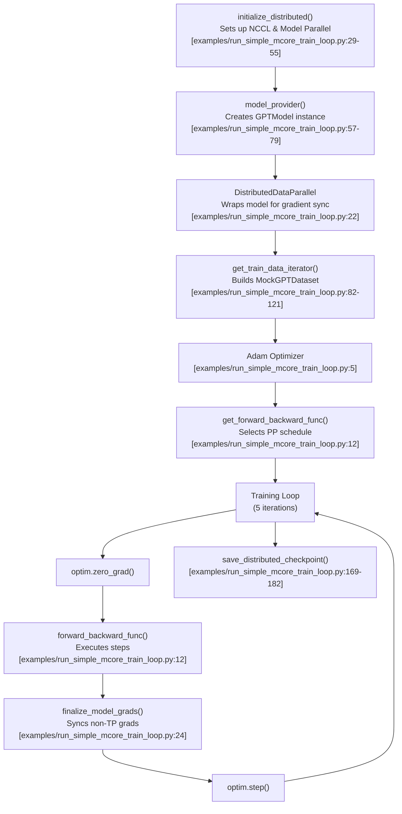
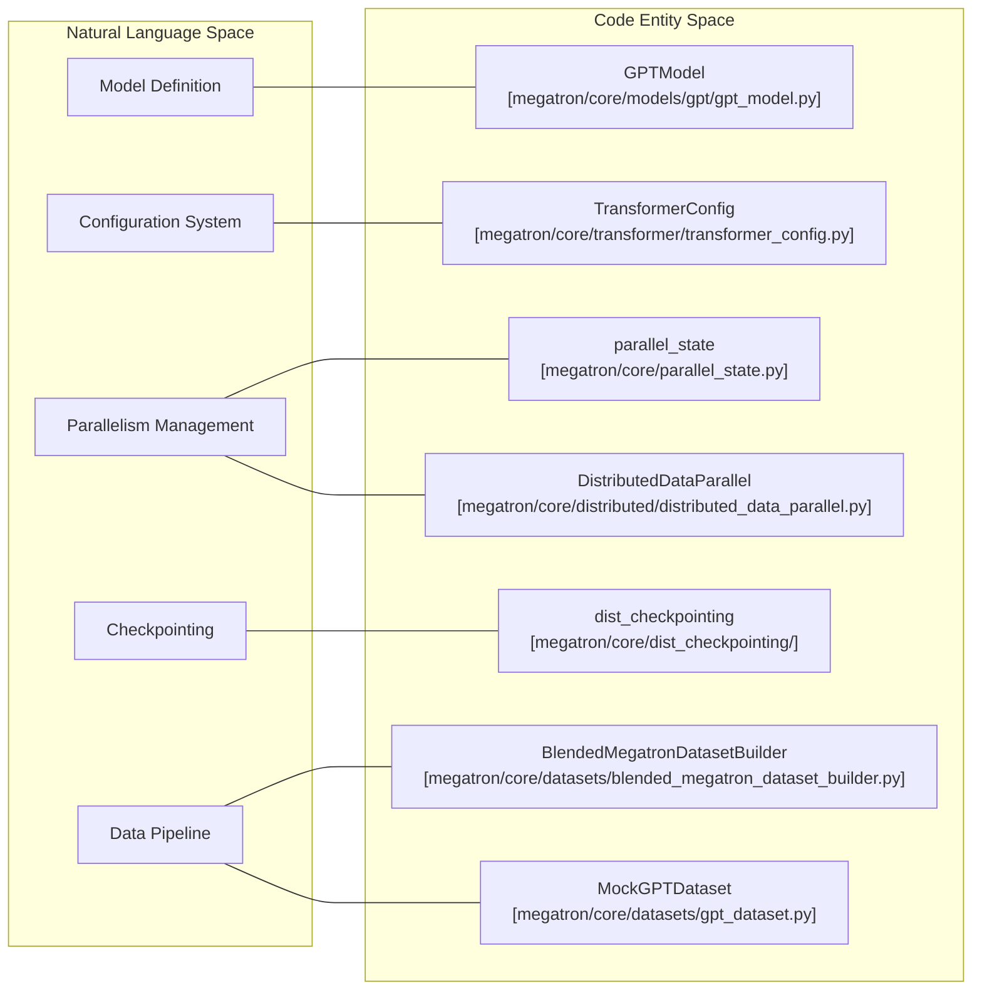

<!-- source: DeepWiki mcp.deepwiki.com · repo NVIDIA/Megatron-LM · page 1.1 Getting Started · fetched 2026-10-26 -->

# Getting Started

<details>
<summary>Relevant source files</summary>

The following files were used as context for generating this wiki page:

- [.github/workflows/_build_test_publish_wheel.yml](.github/workflows/_build_test_publish_wheel.yml)
- [.gitignore](.gitignore)
- [MANIFEST.in](MANIFEST.in)
- [README.md](README.md)
- [docker/Dockerfile.ci.dev](docker/Dockerfile.ci.dev)
- [docker/Dockerfile.ci.lts](docker/Dockerfile.ci.lts)
- [docker/common/install.sh](docker/common/install.sh)
- [docker/common/install_source_wheels.sh](docker/common/install_source_wheels.sh)
- [docs/get-started/install.md](docs/get-started/install.md)
- [docs/get-started/overview.md](docs/get-started/overview.md)
- [docs/get-started/quickstart.md](docs/get-started/quickstart.md)
- [docs/get-started/releasenotes.md](docs/get-started/releasenotes.md)
- [docs/user-guide/data-preparation.md](docs/user-guide/data-preparation.md)
- [docs/user-guide/training-examples.md](docs/user-guide/training-examples.md)
- [examples/run_simple_mcore_train_loop.py](examples/run_simple_mcore_train_loop.py)
- [megatron/core/QuickStart.md](megatron/core/QuickStart.md)
- [megatron/core/README.md](megatron/core/README.md)
- [megatron/core/distributed/fsdp/src/megatron_fsdp/__init__.py](megatron/core/distributed/fsdp/src/megatron_fsdp/__init__.py)
- [megatron/core/distributed/fsdp/src/megatron_fsdp/package_info.py](megatron/core/distributed/fsdp/src/megatron_fsdp/package_info.py)
- [megatron/core/distributed/fsdp/src/pyproject.toml](megatron/core/distributed/fsdp/src/pyproject.toml)
- [megatron/core/models/common/__init__.py](megatron/core/models/common/__init__.py)
- [megatron/core/package_info.py](megatron/core/package_info.py)
- [megatron/core/requirements.txt](megatron/core/requirements.txt)
- [megatron/core/transformer/custom_layers/__init__.py](megatron/core/transformer/custom_layers/__init__.py)
- [pyproject.toml](pyproject.toml)
- [setup.py](setup.py)
- [tests/functional_tests/shell_test_utils/_run_training.sh](tests/functional_tests/shell_test_utils/_run_training.sh)
- [tests/functional_tests/shell_test_utils/run_ci_test.sh](tests/functional_tests/shell_test_utils/run_ci_test.sh)
- [tests/performance_tests/shell_test_utils/determinism/print_nsys_leaderboard.py](tests/performance_tests/shell_test_utils/determinism/print_nsys_leaderboard.py)
- [tests/test_utils/test_training_script_secret_redaction.py](tests/test_utils/test_training_script_secret_redaction.py)
- [tests/unit_tests/data/test_multimodal_dataset.py](tests/unit_tests/data/test_multimodal_dataset.py)
- [uv.lock](uv.lock)

</details>


This document provides installation instructions and a simple training example to help users begin using Megatron-LM. It covers environment setup, basic model training with distributed parallelism, and checkpoint management. For detailed architecture information, see [Architecture Overview](#1.2). For information about the codebase organization, see [Package Structure and Ecosystem](#1.3).

## Overview

Megatron-LM provides two components: **Megatron-LM** and **Megatron Core**.

1.  **Megatron-LM**: A reference example including Megatron Core plus pre-configured training scripts. Best for research teams and quick experimentation [README.md:16-19]().
2.  **Megatron Core**: A composable library with GPU-optimized building blocks (kernels, parallelism, building blocks). Best for framework developers building custom pipelines [README.md:20-21](), [megatron/core/README.md:19-21]().

**Sources:** [README.md:1-21](), [megatron/core/README.md:19-21]()

## Installation

### Prerequisites

Megatron-LM requires:
- NVIDIA GPU with compute capability 7.0 or higher [README.md:98-100]().
- Python 3.12 or higher (Note: Python 3.10 support is deprecated as of version 0.17.0) [README.md:55-55](), [uv.lock:3-3](), [pyproject.toml:26-26]().
- PyTorch 2.6.0 or higher [pyproject.toml:28-28]().

### Installing Megatron Core (Library Only)

You can install the core library directly from PyPI using `uv`:

```bash
uv pip install megatron-core
```

**Sources:** [README.md:26-30](), [pyproject.toml:23-28]()

### Installing from Source (Full Repository)

Clone the repository to access pre-configured training scripts, examples, and tools:

```bash
git clone https://github.com/NVIDIA/Megatron-LM.git
cd Megatron-LM
uv pip install -e .
```

The build system utilizes `setuptools` with `pybind11` to compile C++ helper extensions [pyproject.toml:3-5](), [setup.py:3-5](). The main extension is defined in `setup.py`:

| Extension | Source | Purpose |
|-----------|--------|---------|
| `helpers_cpp` | [megatron/core/datasets/helpers.cpp]() | C++ optimized dataset sampling operations [setup.py:8-15]() |

**Note:** Building from source can be memory-intensive. Limit parallel jobs if needed using `MAX_JOBS=4 uv pip install -e .` [README.md:40-40]().

**Sources:** [README.md:32-40](), [pyproject.toml:3-5](), [setup.py:1-16]()

## First Training Loop

The following example demonstrates the complete workflow for training a small GPT model using Megatron Core APIs. This example is implemented in `examples/run_simple_mcore_train_loop.py`.

### Training Workflow



**Sources:** [examples/run_simple_mcore_train_loop.py:1-182](), [megatron/core/QuickStart.md:1-10]()

### Step 1: Initialize Distributed Environment

Initialize PyTorch's distributed backend and Megatron's model parallel process groups via `parallel_state`:

```python
from megatron.core import parallel_state

def initialize_distributed(tensor_model_parallel_size=1, pipeline_model_parallel_size=1):
    rank = int(os.environ["RANK"])
    world_size = int(os.environ["WORLD_SIZE"])
    local_rank = int(os.environ["LOCAL_RANK"])
    
    torch.cuda.set_device(local_rank)
    torch.distributed.init_process_group(backend="nccl", rank=rank, world_size=world_size)
    
    # Initialize TP, PP, DP, etc.
    parallel_state.initialize_model_parallel(tensor_model_parallel_size, pipeline_model_parallel_size)
```

**Sources:** [examples/run_simple_mcore_train_loop.py:29-55](), [megatron/core/QuickStart.md:44-62]()

### Step 2: Define Model Provider

Create a `GPTModel` using a `TransformerConfig`. This configuration drives the internal architecture of the transformer blocks.

```python
from megatron.core.transformer.transformer_config import TransformerConfig
from megatron.core.models.gpt.gpt_model import GPTModel
from megatron.core.models.gpt.gpt_layer_specs import get_gpt_layer_local_spec

def model_provider():
    config = TransformerConfig(
        num_layers=2, 
        hidden_size=12, 
        num_attention_heads=4, 
        use_cpu_initialization=True, 
        pipeline_dtype=torch.float32)

    return GPTModel(
        config=config, 
        transformer_layer_spec=get_gpt_layer_local_spec(), 
        vocab_size=100, 
        max_sequence_length=64)
```

**Sources:** [examples/run_simple_mcore_train_loop.py:57-79](), [megatron/core/QuickStart.md:66-92]()

### Step 3: Create Data Iterator

Use the `BlendedMegatronDatasetBuilder` to construct datasets. For quick starts, `MockGPTDataset` generates synthetic data.

```python
from megatron.core.datasets.blended_megatron_dataset_builder import BlendedMegatronDatasetBuilder
from megatron.core.datasets.gpt_dataset import GPTDatasetConfig, MockGPTDataset

def get_train_data_iterator():
    config = GPTDatasetConfig(
        random_seed=0,
        sequence_length=64,
        tokenizer=MegatronTokenizer.from_pretrained(...)
    )
    datasets = BlendedMegatronDatasetBuilder(
        MockGPTDataset, [1000, None, None], lambda: True, config
    ).build()
    return iter(DataLoader(datasets[0], batch_size=8, shuffle=True))
```

**Sources:** [examples/run_simple_mcore_train_loop.py:82-121](), [megatron/core/QuickStart.md:96-142]()

### Step 4: Define Forward Step Function

Define how a single microbatch is processed. This function is passed to the pipeline scheduler.

```python
def forward_step_func(data_iterator, model):
    data = next(data_iterator)
    # Extract tokens, labels, masks from data...
    output_tensor = model(tokens, position_ids, attention_mask, labels=labels)
    
    def loss_func(loss_mask, output_tensor):
        # Compute loss...
        return loss, {'lm loss': loss}
        
    return output_tensor, partial(loss_func, loss_mask)
```

**Sources:** [examples/run_simple_mcore_train_loop.py:124-167](), [megatron/core/QuickStart.md:146-176]()

### Step 5: Execute Training Loop

The training loop orchestrates the forward and backward passes using the selected schedule and finalizes gradients before the optimizer step.

```python
# Wrap model with DistributedDataParallel for gradient reduction
gpt_model = DistributedDataParallel(config=config, ddp_config=ddp_config, module=gpt_model)

for iteration in range(5):
    optim.zero_grad()
    # forward_backward_func handles microbatching and PP logic
    forward_backward_func(model=gpt_model, ...)
    # Sync non-tensor-parallel gradients (e.g. LayerNorm)
    finalize_model_grads([gpt_model])
    optim.step()
```

**Sources:** [examples/run_simple_mcore_train_loop.py:22-24](), [megatron/core/QuickStart.md:201-241]()

## Running the Example

### Using torchrun

To run the provided simple training loop on 2 GPUs:

```bash
export PYTHONPATH=$PYTHONPATH:./megatron
torchrun --nproc_per_node 2 examples/run_simple_mcore_train_loop.py
```

**Sources:** [megatron/core/QuickStart.md:38-41](), [megatron/core/README.md:15-16]()

## Checkpointing

Megatron Core uses **Distributed Checkpointing** (`dist_checkpointing`). This system saves the `sharded_state_dict`, allowing models to be loaded with different parallelism configurations (e.g., train on TP=2, load on TP=4).

```python
from megatron.core import dist_checkpointing

# Saving
sharded_state_dict = model.sharded_state_dict(prefix="")
dist_checkpointing.save(sharded_state_dict=sharded_state_dict, checkpoint_dir=path)

# Loading
checkpoint = dist_checkpointing.load(sharded_state_dict=sharded_state_dict, checkpoint_dir=path)
model.load_state_dict(checkpoint)
```

**Sources:** [examples/run_simple_mcore_train_loop.py:169-205](), [megatron/core/QuickStart.md:180-200]()

## Summary of Code Entities

The following diagram maps high-level system components to their specific code implementations within the repository.



| Entity | Path | Role |
|--------|------|------|
| `GPTModel` | [megatron/core/models/gpt/gpt_model.py]() | Reference GPT implementation |
| `TransformerConfig` | [megatron/core/transformer/transformer_config.py]() | Central configuration for transformer blocks |
| `parallel_state` | [megatron/core/parallel_state.py]() | Manages distributed process groups |
| `DistributedDataParallel` | [megatron/core/distributed/distributed_data_parallel.py]() | Megatron-optimized DDP implementation |
| `dist_checkpointing` | [megatron/core/dist_checkpointing/]() | Distributed checkpointing logic |
| `BlendedMegatronDatasetBuilder` | [megatron/core/datasets/blended_megatron_dataset_builder.py]() | Builds blended datasets from multiple sources |
| `MockGPTDataset` | [megatron/core/datasets/gpt_dataset.py]() | Generates synthetic data for GPT models |

**Sources:** [examples/run_simple_mcore_train_loop.py:10-25](), [README.md:72-87](), [megatron/core/package_info.py:34-42]()

---

