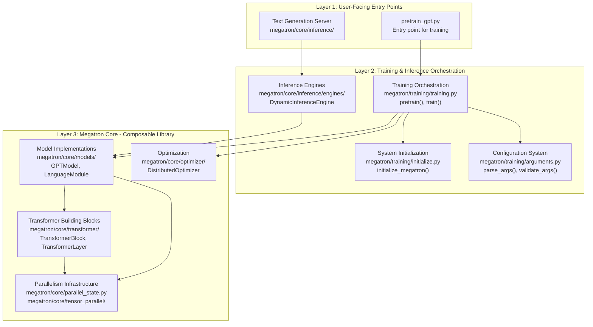
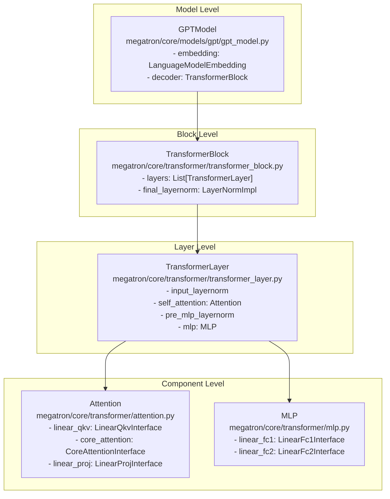

<!-- source: DeepWiki mcp.deepwiki.com · repo NVIDIA/Megatron-LM · page 1.2 Architecture Overview · fetched 2026-10-26 -->

# Architecture Overview

Relevant source files

The following files were used as context for generating this wiki page:

- [.gitignore](.gitignore)
- [MANIFEST.in](MANIFEST.in)
- [README.md](README.md)
- [examples/run_simple_mcore_train_loop.py](examples/run_simple_mcore_train_loop.py)
- [megatron/core/QuickStart.md](megatron/core/QuickStart.md)
- [megatron/core/README.md](megatron/core/README.md)
- [megatron/core/dist_checkpointing/strategies/fully_parallel.py](megatron/core/dist_checkpointing/strategies/fully_parallel.py)
- [megatron/core/distributed/fsdp/src/megatron_fsdp/package_info.py](megatron/core/distributed/fsdp/src/megatron_fsdp/package_info.py)
- [megatron/core/extensions/transformer_engine.py](megatron/core/extensions/transformer_engine.py)
- [megatron/core/fusions/fused_bias_swiglu.py](megatron/core/fusions/fused_bias_swiglu.py)
- [megatron/core/model_parallel_config.py](megatron/core/model_parallel_config.py)
- [megatron/core/models/common/__init__.py](megatron/core/models/common/__init__.py)
- [megatron/core/models/gpt/gpt_model.py](megatron/core/models/gpt/gpt_model.py)
- [megatron/core/package_info.py](megatron/core/package_info.py)
- [megatron/core/parallel_state.py](megatron/core/parallel_state.py)
- [megatron/core/pipeline_parallel/p2p_communication.py](megatron/core/pipeline_parallel/p2p_communication.py)
- [megatron/core/pipeline_parallel/schedules.py](megatron/core/pipeline_parallel/schedules.py)
- [megatron/core/requirements.txt](megatron/core/requirements.txt)
- [megatron/core/tensor_parallel/__init__.py](megatron/core/tensor_parallel/__init__.py)
- [megatron/core/tensor_parallel/layers.py](megatron/core/tensor_parallel/layers.py)
- [megatron/core/tensor_parallel/random.py](megatron/core/tensor_parallel/random.py)
- [megatron/core/transformer/attention.py](megatron/core/transformer/attention.py)
- [megatron/core/transformer/cuda_graphs.py](megatron/core/transformer/cuda_graphs.py)
- [megatron/core/transformer/custom_layers/__init__.py](megatron/core/transformer/custom_layers/__init__.py)
- [megatron/core/transformer/mlp.py](megatron/core/transformer/mlp.py)
- [megatron/core/transformer/module.py](megatron/core/transformer/module.py)
- [megatron/core/transformer/torch_norm.py](megatron/core/transformer/torch_norm.py)
- [megatron/core/transformer/transformer_block.py](megatron/core/transformer/transformer_block.py)
- [megatron/core/transformer/transformer_config.py](megatron/core/transformer/transformer_config.py)
- [megatron/core/transformer/transformer_layer.py](megatron/core/transformer/transformer_layer.py)
- [megatron/core/transformer/utils.py](megatron/core/transformer/utils.py)
- [megatron/core/utils.py](megatron/core/utils.py)
- [megatron/training/arguments.py](megatron/training/arguments.py)
- [megatron/training/checkpointing.py](megatron/training/checkpointing.py)
- [megatron/training/config/training_config.py](megatron/training/config/training_config.py)
- [megatron/training/initialize.py](megatron/training/initialize.py)
- [megatron/training/training.py](megatron/training/training.py)
- [pretrain_gpt.py](pretrain_gpt.py)
- [pretrain_hybrid.py](pretrain_hybrid.py)
- [pretrain_mamba.py](pretrain_mamba.py)
- [setup.py](setup.py)
- [tests/unit_tests/data/test_multimodal_dataset.py](tests/unit_tests/data/test_multimodal_dataset.py)
- [tests/unit_tests/dist_checkpointing/test_pipeline_parallel_layout.py](tests/unit_tests/dist_checkpointing/test_pipeline_parallel_layout.py)
- [tests/unit_tests/dist_checkpointing/utils.py](tests/unit_tests/dist_checkpointing/utils.py)
- [tests/unit_tests/fusions/test_swiglu_fusion.py](tests/unit_tests/fusions/test_swiglu_fusion.py)
- [tests/unit_tests/pipeline_parallel/test_pipeline_layout.py](tests/unit_tests/pipeline_parallel/test_pipeline_layout.py)
- [tests/unit_tests/tensor_parallel/test_random.py](tests/unit_tests/tensor_parallel/test_random.py)
- [tests/unit_tests/test_checkpointing.py](tests/unit_tests/test_checkpointing.py)
- [tests/unit_tests/test_parallel_state.py](tests/unit_tests/test_parallel_state.py)
- [tests/unit_tests/transformer/test_cuda_graphs.py](tests/unit_tests/transformer/test_cuda_graphs.py)
- [tests/unit_tests/transformer/test_utils.py](tests/unit_tests/transformer/test_utils.py)

## Purpose and Scope

This page provides a high-level architectural overview of Megatron-LM, describing its major components, architectural layers, and how they interact to enable large-scale transformer model training and inference. It focuses on the structural organization of the codebase and the flow of control through the system.

Megatron-LM consists of two primary components: **Megatron-LM** (the reference training framework) and **Megatron Core** (the modular library of GPU-optimized building blocks) [[README.md:14-21]]().

## System Architecture Layers

Megatron-LM is organized into three architectural layers that separate concerns and enable flexible composition:

Title: Megatron-LM System Layers

**Layer 1** provides command-line scripts and API servers. **Layer 2** contains orchestration logic for training runs and inference serving. **Layer 3** (Megatron Core) provides the underlying infrastructure for models, parallelism, and optimization [[README.md:71-92]]().

Sources: [[megatron/training/training.py:1-195]](), [[megatron/training/initialize.py:1-155]](), [[megatron/core/models/gpt/gpt_model.py:52-154]](), [[megatron/core/transformer/transformer_block.py:1-170]](), [[README.md:71-92]]()

## Core Components and Data Flow

### Training Pipeline Components

Title: Training Data and Control Flow

```mermaid
graph LR
    subgraph "Configuration"
        Args["parse_args()<br/>megatron/training/arguments.py"]
        TConfig["TransformerConfig<br/>megatron/core/transformer/transformer_config.py"]
    end
    
    subgraph "Initialization"
        InitMegatron["initialize_megatron()<br/>megatron/training/initialize.py"]
        ParallelState["parallel_state.py<br/>Process group creation"]
    end
    
    subgraph "Model Construction"
        ModelProvider["model_provider()<br/>User-defined function"]
        GPTModel["GPTModel<br/>megatron/core/models/gpt/gpt_model.py"]
        TransformerBlock["TransformerBlock<br/>megatron/core/transformer/transformer_block.py"]
    end
    
    subgraph "Optimization"
        GetOptimizer["get_megatron_optimizer()<br/>megatron/core/optimizer/"]
        DistOptimizer["DistributedOptimizer<br/>megatron/core/optimizer/distrib_optimizer.py"]
    end
    
    subgraph "Training Execution"
        Pretrain["pretrain()<br/>megatron/training/training.py"]
        Train["train_step()<br/>Main training loop"]
    end
    
    Args --> InitMegatron
    InitMegatron --> ParallelState
    ParallelState --> ModelProvider
    TConfig --> ModelProvider
    
    ModelProvider --> GPTModel
    GPTModel --> TransformerBlock
    
    GPTModel --> GetOptimizer
    TConfig --> GetOptimizer
    GetOptimizer --> DistOptimizer
    
    DistOptimizer --> Pretrain
    GPTModel --> Pretrain
    Pretrain --> Train
```

The training pipeline starts with argument parsing via `parse_args` [[megatron/training/arguments.py:116]]() which initializes the global configuration. `initialize_megatron()` [[megatron/training/initialize.py:152]]() sets up the distributed environment and initializes `parallel_state.py`. Models like `GPTModel` [[megatron/core/models/gpt/gpt_model.py:52]]() are constructed using modular components like `TransformerBlock` [[megatron/core/transformer/transformer_block.py:1]]() and `TransformerConfig` [[megatron/core/transformer/transformer_config.py:54]]().

Sources: [[megatron/training/arguments.py:87-168]](), [[megatron/training/initialize.py:151-155]](), [[megatron/training/training.py:1-195]](), [[megatron/core/models/gpt/gpt_model.py:98-154]](), [[megatron/core/parallel_state.py:28-178]]()

### Model Architecture Hierarchy

Title: Transformer Model Entity Hierarchy

`GPTModel` [[megatron/core/models/gpt/gpt_model.py:52]]() encapsulates the full transformer. It contains a `TransformerBlock` [[megatron/core/transformer/transformer_block.py:1]](), which manages a list of `TransformerLayer` [[megatron/core/transformer/transformer_layer.py:1]]() instances. Each layer is composed of an `Attention` [[megatron/core/transformer/attention.py:1]]() and an `MLP` [[megatron/core/transformer/mlp.py:32]]() module.

Sources: [[megatron/core/models/gpt/gpt_model.py:98-154]](), [[megatron/core/transformer/transformer_block.py:1-170]](), [[megatron/core/transformer/transformer_layer.py:1-170]](), [[megatron/core/transformer/attention.py:139-235]](), [[megatron/core/transformer/mlp.py:32]]()

## Configuration System

Megatron uses a configuration system centered around dataclasses:

- **ModelParallelConfig**: Base configuration for distributed settings [[megatron/core/model_parallel_config.py:26]]().
- **TransformerConfig**: Extends `ModelParallelConfig` with transformer-specific parameters like `num_layers`, `hidden_size`, and `attention_backend` [[megatron/core/transformer/transformer_config.py:54-163]]().
- **MLATransformerConfig**: Specialized config for Multi-Latent Attention [[megatron/core/transformer/transformer_config.py:113]]().

The `add_megatron_arguments` function [[megatron/training/arguments.py:45]]() adds a comprehensive set of arguments to an `argparse.ArgumentParser`. These arguments are then parsed and validated by `parse_and_validate_args` [[megatron/training/arguments.py:87]](), which also sets global variables [[megatron/training/arguments.py:111]]().

Sources: [[megatron/core/transformer/transformer_config.py:54-163]](), [[megatron/core/model_parallel_config.py:26]](), [[megatron/training/arguments.py:45]](), [[megatron/training/arguments.py:87]]()

## Parallelism Architecture

### Process Group Hierarchy

Initialization logic in `parallel_state.py` defines the various process groups required for 3D parallelism and advanced strategies:

| Variable Name | Purpose |
|---------------|---------|
| `_TENSOR_MODEL_PARALLEL_GROUP` | Intra-layer model parallelism [[megatron/core/parallel_state.py:29]]() |
| `_PIPELINE_MODEL_PARALLEL_GROUP` | Inter-layer pipeline parallelism [[megatron/core/parallel_state.py:34]]() |
| `_MODEL_PARALLEL_GROUP` | Combined intra- and pipeline model parallelism [[megatron/core/parallel_state.py:36]]() |
| `_DATA_PARALLEL_GROUP` | Standard data parallelism [[megatron/core/parallel_state.py:43]]() |
| `_TENSOR_AND_DATA_PARALLEL_GROUP` | Tensor and data parallel group combined [[megatron/core/parallel_state.py:47]]() |
| `_EXPERT_MODEL_PARALLEL_GROUP` | Expert model parallel group for MoE models [[megatron/core/parallel_state.py:60]]() |
| `_EXPERT_TENSOR_PARALLEL_GROUP` | Expert tensor parallel group [[megatron/core/parallel_state.py:62]]() |
| `_EXPERT_DATA_PARALLEL_GROUP` | Expert data parallel group [[megatron/core/parallel_state.py:71]]() |
| `_CONTEXT_PARALLEL_GROUP` | Sequence-based context parallelism [[megatron/core/parallel_state.py:124]]() |

Sources: [[megatron/core/parallel_state.py:28-178]]()

### Tensor Parallelism (TP)

TP splits weight matrices across GPUs. `VocabParallelEmbedding` [[megatron/core/tensor_parallel/layers.py:198]]() shards the vocabulary dimension. `ColumnParallelLinear` [[megatron/core/tensor_parallel/layers.py:351]]() shards weights along the output dimension, while `RowParallelLinear` [[megatron/core/tensor_parallel/layers.py:514]]() shards along the input dimension. Communication primitives like `gather_from_tensor_model_parallel_region` [[megatron/core/extensions/transformer_engine.py:43]]() handle data movement.

Sources: [[megatron/core/tensor_parallel/layers.py:198-514]](), [[megatron/core/extensions/transformer_engine.py:43]]()

### Pipeline Parallelism (PP)

Pipeline parallelism divides model layers across GPUs. The `schedules.py` module defines various pipeline schedules, including `forward_backward_pipelining_with_interleaving` for interleaved PP and `forward_backward_pipelining_without_interleaving` for non-interleaved PP [[megatron/core/pipeline_parallel/schedules.py:161-165]](). The `PipelineParallelLayerLayout` class allows for custom definitions of pipeline parallel partitioning [[megatron/core/transformer/transformer_config.py:104]](). The `get_transformer_layer_offset` function calculates the layer index offset for the current pipeline stage [[megatron/core/transformer/transformer_layer.py:65]]().

Sources: [[megatron/core/pipeline_parallel/schedules.py:157-166]](), [[megatron/core/transformer/transformer_config.py:104]](), [[megatron/core/transformer/transformer_layer.py:65]]()

## Training Execution Flow

The training lifecycle is orchestrated by utilities in `megatron/training/training.py`. It selects a pipeline schedule via `get_forward_backward_func()` [[megatron/core/pipeline_parallel/schedules.py:53]](). This function handles microbatching and communication logic. The training loop manages forward/backward passes, gradient synchronization via `finalize_model_grads` [[megatron/training/training.py:51]](), and optimizer steps using `DistributedOptimizer` [[megatron/core/optimizer/distrib_optimizer.py:82]]().

Sources: [[megatron/training/training.py:1-195]](), [[megatron/core/pipeline_parallel/schedules.py:53-166]](), [[megatron/core/optimizer/distrib_optimizer.py:82]]()

## Checkpointing System

Megatron implements a distributed checkpointing system. The `checkpointing.py` module provides functions for saving and loading model, optimizer, and training states [[megatron/training/checkpointing.py:3]](). Key functions include `save_checkpoint` [[megatron/training/checkpointing.py:145]]() and `load_checkpoint` [[megatron/training/checkpointing.py:144]](). It supports `ShardedStateDict` [[megatron/core/dist_checkpointing/mapping.py:12]]() for flexible loading across different parallelism configurations.

Sources: [[megatron/training/checkpointing.py:1-161]](), [[megatron/core/dist_checkpointing/mapping.py:12]]()

## Key Abstractions and Interfaces

### Module Specification System
Megatron Core uses `ModuleSpec` [[megatron/core/transformer/spec_utils.py:39]]() to define module structures. This allows users to swap implementations (e.g., replacing a standard MLP with an MoE MLP) by providing a different specification to the `TransformerLayer`.

### Distributed Data Parallel (DDP)
Megatron supports distributed data parallelism through its own `DistributedDataParallel` class [[megatron/core/distributed/distributed_data_parallel.py:47]]() and an adapter for `megatron_FSDP` [[megatron/core/distributed/fsdp/mcore_fsdp_adapter.py:53]]().

Sources: [[megatron/core/transformer/spec_utils.py:39]](), [[megatron/core/distributed/distributed_data_parallel.py:47]](), [[megatron/core/distributed/fsdp/mcore_fsdp_adapter.py:53]]()

## Integration Points

| Library | Purpose | Integration Point |
|---------|---------|------------------|
| **Transformer Engine (TE)** | FP8 support, fused kernels | `megatron/core/extensions/transformer_engine.py` [[megatron/core/extensions/transformer_engine.py:1]]() |
| **Flash Attention** | Memory-efficient attention | `megatron/core/transformer/attention.py` [[megatron/core/transformer/attention.py:65-120]]() |
| **Multi-Storage Client (MSC)** | Support for various storage backends | `megatron/core/msc_utils.py` [[megatron/training/arguments.py:39]](), [[megatron/training/arguments.py:156]]() |
| **ModelOpt** | Post-training optimization | `megatron/training/checkpointing.py` [[megatron/training/checkpointing.py:82-90]]() |

Sources: [[megatron/core/extensions/transformer_engine.py:1-187]](), [[megatron/core/transformer/attention.py:65-120]](), [[megatron/training/arguments.py:146-167]](), [[megatron/training/checkpointing.py:82-90]]()

---

