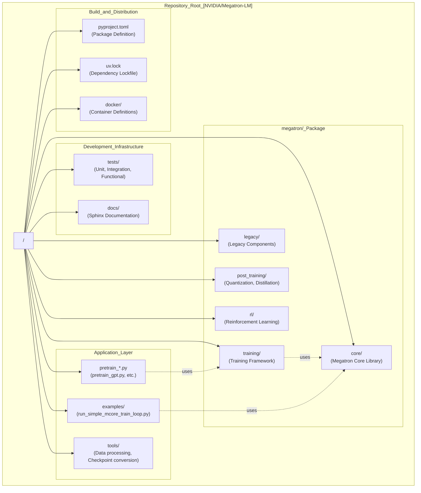
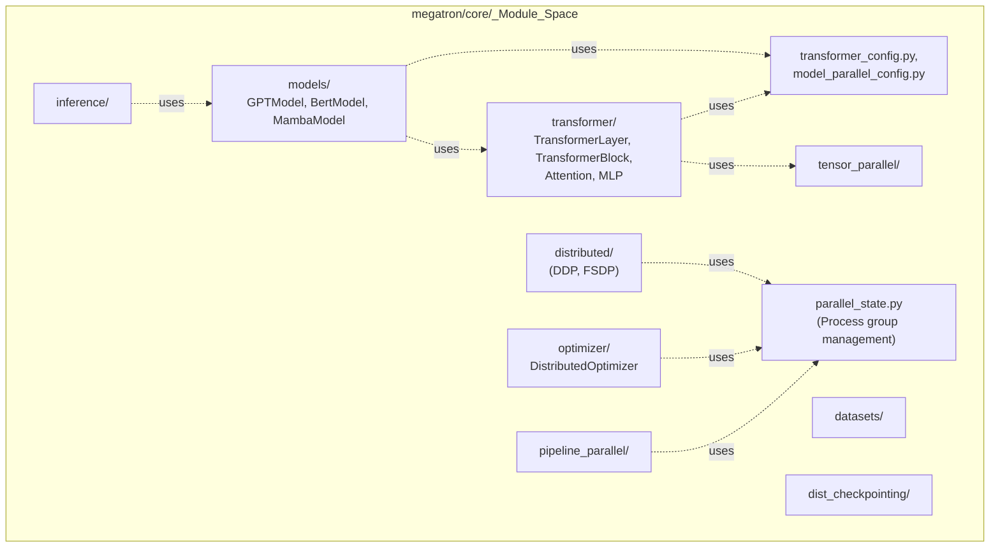
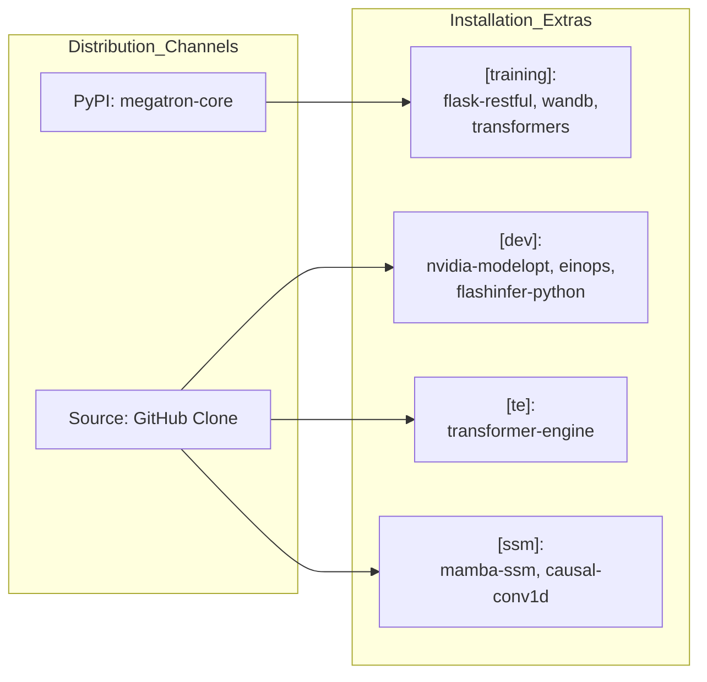

<!-- source: DeepWiki mcp.deepwiki.com · repo NVIDIA/Megatron-LM · page 1.3 Package Structure and Ecosystem · fetched 2026-10-26 -->

# Package Structure and Ecosystem

Relevant source files

The following files were used as context for generating this wiki page:

- [.github/workflows/_build_test_publish_wheel.yml](.github/workflows/_build_test_publish_wheel.yml)
- [.gitignore](.gitignore)
- [MANIFEST.in](MANIFEST.in)
- [README.md](README.md)
- [docker/Dockerfile.ci.dev](docker/Dockerfile.ci.dev)
- [docker/Dockerfile.ci.lts](docker/Dockerfile.ci.lts)
- [docker/common/install.sh](docker/common/install.sh)
- [docker/common/install_source_wheels.sh](docker/common/install_source_wheels.sh)
- [docs/api-guide/core/index.md](docs/api-guide/core/index.md)
- [docs/index.md](docs/index.md)
- [docs/user-guide/features/context_parallel.md](docs/user-guide/features/context_parallel.md)
- [docs/user-guide/features/dist_optimizer.md](docs/user-guide/features/dist_optimizer.md)
- [docs/user-guide/features/index.md](docs/user-guide/features/index.md)
- [docs/user-guide/features/megatron_energon.md](docs/user-guide/features/megatron_energon.md)
- [docs/user-guide/features/megatron_rl.md](docs/user-guide/features/megatron_rl.md)
- [docs/user-guide/features/multi_latent_attention.md](docs/user-guide/features/multi_latent_attention.md)
- [docs/user-guide/features/multi_token_prediction.md](docs/user-guide/features/multi_token_prediction.md)
- [docs/user-guide/features/pipeline_parallel_layout.md](docs/user-guide/features/pipeline_parallel_layout.md)
- [docs/user-guide/features/tokenizers.md](docs/user-guide/features/tokenizers.md)
- [docs/user-guide/hybrid-model-migration.md](docs/user-guide/hybrid-model-migration.md)
- [docs/user-guide/index.md](docs/user-guide/index.md)
- [docs/user-guide/parallelism-guide.md](docs/user-guide/parallelism-guide.md)
- [examples/run_simple_mcore_train_loop.py](examples/run_simple_mcore_train_loop.py)
- [megatron/core/QuickStart.md](megatron/core/QuickStart.md)
- [megatron/core/README.md](megatron/core/README.md)
- [megatron/core/dist_checkpointing/gpt_checkpoint_interop.py](megatron/core/dist_checkpointing/gpt_checkpoint_interop.py)
- [megatron/core/distributed/fsdp/src/megatron_fsdp/__init__.py](megatron/core/distributed/fsdp/src/megatron_fsdp/__init__.py)
- [megatron/core/distributed/fsdp/src/megatron_fsdp/package_info.py](megatron/core/distributed/fsdp/src/megatron_fsdp/package_info.py)
- [megatron/core/distributed/fsdp/src/pyproject.toml](megatron/core/distributed/fsdp/src/pyproject.toml)
- [megatron/core/models/common/__init__.py](megatron/core/models/common/__init__.py)
- [megatron/core/package_info.py](megatron/core/package_info.py)
- [megatron/core/requirements.txt](megatron/core/requirements.txt)
- [megatron/core/transformer/custom_layers/__init__.py](megatron/core/transformer/custom_layers/__init__.py)
- [pyproject.toml](pyproject.toml)
- [setup.py](setup.py)
- [skills/mcore-migrate-gpt-to-hybrid/SKILL.md](skills/mcore-migrate-gpt-to-hybrid/SKILL.md)
- [tests/functional_tests/shell_test_utils/_run_training.sh](tests/functional_tests/shell_test_utils/_run_training.sh)
- [tests/functional_tests/shell_test_utils/run_ci_test.sh](tests/functional_tests/shell_test_utils/run_ci_test.sh)
- [tests/performance_tests/shell_test_utils/determinism/print_nsys_leaderboard.py](tests/performance_tests/shell_test_utils/determinism/print_nsys_leaderboard.py)
- [tests/test_utils/test_training_script_secret_redaction.py](tests/test_utils/test_training_script_secret_redaction.py)
- [tests/unit_tests/data/test_multimodal_dataset.py](tests/unit_tests/data/test_multimodal_dataset.py)
- [uv.lock](uv.lock)

This page describes the repository organization, package distribution model, and external ecosystem of Megatron-LM and Megatron Core. It covers the directory structure, key modules, installation methods, and how Megatron Core integrates with external libraries and frameworks.

---

## Repository Organization

The Megatron-LM repository contains two distinct but complementary components: **Megatron-LM** (the reference training framework) and **Megatron Core** (the composable library). The repository is organized to support both library usage and end-to-end training workflows.

**Sources:** [README.md:16-21](), [README.md:69-89](), [pyproject.toml:11-16]()

The repository follows a layered architecture:

1.  **Core Library Layer** (`megatron/core/`): Composable library with GPU-optimized building blocks for custom training frameworks [README.md:20-21]().
2.  **Training Framework Layer** (`megatron/training/`): Reference example including Megatron Core plus pre-configured training scripts [README.md:18-19]().
3.  **Application Layer**: Entry points for pre-configured training (e.g., `pretrain_gpt.py`) and usage examples [README.md:81-85](), [megatron/core/QuickStart.md:38-42]().
4.  **Development Infrastructure**: Comprehensive testing suite and automated CI/CD configurations [README.md:87](), [pyproject.toml:140-155]().

---

## Megatron Core Internal Structure

Megatron Core (`megatron/core/`) is the foundational library providing modular, GPU-optimized components. It is organized into functional subsystems that correspond to different aspects of transformer training.

**Sources:** [README.md:70-80](), [megatron/core/QuickStart.md:68-73](), [megatron/core/QuickStart.md:85-92]()

### Core Module Breakdown

| Module | Purpose | Key Entities |
| :--- | :--- | :--- |
| `models/` | High-level model definitions | `GPTModel` [megatron/core/QuickStart.md:85](), `LanguageModule` [README.md:72]() |
| `transformer/` | Foundational blocks | `TransformerBlock` [README.md:73](), `TransformerConfig` [megatron/core/QuickStart.md:78]() |
| `tensor_parallel/` | Intra-layer sharding | `parallel_state.initialize_model_parallel` [megatron/core/QuickStart.md:61]() |
| `pipeline_parallel/` | Inter-layer sharding | `schedules.py` [megatron/core/QuickStart.md:148]() |
| `distributed/` | Gradient/Param sharding | `DistributedDataParallel`, `FSDP` [README.md:76](), `megatron_fsdp` [pyproject.toml:35]() |
| `optimizer/` | State management | `DistributedOptimizer` [README.md:77]() |
| `dist_checkpointing/` | Sharded IO | `dist_checkpointing` [megatron/core/QuickStart.md:186]() |
| `parallel_state.py` | Distributed orchestration | `parallel_state` [megatron/core/QuickStart.md:51]() |

---

## Integration with External Ecosystems

Megatron-LM serves as a hub for several specialized NVIDIA libraries, enabling state-of-the-art performance and interoperability.

### Transformer Engine (TE) Integration
Megatron-LM heavily integrates with [Transformer Engine](https://github.com/NVIDIA/TransformerEngine) to provide optimized kernels and mixed-precision support (FP8/FP4).
*   **Module Overrides**: Core transformer blocks are designed to be compatible with TE's FP8/FP4 support [README.md:20-21]().
*   **Build Support**: `uv` handles TE as a non-build-isolation package to ensure compatibility with local CUDA environments [pyproject.toml:192-193]().
*   **CI/CD**: The CI infrastructure specifically installs `transformer-engine[pytorch,core_cu13]` for development and testing [pyproject.toml:130-132](), [docker/Dockerfile.ci.dev:78]().

### NeMo and Ecosystem Tools
*   **Megatron Bridge**: Provides bidirectional Hugging Face ↔ Megatron checkpoint conversion with production-ready recipes [README.md:22](), [README.md:59]().
*   **ModelOpt**: Integrated for post-training optimizations including quantization, pruning, and distillation [README.md:83](), [pyproject.toml:93]().
*   **Mamba/SSM**: Native support for state-space models via `mamba-ssm` and `causal-conv1d` [pyproject.toml:134-137]().
*   **Emerging Optimizers**: Support for `Muon` and other emerging optimizers via the `Emerging-Optimizers` library [README.md:51](), [pyproject.toml:110]().
*   **DeepSeek Integration**: Support for DeepSeek-V4 and MoE optimizations via `flash-mla` and `DeepGEMM` [README.md:50](), [pyproject.toml:182-183]().

---

## Package Distribution and Installation

Megatron Core is distributed via PyPI and source, supporting various use cases from research to production.

**Sources:** [pyproject.toml:23-28](), [pyproject.toml:70-137](), [README.md:26-38]()

### Dependency Management
The project utilizes `uv` for modern dependency resolution and `pyproject.toml` for metadata:
*   **Python Version**: Supports `>=3.12` [pyproject.toml:26](). Note: Python 3.10 support is deprecated as of release 0.17.0 [README.md:55]().
*   **Core Dependencies**: `torch>=2.6.0`, `numpy`, and `packaging>=24.2` [pyproject.toml:28]().
*   **Optional Groups**:
    *   `training`: Necessary for running the reference training scripts, including `wandb` and `transformers` [pyproject.toml:71-79]().
    *   `dev`: Includes the full suite of ecosystem integrations like `nvidia-modelopt`, `nemo-lens`, and `flashinfer-python` [pyproject.toml:92-117]().
    *   `te`: Specifically for Transformer Engine [pyproject.toml:130-132]().
    *   `ssm`: For Mamba and SSM model support [pyproject.toml:134-137]().
    *   `linting`: Quality gates including `ruff`, `black`, and `pylint` [pyproject.toml:174-180]().

**Sources:** [pyproject.toml:1-208](), [uv.lock:1-37](), [megatron/core/package_info.py:1-14]()

---

