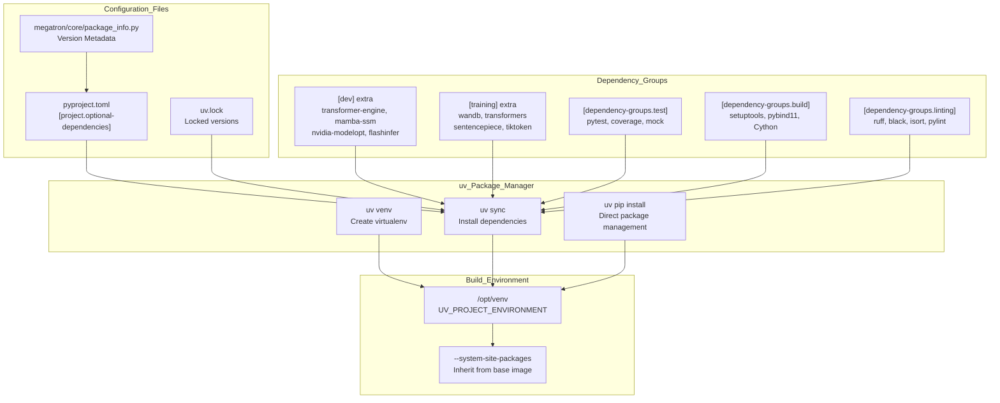
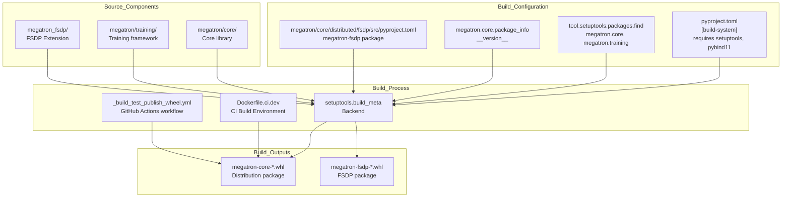

<!-- source: DeepWiki mcp.deepwiki.com · repo NVIDIA/Megatron-LM · page 10 Development Environment and Tooling · fetched 2026-10-26 -->

# Development Environment and Tooling

Relevant source files

The following files were used as context for generating this wiki page:

- [.github/workflows/_build_test_publish_wheel.yml](.github/workflows/_build_test_publish_wheel.yml)
- [.pylintrc](.pylintrc)
- [docker/Dockerfile.ci.dev](docker/Dockerfile.ci.dev)
- [docker/Dockerfile.ci.lts](docker/Dockerfile.ci.lts)
- [docker/common/install.sh](docker/common/install.sh)
- [docker/common/install_source_wheels.sh](docker/common/install_source_wheels.sh)
- [megatron/core/distributed/fsdp/src/megatron_fsdp/__init__.py](megatron/core/distributed/fsdp/src/megatron_fsdp/__init__.py)
- [megatron/core/distributed/fsdp/src/pyproject.toml](megatron/core/distributed/fsdp/src/pyproject.toml)
- [megatron/training/yaml_arguments.py](megatron/training/yaml_arguments.py)
- [pyproject.toml](pyproject.toml)
- [tests/functional_tests/shell_test_utils/_run_training.sh](tests/functional_tests/shell_test_utils/_run_training.sh)
- [tests/functional_tests/shell_test_utils/run_ci_test.sh](tests/functional_tests/shell_test_utils/run_ci_test.sh)
- [tests/performance_tests/shell_test_utils/determinism/print_nsys_leaderboard.py](tests/performance_tests/shell_test_utils/determinism/print_nsys_leaderboard.py)
- [tests/test_utils/test_training_script_secret_redaction.py](tests/test_utils/test_training_script_secret_redaction.py)
- [tools/autoformat.sh](tools/autoformat.sh)
- [tools/check_copyright.py](tools/check_copyright.py)
- [tools/checkpoint/loader_base.py](tools/checkpoint/loader_base.py)
- [tools/checkpoint/loader_llava.py](tools/checkpoint/loader_llava.py)
- [tools/checkpoint/loader_mixtral_hf.py](tools/checkpoint/loader_mixtral_hf.py)
- [tools/checkpoint/saver_base.py](tools/checkpoint/saver_base.py)
- [tools/checkpoint/saver_hf_llava.py](tools/checkpoint/saver_hf_llava.py)
- [tools/checkpoint/saver_llava.py](tools/checkpoint/saver_llava.py)
- [tools/checkpoint/schema_hf.py](tools/checkpoint/schema_hf.py)
- [tools/copyright.sh](tools/copyright.sh)
- [uv.lock](uv.lock)

## Purpose and Scope

This document provides an overview of the development environment setup, dependency management, and build tooling for Megatron-LM and Megatron Core. It covers installation methods, package structure, and the development workflow needed to start contributing to or using the codebase.

For specific topics:
- Package installation and dependency specifications: see [Package Management and Dependencies](#10.1)
- Build system internals and C++ compilation: see [Build System and Packaging](#10.2)
- Code quality enforcement and linting: see [Code Quality and Linting](#10.3)

---

## Installation Methods

Megatron-LM supports two primary installation approaches: **Docker containers** (recommended) and **pip installation** (for custom environments). The Docker approach provides pre-configured environments with all dependencies, while pip installation offers flexibility for custom setups.

### Docker Container Approach

The recommended approach uses NVIDIA NGC PyTorch containers, which include PyTorch, CUDA, cuDNN, NCCL, and Transformer Engine with compatible versions. The CI infrastructure utilizes `Dockerfile.ci.dev` and `Dockerfile.ci.lts` to build standardized environments, installing `uv` for package management and configuring a virtual environment at `/opt/venv` [docker/Dockerfile.ci.dev:8-14](), [docker/Dockerfile.ci.lts:17-23]().

The CI images support different "extras" and hardware-specific libraries like `DeepEP` for MoE communication [docker/Dockerfile.ci.dev:97-137]() and `nvshmem` [docker/Dockerfile.ci.lts:89-93]().

### Pip Installation Approach

Pip installation supports two release tracks defined in `pyproject.toml`:
- **`dev`**: Moving head supporting the most recent upstream dependencies like `transformer-engine`, `mamba-ssm`, and `flashinfer-python` [pyproject.toml:92-117]().
- **`lts`**: Long-term support based on stable dependency versions. Note that LTS dependencies are now pinned directly in the Dockerfile rather than the `pyproject.toml` [pyproject.toml:123-128](), [docker/Dockerfile.ci.lts:70-84]().

Installation can be combined with optional extras:
- **`training`** (formerly `mlm`): Adds Megatron-LM training dependencies (e.g., `wandb`, `transformers`, `sentencepiece`, `tiktoken`) [pyproject.toml:70-80]().
- **`te`**: Transformer Engine integration [pyproject.toml:130-132]().
- **`ssm`**: Mamba and State Space Model support [pyproject.toml:134-137]().

**Sources:** [pyproject.toml:70-137](), [docker/Dockerfile.ci.dev:8-14](), [docker/Dockerfile.ci.lts:70-84]()

---

## Dependency Management with uv

Megatron-LM uses `uv` for fast, reproducible dependency management. The dependency configuration is defined in `pyproject.toml` with a lockfile (`uv.lock`) ensuring consistent installations across environments [uv.lock:1-3]().

### Dependency Management Architecture

The following diagram maps the package management configuration to the resulting environment.

**Sources:** [pyproject.toml:70-207](), [uv.lock:1-14](), [docker/Dockerfile.ci.dev:52-71]()

### uv Configuration Details

The `tool.uv` section in `pyproject.toml` configures uv-specific behavior:

| Configuration | Value | Purpose |
|--------------|-------|---------|
| **`default-groups`** | `["linting", "build", "test"]` | Groups installed by default with `uv sync` [pyproject.toml:187]() |
| **`no-build-isolation-package`** | `["causal-conv1d", "flash_mla", "mamba-ssm", "transformer-engine", ...]` | Packages that must see system PyTorch during build [pyproject.toml:188-196]() |
| **`link-mode`** | `"copy"` | Copy files instead of symlinking to avoid container issues [pyproject.toml:197]() |
| **`override-dependencies`** | `torch, torchvision, triton` | Prevents re-installing core ML libraries in NGC containers [pyproject.toml:201-207]() |

**Sources:** [pyproject.toml:185-207]()

---

## Build System Overview

The build system handles the packaging of Python code and the compilation of performance-critical components for `megatron-core` and `megatron-fsdp`.

### Build System Architecture

This diagram bridges the build configuration in code to the final artifacts.

**Sources:** [pyproject.toml:3-20](), [.github/workflows/_build_test_publish_wheel.yml:50-87]()

### Specialized Component Building

Performance-critical components like `transformer-engine`, `mamba-ssm`, and `flash_mla` are often built from source or installed with specific overrides to ensure compatibility with the target CUDA architecture [pyproject.toml:215-242](). The CI build process also handles integration of specialized libraries like `DeepEP` for high-performance MoE routing [docker/Dockerfile.ci.dev:97-137]().

**Sources:** [pyproject.toml:215-242](), [docker/Dockerfile.ci.dev:97-137]()

---

## Code Quality and Linting

Megatron-LM enforces code quality through a suite of tools defined in the `linting` dependency group [pyproject.toml:174-180]().

### Linting Toolset

| Tool | Version | Role |
|------|---------|------|
| **`ruff`** | `~0.9.0` | Fast linting and basic formatting [pyproject.toml:175]() |
| **`black`** | `26.3.0` | Opinionated code formatting [pyproject.toml:176]() |
| **`isort`** | `5.13.2` | Import sorting [pyproject.toml:177]() |
| **`flake8`** | `7.1.0` | Style enforcement [pyproject.toml:178]() |
| **`pylint`** | `3.2.6` | Deep static analysis and print detection [pyproject.toml:179]() |

### Automation Scripts

The project provides helper scripts to automate code quality checks:
- **`tools/autoformat.sh`**: Runs `black`, `isort`, `pylint`, `ruff`, and `mypy` on changed files compared to a base branch [tools/autoformat.sh:38-43]().
- **`tools/copyright.sh`**: Checks for the presence of the NVIDIA copyright header in source files [tools/copyright.sh:1-10]().

**Sources:** [pyproject.toml:174-180](), [tools/autoformat.sh:1-46]()

---

## Child Pages

For detailed technical documentation on each area, refer to the following sub-pages:

- [Package Management and Dependencies](#10.1) — Explain the uv-based dependency management, pyproject.toml configuration, and lockfile system.
- [Build System and Packaging](#10.2) — Document the wheel building process, manylinux compatibility, and PyPI publishing.
- [Code Quality and Linting](#10.3) — Detail the linting setup, autoformatting, copyright checks, and code quality gates.

---

