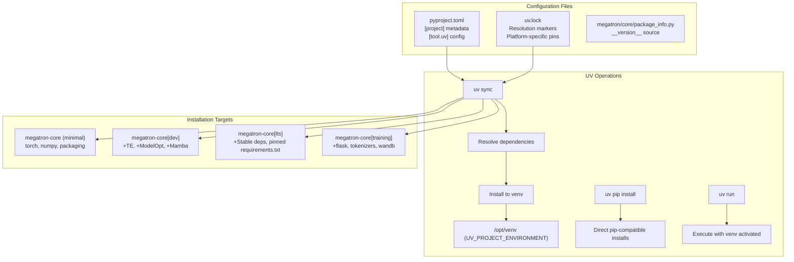
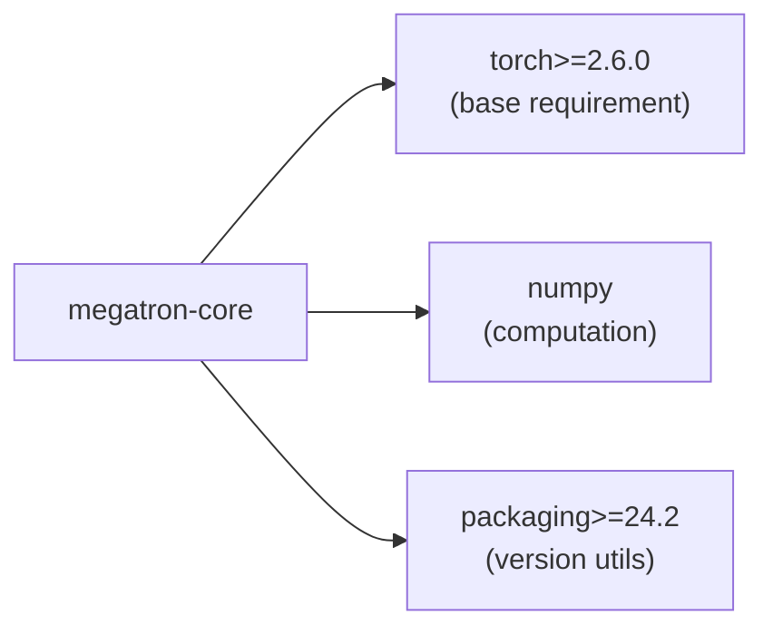
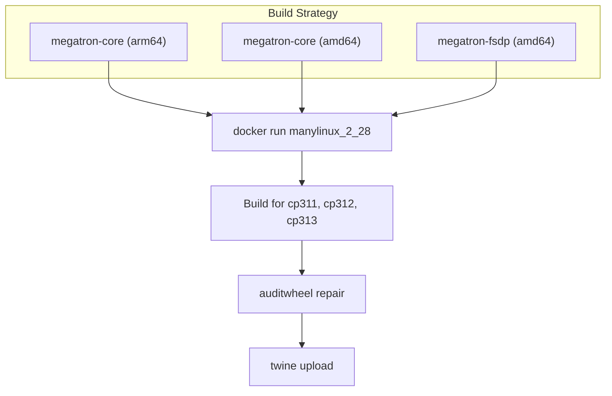

<!-- source: DeepWiki mcp.deepwiki.com · repo NVIDIA/Megatron-LM · page 10.1 Package Management and Dependencies · fetched 2026-10-26 -->

# Package Management and Dependencies

<details>
<summary>Relevant source files</summary>

The following files were used as context for generating this wiki page:

- [.github/workflows/_build_test_publish_wheel.yml](.github/workflows/_build_test_publish_wheel.yml)
- [docker/Dockerfile.ci.dev](docker/Dockerfile.ci.dev)
- [docker/Dockerfile.ci.lts](docker/Dockerfile.ci.lts)
- [docker/common/install.sh](docker/common/install.sh)
- [docker/common/install_source_wheels.sh](docker/common/install_source_wheels.sh)
- [megatron/core/distributed/fsdp/src/megatron_fsdp/__init__.py](megatron/core/distributed/fsdp/src/megatron_fsdp/__init__.py)
- [megatron/core/distributed/fsdp/src/pyproject.toml](megatron/core/distributed/fsdp/src/pyproject.toml)
- [pyproject.toml](pyproject.toml)
- [tests/functional_tests/shell_test_utils/_run_training.sh](tests/functional_tests/shell_test_utils/_run_training.sh)
- [tests/functional_tests/shell_test_utils/run_ci_test.sh](tests/functional_tests/shell_test_utils/run_ci_test.sh)
- [tests/performance_tests/shell_test_utils/determinism/print_nsys_leaderboard.py](tests/performance_tests/shell_test_utils/determinism/print_nsys_leaderboard.py)
- [tests/test_utils/test_training_script_secret_redaction.py](tests/test_utils/test_training_script_secret_redaction.py)
- [uv.lock](uv.lock)

</details>


This document explains the uv-based dependency management system used by Megatron-LM. The project uses `uv` (version 0.7.2) as its primary package manager for fast, deterministic dependency resolution across multiple Python versions and platforms. This page covers the `pyproject.toml` configuration, lockfile management, dependency groups, installation workflows, and integration with PyTorch base images.

## UV-Based Package Management System

Megatron-LM has migrated from traditional pip-based dependency management to `uv`, a fast Python package installer and resolver written in Rust. The system is configured through `pyproject.toml` with a lockfile (`uv.lock`) ensuring reproducible builds.

**UV Package Manager Architecture**



**Key UV Configuration Parameters**

The `[tool.uv]` section in `pyproject.toml` defines critical behavior for the environment:

| Parameter | Value | Purpose |
|-----------|-------|---------|
| `managed` | `true` | Enables UV to manage the project environment [pyproject.toml:186]() |
| `default-groups` | `["linting", "build", "test"]` | Automatically installed dependency groups during sync [pyproject.toml:187]() |
| `no-build-isolation-package` | `["causal-conv1d", "flash_mla", "mamba-ssm", ...]` | Packages requiring system CUDA libraries [pyproject.toml:188-196]() |
| `link-mode` | `"copy"` | Copy files instead of symlinks for container compatibility [pyproject.toml:197]() |
| `override-dependencies` | torch, torchvision, triton markers | Skip PyTorch reinstallation in base images [pyproject.toml:201-207]() |

Sources: [pyproject.toml:185-207](), [docker/Dockerfile.ci.dev:8-18]()

## Dependency Configuration in pyproject.toml

The `[project]` section defines core dependencies and optional extras, while `[dependency-groups]` provides additional development/testing packages.

**Core Dependencies (Always Required)**



The minimal installation (`pip install megatron-core`) includes only these three dependencies [pyproject.toml:28](). PyTorch version management is typically handled externally via NVIDIA NGC containers [docker/Dockerfile.ci.dev:4]().

**Optional Extras Configuration**

The project defines several "extras" for different use cases:

*   **dev**: Includes `nvidia-modelopt`, `nvidia-resiliency-ext`, `mamba-ssm`, and `einops` for active development [pyproject.toml:92-117]().
*   **training / mlm**: Includes utilities for training orchestration like `wandb`, `transformers`, and `accelerate` [pyproject.toml:71-90]().
*   **te**: Specifically for `transformer-engine` integration [pyproject.toml:130-132]().
*   **ssm**: Dependencies for State Space Models like `mamba-ssm` and `causal-conv1d` [pyproject.toml:134-137]().
*   **otel**: OpenTelemetry integration via `nemo-lens[sdk]` [pyproject.toml:119-121]().

**Dependency Groups**

UV dependency groups are used for specialized tasks:
*   **test**: Includes `pytest==9.1.1`, `coverage`, and `nemo-run` [pyproject.toml:140-155]().
*   **build**: Tools required for compiling extensions like `Cython` and `pybind11` [pyproject.toml:164-173]().
*   **linting**: Code quality tools like `ruff`, `black`, and `pylint` [pyproject.toml:174-180]().

Sources: [pyproject.toml:70-184]()

## UV Lockfile and Resolution Markers

The `uv.lock` file provides deterministic dependency resolution across multiple Python versions and platforms. It uses resolution markers to select appropriate package versions based on the environment [uv.lock:4-14]().

**Override Dependencies Mechanism**

The lockfile and `pyproject.toml` include override directives to prevent reinstalling PyTorch components when using NGC base images [pyproject.toml:201-207](). The `sys_platform == 'never'` marker in the lockfile manifest effectively disables installation of these packages, allowing the pre-installed versions in the container to be used [uv.lock:18-20]().

**Git-based Dependencies**

Several key components are pinned to specific git revisions in `pyproject.toml` to ensure stability:
*   `flash_mla`: [pyproject.toml:238-240]()
*   `deep_gemm`: [pyproject.toml:241]()
*   `transformer-engine`: [pyproject.toml:242]()
*   `nemo-run`: [pyproject.toml:243]()

Sources: [uv.lock:1-22](), [pyproject.toml:201-243]()

## Installation Methods and UV Workflows

The project supports multiple installation workflows using `uv` commands, particularly within Docker environments.

**UV Installation Workflow in Docker CI**

The `Dockerfile.ci.dev` utilizes `uv` to build the environment efficiently:

1.  **Venv Creation**: Creates a virtual environment that uses system site packages [docker/Dockerfile.ci.dev:70]().
2.  **Build Sync**: Synchronizes the `build` group first to prepare the environment for source builds [docker/Dockerfile.ci.dev:71]().
3.  **Extra Sync**: Installs the specified `IMAGE_TYPE` (dev or lts) along with `mlm`, `ssm`, and `te` extras while explicitly skipping the installation of heavy packages already present in the base image (e.g., `torch`, `nvidia-nccl-cu12`) [docker/Dockerfile.ci.dev:77-94]().

**LTS Environment**

For Long Term Support (LTS) environments, dependencies are pinned directly in `docker/lts/requirements.txt` to avoid collisions with the floating dev tag [docker/Dockerfile.ci.lts:7-11](). The LTS build process installs these pins explicitly via `uv pip install -r` [docker/Dockerfile.ci.lts:81]().

**CI Script Workflows**

The common installation script `docker/common/install.sh` provides a unified entry point for setting up the environment. It handles:
*   Python version installation via `deadsnakes/ppa` [docker/common/install.sh:81-84]().
*   CUDA Toolkit and cuDNN setup for Ubuntu base images [docker/common/install.sh:92-100]().
*   Conditional execution between `uv` and standard `pip` [docker/common/install.sh:107-154]().

Sources: [docker/Dockerfile.ci.dev:58-95](), [docker/Dockerfile.ci.lts:47-84](), [docker/common/install.sh:71-156]()

## Build Isolation and GPU-Optimized Dependencies

Several packages in Megatron-Core require access to system CUDA libraries and PyTorch headers during installation. UV's `no-build-isolation-package` configuration disables build isolation for these packages, allowing them to find the required build-time dependencies in the environment.

**Packages with Disabled Build Isolation**
*   `causal-conv1d`
*   `flash_mla`
*   `mamba-ssm`
*   `transformer-engine`
*   `transformer-engine-torch`
*   `deep_gemm`
*   `fast-hadamard-transform`

Sources: [pyproject.toml:188-196]()

**Source-based Wheel Installation**

For certain dependencies, Megatron-LM provides scripts to build and install from source wheels, ensuring they are optimized for the specific hardware/CUDA version:

```bash
# docker/common/install_source_wheels.sh:46-53
uv pip install --no-cache-dir --no-deps $TE_WHEEL
uv pip install --no-cache-dir \
    $MAMBA_WHEEL \
    $CAUSALCONV1D_WHEEL \
    "setuptools>=80"
```

This approach is used for `transformer-engine`, `mamba`, and `causal-conv1d` to ensure proper linking against the container's CUDA toolkit [docker/common/install_source_wheels.sh:32-42]().

Sources: [docker/common/install_source_wheels.sh:1-53](), [pyproject.toml:3-5]()

## Release and Wheel Publishing

Megatron-LM uses GitHub Actions for building and publishing wheels to PyPI. The process involves multi-platform builds for `megatron-core` and `megatron-fsdp`.

**Wheel Build Pipeline**



The build process uses the `manylinux_2_28` image and supports Python versions 3.11 through 3.13 [.github/workflows/_build_test_publish_wheel.yml:81-87](). For platform-specific wheels, `auditwheel repair` is executed to ensure compatibility [.github/workflows/_build_test_publish_wheel.yml:92](). The versioning is dynamically pulled from `megatron.core.package_info.__version__` [pyproject.toml:19]() and `megatron_fsdp.package_info.__version__` [megatron/core/distributed/fsdp/src/pyproject.toml:14]().

Sources: [.github/workflows/_build_test_publish_wheel.yml:24-96](), [pyproject.toml:18-20](), [megatron/core/distributed/fsdp/src/pyproject.toml:14]()

---

