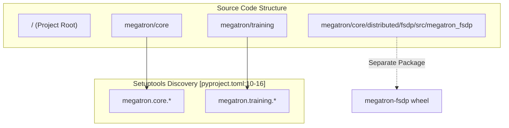
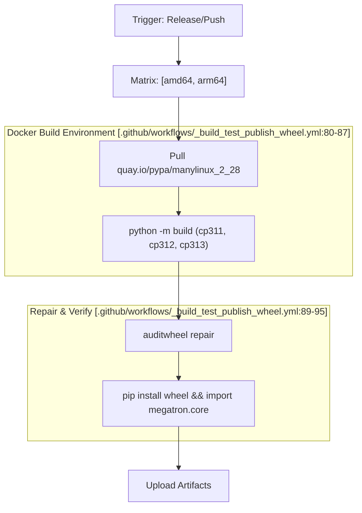

<!-- source: DeepWiki mcp.deepwiki.com · repo NVIDIA/Megatron-LM · page 10.2 Build System and Packaging · fetched 2026-10-26 -->

# Build System and Packaging

Relevant source files

The following files were used as context for generating this wiki page:

- [.github/actions/action.yml](.github/actions/action.yml)
- [.github/scripts/cancel_superseded_merge_group_runs.py](.github/scripts/cancel_superseded_merge_group_runs.py)
- [.github/scripts/test_approve_test_queue.sh](.github/scripts/test_approve_test_queue.sh)
- [.github/scripts/test_cancel_superseded_merge_group_runs.py](.github/scripts/test_cancel_superseded_merge_group_runs.py)
- [.github/workflows/_build_test_publish_wheel.yml](.github/workflows/_build_test_publish_wheel.yml)
- [.github/workflows/cicd-approve-test-queue.yml](.github/workflows/cicd-approve-test-queue.yml)
- [.github/workflows/cicd-cancel-superseded-merge-groups.yml](.github/workflows/cicd-cancel-superseded-merge-groups.yml)
- [.github/workflows/cicd-main.yml](.github/workflows/cicd-main.yml)
- [.github/workflows/copyright-check.yml](.github/workflows/copyright-check.yml)
- [.github/workflows/install-test.yml](.github/workflows/install-test.yml)
- [.github/workflows/multi-approval-bot.yml](.github/workflows/multi-approval-bot.yml)
- [.github/workflows/release.yaml](.github/workflows/release.yaml)
- [docker/Dockerfile.ci.dev](docker/Dockerfile.ci.dev)
- [docker/Dockerfile.ci.lts](docker/Dockerfile.ci.lts)
- [docker/common/install.sh](docker/common/install.sh)
- [docker/common/install_source_wheels.sh](docker/common/install_source_wheels.sh)
- [megatron/core/distributed/fsdp/src/megatron_fsdp/__init__.py](megatron/core/distributed/fsdp/src/megatron_fsdp/__init__.py)
- [megatron/core/distributed/fsdp/src/pyproject.toml](megatron/core/distributed/fsdp/src/pyproject.toml)
- [pyproject.toml](pyproject.toml)
- [tests/functional_tests/shell_test_utils/_run_training.sh](tests/functional_tests/shell_test_utils/_run_training.sh)
- [tests/functional_tests/shell_test_utils/run_ci_test.sh](tests/functional_tests/shell_test_utils/run_ci_test.sh)
- [tests/performance_tests/shell_test_utils/determinism/print_nsys_leaderboard.py](tests/performance_tests/shell_test_utils/determinism/print_nsys_leaderboard.py)
- [tests/test_utils/python_scripts/launch_nemo_run_workload.py](tests/test_utils/python_scripts/launch_nemo_run_workload.py)
- [tests/test_utils/test_launch_nemo_run_workload.py](tests/test_utils/test_launch_nemo_run_workload.py)
- [tests/test_utils/test_training_script_secret_redaction.py](tests/test_utils/test_training_script_secret_redaction.py)
- [uv.lock](uv.lock)

This document describes the build system, packaging configuration, and distribution mechanisms for Megatron-LM and Megatron Core. It covers how the project is structured for distribution via PyPI, how dependencies are managed using modern tooling, and how platform-specific wheels are built and published.

## Overview

Megatron-LM uses a dual-packaging strategy. While the repository contains the full training framework, the library components are primarily packaged as `megatron-core`. The build system uses modern Python packaging standards defined in `pyproject.toml` with `setuptools` as the build backend [pyproject.toml:3-5]().

The build system is designed to support:
- **Multiple Distribution Packages**: Building both `megatron-core` and `megatron-fsdp` [.github/workflows/_build_test_publish_wheel.yml:29-37]().
- **Manylinux Compatibility**: Using `manylinux_2_28` images for robust binary distribution [.github/workflows/_build_test_publish_wheel.yml:31-36]().
- **Platform Diversity**: Native builds for `x86_64` (amd64) and `aarch64` (arm64) architectures [.github/workflows/_build_test_publish_wheel.yml:30-34]().
- **Modern Dependency Management**: Leveraging `uv` for fast, reproducible environment synchronization [pyproject.toml:185-187]().

## Build Configuration

### Build System Declaration
The project defines its build requirements and backend in the `[build-system]` table of `pyproject.toml` [pyproject.toml:3-5]().

| Requirement | Version / Role |
| :--- | :--- |
| `setuptools` | `>=80` (Backend) [pyproject.toml:4]() |
| `pybind11` | For C++ extensions [pyproject.toml:4]() |
| `packaging` | `>=24.2` [pyproject.toml:4]() |

### Package Discovery and Structure
The build system is configured to find specific namespaces while excluding legacy or experimental code that is not part of the core library. The `megatron-fsdp` package is maintained in a nested directory structure but released as a standalone package [.github/workflows/_build_test_publish_wheel.yml:60-62]().

Sources: [pyproject.toml:10-16](), [.github/workflows/_build_test_publish_wheel.yml:60-62]()

## Dependency Management with UV

Megatron-LM has transitioned to `uv` for managing complex dependency graphs. The project utilizes `uv.lock` to ensure reproducible builds across different Python versions (3.12+) [uv.lock:1-3]().

### Configuration and Isolation
A key feature is the use of `no-build-isolation-package` for heavy GPU libraries like `transformer-engine` and `flash_mla` to ensure they compile against the specific CUDA environment of the host rather than a clean environment [pyproject.toml:188-196](). Additionally, `uv` is configured to override dependencies like `torch`, `torchvision`, and `triton` with a `sys_platform == 'never'` marker to prevent accidental re-installation when running inside pre-configured environments [pyproject.toml:201-204]().

### Dependency Groups
Dependencies are categorized into functional groups to minimize environment bloat [pyproject.toml:70-183]():
- **build**: Tools needed for compilation (`setuptools`, `Cython`, `pybind11`, `hatchling`) [pyproject.toml:164-173]().
- **test**: Frameworks for validation (`pytest`, `nemo-run`, `coverage`, `pydantic`) [pyproject.toml:139-155]().
- **linting**: Code quality tools (`ruff`, `black`, `isort`, `pylint`) [pyproject.toml:174-180]().
- **dev**: Optional extras including `nvidia-modelopt`, `tensorstore`, and `emerging_optimizers` [pyproject.toml:92-117]().

Sources: [pyproject.toml:139-207](), [uv.lock:1-23](), [docker/Dockerfile.ci.dev:58-71]()

## Wheel Building Process

The project uses GitHub Actions to build `manylinux` compatible wheels. The process involves building inside a Docker container and repairing the wheels with `auditwheel`.

### Multi-Platform Build Workflow
The build matrix covers `amd64` and `arm64` using `manylinux_2_28` base images [.github/workflows/_build_test_publish_wheel.yml:25-37]().

### Dynamic Versioning
During the build process, the version is extracted from `megatron.core.package_info.__version__` [pyproject.toml:19](). For dry-runs or pre-releases, the build script dynamically appends a random development suffix (e.g., `.dev123456`) to the `PRE_RELEASE` variable in `package_info.py` [.github/workflows/_build_test_publish_wheel.yml:68-71]().

Sources: [.github/workflows/_build_test_publish_wheel.yml:24-110](), [pyproject.toml:18-20]()

## PyPI Publishing and Release

Publishing is handled via the `twine` utility and is gated by repository permissions and branch naming conventions.

### Publishing Logic
- **Target**: `pypi` for main or release branches; `testpypi` for others [.github/workflows/_build_test_publish_wheel.yml:178]().
- **Mechanism**: Twine uploads all wheels and source distributions (`.tar.gz`) [.github/workflows/_build_test_publish_wheel.yml:189-198]().
- **Architecture Handling**: Source distributions are only uploaded once (typically from the `amd64` job) to avoid duplicates on PyPI [.github/workflows/_build_test_publish_wheel.yml:184-186]().

### Package Information
Metadata for the `megatron-core` package is centrally managed in `pyproject.toml`.

| Attribute | Value / Source |
| :--- | :--- |
| `name` | `megatron-core` [pyproject.toml:23]() |
| `version` | Dynamic (from `megatron.core.package_info.__version__`) [pyproject.toml:19]() |
| `license` | `Apache 2.0` [pyproject.toml:27]() |
| `authors` | `NVIDIA` [pyproject.toml:29]() |
| `maintainers` | `NVIDIA` [pyproject.toml:30]() |

Sources: [.github/workflows/_build_test_publish_wheel.yml:149-201](), [pyproject.toml:18-30]()

## Containerization for CI/CD

The `Dockerfile.ci.dev` provides the authoritative environment for building and testing.

### Key Container Features
- **Environment**: Sets `UV_PROJECT_ENVIRONMENT` to `/opt/venv` and configures `PATH` to prioritize this virtual environment [docker/Dockerfile.ci.dev:14-17]().
- **Optimization**: Uses `--system-site-packages` to leverage pre-installed GPU libraries in the base image [docker/Dockerfile.ci.dev:70]().
- **Custom Extensions**: Compiles `DeepEP` and `flash-mla` from source, applying specific patches and scoping builds to target architectures [docker/Dockerfile.ci.dev:60-69](), [docker/Dockerfile.ci.dev:98-137]().
- **Isolation**: Prevents overlapping payloads by setting `UV_CONCURRENT_INSTALLS=1` during the sync process [docker/Dockerfile.ci.dev:77]().

Sources: [docker/Dockerfile.ci.dev:1-140](), [pyproject.toml:185-196]()

---

