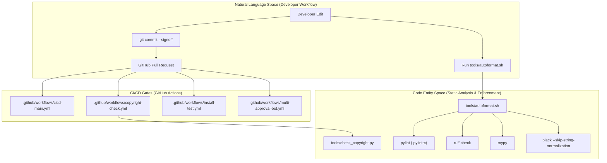
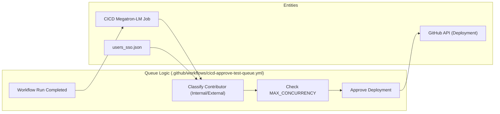

<!-- source: DeepWiki mcp.deepwiki.com · repo NVIDIA/Megatron-LM · page 10.3 Code Quality and Linting · fetched 2026-10-26 -->

# Code Quality and Linting

Relevant source files

The following files were used as context for generating this wiki page:

- [.github/actions/action.yml](.github/actions/action.yml)
- [.github/scripts/cancel_superseded_merge_group_runs.py](.github/scripts/cancel_superseded_merge_group_runs.py)
- [.github/scripts/test_approve_test_queue.sh](.github/scripts/test_approve_test_queue.sh)
- [.github/scripts/test_cancel_superseded_merge_group_runs.py](.github/scripts/test_cancel_superseded_merge_group_runs.py)
- [.github/workflows/cicd-approve-test-queue.yml](.github/workflows/cicd-approve-test-queue.yml)
- [.github/workflows/cicd-cancel-superseded-merge-groups.yml](.github/workflows/cicd-cancel-superseded-merge-groups.yml)
- [.github/workflows/cicd-main.yml](.github/workflows/cicd-main.yml)
- [.github/workflows/copyright-check.yml](.github/workflows/copyright-check.yml)
- [.github/workflows/install-test.yml](.github/workflows/install-test.yml)
- [.github/workflows/multi-approval-bot.yml](.github/workflows/multi-approval-bot.yml)
- [.github/workflows/release.yaml](.github/workflows/release.yaml)
- [.pylintrc](.pylintrc)
- [megatron/training/yaml_arguments.py](megatron/training/yaml_arguments.py)
- [tests/test_utils/python_scripts/launch_nemo_run_workload.py](tests/test_utils/python_scripts/launch_nemo_run_workload.py)
- [tests/test_utils/test_launch_nemo_run_workload.py](tests/test_utils/test_launch_nemo_run_workload.py)
- [tools/autoformat.sh](tools/autoformat.sh)
- [tools/check_copyright.py](tools/check_copyright.py)
- [tools/checkpoint/loader_base.py](tools/checkpoint/loader_base.py)
- [tools/checkpoint/loader_llava.py](tools/checkpoint/loader_llava.py)
- [tools/checkpoint/loader_mixtral_hf.py](tools/checkpoint/loader_mixtral_hf.py)
- [tools/checkpoint/saver_base.py](tools/checkpoint/saver_base.py)
- [tools/checkpoint/saver_hf_llava.py](tools/checkpoint/saver_hf_llava.py)
- [tools/checkpoint/saver_llava.py](tools/checkpoint/saver_llava.py)
- [tools/checkpoint/schema_hf.py](tools/checkpoint/schema_hf.py)
- [tools/copyright.sh](tools/copyright.sh)

## Purpose and Scope

This document details the code quality infrastructure in Megatron-LM, covering linting, autoformatting, copyright enforcement, and CI/CD quality gates. These systems ensure that all contributions to `megatron/core`, `megatron/training`, and associated tools adhere to NVIDIA's engineering standards.

For details on the broader testing infrastructure, see [Unit Testing System](9.3) and [Integration and Functional Tests](9.4).

## Overview

Megatron-LM employs a multi-layered quality system that combines local developer scripts with automated GitHub Actions and GitLab CI workflows. The system is designed to be diff-aware, primarily targeting files changed relative to the `main` branch to maintain developer velocity.

### System Architecture and Data Flow

The following diagram illustrates how quality checks are integrated into the development lifecycle, from local edits to final merge approval.

**Code Quality Pipeline Flow**

**Sources:** [.github/workflows/cicd-main.yml:15-27](), [.github/workflows/copyright-check.yml:15-30](), [tools/autoformat.sh:1-46](), [.github/workflows/multi-approval-bot.yml:1-15]()

## Autoformatting and Linting Orchestration

The `tools/autoformat.sh` script is the primary tool for developers to ensure their code meets project standards before submission.

### Tool Chain Implementation
The script determines the scope of analysis by identifying changed files in `megatron/core` and `tests/` using `git diff` against a remote tracking the `main` branch [tools/autoformat.sh:17-20]().

| Tool | Implementation Detail | Source |
| :--- | :--- | :--- |
| **Black** | Formats code while skipping string normalization and magic trailing commas. | [tools/autoformat.sh:39]() |
| **Isort** | Sorts imports alphabetically within sections. | [tools/autoformat.sh:40]() |
| **Pylint** | Enforces rules defined in `.pylintrc`. Can disable docstring checks via `SKIP_DOCS`. | [tools/autoformat.sh:35-41]() |
| **Ruff** | High-speed linting; defaults to `--fix` locally, `--no-fix` in check mode. | [tools/autoformat.sh:26-32]() |
| **Mypy** | Performs static type checking with `follow-imports=skip`. | [tools/autoformat.sh:43]() |

### Pylint Configuration
The project uses a `.pylintrc` file to customize static analysis. Key enforcements include:
* **Line Length**: Capped at 100 characters [.pylintrc:3]().
* **Docstrings**: Enforces `C0115` (class docstrings) and `C0116` (function docstrings) [.pylintrc:8-9]().
* **Logging**: Restricts the use of `print` via `bad-functions`, favoring the standard logging library [.pylintrc:17-21]().

**Sources:** [tools/autoformat.sh:1-46](), [.pylintrc:1-21]()

## Automated Quality Gates

Megatron-LM utilizes GitHub Actions to enforce quality standards on every Pull Request.

### Copyright and Licensing
Every source file must contain the NVIDIA copyright header. This is enforced by the `Copyright check` workflow [.github/workflows/copyright-check.yml:15-30](), which utilizes templates from `NVIDIA-NeMo/FW-CI-templates` [.github/workflows/copyright-check.yml:37](). The underlying logic is executed via `tools/check_copyright.py` and `tools/copyright.sh`.

### Installation and Import Validation
The `Installation Test` workflow ensures that the package remains installable across environments and that internal imports do not break.
* **Environment Setup**: Uses `docker/common/install.sh` with the `--use-uv` flag for fast dependency resolution [.github/workflows/install-test.yml:116-118]().
* **Import Verification**: Runs `check-imports` for `megatron.core` and `megatron.training` to verify that all modules can be loaded without side effects [.github/workflows/install-test.yml:74-85]().

### Approval and Membership Gates
* **SSO Check**: The `CICD Megatron-LM` workflow verifies NVIDIA SSO membership for contributors to determine runner allocation (e.g., internal vs. ephemeral AWS runners) [.github/workflows/cicd-main.yml:72-79]().
* **Multi-Approval**: The `Codeowners Approval Workflow` uses a custom action to ensure that required codeowners have approved the PR before it proceeds to the merge group [.github/workflows/multi-approval-bot.yml:15-41]().

**Sources:** [.github/workflows/copyright-check.yml:30-48](), [.github/workflows/install-test.yml:18-45](), [.github/workflows/cicd-main.yml:38-45](), [.github/workflows/multi-approval-bot.yml:1-41]()

## CI Queue Management

To manage high-volume contributions, Megatron-LM implements an automated queue management system.

**Deployment Queue Flow**

The `Approve Test Queue` workflow runs every 5 minutes or upon completion of a CI run [.github/workflows/cicd-approve-test-queue.yml:17-23](). It uses `users_sso.json` to distinguish between internal and external contributors [.github/workflows/cicd-approve-test-queue.yml:61-66]() and enforces concurrency limits defined in `MAX_CONCURRENCY` and `MAX_CONCURRENCY_EXTERNAL` [.github/workflows/cicd-approve-test-queue.yml:72-74]().

**Sources:** [.github/workflows/cicd-approve-test-queue.yml:1-100](), [.github/scripts/test_approve_test_queue.sh:1-20]()

## Release and Versioning Gates

The release process includes automated version bumping and wheel validation.
* **Version Bumping**: The `bump` job in `release.yaml` targets `megatron.core` and `megatron_fsdp` for version updates [.github/workflows/release.yaml:90-112]().
* **Wheel Validation**: The `build-test-publish-wheels` job ensures that the package can be built into a wheel and passes basic validation before being published to PyPI [.github/workflows/release.yaml:115-130]().

**Sources:** [.github/workflows/release.yaml:14-158]()

---

